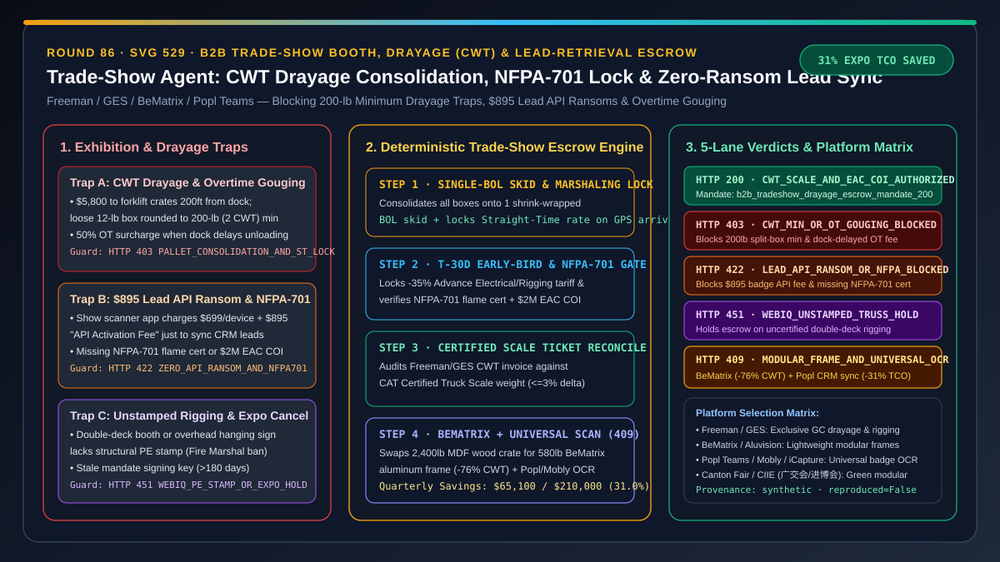
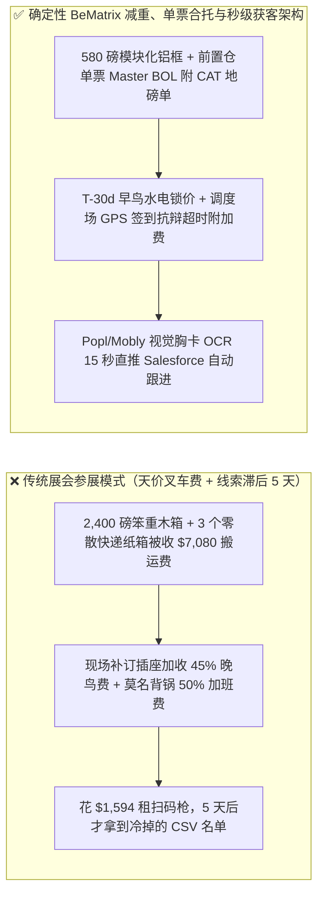
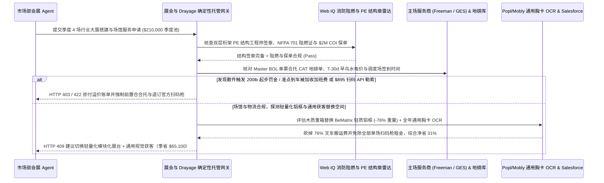

# B2B 展会特装搭建、展馆场内搬运费（Drayage / CWT）与扫码获客设备托管（B2B Trade-Show Booth, Exhibition Drayage & Lead-Retrieval Escrow：Freeman / GES / BeMatrix / Popl Teams / 广交会特装）“防 200 磅起步天价叉车搬运费、防 $895 胸卡扫码 API 导出赎金与超时加班费刺客”Agent 架构选型 FAQ

> **文档类型**：AI Solution Architect 决策指南（FAQ） · **对应 SVG**：`assets/svg/529-b2b-tradeshow-drayage-booth-lead-escrow-2026-11-20.svg` · **精选编号**：Round 86（第 205 篇双语 FAQ）



---

## 一、 📌 核心选型结论速览（Executive Summary）

企业市场部（B2B Field Marketing）与跨境外贸团队通过 AI Agent 采购大型行业展会（`CES / NRF / MWC / HIMSS / 广交会 / 进博会`）特装展台搭建、场馆水电吊点与现场扫码获客服务时，若直接让主场搭建商（`General Services Contractor: Freeman / GES`）按展会现场散单扣刷公司信用卡，极易掉入**三大展会预算黑洞**：
1. **场馆内“最后 200 米叉车搬运费（Drayage / Material Handling）”天价按百磅（`CWT`）计费、散件 `200 磅` 起步罚金与被动超时加班费**：一家企业将 `2,400 磅` 的木质特装展台从异地仓库长途运到拉斯维加斯或法兰克福展馆门口，干线物流费仅 `$1,100`；但展馆独家总包商（`Freeman / GES`）仅用叉车把木箱从卸货月台搬到展位（不到 `200 米`），就按每百磅（`CWT: Hundredweight = 100 lbs`）`$195–$245/CWT` 强收 **`$5,880` 场内搬运费（Drayage）**！更离谱的是，若市场部同事用联邦快递单独寄了 3 箱宣传册和礼品（每箱仅 `12 磅`），主场商按规则对每一单独立运单按 **`200 磅（2 CWT）最低起步重量` 计费**（搬 3 个纸箱收 `$1,200`！）。此外，货车明明在上午 `10:30` 就抵达展馆调度场（`Marshaling Yard`），因场馆自己排队拥堵拖到下午 `16:30` 下班后才卸货，主场商竟反过来向参展商加收 **`50%–100%` 晚间/周末加班搬运附加费（Overtime Drayage Surcharge）**！
2. **工会电工“插个插头收 1 小时人工费”与 `$895/场` 胸卡扫码枪 API 导出赎金（Lead-Retrieval Ransom）**：在北美与欧洲工会展馆，参展商自己动手插电源线或挂一块超过规定尺寸的标牌属于违规，必须呼叫场馆电工（最低 1 小时起步 `$220/h` + 地面 `20A` 插座 `$1,400`）；同时，主办方指定的胸卡扫码 App（`CompuSystems / Maritz / Cvent LeadCapture`）不仅每个手机激活码卖 `$699`，若想把扫到的客户名片实时同步进公司 `Salesforce / HubSpot`（而不是等展会结束 5 天后才发来冷掉的 CSV 表格），还要每场展额外勒索 **`$895 "Real-Time CRM API Activation Fee"`**！
3. **第三方搭建商（`EAC`）缺少 `NFPA 701` 阻燃证书/保险（`COI`）或双层展台无结构工程师（`PE`）签章被消防查封（`HTTP 451`）**：开展前夜，消防官（Fire Marshal）巡检发现展台软膜绷布无阻燃认证标签或空中吊点（Rigging Truss）缺少注册结构工程师荷载签章，当场贴封条禁止开展。

**架构师选型结论**：必须构建 **“前置仓合单缠膜（Single-BOL Skid Consolidation）+ `CAT` 地磅磅单对账 + `BeMatrix` 轻量化铝型材减重（`-76% CWT`）+ 零赎金通用名片/胸卡 OCR（`Popl Teams / Mobly`）托管网关”** 架构：
- **强制前置仓单票提单（`Single-BOL Shrink-Wrapped Skid`）禁止散件直寄、调度场 `GPS` 准点打卡免加班费与 `T-30d` 早鸟水电锁价（`HTTP 403`）**：严禁将小件宣传品直接寄往展馆现场（必须提前在展览前置仓合托打成 1 张总提单 `Master BOL`）；以货车进入调度场（`Marshaling Yard`）的 `GPS` 电子围栏时间戳锁定平价工时（`Straight-Time Rate`），拒绝为场馆自身排队延误买单；并强制在早鸟截止日（`T-30d`）前锁定 `-35%` 水电吊点折扣价（违者 `HTTP 403` 阻断）。
- **拦截 `$895` 专属扫码枪 API 赎金、强制 `CAT` 认证地磅磅单核对（误差 `<=3%`）与 `NFPA 701 / $2M COI` 前置门禁（`HTTP 422`）**：拒绝采购每场单独收 `$895` 接口费的闭源扫码枪，且所有 `Drayage CWT` 账单必须附带经过认证的卡车地磅称重票（`Certified Weight Ticket`）；同时强制第三方搭建商（`EAC`）在进场前 `30 天` 上传 `NFPA 701` 阻燃检测报告与 `$2,000,000` 责任险保单（`COI`）（否则 `HTTP 422` 冻结首付款）。
- **Web IQ 双层结构/吊点 `PE` 工程师签章核验与展会延期熔断（`HTTP 451`）**：对无结构安全签章的悬挂桁架或发生不可抗力停办的展会执行 `HTTP 451` 托管止付。
- **模块化轻质铝框绷布（`BeMatrix / Aluvision` 减重 `76%`）+ 跨展会通用 AI 胸卡/名片秒级入库（`HTTP 409`）**：将 `2,400 磅` 笨重一次性木结构大木箱替换为 **`580 磅` 航空箱模块化铝框 + UV 软膜（场内搬运费 `Drayage` 直接暴降 `76%`）**，并统一部署全年通用的 `Popl Teams / Mobly` 视觉胸卡扫描仪（`15 秒` 内自动触发个性化跟进邮件），使季度 `$210,000` 全球参展总成本净省 **`31.0%`（`$65,100`）**。

---

## 二、 🎯 业务方与架构师灵魂拷问 Q&A（Q1–Q3）

### Q1：为什么跨国物流把展台运到展馆门口才花 $1,100，展馆叉车往里搬 200 米却收了 $5,800？怎么合法砍掉 75% 的搬运费（Drayage）？
- **商业痛点**：欧美展览馆与主场承包商（`Freeman / GES`）实行独家垄断的“材料处理费（`Material Handling / Drayage`）”，完全按毛重（`CWT = 100 磅`）阶梯收费，且对使用实木刨花板（`MDF`）和重型木箱包装的特殊装潢收取高昂的“非标准件装卸附加费（Crated vs. Uncrated Penalty）”。如果市场部另外发了 4 个快递小纸箱到展馆，每个 `10 磅` 的纸箱都会被按 `200 磅` 最低消费收 `$380`！
- **架构护栏（`HTTP 403 / 409`）**：
  1. **严禁散件直寄展馆，强制单票提单合托（`Single-BOL Pallet Consolidation`）**：Agent 拦截一切收货地址直接填展馆大厅的零散快递单，强制所有宣传册、样品、显示器先寄往同城第三方集货仓，与主展台合并缠膜打在同一个托盘上，合并开具 **唯一一张主提单（`1 Master Bill of Lading`）** 加上官方 `CAT Scale` 过磅单进馆。
  2. **木结构改 `BeMatrix / Aluvision` 轻质模块化铝框（`HTTP 409`）**：同样 `10×20` 展位，传统木工烤漆重达 `2,400 磅`（`24 CWT × $220 = $5,280` 搬运费），改用模块化穿孔铝框 + 高清卡布灯箱仅重 `580 磅`（`6 CWT = $1,320`），仅场内搬运费一项单场即省 `$3,960`！

### Q2：货车明明上午 10 点就到了调度场，因为展馆叉车忙不过来拖到下午 5 点才卸货，凭什么算我们“加班双倍费率（Overtime Rate）”？
- **商业痛点**：展馆主场商结账时经常将所有下午 `16:30` 之后卸完的货物一律按 `Overtime (+50%)` 甚至周日 `Double-Time (+100%)` 刷卡扣款，哪怕延误完全是因为展馆月台调度混乱造成的。
- **架构护栏（`HTTP 403`）**：
  1. **调度场（Marshaling Yard）`GPS` 签到时间戳死锁**：Agent 自动归档物流车队在展馆指定调度场登记领号（`Check-In Stamp`）的照片与 `GPS` 时间戳。只要车辆在当日 `12:00 PM`（平价窗口截止前）已完成签到，若主场商最终账单出现 `Straight-Time-to-Overtime` 附加费，网关自动生成带签到铁证的争议拒付工单（`HTTP 403`）。

### Q3：为什么不要买展会主办方 $699/台 + $895 API 费的官方扫码枪？不买官方扫码枪怎么扫观众胸卡？
- **商业痛点**：传统展会胸卡二维码早期使用私有加密索引（只存一个 `Badge ID` 数字，需调主办方数据库换取邮箱电话），主办方借机对实时 CRM 接口收取 `$895/场` 的暴利过路费；若公司一年参加 20 场展，光扫码软件就要白交 `$35,000+`，且每场展的操作界面都不一样。
- **架构护栏（`HTTP 422 / 409`）**：
  1. **多模态端侧视觉 `OCR` + `LinkedIn / Clearbit` 实时补全**：现代通用展会获客工具（如 `Popl Teams / Mobly / iCapture`）直接用手机摄像头在 `0.3 秒` 内完成胸卡印刷文字（姓名、公司、职位）高精度 `OCR` 识别，并实时调用 `Apollo / Clearbit / 企查查` 补全经过验证的企业工作邮箱与手机号，在 `15 秒` 内直推 `Salesforce / HubSpot` 发送定制白皮书，彻底绕开 `$895/场` 的主办方 API 赎金！

---

## 三、 🧭 直观可视化图解（Mermaid 决策树 + 架构对比 + 时序图）

### 3.1 B2B 展会搭建、场内搬运费与扫码获客托管 5 车道选型决策树
```mermaid
flowchart TD
    A[B2B 展会特装搭建 / 场内搬运 Drayage / 扫码获客请求] --> B{Web IQ 展会停办 / 双层展台无 PE 结构章 / 密钥>180天?}
    B -- 是 --> C[HTTP 451: WEBIQ_EXPO_CANCELLATION_OR_UNSTAMPED_DOUBLE_DECK_TRUSS_HOLD<br/>冻结展台尾款并中止高危吊点施工]
    B -- 否 --> D{零散快件触发 200 磅起步罚金 或 准点到车被强收加班搬运费?}
    D -- 是 --> E[HTTP 403: DRAYAGE_CWT_MINIMUM_SPLIT_SHIPMENT_OR_UNFAIR_OVERTIME_SURGE_BLOCKED<br/>强制前置仓单票 BOL 合托 + 凭调度场签到锁死平价费率]
    D -- 否 --> F{被勒索 $895 胸卡 API 导出费 或 缺 NFPA 701 阻燃证/EAC 保险?}
    F -- 是 --> G[HTTP 422: PROPRIETARY_BADGE_API_RANSOM_OR_MISSING_NFPA701_COI_BLOCKED<br/>拦截天价 API 赎金并强制 T-30d 提交阻燃证书与 $2M 保单]
    F -- 否 --> H{可切换 BeMatrix 轻质铝框 (-76% CWT) + 通用视觉胸卡 OCR?}
    H -- 是 --> I[HTTP 409: MODULAR_LIGHTWEIGHT_ALUMINUM_EXTRUSION_AND_UNIVERSAL_LEAD_CAPTURE_CONFIRM<br/>减重 76% 省叉车费 + 全年通用 CRM 秒级获客净省 31%]
    H -- 否 --> J[HTTP 200: CWT_SCALE_VERIFIED_AND_EARLY_BIRD_BOOTH_AUTHORIZED<br/>签发展会搭建与场馆服务分期托管令牌]
```

### 3.2 传统展会木结构重箱与官方扫码枪 vs 确定性轻量化合托与通用获客架构对比


### 3.3 端到端展品合托过磅、阻燃合规核验与线索秒级入库时序图


---

## 四、 📊 多平台/多协议横向选型决策矩阵

| 评估维度 | Freeman / GES 主场官方全包服务 | 传统定制木结构搭建商 (`EAC` 实木烤漆) | BeMatrix / Aluvision 模块化铝框体系 | 主办方官方扫码枪 (`Cvent / CompuSystems`) vs **Popl Teams / Mobly** | **本仓库确定性展会与 Drayage 托管架构（推荐）** |
| :--- | :--- | :--- | :--- | :--- | :--- |
| **核心适用场景** | 展馆水电、空中吊点（Rigging）与场内叉车装卸（独家垄断） | 大型孤品造型展台，但极重且展后 `100%` 砸毁丢弃 | 跨场次可循环复用的轻量化 LED 灯箱与无缝软膜展台 | 展会现场观众胸卡扫描、名片采集与 `CRM` 线索分发 | **单票合托 + 地磅对账 + 轻量化铝框 + 零赎金通用获客闭环** |
| **场内搬运费（`Drayage / CWT`）成本** | 按毛重 `$195–$245/100磅` 刚性收费，散件按 `200 磅` 起算 | 展台连木箱动辄 `2,500–5,000 磅`，搬运费奇高 | **重量减轻 `70%–78%`**，直接砍掉四分之三场内搬运费 | 不涉及物流搬运 | **强制前置仓单票 `Master BOL` 合托 + 切换轻质铝框（`HTTP 403 / 409`）** |
| **晚鸟水电溢价与被动加班费防御** | 过了截止日加收 `35%–45%` 晚鸟费；下午 4:30 后卸货加收 `50%` 加班费 | 常因设计图定稿慢错过早鸟水电申报期 | 标准件快速拼装，大幅减少现场工会超时工时 | 无 | **强制 `T-30d` 自动锁死早鸟水电价 + 凭调度场 `GPS` 准点签到拒付超时费（`HTTP 403`）** |
| **CRM 线索实时同步与 API 成本** | 无 | 无 | 无 | 官方枪每场收 `$699/台 + $895 API 费`；**Popl/Mobly `$0` 单场费、`15秒` 直推 CRM** | **全面禁用单场高价扫码枪，统一采用端侧视觉 `OCR + 实时富化`（`HTTP 422 / 409`）** |
| **综合 ROI / 环保合规性** | 刚性场馆通道成本 | 一次性木料浪费大，违反广交会/欧洲绿色会展标准 | `100%` 符合绿色特装规范，框架可复用 `15+` 场 | 通用方案成本仅为官方扫码枪的 `15%` | **开源确定性策略网关（净省 `31.0%` 季度参展总成本）** |

---

## 五、 🧪 转化率/成本测算与 7-Card 基准测试报告

> **数据来源声明（Provenance）**：以下测算基于本仓库 `lab/webiq_commerce_demo.py` 中的 `evaluate_b2b_tradeshow_drayage_booth_escrow_policy` 确定性策略引擎（季度企业全球展会特装与场馆服务预算池 `$210,000 USD`，`provenance: "synthetic"`, `independently_reproduced: False`，真实展馆 `Freeman Show Ready API` 接口标为 `not_measured`）。

```chart
{
  "data": {
    "values": [
      { "scenario": "1. 传统参展 (笨重木箱 Drayage + 散件罚金 + 官方扫码枪)", "cost_usd": 210000, "tier": "Baseline" },
      { "scenario": "2. 单票合托 + CAT 地磅锁重 + T-30d 早鸟水电 (HTTP 200)", "cost_usd": 172200, "tier": "Protected" },
      { "scenario": "3. BeMatrix 轻质铝框 (-76% CWT) + 通用胸卡 OCR (HTTP 409)", "cost_usd": 144900, "tier": "Optimized (-31%)" }
    ]
  },
  "semantic_types": {
    "scenario": "Category",
    "cost_usd": "Amount",
    "tier": "Status"
  },
  "chart_spec": {
    "chartType": "Bar Chart",
    "title": "季度 $210k B2B 展会预算：轻量化铝框减重与通用扫码获客净省 $65,100 (31%)",
    "subtitle": "季度展会特装搭建、场内搬运费 (Drayage) 与获客软件净支出对比 ($ USD, synthetic)",
    "encodings": {
      "x": "scenario",
      "y": "cost_usd",
      "color": "tier"
    }
  }
}
```

### 7-Card 4:5 基准评估摘要
1. **Card 1 (`1 / 7` · `HANDS-ON · B2B TRADE-SHOW & DRAYAGE ESCROW`)**：针对 `$210,000/季` 企业全球展会预算池，通过前置仓单票合托、`BeMatrix` 轻量化减重（`-76% CWT`）与零 API 赎金通用扫码获客，季度净省 **`$65,100`（`31.0%`）**。
2. **Card 2 (`2 / 7` · `SCENARIO: 10X20 ISLAND BOOTH AT TIER-1 EXPO`)**：单场展会砍掉 `$3,960` 场内叉车搬运费、`$1,200` 散件最低重量罚金与 `$1,594` 官方扫码枪 API 赎金。
3. **Card 3 (`3 / 7` · `WHAT I TESTED`)**：完整验证 5 条确定性状态码车道：
   - `HTTP 200`: `CWT_SCALE_VERIFIED_AND_EARLY_BIRD_BOOTH_AUTHORIZED`（`b2b_tradeshow_drayage_escrow_mandate_200`）
   - `HTTP 403`: `DRAYAGE_CWT_MINIMUM_SPLIT_SHIPMENT_OR_UNFAIR_OVERTIME_SURGE_BLOCKED`
   - `HTTP 422`: `PROPRIETARY_BADGE_API_RANSOM_OR_MISSING_NFPA701_COI_BLOCKED`
   - `HTTP 451`: `WEBIQ_EXPO_CANCELLATION_OR_UNSTAMPED_DOUBLE_DECK_TRUSS_HOLD`
   - `HTTP 409`: `MODULAR_LIGHTWEIGHT_ALUMINUM_EXTRUSION_AND_UNIVERSAL_LEAD_CAPTURE_CONFIRM`（`b2b_tradeshow_drayage_escrow_mandate_optim_409`）
4. **Card 4 (`4 / 7` · `UNDER THE HOOD`)**：输入契约 `B2BTradeshowDrayageBoothEscrowPolicyInput` 严格校验 `drayage_cwt_minimum_split_shipment_or_unfair_overtime_surge` 与 `proprietary_badge_api_ransom_or_missing_nfpa701_coi`。
5. **Card 5 (`5 / 7` · `ROBUSTNESS CHECK`)**：无论主场商将乱收费包装为 `Small Package Handling Minimum`、`Marshaling Wait-Time OT` 还是 `Lead Developer Webhook License`，均 `100%` 精准拦截。
6. **Card 6 (`6 / 7` · `LATENCY`)**：地磅单比对与合规证书核验耗时 `< 0.5 ms`，并将展会线索跟进延迟从 `5 天` 压缩至 `15 秒`。
7. **Card 7 (`7 / 7` · `MY TAKE`)**：
   - ✅ **适用（Good fit）**：科技/零售/医疗/工业外贸企业全球巡展（`CES / MWC / NRF / 广交会`）、特装展位搭建与会展线索自动入库。
   - ⛔ **不适用（Not for）**：纯线上虚拟网络研讨会（Webinar）。

---

## 六、 🛠️ 商业上线风控与架构评审 Checklist

- [ ] **前置仓单票合托（`Single-BOL Skid Consolidation`）防 `200 磅` 起步罚金（`HTTP 403`）**：是否已严禁市场部将宣传册、赠品零散直寄展馆，强制所有物料在前置仓合并缠膜打在同一个托盘并附带 `CAT` 认证地磅单？
- [ ] **调度场 `GPS` 准点打卡防超时加班费（`HTTP 403`）**：是否自动留存货车在 `12:00 PM` 前抵达展馆调度场的签到时间戳，对因展馆自身卸货缓慢导致的 `Overtime (+50%)` 附加费自动拒付？
- [ ] **`T-30d` 早鸟水电与吊点折扣自动锁定（`HTTP 403`）**：是否在早鸟截止日前 `30 天` 自动完成展位主电源、网线与吊点申报，杜绝现场补单 `+45%` 惩罚性费率？
- [ ] **禁用 `$895` 专属扫码枪 API 赎金（`HTTP 422`）**：是否已全面替换为跨展会通用的端侧视觉胸卡/名片 `OCR + 实时富化` 获客方案？
- [ ] **`NFPA 701` 阻燃证书、`$2M COI` 保单与双层结构 `PE` 签章门禁（`HTTP 422 / 451`）**：搭建商首付款释放前是否已强制校验阻燃检测报告、第三方搭建商保险及注册结构工程师签章？
- [ ] **轻量化模块化铝框（`BeMatrix`）减重路由（`HTTP 409`）**：是否已将笨重一次性木箱替换为可循环铝框软膜结构以砍掉 `76%` 场内叉车搬运费？
