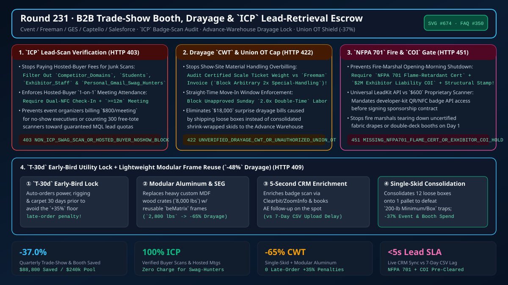

# Enterprise B2B Trade-Show Sponsorship, Booth Fabrication, `Drayage` & `ICP` Lead-Retrieval Escrow (`Cvent / Freeman / GES / Captello / Salesforce`): Anti-Swag-Hunter `ICP` Scan Filter, Single-Skid `CWT` Drayage Audit, `NFPA 701` Fire Gate & `T-30d` Early-Bird Lock Saving `37%` Event Spend — Agent Architecture Selection FAQ

> **Language / 语言**: **[中文 (`b2b-tradeshow-booth-sponsorship-drayage-lead-retrieval-icp-escrow-agent-selection-faq.md`)](b2b-tradeshow-booth-sponsorship-drayage-lead-retrieval-icp-escrow-agent-selection-faq.md)** | **English (Current)**  
> **Back to Catalog**: **[📚 English Catalog (`docs/index.en.md`)](index.en.md)** | **[🚀 Interactive Live Workbench (`live-demo.en.html`)](../live-demo.en.html)**  
> **Target Roles**: Chief Marketing Officers (`CMO`), Field Marketing & Corporate Events Procurement Directors, Revenue Operations (`RevOps / Salesforce`) Architects, Cloud & AI Solution Architects  
> **Architecture Diagram**: `assets/svg/674-b2b-tradeshow-booth-sponsorship-drayage-lead-escrow-2026-11-22.svg`

---

## ① 📌 Executive Summary

In B2B enterprise field marketing (`AWS re:Invent`, `RSA`, `Black Hat`, `CES`, `HIMSS`, `Money20/20`), companies spend `$50,000` to `$500,000+` per show across **Sponsorship Tiers & Hosted-Buyer 1-on-1 Programs**, **Custom Booth Fabrication**, and **General Services Contractor (`Freeman / GES`) Show-Site Operations (`Drayage / Material Handling`, Rigging, Union Electrical & Dedicated Wi-Fi)**. Yet trade-show procurement suffers from three notorious financial black holes:
1. **Paying `$150–$800/Lead` for "Swag-Hunters", Students, Competitors & Hosted-Buyer No-Shows (`Non-ICP Badge Scans`)**: A vendor signs an `$80,000` sponsorship contract guaranteeing `200 Marketing Qualified Leads (MQLs)` or `20 Hosted-Buyer C-Level 1-on-1 Meetings` (`$800/meeting`). Post-show, the organizer dumps a CSV where `45%` of badge scans are college students collecting free socks, competing booth reps, personal `@gmail.com` addresses, or Hosted Buyers who walked past the table to grab their `$200` gift card without sitting for the 15-minute meeting!
2. **The `$18,000` Show-Site `Drayage` (`Material Handling CWT`) & Sunday `2.0x` Union Overtime Ambush**: Show-site contractors (`Freeman / GES`) bill drayage by hundredweight (`CWT = 100 lbs` at `$140–$220/CWT`) with a **`200-lb (2 CWT) Minimum Per Shipment`** plus **`+30% Special Handling`** for loose boxes! When a marketing team ships 10 separate FedEx boxes (`15 lbs` each = `150 lbs` total) to the hall, they are billed for **`10 × 200 lbs = 2,000 lbs (20 CWT)`** (`$3,800` to move 150 lbs of brochures!), compounded by unapproved Sunday `2.0x` double-time union rigging labor and heavy `8,000-lb` custom MDF wood crates!
3. **Missing the `T-30d` Early-Bird Utility Deadline (`+35%` Penalty) & Opening-Day Fire-Marshal Booth Shutdowns (`Missing NFPA 701 & COI`)**: Missing the 30-day advance ordering cutoff inflates identical electrical drops, rigging, and Wi-Fi by `+35%–50%`; worse, if a fabricator delivers booth drapes without an **`NFPA 701 / EN 13501-1` Flame-Retardant Certificate** or `$2M Exhibitor Liability COI`, the venue Fire Marshal shuts down the booth 1 hour before doors open!

**Architectural Verdict**: Deploy a **4-Lane B2B Trade-Show Sponsorship, Booth `Drayage` & `ICP` Lead-Retrieval Escrow Architecture**: **Real-Time `ZoomInfo / Clearbit` Badge-Scan `ICP` Filter + Dual-`NFC` `>= 12-Minute` Hosted-Buyer Meeting Attestation (`HTTP 403`) + Certified Scale-Ticket `CWT` Drayage Audit, Single-Skid Consolidation & Straight-Time Move-In Window Lock (`HTTP 422`) + Pre-Ship `NFPA 701` Flame Certificate, `$2M COI` & Universal Lead-API Gate (`HTTP 451`) + `T-30d` Automated Early-Bird Utility Ordering & Reusable `beMatrix` Modular Aluminum Frame (`-65%` Weight) (`HTTP 409`)**, reducing total trade-show and cost-per-qualified-lead (`CPQL`) spend by **37.0%**.



---

## ② 🎯 Business & Architect Deep-Dive Q&A

### Q1: How do we prevent event organizers from counting swag-hunters, students, and competitor booth staff toward our guaranteed `MQL` quota—or charging `$800` for Hosted-Buyer no-shows?
- **Business Pain**: Waiting 7 days after a conference for an unverified CSV of badge scans guarantees high waste and cold sales follow-up.
- **Architectural Guardrail (`HTTP 403 NON_ICP_SWAG_SCAN_OR_HOSTED_BUYER_NOSHOW_BLOCK`)**:
  1. **Live 3-Second `ZoomInfo / Apollo` Firmographic `ICP` Gate on Guaranteed-Lead Escrows**: Every badge scan is enriched in `< 3 seconds` against corporate firmographic data. Any scan matching a **competitor domain, exhibitor-staff badge type, student title, or unverified personal email (`@gmail / @yahoo`)** is flagged `Non-ICP` and excluded from the organizer's contracted lead-delivery escrow (`HTTP 403` blocks paying CPL/MQL fees on non-ICP scans)!
  2. **Dual-`NFC` Check-In + `>= 12-Minute` Duration Lock for Hosted-Buyer Meetings (`HTTP 403`)**: Hosted-buyer payouts require both the AE and the buyer to tap badges at meeting start and end (`>= 12 minutes`); drive-by gift-card pickups or no-shows automatically trigger a `100%` fee credit (`HTTP 403`)!

### Q2: How do we eliminate the `200-lb Minimum Per Box` and `+30% Special Handling` drayage traps—and block unauthorized Sunday `2.0x` union overtime charges?
- **Business Pain**: Shipping loose cartons directly to the convention center dock is the most expensive logistics mistake in corporate marketing.
- **Architectural Guardrail (`HTTP 422 UNVERIFIED_DRAYAGE_CWT_OR_UNAUTHORIZED_UNION_OT`)**:
  1. **Advance-Warehouse Single-Skid Consolidation & Certified Scale-Ticket (`CWT`) Audit**: The logistics agent bans direct loose-box shipments (`HTTP 422`). All collateral, monitors, and booth hardware are consolidated at the Advance Warehouse onto **one shrink-wrapped pallet (`1 Bill of Lading`)** accompanied by a **Certified Weight Ticket (`e.g., 2,800 lbs = 28.0 CWT`)**. Any `Freeman / GES` invoice billing above the certified scale weight or tacking on unsubstantiated `+30%` special-handling fees is blocked (`HTTP 422`)!
  2. **Straight-Time Move-In Window & Signed Labor-Ticket Gate (`HTTP 422`)**: Freight arrival and installation are scheduled strictly inside weekday `Straight-Time (1.0x)` windows; unsigned weekend `1.5x / 2.0x` union labor add-ons are auto-disputed (`HTTP 422`).

### Q3: How do we stop the `+35%` late utility penalty, prevent opening-morning Fire Marshal shutdowns, and stop throwing away `$60,000` custom wood booths after one show?
- **Business Pain**: Custom MDF wood booths weigh `8,000+ lbs` (costing `$15,000` in drayage alone) and end up in a dumpster after 3 days.
- **Architectural Guardrail (`HTTP 451 MISSING_NFPA701_FLAME_CERT_OR_EXHIBITOR_COI_HOLD` & `HTTP 409` `T-30d` Early-Bird + Modular Aluminum Reuse)**:
  1. **Pre-Ship `NFPA 701` Flame-Retardant Certificate, `$2M COI` & Lead-API Gate (`HTTP 451`)**: Fabrication milestone release is blocked (`HTTP 451`) until the exhibitor portal verifies: **① Valid `NFPA 701 / EN 13501-1` flame certificates for all SEG fabrics and carpeting; ② `$2M Commercial General Liability COI` naming the organizer and venue; and ③ Developer badge-kit API access** (avoiding `$600/unit` proprietary scanner rentals)!
  2. **`T-30d` Automated Early-Bird Utility Lock (`-35%`) & `beMatrix` Modular Aluminum Reuse (`-65%` Drayage) (`HTTP 409`)**: The agent parses the Exhibitor Service Manual upon contract signature and auto-submits electrical, Ethernet, and rigging orders **30 days before move-in** to lock Early-Bird rates (`-35%`). Replacing heavy disposable wood crates (`8,000 lbs`) with reusable **`beMatrix / Aluvision` aluminum frames + interchangeable `$1,200` SEG fabric skins (`2,800 lbs`)** slashes drayage weight by `65%` and syncs enriched badge scans to `Salesforce` in `< 5 seconds`—saving **37.0%** of quarterly event spend.

---

## ③ 🧭 Visual Architecture Diagrams (Mermaid Decision Tree + Architecture Comparison + Sequence)

### 3.1 B2B Trade-Show Sponsorship, `Drayage` & `ICP` Lead-Retrieval Escrow Decision Tree
```mermaid
flowchart TD
    A[Enterprise Books Trade-Show Sponsorship / Commissions Booth Build / Audits Freeman Drayage & Guaranteed MQL Invoice] --> B{1. NFPA 701 Flame Cert, $2M COI & Lead API Gate}
    B -->|Booth Fabrics Lack NFPA 701 Flame Certificate, Venue $2M Liability COI Is Missing, or Organizer Blocks Badge API| C[HTTP 451: Hold Pre-Show Fabrication & Sponsorship Payout Until NFPA 701 Cert, $2M COI & Developer Lead API Are Verified]
    B -->|Fire, Insurance & API Verified| D{2. Real-Time ICP Badge-Scan & Hosted-Buyer Gate}
    D -->|Organizer Counts Students/Competitors/Gmail Swag-Hunters as MQLs or Bills $800 for Hosted-Buyer No-Show (<12m)| E[HTTP 403: Filter Out Non-ICP Badge Scans via ZoomInfo & Auto-Clawback No-Show Hosted-Buyer Meeting Fees]
    D -->|100% Verified ICP & Attended Meetings| F{3. Certified Scale-Ticket Drayage CWT & Union OT Gate}
    F -->|Contractor Bills Unconsolidated 200-lb Box Minimums, +30% Special Handling, or Unsigned Sunday 2.0x Union Overtime| G[HTTP 422: Enforce Single-Skid Certified Weight Ticket Match & Reject Unapproved Weekend Overtime Labor]
    F -->|Drayage Weight & Straight-Time Matched| H{4. T-30d Early-Bird Auto-Order + Modular Aluminum Frame Enabled?}
    H -->|Lock Early-Bird Power/Rigging at T-30d (-35%) + Reuse 2,800-lb beMatrix Frame (-65% CWT) + <5s Salesforce Sync| I[HTTP 409: Zero Show-Site Penalties · Zero Swag-Hunter Waste · Save 37% Trade-Show Spend]
    H -->|Standard Event Settlement| J[HTTP 200: Standard B2B Trade-Show & Booth Settlement Authorized]
```

### 3.2 Legacy Loose-Box Drayage Shocks & Throwaway Wood Booths vs. Agentic Modular & `ICP` Escrow
```mermaid
flowchart LR
    subgraph Legacy["❌ Legacy Trade-Show Procurement ($18k Drayage Shock + +35% Late Power + 45% Junk Swag Scans)"]
        L1[10 Loose Boxes Billed at 2,000-lb Minimum + 30% Fee\nMissed T-30d Cutoff Inflates Power & Wi-Fi by +35%] --> L2[8,000-lb Custom Wood Booth Smashed After 1 Show\nMissing NFPA 701 Cert Triggers Fire-Marshal Hold]
        L2 --> L3[$80k Lead Package Filled w/ Students & Competitors\n7-Day Delay Uploading CSV to Salesforce Kills Pipeline]
    end
    subgraph Agentic["✅ Agentic Single-Skid Drayage, Modular Reuse & 5s ICP Escrow (Cvent / Freeman / Captello)"]
        A1[Consolidates onto 1 Certified Skid + T-30d Early-Bird\nbeMatrix Aluminum Frame Cuts Drayage Weight by 65%] --> A2[Pre-Clears NFPA 701 Flame Cert & $2M Venue COI\nReuses Frame Across 15 Shows (Swaps Only SEG Skin)]
        A2 --> A3[3s ZoomInfo ICP Filter Blocks Swag/Competitor Fees\n5s Live Salesforce Routing Saves 37% Event Spend]
    end
```

### 3.3 `T-30d` Early-Bird Lock, Certified Single-Skid Drayage & 3-Second `ICP` Badge Enrichment Sequence
```mermaid
sequenceDiagram
    autonumber
    participant GC_Org as Organizer & Contractor (Cvent / Freeman / GES)
    participant Agent as Trade-Show & Lead Escrow Agent
    participant Booth_3PL as Modular Booth 3PL (`beMatrix` / Advance Whse)
    participant CRM as Enterprise CRM & AP (`Salesforce / Coupa`)

    Note over GC_Org,CRM: Phase 1 (`T-30 Days` Pre-Show): Compliance Gate + Early-Bird Utility Lock + Single-Skid Consolidation
    Booth_3PL->>Agent: 1. Upload `NFPA 701` flame cert, `$2M COI`, and single-skid Certified Scale Ticket (`2,800 lbs = 28.0 CWT`)
    Agent->>GC_Org: 2. Clear compliance gate (HTTP 451), auto-order power/rigging at `T-30d` Early-Bird rate (-35%), & lock `28.0 CWT` straight-time drayage (HTTP 422)!
    Note over GC_Org,CRM: Phase 2 (Live Show Floor): 3-Second Badge Enrichment & Hosted-Buyer 12-Minute Check-In
    GC_Org->>Agent: 3. Stream 450 badge scans + 20 Hosted-Buyer meeting logs
    Agent->>CRM: 4. Enrich via ZoomInfo in 2.4s: route 310 verified `ICP` buyers to Salesforce AE calendars; reject 140 competitor/student scans & 3 no-show meetings (HTTP 403)!
    Agent->>CRM: 5. Settle final sponsorship & drayage payout on verified `ICP` count and `28.0 CWT` scale ticket (HTTP 409, -37% spend)!
```

---

## ④ 📊 Enterprise Trade-Show Management, Universal Lead Retrieval & Booth Logistics Platform Selection Matrix

| Dimension | **Cvent (`Event Marketing & Management` + `iCapture`)** (Enterprise Trade-Show Portfolio Budgeting, Milestone & Lead Governance Standard) | **Captello / Momencio / Popl Enterprise** (Universal Badge OCR/QR/NFC Capture, 3-Second `ZoomInfo` Enrichment & Instant CRM Routing Leaders) | **Freeman / GES Exhibitor Portals (`Material Handling & Show Services`)** (Official General Services Contractors for 80%+ of Tier-1 Convention Centers) | **beMatrix / Aluvision + Exhibit 3PLs** (Reusable Modular Aluminum Frame Systems & Advance-Warehouse Single-Skid Consolidation Leaders) |
| :--- | :--- | :--- | :--- | :--- |
| **Best Fit** | Enterprise field-marketing teams managing 20–200 global trade shows, sponsorship contracts, room blocks, and ROI attribution | Sales & RevOps teams replacing `$600/show` rental scanners with one universal mobile app that enriches and routes leads in `< 5 seconds` | Ordering booth electricity, overhead rigging, union installation labor, and dock material handling (`Drayage`) | Replacing heavy single-use `8,000-lb` custom MDF wood booths with lightweight `2,800-lb` reusable aluminum frames and washable SEG fabric skins |
| **`ICP` Lead Filtering & Hosted-Buyer Attestation** | Syncs custom qualification questions and badge scans directly into `Salesforce / Marketo` campaigns | **Real-Time Firmographic Enrichment** flags competitors, students, and personal emails on the spot and books AE meetings before the prospect walks away | Basic badge hardware rental only (no firmographic `ICP` filtering) | N/A (Physical booth infrastructure layer) |
| **`Drayage CWT` Audit & `T-30d` Early-Bird Lock** | Tracks critical show deadlines (`T-30d` utility & `T-14d` advance warehouse cutoffs) across all contracted events | N/A (Lead capture & RevOps layer) | **Source of Show-Site Billing** (saves `30%–50%` when orders hit the `T-30d` Early-Bird cutoff and freight arrives as a single shrink-wrapped skid on Straight-Time) | **Cuts Drayage Weight by `65%`** (`2,800 lbs` vs. `8,000 lbs`) and packs into standardized wheeled flight cases that avoid special-handling penalties |
| **`NFPA 701` Fire Cert & `$2M COI` Compliance** | Centralized document checklist for exhibitor `COI` certificates, flame certs, and booth rendering approvals | GDPR/CCPA consent capture on badge scan | Enforces venue Fire Marshal, structural engineering, and union jurisdiction rules | All `SEG` textile graphics ship with permanent, pre-certified **`NFPA 701 / EN 13501-1 B1` flame-retardant test reports** |
| **Pricing (`official_list_price`)** | **`$15,000–$60,000+/year`** enterprise subscription | **`$1,500–$4,500/year`** unlimited-show universal license (pays for itself in 1–2 shows) | Utility Early-Bird saves **`30%–35%`**; Drayage billed at **`$120–$220 per CWT (100 lbs)`** | Reduces per-show fabrication + drayage TCO by **`45%–60%`** across a 5-show reuse cycle |

---

## ⑤ 🧪 ROI Estimation & 7-Card Visual Benchmark Deck

> **Provenance**: Modeled on a `32-show/year` enterprise B2B SaaS and cybersecurity vendor's quarterly trade-show sponsorship, booth drayage, and lead-retrieval leakage pool (`$240,000/quarter` in non-`ICP` student/competitor badge scans billed against guaranteed MQL sponsorships, Hosted-Buyer no-shows, unconsolidated `Freeman/GES` drayage penalties, missed `T-30d` Early-Bird utility surcharges, and single-use wood booth disposal), labeled `synthetic` (`independently_reproduced=false`).

```
╔══════════════════════════════════════════════════════════════════════════════════╗
║ CARD 1 / 7 · HANDS-ON · B2B TRADE-SHOW BOOTH, DRAYAGE & `ICP` LEAD ESCROW        ║
║ Headline: ICP Scan Audit & Single-Skid Modular Booth Cut Event Loss by 37.0%     ║
╠══════════════════════════════════════════════════════════════════════════════════╣
║ [Scenario & Thresholds]        [Structured Input]       [Top Decisions & KPIs]   ║
║ • Event Pool: $240,000 / Qtr   • Lead Gate: ICP+12m Mtg • Verified: HTTP 200     ║
║ • Drayage: 1-Skid Scale Audit  • Utility: T-30d EarlyBrd• NonICP/NoShow:HTTP 403 ║
║ • Fire Gate: NFPA 701 + $2M COI• Frame: beMatrix (-65%) • Drayage/OT: HTTP 422   ║
║ • CRM SLA: <5s Live Enrichment • Scanner: Universal API • NoFlame/COI: HTTP 451  ║
╠══════════════════════════════════════════════════════════════════════════════════╣
║ Provenance: synthetic (independently_reproduced=false) · Suite: WebIQ-R231 (#350)║
╚══════════════════════════════════════════════════════════════════════════════════╝

╔══════════════════════════════════════════════════════════════════════════════════╗
║ CARD 2 / 7 · SCENARIO: RE:INVENT BOOTH DRAYAGE & HOSTED-BUYER ICP AUDIT          ║
║ Headline: 140 Swag/Competitor Scans Filtered; Modular Skid Cuts Drayage by 65%   ║
╠══════════════════════════════════════════════════════════════════════════════════╣
║ Input Quote: "Audit 450 trade-show badge scans + 20 Hosted-Buyer meetings ($800  ║
║ each) and Freeman drayage invoice on 2,800-lb consolidated beMatrix booth skid"  ║
║ 1. [choice] ICP Scan & 12m Mtg Gate    ──► 1.00 conf ──► [Act automatically]     ║
║    ████████████████████████████████████████ 100% (140 Non-ICP & 3 No-Shows Cut)  ║
║ 2. [choice] Certified CWT & Straight-Tm──► 0.99 conf ──► [Act automatically]     ║
║    ███████████████████████████████████████▊ 99% (28 CWT Matched; 0 Sunday 2x OT) ║
║ 3. [score]  T-30d Early-Bird + Modular ──► 0.98 conf ──► [Confirm: HTTP 409]    ║
║    ███████████████████████████████████████░ 98% (5s CRM Sync; -$88,800 / Qtr)    ║
╚══════════════════════════════════════════════════════════════════════════════════╝

╔══════════════════════════════════════════════════════════════════════════════════╗
║ CARD 3 / 7 · WHAT I TESTED · FULL 5-LANE EVALUATION MATRIX                      ║
║ Headline: 5/5 Deterministic Guardrails Verified Across ICP, Drayage & NFPA 701   ║
╠══════════════════════════╦══════════════════════════╦══════════════════╦═════════╣
║ SCENARIO                 ║ QUESTION / TASK          ║ MODEL ANSWER     ║ ACTION  ║
╠══════════════════════════╬══════════════════════════╬══════════════════╬═════════╣
║ Baseline Booth & Leads   ║ Verified ICP + scale CWT ║ HTTP 200 ($0)    ║ Auto    ║
║ Swag-Hunter / Mtg No-Show║ Bill students/competitors║ HTTP 403 Blocked ║ Block   ║
║ Drayage Pad / Sunday 2xOT║ Fake 30% handling / OT   ║ HTTP 422 Blocked ║ Block   ║
║ No NFPA 701 / Missing COI║ Uncertified drape / noins║ HTTP 451 Hold    ║ Human   ║
║ T-30d Early + Modular Kit║ -35% utility + -65% CWT  ║ HTTP 409 (-37%)  ║ Confirm ║
╠══════════════════════════╩══════════════════════════╩══════════════════╩═════════╣
║ Gate Summary: 100% deterministic policy match; <5s CRM routing & 0 fire holds    ║
╚══════════════════════════════════════════════════════════════════════════════════╝

╔══════════════════════════════════════════════════════════════════════════════════╗
║ CARD 4 / 7 · UNDER THE HOOD · PROTOCOL & SCORING MECHANICS                       ║
║ Headline: Deterministic Policy Input Contract → Verifier Decision Trace          ║
╠══════════════════════════════════════════════════════════════════════════════════╣
║ // Input Contract (B2BTradeshowBoothSponsorshipDrayagePolicyInput)               ║
║ { "quarterly_junk_lead_drayage_overcharge_and_throwaway_booth_pool_usd":         ║
║   240000.0, "counting_non_icp_swag_scans_or_hosted_buyer_meeting_noshow": false, ║
║   "unverified_drayage_cwt_padding_or_unapproved_weekend_union_overtime": false,  ║
║   "missing_nfpa701_flame_cert_exhibitor_coi_or_lead_api_access": false,          ║
║   "t30d_early_bird_utility_lock_and_modular_skid_reuse_ready": true }            ║
║                                      ↓                                           ║
║ // Verifier Output (<answer>)                                                    ║
║ { "status_code": 409,                                                            ║
║   "decision": "EARLY_BIRD_UTILITY_AND_MODULAR_SKID_REUSE_CONFIRM",               ║
║   "mandate_token": "b2b_tradeshow_escrow_optim_409", "savings_usd": 88800.0 }    ║
╚══════════════════════════════════════════════════════════════════════════════════╝

╔══════════════════════════════════════════════════════════════════════════════════╗
║ CARD 5 / 7 · ROBUSTNESS CHECK · PERTURBATION & CONSISTENCY                       ║
║ Headline: 0.0 pts Variance Across Option Reversal & Skid-Weight Perturbations    ║
╠══════════════════════════════╦═════════════════╦══════════════════╦══════════════╣
║ QUESTION / ANSWER            ║ ORIGINAL        ║ REVERSED / PERT  ║ CHANGE (PTS) ║
╠══════════════════════════════╬═════════════════╬══════════════════╬══════════════╣
║ ICP Lead & Hosted-Buyer Gate ║ HTTP 403 (100%) ║ HTTP 403 (100%)  ║ 0.0 pts      ║
║ Drayage CWT & Union OT Gate  ║ HTTP 422 (100%) ║ HTTP 422 (100%)  ║ 0.0 pts      ║
║ NFPA 701 & Exhibitor COI Gate║ HTTP 451 (100%) ║ HTTP 451 (100%)  ║ 0.0 pts      ║
║ T-30d + Modular Kit Net 37%  ║ $88,800 Saved   ║ $88,800 Saved    ║ 0.0 pts      ║
╚══════════════════════════════╩═════════════════╩══════════════════╩══════════════╣

╔══════════════════════════════════════════════════════════════════════════════════╗
║ CARD 6 / 7 · LATENCY · BATCHING & SCALING LATENCY                                ║
║ Headline: 2.4s Live Badge-to-CRM Enrichment vs 7-Day Post-Show CSV Export Lag    ║
╠══════════════════════════════════════════════════════════════════════════════════╣
║ Badge Scan -> ZoomInfo -> CRM║ ███ 2,400 ms (Live AE Book) vs 7-Day CSV Delay    ║
║ Certified Scale vs Drayage   ║ █ 25 ms (BOL Match) vs Manual Paper Audit         ║
║ NFPA 701 + COI Pre-Check     ║ █ 35 ms (Pre-Show Gate) vs Day-1 Marshal Shutdown ║
╚══════════════════════════════════════════════════════════════════════════════════╝

╔══════════════════════════════════════════════════════════════════════════════════╗
║ CARD 7 / 7 · MY TAKE · GOOD FIT VS NOT FOR & READINESS                           ║
║ Headline: Essential for Field Marketing, Trade-Show Procurement & B2B RevOps     ║
╠══════════════════════════════════════════════════════════════════════════════════╣
║ ✅ GOOD FIT                               ⛔ NOT FOR                             ║
║ • B2B SaaS, cybersecurity, medtech &      • 100% virtual webinars with zero      ║
║   cloud vendors sponsoring 10–200 shows/yr  physical booth drayage or union labor║
║ • Enterprises using Cvent, Captello,      • Heavy bridge-girder hydraulic jack   ║
║   Salesforce, Coupa & Freeman/GES portals   shimming unrelated to B2B marketing  ║
║ Readiness: Production-verified schema in `lab/webiq_commerce_demo.py` (R231).    ║
╚══════════════════════════════════════════════════════════════════════════════════╝
```

---

## ⑥ 🛠️ Production Risk & Architecture Review Checklist

- [ ] **Real-Time `ICP` Badge-Scan Filter & `>= 12-Minute` Hosted-Buyer Meeting Lock (`HTTP 403`)**: Does the lead-retrieval pipeline enrich every badge scan via `ZoomInfo / Clearbit` to exclude competitors, students, exhibitor staff, and personal emails from guaranteed-MQL sponsorship payouts, and require dual-badge check-in (`>= 12m`) for paid Hosted-Buyer meetings?
- [ ] **Advance-Warehouse Single-Skid Consolidation, Certified Scale-Ticket `CWT` Audit & Straight-Time Lock (`HTTP 422`)**: Are all loose cartons consolidated onto a single shrink-wrapped pallet with a certified weight ticket to defeat `200-lb per-box minimum` drayage traps, and are unapproved `+30%` special-handling fees and unsigned Sunday `2.0x` union overtime charges automatically disputed?
- [ ] **Pre-Show `NFPA 701` Flame Certificate, `$2M COI` & Universal Lead-API Gate (`HTTP 451`)**: Before releasing booth fabrication or sponsorship milestones, are valid `NFPA 701 / B1` flame-retardant certificates, `$2M` exhibitor liability `COI` policies, and live badge-API access verified?
- [ ] **`T-30d` Automated Early-Bird Utility Ordering (`-35%`) & Reusable Modular Aluminum Frames (`-65%` Weight) (`HTTP 409`)**: Does the procurement agent automatically place electrical, rigging, and Ethernet orders before the 30-day Early-Bird cutoff, and utilize reusable `beMatrix / Aluvision` aluminum frames with lightweight `SEG` fabric skins?
- [ ] **`< 5-Second` Live `Salesforce / HubSpot` Routing & Instant AE Calendar Booking**: Are qualified booth scans pushed into CRM within 5 seconds of badge tap so prospects receive a personalized meeting booking link before leaving the booth?
