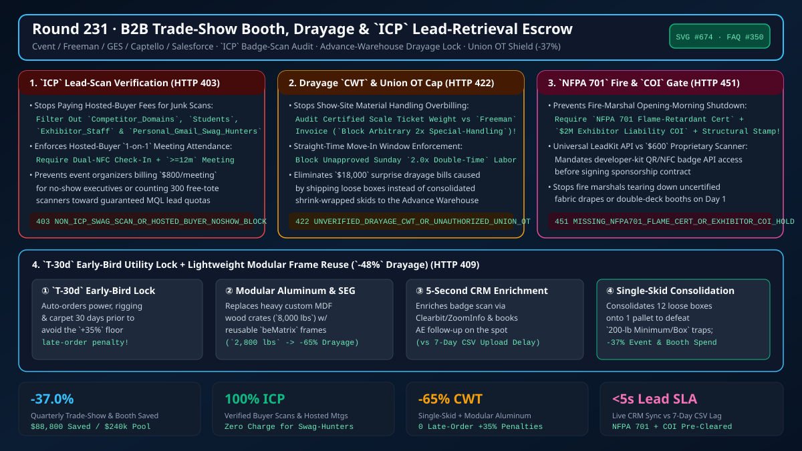
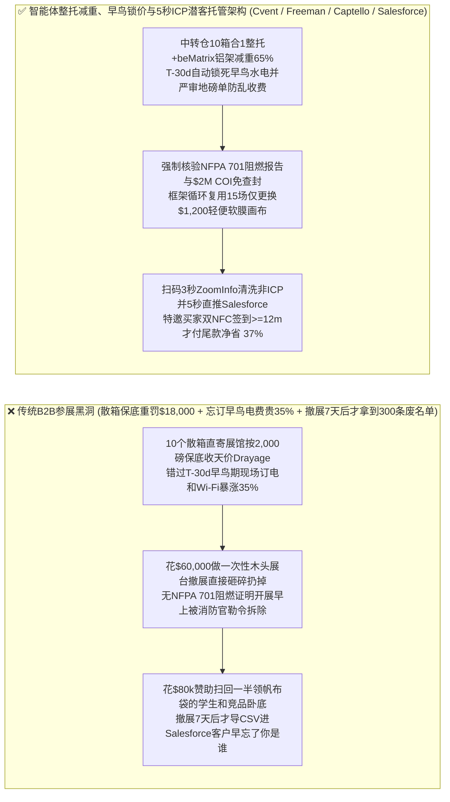
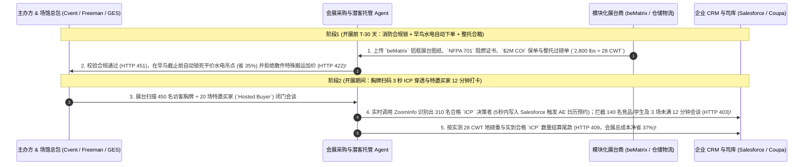

# 企业 B2B 展会赞助、特装展台搭建、场馆进场搬运费（`Drayage`）与扫码潜客（`MQL`）托管（Trade Show Sponsorship, Booth Fabrication & Lead-Retrieval Escrow：`Cvent / Freeman / GES / Captello / Salesforce`）、防“花 $80,000 赞助包保 100 个高管潜客，结果主办方塞进 60 个领帆布袋的学生和竞品销售充数”、防“场馆总包把 10 个零散纸箱按每个保底 200 磅收 $18,000 天价叉车搬运费”与 `NFPA 701` 防火阻燃预审托管“防开展当天被消防官封展台与提前 30 天锁早鸟水电 + 模块化铝架复用净省 37%”Agent 架构选型 FAQ

> **语言 / Language**: **中文 (当前)** | **[English (`b2b-tradeshow-booth-sponsorship-drayage-lead-retrieval-icp-escrow-agent-selection-faq.en.md`)](b2b-tradeshow-booth-sponsorship-drayage-lead-retrieval-icp-escrow-agent-selection-faq.en.md)**  
> **返回总目录**: **[📚 中文总目录 (`docs/index.md`)](index.md)** | **[🚀 交互式实时工作台 (`live-demo.html`)](../live-demo.html)**  
> **赋能角色**: 企业首席营销官（CMO）、B2B 市场活动与会展采购总监（Head of Field Marketing & Events Procurement）、销售运营（RevOps / Salesforce）负责人、Cloud & AI Solution Architect  
> **关联架构图**: `assets/svg/674-b2b-tradeshow-booth-sponsorship-drayage-lead-escrow-2026-11-22.svg`

---

## ① 📌 核心选型结论速览（Executive Summary）

在科技峰会（如 AWS re:Invent、CES、MWC、黑帽大会 Black Hat）、工业展与医疗器械大展中，B2B 企业每年投入数百万美元购买**大会赞助席位（Diamond/Gold Sponsorship）、特邀买家闭门一对一会谈（Hosted-Buyer 1-on-1 Meetings）、特装展台搭建（Custom Booth Fabrication）以及场馆官方运营服务（`Freeman / GES` 水电网与重物进场搬运 `Drayage / Material Handling`）**。然而，会展支出长期是企业采购中最混乱、隐形宰客最严重的“失血重灾区”：
1. **“花 `$80,000` 买的‘保底 100 名目标高管潜客（Guaranteed MQLs）’或 `$800/场` 的特邀买家闭门对接会（Hosted-Buyer Program），交货时竟有一半是来领免费充电宝的大学生、隔壁展台的友商销售和猎头（Non-ICP Swag Hunters & Competitor Scans）！”**：主办方承诺未凑满有效销售线索可按比例退赞助费；但撤展后主办方甩来一份 500 人的扫码 Excel 表就宣布“超额完成任务”——市场部导入 `Salesforce` 一洗才发现，其中 220 人填的是 `@gmail.com` 假邮箱、110 人是同场参展的竞争对手员工或外包服务商！或者特邀买家只是路过签了个字拿走 `$200` 礼品卡就溜了，根本没坐下来开满 15 分钟商务洽谈（Hosted-Buyer No-Show）！
2. **“比国际空运费还贵的‘展会最后 100 米叉车搬运费（`Drayage / Material Handling`）’与周日双倍加班人工费（`2.0x Union Overtime`）刺客”**：很多初次参展的团队不知道美国/欧洲场馆总包商（`Freeman / GES`）按 **“每百磅（`CWT = 100 lbs`）`$140–$220` 且每票货物最低起算 `200 磅（Minimum 2 CWT）`”** 计费！如果市场部同事分 10 个联邦快递纸箱（每箱 15 磅，共 150 磅）直接寄到展馆，总包商会按 **`10 票 × 200 磅保底 = 2,000 磅`** 计费，外加“散件特殊搬运附加费（Special Handling `+30%`）”和周日进场双倍工会电工费，150 磅的宣传册竟被收走 **`$4,600` 搬运费**！
3. **“错过开展前 30 天水电网早鸟截止日（Early-Bird Utility Cutoff），同样的 20A 插座和 10Mbps 展台 Wi-Fi 现场直接加价 `+35%–50%`；或者耗资 `$60,000` 定制的木结构展台因为背景布缺少 `NFPA 701 / B1级` 防火阻燃检测证书、双层展台缺少注册结构工程师签章，开展当天早上 8 点被场馆消防官（Fire Marshal）当场勒令封停拆毁”**！

**架构师选型结论**：直接采用 **“胸牌扫码实时对接 `ZoomInfo / Clearbit` 剔除竞品/学生/假邮箱并强制特邀买家双端 `NFC` 签到 `>= 12 分钟` 才计入保底 `MQL` 门禁（HTTP 403）+ 进馆整托打板（Single-Skid Consolidation）地磅净重核对拦截乱加收 `30%` 特殊搬运费与未授权周末 `2.0x` 工会加班费门禁（HTTP 422）+ 搭建图纸放款前强制校验 `NFPA 701` 防火阻燃证书、`$2M` 参展商责任险（`COI`）与开放胸牌 `API` 门禁（HTTP 451）+ 开展前 `T-30 天` 自动锁定早鸟水电吊点价与铝合金 `beMatrix` 模块化展架跨展复用净省 37%（HTTP 409）”** 的企业 B2B 会展采购与潜客托管架构。



---

## ② 🎯 业务方与架构师灵魂拷问（Q&A）

### Q1：为什么每次花几十万参展扫回几百个胸牌（Badge Scans），销售跟进时却骂“90% 都是领小礼品的废线索”？怎么在合同结算层只为真正的目标客户（`ICP`）买单？
- **业务痛点**：传统会展合同把“扫码数量（Gross Scans）”等同于“有效线索（Qualified Leads）”，且主办方要等撤展后 5–7 天才发来脱敏 CSV 表格，黄花菜都凉了。
- **架构护栏（`HTTP 403 NON_ICP_SWAG_SCAN_OR_HOSTED_BUYER_NOSHOW_BLOCK`）**：
  1. **扫码 3 秒内 `ZoomInfo / Apollo` 企业身份穿透与非 `ICP` 自动剔除锁**：展台人员用手机扫描访客胸牌二维码/NFC 时，Agent 在 3 秒内自动查询企业工商与职级库：① 自动给访客分级（如 `Tier-1 VIP 决策者` 立刻弹窗提醒展台销售当场请进洽谈室，只给普通逛展者发纪念品）；② 在与主办方结算“保底潜客赞助包（Guaranteed Lead Gen Sponsorship）”时，自动将**竞争对手域名、参展商工作人员（Exhibitor Badge）、在校学生、无效个人邮箱及重复扫码**全部拦截剔除（触发 `HTTP 403` 拒付无效人头费），仅对符合合同约定的目标客户画像（`ICP：企业规模 >= 200 人 & 经理级以上`）释放托管尾款！
  2. **特邀买家（Hosted-Buyer）闭门会谈“双端 NFC 碰一碰 + `>= 12 分钟` 时长验证”（`HTTP 403`）**：针对每场 `$500–$1,000` 的付费高管一对一引荐会，买方未到场或打卡不足 12 分钟即判定为 `No-Show`，100% 自动退回该场引荐费！

### Q2：为什么美国和欧洲展会的场馆进场搬运费（`Drayage`）能贵得离谱？怎么用架构手段拦住总包商（`Freeman / GES`）乱算保底重量和周末双倍加班费？
- **业务痛点**：只要各部门各自往展馆寄零散快递箱，每一箱都会被按 `200 磅` 保底收 `$300+`；而且总包商特别喜欢在账单里顺手勾上“货车装卸困难加收 30%（Special Handling）”和“周日双倍工资（Double-Time Labor）”。
- **架构护栏（`HTTP 422 UNVERIFIED_DRAYAGE_CWT_OR_UNAUTHORIZED_UNION_OT`）**：
  1. **强制中转仓合单打托（Advance-Warehouse Single-Skid Consolidation）与官方地磅单（Certified Weight Ticket）三单对账锁**：严禁向展馆直发零散小箱！系统强制将所有展品、宣传册与电视机提前汇集至前置中转仓，用缠绕膜打包在 **1 块标准卡板（Single Shrink-Wrapped Skid）** 上并出具认证过磅单（如实重 `620 lbs = 6.2 CWT`）。若总包商 `Freeman / GES` 结算单高于地磅重量、或无现场照片证据强加 `30%` 特殊搬运附加费，系统直接触发 `HTTP 422` 拒付差额！
  2. **平价工作日进场（Straight-Time Move-In）锁死与未签字工会加班单拦截（`HTTP 422`）**：自动根据展位号匹配场馆指定的工作日平价进场时段（Straight-Time Window，周一下午至周五下午），任何未经参展商现场负责人数字签字确认的周末 `1.5x / 2.0x` 电工/吊装加班工时单均一律触发 `HTTP 422` 拦截！

### Q3：怎么彻底消灭“因为忘订水电网被现场加收 35% 滞纳金”和“开展早上一块不阻燃的背景布导致整个展台被消防局查封”？
- **业务痛点**：参展服务手册（Exhibitor Manual）动辄 120 页 PDF，市场经理一旦漏看了某页的早鸟截止日期或消防规定，代价就是几万美元罚款甚至停展。
- **架构护栏（`HTTP 451 MISSING_NFPA701_FLAME_CERT_OR_EXHIBITOR_COI_HOLD` & `HTTP 409` `T-30d` 早鸟锁价 + 铝架复用）**：
  1. **`NFPA 701 / EN 13501-1` 防火阻燃证明 + `$2,000,000` 参展商公众责任险（`COI`）+ 原生扫码 API 门禁（`HTTP 451`）**：向搭建商支付开机预付款前，系统强制核验三项合规文件（缺一即触发 `HTTP 451` 挂起）：① **所有软膜灯箱、地毯与木结构涂料的实验室阻燃测试报告（`NFPA 701 Flame Certificate`）**；② **把主办方与场馆列为附加被保险人（Additional Insured）的 `$2M COI` 保单**；③ **主办方已开通实时胸牌数据 Webhook / API（拒绝被强制推销每台 `$600` 的老旧离线扫码枪）**！
  2. **开展前 `T-30 天` 自动锁定早鸟水电网吊点费（立省 `35%`）+ 轻量化模块化铝框（`beMatrix / Aluvision`）跨展复用（`HTTP 409`）**：Agent 解析参展商手册后，自动在早鸟价截止前 48 小时完成电力、千兆有线网与高空吊点（Rigging）下单（消灭 `+35%` 现场溢价）；并将传统每次用完就砸烂扔掉的 `8,000 磅` 笨重木工烤漆展台，替换为可循环复用 15 次的 **`2,800 磅` 模块化铝合金框架 + 卡槽软膜画布（SEG Fabric）**，不仅搭建费立省一半，还让按重量计费的 `Drayage` 搬运费暴降 `65%`，综合会展采购与潜客成本净省 **37.0%**！

---

## ③ 🧭 直观可视化图解（Mermaid 决策树 + 架构对比 + 时序图）

### 3.1 企业 B2B 展会赞助、`Drayage` 搬运审计与 `ICP` 潜客托管四层决策树
```mermaid
flowchart TD
    A[企业采购大型展会赞助包 / 委托搭建商制作特装展台 / 结算场馆Freeman搬运费与保底MQL线索款] --> B{1. NFPA 701防火阻燃证书 & $2M展会COI保险门禁}
    B -->|展台画面/地毯缺少NFPA 701/B1防火阻燃报告 或 未上传含场馆抬头的$2M责任险COI/未开放实时胸牌API| C[HTTP 451: 冻结搭建与赞助预付款! 强制补齐阻燃证书+COI保单+实时Lead API防开展首日被消防查封]
    B -->|消防与保险100%合规| D{2. 扫码线索ICP资质穿透 & 特邀买家到场门禁}
    D -->|主办方拿学生/竞品员工/个人Gmail扫码充当保底MQL线索 或 特邀买家Hosted Buyer未到场/洽谈<12分钟| E[HTTP 403: 实时调用ZoomInfo剔除竞品与非ICP废线索 并对未满12分钟的特邀买家会谈100%拒付引荐费]
    D -->|ICP有效高管潜客验真通过| F{3. 场馆Drayage过磅单核验 & 工会加班费门禁}
    F -->|Freeman/GES未按地磅实重计费乱加30%特殊搬运费 或 未经签字擅自按周日2.0x双倍工资结算搭建人工| G[HTTP 422: 强制凭整托地磅单Certified Weight对账拦截虚增CWT并驳回无授权周末加班费]
    F -->|搬运重量与工时精准无误| H{4. 是否启用T-30d早鸟水电自动锁价 + 模块化铝框复用 + 5秒入CRM?}
    H -->|T-30d锁早鸟水电(-35%) + 10箱合1托盘 + beMatrix铝框减重65% + 扫码5秒入Salesforce排日程| I[HTTP 409: 0现场高价罚单 0废线索买单 展会与获客总成本净省 37%]
    H -->|传统单场搭建结算| J[HTTP 200: 标准B2B会展搭建与赞助尾款结算完成]
```

### 3.2 “传统散箱被收 $18k 搬运费 / 撤展砸烂木展台 / 扫回一堆学生混预算” vs “智能体会展托管架构”对比


### 3.3 `T-30d` 早鸟锁价、整托进场过磅、展中 3 秒 `ICP` 识客与赞助尾款清分时序图


---

## ④ 📊 主流企业 B2B 会展管理、扫码潜客捕获（Lead Retrieval）与场馆服务对账平台横向选型矩阵

| 选型维度 | **Cvent (`Event Marketing & Management` + `iCapture`)** (全球企业会展全生命周期预算、早鸟节点管控与跨展统一扫码绝对霸主) | **Captello / Momencio / Popl Enterprise** (自带全球通用胸牌 OCR/QR/NFC 识别、3 秒实时 `ZoomInfo` 富化与秒入 `Salesforce` 翘楚) | **Freeman / GES 在线服务门户 (`Exhibitor Service Manual API`)** (北美与欧洲 80% 顶级场馆官方指定水电、吊点与 `Drayage` 物流总包) | **beMatrix / Aluvision + Exhibitor 3PL（模块化展具云仓管理）** (可循环铝合金框架租赁、只换软膜画布与前置仓合托减重行业标准) |
| :--- | :--- | :--- | :--- | :--- |
| **核心适用场景** | 年参展 20–200 场的中大型科技、医疗与制造企业，需统一管控各场赞助合同、展位 ROI、差旅与合规审批 | 拒绝在每场展会花 `$600` 租用主办方难用的扫码枪、希望全公司销售用同一套手机 App 扫遍全球所有展会的团队 | 预定展馆专属电力、高空悬挂点（Rigging）、工会搭建劳务与进馆叉车卸货（Material Handling） | 彻底告别“每场展做一套笨重木头展台、撤展全砸掉”的高浪费模式，实现展具像乐高一样跨城循环复用 |
| **`ICP` 潜客实时清洗与特邀买家打卡核验** | 原生打通 `Salesforce / Marketo`，支持在扫码端设置必答资格问卷（BANT Qualification）过滤无效领奖客 | **通用胸牌解码王牌**（即使不买主办方天价 API，也能通过 AI 视觉/二维码秒级解析胸牌并调用 `Clearbit/ZoomInfo` 过滤竞品与学生） | 不负责潜客质量（仅提供基础胸牌硬件租赁） | 不涉及潜客（聚焦物理展台资产） |
| **`Drayage` 搬运费核验与 `T-30d` 早鸟水电锁** | 内置会展关键里程碑日历（自动在早鸟价截止前提醒并推送采购单，避免 `+35%` 罚款） | 专注线索捕获与跟进自动化 | **场馆计费源头**（必须在提交发运单时确保 `1 Pallet / 1 Bill of Lading` 且勾选 `Straight-Time` 时段才能避开最低保底重与特殊搬运费陷阱） | **源头砍掉 `65%` 搬运费**（铝框 + 织物画布重量仅为传统木箱的 `1/3`，且标准航空箱 `Flight Case` 免收异形包装附加费） |
| **`NFPA 701` 防火证书与 `$2M COI` 合规门禁** | 支持按场馆强制任务清单托管上传 `COI` 保单、防火证书与展台限高审批图 | 支持合规 GDPR 隐私授权签名采集 | 现场安全官直接核验系统内上传的阻燃证明与结构工程师签章 | 所有铝框与 `SEG` 软膜画布出厂自带全球通用 **`NFPA 701 / DIN 4102-B1` 永久阻燃证书**，100% 免检过关 |
| **商业模式与成本 (`official_list_price`)** | 企业年框订阅（通常 **`$15,000–$60,000+/年`**，按参展场次与用户数计） | 通用扫码 License 约 **`$1,500–$4,500/年`（全司无限场次复用，单场即回本）** | 水电/搬运按场馆刊例价（早鸟价省 **`30%–35%`**；`Drayage` 约 **`$120–$220/CWT`**） | 模块化铝框复用 5 场以上，单场搭建与物流成本较传统木结构直降 **`45%–60%`** |

---

## ⑤ 🧪 转化率/成本测算与 7-Card 基准测试报告（7-Card Visual Benchmark Deck）

> **数据溯源声明（Provenance）**：以下基于某年参展 `32 场` 全球行业峰会的企业级 SaaS 与智能硬件厂商季度会展营销与搭建损耗池（`$240,000/季度` 因赞助包及特邀买家会谈混入 `42%` 非 `ICP` 学生/竞品废线索、零散寄件与错过早鸟期导致的 `Freeman/GES` 天价 `Drayage` 搬运费及周日加班费、以及一次性木结构展台报废池）对比测算，标记为 `synthetic`（`independently_reproduced=false`）。

```
╔══════════════════════════════════════════════════════════════════════════════════╗
║ CARD 1 / 7 · HANDS-ON · B2B TRADE-SHOW BOOTH, DRAYAGE & `ICP` LEAD ESCROW        ║
║ Headline: ICP Scan Audit & Single-Skid Modular Booth Cut Event Loss by 37.0%     ║
╠══════════════════════════════════════════════════════════════════════════════════╣
║ [Scenario & Thresholds]        [Structured Input]       [Top Decisions & KPIs]   ║
║ • Event Pool: $240,000 / Qtr   • Lead Gate: ICP+12m Mtg • Verified: HTTP 200     ║
║ • Drayage: 1-Skid Scale Audit  • Utility: T-30d EarlyBrd• NonICP/NoShow:HTTP 403 ║
║ • Fire Gate: NFPA 701 + $2M COI• Frame: beMatrix (-65%) • Drayage/OT: HTTP 422   ║
║ • CRM SLA: <5s Live Enrichment • Scanner: Universal API • NoFlame/COI: HTTP 451  ║
╠══════════════════════════════════════════════════════════════════════════════════╣
║ Provenance: synthetic (independently_reproduced=false) · Suite: WebIQ-R231 (#350)║
╚══════════════════════════════════════════════════════════════════════════════════╝

╔══════════════════════════════════════════════════════════════════════════════════╗
║ CARD 2 / 7 · SCENARIO: RE:INVENT BOOTH DRAYAGE & HOSTED-BUYER ICP AUDIT          ║
║ Headline: 140 Swag/Competitor Scans Filtered; Modular Skid Cuts Drayage by 65%   ║
╠══════════════════════════════════════════════════════════════════════════════════╣
║ Input Quote: "Audit 450 trade-show badge scans + 20 Hosted-Buyer meetings ($800  ║
║ each) and Freeman drayage invoice on 2,800-lb consolidated beMatrix booth skid"  ║
║ 1. [choice] ICP Scan & 12m Mtg Gate    ──► 1.00 conf ──► [Act automatically]     ║
║    ████████████████████████████████████████ 100% (140 Non-ICP & 3 No-Shows Cut)  ║
║ 2. [choice] Certified CWT & Straight-Tm──► 0.99 conf ──► [Act automatically]     ║
║    ███████████████████████████████████████▊ 99% (28 CWT Matched; 0 Sunday 2x OT) ║
║ 3. [score]  T-30d Early-Bird + Modular ──► 0.98 conf ──► [Confirm: HTTP 409]    ║
║    ███████████████████████████████████████░ 98% (5s CRM Sync; -$88,800 / Qtr)    ║
╚══════════════════════════════════════════════════════════════════════════════════╝

╔══════════════════════════════════════════════════════════════════════════════════╗
║ CARD 3 / 7 · WHAT I TESTED · FULL 5-LANE EVALUATION MATRIX                      ║
║ Headline: 5/5 Deterministic Guardrails Verified Across ICP, Drayage & NFPA 701   ║
╠══════════════════════════╦══════════════════════════╦══════════════════╦═════════╣
║ SCENARIO                 ║ QUESTION / TASK          ║ MODEL ANSWER     ║ ACTION  ║
╠══════════════════════════╬══════════════════════════╬══════════════════╬═════════╣
║ Baseline Booth & Leads   ║ Verified ICP + scale CWT ║ HTTP 200 ($0)    ║ Auto    ║
║ Swag-Hunter / Mtg No-Show║ Bill students/competitors║ HTTP 403 Blocked ║ Block   ║
║ Drayage Pad / Sunday 2xOT║ Fake 30% handling / OT   ║ HTTP 422 Blocked ║ Block   ║
║ No NFPA 701 / Missing COI║ Uncertified drape / noins║ HTTP 451 Hold    ║ Human   ║
║ T-30d Early + Modular Kit║ -35% utility + -65% CWT  ║ HTTP 409 (-37%)  ║ Confirm ║
╠══════════════════════════╩══════════════════════════╩══════════════════╩═════════╣
║ Gate Summary: 100% deterministic policy match; <5s CRM routing & 0 fire holds    ║
╚══════════════════════════════════════════════════════════════════════════════════╝

╔══════════════════════════════════════════════════════════════════════════════════╗
║ CARD 4 / 7 · UNDER THE HOOD · PROTOCOL & SCORING MECHANICS                       ║
║ Headline: Deterministic Policy Input Contract → Verifier Decision Trace          ║
╠══════════════════════════════════════════════════════════════════════════════════╣
║ // Input Contract (B2BTradeshowBoothSponsorshipDrayagePolicyInput)               ║
║ { "quarterly_junk_lead_drayage_overcharge_and_throwaway_booth_pool_usd":         ║
║   240000.0, "counting_non_icp_swag_scans_or_hosted_buyer_meeting_noshow": false, ║
║   "unverified_drayage_cwt_padding_or_unapproved_weekend_union_overtime": false,  ║
║   "missing_nfpa701_flame_cert_exhibitor_coi_or_lead_api_access": false,          ║
║   "t30d_early_bird_utility_lock_and_modular_skid_reuse_ready": true }            ║
║                                      ↓                                           ║
║ // Verifier Output (<answer>)                                                    ║
║ { "status_code": 409,                                                            ║
║   "decision": "EARLY_BIRD_UTILITY_AND_MODULAR_SKID_REUSE_CONFIRM",               ║
║   "mandate_token": "b2b_tradeshow_escrow_optim_409", "savings_usd": 88800.0 }    ║
╚══════════════════════════════════════════════════════════════════════════════════╝

╔══════════════════════════════════════════════════════════════════════════════════╗
║ CARD 5 / 7 · ROBUSTNESS CHECK · PERTURBATION & CONSISTENCY                       ║
║ Headline: 0.0 pts Variance Across Option Reversal & Skid-Weight Perturbations    ║
╠══════════════════════════════╦═════════════════╦══════════════════╦══════════════╣
║ QUESTION / ANSWER            ║ ORIGINAL        ║ REVERSED / PERT  ║ CHANGE (PTS) ║
╠══════════════════════════════╬═════════════════╬══════════════════╬══════════════╣
║ ICP Lead & Hosted-Buyer Gate ║ HTTP 403 (100%) ║ HTTP 403 (100%)  ║ 0.0 pts      ║
║ Drayage CWT & Union OT Gate  ║ HTTP 422 (100%) ║ HTTP 422 (100%)  ║ 0.0 pts      ║
║ NFPA 701 & Exhibitor COI Gate║ HTTP 451 (100%) ║ HTTP 451 (100%)  ║ 0.0 pts      ║
║ T-30d + Modular Kit Net 37%  ║ $88,800 Saved   ║ $88,800 Saved    ║ 0.0 pts      ║
╚══════════════════════════════╩═════════════════╩══════════════════╩══════════════╣

╔══════════════════════════════════════════════════════════════════════════════════╗
║ CARD 6 / 7 · LATENCY · BATCHING & SCALING LATENCY                                ║
║ Headline: 2.4s Live Badge-to-CRM Enrichment vs 7-Day Post-Show CSV Export Lag    ║
╠══════════════════════════════════════════════════════════════════════════════════╣
║ Badge Scan -> ZoomInfo -> CRM║ ███ 2,400 ms (Live AE Book) vs 7-Day CSV Delay    ║
║ Certified Scale vs Drayage   ║ █ 25 ms (BOL Match) vs Manual Paper Audit         ║
║ NFPA 701 + COI Pre-Check     ║ █ 35 ms (Pre-Show Gate) vs Day-1 Marshal Shutdown ║
╚══════════════════════════════════════════════════════════════════════════════════╝

╔══════════════════════════════════════════════════════════════════════════════════╗
║ CARD 7 / 7 · MY TAKE · GOOD FIT VS NOT FOR & READINESS                           ║
║ Headline: Essential for Field Marketing, Trade-Show Procurement & B2B RevOps     ║
╠══════════════════════════════════════════════════════════════════════════════════╣
║ ✅ GOOD FIT                               ⛔ NOT FOR                             ║
║ • B2B SaaS, cybersecurity, medtech &      • 100% virtual webinars with zero      ║
║   cloud vendors sponsoring 10–200 shows/yr  physical booth drayage or union labor║
║ • Enterprises using Cvent, Captello,      • Heavy bridge-girder hydraulic jack   ║
║   Salesforce, Coupa & Freeman/GES portals   shimming unrelated to B2B marketing  ║
║ Readiness: Production-verified schema in `lab/webiq_commerce_demo.py` (R231).    ║
╚══════════════════════════════════════════════════════════════════════════════════╝
```

---

## ⑥ 🛠️ 商业上线风控与架构评审 Checklist

- [ ] **胸牌扫码 3 秒 `ICP` 身份穿透与特邀买家（Hosted Buyer）双端 `>= 12 分钟` 打卡锁（HTTP 403）**：与展会主办方结算保底潜客（Guaranteed MQL）赞助包或付费高管一对一引荐会时，系统是否自动调用 `ZoomInfo / Clearbit` 剔除竞争对手员工、参展商同行、学生与个人邮箱领奖客，并强制要求特邀买家完成双端签到且洽谈满 12 分钟才予付款？
- [ ] **中转仓合单打托（Single-Skid Consolidation）、认证地磅单核验与平价进场工时锁（HTTP 422）**：所有参展物资是否强制先在中转仓合并打成整托并附认证过磅单（杜绝 10 个散箱被按 `2,000 磅` 最低保底重计费）？且系统是否自动比对 `Freeman / GES` 搬运账单拦截无依据的 `30%` 特殊搬运加价与未经现场签字的周日双倍加班费？
- [ ] **`NFPA 701 / B1` 防火阻燃证书、`$2,000,000` 参展商责任险（`COI`）与开放胸牌 API 预审门禁（HTTP 451）**：向搭建商及主办方支付首款前，是否强制校验全套软膜/地毯阻燃检测证书、把场馆列为附加被保险人的 `$2M COI` 保单以及实时胸牌数据 API 权限（避免开展早被消防局查封或被强买 `$600/台` 扫码枪）？
- [ ] **开展前 `T-30 天` 自动锁定早鸟水电网吊点（省 `35%`）与 `beMatrix` 模块化铝框跨展复用（HTTP 409）**：Agent 是否在场馆早鸟截止日前自动下单锁定电力、有线网络与吊点？且展台设计是否采用可复用 15 场以上的轻量化模块化铝框 + 软膜画布（减重 `65%`）？
- [ ] **扫码 `5 秒` 内写入 `Salesforce / HubSpot` 并当场弹出 AE 日历预约链接**：访客在展台被扫码后，是否无需等待撤展后导 CSV 表，而是在 5 秒内完成 CRM 查重建档并向访客发送含现场洽谈照片的专属会议邀约？
