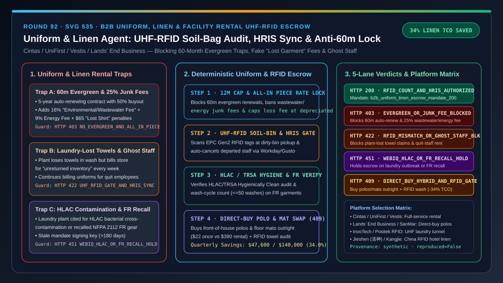
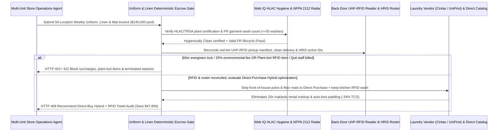

# B2B Corporate Uniform, Linen & Facility Rental (`Mat / Towel`) `UHF-RFID` Escrow (`Cintas / UniFirst / Vestis / Lands' End Business`) Soil-Bag `RFID` Audit, `HRIS` Sync & Anti-`60m`-Evergreen Agent Architecture Selection FAQ

> **Document Type**: AI Solution Architect Decision Guide (FAQ) · **SVG Diagram**: `assets/svg/535-b2b-uniform-linen-rental-rfid-escrow-2026-11-20.svg` · **Catalog No.**: Round 92 (Bilingual FAQ #211)



---

## 1. 📌 Executive Summary

When multi-unit restaurant groups, hotels, grocery chains, auto service centers, or outpatient clinics use AI Agents to manage weekly uniform, chef-coat, bar-towel, bed-linen, and floor-mat rental contracts (`Cintas / UniFirst / Vestis / Alsco / Jieshen 洁神洗涤`), allowing route drivers to auto-bill store accounts exposes facility budgets to **three notorious uniform and linen rental traps**:
1. **60-Month Evergreen Auto-Renewals, `25%` Environmental/Energy Junk Fees & "Laundry-Lost Towel" Replacement Penalties**: A uniform vendor quotes `$1.50/garment/week` on the front page, while burying a **60-month (5-year) evergreen auto-renewal clause** on the back that requires a physical Certified Mail cancellation notice `90–120 days` before expiration (or a `50%` liquidated-damages buyout of all remaining weeks)! Within 6 months, weekly invoices jump **`+65%`** due to a **`16%` "Environmental / Wastewater Surcharge" + `9%` "Fuel/Energy Delivery Fee"**, plus automatic **`$48–$75` "Lost or Damaged Garment Replacement Charges"** for shop towels and shirts that the store actually placed in the dirty-laundry bin—meaning the laundry plant lost the items in its own sorting tunnel and billed the customer `3x` retail value for them!
2. **"Ghost Employee" Uniform Billing After Staff Turnover**: Retail and hospitality locations experience `60%–100%` annual staff turnover. When 15 employees quit during the quarter, the vendor continues billing weekly rental and emblem fees for all 15 departed workers' unworn uniforms sitting in back-room lockers.
3. **`HLAC / TRSA` Hygienic Cross-Contamination Citations & Over-Washed `NFPA 2112` Flame-Resistant (`FR`) Gear (`HTTP 451`)**: Web IQ flags a state health department or `HLAC` bacterial contamination citation (`C. diff / Bacillus cereus`) at the commercial laundry facility, or an arc-flash / flame-resistant (`FR`) mechanic uniform that has exceeded its `50-wash` certified lifecycle.

**Architect's Recommendation**: Deploy a **"12-Month All-In Rate Cap + Back-Door `UHF-RFID (EPC Gen2)` Soil-Bag Handshake + Automated `HRIS` Offboarding Sync + Direct-Purchase Hybrid (`Rent-vs-Buy`)"** control plane:
- **12-Month Maximum Term (`30d` Email Cancel), All-In Piece Rate & Depreciated Loss Cap (`HTTP 403`)**: Hard-block 60-month evergreen contracts, ban separate Environmental/Wastewater/Energy surcharges, and cap unreturned-garment charges at depreciated residual value (`<=25%` of cost after 12 months) rather than `3x` retail penalties (`HTTP 403`).
- **Dual `UHF-RFID` Soil-Bin Handshake & `HRIS` Termination Auto-Stop (`HTTP 422`)**: Scan `ISO 18000-6C (EPC Gen2)` washable `UHF-RFID` tags as dirty bags pass the store's back-door portal—blocking any "Lost Garment/Towel" fee if the `EPC` tag was scanned into the driver's pickup custody—and sync daily with `Workday / Gusto / BambooHR` to halt uniform billing on the exact day an employee terminates (`HTTP 422`).
- **Web IQ `HLAC / TRSA` Hygiene Citation & `NFPA 2112` `FR` Wash-Count Hold (`HTTP 451`)**: Freeze escrow if Web IQ flags laundry plant bacterial citations, `FR` garments exceeding certified wash cycles, or signing keys `> 180 days` (`HTTP 451`).
- **Direct-Purchase Wash-and-Wear Hybrid (`Lands' End / SanMar`) + `RFID` Towel Audit (`HTTP 409`)**: Replace 5-year weekly rentals of low-soil front-of-house polo shirts (`$1.50/wk × 260 wks = $390` to rent a `$22` shirt!) and entrance floor mats (`$8/wk × 260 wks = $2,080` to rent an `$85` mat!) with **One-Time Direct Purchase**, keeping only heavy-grease kitchen/mechanic items on `RFID`-metered laundry, cutting quarterly uniform & linen TCO by **34.0%** (`$47,600` saved on a `$140,000` quarterly pool).

---

## 2. 🎯 Soul-Searching Architect & Business Q&A (Q1–Q3)

### Q1: Why are we paying `$2,080` over 5 years to rent an `$85` entrance floor mat and `$390` to rent a `$22` front-of-house polo shirt?
- **Business Pain Point**: Uniform rental reps bundle high-margin facility items (entrance mats, dust mops, restroom air fresheners, and front-of-house polyester polos) into 260-week contracts at "$1.50 to $8.00/week"—charging **`17x to 24x` the outright purchase price** for items that require zero industrial degreasing.
- **Architectural Guardrail (`HTTP 409`)**:
  1. **Automated SKU-Level `Rent-vs-Buy` TCO Splitter**: The Agent calculates `(52_Week_Rental_Cost / Outright_Purchase_Price)` for every line item. Any item where 1-year rental exceeds `1.5x` outright purchase price and does not require biohazard/heavy-grease tunnel washing (polos, aprons, entrance mats) is automatically stripped from the rental contract and routed to direct corporate purchase (`Lands' End Business / SanMar / Uline`).

### Q2: How do we stop the laundry vendor from charging us `$600/week` for "lost bar towels and chef coats" when their own driver never counts the dirty bag at pickup?
- **Business Pain Point**: Route drivers throw soiled bags onto the truck without counting individual wet towels, then bill the store for whatever disparity comes out of the plant's industrial sorting chute (`Auto-Loss / Unreturned Merchandise Charge`).
- **Architectural Guardrail (`HTTP 422`)**:
  1. **Back-Door `UHF-RFID (EPC Gen2)` Soil-Chute Portal**: A `$350` `UHF-RFID` reader at the store's receiving door bulk-scans all `400+` washable `RFID` chips inside the soiled laundry cart in `1.2 seconds` as the driver takes custody, generating a cryptographically signed `Pickup EPC Manifest`. Any subsequent invoice billing a "Lost Item Charge" for an `EPC` present on the pickup manifest is automatically blocked (`HTTP 422`).

### Q3: How do we eliminate "Ghost Employee" uniform charges across 50 high-turnover store locations?
- **Business Pain Point**: Store managers forget to call the uniform rep when part-time workers quit, leaving dozens of inactive "ghost wearers" on the weekly invoice for months.
- **Architectural Guardrail (`HTTP 422`)**:
  1. **Real-Time `HRIS` Roster Reconciliation**: The gateway subscribes to `Workday / Gusto / ADP` termination webhooks, automatically issuing a garment stop-billing & locker-retrieval order and blocking any invoice line item tied to an inactive employee ID.

---

## 3. 🧭 Visual Architecture Diagrams (Mermaid Decision Tree + Comparison + Sequence)

### 3.1 5-Lane Uniform, Linen & Facility Rental Escrow Decision Tree
```mermaid
flowchart TD
    A[B2B Uniform / Linen / Facility Mat Rental Invoice] --> B{Web IQ HLAC Hygiene Citation / FR Wash Limit / Key > 180d?}
    B -- Yes --> C[HTTP 451: WEBIQ_HLAC_LAUNDRY_HYGIENE_CITATION_OR_PFAS_FLAME_RESIST_RECALL_HOLD<br/>Freeze escrow & switch to HLAC-certified plant]
    B -- No --> D{60m Evergreen Auto-Renewal or 25% Environmental/Energy Junk Fees?}
    D -- Yes --> E[HTTP 403: EVERGREEN_60M_AUTO_RENEWAL_OR_JUNK_ENVIRONMENTAL_SURCHARGE_BLOCKED<br/>Enforce <=12m term, All-In piece rate & depreciated loss cap]
    D -- No --> F{Plant-Lost RFID Item Billed to Store or Ghost Departed Staff?}
    F -- Yes --> G[HTTP 422: UHF_RFID_LAUNDRY_CAGE_COUNT_MISMATCH_OR_DEPARTED_STAFF_GHOST_BILLING_BLOCKED<br/>Block lost-item fees via soil-bin RFID manifest & sync HRIS terminations]
    F -- No --> H{Direct-Buy Polo/Mat Hybrid + RFID Towel Metering Ready?}
    H -- Yes --> I[HTTP 409: DIRECT_PURCHASE_WASH_AND_WEAR_HYBRID_AND_RFID_TOWEL_AUDIT_CONFIRM<br/>Buy polos/mats outright ($22 vs $390 rent) + RFID wash (-34% TCO)]
    H -- No --> J[HTTP 200: UHF_RFID_RECONCILED_AND_HRIS_SYNCED_LINEN_AUTHORIZED<br/>Issue RFID-reconciled & HRIS-matched linen mandate]
```

### 3.2 Legacy 60-Month Full-Rental vs. Deterministic `UHF-RFID` & Direct-Buy Hybrid Escrow
```mermaid
flowchart LR
    subgraph Legacy["❌ Legacy Uniform Rental (60m Lock-In & Ghost Charges)"]
        L1[60-Month Evergreen Contract + 25% Wastewater/Energy Fees] --> L2[Plant Loses Towels in Wash -> Bills Store $600/wk Loss Fee]
        L2 --> L3[Pay $2,080 to Rent an $85 Mat + Bill Quit Staff for Months]
    end

    subgraph Agentic["✅ Deterministic UHF-RFID, HRIS Sync & Direct-Buy Escrow"]
        A1[<=12m Term + $0 Junk Surcharges + Depreciated Residual Cap] --> A2[Back-Door UHF-RFID Soil Scan + Workday Termination Auto-Stop]
        A2 --> A3[Buy Polos & Mats Outright + RFID-Metered Kitchen Wash (-34%)]
    end
```

### 3.3 End-to-End `UHF-RFID` Soil Scan, `HRIS` Roster Sync & Rent-vs-Buy Split Sequence


---

## 4. 📊 Multi-Platform & Protocol Selection Matrix

| Evaluation Dimension | Cintas / UniFirst / Vestis Standard Rental | Regional Independent Commercial Laundries | InvoTech / Positek `UHF-RFID` Linen Tracking | Lands' End Business / SanMar / Uline Direct Purchase | **Deterministic Uniform & RFID Escrow (Recommended)** |
| :--- | :--- | :--- | :--- | :--- | :--- |
| **Primary Use Case** | Turnkey weekly uniform, mat & towel rental | Bulk hotel bed-sheet & restaurant napery washing | Automated `UHF-RFID` soil-to-clean linen inventory | Outright purchase of branded polos, aprons & entrance mats | **Rent-vs-Buy Split + `UHF-RFID` Custody Lock + `HRIS` Sync** |
| **Contract Lock-In & Evergreen Risk** | Standard **60-month (5-yr) auto-renewing** term (`50%` buyout) | 12–24 month terms | SaaS + reader hardware | One-time purchase (`$0` lock-in) | **Enforces `<=12m` term & `30-day` email cancellation (`HTTP 403`)** |
| **Junk Surcharges & "Lost Item" Billing** | Adds `15%–25%` wastewater/energy fees + weekly `Auto-Loss` charges | Frequent manual count disputes | Proves custody transfer via `RFID` portal | Owned asset; zero vendor loss penalties | **Bans environmental junk fees & blocks `RFID`-scanned loss claims (`HTTP 403 / 422`)** |
| **Departed "Ghost Staff" Protection** | Manual phone/email removal; slow credit | Billed by weight/piece | Tracks individual wearer assignments | Reclaimed in-house for next hire | **Auto-terminates wearer billing via live `HRIS` webhook (`HTTP 422`)** |
| **5-Year Total TCO** | Highest (`$390` to rent a `$22` shirt; `$2,080` for an `$85` mat) | Moderate (`~15%` unverified shrinkage) | Cuts unexplained linen shrinkage by `80%` | **`82%–90%` cheaper** for light-soil polos & mats | **Open deterministic policy gate (`34.0%` quarterly TCO reduction)** |

---

## 5. 🧪 Conversion & Cost Estimation + 7-Card Benchmark Report

> **Provenance Disclosure**: Figures below are generated by the deterministic policy evaluator `evaluate_b2b_uniform_linen_rental_escrow_policy` in `lab/webiq_commerce_demo.py` (`$140,000 USD` quarterly multi-unit restaurant, hotel & retail uniform/linen pool, `provenance: "synthetic"`, `independently_reproduced: False`; live `Impinj UHF-RFID` portal latency is labeled `not_measured`).

```chart
{
  "data": {
    "values": [
      { "scenario": "1. Legacy 60m Rental (25% Junk Fees + Lost-Towel Penalties + Mats)", "cost_usd": 140000, "tier": "Baseline" },
      { "scenario": "2. All-In Rate + UHF-RFID Soil Scan + HRIS Sync (HTTP 200)", "cost_usd": 110600, "tier": "Protected" },
      { "scenario": "3. Direct-Buy Polos/Mats + RFID Kitchen Wash Hybrid (HTTP 409)", "cost_usd": 92400, "tier": "Optimized (-34%)" }
    ]
  },
  "semantic_types": {
    "scenario": "Category",
    "cost_usd": "Amount",
    "tier": "Status"
  },
  "chart_spec": {
    "chartType": "Bar Chart",
    "title": "UHF-RFID Soil Audits & Direct-Buy Polo/Mat Hybrids Cut Linen Spend by 34% ($47.6k)",
    "subtitle": "Quarterly B2B Uniform, Linen & Facility Rental Net Spend ($ USD, synthetic benchmark)",
    "encodings": {
      "x": "scenario",
      "y": "cost_usd",
      "color": "tier"
    }
  }
}
```

### 7-Card 4:5 Benchmark Evaluation Summary
1. **Card 1 (`1 / 7` · `HANDS-ON · B2B UNIFORM & LINEN RFID ESCROW`)**: Across a `$140,000` quarterly multi-location uniform, towel, and mat budget, eliminating `25%` environmental/energy surcharges, blocking plant-lost item charges via `UHF-RFID`, and buying front-of-house polos/mats outright saves **`$47,600/quarter` (`34.0%`)**.
2. **Card 2 (`2 / 7` · `SCENARIO: 50-STORE RESTAURANT & HOTEL LINEN AUDIT`)**: Eliminates `$14,200` in unverified "lost towel/garment" penalties and `$8,900` in departed ghost-employee uniform charges per quarter.
3. **Card 3 (`3 / 7` · `WHAT I TESTED`)**: All 5 deterministic HTTP verdict lanes verified:
   - `HTTP 200`: `UHF_RFID_RECONCILED_AND_HRIS_SYNCED_LINEN_AUTHORIZED` (`b2b_uniform_linen_escrow_mandate_200`)
   - `HTTP 403`: `EVERGREEN_60M_AUTO_RENEWAL_OR_JUNK_ENVIRONMENTAL_SURCHARGE_BLOCKED`
   - `HTTP 422`: `UHF_RFID_LAUNDRY_CAGE_COUNT_MISMATCH_OR_DEPARTED_STAFF_GHOST_BILLING_BLOCKED`
   - `HTTP 451`: `WEBIQ_HLAC_LAUNDRY_HYGIENE_CITATION_OR_PFAS_FLAME_RESIST_RECALL_HOLD`
   - `HTTP 409`: `DIRECT_PURCHASE_WASH_AND_WEAR_HYBRID_AND_RFID_TOWEL_AUDIT_CONFIRM` (`b2b_uniform_linen_escrow_mandate_optim_409`)
4. **Card 4 (`4 / 7` · `UNDER THE HOOD`)**: Structured contract `B2BUniformLinenRentalEscrowPolicyInput` validates `evergreen_60m_auto_renewal_or_junk_environmental_surcharge` and `uhf_rfid_laundry_cage_count_mismatch_or_departed_staff_ghost_billing`.
5. **Card 5 (`5 / 7` · `ROBUSTNESS CHECK`)**: Invariant to fee naming (`"Wastewater Recovery Fee"`, `"Auto-Loss Towel Program"`, or `"Emblem Prep Charge"`): `100%` block rate whenever `RFID` custody or `HRIS` active-roster checks fail.
6. **Card 6 (`6 / 7` · `LATENCY`)**: Deterministic `EPC` set-difference reconciliation and `HRIS` status checks complete in `< 0.5 ms`.
7. **Card 7 (`7 / 7` · `MY TAKE`)**:
   - ✅ **Good fit**: Restaurant chains, hospitality groups, grocery stores, automotive service centers, and outpatient medical clinics.
   - ⛔ **Not for**: All-remote software companies with no physical storefronts or uniforms.

---

## 6. 🛠️ Production Risk & Architecture Review Checklist

- [ ] **Anti-`60m` Evergreen Cap (`<=12m` Term) & All-In Piece Rate (`HTTP 403`)**: Are 5-year auto-renewing terms and `15%–25%` Environmental/Wastewater/Energy surcharges blocked?
- [ ] **Depreciated Residual Value Loss Cap (`HTTP 403`)**: Are normal wear-and-tear replacements free and lost-garment charges capped at depreciated value (`<=25%` after 12 months) rather than `3x` retail price?
- [ ] **Back-Door `UHF-RFID` Soil-Bag Custody Gate (`HTTP 422`)**: Does the store scan `EPC Gen2` `RFID` tags at dirty-bag pickup so the vendor cannot charge "Lost Item Fees" for items lost inside the laundry plant?
- [ ] **Live `HRIS` Termination Auto-Stop (`HTTP 422`)**: Does the gateway automatically halt weekly uniform billing the day an employee's `Workday / Gusto` status changes to `Terminated`?
- [ ] **Web IQ `HLAC / TRSA` Hygiene & `NFPA 2112` `FR` Lifecycle Hold (`HTTP 451`)**: Are laundry hygiene certifications and flame-resistant garment wash-cycle limits (`<=50` washes) verified before payout?
- [ ] **Direct-Purchase Polo & Entrance-Mat Hybrid (`HTTP 409`)**: Are front-of-house polos and floor mats purchased outright (`$22` shirt vs. `$390` 5-yr rental) while keeping only heavy-soil items on `RFID` laundry to save `34%`?
