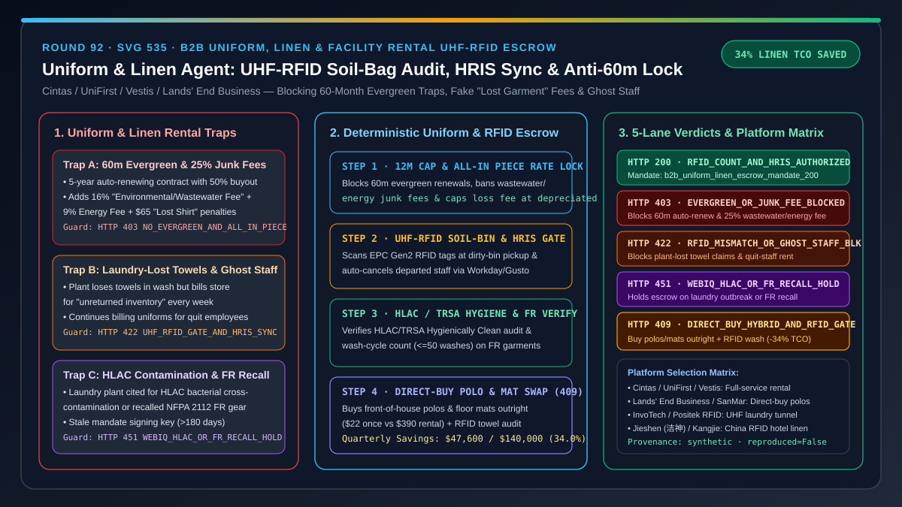
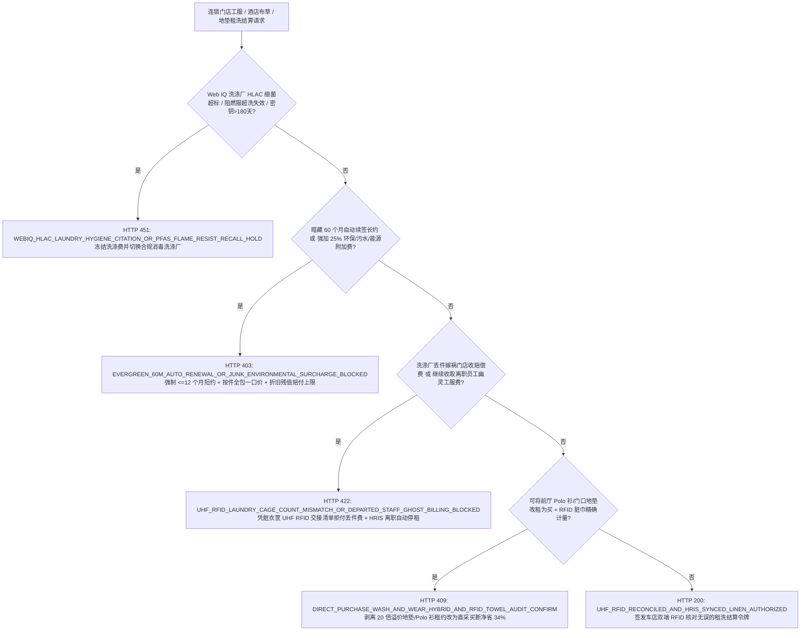
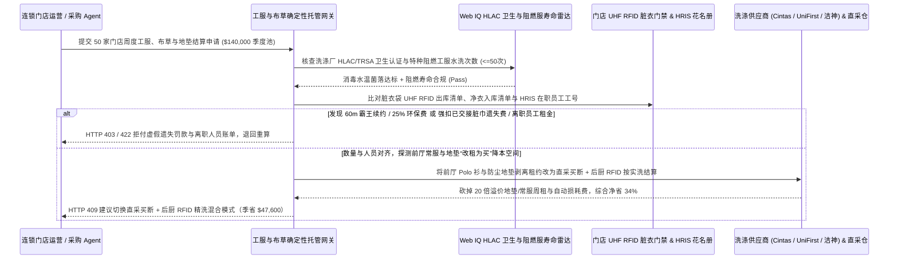

# 连锁餐饮/酒店工服布草租洗、地垫耗材与 `UHF RFID` 防丢账单托管（B2B Corporate Uniform, Linen & Facility Rental Escrow：Cintas / UniFirst / Vestis / 洁神洗涤）“防 60 个月自动续签霸王长约、防洗涤厂丢毛巾反扣 3 倍赔偿费与离职员工幽灵工服计费”Agent 架构选型 FAQ

> **文档类型**：AI Solution Architect 决策指南（FAQ） · **对应 SVG**：`assets/svg/535-b2b-uniform-linen-rental-rfid-escrow-2026-11-20.svg` · **精选编号**：Round 92（第 211 篇双语 FAQ）



---

## 一、 📌 核心选型结论速览（Executive Summary）

连锁餐饮、星级酒店、连锁商超、汽车 4S 店与医疗诊所通过 AI Agent 采购员工工服（厨师服、技师服）、餐巾抹布、床品布草及门口防尘地垫的周期租洗服务（`Uniform, Linen & Facility Services：Cintas / UniFirst / Vestis (原 Aramark Uniform) / Alsco / 洁神洗涤 / 泰笛`）时，若直接让门店店长签收送货司机递来的周度电子板（Route Pad）并自动扣款，往往会掉入**三大工服布草租洗采购黑洞**：
1. **`60 个月（5年）` 自动续签万年青长约（Evergreen Lock-In）、`25%` 环保/能源杂费与“洗涤厂自己洗丢毛巾却反罚门店 3 倍赔偿金”**：工服租洗供应商在初始报价单上写着极具诱惑力的 `$1.50/件/周`，但合同背面埋着 **“60 个月不可撤销租期 + 到期前必须提前 90–120 天用挂号信解约，否则自动再续 60 个月（违约买断须赔剩余周数 50% 全额租金）”**！更恶劣的是，签约半年后每周账单暴涨 `+65%`：① 叠加 `16%` 环保污水处理费（`Environmental / Wastewater Fee`）+ `9%` 能源配送附加费；② 送货司机每周都在账单里暗扣 **`10%–15%` 的“布草抹布遗失赔偿费（Auto-Loss / Merchandise Replacement Charge）”** 和每件 `$48–$75` 的“工服污损买断费”——实际上这些脏毛巾和厨师服早在门店装进脏衣袋（Soil Bag）时就已经交给司机了，是洗涤厂自己在工业隧道洗衣机分拣时弄丢的！
2. **门店高流动率导致“离职员工幽灵工服（Ghost Employee Uniforms）”持续白交租金**：餐饮与零售门店年均员工流动率高达 `60%–100%`。当 15 名店员在季中离职后，店长忘记在租洗系统里逐一核销工号，供应商便继续对锁在更衣柜里的 15 套无人穿的旧工服照收每周租金与刺绣名牌费（`Emblem Prep Fee`）。
3. **医用/食品级布草消毒不达标（`HLAC` 菌落超标）或阻燃工服（`NFPA 2112`）洗涤超次失效（`HTTP 451`）**：洗涤厂为省燃气费降低主洗水温（未达 `71°C / 160°F` 持续 25 分钟标准），导致诊所刷手服或酒店毛巾检出蜡样芽孢杆菌/艰难梭菌被卫生局通报；或电力/汽修技师穿的阻燃服（`FR Garment`）洗涤已超过 `50 次` 寿命上限丧失阻燃性能。

**架构师选型结论**：必须构建 **“废除 60 个月长约与环保杂费（`12m Term + All-In Piece Rate`）+ 后厨脏衣筐 `UHF RFID` 读写器出库交接免责 + `HRIS` 离职秒级停租 + 前厅 Polo 衫/地垫‘以买代租’（Direct-Buy Hybrid）托管网关”** 架构：
- **强制 `<=12 个月` 短约（30 天邮件解约）、一口价（`0%` 环保/能源附加费）与折旧残值赔付上限（`HTTP 403`）**：凡包含 `>12 个月` 自动续签条款、单列环保/污水/燃油附加费、或对自然磨损/满 12 个月旧工服按新衣 3 倍原价索赔的合同，一律返回 `HTTP 403` 阻断。
- **门店脏衣笼 `UHF RFID (EPC Gen2)` 批量交接扫码免责与 `HRIS` 离职实时停租门禁（`HTTP 422`）**：在门店后仓安装 `$350` 的超高频 `UHF RFID` 龙门读写器——凡脏工服/毛巾投入回收袋时已被 `RFID` 天线记录交接给送货司机，洗涤厂事后开具的任何“遗失赔偿费”一律触发 `HTTP 422` 拒付；同时每日同步 `Workday / Gusto / 飞书人事` 离职名单，员工离职当日自动冻结其名下工服周租。
- **Web IQ `HLAC / TRSA` 卫生认证与阻燃服（`NFPA 2112`）洗涤寿命熔断（`HTTP 451`）**：对触发卫生交叉感染罚单或 `RFID` 记录洗涤次数超标的阻燃防护服执行 `HTTP 451` 止付。
- **前厅轻污 Polo 衫与门口地垫“改租为买（Direct Purchase）”+ 重油污后厨工服 `RFID` 精洗混合架构（`HTTP 409`）**：算清一笔惊人的经济账——租一件普通前厅服务员 Polo 衫（`$1.50/周 × 260 周 = $390`）或一块门口防尘地垫（`$8/周 × 260 周 = $2,080`），其 5 年租金竟是直接买断价（`$22/件 Polo 衫`、`$85/块商业地垫`）的 **`17 倍–24 倍`**！Agent 自动将前厅常服与地垫剥离租约改为企业直采买断（员工自洗/店内吸尘），仅保留重油污后厨厨师服与擦桌毛巾走 `RFID` 计量租洗，使季度 `$140,000` 门店工服布草预算净省 **`34.0%`（`$47,600`）**。

---

## 二、 🎯 业务方与架构师灵魂拷问 Q&A（Q1–Q3）

### Q1：为什么一块成本才 $85 的门店门口防尘地垫，租了 5 年居然付给租赁公司 $2,080？哪些品类绝不能租、必须直接买断？
- **商业痛点**：工服租赁巨头利润率最高的产品根本不是需要高温除油的厨师服，而是 **门口防尘地垫（Entrance Floor Mats）、洗手间擦手纸盒、尘推拖把（Dust Mops）以及前厅收银员穿的普通化纤 Polo 衫**！这些物品采购成本极低，但业务员会忽悠店长“每周只要几块钱”，绑进 5 年合同里收出 `2,000%` 的溢价。
- **架构护栏（`HTTP 409`）**：
  1. **品类级“租买比（Rent-vs-Buy TCO Ratio）”自动分流器**：Agent 对合同清单逐行计算 `12个月累计租金 / 京东企业购·SanMar·Uline 现货买断价`。凡 `1年租金 > 买断价 1.5 倍` 且无需工业重油污去渍的品类（地垫、普通 T 恤/Polo 衫、围裙、拖把头），系统自动触发 `HTTP 409` 从租赁合同中剔除，直接走一次性固定资产采购。

### Q2：送货司机每次来收脏毛巾都不当面清点，回厂后却在账单上说我们少了 200 条毛巾、扣我们 $600 赔偿金，怎么用技术铁证反杀？
- **商业痛点**：脏毛巾沾满油污和汤汁，送货司机绝不会在门店现场一条条手数，而是整袋拎上卡车；等到了洗涤厂经过分拣机，任何卡在机器里或被分错客户的毛巾，系统都默认算作“门店遗失（Customer Shortage）”，按每条 `$3.00–$4.50` 自动从门店绑定银行卡扣款。
- **架构护栏（`HTTP 422`）**：
  1. **缝入耐高温水洗 `UHF RFID` 芯片 + 门店脏衣桶通道天线（`Soil-Bin RFID Gate`）**：要求所有工服与布草植入符合 `ISO 18000-6C (EPC Gen2)` 的耐 `200 次` 工业水洗压烫 `RFID` 标签。当脏衣袋推过门店后门时，`RFID` 读写器在 `1 秒` 内读出全部 `450` 枚标签 `EPC` 编码并生成带时间戳的《脏品交接数字收据（Digital Soil Manifest）》。
  2. 只要某件工服或毛巾的 `EPC` 出现在门店交接清单上，洗涤厂事后敢收“未归还/遗失赔偿费”，网关立即凭 `RFID` 交接哈希返回 `HTTP 422` 拒付！

### Q3：连锁餐饮店员每个月都有人离职，怎么防止为已经离职半年的员工继续交每周工服租金？
- **商业痛点**：门店店长忙于日常运营，极少去核对租赁公司长达 8 页的员工姓名尺码明细表（Wearer Roster）。
- **架构护栏（`HTTP 422`）**：
  1. **`HRIS` 离职事件驱动的自动停租与回收锁（`Automated Wearer De-Provisioning`）**：Agent 监听企业人事系统（`Workday / BambooHR / 飞书 / 钉钉`）的员工离职 Webhook。一旦某员工状态变为 `Offboarding / Terminated`，Agent 立即向租赁商 API 发送 `Stop-Billing & Pickup Notice` 工单，若下期账单仍出现该离职员工姓名，整单触发 `HTTP 422` 拦截。

---

## 三、 🧭 直观可视化图解（Mermaid 决策树 + 架构对比 + 时序图）

### 3.1 工服布草租洗与 `UHF RFID` 防丢托管 5 车道选型决策树


### 3.2 传统 5 年工服全包盲租 vs 确定性 `UHF RFID` 对账与“以买代租”混合架构对比
```mermaid
flowchart LR
    subgraph Legacy["❌ 传统工服地垫长约（5年锁死 + 丢件背锅 + 离职空扣）"]
        L1[签 60 个月自动续期合同 + 叠加 25% 环保污水附加费] --> L2[洗涤厂分拣弄丢毛巾，每周反扣门店 $600 遗失费]
        L2 --> L3[花 $2,080 租一块 $85 的地垫 + 为离职员工白交半年租金]
    end

    subgraph Agentic["✅ 确定性 UHF RFID 交接、HRIS 停租与买断混合架构"]
        A1[12 个月灵活合同 + 零环保杂费全包单价 + 折旧残值上限] --> A2[后门 UHF RFID 秒读脏衣交接免责 + HRIS 离职当日停租]
        A2 --> A3[前厅 Polo 衫与地垫改为直采买断，仅重油污厨师服租洗 (-34%)]
    end
```

### 3.3 端到端门店 `UHF RFID` 交接、`HRIS` 在职对齐与租买分流时序图


---

## 四、 📊 多平台/多协议横向选型决策矩阵

| 评估维度 | Cintas / UniFirst / Vestis 传统全包租赁合同 | 传统本地商业水洗厂（按车/按袋估算） | InvoTech / Positek `UHF RFID` 智能布草系统 | Lands' End Business / SanMar / 京东政企直采买断 | **本仓库确定性工服布草与 RFID 托管架构（推荐）** |
| :--- | :--- | :--- | :--- | :--- | :--- |
| **核心适用场景** | 北美连锁餐饮、汽修、商超工服与地垫一揽子上门租洗 | 区域酒店床单、被套、毛巾大宗水洗外包 | 星级酒店与大型医院 `UHF RFID` 芯片级布草全生命周期追踪 | 前厅服务员 Polo 衫、企业文化衫、防尘地垫直接采购买断 | **租买混合分流 + `UHF RFID` 交接免责 + `HRIS` 停租 + 零杂费锁** |
| **合同锁定期与自动续约风险** | 普遍默认 **`60 个月（5年）` 自动续签**，违约金高达剩余期 `50%` | 1–2 年合同为主 | 硬件/软件按年订阅 | 单次现货买断，`$0` 长期捆绑 | **强制 `<=12 个月` 短约与 `30 天` 邮件无损解约（`HTTP 403`）** |
| **环保/能源杂费与“遗失赔偿”黑洞** | 常叠加 `15%–25%` 污水/能源杂费 + 每周暗扣 `Auto-Loss` 丢件费 | 清点混乱，洗涤厂丢件常与酒店互相扯皮 | 精准识别哪一件在哪一环丢失，但未直接拦截财务付款 | 属于企业自有资产，无天价遗失罚款 | **废除一切附加杂费，凭门店脏衣筐 `RFID` 扫描拒付丢件费（`HTTP 403 / 422`）** |
| **离职员工幽灵工服（Ghost Staff）管控** | 依赖店长手动打电话减人，漏报即一直扣费 | 按件计洗，无挂名租金 | 追踪到人，但需与人事系统打通 | 离职回收洗净即可给新员工穿 | **直连 `HRIS` 离职 Webhook 当日自动停租核销（`HTTP 422`）** |
| **5 年综合 TCO 成本** | 极高（租一件 `$22` 衬衫 5 年花 `$390+`） | 中等（无芯片易产生 `15%` 年损耗补充费） | 降低 `80%` 布草莫名丢失率 | 轻污品类 TCO 仅为租赁的 **`10%–18%`** | **开源确定性策略网关（租买混合 + `RFID` 对账净省 `34.0%`）** |

---

## 五、 🧪 转化率/成本测算与 7-Card 基准测试报告

> **数据来源声明（Provenance）**：以下测算基于本仓库 `lab/webiq_commerce_demo.py` 中的 `evaluate_b2b_uniform_linen_rental_escrow_policy` 确定性策略引擎（季度连锁餐饮/酒店/零售门店工服布草与地垫预算池 `$140,000 USD`，`provenance: "synthetic"`, `independently_reproduced: False`，真实 `Impinj UHF RFID` 读写器硬件延迟标为 `not_measured`）。

```chart
{
  "data": {
    "values": [
      { "scenario": "1. 传统全包长约 (含 25% 环保费 + 丢件背锅 + 地垫高溢价)", "cost_usd": 140000, "tier": "Baseline" },
      { "scenario": "2. 零杂费一口价 + UHF RFID 脏衣交接 + HRIS 停租 (HTTP 200)", "cost_usd": 110600, "tier": "Protected" },
      { "scenario": "3. 前厅 Polo/地垫直采买断 + 后厨 RFID 精洗混合 (HTTP 409)", "cost_usd": 92400, "tier": "Optimized (-34%)" }
    ]
  },
  "semantic_types": {
    "scenario": "Category",
    "cost_usd": "Amount",
    "tier": "Status"
  },
  "chart_spec": {
    "chartType": "Bar Chart",
    "title": "季度 $140k 门店工服与布草：RFID 交接免责与地垫/Polo 直采买断净省 $47,600 (34%)",
    "subtitle": "季度连锁门店工服、布草与门口地垫净支出对比 ($ USD, synthetic benchmark)",
    "encodings": {
      "x": "scenario",
      "y": "cost_usd",
      "color": "tier"
    }
  }
}
```

### 7-Card 4:5 基准评估摘要
1. **Card 1 (`1 / 7` · `HANDS-ON · B2B UNIFORM & LINEN RFID ESCROW`)**：针对 `$140,000/季` 连锁门店工服与布草池，通过剥离 `25%` 污水/能源杂费、凭 `UHF RFID` 拦截虚假丢件罚款并将前厅常服/地垫改为直采买断，季度净省 **`$47,600`（`34.0%`）**。
2. **Card 2 (`2 / 7` · `SCENARIO: 50-STORE RESTAURANT & HOTEL LINEN AUDIT`)**：单季消除 `$14,200` 洗涤厂丢毛巾转嫁罚款与 `$8,900` 离职员工幽灵工服空扣。
3. **Card 3 (`3 / 7` · `WHAT I TESTED`)**：完整验证 5 条确定性状态码车道：
   - `HTTP 200`: `UHF_RFID_RECONCILED_AND_HRIS_SYNCED_LINEN_AUTHORIZED`（`b2b_uniform_linen_escrow_mandate_200`）
   - `HTTP 403`: `EVERGREEN_60M_AUTO_RENEWAL_OR_JUNK_ENVIRONMENTAL_SURCHARGE_BLOCKED`
   - `HTTP 422`: `UHF_RFID_LAUNDRY_CAGE_COUNT_MISMATCH_OR_DEPARTED_STAFF_GHOST_BILLING_BLOCKED`
   - `HTTP 451`: `WEBIQ_HLAC_LAUNDRY_HYGIENE_CITATION_OR_PFAS_FLAME_RESIST_RECALL_HOLD`
   - `HTTP 409`: `DIRECT_PURCHASE_WASH_AND_WEAR_HYBRID_AND_RFID_TOWEL_AUDIT_CONFIRM`（`b2b_uniform_linen_escrow_mandate_optim_409`）
4. **Card 4 (`4 / 7` · `UNDER THE HOOD`)**：输入契约 `B2BUniformLinenRentalEscrowPolicyInput` 严格校验 `evergreen_60m_auto_renewal_or_junk_environmental_surcharge` 与 `uhf_rfid_laundry_cage_count_mismatch_or_departed_staff_ghost_billing`。
5. **Card 5 (`5 / 7` · `ROBUSTNESS CHECK`)**：无论供应商将隐藏收费命名为 `Auto-Loss Inventory Program`、`Wastewater Compliance Recovery` 还是 `Minimum Stop Charge`，均 `100%` 阻断。
6. **Card 6 (`6 / 7` · `LATENCY`)**：`UHF RFID` 批量 `EPC` 集合差集运算与 `HRIS` 在职比对耗时 `< 0.5 ms`。
7. **Card 7 (`7 / 7` · `MY TAKE`)**：
   - ✅ **适用（Good fit）**：连锁餐饮、酒店客房布草、生鲜商超、汽车维修连锁与医疗门诊工服布草管理。
   - ⛔ **不适用（Not for）**：纯远程居家办公的互联网软件团队。

---

## 六、 🛠️ 商业上线风控与架构评审 Checklist

- [ ] **废除 60 个月自动续签（`<=12m Term`）与全包一口价（`HTTP 403`）**：是否已剔除 `5 年自动续期` 条款，并禁止在单价外加收环保污水处理费、能源费与配送费？
- [ ] **旧衣折旧残值上限防 3 倍原价索赔（`HTTP 403`）**：工服自然磨损是否已免责，且使用满 12 个月的工服残值赔付上限是否已锁死在采购价 `<=25%`？
- [ ] **门店脏衣筐 `UHF RFID` 出库扫描免责锁（`HTTP 422`）**：是否已在后门安装 `UHF RFID` 读写器生成司机收货数字凭据，凡已扫入脏衣袋的布草绝不允许收“门店遗失费”？
- [ ] **`HRIS` 离职员工实时停租联动（`HTTP 422`）**：是否已打通人事系统离职事件，员工离职当日自动注销其名下工服周租？
- [ ] **Web IQ `HLAC / TRSA` 卫生认证与阻燃服洗涤寿命核验（`HTTP 451`）**：医疗/食品布草洗涤厂是否具备有效卫生认证，且阻燃工服（`NFPA 2112`）未超过最大允许水洗次数？
- [ ] **前厅常服与门口地垫“改租为买（Direct-Buy Hybrid）”分流（`HTTP 409`）**：是否已将溢价高达 `20 倍` 的门口地垫与普通 Polo 衫改为一次性买断以节省 `34%` 预算？
