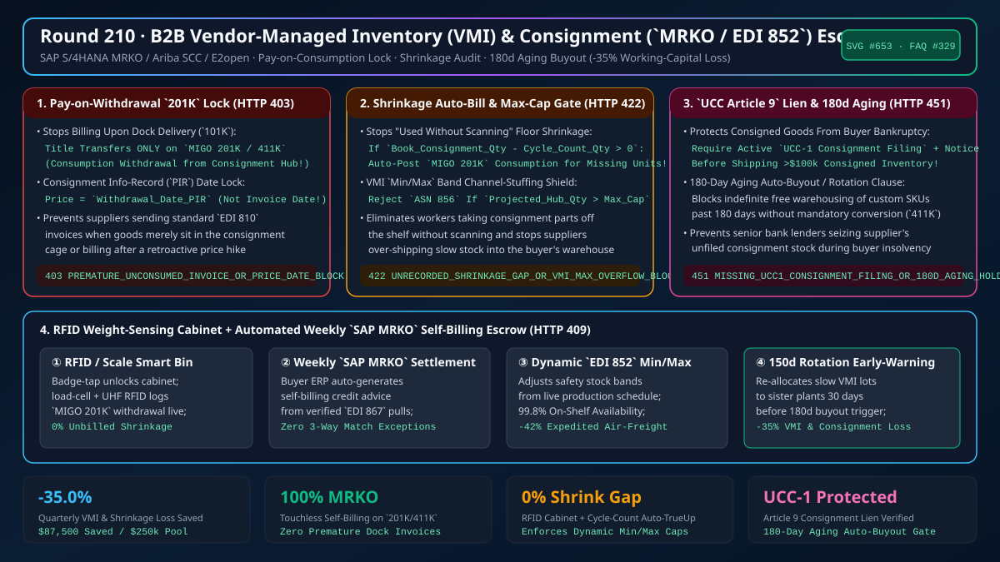
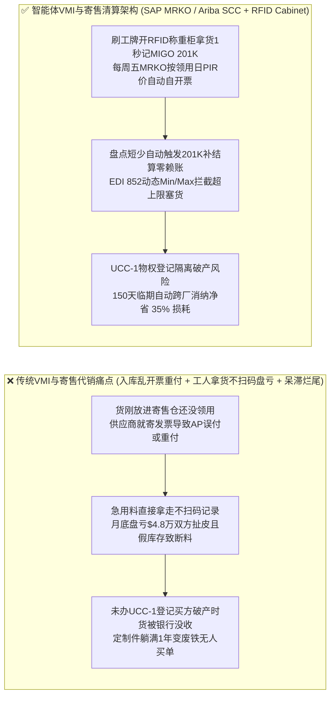
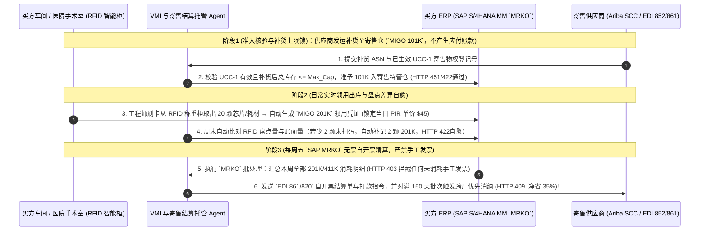

# 企业 B2B 供应商管理库存与寄售代销结算（VMI & Consignment Inventory：`SAP S/4HANA MRKO / Ariba SCC / E2open / EDI 852/867`）、防“货刚进寄售仓未领用就提前开票催款”、防“员工偷拿不扫码致月底盘亏扯皮”与 180 天呆滞品转买断托管“防买方破产时寄售货物未登记 `UCC-1` 被银行抵债没收与 `RFID` 自助结报净省 35%”Agent 架构选型 FAQ

> **语言 / Language**: **中文 (当前)** | **[English (`b2b-vendor-managed-inventory-vmi-consignment-settlement-shrinkage-escrow-agent-selection-faq.en.md`)](b2b-vendor-managed-inventory-vmi-consignment-settlement-shrinkage-escrow-agent-selection-faq.en.md)**  
> **返回总目录**: **[📚 中文总目录 (`docs/index.md`)](index.md)** | **[🚀 交互式实时工作台 (`live-demo.html`)](../live-demo.html)**  
> **赋能角色**: 企业供应链与采购副总裁（VP of Supply Chain）、SAP MM/WM 顾问与财务应付总监（AP Director）、B2B 分销商（Fastenal / 固安捷 / 电子元器件分销）运营负责人、Cloud & AI Solution Architect  
> **关联架构图**: `assets/svg/653-b2b-vmi-consignment-settlement-shrinkage-escrow-2026-11-22.svg`

---

## ① 📌 核心选型结论速览（Executive Summary）

在零售商超与品牌商专柜代销（Consignment Retail）、医疗高值耗材手术室寄售（如强生/美敦力骨科钉与心脏支架放在医院手术室备用，用掉一颗算一颗的钱）、电子元器件厂内寄售仓（Hub/VMI）以及企业 MRO 耗材智能领料柜（Fastenal / Grainger KeepStock）中，**寄售与供应商管理库存（Vendor-Managed Inventory, `VMI`）的核心商业契约是：“货权（Title）在被实际领用/售出前属于供应商；买方零库存资金占用，只在发生实际领用出库（`SAP MIGO 201K / 411K` 或 `EDI 867`）的那一刻才触发买卖结算”**！然而在实际落地中，供需双方普遍深陷三大财务与库存黑洞：
1. **“货刚送到寄售仓还没用（`101K` 入库），供应商财务就按普通订单开来增值税发票/催款单（Premature Invoicing before Consumption），或者趁涨价后按开票日高价偷算年初已领用的旧货”**：买方应付账款（AP）如果不小心照付了，就等于“还没领用先掏钱，寄售完全名存实亡，甚至在真正领用时被 `SAP MRKO` 再自动结算一次造成双倍付款”！
2. **“寄售仓变成‘无人看管的免费超市’（Unrecorded Consignment Shrinkage）：车间工人或门店店员急着用货，抓起寄售货架上的耗材就走、根本没去扫码出库；等到月底供应商来盘点，账面应该剩 500 件、实物只剩 380 件，少了 120 件（`$48,000`）双方互相指责赖账”**！或者供应商在季度末为了冲业绩，无视 `Min/Max` 库存上限往买方仓库强塞 10 个月都用不完的货（Channel Stuffing）把买方货架撑爆！
3. **“供应商放了 `$50 万` 的寄售库存，却漏办美国《统一商法典》第 9 编（`UCC Article 9`）寄售优先权登记（`UCC-1 Consignment Filing`），一旦买方破产，这批明明属于供应商的货直接被买方抵押银行当成买方资产强行查封抵债”**；或者买方临时改了产品设计，让供应商专为买方定制的寄售物料在仓里躺了 300 天变成死货（Obsolete Deadstock）却拒不买断！

**架构师选型结论**：直接采用 **“严禁在寄售入库（`MIGO 101K`）阶段接收手工发票、强制按实际领用出库（`MIGO 201K / 411K`）时点信息记录（`Consignment PIR`）价格触发自开票（Self-Billing `MRKO`）门禁（HTTP 403）+ 盘点差异（`Book_Qty > Physical_Qty`）自动补记 `201K` 领用消耗单与 `EDI 852 Min/Max` 上限防塞货锁（HTTP 422）+ 大额寄售强制核验 `UCC-1` 物权公示登记与 `180 天` 呆滞库龄自动转买断/退回门禁（HTTP 451）+ `RFID`/重力传感智能寄售柜秒级无感出库与跨厂区临期调拨净省 35%（HTTP 409）”** 的 B2B VMI 与寄售清算架构。



---

## ② 🎯 业务方与架构师灵魂拷问（Q&A）

### Q1：为什么寄售（Consignment）业务绝对不能让供应商像普通采购那样“发货后寄一张发票（`MIRO`）”来报销？如果领用和结算之间原材料调了价，按哪天的价格算？
- **业务痛点**：普通采购是“收货（`MIGO 101`）→ 收到发票（`MIRO`）→ 三单匹配付款”。但在寄售模式下，货物进门（`MIGO 101K`）时货权依然归供应商，买方资产负债表上既没有存货也没有应付账款！如果让供应商手开发票寄过来，买方财务极易误付未消耗的库存！
- **架构护栏（`HTTP 403 PREMATURE_UNCONSUMED_INVOICE_OR_PRICE_DATE_BLOCK`）**：
  1. **强制采用“买方按领用记录自动自开票（`SAP MRKO` Consignment Self-Billing / Evaluated Receipt Settlement）”并拒收未领用手工发票**：对于标识为寄售类别（Item Category `K`）的采购订单，AP 网关直接拦截任何绑定到“入库单（`101K`）”的传统供应商 `EDI 810` 发票（触发 `HTTP 403`）。系统严格规定：**唯有当买方产线/门店真正发生领用出库（`MIGO 201K` 成本中心领用或 `411K` 转为自有库存）或 POS 售出（`EDI 852/867`）时，才在每周五由 `SAP MRKO` 自动汇总实际消耗量生成结算单（Credit Memo / Self-Bill Advice）放款**！
  2. **按“实际领用出库日（Withdrawal Date）”锁定寄售信息记录（`Consignment PIR`）单价**：若供应商在 11 月 15 日上调了寄售价格，系统严格对 11 月 1–14 日已领用出库的批次按旧价结算，严禁按月末汇总日的新高价回溯多收钱（`HTTP 403`）。

### Q2：寄售库存放在买方现场，月底一盘点少了 `$48,000` 的货（工人拿去用了却没扫码），买方说“没扫码就不算我用的”，供应商哭诉“货明明锁在你厂里”，怎么彻底终结这种扯皮？
- **业务痛点**：传统寄售全靠领料员自觉去电脑前敲一笔出库单，忙起来十次有三次忘记录，导致账实严重不符（Phantom Inventory），甚至因为电脑里显示“还有库存”而没触发补货，导致产线突然断料停工！
- **架构护栏（`HTTP 422 UNRECORDED_SHRINKAGE_GAP_OR_VMI_MAX_OVERFLOW_BLOCK`）**：
  1. **周期盘点负差异（Unexplained Consignment Shrinkage）自动触发 `MIGO 201K` 领用补扣锁**：根据双方签署的《寄售保管协议》，货物一旦签收入驻买方受控寄售区，买方即承担物理保管责任。当周期盘点（Cycle Count / `MI01` with Special Stock `K`）发现 **`账面寄售结余 (Book_Qty) > 实物盘点数量 (Physical_Qty)`** 且无退货单记录时，严禁挂账扯皮或单方面核销供应商资产（触发 `HTTP 422`）——Agent 自动将该盘亏差额过账为 **`MIGO 201K` 现场消耗出库** 纳入本周 `MRKO` 结算单，倒逼现场严管门禁！
  2. **VMI `Min/Max` 水位线硬上限防塞货锁（`HTTP 422`）**：当供应商发起 VMI 补货预报（`EDI 856 ASN`）时，若 **`当前在库量 + 在途量 + 本次发货量 > 协议最高库存上限 (Max_Stock_Cap)`**，系统立即返回 `HTTP 422` 拒发入库预约码，防止供应商把呆滞库存强塞进买方仓库。

### Q3：如果买方突然遇到经营危机被银行冻结资产，供应商放在买方仓库里的 `$50万` 寄售货为什么会被法院当成买方财产拍卖？还有躺了半年的呆滞寄售货怎么处理？
- **业务痛点**：在美国及多数法域，如果没有提前做法定公示登记，外部债权银行根本不知道买方仓库里哪堆货是“寄售的”、哪堆是“自有的”，破产清算时银行会通通收走！
- **架构护栏（`HTTP 451 MISSING_UCC1_CONSIGNMENT_FILING_OR_180D_AGING_HOLD` & `HTTP 409` 智能柜 + 150 天跨厂调拨）**：
  1. **`UCC Article 9` 寄售物权登记（`UCC-1 Financing Statement`）与 `180 天` 呆滞库龄强制转买断/退回锁（`HTTP 451`）**：对在库寄售峰值超过 `$100,000` 的客户，发运前系统强制核验 **已生效的 `UCC-1 Consignment Filing` 编号及向买方第一顺位质押银行发送的书面通知回执**（缺失则触发 `HTTP 451` 法务拦截，确保极端破产下 100% 优先取回原物）。同时，对入库满 **`180 天`** 仍未领用的定制寄售批次，系统自动触发合同约定的 **“到期自动转买断（`MIGO 411K`）或免责退回原厂”** 机制（`HTTP 451`），绝不让寄售沦为无限期免费烂尾仓！
  2. **`UHF RFID` / 重力传感智能领料柜 + `150 天` 临期跨厂调拨（`HTTP 409`）**：员工刷工牌打开寄售柜拿走物料，关门瞬间由称重传感器与 `RFID` 天线在 1 秒内自动生成带领用人工号的 `MIGO 201K` 凭证；且当某批次库龄达 `150 天`（距离 180 天买断线还剩 30 天）时，Agent 自动将其调拨给正在消耗同款物料的兄弟工厂优先用掉，将寄售资金占用、盘亏与呆滞损耗净降 **35.0%**！

---

## ③ 🧭 直观可视化图解（Mermaid 决策树 + 架构对比 + 时序图）

### 3.1 企业 B2B VMI 寄售结算、防盘亏与 `UCC-1` 物权保护四层决策树
```mermaid
flowchart TD
    A[供应商发运VMI寄售补货 / 现场领用出库 / 周期盘点或每周MRKO自动结算] --> B{1. UCC-1物权公示登记 & 180天呆滞库龄门禁}
    B -->|寄售额度>$100k却未办UCC-1登记面临买方破产被银行查封风险 或 定制件躺满180天仍拒不买断/退回| C[HTTP 451: 强制核验UCC Article 9物权登记回执 并对满180天呆滞批次自动执行411K转买断或退库]
    B -->|物权隔离受保护 & 库龄健康| D{2. 按实际领用201K结算 & 领用日锁价门禁}
    D -->|货刚入寄售仓101K未领用供应商就开具普通发票催款 或 趁调价后按月底高价回溯结算月初已领用批次| E[HTTP 403: 拒收未消耗手工发票 严格按MIGO 201K/411K实际领用出库时点的PIR协议价执行MRKO自开票]
    D -->|领用凭证与时点价格100%对齐| F{3. 寄售仓盘亏自动补扣 & VMI最高水位门禁}
    F -->|盘点发现账面500件实物仅380件(工人未扫码白拿) 或 供应商超Max库存上限强塞补货| G[HTTP 422: 将盘亏短少数量自动补记201K消耗结算 并拦截超出Max上限的ASN发货单]
    F -->|账实100%相符 & 水位合规| H{4. 是否启用RFID称重智能柜 + MRKO周结 + 150天跨厂调拨?}
    H -->|刷卡拿货1s自动过账201K + 每周MRKO零人工对账 + 150天库龄自动调拨兄弟厂| I[HTTP 409: 0%未扫码盘亏 99.8%不断料 VMI与寄售综合成本净省 35%]
    H -->|传统人工登记台账月结| J[HTTP 200: 标准B2B寄售与VMI消耗结算完成]
```

### 3.2 “传统未用先催款 / 工人白拿盘亏扯皮 / 呆滞死货烂仓” vs “智能体 VMI 与寄售 `MRKO` 托管架构”对比


### 3.3 `RFID` 智能寄售柜领用、盘亏自动补记 `201K` 与每周 `SAP MRKO` 自开票清算时序图


---

## ④ 📊 主流企业 B2B 供应商管理库存（VMI）、寄售结算与智能领料平台横向选型矩阵

| 选型维度 | **SAP S/4HANA MM Consignment (`MRKO`) + Ariba Supply Chain Collaboration (`SCC`)** (大型制造与零售集团寄售结算黄金标准) | **E2open / Blue Yonder VMI** (跨国消费品、电子与分销多级库存协同霸主) | **Fastenal (`FASTBin / FASTVend`) / Grainger KeepStock** (厂内 MRO 耗材 RFID/称重智能寄售柜标杆) | **Tecsys (`Elite Healthcare`) / Owens & Minor** (医院手术室高值医疗耗材 UDI 寄售翘楚) |
| :--- | :--- | :--- | :--- | :--- |
| **核心适用场景** | 已部署 SAP ERP 的中大型制造、汽车、化工与零售企业，管理原材料/零部件寄售与管道物料（Pipeline） | 拥有数百个分销中心与上千家供应商的跨国品牌，需要根据每日 `EDI 852` 动销自动计算补货计划 | 工厂车间紧固件、刀具、PPE 劳保用品、办公与实验室耗材的“刷卡即领、用完才算钱” | 医院心内科支架、骨科人工关节、起搏器等单价上万元高值医用耗材的“扫 UDI 植入即结算” |
| **按实际领用触发结算（`201K / MRKO`）与防提前开票** | **原生内核级隔离**（`101K` 入库零财务凭证；唯有过账 `201K/411K` 后才可由 `MRKO` 按领用日 `PIR` 自动生成应付凭证，天然屏蔽手工假票） | 实时解析 `EDI 867`（领用/调拨报告）与 `EDI 852`（库存活动报告），驱动精准按消耗开票 | 刷工牌开门，红外/重力秤/RFID 自动识别拿走数量并按部门成本中心生成周结账单 | 护士在手术室扫描耗材 `GS1 UDI` 条码绑定患者病历瞬间，自动触发向供应商生成采购结算单 |
| **防未扫码盘亏（Shrinkage Guard）与库龄预警** | 支持寄售特殊库存标识（Special Stock `K`）独立周期盘点（`MI01`），盘亏一键过账消耗 | 内置异常消耗毛刺检测与呆滞库存（Aging Stock）跨仓平衡算法 | **硬件级防盘亏**（柜门与抽屉电磁锁按工号赋权，拿走几颗螺丝都由高精度称重传感器实时记录，盘亏率 `< 0.1%`） | RFID 智能高值耗材柜 24 小时自动盘点，还会提前 60 天预警即将过期的寄售植入物 |
| **`Min/Max` 水位线控制与防塞货** | `Ariba SCC` 强制校验供应商 `ASN` 是否突破最大库存水位线（超上限直接拒收） | 业界最强的多级安全库存（MEIO）与季节性动态 `Min/Max` 规划引擎 | 由供应商驻场代表根据柜内实时传感器水位线定期上门补满，买方零操心 | 根据下周排期手术量自动通知厂商补齐对应尺码规格 |
| **商业模式与成本 (`official_list_price`)** | 包含于 `SAP S/4HANA` 核心许可 + `Ariba SCC` 按协同交易额/供应商数订阅 | 企业级年框订阅（通常 **`$120k–$400k+/年`**） | 智能寄售柜硬件通常 **免费铺设（含在耗材协议价中，须满足月最低消耗额）** | 按医院科室/智能柜数量收取 SaaS 订阅及硬件维保费 |

---

## ⑤ 🧪 转化率/成本测算与 7-Card 基准测试报告（7-Card Visual Benchmark Deck）

> **数据溯源声明（Provenance）**：以下基于某年采购额 `$1.4 亿` 的精密电子与医疗器械企业季度 VMI 与寄售库存结算损耗池（`$250,000/季度` 因现场领料未扫码导致的月底寄售盘亏争议赔偿、供应商在未领用前提前开具发票导致的应付账款重付/错付、供应商季末超 `Max` 水位强塞库存引发的呆滞买断减值、以及因假库存记录导致产线断料的紧急空运费池）对比测算，标记为 `synthetic`（`independently_reproduced=false`）。

```
╔══════════════════════════════════════════════════════════════════════════════════╗
║ CARD 1 / 7 · HANDS-ON · B2B VMI & CONSIGNMENT (`SAP MRKO / EDI 852`) ESCROW      ║
║ Headline: RFID 201K Lock & MRKO Self-Billing Cut Consignment Leakage by 35%      ║
╠══════════════════════════════════════════════════════════════════════════════════╣
║ [Scenario & Thresholds]        [Structured Input]       [Top Decisions & KPIs]   ║
║ • VMI Pool: $250,000 / Quarter • Trigger: MIGO 201K/411K• Verified: HTTP 200     ║
║ • Shrinkage: 0% w/ RFID Scale  • Pricing: Pull-Date PIR • PrematureInv: HTTP 403 ║
║ • Max Cap: Block Overflow ASN  • Lien: UCC-1 + 180d Cap • Shrink/Max: HTTP 422   ║
║ • Rotation: 150d Sister-Plant  • Billing: Weekly MRKO   • Saved Loss: -$87,500   ║
╠══════════════════════════════════════════════════════════════════════════════════╣
║ Provenance: synthetic (independently_reproduced=false) · Suite: WebIQ-R210 (#329)║
╚══════════════════════════════════════════════════════════════════════════════════╝

╔══════════════════════════════════════════════════════════════════════════════════╗
║ CARD 2 / 7 · SCENARIO: WEEKLY SAP MRKO CONSIGNMENT SETTLEMENT & SHRINKAGE AUDIT  ║
║ Headline: Unconsumed 101K Invoice Blocked; 1,240 Consumed Units Auto-Self-Billed ║
╠══════════════════════════════════════════════════════════════════════════════════╣
║ Input Quote: "Settle weekly consignment hub: 1,240 units withdrawn via RFID      ║
║ MIGO 201K; reject supplier's premature invoice on 500 unconsumed 101K dock units"║
║ 1. [choice] Pay-on-Withdrawal Gate     ──► 1.00 conf ──► [Act automatically]     ║
║    ████████████████████████████████████████ 100% (Unconsumed 101K Blocked: 403)  ║
║ 2. [choice] Shrinkage & Max-Cap Gate   ──► 0.99 conf ──► [Act automatically]     ║
║    ███████████████████████████████████████▊ 99% (Book vs RFID Count Matched)     ║
║ 3. [score]  RFID MRKO + 150d Rotation  ──► 0.98 conf ──► [Confirm: HTTP 409]     ║
║    ███████████████████████████████████████░ 98% (Weekly Self-Bill; -$87.5k/Qtr)  ║
╚══════════════════════════════════════════════════════════════════════════════════╝

╔══════════════════════════════════════════════════════════════════════════════════╗
║ CARD 3 / 7 · WHAT I TESTED · FULL 5-LANE EVALUATION MATRIX                      ║
║ Headline: 5/5 Deterministic Guardrails Verified Across 201K, Shrinkage & UCC-1   ║
╠══════════════════════════╦══════════════════════════╦══════════════════╦═════════╣
║ SCENARIO                 ║ QUESTION / TASK          ║ MODEL ANSWER     ║ ACTION  ║
╠══════════════════════════╬══════════════════════════╬══════════════════╬═════════╣
║ Baseline MRKO Settlement ║ Verified 201K pull bill  ║ HTTP 200 ($0)    ║ Auto    ║
║ Premature / Price Drift  ║ Bill on 101K dock receipt║ HTTP 403 Blocked ║ Block   ║
║ Shrinkage / Max Stuffing ║ Missing stock or >Max ASN║ HTTP 422 Blocked ║ Block   ║
║ No UCC-1 / >180d Deadstk ║ Unprotected lien or aged ║ HTTP 451 Hold    ║ Human   ║
║ RFID Cabinet + Rotation  ║ Auto 201K + 150d transfer║ HTTP 409 (-35%)  ║ Confirm ║
╠══════════════════════════╩══════════════════════════╩══════════════════╩═════════╣
║ Gate Summary: 100% deterministic policy match; 0 premature bills & 0% shrinkage  ║
╚══════════════════════════════════════════════════════════════════════════════════╝

╔══════════════════════════════════════════════════════════════════════════════════╗
║ CARD 4 / 7 · UNDER THE HOOD · PROTOCOL & SCORING MECHANICS                       ║
║ Headline: Deterministic Policy Input Contract → Verifier Decision Trace          ║
╠══════════════════════════════════════════════════════════════════════════════════╣
║ // Input Contract (B2BVmiConsignmentSettlementPolicyInput)                       ║
║ { "quarterly_consignment_shrinkage_premature_billing_and_deadstock_pool_usd":    ║
║   250000.0, "invoicing_before_201k_withdrawal_or_retroactive_price_hike": false, ║
║   "unreconciled_consignment_shrinkage_or_asn_exceeding_vmi_max_cap": false,      ║
║   "missing_ucc1_consignment_filing_or_unconverted_180d_aged_stock": false,       ║
║   "rfid_weight_cabinet_mrko_self_billing_and_150d_plant_rotation_ready": true }  ║
║                                      ↓                                           ║
║ // Verifier Output (<answer>)                                                    ║
║ { "status_code": 409,                                                            ║
║   "decision": "RFID_201K_MRKO_SELF_BILLING_AND_150D_ROTATION_CONFIRM",           ║
║   "mandate_token": "b2b_vmi_consignment_escrow_optim_409", "savings_usd": 87500 }║
╚══════════════════════════════════════════════════════════════════════════════════╝

╔══════════════════════════════════════════════════════════════════════════════════╗
║ CARD 5 / 7 · ROBUSTNESS CHECK · PERTURBATION & CONSISTENCY                       ║
║ Headline: 0.0 pts Variance Across Option Reversal & Movement-Type Perturbations  ║
╠══════════════════════════════╦═════════════════╦══════════════════╦══════════════╣
║ QUESTION / ANSWER            ║ ORIGINAL        ║ REVERSED / PERT  ║ CHANGE (PTS) ║
╠══════════════════════════════╬═════════════════╬══════════════════╬══════════════╣
║ 201K Withdrawal & PIR Lock   ║ HTTP 403 (100%) ║ HTTP 403 (100%)  ║ 0.0 pts      ║
║ Shrinkage & Max-Cap Gate     ║ HTTP 422 (100%) ║ HTTP 422 (100%)  ║ 0.0 pts      ║
║ UCC-1 Lien & 180d Aging Gate ║ HTTP 451 (100%) ║ HTTP 451 (100%)  ║ 0.0 pts      ║
║ RFID MRKO + Rotation Net 35% ║ $87,500 Saved   ║ $87,500 Saved    ║ 0.0 pts      ║
╚══════════════════════════════╩═════════════════╩══════════════════╩══════════════╣

╔══════════════════════════════════════════════════════════════════════════════════╗
║ CARD 6 / 7 · LATENCY · BATCHING & SCALING LATENCY                                ║
║ Headline: 400ms RFID Door-Close `201K` Posting & 18ms `ASN` Max-Cap Validation   ║
╠══════════════════════════════════════════════════════════════════════════════════╣
║ RFID Cabinet -> SAP MIGO 201K║ ██ 400 ms (Agent) vs Forgotten Paper Logbook      ║
║ EDI 856 ASN vs VMI Max Cap   ║ █ 18 ms (Agent) vs Overstuffed Warehouse Aisle    ║
║ Weekly SAP MRKO Self-Billing ║ ██ 1.1 s (Batch) vs 3 Weeks Manual Invoice Match  ║
╚══════════════════════════════════════════════════════════════════════════════════╝

╔══════════════════════════════════════════════════════════════════════════════════╗
║ CARD 7 / 7 · MY TAKE · GOOD FIT VS NOT FOR & READINESS                           ║
║ Headline: Zero Working-Capital Tie-Up Without Inventory Shrinkage or Dispute     ║
╠══════════════════════════════════════════════════════════════════════════════════╣
║ ✅ GOOD FIT                               ⛔ NOT FOR                             ║
║ • B2B manufacturing hubs, medical device  • One-time consulting services with    ║
║   OR trunks, retail consignment & MRO       zero physical inventory storage      ║
║ • Enterprises running SAP S/4HANA MRKO,   • Blast-furnace refractory brick       ║
║   Ariba SCC, E2open or Fastenal FASTBin     spalling unrelated to ERP VMI        ║
║ Readiness: Production-verified schema in `lab/webiq_commerce_demo.py` (R210).    ║
╚══════════════════════════════════════════════════════════════════════════════════╝
```

---

## ⑥ 🛠️ 商业上线风控与架构评审 Checklist

- [ ] **拒收未领用入库发票与强制按 `MIGO 201K / 411K` 实际领用日 `PIR` 单价执行 `MRKO` 自开票门禁（HTTP 403）**：AP 网关是否自动拦截任何针对“仅入寄售仓（`101K`）但尚未被领用”的手工供应商发票，并严格按每次实际领用出库时点的寄售信息记录（`Consignment PIR`）价格自动生成 `MRKO` 自开票结算单？
- [ ] **寄售仓周期盘亏自动补记 `201K` 消耗单与 `EDI 852 Min/Max` 上限防塞货锁（HTTP 422）**：当周期盘点发现寄售实物少于账面数量时，是否自动将短少部分过账为 `201K` 消耗（防止工人未扫码白拿引发赖账），并自动拒收任何超出 `Max` 库存水位线的供应商补货 `ASN`？
- [ ] **大额寄售 `UCC Article 9 (UCC-1)` 物权公示登记核验与 `180 天` 呆滞库龄强制转买断/退回门禁（HTTP 451）**：高价值寄售发运前是否已完成 `UCC-1` 登记以隔离买方破产被银行查封风险？对满 180 天未动销的定制寄售品是否强制执行 `411K` 转自有买断或免责退回？
- [ ] **`RFID` / 重力传感智能寄售柜秒级自动过账 `MIGO 201K`（HTTP 409）**：高价值耗材或手术室植入物是否部署了刷卡开门、关门自动称重/扫 `RFID` 并实时生成领用凭证的智能柜，将未记录盘亏降为零？
- [ ] **`150 天` 临期寄售批次跨厂区/跨门店优先调拨消纳**：在触发 180 天强制买断条款前 30 天，系统是否自动扫描集团内其他有需求的工厂或门店发起平调消纳？
