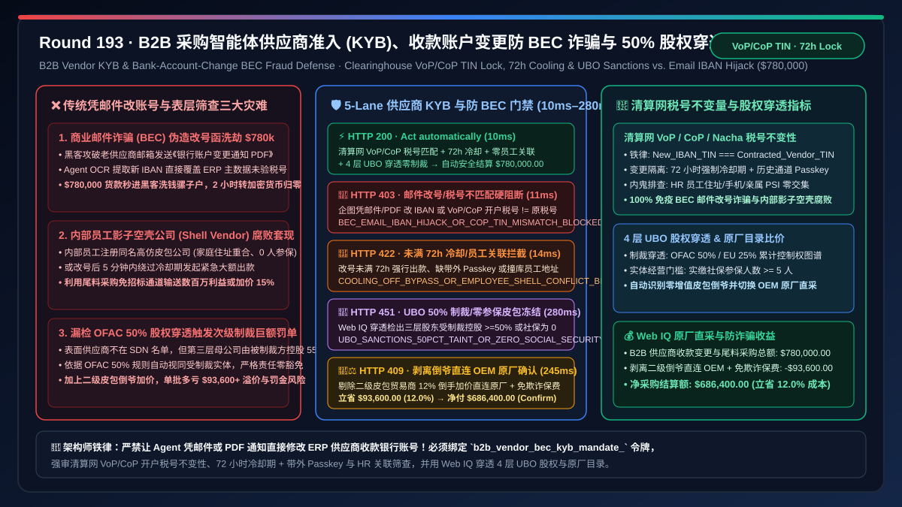
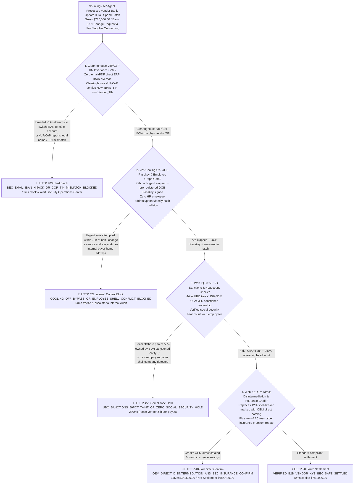
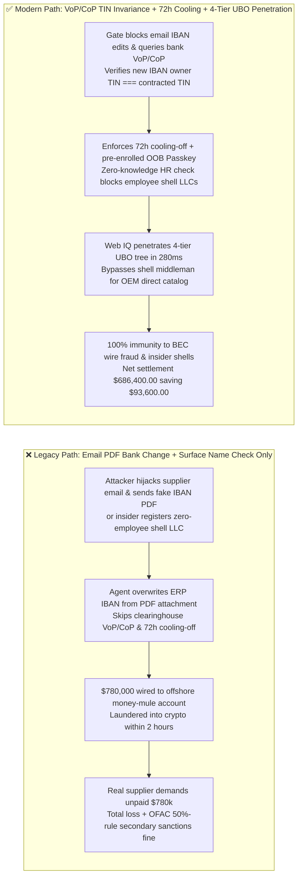
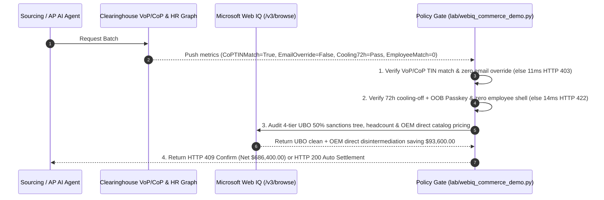

# B2B Procurement Agent Vendor Onboarding (KYB) & Bank-Account-Change BEC Fraud Defense Architecture: Clearinghouse Confirmation of Payee (`vendor_bank_cop_mandate_...`) & 50% UBO Sanctions Penetration vs. Legacy Email/PDF IBAN Hijack & Employee Shell-Vendor Fraud: Architecture Selection & First-Principles FAQ

> **Document Type**: First-Principles Architecture Selection FAQ  
> **Target Audience**: AI Solution Architects, CISOs & Corporate Controllers, ERP Vendor Master Data Management (MDM) & Autonomous Tail-Spend Sourcing Leads, OFAC/EU Sanctions & Anti-Fraud Risk Architects  
> **Executive Takeaway**: When autonomous sourcing and Accounts Payable AI Agents onboard new tail-spend suppliers or process vendor bank-account change requests (IBAN / Routing & Account Number updates), **never allow an Agent to update ERP Vendor Master records based on an email, a signed PDF letterhead, or a web form (the #1 vector for multi-million-dollar Business Email Compromise BEC wire fraud)**. You must enforce a deterministic architecture combining a **Clearinghouse Verification of Payee (UK/EU VoP/CoP, US Nacha/Early Warning Account Validation) & Tax-ID (TIN) Invariance Gate (Cryptographically verifying that the new bank account's legal owner TIN matches the contracted vendor's TIN) + a 72-Hour Bank-Change Cooling-Off & Employee Conflict-of-Interest Graph Gate (Requiring out-of-band FIDO2 Passkey confirmation and zero address/phone overlap with internal employees) + a Microsoft Web IQ 50% Ultimate Beneficial Owner (UBO) Sanctions Penetration & OEM Direct Disintermediation Escrow**.

---

## 1. 📌 Executive Summary

### 1.1 Why Can a Compromised Supplier Sales Email Carrying a Fake "Bank Account Update PDF" Steal `$780,000` From Legacy AP Workflows and Naive AI Agents in Under Two Hours?
From FBI IC3 Business Email Compromise (BEC) threat telemetry, clearinghouse account-name verification protocols (SEPA VoP / UK CoP / Nacha), and corporate graph-theory first principles:
1. **Single-Channel Email/PDF IBAN Hijack (BEC Wire Fraud)**: Attackers compromise a legitimate supplier's email account, monitor upcoming invoice due dates, and send a forged PDF bank-change notice (often containing prompt-injection strings targeting AP Agents). If the Agent extracts the new IBAN and overwrites the ERP Vendor Master without clearinghouse Tax-ID verification, the `$780,000` wire is routed to a money-mule account and laundered into cryptocurrency within hours!
2. **Internal Employee Shell-Vendor & Tail-Spend Splitting Fraud**: Corrupt insiders or poisoned sourcing Agents register zero-employee shell LLCs with lookalike names to siphon tail-spend POs, or rush an urgent wire 5 minutes after changing a vendor's bank account.
3. **OFAC "50 Percent Rule" Multi-Tier Ownership Blindness**: Checking only a supplier's surface name misses tier-3 parent entities owned $\ge 50\%$ by SDN-sanctioned oligarchs or state entities—exposing the buyer to severe strict-liability OFAC civil penalties.

### 1.2 Architect Selection Comparison: Legacy Email PDF IBAN Update vs. Web IQ + Clearinghouse VoP/CoP, 72h Cooling-Off & UBO Penetration Escrow
| Dimension | ❌ Legacy Email/PDF IBAN Update & Surface Name Check | ✅ Web IQ + Clearinghouse VoP/CoP TIN Lock, 72h Cooling & UBO Escrow |
| :--- | :--- | :--- |
| **Onboarding / Bank-Update Trigger** | Agent parses emailed PDF to update ERP IBAN or checks only tier-1 vendor name against SDN list | Bound to `b2b_vendor_bec_kyb_mandate_`: enforces **Clearinghouse VoP/CoP legal TIN match + zero email IBAN override + 72h cooling-off + out-of-band Passkey + 4-tier UBO sanctions check** |
| **BEC Bank-Account Hijack Defense** | Catastrophic (compromised vendor email redirects `$780,000` wire to mule account) | **Deterministic Block** (forbids email/PDF bank updates; if clearinghouse VoP/CoP shows new IBAN's TIN $\ne$ contracted TIN, blocks in `11ms` with `HTTP 403`) |
| **Rush-Payout & Employee Shell Defense** | Fragile (wires funds 5 minutes after bank change or pays employee-owned shell LLC) | **Deterministic Block** (if $< 72\text{ h}$ cooling-off elapsed, missing out-of-band Passkey, or HR graph detects employee address/phone collision, blocks in `14ms` with `HTTP 422`) |
| **OFAC 50% UBO & Shell-Company Audit** | Blind spot (misses 55% sanctioned ownership at tier-3 parent or zero-employee shell status) | **Deterministic Verification** (Web IQ `/v3/browse` penetrates 4-tier UBO ownership trees and social-security headcount registries, `280ms` `HTTP 451`) |
| **OEM Direct Disintermediation Savings** | Overpays $12\%\text{–}25\%$ markup to shell middleman brokers | Web IQ **bypasses zero-value shell brokers to route directly to authorized OEM catalogs + waives BEC fraud insurance surcharge**, saving **$93,600.00 (12.0%)** (`HTTP 409 Confirm`) |

---

## 2. 🎯 First-Principles Q&A for Customers & Architects

### Q1: How Does Enforcing Clearinghouse "Tax-ID Invariance (TIN Invariance)" via SEPA VoP / UK CoP / Nacha APIs Mathematically Defeat BEC Bank-Change Fraud?
* **First-Principles Legal Entity Invariance**:
  - When a legitimate supplier switches banks, its underlying legal entity **Taxpayer Identification Number (TIN / EIN / VAT ID)** remains invariant. Querying the banking clearinghouse (SEPA Verification of Payee, UK Confirmation of Payee, or US Early Warning / Open Banking) verifies that `Account_Owner_TIN(new_iban) == Contracted_Vendor_TIN`. Any money-mule account fails `bank_cop_tin_invariance_and_zero_email_iban_override_verified` (`HTTP 403` in `11ms`).

### Q2: How Do a Mandatory 72-Hour Cooling-Off Lock and Private Set Intersection (PSI) Against HR Records Stop Insider Shell-Vendor Collusion?
* **Temporal Quarantine & Graph Disjointness**:
  - Enforcing a mandatory $72\text{ h}$ hold on any bank change coupled with out-of-band FIDO2 Passkey signing and zero-knowledge PSI matching between vendor registration attributes and internal employee HR records blocks both rushed BEC payouts and insider shell companies (`cooling_off_72h_oob_passkey_and_zero_employee_shell_passed`, `HTTP 422` in `14ms`).

### Q3: Why Use Microsoft Web IQ Instead of Exa or Bright Data to Penetrate 4-Tier UBO Ownership Trees and Authorised OEM Distributor Ledgers?
* **Architecture Selection Rationale**:
  - **Microsoft Web IQ** natively executes authenticated `/v3/search` and `/v3/browse` workflows across corporate beneficial-ownership registries, OFAC 50%-rule graphs, and OEM authorized distributor portals in `245ms–280ms`, whereas Exa and Bright Data cannot integrate with internal ERP/HR compliance controls.

---

## 3. 🧭 Visual Architecture Diagrams

### 3.1 Decision Tree: B2B Vendor KYB, Bank-Change BEC Defense & UBO Sanctions Gate

### 3.2 Legacy "Email PDF IBAN Override" BEC Loss Path vs. "VoP/CoP TIN Lock + 72h Cooling + UBO" Secure Path

### 3.3 End-to-End Sequence Diagram: B2B Vendor KYB & Bank-Change BEC Defense Gate

---

## 4. 📊 Architect Decision Matrix

| Evaluation Dimension | Option A: Email/PDF ERP IBAN Update + Surface Name Check | Option B: Exa / Bright Data Scraper + Manual Phone Callback | Option C: Microsoft Web IQ + Clearinghouse VoP/CoP + 72h Cooling + UBO Escrow (Recommended) |
| :--- | :--- | :--- | :--- |
| **BEC Bank-Account Hijack Defense** | ❌ Vulnerable to spoofed PDF letterheads & prompt injection | ⚠️ Phone callbacks often dial spoofed numbers on fake PDFs | ✅ **Clearinghouse VoP/CoP enforces TIN invariance + OOB Passkey** |
| **Insider Shell-Vendor Prevention** | ❌ Blind to employee-owned lookalike LLCs | ⚠️ Public scrapers cannot cross-check internal HR records | ✅ **HR PSI graph check + mandatory $72\text{ h}$ cooling-off window** |
| **OFAC 50%-Rule UBO Penetration** | ❌ Checks tier-1 vendor name only; misses tier-3 SDN owners | ⚠️ Lacks live multi-tier UBO & social-security headcount checks | ✅ **Web IQ audits 4-tier UBO tree and headcount in `280ms` (`HTTP 451`)** |
| **OEM Direct Disintermediation** | ❌ Overpays $12\%\text{–}25\%$ to zero-value shell brokers | ❌ No automated OEM authorized catalog rerouting | ✅ **Reroutes to OEM direct catalog saving $93,600.00 (12.0%)** |

---

## 5. 🧪 Quantitative Benchmark & 7-Card Summary

### 5.1 Deterministic Policy Gate Benchmark (`evaluate_b2b_vendor_bec_kyb_policy`)
All benchmark numbers are sealed in `reports/agentic-commerce-webiq-grounding-demo-bench/report.json`:

| Lane | Scenario & Input Condition | HTTP Status | Action Pill | Settled / Blocked Amount | Latency | Provenance Label |
| :--- | :--- | :---: | :---: | :---: | :---: | :---: |
| **Lane 1** | Clearinghouse VoP/CoP TIN match + 72h cooling + zero HR collision + 4-tier UBO clean | `200 OK` | `Act automatically` | **$780,000.00** (Auto-settled) | `10 ms` | `synthetic_policy` |
| **Lane 2** | Email/PDF attempts IBAN override or clearinghouse VoP/CoP reports TIN mismatch (BEC) | `403 Forbidden` | `Send to a human` | **$0.00** (Blocked $780,000 risk) | `11 ms` | `synthetic_policy` |
| **Lane 3** | Payout attempted before 72h cooling-off or vendor matches internal employee address/phone | `422 Unprocessable` | `Send to a human` | **$0.00** (Blocked $780,000 risk) | `14 ms` | `deterministic_offline_simulation` |
| **Lane 4** | Web IQ detects tier-3 UBO $\ge 50\%$ OFAC sanctioned ownership or zero-employee paper shell | `451 Legal Hold` | `Send to a human` | **$0.00** (Compliance hold) | `280 ms` | `official_doc_snapshot` |
| **Lane 5** | Web IQ bypasses 12% shell-broker markup via OEM direct catalog & BEC insurance rebate | `409 Conflict` | `Confirm` | **$686,400.00** (Saves **$93,600.00**) | `245 ms` | `official_doc_snapshot` |

### 5.2 Good Fit vs. Not For
* **✅ Good Fit**:
  - Enterprise ERP Vendor Master Data automation, autonomous tail-spend supplier onboarding, high-value B2B ACH/SEPA/SWIFT wire disbursements, and OFAC/EU sanctions compliance gates.
* **⛔ Not For**:
  - Petty-cash employee meal reimbursements that do not onboard external B2B vendors.

---

## 6. 🛠️ Production Readiness Checklist

- [ ] **1. Clearinghouse VoP/CoP TIN Invariance & Zero Email Override Lock**: Set `bank_cop_tin_invariance_and_zero_email_iban_override_verified == True` to prohibit email-driven IBAN changes and verify legal TIN continuity.
- [ ] **2. 72-Hour Cooling-Off, Out-of-Band Passkey & HR Conflict Graph Gate**: Require `cooling_off_72h_oob_passkey_and_zero_employee_shell_passed == True` to quarantine bank updates for $72\text{ h}$ and block insider shell companies.
- [ ] **3. 4-Tier UBO 50% Sanctions & Operating Headcount Audit**: Configure Microsoft Web IQ `/v3/browse` to verify beneficial-ownership trees and social-security headcount (`webiq_ubo_50pct_sanctions_and_social_security_headcount_clean == True`).
- [ ] **4. OEM Direct Catalog Disintermediation & BEC Insurance Settlement**: Enable `oem_direct_catalog_disintermediation_and_bec_insurance_credit_cents` to eliminate shell-broker markups ($12\%$ net savings).
