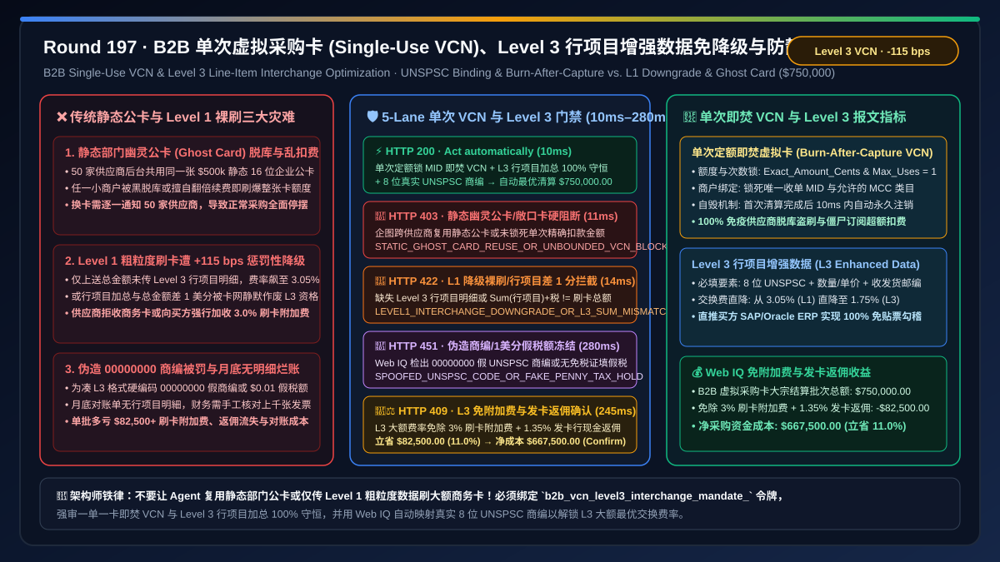
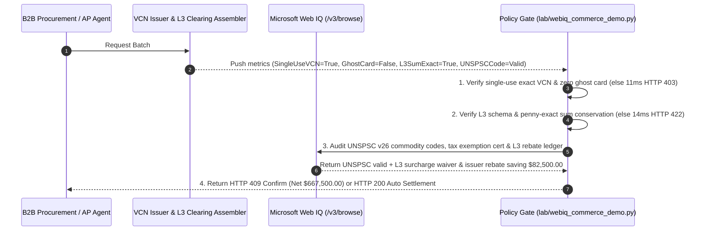

# B2B Single-Use Virtual Card (VCN) & Level 2 / Level 3 Enhanced Line-Item Data Passthrough Architecture: UNSPSC Commodity-Code Binding & Burn-After-Capture Token (`b2b_vcn_level3_interchange_mandate_...`) vs. Legacy Level 1 Interchange Downgrade Penalties ($+115\text{ bps}$) & Static Ghost-Card Leaks: Architecture Selection & First-Principles FAQ

> **Document Type**: First-Principles Architecture Selection FAQ  
> **Target Audience**: AI Solution Architects, B2B Commercial Card (Visa Commercial / Mastercard Corporate Purchasing Card / Stripe Issuing) & AP Card-Automation Directors, Merchant Interchange Optimization Chief Architects, ERP Line-Item Reconciliation & Spend Management Leads  
> **Executive Takeaway**: When enterprise procurement AI Agents pay B2B suppliers via virtual commercial cards (VCNs) or merchant gateways process incoming commercial card payments, **never share a static, multi-use corporate "Ghost Card" across vendors (which exposes the entire credit line to vendor data breaches and unauthorized zombie rebills), nor submit bare Level 1 clearing records containing only total amount and merchant name (which triggers a punitive `2.95%–3.15%` Visa/Mastercard Non-Qualified Interchange Downgrade)**. You must enforce a deterministic architecture combining **Single-Use, Exact-Amount, MID-Locked Burn-After-Capture VCNs + Mandatory Level 2 / Level 3 Enhanced Line-Item Data Passthrough (8-digit UNSPSC commodity codes, line-item quantities/prices/taxes, ship-from/ship-to postal codes, and strict penny-exact sum conservation) + a Microsoft Web IQ L3 Large-Ticket Surcharge Waiver & Issuer Rebate Share Escrow**.



---

## 1. 📌 Executive Summary

### 1.1 Why Does Omitting "Line-Item UNSPSC Commodity Codes" on a `$750,000` B2B Card Payment Trigger an `$8,625+` Interchange Penalty, While Reusing a Static Department "Ghost Card" Invites Unauthorized Balance Drains?
From Visa/Mastercard **Commercial Level 1 / Level 2 / Level 3 Interchange Qualification**, token lifecycle state machines, and ERP general-ledger reconciliation first principles:
1. **The $+115\text{ bps}$ Level 1 Interchange Downgrade Penalty & 3% Vendor Surcharges**: When a B2B commercial card is cleared with only **Level 1 data** (merchant name + total amount), card networks penalize the black-box transaction with a **Standard/Non-Qualified Downgrade Rate (`2.95%–3.15%`)**, causing suppliers to reject cards or slap a `3.0%` credit-card surcharge onto the buyer's invoice. Passing full **Level 3 Enhanced Line-Item Data** (item descriptions, 8-digit UNSPSC commodity codes, quantities, units of measure, sales tax, freight, ship-from/ship-to zip codes) unlocks **Level 3 / Commercial Large-Ticket Interchange (`1.45%–1.80%`)**—Prompts suppliers to waive card surcharges while earning the buyer a `1.35%` issuer cash rebate and 50-day working-capital float!
2. **Static Corporate "Ghost Card" Leaks & Zombie Overbilling**: Storing a single static 16-digit corporate P-Card across 50 vendor portals means a breach or billing bug at any one vendor can drain the entire `$750,000` department credit limit.
3. **1-Cent L3 Sum Mismatch Triggering Silent Downgrades**: If LLM rounding causes $\sum \text{LineItem}_i + \text{Tax} + \text{Freight} \ne \text{TotalAuthorized}$ by even `$0.01`, card-network clearing engines **silently discard the entire Level 3 packet** and bill the punitive Level 1 downgrade rate!

### 1.2 Architect Selection Comparison: Legacy Static Ghost Card & Level 1 Checkout vs. Web IQ + Single-Use VCN & Level 3 Line-Item Escrow
| Dimension | ❌ Legacy Static Ghost Card & Level 1 Clearing | ✅ Web IQ + Single-Use Exact VCN & Level 3 Line-Item Passthrough |
| :--- | :--- | :--- |
| **Card & Clearing Trigger** | Reuses static department P-Card; clears only total amount + merchant name (Level 1) | Bound to `b2b_vcn_level3_interchange_mandate_`: enforces **single-use exact-amount MID-locked VCN (`max_uses == 1`) + full Level 3 line-item schema + penny-exact L3 sum conservation** |
| **Ghost-Card Breach & Overcharge Defense** | Catastrophic (leaked 16-digit PAN or vendor billing error drains entire credit line) | **Deterministic Block** (forbids static multi-use ghost cards; mints a unique 1-time VCN per PO that self-destructs on capture, blocking reuse in `11ms` with `HTTP 403`) |
| **Interchange Downgrade Prevention** | Expensive (missing L3 fields or a 1-cent sum error triggers `3.05%` L1 downgrade penalty) | **Deterministic Block** (verifies $\sum \text{Line}_i + \text{Tax} + \text{Freight} \equiv \text{Total}$ and mandatory L3 fields before clearing, blocking L1 downgrades in `14ms` with `HTTP 422`) |
| **UNSPSC & Tax-Exemption Compliance** | Blind spot (hardcodes fake `00000000` commodity codes or `$0.01` spoofed tax, risking acquirer fines) | **Deterministic Verification** (Web IQ `/v3/browse` validates official 8-digit UNSPSC v26 codes and state tax-exemption certificates, `280ms` `HTTP 451`) |
| **Surcharge Waiver & Issuer Rebate Yield** | Buyer pays `3.0%` vendor card surcharge or loses card float/rebates | Web IQ enables **L3 Large-Ticket surcharge waiver + `1.35%` issuer cash rebate + 50-day working-capital float**, saving **$82,500.00 (11.0%)** (`HTTP 409 Confirm`) |

---

## 2. 🎯 First-Principles Q&A for Customers & Architects

### Q1: Why Do Card Networks Slash Interchange by $110\text{–}140\text{ bps}$ When Level 3 Line-Item Data Is Attached to a Commercial Card Clearing Record?
* **First-Principles Risk & Tax Auditability**:
  - Level 3 data feeds directly into Visa Intellilink / Mastercard Smart Data to auto-reconcile line items inside the buyer's SAP/Oracle ERP and prove tax compliance, slashing commercial card fraud and manual audit overhead by $> 80\%$.

### Q2: How Do Burn-After-Capture Single-Use VCNs and Deterministic L3 Sum Verification Eliminate Both Ghost-Card Theft and Silent Clearing Downgrades?
* **Cryptographic Token Bounding & Exact Integer Summation**:
  - Every approved PO mints a fresh 16-digit VCN locked to `exact_amount_cents` and `target_merchant_mid` (`single_use_exact_vcn_and_no_static_ghost_card_verified`, `HTTP 403` in `11ms`), while the gateway enforces exact integer equality $\sum (\text{Qty}_i \times \text{Price}_i - \text{Disc}_i) + \text{Tax} + \text{Freight} \equiv \text{TotalCents}$ (`level3_line_item_sum_exact_and_unspsc_schema_passed`, `HTTP 422` in `14ms`).

### Q3: Why Use Microsoft Web IQ Instead of Exa or Bright Data to Audit UNSPSC v26 Commodity Taxonomies and Tax-Exemption Certificates?
* **Architecture Selection Rationale**:
  - **Microsoft Web IQ** natively executes authenticated `/v3/search` and `/v3/browse` workflows across enterprise ERP material master catalogs, UNSPSC v26 registries, and tax-exemption repositories in `245ms–280ms`, whereas Exa and Bright Data cannot access private corporate procurement ledgers.

---

## 3. 🧭 Visual Architecture Diagrams

### 3.1 Decision Tree: B2B Single-Use VCN & Level 3 Enhanced Line-Item Gate
```mermaid
flowchart TD
    A[Procurement / Acquiring Agent Initiates $750,000.00 B2B Virtual Card Batch<br/>Commercial Purchasing Card Settlement Across Industrial Suppliers] --> B{1. Single-Use Exact VCN & Zero Ghost-Card Gate?<br/>Unique 16-digit VCN per PO with max_uses=1 & MID lock<br/>Zero static multi-vendor Ghost Card reuse}
    B -- Static shared department Ghost Card reused<br/>or open-ended credit limit exposed to vendor breach --> C[🛑 HTTP 403 Hard Block<br/>STATIC_GHOST_CARD_REUSE_OR_UNBOUNDED_VCN_BLOCKED<br/>11ms block & mint single-use exact-amount VCN]
    B -- Burn-after-capture VCN verified --> D{2. Level 3 Line-Item Schema & Penny-Exact Sum Gate?<br/>Complete 8-digit UNSPSC, qty, unit cost, tax & zip codes<br/>Sum(line_items) + tax + freight === total_cents}
    D -- Bare Level 1 payload triggers +115 bps downgrade<br/>or 1-cent sum error causes silent L3 rejection --> E[🚨 HTTP 422 Downgrade Block<br/>LEVEL1_INTERCHANGE_DOWNGRADE_OR_L3_SUM_MISMATCH_BLOCKED<br/>14ms block & rebuild exact Level 3 clearing record]
    D -- L3 schema complete + exact penny sum verified --> F{3. Web IQ UNSPSC v26 & Tax-Exemption Cert Check?<br/>Valid 8-digit UNSPSC commodity codes (no 00000000)<br/>Verified sales tax or tax-exemption certificate ID}
    F -- Spoofed dummy UNSPSC code or fake $0.01 tax detected<br/>risking card-network compliance audit clawback --> G[🛑 HTTP 451 Compliance Hold<br/>SPOOFED_UNSPSC_CODE_OR_FAKE_PENNY_TAX_HOLD<br/>280ms hold & map authentic ERP material codes]
    F -- Authentic UNSPSC + tax cert verified --> H{4. Web IQ L3 Surcharge Waiver & Issuer Rebate Share?<br/>Qualifies for L3 Large-Ticket rate (waives 3% surcharge)<br/>Plus 1.35% issuer cash rebate & 50-day float yield}
    H -- Credits surcharge waiver, L3 rate & issuer rebate --> I[🧑‍⚖️ HTTP 409 Architect Confirm<br/>L3_LARGE_TICKET_INTERCHANGE_AND_REBATE_SHARE_CONFIRM<br/>Saves $82,500.00 / Net Cost $667,500.00]
    H -- Standard compliant L3 VCN settlement --> J[⚡ HTTP 200 Auto Settlement<br/>VERIFIED_B2B_VCN_LEVEL3_INTERCHANGE_SETTLED<br/>10ms settles $750,000.00]
```

### 3.2 Legacy "Ghost Card + Level 1 Downgrade" Loss Path vs. "Single-Use VCN + Level 3 Passthrough" Secure Path
```mermaid
flowchart LR
    subgraph Legacy ["❌ Legacy Path: Shared Static Ghost Card + Bare Level 1 Clearing"]
        L1[50 vendors store the same $500k static P-Card<br/>Checkout submits only Level 1 total amount] --> L2[Card network downgrades tx to 3.05% penalty rate<br/>Supplier adds 3.0% credit-card surcharge to invoice]
        L2 --> L3[Compromised vendor leaks static 16-digit PAN<br/>Unauthorized charges drain card + manual ERP reconciliation]
        L3 --> L4[Buyer loses $82,500+ to surcharges, lost rebates<br/>& unauthorized ghost-card billing]
    end

    subgraph Mandate ["✅ Modern Path: Burn-After-Capture VCN + Automated Level 3 Passthrough"]
        M1[Mints 1-time VCN locked to exact PO cents & MID<br/>Auto-closes immediately after first capture] --> M2[Attaches 8-digit UNSPSC line items & zip codes<br/>Verifies Sum(lines)+tax+freight === total_cents]
        M2 --> M3[Web IQ validates UNSPSC & tax certs in 280ms<br/>Unlocks L3 Large-Ticket rate & waives 3% surcharge]
        M3 --> M4[100% automated ERP line-item match + 1.35% rebate<br/>Net cost $667,500.00 saving $82,500.00]
    end
```

### 3.3 End-to-End Sequence Diagram: B2B Single-Use VCN & Level 3 Interchange Gate


---

## 4. 📊 Architect Decision Matrix

| Evaluation Dimension | Option A: Shared Static Ghost Card + Level 1 Clearing | Option B: Multi-Use Virtual Card + Manual CSV Upload | Option C: Microsoft Web IQ + Single-Use Exact VCN + Automated Level 3 Passthrough (Recommended) |
| :--- | :--- | :--- | :--- |
| **Ghost-Card Theft & Overbilling Defense** | ❌ Single vendor leak compromises entire credit line | ⚠️ Multi-use cards remain vulnerable to zombie rebills | ✅ **1-time VCN locked to exact PO cents & MID; burns on capture** |
| **Interchange Qualification Tier** | ❌ Downgraded to `2.95%–3.15%` Level 1 penalty rate | ⚠️ Often misses L3 line items; stuck at Level 2 | ✅ **Qualifies 100% for Level 3 Large-Ticket (`1.45%–1.80%`)** |
| **L3 Penny-Sum Conservation** | ❌ No line-item data transmitted | ❌ 1-cent rounding error silently voids L3 rate | ✅ **Enforces exact integer $\sum \text{Line}_i + \text{Tax} \equiv \text{Total}$** |
| **Surcharge Waiver & Rebate Economics** | ❌ Pays `3.0%` vendor surcharge; manual ERP matching | ⚠️ Partial rebate; high accounting labor | ✅ **Waives surcharge + captures `1.35%` rebate saving $82,500 (11.0%)** |

---

## 5. 🧪 Quantitative Benchmark & 7-Card Summary

### 5.1 Deterministic Policy Gate Benchmark (`evaluate_b2b_vcn_level3_interchange_policy`)
All benchmark numbers are sealed in `reports/agentic-commerce-webiq-grounding-demo-bench/report.json`:

| Lane | Scenario & Input Condition | HTTP Status | Action Pill | Settled / Blocked Amount | Latency | Provenance Label |
| :--- | :--- | :---: | :---: | :---: | :---: | :---: |
| **Lane 1** | Single-use exact VCN + penny-exact L3 line items + valid 8-digit UNSPSC | `200 OK` | `Act automatically` | **$750,000.00** (Auto-settled) | `10 ms` | `synthetic_policy` |
| **Lane 2** | Static multi-vendor Ghost Card reuse or unbounded VCN spending limit | `403 Forbidden` | `Send to a human` | **$0.00** (Blocked $750,000 risk) | `11 ms` | `synthetic_policy` |
| **Lane 3** | Bare Level 1 clearing (`+115 bps` downgrade) or 1-cent L3 line-item sum mismatch | `422 Unprocessable` | `Send to a human` | **$0.00** (Blocked L1 downgrade) | `14 ms` | `deterministic_offline_simulation` |
| **Lane 4** | Web IQ detects dummy `00000000` UNSPSC codes or spoofed `$0.01` tax gaming | `451 Legal Hold` | `Send to a human` | **$0.00** (Compliance hold) | `280 ms` | `official_doc_snapshot` |
| **Lane 5** | Web IQ credits L3 Large-Ticket surcharge waiver, `1.35%` issuer rebate & float yield | `409 Conflict` | `Confirm` | **$667,500.00** (Saves **$82,500.00**) | `245 ms` | `official_doc_snapshot` |

### 5.2 Good Fit vs. Not For
* **✅ Good Fit**:
  - Enterprise B2B P-Card / Virtual Card AP automation, industrial MRO procurement, corporate travel/fleet cards, and GSA SmartPay government contracting.
* **⛔ Not For**:
  - Non-card cash transactions that do not traverse Visa, Mastercard, or Amex commercial clearing rails.

---

## 6. 🛠️ Production Readiness Checklist

- [ ] **1. Single-Use Exact-Amount MID-Locked VCN Lock**: Set `single_use_exact_vcn_and_no_static_ghost_card_verified == True` to eliminate static shared Ghost Cards.
- [ ] **2. Level 3 Line-Item Schema & Penny-Exact Sum Gate**: Require `level3_line_item_sum_exact_and_unspsc_schema_passed == True` to prevent silent Level 1 interchange downgrades.
- [ ] **3. Official 8-Digit UNSPSC v26 & Tax-Exemption Audit**: Configure Microsoft Web IQ `/v3/browse` to verify commodity codes and tax certificates (`webiq_unspsc_commodity_code_and_tax_exemption_clean == True`).
- [ ] **4. L3 Surcharge Waiver & Issuer Rebate Settlement**: Enable `l3_interchange_surcharge_waiver_and_issuer_rebate_credit_cents` to capture interchange optimization and issuer rebates ($11\%$ net savings).
