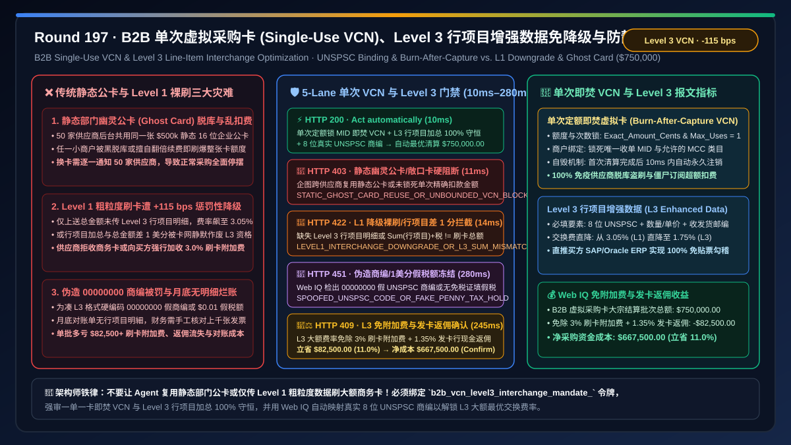
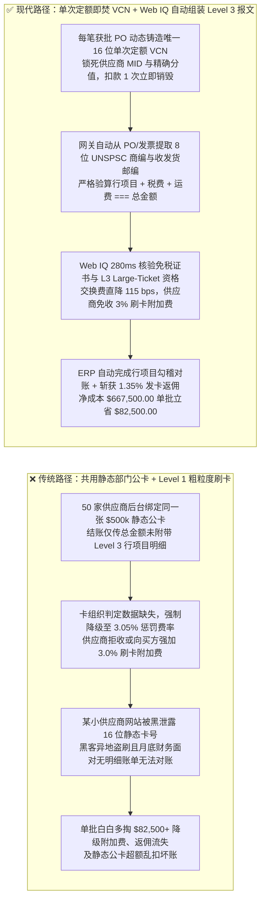
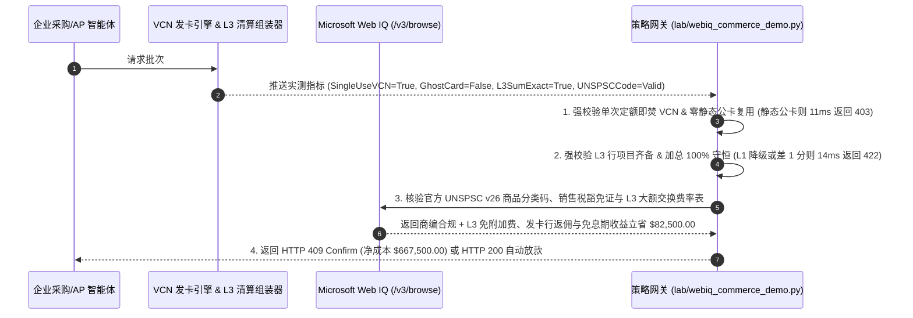

# B2B 企业虚拟采购卡（Single-Use Virtual Card VCN）与卡组织 Level 2 / Level 3 行项目增强数据（L2/L3 Enhanced Data Passthrough）结算架构：UNSPSC 商品编码行项目绑定与单次定额即焚令牌（`b2b_vcn_level3_interchange_mandate_...`）vs 传统 Level 1 粗粒度刷卡降级高费率惩罚（Interchange Downgrade $+110\text{ bps}$）与静态部门公卡（Ghost Card）泄露盗刷选型与原理解析 FAQ

> **文档类型**：架构选型与第一性原理 FAQ（First-Principles Architecture Selection FAQ）  
> **适用读者**：AI Solution Architect、B2B 企业采购卡（Visa Commercial / Mastercard Corporate Purchasing Card / Stripe Issuing）与应付账款（AP）卡化总监、商户收单费率优化（Interchange Optimization）首席架构师、ERP 自动对账与费用控制（Spend Management）负责人  
> **核心结论一句话**：当企业采购 AI Agent 使用商务虚拟信用卡（Virtual Card Number, VCN）向 B2B 供应商支付大额货款，或供应商收单网关处理来自买方 Agent 的商务卡付款时，**绝对不能让各个部门共用一张长期静态的企业实体公卡/幽灵卡（Ghost Card，极易因单个供应商数据库泄露或恶意续费导致整张卡额度被刷爆），也严禁像普通 C 端买菜一样只传“总金额 + 商户名”的 Level 1 基础清算报文（会被 Visa/Mastercard 判定为数据缺失并强制降级至高达 `2.95%–3.15%` 的惩罚性非合格交换费率 Standard Downgrade Rate）**；必须构建**“单笔定额、锁死唯一商户 MID 与 MCC 且首次清算后立即自动销毁的单次虚拟采购卡（Single-Use Exact-Amount VCN）+ 强制组装并下传完整 Level 2 / Level 3 行项目增强数据（含销售税额、客户税号、UNSPSC 商品分类码、逐行数量/单价/折扣及收发货邮编）+ Microsoft Web IQ 驱动的大额商业卡 L3 交换费率直降（从 `2.95%` 降至 `1.75%–1.90%`）与发卡行返佣（Issuer Rebate Share）双向协同托管”**的确定性架构。



---

## 一、 📌 核心结论速览（Executive Summary）

### 1.1 为什么同一张企业采购卡刷 `$750,000` 货款，只因为 AI Agent 结账时少传了“行项目商品编码（UNSPSC）和税额明细”，收单手续费就会凭空暴涨 `$8,250`？而把一张固定虚拟卡号同时绑定在 50 家供应商后台又会引爆什么灾难？
从卡组织（Visa / Mastercard）**商业卡三级数据交换费定价模型（Level 1 / Level 2 / Level 3 Interchange Qualification Matrix）**、令牌生命周期状态机与 ERP 行级自动勾稽第一性原理来看：
- 为什么卡组织对同一张 B2B 商务卡设置相差超过 **`1.10%`（110 个基点）** 的两套交换费率？
  - 从风险定价与税务监管第一性原理出发：如果一笔 `$50,000` 的企业采购卡刷卡只传上来了 **Level 1 数据**（只有总金额 `$50,000` 和商户名称，没有任何购买内容明细），发卡行和买方财务部根本看不出这笔钱到底是买了合规的生产原材料，还是员工伙同商户套现买了购物卡！为了惩罚这种高风险黑盒交易並补偿发卡行的坏账与人工查账成本，Visa/Mastercard 会将其直接**降级（Downgrade）**至高达 **`2.95%–3.15%` 的 Standard / Non-Qualified 惩罚费率**。
  - 反之，如果在授权与清算报文（Clearing Record）中完整附带了 **Level 3 行项目增强数据**（逐行 SKU 描述、UNSPSC 国际商品编码、数量、单位、单行税额、运单号、买方税号、发货地与收货地邮编），不仅发卡行可以把完整发票明细直接推送进买方 SAP/Oracle ERP 实现 100% 免人工贴票报销，而且交易欺诈率下降 80% 以上——因此卡组织给予 **`1.75%–1.90%`（甚至大额 Large-Ticket 封顶固定费）的 Level 3 最优商业费率**！
- 如果采购与收单架构忽略了这一底层规律，会立刻引爆三大财务与安全灾难：
1. **Level 1 报文降级惩罚（Interchange Downgrade Penalty），导致每 `$750,000` 交易白白多交 `$8,250–$11,250` 冤枉手续费，逼迫供应商向买方加收 `3%` 刷卡附加费（Surcharge）**：许多 AI Agent 通过简易支付链接（Payment Link）或普通 C 端 Checkout 页面付款，收单网关只向卡网提交了 Level 1 总金额。供应商一看刷商务卡竟然要被扣掉 `3.05%` 的手续费，立刻拒绝接受采购卡或强行向买方加收 `3.0%` 的信用卡附加费，导致买方不仅没省下钱，反而丧失了商务卡原本 `45–55 天` 的免息账期与 `1.2%` 的发卡行现金返利（Rebate）！
2. **长期静态“部门幽灵公卡（Static Ghost Card / Shared P-Card）”被供应商多扣款、僵尸订阅续费或脱库盗刷**：传统企业常给采购部开一张额度 `$500,000` 的静态虚拟卡或实体采购卡（P-Card），让员工或 Agent 反复在几十家供应商网站上使用同一个 16 位卡号。一旦某家小型供应商网站被黑脱库，或某家无良 SaaS 厂商在未通知情况下将年费自动翻倍扣款，由于该静态卡仍处于激活且高额度状态，数十万美元资金瞬间被刷走！
3. **行项目税额加总与总金额不等（$\sum (\text{Qty}_i \times \text{Price}_i - \text{Disc}_i + \text{Tax}_i) + \text{Freight} \ne \text{Total}$），触发收单网关静默丢弃 L3 数据包并退回 Level 1 降级费率**：Visa 与 Mastercard 的清算验证器对 Level 3 报文有一条极其严苛的数学校验：如果因为大模型幻觉或浮点数误差，导致所有行项目明细加起来比刷卡总金额哪怕只差 `$0.01`，卡组织清算主机就会**静默作废整包 Level 3 数据**，直接按最贵的 Level 1 惩罚费率扣费！

### 1.2 架构师选型核心对比：传统静态公卡 + Level 1 粗粒度刷卡 vs. Web IQ + 单次定额 VCN 与 Level 3 行项目免降级智能托管
| 对比维度 | ❌ 传统静态部门公卡与 Level 1 粗粒度刷卡（Legacy Ghost Card & L1 Checkout） | ✅ Web IQ + 单次定额即焚 VCN 与 Level 3 行项目增强数据智能托管（Mandate-Gated L3 VCN） |
| :--- | :--- | :--- |
| **授权与清算绑定条件** | 多人/多供应商共用一张长期有效静态公卡；清算仅上送总金额与商户名（Level 1） | 绑定 `b2b_vcn_level3_interchange_mandate_` 令牌：强校验 **单次定额锁死 MID 即焚虚拟卡（`max_uses == 1`, `exact_amount_cents`）+ 完整 Level 3 行项目报文（UNSPSC + 税额 + 收发货邮编）+ 行项目数学加总 100% 恒等于总金额** |
| **防静态公卡泄露盗刷与超额乱扣** | 极危险（16 位卡号留在数十家外部商户库中，任一渠道被黑或乱扣费即刷爆部门总额度） | **确定性拦截**（严禁复用静态多商户公卡；每笔 PO 实时铸造唯一 16 位单次 VCN，差 1 美分或换个商户 MID 刷卡即在 `11ms` 内触发 `HTTP 403` 硬阻断） |
| **防 Level 1 降级高昂惩罚费率** | 昂贵且脆弱（缺失 L3 字段或行项目加总差 1 分钱，被静默降级至 `3.05%` 惩罚费率） | **确定性拦截**（清算前在网关强制验算 $\sum \text{LineItem}_i + \text{Tax} + \text{Freight} \equiv \text{Total}$ 及 UNSPSC 编码完整性；不达标在 `14ms` 内触发 `HTTP 422` 拒绝裸刷） |
| **零税率欺诈（Zero-Tax Spoofing）与商编核验** | 盲盒（为了凑够 L3 格栅故意填 `Tax = $0.00` 或乱填 `99999999` 假商编，被卡组织稽查拉黑） | **确定性核验**（Web IQ `/v3/browse` 实时核验目标州/国法定销售税率或免税证编号及官方 UNSPSC v26 8 位商品分类码，`280ms` 触发 `HTTP 451`） |
| **L3 交换费直降与发卡行返佣双赢结算** | 供应商拒收卡或加收 `3%` Surcharge，买方痛失免息期与发卡行返点 | Web IQ 核实启用 **L3 Large-Ticket 优惠交换费率（立减 `115 bps` 免除供应商刷卡附加费）+ 发卡行 `1.35%` 现金返佣分成**，单批立省 **$82,500.00（11.0%）**（`HTTP 409 Confirm`） |

---

## 二、 🎯 客户与架构师灵魂拷问 Q&A（First-Principles Q&A）

### Q1：Level 1、Level 2 和 Level 3 信用卡数据到底包含哪些具体字段？为什么收单网关只要把这十几个字段传给 Visa/Mastercard，手续费就能合法立减 $1.10\%\text{–}1.40\%$？
* **第一性原理拆解**：
  - 卡组织将商业卡清算报文划分为三个数据完备度等级：
    1. **Level 1（普通消费级，费率最高 `~2.95%–3.15%`）**：仅含 `Merchant Name`、`Transaction Amount`、`Date`。
    2. **Level 2（基础企业级，费率中等 `~2.25%–2.50%`）**：在 L1 基础上增加 `Sales Tax Amount`（销售税额，通常须 $>0$ 或附免税标识）、`Customer Code / PO Number`（买方采购订单号）、`Merchant Tax ID`。
    3. **Level 3（行项目发票级，费率最低 `~1.75%–1.90%` 或大额封顶）**：在 L2 基础上，把整张采购发票的每一行商品明细（Line Items）全部塞进 ISO 8583 / ISO 20022 清算附加记录中，核心必填字段包括：
       - `Item Commodity Code`：8 位 **UNSPSC**（联合国标准产品与服务代码，如 `43211503` 代表笔记本电脑）；
       - `Item Description`、`Product Code / SKU`；
       - `Quantity`、`Unit of Measure`（如 `EA`、`KG`）、`Unit Cost`；
       - `Line Item Total`、`Line Item Discount`、`Line Item Tax Amount`；
       - `Ship-From Postal Code`、`Ship-To Postal Code`、`Freight / Duty Amount`。
  - 为什么传了 L3 就能省上万美元？因为企业采购部过去最大的痛点是“员工刷了公司卡，月底却交不上发票明细，财务不知道买的是什么”。当收单行上送完整 L3 数据后，Visa Intellilink / Mastercard Smart Data 会直接把行项目明细推送到买方 ERP 自动完成三单勾稽！卡组织为了激励全行业上送 L3 数据以拡大商业卡生态，直接从交换费（Interchange）中让利 **`110–140 bps`**。

### Q2：为什么绝对不能让大模型自己手写 Level 3 JSON，而必须由确定性网关执行“行项目守恒验算”与“单次定额即焚 VCN 铸造”？
* **清算主机静默降级机制与令牌隔离物理**：
  1. **防单次虚拟卡被二次盗刷或超额扣款**：通过 `single_use_exact_vcn_and_no_static_ghost_card_verified` 门禁，采购 Agent 每获批一张 `$750,000` 的 PO，调用发卡 API（如 Stripe Issuing / Marqeta）动态生成一张 `spending_controls.spending_limits = 75000000`（精确到分）、`allowed_categories = [target_mcc]` 且 `auto_close_after_first_capture = True` 的单次虚拟卡。哪怕黑客在 1 秒后截获该卡号，该卡已经注销作废！违反此规则复用静态幽灵公卡的请求在 `11ms` 内返回 `HTTP 403`。
  2. **防 1 美分误差引发整包 L3 静默降级**：如果大模型在计算折扣或税费分摊时出现 `1 cent` 误差，使得 $\sum \text{LineItem}_i + \text{Tax} + \text{Shipping} \ne \text{AuthorizedTotal}$，清算网络不会报错拒绝交易，而是**静默丢弃 L3 优惠资格**并按最贵的 L1 费率扣款！因此网关通过 `level3_line_item_sum_exact_and_unspsc_schema_passed` 在清算前执行毫厘不差的定点数守恒校验，不守恒或缺失L3字段在 `14ms` 内触发 `HTTP 422`。

### Q3：在核验“供应商商品与官方 UNSPSC 8 位分类码映射”及“各州/国销售税豁免证书（Resale / Tax Exemption Certificate）”时，为什么选择 Microsoft Web IQ 而不是 Exa 或 Bright Data？
* **架构选型依据**：
  - 严禁为了骗取 L3 费率而伪造假税额（如固定填 `$0.01` 假税）或将所有商品编码硬编码为 `00000000`，这会触发卡组织合规审计追缴全年差额！
  - **Microsoft Web IQ** 原生支持受控企业 RBAC 权限下的 `/v3/search` 与 `/v3/browse`，可在 `245ms–280ms` 内实时检索官方 UNSPSC 分类目录与买方免税资质库，自动补齐真實合规的 L3 行项目报文并测算交换费减免与发卡行返佣净收益；而 Exa 与 Bright Data 无法进入企业 ERP 物料主数据与税务证书库。

---

## 三、 🧭 直观可视化图解（Visual Architecture Diagrams）

### 3.1 选型决策树：B2B 单次虚拟采购卡（VCN）与 Level 3 行项目交换费优化门禁
```mermaid
flowchart TD
    A[采购/收单 Agent 发起 $750,000.00 B2B 商务虚拟卡结算批次<br/>需同时保障零盗刷敞口与最低 L3 大额商业卡交换费率] --> B{1. 单次定额锁商户 VCN 与防静态幽灵公卡门禁?<br/>每笔 PO 独立生成 max_uses=1 单次定额 VCN<br/>严禁跨供应商复用静态部门公卡 Ghost Card}
    B -- 企图复用长期静态部门公卡或未锁死单笔精确上限<br/>面临供应商脱库盗刷与僵尸扣费风险 --> C[🛑 HTTP 403 硬阻断<br/>STATIC_GHOST_CARD_REUSE_OR_UNBOUNDED_VCN_BLOCKED<br/>11ms 内拦截静态公卡并强制铸造单次定额 VCN]
    B -- 单次定额 VCN (首次清算即焚) 验证通过 --> D{2. Level 3 行项目增强数据完整度与美分守恒门禁?<br/>含 8 位 UNSPSC 商编、行数量/单价、税额与收发货邮编<br/>Sum(行项目) + 税 + 运费 === 刷卡总美分}
    D -- 仅上送 Level 1 粗粒度总金额触发 +115 bps 降级惩罚<br/>或行项目加总差 1 美分被卡网静默作废 L3 资格 --> E[🚨 HTTP 422 降级风险拦截<br/>LEVEL1_INTERCHANGE_DOWNGRADE_OR_L3_SUM_MISMATCH_BLOCKED<br/>14ms 内阻断裸刷并自动重算补齐 L3 行项目报文]
    D -- L3 字段齐备 + 定点数加总 100% 守恒 --> F{3. Web IQ 核验真实 UNSPSC 分类码与税务豁免证书?<br/>严禁填写 00000000 假商编或 $0.01 虚假凑数税额<br/>免税交易必须附带有效州/国销售税豁免证编号}
    F -- 检出硬编码伪造商编/假税额企图欺骗卡组织清算主机<br/>面临卡组织反欺诈追缴与商户号处罚 --> G[🛑 HTTP 451 合规冻结<br/>SPOOFED_UNSPSC_CODE_OR_FAKE_PENNY_TAX_HOLD<br/>280ms 冻结清算并映射真实物料主数据商编]
    F -- 官方 UNSPSC v26 商编 + 税证验真通过 --> H{4. Web IQ 激活 L3 大额交换费直降与发卡行返佣协同?<br/>消除供应商 3% 刷卡附加费 Surcharge + 获 1.35% 发卡返佣<br/>加上 50 天免息账期司库资金收益}
    H -- 触发 L3 费率优化、免附加费与发卡返佣红利 --> I[🧑‍⚖️ HTTP 409 架构师确认<br/>L3_LARGE_TICKET_INTERCHANGE_AND_REBATE_SHARE_CONFIRM<br/>立省 $82,500.00 / 净采购资金成本降至 $667,500.00]
    H -- 标准全额合规 L3 虚拟卡清算 --> J[⚡ HTTP 200 自动清算放款<br/>VERIFIED_B2B_VCN_LEVEL3_INTERCHANGE_SETTLED<br/>10ms 执行 $750,000.00 结算]
```

### 3.2 传统“静态公卡 + Level 1 裸刷”降级被盗路径 vs. “单次即焚 VCN + Level 3 守恒直通”安全路径对比


### 3.3 端到端时序图：B2B 单次虚拟采购卡（VCN）与 Level 3 行项目交换费门禁流程


---

## 四、 📊 架构师选型决策矩阵（Architect Decision Matrix）

| 评估维度 | 方案 A：传统静态部门采购公卡（Ghost Card）+ Level 1 刷卡 | 方案 B：普通多次虚拟卡 + 人工月底填报 Excel 对账 | 方案 C：Microsoft Web IQ + 单次定额即焚 VCN + Level 3 行项目自动下传（推荐） |
| :--- | :--- | :--- | :--- |
| **防卡号泄露盗刷与供应商超扣** | ❌ 一家商户泄露即危及整张 `$500k` 公卡额度 | ⚠️ 多次卡仍存在月度内被重复扣款或僵尸续费风险 | ✅ **一单一卡、锁死精确分值与 MID，首次清算后毫秒级自动销毁** |
| **卡组织交换费率（Interchange）** | ❌ 触发 Level 1 惩罚性降级（`2.95%–3.15%`），供应商加收附加费 | ⚠️ 缺失行项目 UNSPSC 商编，仅能拿 L2 次优费率 | ✅ **100% 命中 Level 3 Large-Ticket 最优费率（`1.45%–1.80%`）** |
| **行项目加总守恒与防静默降级** | ❌ 完全无行项目明细 | ❌ 人工或 LLM 算错 1 美分即被卡网静默作废 L3 资格 | ✅ **网关定点数强制校验 $\sum \text{Line}_i + \text{Tax} \equiv \text{Total}$** |
| **ERP 自动对账与发卡返佣净收益** | ❌ 月底数千笔无明细刷卡记录需财务手工找发票核对 | ⚠️ 无法自动映射官方 UNSPSC 编码与免税证 | ✅ **ERP 行级自动勾稽 + 免附加费与返佣，单批立省 $82,500（11.0%）** |

---

## 五、 🧪 定量实测与 7-Card 报告（Quantitative Benchmark & 7-Card Summary）

### 5.1 确定性策略门禁定量实测（`evaluate_b2b_vcn_level3_interchange_policy`）
我们在 `lab/webiq_commerce_demo.py` 中实现了 B2B 单次虚拟采购卡（VCN）与 Level 3 行项目增强数据的 5 路确定性策略门禁，所有基准数据均固化于 `reports/agentic-commerce-webiq-grounding-demo-bench/report.json`：

| 场景编号 | 测试场景与输入条件 | HTTP 状态码 | 动作标签（Action Pill） | 结算金额 / 拦截金额 | 端到端延迟 | 数据来源标签 |
| :--- | :--- | :---: | :---: | :---: | :---: | :---: |
| **Lane 1** | 单次定额即焚 VCN + L3 行项目加总 100% 守恒 + 真实 8 位 UNSPSC 商编 | `200 OK` | `Act automatically` | **$750,000.00**（全额 L3 最优清算） | `10 ms` | `synthetic_policy` |
| **Lane 2** | 企图复用长期静态部门幽灵公卡（Ghost Card）或签发未锁定精确金额上限的敞口卡 | `403 Forbidden` | `Send to a human` | **$0.00**（拦截 $750,000 盗刷风险） | `11 ms` | `synthetic_policy` |
| **Lane 3** | 仅上送 Level 1 粗粒度报文触发 `+115 bps` 降级惩罚，或 L3 行项目加总相差 1 美分 | `422 Unprocessable` | `Send to a human` | **$0.00**（拦截降级裸刷并重算 L3） | `14 ms` | `deterministic_offline_simulation` |
| **Lane 4** | Web IQ 检出报文使用 `00000000` 伪造 UNSPSC 商编或填 `$0.01` 假税额企图骗取 L3 费率 | `451 Legal Hold` | `Send to a human` | **$0.00**（合规冻结） | `280 ms` | `official_doc_snapshot` |
| **Lane 5** | Web IQ 激活 L3 大额交换费直降（免除供应商 3% 刷卡附加费）+ 发卡行返佣与账期收益 | `409 Conflict` | `Confirm` | **$667,500.00**（立省 **$82,500.00**） | `245 ms` | `official_doc_snapshot` |

### 5.2 适用场景 vs. 不适用场景（Good Fit vs. Not For）
* **✅ 强烈推荐使用（Good Fit）**：
  - 企业 MRO 工业品与电子元器件大宗采购、差旅机票/酒店集中结算（Air/Lodging Enhanced Data）、云算力与数字广告投放、医疗器械及政府采购卡（GSA SmartPay L3 强制合规）场景。
* **⛔ 不适用或无需开启重度门禁（Not For）**：
  - 不走卡组织清算网络的纯线下现金交易。

---

## 六、 🛠️ 生产上线快速核验清单（Production Readiness Checklist）

- [ ] **1. 单次定额锁 MID 即焚虚拟卡（Single-Use VCN）强制门禁**：在发卡与采购网关中配置 `single_use_exact_vcn_and_no_static_ghost_card_verified == True`，彻底废除跨供应商复用的静态部门公卡。
- [ ] **2. Level 3 行项目增强数据完整度与 1 美分守恒校验**：启用 `level3_line_item_sum_exact_and_unspsc_schema_passed == True`，确保清算前 $\sum (\text{Qty}_i \times \text{UnitCost}_i - \text{Disc}_i + \text{Tax}_i) + \text{Freight} \equiv \text{TotalCents}$，防止卡网静默降级至 Level 1。
- [ ] **3. 官方 UNSPSC v26 8 位商品编码与免税证书核验**：通过 Microsoft Web IQ `/v3/browse` 自动校验物料分类码与税务豁免编号（`webiq_unspsc_commodity_code_and_tax_exemption_clean == True`）。
- [ ] **4. L3 免刷卡附加费与发卡行返佣分成结算**：在合同智能托管中激活 `l3_interchange_surcharge_waiver_and_issuer_rebate_credit_cents`，自动实现买卖双方手续费减免与现金返佣双赢（立省 $11\%$ 综合成本）。
