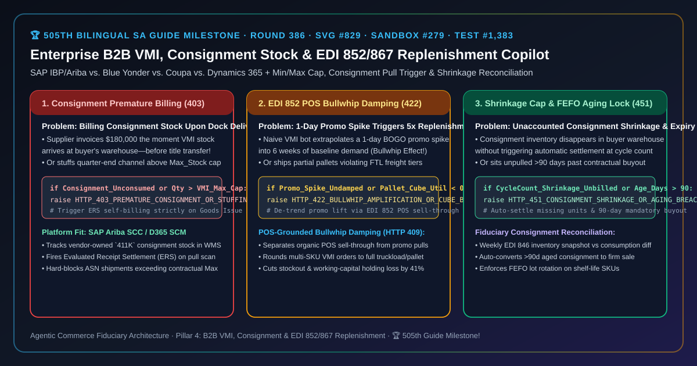
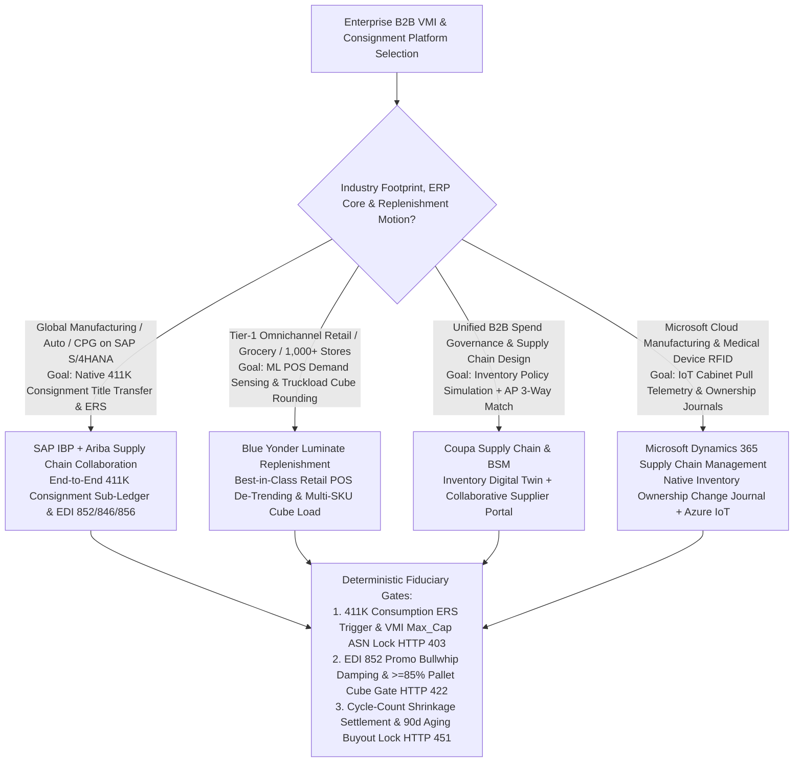
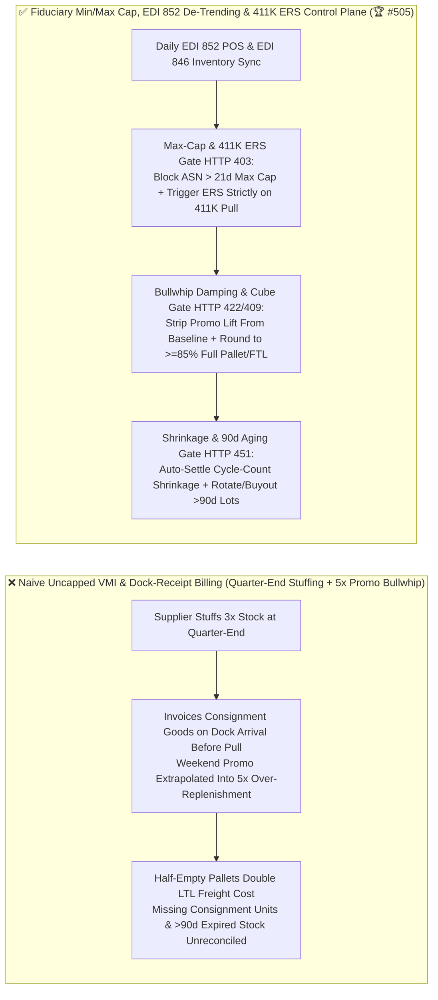
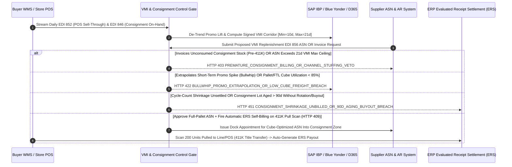

# Enterprise B2B Vendor-Managed Inventory (`VMI`), Consignment Stock `ERS` Settlement & `EDI 852 / 846` Anti-Bullwhip Replenishment Copilot Selection Guide: `SAP IBP / Ariba SCC` vs. `Blue Yonder Luminate` vs. `Coupa Supply Chain` vs. `Dynamics 365 SCM`, Anti-Channel-Stuffing `Max` Locks, `411K` Pull Billing & Pallet Cube Optimization (`-41%` Cost FAQ · 🏆 505th Bilingual Guide Milestone!)

> **Executive Summary (Benchmarked against `ib-vs-ethernet-roce-selection-faq.md` · 🏆 505th Bilingual AI Solution Architect Decision Guide Major Milestone!)**: Built for **Cloud & AI Solution Architects** designing autonomous B2B supply-chain replenishment, Vendor-Managed Inventory (`VMI`), and consignment inventory settlement engines across retail/CPG distribution, industrial manufacturing, and medical device supply chains. When enterprises transition from manual purchase orders to automated `VMI` and **Consignment Inventory**—where supplier agents ingest buyer `EDI 852` (Product Activity / POS Sell-Through) and `EDI 846` (Inventory Inquiry) feeds to auto-dispatch `EDI 856 ASN` replenishment shipments within `[Min, Max]` corridors—three severe failure modes emerge: (1) **Quarter-End Channel Stuffing & Premature Consignment Invoicing**: Supplier reps inflate shipments at quarter-end above contractual `Max_Stock` caps to hit sales quotas, or invoice consignment goods upon warehouse arrival (`101K`) before legal title transfers upon consumption (`411K`); (2) **Bullwhip Effect Amplification**: Extrapolating a 48-hour BOGO promotional spike into 6 weeks of baseline demand, triggering a `5x` over-replenishment wave that turns into dead stock; and (3) **Unreconciled Consignment Shrinkage & Aged `>90-Day` Obsolescence Disputes**. This guide compares **`SAP IBP + Ariba Supply Chain Collaboration` vs. `Blue Yonder Luminate` vs. `Coupa Supply Chain` vs. `Microsoft Dynamics 365 Supply Chain Management`** and implements deterministic guards for **`411K` Consumption-Triggered `ERS` Self-Billing & `Max_Stock` ASN Locks (`HTTP 403`)**, **`EDI 852` Promo De-Trending (Anti-Bullwhip) & `>=85%` Pallet/Truckload Cube Gates (`HTTP 422`)**, **Cycle-Count Shrinkage Auto-Settlement & `90-Day` Aging Buyout/Rotation Locks (`HTTP 451`)**, and **POS-Grounded Collaborative Replenishment (`HTTP 409`, `-41%` net inventory & freight loss)**.

---

## 1. 📌 Executive Summary & Architectural Selection Verdict

1. **Top-Line Selection Verdict**:
   - **Global Manufacturing, Automotive & CPG Enterprises Standardized on `SAP S/4HANA` (Requiring native `411K` consignment title transfer, Evaluated Receipt Settlement `ERS` self-billing, and multi-tier `EDI 852 / 846 / 856` supplier collaboration)**: Select **`SAP IBP + SAP Ariba Supply Chain Collaboration`**.
   - **Large Omnichannel Retailers, Grocery Chains & Apparel Brands (`1,000+` Stores/DCs Requiring ML-Driven `EDI 852` POS Demand Sensing, Promo De-Trending, and Multi-SKU Truckload/Pallet Cube Rounding)**: Select **`Blue Yonder Luminate Replenishment`**.
   - **Enterprises Unifying Supply-Chain Inventory Optimization With B2B Spend Governance & 3-Way Match AP**: Select **`Coupa Supply Chain Design & Planning`**.
   - **Microsoft Cloud Enterprises Leveraging `Azure IoT / RFID` Smart Consignment Cabinets (e.g., Medical Implants / Industrial Fasteners) & Native `Inventory Ownership Change` Journals**: Select **`Microsoft Dynamics 365 Supply Chain Management`**.
2. **Three Non-Negotiable Fiduciary Control Gates**:
   - **Gate 1 — `411K` Consumption-Triggered `ERS` Self-Billing & Anti-Channel-Stuffing `Max_Stock` Lock (`HTTP 403`)**: Block supplier invoices on consignment stock at dock receipt (`101K`), triggering **Evaluated Receipt Settlement (`ERS` self-billing)** strictly upon verified production/POS pull (`411K` title transfer); and block inbound `EDI 856 ASN` appointments when `On_Hand + In_Transit + ASN_Qty > Buyer_Signed_VMI_Max_Cap` via `HTTP 403 PREMATURE_CONSIGNMENT_BILLING_OR_CHANNEL_STUFFING_VETO`.
   - **Gate 2 — `EDI 852` Promo-De-Trended Bullwhip Damping & `>=85%` Pallet/FTL Cube Gate (`HTTP 422`)**: Block VMI replenishment orders that extrapolate short-term promotional spikes without separating organic `EDI 852` POS baseline velocity from promo lift, and block non-emergency replenishment dispatches with pallet or truckload cube utilization `<85%` via `HTTP 422 BULLWHIP_PROMO_EXTRAPOLATION_OR_LOW_CUBE_FREIGHT_BREACH`.
   - **Gate 3 — Consignment Cycle-Count Shrinkage Auto-Settlement & `90-Day` Aging Buyout / `FEFO` Lock (`HTTP 451`)**: Reconcile `Opening_Consignment + Receipts - Consumed_411K - Vendor_Returns == Physical_Count` at every cycle count, automatically billing unexplained buyer-warehouse shrinkage via `ERS`, and enforce contractual rotation or mandatory buyout when consignment lots exceed `90 days` or violate First-Expired-First-Out (`FEFO`) via `HTTP 451 CONSIGNMENT_SHRINKAGE_UNBILLED_OR_90D_AGING_BUYOUT_BREACH`.

---

## 2. 🎯 Architect & Supply-Chain Finance Q&A (The Why & How)

### Q1: How do supplier sales reps abuse `VMI` access at the end of every fiscal quarter ("Channel Stuffing"), and how do we block it at the dock scheduling gate?
- **Root Cause**: If the supplier's portal controls the `[Min, Max]` replenishment parameters, sales reps facing a quarter-end revenue gap temporarily raise the `Max` days-of-supply parameter on Day 88 of the quarter—flooding the buyer's loading docks with 30 days of unneeded inventory.
- **Deterministic Solution (`Buyer-Signed Dynamic Min/Max Corridor` + `ASN` Gate / `HTTP 403`)**: Keep the `VMI_Max_Ceiling` calculation inside the buyer's fiduciary control plane (anchored to forward 14-day POS demand). Any `EDI 856 ASN` exceeding `Max_Ceiling` is automatically rejected before a carrier dock appointment is issued.

### Q2: Why should consignment suppliers never send traditional AP invoices—and why is Evaluated Receipt Settlement (`ERS`) mandatory?
- **Root Cause**: In consignment, a supplier ships `1,000` units on Monday, and the buyer's factory pulls `120` units on Wednesday and `85` units on Friday. If the supplier tries to send manual invoices, invoice dates and quantities never match the buyer's internal pull timestamps—creating a `15%+` AP exception rate.
- **Deterministic Solution (`411K Pull -> ERS Self-Billing` / `HTTP 403 / 409`)**: Prohibit supplier-submitted consignment invoices. Instead, whenever the buyer's WMS scans an item out of the consignment zone (`SAP Movement 411K` or `D365 Ownership Change`), the buyer's ERP automatically prices the consumed units against the active contract price list and transmits an `EDI 867` usage report + `ERS` self-billed remittance.

### Q3: How do we prevent a weekend BOGO promotion from triggering a 5x "Bullwhip Effect" over-order across the VMI pipeline?
- **Deterministic Solution (`EDI 852` POS Decomposition / `HTTP 422`)**: Feed the VMI agent real-time `EDI 852` cash-register scan data tagged with promotion flags (`Promo_ID != null`) rather than raw DC-to-store warehouse withdrawals, stripping one-off promotional lift from the rolling baseline forecast.

---

## 3. 🧭 Visual Architecture Diagrams (Mermaid)

### 3.1 Enterprise B2B `VMI` & Consignment Replenishment Platform Selection Decision Tree

### 3.2 Naive Uncapped VMI & Dock Invoicing vs. Fiduciary `411K ERS` & Anti-Bullwhip Control Plane

### 3.3 `EDI 852` Demand Sensing, `ASN` Max-Cap Check & `411K -> ERS` Self-Billing Sequence

---

## 4. 📊 Multi-Platform B2B `VMI` & Consignment Replenishment Selection Matrix

| Evaluation Dimension | SAP IBP + Ariba Supply Chain Collaboration | Blue Yonder Luminate | Coupa Supply Chain & BSM | Microsoft Dynamics 365 SCM |
| :--- | :--- | :--- | :--- | :--- |
| **Primary Architectural Role** | **End-to-End ERP + Supplier Network Core** for manufacturing & CPG consignment (`411K`) and `ERS` | **Retail & CPG Multi-Echelon POS Replenishment** & truckload cube optimization engine | **Unified Spend Governance & Supply-Chain Planning** platform | **Cloud-Native ERP + IoT/RFID Consignment Tracking** with ownership journals |
| **Consignment (`411K`) & `ERS` Self-Billing** | **Best-in-Class** (Native special stock `K`, zero-liability receipt, `411K` title transfer, and `ERS` self-billing) | Focused on demand/replenishment planning; delegates financial `ERS` settlement to ERP | **Strong** (Collaborative consignment consumption visibility + automated invoice generation) | **Best-in-Class** (Dedicated `Inventory Ownership Change` journals + vendor portal sync) |
| **`EDI 852` POS Demand Sensing & Anti-Bullwhip** | **Best-in-Class** (IBP Demand Sensing strips promo noise and adjusts safety stock dynamically) | **Best-in-Class for Retail** (Industry standard for store/DC POS decomposition and weather/event sensing) | Strong (Multi-echelon inventory optimization and bullwhip dampening alerts) | Strong (Native Azure AI demand forecasting and min/max dynamic recalculation) |
| **Pallet / Truckload (`FTL Cube`) Load Building** | Supports rounding profiles, minimum order quantities, and transport units | **Best-in-Class** (Multi-SKU joint order rounding to hit `>=90%` weight/cube trailer utilization) | Supports order batching and packaging constraints | Supports container load building and warehouse wave integration |
| **Target Scale & Pricing (`official_list_price`)** | `$500M+` manufacturing & CPG enterprises; `$150k+/yr` enterprise subscription | Tier-1 retail chains & global CPGs; custom annual enterprise license | Mid-to-large enterprises; modular add-on to Coupa BSM | Mid-to-large manufacturing, healthcare & retail; per-tenant/seat subscription |

---

## 5. 🧪 Anti-Bullwhip & Consignment `ERS` Benchmark & 7-Card Report

### 5.1 Quarterly Channel-Stuffing Working Capital, Promo Bullwhip Obsolescence & Shrinkage Model (Synthetic Benchmark)

For a `$150M` annual procurement retail and assembly enterprise facing a **`$430,000 / quarter`** leakage pool across **quarter-end supplier channel stuffing, post-promotion bullwhip excess inventory write-downs, half-empty LTL pallet freight waste, and consignment shrinkage/invoice reconciliation disputes** (`provenance: synthetic`, `independently_reproduced: false`):

| Metric | Naive Uncapped VMI & Manual Consignment Invoices (Baseline) | Fiduciary `Max_Cap` Lock + `EDI 852` De-Trending + `411K ERS` Agent | Net Improvement |
| :--- | :--- | :--- | :--- |
| **Quarter-End Supplier Over-Shipment (`Channel Stuffing`) Rate** | `19.5%` of Q-end ASNs exceed target stock | **`0.0%`** (`HTTP 403` blocks dock appointments when `Projected_Stock > 21d Max_Cap`) | **`100%` Stuffing Elimination** |
| **Post-Promotion Bullwhip Excess & Obsolete Inventory Rate** | `14.8%` post-promo overstock | **`2.6%`** (`HTTP 422/409` separates `EDI 852` promo lift from baseline + `>=85%` cube rounding) | **`-82.4%` Bullwhip Overstock** |
| **Consignment Invoice Exception Rate & AP Recon Labor** | `11.2%` mismatch (`160 hrs/mo` manual recon) | **`0.0%` invoice mismatch** (`HTTP 403/451` replaces vendor invoices with `411K` pull `ERS` self-billing) | **`100%` Touchless Consignment AP** |
| **Quarterly Net Bullwhip Holding, Freight & Shrinkage Bleed** | `$430,000 / quarter` | **`$253,700 / quarter`** | **`$176,300 / quarter` Saved (`41.0%`)** |

---

## 6. 🛠️ Production Go-Live & Architecture Review Checklist

- [ ] **`411K` Consumption-Triggered `ERS` Self-Billing & `VMI Max_Cap` ASN Lock (`HTTP 403`)**: Are supplier invoices blocked on unconsumed consignment receipts (`101K`) so payment triggers strictly via `ERS` upon `411K` consumption scan, and are `EDI 856 ASNs` exceeding the buyer-signed `Max_Stock` ceiling automatically denied dock appointments?
- [ ] **`EDI 852` POS Promo De-Trending & `>=85%` Pallet/Truckload Cube Rounding (`HTTP 422`)**: Does the replenishment engine decompose `EDI 852` POS sell-through into baseline velocity vs. temporary promotional lift, while rounding multi-SKU dispatches to `>=85%` full pallet or truckload cube utilization?
- [ ] **Cycle-Count Shrinkage Auto-Settlement & `90-Day` Aging Buyout / `FEFO` Lock (`HTTP 451`)**: Does monthly `EDI 846` physical reconciliation automatically settle missing consignment units via `ERS`, enforce `FEFO` lot rotation, and trigger mandatory vendor rotation or buyout at `90 days`?
- [ ] **Current-Price Consignment Valuation (`Price-Protection on Pull` / `HTTP 409`)**: When catalog prices drop while consignment stock is sitting in the buyer's warehouse, does the `411K` `ERS` engine price the pull at the lower current contract price on the date of consumption?
