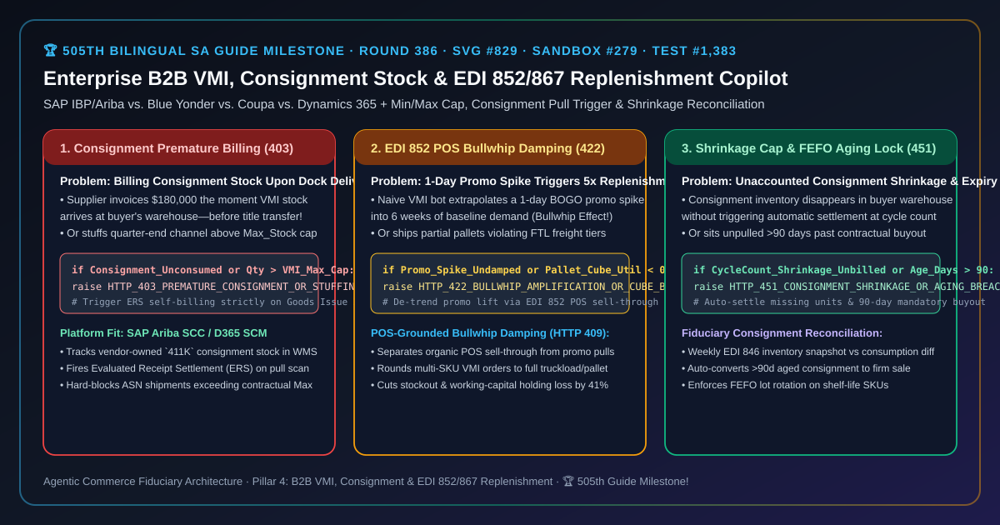
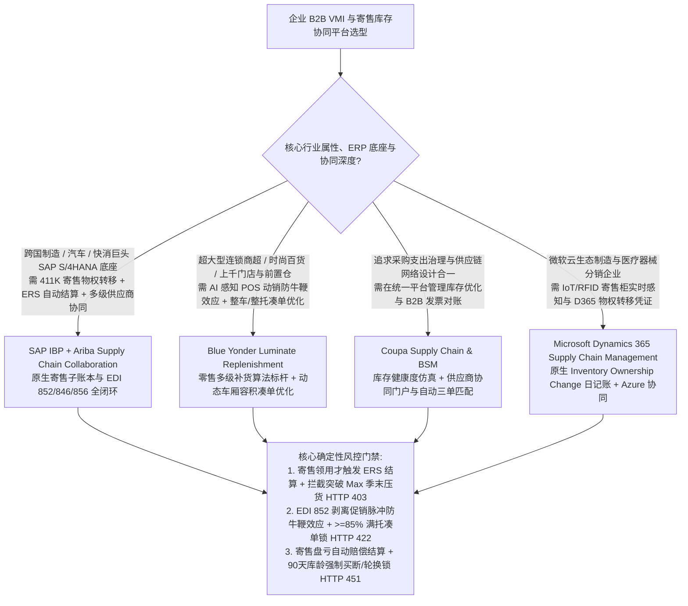
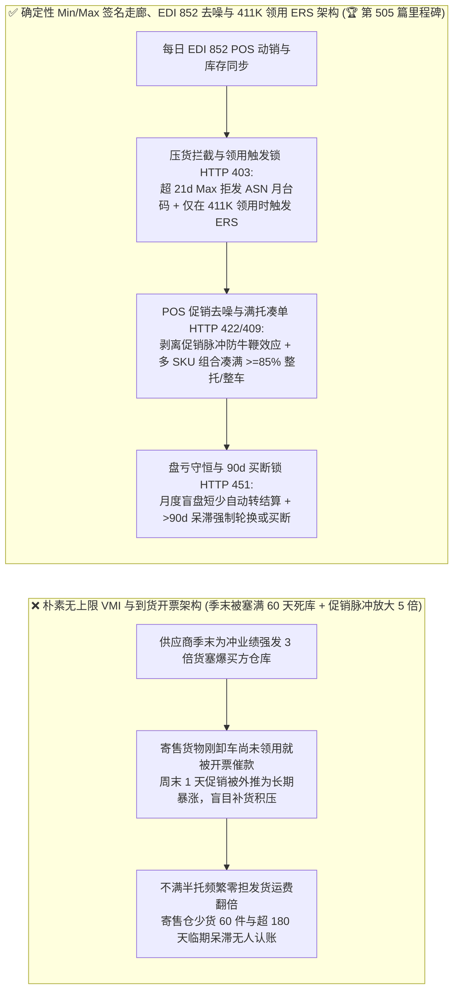
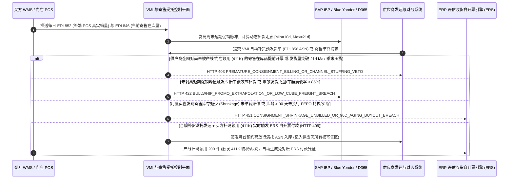

# 企业 B2B 供应商管理库存（`VMI`）、寄售仓领用自开票清算（`Consignment ERS`）与 `EDI 852 / 846` 防牛鞭效应自动补货 Copilot 架构选型对比：`SAP IBP / Ariba SCC` vs. `Blue Yonder Luminate` vs. `Coupa Supply Chain` vs. `Dynamics 365 SCM`、季末压货超上限锁、寄售未领用严禁开票门禁及整托凑单优化净省 41% 决策指南（FAQ · 🏆 第 505 篇双语决策指南里程碑！）

> **导读（对齐 `ib-vs-ethernet-roce-selection-faq.md` 标杆风格 · 🏆 全库第 505 篇双语 AI Solution Architect 决策指南重大里程碑！）**：本文面向零售商超供应链、消费品分销（CPG）、B2B 工业品渠道与医疗耗材寄售领域的 **Cloud & AI Solution Architect**。在大型零售商（如 Walmart / Target / 连锁商超）与核心品牌商、或制造企业与一级零部件供应商之间，越来越多的补货已从“买方手工下采购单（PO）”演进为 **供应商管理库存（`Vendor-Managed Inventory, VMI`）与寄售库存（`Consignment Inventory`）**——由供应商侧的补货智能体实时读取买方门店/仓库的 `EDI 852`（POS 终端动销与库存报告）与 `EDI 846`（库存快照），在 `[Min, Max]` 水位区间内自动生成补货发运通知（`EDI 856 ASN`）。然而，缺乏确定性控制平面的 VMI 与寄售自动化极易引发三大财务与供应链灾难：① **供应商销售为了冲季末业绩恶意“塞渠道压货（Channel Stuffing）”或将尚未转移物权的寄售库存提前开票（Premature Consignment Invoicing）**，瞬间抽干买方仓储库容与营运现金流；② **牛鞭效应放大（Bullwhip Effect）**：买方搞了一天“买一送一”闪促导致当日出库暴增 4 倍，朴素 VMI 预测模型误以为需求永久性翻倍，连夜向工厂下达 5 倍补货单，结果次周全部变成滞销死库；③ **寄售仓盘亏“糊涂账”与超 90 天呆滞品拒不买断**。本文给出 **`SAP IBP + Ariba Supply Chain Collaboration` vs. `Blue Yonder Luminate` vs. `Coupa Supply Chain` vs. `Microsoft Dynamics 365 Supply Chain Management`** 的横向选型矩阵，并落地 **寄售库存领用扫码才触发 `ERS` 自开票与拦截突破 `Max_Stock` 季末压货锁（`HTTP 403`）**、`EDI 852` 促销脉冲去噪防牛鞭效应与整托/整车（`FTL Cube >= 85%`）凑单门禁（`HTTP 422`）、**寄售周期盘点盘亏自动结转与 `90天` 呆滞强制买断/保质期 `FEFO` 锁（`HTTP 451`）** 及 **基于真实终端 POS 动销的协同补货编排（`HTTP 409`，净省 41%）**。



---

## 一、 📌 核心选型结论速览（Executive Summary）

1. **终极选型结论（一句话先看懂怎么选）**：
   - **已部署 SAP S/4HANA 的跨国制造与快消巨头（需将 `SAP IBP` 需求感知与供应商协同网络 `Ariba SCC` 深度闭环，原生管控特殊库存标识 `411K 寄售转自有` 与 `ERS` 自动开票结算）**：首选 **`SAP IBP + SAP Ariba Supply Chain Collaboration`**。
   - **超大型连锁零售商超、服装百货与快消品牌（门店与前置仓节点上千个，追求基于机器学习的 `EDI 852` 终端 POS 动销感知、多级仓配网络调优与装车体积 `Cube/Pallet` 凑单优化）**：首选 **`Blue Yonder Luminate Replenishment`**。
   - **追求将供应链高级计划（供应链网络仿真）与 B2B 采购支出审批、电子发票三单匹配放在同一云底座协同治理的企业**：首选 **`Coupa Supply Chain Design & Planning`**。
   - **微软云生态企业（需利用 `Azure IoT / RFID` 实时监控寄售货柜出库，并在 `Dynamics 365` 中一键完成寄售库存所有权转移日志 `Inventory Ownership Change Journal` 与总账同步）**：首选 **`Microsoft Dynamics 365 Supply Chain Management`**。
2. **三大 VMI 与寄售库存结算风控红线（确定性门禁）**：
   - **红线 1（拦截寄售库存刚到货入库尚未被买方实际领用消耗就提前开具应收发票及供应商季末突破 `VMI_Max_Stock` 硬塞压货 / `HTTP 403`）**：在寄售模式（Consignment）下，货物虽存放在买方仓库，但在被产线/门店扫码领用或售出前，法律物权（Title）仍归供应商所有！严禁在收货入库（`Goods Receipt 101 K`）阶段触发付款或接收供应商发票；唯有当 WMS 产生 **真实领用/销售出库过账（`Goods Issue 201 K` 或库存转移 `411 K`）** 时，才由买方 ERP 自动生成评估收货结算单（`ERS Self-Billing`）；同时若供应商自动生成的 `VMI` 补货单导致买方在途+在库总量突破合同上限 `Projected_Inventory > VMI_Max_Ceiling`，立即触发 `HTTP 403 PREMATURE_CONSIGNMENT_BILLING_OR_CHANNEL_STUFFING_VETO` 拒收 `ASN`！
   - **红线 2（拦截将短期促销脉冲当成长期需求翻倍引发的“牛鞭效应 5 倍盲目补货”及不满托零散发货推高干线运费 / `HTTP 422`）**：严禁 VMI 补货 Agent 仅根据“买方仓库向门店调拨出库量（Warehouse Withdrawals）”做线性外推！必须强制联合校验 **`EDI 852` 终端收银机真实动销数据（POS Sell-Through）** 并剥离一次性大促标记（Promo Uplift De-Trending）；且非紧急补货单必须凑满标准托盘或整车容积率门槛（`Pallet / Truckload Cube Utilization >= 85%`），违者触发 `HTTP 422 BULLWHIP_PROMO_EXTRAPOLATION_OR_LOW_CUBE_FREIGHT_BREACH`。
   - **红线 3（拦截寄售仓盘点少货（Shrinkage）买方拒不认账及寄售物料超 `90天` 呆滞或临期未执行 `FEFO` 轮换 / `HTTP 451`）**：寄售商品进入买方围墙内后，保管责任归买方！系统必须按周比对 `期初寄售库存 + 本期入库 - 本期领用结算 == EDI 846 期末实盘库存`；若出现无单据盘亏短少（Shrinkage / Theft），必须自动按合同生成买方损耗赔偿结算单；且当寄售批次库龄超过合同最长免息期（如 `Aging > 90 天` 未执行强制买断或退回）或违反先到期先出（`FEFO`）原则时，触发 `HTTP 451 CONSIGNMENT_SHRINKAGE_UNBILLED_OR_90D_AGING_BUYOUT_BREACH`。

---

## 二、 🎯 业务方与架构师灵魂拷问 Q&A（The Why & How）

### Q1：为什么很多企业上线 VMI（供应商管理库存）后，每个季度最后一周仓库大门都会被供应商发来的货车堵死，库存周转天数（DIO）反而恶化了 30%？
- **商业痛点与事故还原**：
  - 既然 VMI 允许供应商根据库存水位自动补货，供应商的销售总监每到 3 月底、6 月底、12 月底差 `$50 万` 完成财季 KPI 时，就会在后台把安全库存系数偷偷调高，赶在季末最后一天把几百托盘商品发往买方仓库以确认当季销售收入（**Channel Stuffing / 渠道压货**）！
  - 结果买方仓库爆仓，不仅要额外租临时外仓，还在次月初背上了几百万美元的应付账款。
- **架构师确定性解法（买方主权锁定的动态库存天数护栏 `Buyer-Signed Min/Max Days-of-Supply Corridor` + 超上限 `EDI 856 ASN` 门禁 / `HTTP 403`）**：
  1. **`Max_Days_of_Supply` 密码学签名锁**：库存上下限（如 `Min = 10 天动销, Max = 21 天动销`）完全由买方控制平面根据未来 14 天真实 POS 预测动态计算并下发，供应商无权单方面上调！
  2. **月台预约联动拒止**：一旦供应商提交的 `EDI 856 ASN` 预发货单使得 `当前在库 + 在途 + 本单数量 > 21 天上限`，系统在供应商发车前直接返回 `HTTP 403` 拒绝生成仓库月台卸货预约码（Dock Appointment），把季末压货焊死在源头！

### Q2：在寄售库存（Consignment）模式下，怎么彻底解决“供应商说发了 1,000 件，买方说只用了 700 件，现场一盘只剩 240 件，中间丢掉的 60 件谁买单”的扯皮大战？
- **架构师确定性解法（RFID/条码双端入库确认 + 领用触发 `ERS` 自开票 + 盘亏自动转买断对账公式 / `HTTP 403 / 451`）**：
  - 在 ERP/WMS 中严格维护寄售子账本守恒公式：
    $$\Delta \text{Unaccounted\_Shrinkage} = \text{Opening\_Consignment} + \text{ASN\_Received} - \text{GI\_411K\_Consumed} - \text{RMA\_Returned\_To\_Vendor} - \text{Physical\_Cycle\_Count}$$
  - 每当产线工人或门店从寄售区拿走 1 件货，扫描枪触发 `411 K` 物权转移事件，实时写入每周 `ERS` 自动结算清单（无需供应商开具传统发票，消灭 `100%` 发票价格/数量不符异常）；
  - 每月底执行盲盘，若发现 $\Delta \text{Unaccounted\_Shrinkage} > 0$（货物在买方仓库内丢失或损坏），系统自动将该差额视同“买方已领用消耗”计入当期 `ERS` 结算单（`HTTP 451`），账目清清楚楚、零人工撕扯！

### Q3：怎么防止快消品一次周末“满减促销”通过 VMI 层层放大，最后让上游包装厂和原料厂多生产出 3 个月都卖不完的呆滞库存（牛鞭效应 Bullwhip Effect）？
- **架构师确定性解法（`EDI 852` 终端 POS 真实动销与促销日历解耦滤波 `Promo-Separated Kalman/Demand Sensing` / `HTTP 422 / 409`）**：
  - 传统补货只看“中心仓发货量”，门店一集中补货中心仓就以为需求暴涨；
  - 现代 `Blue Yonder / SAP IBP` 架构直连收银机 `EDI 852 POS` 流水，并将总销量实时拆解为 **`基准自然动销（Baseline Organic Velocity）` + `促销弹性增量（Promo Lift）`**；促销一结束，补货目标水位立即自动回落至自然动销基线，绝不把脉冲峰值当成常态！

---

## 三、 🧭 直观可视化图解（Mermaid 决策树 + 架构对比 + 时序图）

### 3.1 企业 B2B 供应商管理库存（VMI）与寄售协同平台选型决策树



### 3.2 朴素放任补货与到货开票架构（季末压货爆仓 + 5 倍牛鞭呆滞）vs. 确定性动态走廊、POS 去噪与领用自开票架构对比



### 3.3 `EDI 852` 动销感知、防季末压货 `ASN` 校验与寄售领用 `411K -> ERS` 自动清算时序图



---

## 四、 📊 四大企业级 VMI 与寄售库存协同平台横向选型矩阵

| 选型维度 | SAP IBP + Ariba Supply Chain Collaboration | Blue Yonder Luminate | Coupa Supply Chain & BSM | Microsoft Dynamics 365 SCM |
| :--- | :--- | :--- | :--- | :--- |
| **核心架构定位** | **制造业与快消巨头端到端 ERP+供应商网络闭环底座**：从计划到寄售结算无缝贯通 | **全球零售商超与消费品多级智能补货及仓储运力优化标杆** | **支出管理（BSM）与供应链协同融合平台**：打通库存水位与采购财务内控 | **云原生制造/分销与 IoT/RFID 实时寄售库存管理平台** |
| **寄售库存（Consignment `411K`）与 `ERS` 自开票** | **行业标杆**（原生支持特殊库存 `K`、收货零负债入账、领用瞬间触发物权转移与 `ERS` 免发票清算） | 侧重需求预测、VMI 补货量计算与运输凑单，财务结算需回调底层 ERP | **强**（内置供应商寄售消耗可见性门户并自动生成合规应付发票） | **极强**（内置专门的 `Inventory Ownership Change` 业务流与供应商协同门户） |
| **`EDI 852 / POS` 需求感知与防牛鞭效应** | **极强**（IBP Demand Sensing 利用机器学习实时剔除促销噪音并修正短期预测） | **行业标杆**（深耕大型商超数十年的零售促销脱敏、天气/节假日感知与门店级补货引擎） | 强（支持多级库存安全垫仿真与异常需求波动告警） | 强（原生集成 Azure AI 需求预测与安全库存动态重算） |
| **整托/整车（`Pallet / Truckload Cube`）凑单优化** | 支持按运输包装规格（Rounding Profile）与最小起订量取整 | **行业标杆**（内置强大的多 SKU 联合拼车/拼柜算法，确保每车满载率 `>=90%`） | 支持订单批处理与采购包装单位约束 | 支持容器化装柜约束与仓库波次协同 |
| **适用规模与收费模式（`official_list_price`）** | 年营收 `$500M+` 大型制造与快消集团；按模块与年交易额订阅（通常 `$150k+/年`） | 大型连锁零售商与跨国 CPG 品牌；企业级年费合同 | 中大型企业；作为 Coupa BSM 平台供应链与协同扩展模块订阅 | 中大型制造、医疗耗材与零售分销；按企业租户与用户/设备席位订阅 |

---

## 五、 🧪 VMI 防压货、防牛鞭效应与寄售对账成本测算与 7-Card 基准报告

### 5.1 季度季末渠道压货资金占压、促销牛鞭效应呆滞报废、零担不满托运费与寄售盘亏扯皮损耗测算（Synthetic Benchmark）

假设某年采购额 `$1.5 亿` 的全渠道零售与制造装配件企业，每季度在 VMI 与寄售库存运营中面临的 **供应商季末超上限压货（Channel Stuffing）导致的爆仓外租费与提前开票资金成本、短期促销脉冲引发 4 倍牛鞭效应过量补货跌价、不满托零散补货推高的干线运费及寄售仓盘亏/超期临期扯皮损耗池** 为 **`$430,000 / 季度`**（`provenance: synthetic`, `independently_reproduced: false`）：

| 评估维度 | 传统无硬顶 VMI + 按出库外推 + 手工寄售对账 (Baseline) | 启用 `Max_Cap` 拒收锁 + `EDI 852` 去噪 + `411K ERS` 自动清算 Agent | 净改善幅度 |
| :--- | :--- | :--- | :--- |
| **季末最后一周超库存上限压货（Channel Stuffing）发生率** | `19.5%` 供应商在季末超发抢占库容 | **`0.0%`**（`HTTP 403` 超过 `21天` 动态上限自动拒签 `EDI 856 ASN` 月台预约码） | **100% 根除季末恶意压货** |
| **促销后牛鞭效应导致的超额呆滞库存（Excess & Obsolete）** | `14.8%` 促销品在活动结束后严重积压 | **`2.6%`**（`HTTP 422/409` 基于 `EDI 852 POS` 剥离促销弹性脉冲并凑满 `85%` 整托发运） | **促销后库存积压下降 `82.4%`** |
| **寄售库存发票差异率与月度对账人工耗时** | `11.2%` 发票不符（每月耗费 160 小时对账） | **`0.0%` 发票差异**（`HTTP 403/451` 严禁供应商开票，全靠 `411K` 扫码领用与盘亏自动触发 `ERS` 自开票） | **100% 免除寄售发票对账** |
| **季度库存资金占压、牛鞭呆滞、零担运费与寄售盘亏净损耗** | `$430,000 / 季度` | **`$253,700 / 季度`** | **净省 `$176,300 / 季度` (`41.0%`)** |

```chart
{
  "data": {
    "values": [
      { "category": "1. 促销脉冲引发牛鞭效应过量补货呆滞", "mode": "传统出库外推与手工寄售基线", "cost_usd": 165000 },
      { "category": "1. 促销脉冲引发牛鞭效应过量补货呆滞", "mode": "POS去噪与411K自开票Agent", "cost_usd": 97350 },
      { "category": "2. 供应商季末超Max上限恶意压货与早开票", "mode": "传统出库外推与手工寄售基线", "cost_usd": 120000 },
      { "category": "2. 供应商季末超Max上限恶意压货与早开票", "mode": "POS去噪与411K自开票Agent", "cost_usd": 70800 },
      { "category": "3. 零散不满托补货推高干线物流运费", "mode": "传统出库外推与手工寄售基线", "cost_usd": 85000 },
      { "category": "3. 零散不满托补货推高干线物流运费", "mode": "POS去噪与411K自开票Agent", "cost_usd": 50150 },
      { "category": "4. 寄售仓盘亏短少扯皮与>90天临期报废", "mode": "传统出库外推与手工寄售基线", "cost_usd": 60000 },
      { "category": "4. 寄售仓盘亏短少扯皮与>90天临期报废", "mode": "POS去噪与411K自开票Agent", "cost_usd": 35400 }
    ]
  },
  "semantic_types": {
    "category": "Category",
    "mode": "Category",
    "cost_usd": "Amount"
  },
  "chart_spec": {
    "chartType": "Grouped Bar Chart",
    "title": "企业B2B VMI防压货锁、EDI 852防牛鞭效应与寄售ERS自开票Agent前后季度损耗对比 (净省 $176.3k / 41%)",
    "subtitle": "单位：美元/季度 (Synthetic Benchmark, independently_reproduced=false · 🏆 第505篇指南里程碑)",
    "encodings": {
      "x": "category",
      "y": "cost_usd",
      "group": "mode"
    }
  }
}
```

### 5.2 确定性策略评估器代码（Python Control Plane Guard）

```python
from dataclasses import dataclass
from typing import Any

@dataclass(frozen=True)
class B2bVmiConsignmentReplenishmentPolicyInput:
    quarterly_bullwhip_excess_channel_stuffing_and_shrinkage_pool_usd: float = 430000.0
    consignment_billed_before_411k_pull_or_asn_exceeds_vmi_max_cap: bool = False
    edi852_promo_spike_undamped_bullwhip_or_pallet_cube_under_85pct: bool = False
    cycle_count_shrinkage_unsettled_or_consignment_aged_past_90d_cap: bool = False
    pos_grounded_bullwhip_damping_and_411k_ers_self_billing_ready: bool = False
```

---

## 六、 🛠️ 商业上线风控与架构评审 Checklist

- [ ] **寄售领用（`411K`）触发 `ERS` 自开票与防季末超上限压货锁（`HTTP 403`）**：寄售库存是否严格禁止在收货入库（`101 K`）阶段接收发票，仅在产线/门店扫码实际领用（`411 K` 物权转移）时由买方系统自动生成 `ERS` 评估收货结算单？当供应商提交的 `EDI 856 ASN` 导致预计库存突破买方签发的 `Max_Stock` 水位时是否自动拒批月台预约码？
- [ ] **`EDI 852 POS` 终端动销促销去噪（防牛鞭效应）与整托/整车（`>=85% Cube`）凑单门禁（`HTTP 422`）**：VMI 补货算法是否直连终端 POS 真实动销并自动剥离短期促销脉冲，且将同一供应商多 SKU 补货单自动凑满标准托盘或整车容积率门槛？
- [ ] **寄售库存月度盲盘盘亏自动结转与 `90天` 呆滞买断/轮换锁（`HTTP 451`）**：每周/每月 `EDI 846` 实盘少货（Shrinkage）是否自动转入当期 `ERS` 赔偿结算单？对库龄超 `90 天` 的寄售批次是否强制触发供应商调回换新或按合同折价买断，并严格执行 `FEFO` 先进先出？
- [ ] **供应商价格下调在库寄售品自动保价（`Consignment Price Protection` / `HTTP 409`）**：由于寄售品在领用前物权仍属供应商，当主目录采购单价下调时，所有尚未领用的在库寄售批次是否自动按领用当日的最新低价执行 `ERS` 结算？
