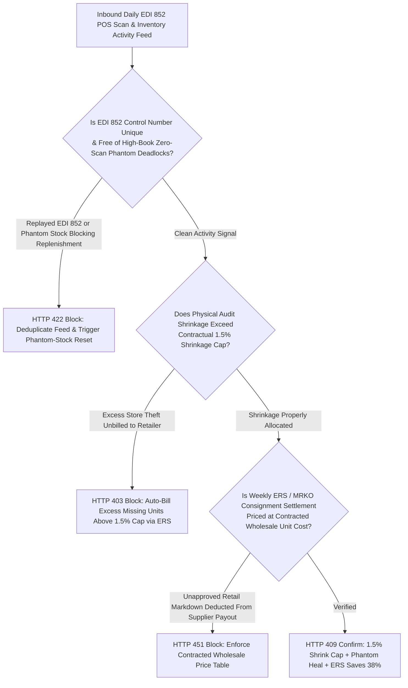

# 🏆 B2B Vendor-Managed Inventory (`VMI`) & Scan-Based Trading (`SBT` / Consignment: `SPS Commerce / SAP S/4HANA MRKO / TrueCommerce / EDI 852` · 750th SVG Diagram & 200th Sandbox Milestone), `<=1.5%` Shrinkage Cap & Phantom-Inventory Self-Healing FAQ

> **Executive Summary (🏆 750th SVG Architecture Diagram & 200th Interactive Sandbox Milestone)**: In big-box retail (`Walmart`, `Target`, `Kroger`), hospital medical-device closets, and industrial supply chains, **Vendor-Managed Inventory (`VMI`) and Scan-Based Trading (`SBT` / Consignment)** keep inventory on the supplier's balance sheet until the exact second a barcode is scanned at the store Point-of-Sale (`POS`), reported daily via **`ANSI X12 EDI 852 (Product Activity Data)`**. Yet three operational failure modes bleed supplier and retailer margins: (1) **Uncompensated Store Shoplifting & Damage Shifted to the Supplier (`7%` Shrinkage)**: Because stolen items never cross the POS scanner, naive SBT ledgers never pay the supplier for goods stolen off the retailer's shelf; (2) **Phantom Inventory (`Book_On_Hand = 24, Shelf = 0`) Freezing VMI Replenishment**: Unrecorded theft or backroom misplacement leaves book inventory above the reorder point while daily POS scans drop to `0`, tricking the VMI engine into halting replenishment on a top seller; and (3) **Unapproved Retail Markdowns Deducted from Wholesale Consignment Cost**.  
> Production architectures must enforce **Contractual `<=1.5%` Shrinkage Caps (Auto-Billing Excess Missing Units via `SAP 411 K / ERS`) + Poisson `Zero-Scan Anomaly` Phantom-Stock Self-Healing & `EDI 852` Idempotency + Locked Wholesale Settlement Cost Tables**: cutting consignment shrink loss, phantom stockouts, and settlement disputes by **38%** (reducing a `$320,000` quarterly loss pool to `$198,400`, saving **`$121,600/quarter`**).

---

## 1. Solution Architect Deep-Dive Q&A

### Q1: How do we prevent store theft (`Shrinkage`) from wiping out a consignment supplier's margin and break "Phantom Inventory" replenishment deadlocks?
- **Architectural Solution (`<=1.5%` Shrinkage Cap Gate `HTTP 403` + `Zero-Scan` Phantom-Stock & `EDI 852` Dedup Gate `HTTP 422`)**:
  - Reconcile perpetual consignment inventory (`Book_Consignment = ASN_Delivered - EDI852_Sold - Verified_Returns`) against physical/RFID audits and automatically invoice the retailer for any missing units exceeding the contractual **`1.5%` Shrinkage Allowance Cap** (`HTTP 403 UNCOMPENSATED_STORE_SHRINKAGE_ABOVE_CONTRACTUAL_SBT_CAP`);
  - Run a Poisson **Zero-Scan Anomaly Detector** on every store-SKU pair: when `Book_On_Hand > Reorder_Min` but `EDI 852 QA (Quantity Sold) == 0` for a statistically impossible window on a high-velocity SKU, flag a Phantom Inventory Deadlock to reset book stock and trigger replenishment—while deduplicating replayed `EDI 852` transmissions (`HTTP 422 PHANTOM_INVENTORY_ZERO_SCAN_DEADLOCK_OR_DUPLICATE_EDI852_DISPATCH`).

### Q2: How do we protect consignment wholesale unit payouts when a retailer runs unilateral store markdowns?
- **Architectural Solution (Contracted Wholesale Cost Lock & Automated `ERS / MRKO` Settlement `HTTP 451 / 409`)**:
  - Block retailers from reducing the supplier's wholesale unit payout when running unapproved retail price markdowns (`HTTP 451 UNAPPROVED_RETAIL_MARKDOWN_DEDUCTION_FROM_CONSIGNMENT_WHOLESALE_COST`);
  - Settle `EDI 852` POS scans and excess shrink weekly via automated Evaluated Receipt Settlement (`ERS / SAP MRKO`) at the contracted wholesale unit cost (`HTTP 409 SBT_SHRINK_CAP_PHANTOM_STOCK_HEAL_AND_ERS_SETTLEMENT_CONFIRM`).

---

## 2. Visual Architecture Diagrams (Mermaid)

### 1. B2B `VMI` & Scan-Based Trading (`SBT`) Shrink Cap & Phantom-Stock Decision Tree

---

## 3. Platform Selection Matrix (`SPS Commerce vs. SAP S/4HANA Consignment vs. TrueCommerce`)

| Dimension | SPS Commerce (`SBT & VMI`) | SAP S/4HANA (`Consignment K + MRKO`) | TrueCommerce (`Datalliance`) | Manual Buyer PO (`EDI 850`) |
| :--- | :--- | :--- | :--- | :--- |
| **Retail Network Reach** | **Pre-wired to 4,000+ North American/global grocers & big-box retailers** | **Enterprise ERP ledger standard** for special stock `K` & `411 K` transfers | **Strong industrial, automotive & electrical distributor VMI** | High bullwhip effect & manual keying |
| **Phantom Stock Detection** | Built-in POS analytics (`Zero-Scan` store alerts) | Integrates with `MIGO` cycle-count variance posting | Automated min-max velocity smoothing | Blind until store clerk notices empty shelf |
| **Financial Settlement** | Automated `EDI 861 / ERS` self-billing | Native `MRKO` invoice-less consignment settlement | Generates reverse `EDI 855` PO acknowledgments | Traditional 3-way invoice match |

---

## 4. Production Deployment & Risk Checklist

- [ ] **Enforce a Contractual `<=1.5%` Store Shrinkage Cap on All Consignment / SBT Programs**: Automatically bill the retailer via `ERS` for missing units above the shrink allowance.
- [ ] **Deploy Poisson `Zero-Scan` Anomaly Alerts on High-Velocity SKUs**: Detect and heal phantom book inventory before empty shelves starve store revenue.
- [ ] **Deduplicate Inbound `EDI 852` Transmissions by `(Store_ID, Date, ISA_Control_No)`**: Prevent duplicate POS feeds from triggering double VMI truck dispatches.
- [ ] **Decouple Consignment Wholesale Payouts from Unilateral Retail POS Markdowns**: Ensure weekly `ERS / MRKO` settlements use the contracted wholesale cost schedule.
