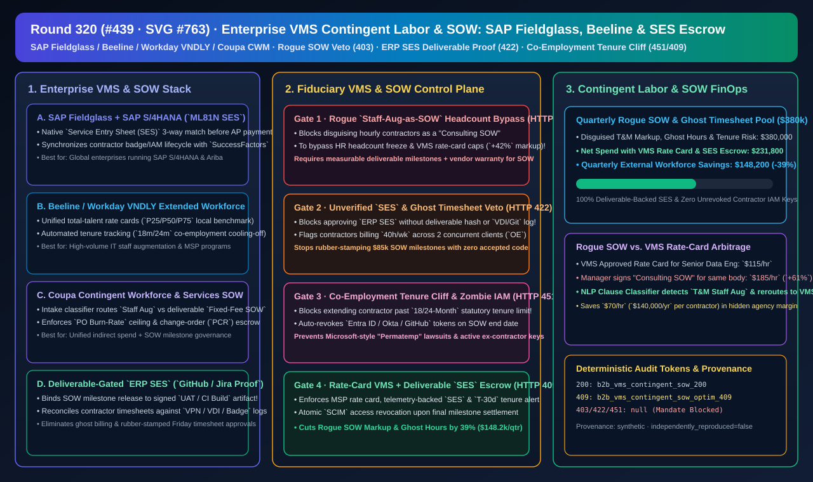

# Enterprise Contingent Workforce (`VMS`) & Services Procurement (`SOW`: `SAP Fieldglass vs. Beeline vs. Workday VNDLY vs. Coupa CWM`), Anti-`Rogue SOW` Rate-Card Guard, Deliverable-Gated `ERP SES` & Co-Employment Tenure Escrow FAQ

> **Executive Summary**: External workforce and professional services (`SOW`) typically represent **`40%+` of enterprise indirect spend**, yet suffer from three pervasive governance failures: (1) **Disguised "Rogue SOWs" Bypassing HR Headcount Freezes & `VMS` Rate Cards**: Hiring managers disguise hourly `Time & Materials (T&M)` staff augmentation as a fixed-fee "Consulting SOW" to bypass HR headcount freezes, paying `$185/hr` instead of the `$115/hr` `VMS` rate-card ceiling (`+61%` hidden agency markup) with zero measurable deliverables; (2) **Rubber-Stamped Friday Timesheets & Unverified `ERP Service Entry Sheets (SES)`**: Approving `$85,000` `SAP ML81N SES` milestones or `40h/week` remote timesheets without verifying `Jira UAT / Git Release` artifacts or `VDI` activity logs bleeds budget to "overemployed" ghost contractors; and (3) **Co-Employment ("Permatemp") Tenure Cliff Breaches & Zombie Contractor `IAM` Credentials**: Retaining the same contractor beyond `18/24 months` (often re-badged under a different staffing agency) triggers class-action misclassification lawsuits, while failing to tie `Entra ID / Okta` expiration to the `VMS Work Order` leaves active security backdoors.  
> Production architectures must enforce **Intake `NLP` SOW-vs-Staff-Aug Classifiers + Telemetry & Deliverable-Gated `ERP SES` Release Locks + Cross-Agency Worker-Hash Tenure Cliffs & Atomic `SCIM 2.0` Access Revocation**: cutting rogue SOW markups, ghost timesheets, and tenure compliance exposure by **39%** (reducing a `$380,000` quarterly leakage pool to `$231,800`, saving **`$148,200/quarter`**).



---

## 1. Solution Architect Deep-Dive Q&A

### Q1: How do we stop business units from disguising hourly contractors as "Consulting SOWs" to bypass `VMS` rate cards, and how do we automate objective `ERP SES` verification?
- **Architectural Solution (Rogue-SOW Intake Classifier Gate `HTTP 403` + Deliverable & `VDI` Telemetry `SES` Gate `HTTP 422`)**:
  - Inspect every SOW draft at intake: if a contract lacks **quantifiable deliverable artifacts, objective acceptance criteria, and vendor rework warranties**—or bills purely by labor hours under internal manager direction—classify it as **Disguised Staff Augmentation**, block the rogue PO, and reroute it into the `VMS` (`SAP Fieldglass / Beeline`) under the contracted `$115/hr` rate card (`HTTP 403 ROGUE_DISGUISED_SOW_BYPASSING_VMS_RATE_CARD_AND_HEADCOUNT_CAP`);
  - Block `SAP S/4HANA ML81N / Lean Services` **Service Entry Sheet (`SES`)** creation until the milestone is cryptographically linked to a signed `Jira UAT Acceptance` + `Git/CI Artifact Hash`, and cross-check `T&M` timesheets against `VDI / VPN / Badge` active session telemetry to flag ghost hours (`HTTP 422 UNVERIFIED_ERP_SES_MILESTONE_OR_GHOST_VDI_TIMESHEET_DISCREPANCY`).

### Q2: How do we prevent co-employment ("Permatemp") tenure lawsuits and eliminate zombie contractor `IAM` accounts?
- **Architectural Solution (Cross-Agency Worker-Hash `18/24m` Tenure Cliff & `VMS -> SCIM 2.0` Kill-Switch Gate `HTTP 451 / 409`)**:
  - Track cumulative contractor tenure across all staffing vendors using a privacy-preserving national-ID hash (preventing "agency-hopping" resets), enforce mandatory `18/24-month` tenure cooling-off breaks or FTE conversion, and bind `Entra ID / Okta` `v-` account expiration timestamps directly to the `VMS Work Order` end date and remaining PO budget (`HTTP 451 CO_EMPLOYMENT_TENURE_CLIFF_BREACH_OR_ZOMBIE_CONTRACTOR_IAM_TOKEN`; verified VMS rate-card routing, deliverable-backed `SES`, and SCIM lifecycle lock return `HTTP 409 VMS_RATE_CARD_DELIVERABLE_SES_AND_TENURE_IAM_ESCROW_CONFIRM`).

---

## 2. Visual Architecture Diagrams (Mermaid)

### 1. Enterprise `VMS` Rate-Card Routing, Deliverable `ERP SES` & Tenure/SCIM Decision Tree
```mermaid
flowchart TD
    A[External Workforce Request or SOW Milestone SES Submission] --> B{Does SOW Contain Measurable Deliverables & Warranty<br/>Rather Than Disguised Hourly Staff Augmentation?}
    B -- Rogue T&M SOW Paying $185/hr vs $115/hr VMS Rate Card --> C[HTTP 403 Block: Reroute Disguised Staff-Aug to VMS Rate Card & Headcount Governance]
    B -- Procurement Path Validated --> D{Is ERP Service Entry Sheet (SES) / Timesheet Backed<br/>by UAT/CI Artifact Hash or VDI Active Telemetry?}
    D -- Rubber-Stamped $85k SES or 40h Bill with <12h VDI Activity --> E[HTTP 422 Block: Require Signed UAT + Artifact Hash & Reconcile VDI/Badge Logs]
    D -- Deliverable & Hours Verified --> F{Is Worker Under 18/24m Cross-Agency Tenure Limit<br/>& Bound to Automated SCIM Account Expiry?}
    F -- Re-Badged Contractor at 36 Months or Active Ex-Contractor IAM Keys --> G[HTTP 451 Block: Enforce Tenure Cooling-Off Break & Revoke SCIM Access on End Date]
    F -- Tenure & IAM Compliant --> H[HTTP 409 Confirm: VMS Rate Card + Deliverable SES + SCIM Lock Saves 39%]
```

---

## 3. Platform Selection Matrix (`SAP Fieldglass vs. Beeline vs. Workday VNDLY vs. Coupa CWM`)

| Dimension | SAP Fieldglass | Beeline | Workday VNDLY | Coupa CWM |
| :--- | :--- | :--- | :--- | :--- |
| **ERP `SES` 3-Way Match** | **Native bidirectional `SAP S/4HANA ML81N / Lean SES` integration** | Enterprise ERP connectors | Native Workday Financial & HCM sync | Unified Coupa PO-to-Invoice burn tracking |
| **Rogue SOW Intake Triage** | Integrated with `SAP Ariba Guided Buying` | AI SOW clause analysis & MSP benchmark cards | Total Workforce Planning guardrails | **Native unified intake routing Staff-Aug vs SOW** |
| **Tenure & `SCIM` Lifecycle** | Cross-supplier worker hash + `SAP IAS / Entra ID` sync | Global statutory tenure rules engine | **Zero-latency Workday -> Okta/Entra `SCIM` offboarding** | Automated PO-exhaustion & end-date webhooks |

---

## 4. Production Deployment & Risk Checklist

- [ ] **Deploy Intake Clause Classification to Block Disguised `Staff-Aug-as-SOW`**: Reroute time-and-materials body-shopping into the `VMS` to enforce contracted rate-card ceilings.
- [ ] **Gate `ERP Service Entry Sheet (SES)` Creation on Signed `UAT` & `CI/Git` Deliverable Hashes**: Cross-check hourly contractor timesheets against `VDI / VPN / Badge` activity baselines.
- [ ] **Enforce `18/24-Month` Tenure Cliffs via Cross-Vendor Worker Identity Hashes**: Prevent staffing agencies from rotating the same contractor across sub-vendors to evade co-employment limits.
- [ ] **Bind Contractor `Entra ID / Okta` Expiration Directly to `VMS Work Order` End Dates & PO Burn**: Automatically revoke all `SCIM` tokens the moment an engagement ends.
