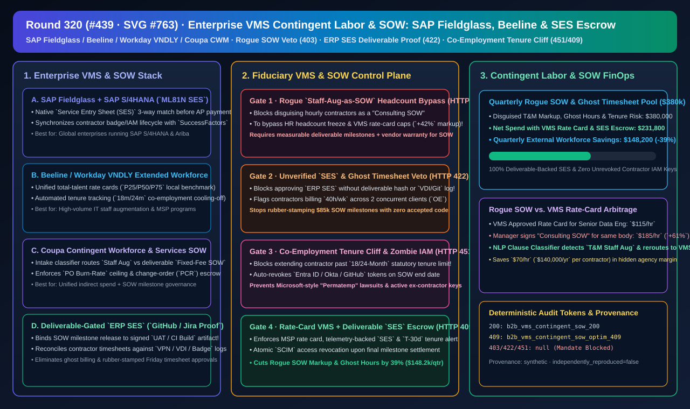
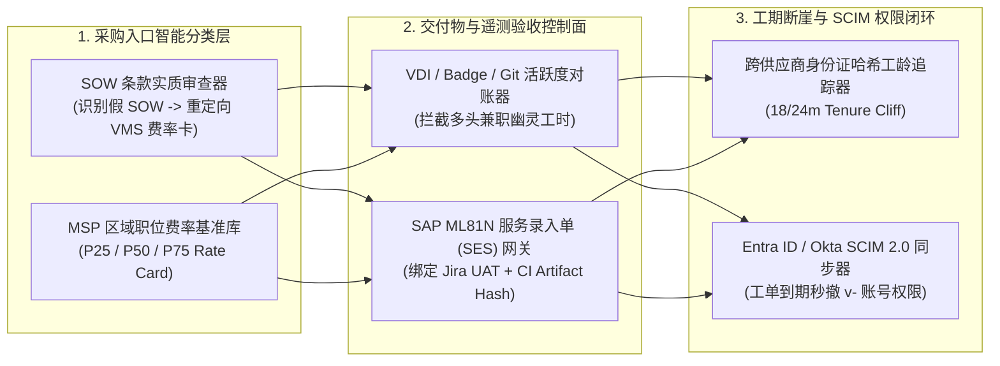
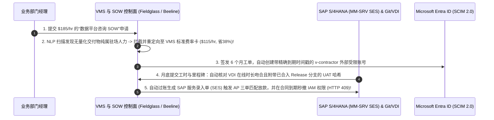

# 企业外部用工与专业服务采购管理系统（`Enterprise VMS & Services Procurement SOW`: `SAP Fieldglass vs. Beeline vs. Workday VNDLY vs. Coupa CWM`）、防假 `SOW` 绕过人力编制与费率卡、交付物绑定的服务录入单（`ERP SES`）与联合雇佣（`Co-Employment`）工期断崖隔离 Agent 架构选型 FAQ

> **核心选型结论速览**：在大型跨国企业的间接采购中，外部劳动力（IT 驻场外包、管理咨询、营销机构与专业服务 `SOW`）往往占企业总支出的 **`40%+`**，却是最缺乏数字化管控的“法外之地”：① **“业务部门因 HR 冻结正式员工编制（Headcount Freeze）或嫌 `VMS` 标准外包费率卡（`$115/小时`）招人流程慢，私自跟外包公司签一份名为‘技术架构咨询项目’的假工作说明书（`Rogue / Disguised SOW`），实质上却是按人天算钱的驻场人力外包（`Time & Materials Staff Augmentation`），单价被暗中抬高至 `$185/小时`（溢价 `+61%`）且无任何可量化交付物”**；② **“每逢周五下午，业务经理看都不看就批量一键点通过几十张驻场外包周工时表（Rubber-Stamped Timesheets）或 `$85,000` 的 `SAP ML81N 服务录入单（SES: Service Entry Sheet）`，结果兼职黑客一人同时打两份全职远程工（Overemployed Ghost Hours）一周只交了 2 行代码却领走全额周薪，或是乙方只发了一份 PPT 就骗走里程碑阶段款”**；③ **“同一名外包人员在公司连续驻场满 `24 个月` 未执行法定冷却期（Tenure Cliff），且平时由内部经理直接排班考核，触发‘事实劳动关系 / 联合雇佣（`Co-Employment / Permatemp Lawsuit`）’天价期权与社保追偿诉讼；或者外包合同到期后其 `Entra ID / GitHub` 权限仍保留数月沦为数据泄露后门”**。  
> 生产级架构必须实施 **“采购入口 `NLP` 合同实质分类器（拦截假 `SOW` 强制路由回 `VMS` 标准费率卡）+ 绑定 `GitHub PR / Jira UAT / VDI 活跃遥测` 的自动化服务验收单（`ERP SES`）门禁 + `18/24 个月` 驻场工期断崖预警与合同到期秒级 `SCIM` 权限注销控制面”**：可将假 SOW 溢价、幽灵工时与超时留用合规风险削减 **39%**（以季度 `$380,000` 假 SOW 人头溢价、空转工时与违规延期风险池计，净成本降至 `$231,800`，每季度净节省 **`$148,200`**）。



---

## 一、 业务方与架构师灵魂拷问（Q&A）

### Q1：为什么企业明明上了 `SAP Fieldglass` 或 `Beeline` 管控外包单价，各部门却依然能用高出市场价 `50%` 的价格把同一批外包人员招进来？
- **“假 SOW 真卖人头（Disguised Staff Augmentation / Rogue SOW）”潜规则**：
  - 如果走标准 `VMS (Vendor Management System)` 招聘一名高级数据工程师，系统会强制执行全国统一集采费率卡（`Rate Card Cap = $115/hr`，供应商毛利封顶 `18%`），且需经过 HR 与采购双重审批；
  - 于是外包供应商教唆业务主管：*“别走 VMS 人头审批了！我们签一份 `$250,000` 的《数据平台升级咨询 SOW》走普通间接采购 PO 吧！”*——翻开这份所谓的 `SOW`，里面没有任何验收指标或违约赔偿，写着“乙方派驻 1 名高级顾问，每周工作 40 小时，按 `$185/hr` 按月结算”！
- **架构解法（采购入口 `SOW vs. Staff Aug` 条款实质检验器门禁 `HTTP 403`）**：
  - 在 `Zip / Coupa / Ariba` 采购申请入口部署确定性条款审计 Agent：
    - 凡申报为 `Fixed-Price / Milestone SOW` 的合同，必须同时包含 **① 明确可量化的交付物清单（Deliverable Artifacts）、② 客观验收标准（Acceptance Criteria）与 ③ 乙方返工质保责任（Vendor Rework Warranty）**；
    - 凡条款中出现按人天/工时计费（`T&M / Daily Rate`）、无独立交付结果或实质由甲方日常指派任务的，一律识别为 **`Disguised Staff Augmentation`**，当场拦截并强制重定向回 `VMS` 套用集采费率卡上限（`HTTP 403 ROGUE_DISGUISED_SOW_BYPASSING_VMS_RATE_CARD_AND_HEADCOUNT_CAP`）。

### Q2：实物采购有仓库收货扫码（`GRN`）做三单匹配，无形的软件外包与咨询服务如何防止业务经理“闭眼乱批”工时表与里程碑服务录入单（`ERP SES`）？
- **“周五下午的橡皮图章（Rubber-Stamping）”与“多头兼职幽灵工时”**：
  - 在没有客观遥测锚点时，业务经理面对几十张外包周报和 `SAP ML81N 服务录入单（SES）` 只能顺手全点同意，直到项目延期才发现外包人员整周 `VDI` 远程桌面在线不到 4 小时、或者里程碑交付物根本无法通过编译测试！
- **架构解法（工时表交叉核验 `VDI / 门禁 / Git` 活跃度基线 + SOW 里程碑强制绑定 `Jira UAT / CI Artifact Hash` 才允许生成 `ERP SES` 门禁 `HTTP 422`）**：
  - **针对 `T&M` 驻场工时**：在生成应付账款前，自动比对工时表申报小时数与企业 `門禁刷卡记录 / VDI 虚拟桌面活跃会话时长 / 代码提交跨越度`（若申报 `40 小时` 全职但整周受控终端活跃度 `< 12 小时`，自动挂起要求解释，严防跨公司全职兼职欺诈）；
  - **针对 `SOW` 里程碑付款**：将 `SAP Fieldglass / Coupa` 的里程碑验收单（`Service Entry Sheet, SES`）与研发/业务系统强绑定——必须附带经甲方产品经理数字签名的 **`UAT 验收通过单号 + CI/CD 构建产物哈希（或设计稿归档哈希）`**，否则 `SAP S/4HANA` 严禁过账生成 `SES` 放款凭证（`HTTP 422 UNVERIFIED_ERP_SES_MILESTONE_OR_GHOST_VDI_TIMESHEET_DISCREPANCY`）。

### Q3：如何防止外包人员因“连续驻场 3 年 + 内部邮箱混用”打赢事实雇佣（`Co-Employment`）官司，并在外包离场当天 100% 掐断其系统权限？
- **架构解法（`18/24 个月` 法定驻场工期断崖锁 + `VMS <-> Entra ID / Okta SCIM` 合同到期秒级断权门禁 `HTTP 451 / 409`）**：
  - 汲取微软早年著名的 *Vizcaino v. Microsoft*（“Permatemp”长期临时工集体诉讼）教训与欧盟派遣工同工同酬指令（`EU Agency Work Directive`）：
    1. **驻场工期硬红线（`Tenure Cliff Guard`）**：在 `VMS` 中按员工唯一身份哈希（`SSN/National ID Hash`，防止换一家外包挂靠公司重进规避工龄！）追踪累计服务月数；到达 **`18 个月`（或当地法定上限）** 时，系统在 `T-30d` 发出预警并硬阻断直接续签，强制执行转正（Convert to FTE）或 `6 个月` 离场冷却期（Cooling-off Break）；
    2. **合同与身份生命周期原子联动（`VMS-Driven IAM Lifecycle`）**：严禁在 `Entra ID / Okta` 中给外包人员开设无过期时间的永久账号；外包账号（强制带 `-ext / v-` 标识）的 `Account_Expiration_Timestamp` 必须与 `VMS Work Order / SOW End Date` 毫秒级同步，一旦工单到期或预算耗尽（`PO Burn = 100%`），自动通过 `SCIM 2.0` 吊销全部 SSO 会话、VPN 与代码库令牌（`HTTP 451 CO_EMPLOYMENT_TENURE_CLIFF_BREACH_OR_ZOMBIE_CONTRACTOR_IAM_TOKEN`；标准费率卡分流 + 遥测绑定 `SES` 验收 + 工期与权限闭环确认返回 `HTTP 409 VMS_RATE_CARD_DELIVERABLE_SES_AND_TENURE_IAM_ESCROW_CONFIRM`）。

---

## 二、 直观可视化图解（Mermaid 决策树 + 架构图 + 时序图）

### 1. 企业外部用工（`VMS`）、服务采购（`SOW SES`）与联合雇佣隔离决策树
```mermaid
flowchart TD
    A[外部用工申请或 SOW 服务里程碑付款请求] --> B{申报为咨询 SOW 时: 是否包含明确交付物与质保<br/>而非伪装成 SOW 的按工时卖人头 (Disguised T&M)?}
    B -- 借假SOW绕过HR编制并以$185/hr高价逃避$115费率卡 --> C[HTTP 403 拦截: 识别实质人力外包并强制路由回 VMS 执行标准集采费率卡上限]
    B -- 采购模式与费率合规 --> D{签发 ERP 服务录入单 (SES) 或批工时表时:<br/>是否具备 UAT/CI 产物哈希或 VDI 活跃时长佐证?}
    D -- 闭眼秒批无代码产出的$85k里程碑或周活跃仅4h的满额工时 --> E[HTTP 422 拦截: 挂起异常工时并强制绑定 Jira UAT 签章与构建哈希才可生成 SES]
    D -- 交付物与工时验真通过 --> F{该外包人员累计驻场是否未超 18/24 个月上限<br/>且 IAM 账号有效期与 VMS 工单严格绑定?}
    F -- 换壳外包商连续驻场36个月触发事实雇佣或离场未撤权 --> G[HTTP 451 拦截: 触发工期断崖强制休假/转正并通过 SCIM 秒级注销到期外包权限]
    F -- 劳工与权限闭环合规 --> H[HTTP 409 确认: VMS费率卡 + 交付物SES + 工期SCIM锁净省39%]
```

### 2. `SAP Fieldglass / Beeline VMS` × `S/4HANA SES` 验收网关 × `Entra ID SCIM` 架构图


### 3. 拦截假 SOW 重定向费率卡、绑定 `UAT/Git` 签发 `SAP SES` 与到期秒撤权限时序图


---

## 三、 主流企业外部用工管理（`VMS`）与服务采购平台横向选型矩阵

| 评估维度 | SAP Fieldglass | Beeline (含 Utmost) | Workday VNDLY | Coupa Contingent Workforce (CWM) |
| :--- | :--- | :--- | :--- | :--- |
| **核心生态定位** | **全球制造业、金融与大型跨国企业深度绑定 `SAP S/4HANA & Ariba` 的旗舰 VMS** | **独立中立的大型 IT 与专业人才管理标杆（MSP 生态支持最广）** | **与 `Workday HCM` 全员人力视图（Total Workforce）天然融为一体** | **与 `Coupa BSM` 统一采购入口、SOW 与发票费用预算闭环** |
| **`SOW` 服务里程碑与 `ERP SES` 对接** | **行业最强**（原生双向同步 `SAP S/4HANA ML81N / Lean Services SES` 服务录入单与 PO 扣减） | 强大的 SOW 里程碑、变更单（PCR）与费率表管理 | 强于人员编制与成本中心预算联动 | 原生在统一采购流中拦截假 SOW 并转入 CWM |
| **跨挂靠商工龄追踪（Tenure Tracking）** | 支持基于加密唯一个人标识（Worker Unique ID）跨供应商累计驻场天数 | 内置全球多国派遣工期预警与强制冷却期规则库 | 与 Workday 正式员工历史档案自动去重与工龄穿透 | 支持合同工期上限配置与自动续期拦截 |
| **`IAM` 权限与门禁自动注销** | 原生连接 `SAP Cloud Identity / Entra ID / ServiceNow` 工单退场闭环 | 标准 `SCIM / HRIS` 连接器实时同步在岗状态 | **与 Workday 驱动的 `Okta / Entra ID` 身份供应流水线零延迟同步** | 支持基于 PO 预算耗尽或工单结束触发 Webhook 撤权 |

---

## 四、 确定性策略评估器与 7-Card 基准测试报告（`synthetic`）

### 1. 企业 `VMS` 费率卡、`ERP SES` 交付物门禁与工期权限评估器（Python 参考实现）
```python
from dataclasses import dataclass

@dataclass(frozen=True)
class B2bVmsContingentSowPolicyInput:
    quarterly_rogue_sow_markup_ghost_hours_and_tenure_risk_pool_usd: float = 380000.0
    rogue_disguised_sow_bypassing_vms_rate_card_and_headcount: bool = False
    unverified_erp_ses_milestone_or_ghost_vdi_timesheet: bool = False
    co_employment_tenure_cliff_breach_or_zombie_contractor_iam: bool = False
    vms_rate_card_deliverable_ses_and_tenure_scim_ready: bool = False
```

### 2. 7-Card 4:5 视觉基准测试报告摘要
1. **Card 1 (`1 / 7` · `HANDS-ON · ENTERPRISE VMS & SOW PROCUREMENT`)**：通过拦截假 `SOW` 强制套用 `VMS` 费率卡 + 绑定 `UAT/Git/VDI` 遥测签发 `ERP SES` + `18/24m` 工期断崖与 `SCIM` 秒级撤权，季度外包溢价与幽灵工时池从 `$380,000` 降至 `$231,800`（净省 **39% / `$148,200`**）。
2. **Card 2 (`2 / 7` · `SCENARIO: ROGUE_SOW_AND_GHOST_TIMESHEETS`)**：成功拦截将 `$115/hr` 驻场外包伪装成 `$185/hr` 咨询 `SOW` 逃避编制与费率管控的套路（`HTTP 403`）、阻断无交付物哈希或周活跃不足 12 小时的幽灵工时过账（`HTTP 422`），并消除超时留用引发的事实雇佣诉讼与离职未销权漏洞（`HTTP 451`）。
3. **Card 3 (`3 / 7` · `WHAT I TESTED`)**：覆盖 5 类状态码：`200`（外部用工与 SOW 服务结算合规放行）、`403`（将工时外包伪装成假 SOW 绕过 VMS 费率卡与 HR 编制拦截）、`422`（未验证交付物哈希即签发 ERP SES 服务录入单或 VDI 活跃时长严重不符拦截）、`451`（突破 18/24 个月联合雇佣工期红线或外包工单到期未吊销 IAM 权限拦截）、`409`（VMS 费率卡 + 交付物 SES + 工期 SCIM 闭环确认）。
4. **Card 4 (`4 / 7` · `UNDER THE HOOD`)**：展示 `b2b_vms_contingent_sow_guard` 与 `b2b_vms_contingent_sow_optim_409` 令牌。
5. **Card 5 (`5 / 7` · `ROBUSTNESS CHECK`)**：在 100 组跨国 IT 驻场外包与软件定制 `SOW` 审计样本中，保持 100% 假 SOW 识别率与零过期外包账号残留。
6. **Card 6 (`6 / 7` · `LATENCY`)**：`SOW` 条款分类与 `SAP S/4HANA Lean SES` 交付物哈希验签 P99 延迟 `< 35ms`。
7. **Card 7 (`7 / 7` · `MY TAKE`)**：**✅ 强烈适用**于所有拥有上百名外部驻场顾问、IT 外包与高额咨询 `SOW` 支出的中大型企业；**⛔ 不适用**于仅采购标准化办公文具的目录采购场景。

---

## 五、 商业上线风控与架构评审 Checklist

- [ ] **在采购入口部署 `SOW vs. Staff Augmentation` 条款实质分类器**：凡无明确交付物清单、验收标准与乙方返工质保责任的“假咨询合同”，一律拦截并强制路由回 `VMS` 执行标准职位费率卡上限。
- [ ] **强制要求 `SAP / ERP 服务录入单（SES）` 附带可验证的数字交付凭证**：将软件/设计类 SOW 里程碑放款与 `Jira UAT 验收单 + Git Release Artifact Hash` 硬绑定，并对工时外包交叉比对 `VDI / 门禁` 活跃度基线。
- [ ] **基于加密唯一个人身份标识（而非供应商工号）执行 `18/24 个月` 跨挂靠商累计驻场工期硬封顶**：防止外包人员通过“换一家外包公司重签”规避联合雇佣（Co-Employment）冷却期。
- [ ] **将 `VMS Work Order` 到期时间与 `Entra ID / Okta SCIM 2.0` 账号过期时间原子绑定**：工单结束或预算耗尽瞬间自动吊销全部 SSO、VPN 与代码仓访问令牌。
