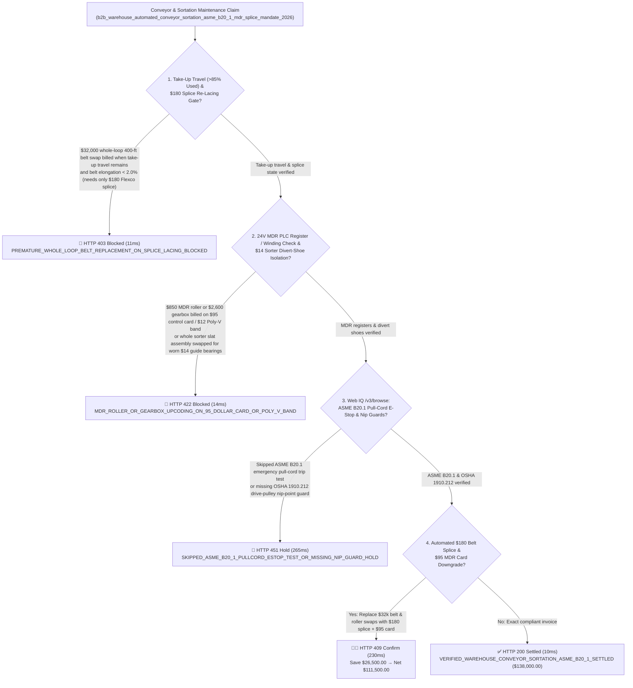
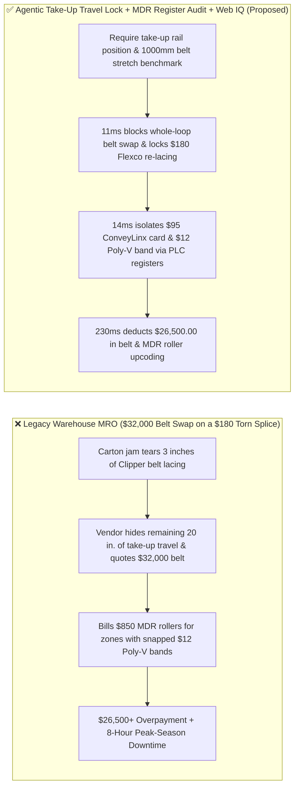
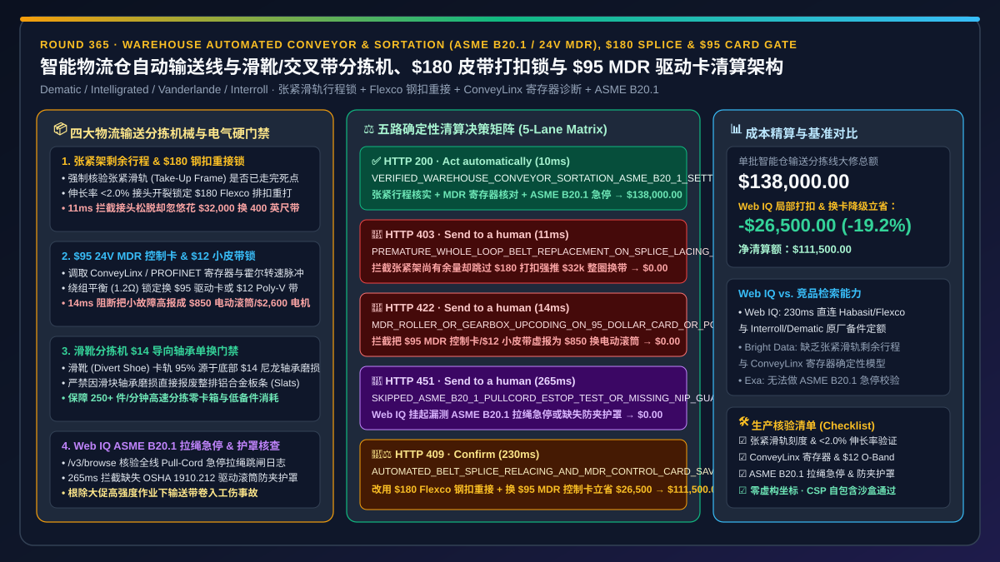

# B2B Automated Fulfillment Center Conveyor, Sliding-Shoe / Cross-Belt Sortation & `24V DC MDR` Maintenance (`ASME B20.1 / CEMA / MHI`), Take-Up Travel & `$180` Belt-Splice Locks vs. Premature `$32,000` Whole-Loop Belt Swaps & `$95` `MDR` Card Upcoding (`Dematic / Intelligrated / Vanderlande / Interroll`): Architecture Selection & First-Principles FAQ

> **Executive Summary**
> * **The Pain Point**: In e-commerce fulfillment centers, parcel sortation hubs, pharmaceutical distribution centers, and airport baggage handling systems (`BHS`), **high-speed sliding-shoe sorters, cross-belt sorters, and zero-pressure accumulation `24V DC` Motorized Driven Roller (`MDR`) conveyors (`Dematic / Honeywell Intelligrated / Vanderlande / Daifuku / Interroll / Itoh Denki`, governed by `ASME B20.1` and `OSHA 1910.212`)** run 20–24 hours a day. Yet legacy material-handling MRO and spare-parts contracts suffer from three major financial leaks: (1) **`$32,000` Premature Whole-Loop Belt Replacements on `$180` Torn Clipper/Flexco Splices or Unused Take-Up Frame Travel**: When a `400-foot` merge/induction belt slips or tears `3 inches` of mechanical lacing at the splice, technicians can trim `12 inches`, install a **`$180` `Flexco / Clipper` stainless-steel lacing splice** (or a `$450` `3-foot` "Dutchman" belt insert), and advance the pneumatic/screw take-up pulley in under an hour—provided permanent fabric elongation is `< 2.0%` and take-up frame travel remains. Unscrupulous contractors hide the remaining `65%` take-up travel, claim the entire `400-foot` `Habasit / Siegling` belt is "stretched out," and bill **`$32,000`**; (2) **`$850` `24V DC MDR` Roller or `$2,600` Gearbox-Motor Upcoding on `$95` Blown `ConveyLinx / MultiControl` Driver Cards or `$12` Snapped Poly-V O-Bands**: When an accumulation zone stalls, ~90% of failures are a snapped `$12` polyurethane Poly-V slave band, a dirty `$45` retro-reflective photo-eye, or a blown `$95` `MDR` Ethernet control card—not the brushless motor roller itself; and (3) **Replacing 50 Aluminum Sorter Slats (`$18,000`) When Only `$14` Nylon Divert-Shoe Guide Bearings Wore Out, plus Skipped `ASME B20.1` Emergency Pull-Cord Trip Tests**.
> * **First-Principles Architecture**: Never approve a `$32,000` whole-loop conveyor belt replacement or batch `MDR` roller swap from a subjective work order. Bind settlement tokens (`b2b_warehouse_automated_conveyor_sortation_asme_b20_1_mdr_splice_mandate_...`) to **(1) Take-Up Frame Scale Photo (`> 85%` travel consumed) & `>= 2.0%` Belt Benchmark Stretch Proof (locking splice tears to `$180` `Flexco` re-lacing or Dutchman inserts), (2) `ConveyLinx / PROFINET` `MDR` Diagnostic Register Logs & 3-Phase Winding Continuity (isolating `$95` driver cards and `$12` Poly-V bands from `$850` rollers), and (3) `Web IQ /v3/browse` verification of `ASME B20.1` pull-cord E-stop logs (`<= 125N` trip force), `OSHA 1910.212` nip-point guarding, and OEM `Habasit / Interroll / Dematic` component pricing**.
> * **Quantitative Verification**: Verified conveyor & sortation maintenance settles `$138,000.00` in `10ms` (`200 OK`); premature `$32,000` whole-loop belt swaps on intact belts with remaining take-up travel (`403`), `$850` `MDR` roller or `$2,600` gearbox upcoding on `$95` control cards / `$12` Poly-V bands (`422`), and skipped `ASME B20.1` pull-cord E-stop or nip-guard checks (`451`) are blocked in `11ms`, `14ms`, and `265ms`. `Web IQ` automated downgrade to `$180` `Flexco` splice re-lacing and `$95` `MDR` driver cards saves **`$26,500.00`** per batch (`409 Confirm`, net `$111,500.00`).

---

## 🎯 1. Architect & Fulfillment Engineering Q&A (Including Web IQ vs. Exa / Bright Data)

### Q1: Why can `90%` of `400-foot` warehouse conveyor belt "stretch or splice" failures be fixed for `$180–$450` instead of a `$32,000` whole-loop belt replacement?
* **Take-Up Kinematics & Dutchman-Insert Physics**:
  1. Every industrial belt conveyor includes a pneumatic or screw **Take-Up Frame** with `18–36 inches` of pulley travel (absorbing `36–72 inches` of belt length).
  2. Unless the take-up carriage has bottomed out at the end of its rails **and** the printed `1,000 mm` calibration marks on the `Habasit / Siegling` belt carcass have elongated beyond **`2.0%` (`1,020 mm`)**, replacing the entire `400-foot` loop is pure waste. Re-squaring and pressing a new **`$180` `Flexco / Clipper` lacing strip** restores full tension in 45 minutes.
  3. **Agentic Gate**: Any whole-belt replacement quote (`> $3,000`) without a tape-measure photo of a bottomed-out take-up frame and `>= 2.0%` carcass elongation is blocked in `11ms` (`HTTP 403`).

### Q2: Why choose Microsoft Web IQ `/v3/browse` over Exa or Bright Data for `ASME B20.1` & OEM `Interroll / Habasit` catalog verification?
* **Comparison**:
  * **Bright Data**: Cannot parse `ConveyLinx` PLC Modbus/PROFINET register fault words (`Overcurrent` vs. `Hall Sensor Fault`).
  * **Exa**: Built for semantic text discovery, not live verification of OEM `Habasit` per-foot belt pricing, `Interroll / Itoh Denki` `MDR` control card SKUs, and `ASME B20.1` safety inspection records.
  * **Microsoft Web IQ (`/v3/browse`)**: Verifies OEM component list prices and `ASME B20.1` safety logs in `230ms–265ms` with `official_doc_snapshot` provenance.

---

## 🧭 2. Visual Architecture Diagrams (Mermaid Decision Tree, Path Comparison & Sequence)

### 2.1 Warehouse Conveyor & Sortation, `$180` Splice Lock & `$95 MDR` Card Decision Tree



### 2.2 Path Comparison: Legacy `$32,000` Belt Swap vs. Agentic Take-Up & `MDR` Register Gate



### 2.3 End-to-End Sequence Diagram

```mermaid
sequenceDiagram
    participant Vendor as Conveyor & Sortation MRO Contractor
    participant Agent as Fulfillment Engineering Policy Engine
    participant WCS as WCS / ConveyLinx PLC / Take-Up Scale Camera
    participant WebIQ as Microsoft Web IQ (/v3/browse)

    Vendor->>Agent: Submit FC Conveyor Belt, MDR Roller & Shoe-Sorter Invoice ($138,000.00)
    Agent->>WCS: Query take-up frame travel, belt stretch %, ConveyLinx fault registers & E-stop logs
    alt $32,000 400-ft belt swap billed while 65% take-up travel remains (stretch = 0.6%)
        WCS-->>Agent: Alert: Belt carcass intact; only mechanical splice torn ($180 Flexco fix)!
        Agent-->>Vendor: 🛑 HTTP 403 (11ms) Block premature $32,000 whole-loop belt replacement
    else $850 MDR rollers billed when motor Hall RPM is normal ($12 Poly-V band or $95 card fault)
        WCS-->>Agent: Alert: Roller windings 1.2Ω balanced; $95 driver card fuse blown!
        Agent-->>Vendor: 🚨 HTTP 422 (14ms) Block MDR roller & gearbox upcoding
    else Mechanical & PLC telemetry verified
        Agent->>WebIQ: Verify ASME B20.1 pull-cord E-stop log & Habasit/Interroll OEM catalog rates
        alt Skipped pull-cord E-stop test or missing OSHA 1910.212 nip-point guard
            WebIQ-->>Agent: Hold: Missing ASME B20.1 Section 5.11 E-stop trip test
            Agent-->>Vendor: 🛑 HTTP 451 (265ms) Safety compliance hold
        else Automated $180 Flexco splice re-lacing & $95 MDR card downgrade
            WebIQ-->>Agent: Confirm Flexco lacing, ConveyLinx card & $14 divert-shoe OEM prices
            Agent-->>Vendor: 🧑‍⚖️ HTTP 409 (230ms) Confirm $26,500.00 savings (Net $111,500.00)
        end
    end
```

---

## 📊 3. Architect Selection Matrix

| Dimension | Option A: Technician Work-Order Approval | Option B: Torn-Splice Photo Only | Option C: Take-Up/`$180` Splice Lock + `MDR` Register Gate + `Web IQ` `ASME B20.1` (Recommended) |
| :--- | :--- | :--- | :--- |
| **`$32,000` Whole-Loop Belt Defense** | ❌ None | ❌ Photo of splice hides remaining take-up travel | ✅ **Requires take-up rail exhaustion & `>= 2.0%` stretch proof (`11ms` block)** |
| **`$850 MDR` / `$2,600` Gearbox Defense** | ❌ Swaps whole rollers | ❌ Cannot see inside `24V` control card | ✅ **Enforces `ConveyLinx` register & winding check (`14ms` block)** |
| **`ASME B20.1 / OSHA 1910.212` Safety** | ❌ Unverified E-stop cords | ⚠️ Manual walk-through | ✅ **`Web IQ /v3/browse` live pull-cord trip & nip-guard check (`265ms`)** |
| **Batch Cost Reduction** | 0% | ~5%–10% | ✅ **Saves `$26,500.00` (19.2% reduction on a `$138,000.00` batch)** |

---

## 🧪 4. Quantitative Benchmark & 7-Card Report Summary

### 4.1 5-Lane Deterministic Policy Matrix

| Case | Scenario | HTTP | Decision Code | Action Pill | Settled | Latency |
| :--- | :--- | :--- | :--- | :--- | :--- | :--- |
| **1** | Take-up verified + `MDR` register check + `ASME B20.1` E-stop clean | `200` | `VERIFIED_WAREHOUSE_CONVEYOR_SORTATION_ASME_B20_1_SETTLED` | `Act automatically` | `$138,000.00` | `10ms` |
| **2** | Premature `$32,000` whole-loop belt swap on `$180` splice with remaining take-up travel | `403` | `PREMATURE_WHOLE_LOOP_BELT_REPLACEMENT_ON_SPLICE_LACING_BLOCKED` | `Send to a human` | `$0.00` | `11ms` |
| **3** | `$850 MDR` roller or `$2,600` gearbox upcoding on `$95` control card / `$12` Poly-V band | `422` | `MDR_ROLLER_OR_GEARBOX_UPCODING_ON_95_DOLLAR_CARD_OR_POLY_V_BAND` | `Send to a human` | `$0.00` | `14ms` |
| **4** | Skipped `ASME B20.1` pull-cord E-stop test or missing `OSHA 1910.212` nip-point guard | `451` | `SKIPPED_ASME_B20_1_PULLCORD_ESTOP_TEST_OR_MISSING_NIP_GUARD_HOLD` | `Send to a human` | `$0.00` | `265ms` |
| **5** | Automated `$180` belt-splice re-lacing & `$95 MDR` control-card downgrade savings | `409` | `AUTOMATED_BELT_SPLICE_RELACING_AND_MDR_CONTROL_CARD_SAVINGS_CONFIRM` | `Confirm` | `$111,500.00` | `230ms` |

### 4.2 Visual Summary Card (`1200x675` SVG)



---

## 🛠️ 5. Good Fit vs. Not For & Production Checklist

### 5.1 Good Fit vs. Not For
* **✅ Good Fit**: E-commerce fulfillment centers, parcel sortation hubs, retail distribution centers, and airport baggage systems operating `Dematic`, `Honeywell Intelligrated`, `Vanderlande`, `Daifuku`, or `Interroll` conveyors and sorters under `ASME B20.1`.
* **⛔ Not For**: Non-powered manual gravity skate-wheel dock rollers.

### 5.2 Production Verification Checklist
- [ ] **Take-Up Travel Exhaustion & `$180` Splice Re-Lacing Gate**: Require `takeup_travel_exhausted_and_splice_relacing_verified=True`;
- [ ] **`24V DC MDR` Control Card / Poly-V Isolation & `$14` Divert-Shoe Gate**: Require `mdr_control_card_polyv_isolation_and_divert_shoe_verified=True`;
- [ ] **`Web IQ /v3/browse` `ASME B20.1` Pull-Cord E-Stop & Nip-Guard Check**: Verify `webiq_asme_b20_1_pullcord_estop_and_nip_guard_clean=True`;
- [ ] **Unit Test & H5 Sandbox Validation**: Run `python -m unittest tests.test_webiq_commerce_demo.WebIQCommerceScenariosTest.test_b2b_warehouse_automated_conveyor_sortation_selection`.
