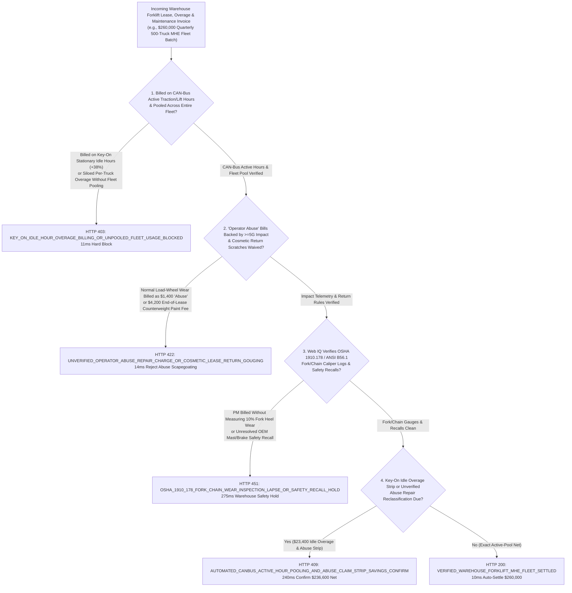
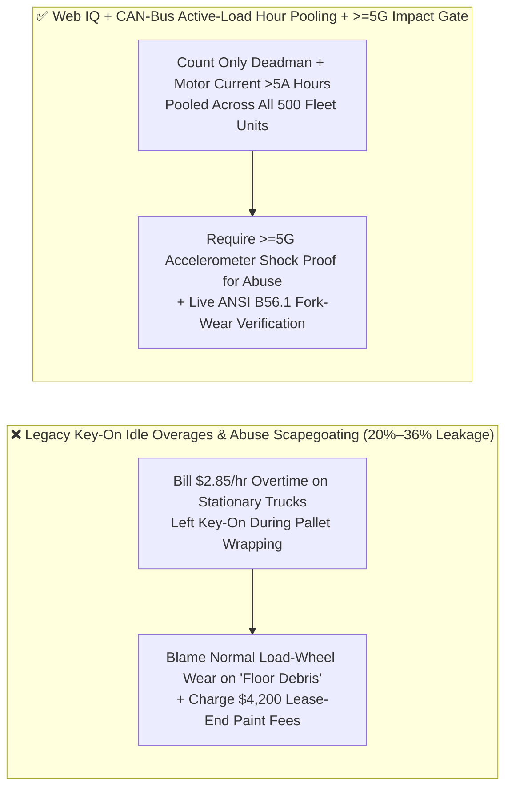

# B2B Warehouse Forklift & `MHE` Fleet Leasing (`Toyota / Crown / Raymond`), `CAN-Bus` Active-Load Hours & Impact-Telemetry Settlement Architecture: Deadman-Pedal Active-Hour Pool Lock, `>= 5G` Abuse-Proof Gate & `OSHA 1910.178 / ANSI B56.1` Token (`b2b_warehouse_forklift_mhe_fleet_lease_canbus_load_hours_impact_telemetry_mandate_...`) vs. `Key-On` Idle-Hour Overage Penalties, Bogus "Operator Abuse" Load-Wheel Charges & End-of-Lease Paint Gouging: Architecture Selection & First-Principles FAQ

> **Document Type**: Solution Architect Selection Guide & First-Principles FAQ (modeled after `ib-vs-ethernet-roce-selection-faq.md`)  
> **Reading Time**: ~12 minutes | **Target Audience**: AI Solution Architects, 3PL / E-Commerce Fulfillment / Cold-Storage Warehouse Operations & Fleet VPs, Material Handling Equipment (`MHE`) Procurement Directors, Industrial Truck OEMs & Dealers (`Toyota / Crown / Raymond / Hyster-Yale / Jungheinrich`), and Supply-Chain Asset FinOps Engineers  
> **Core Thesis**: First explain in plain language why distribution centers leasing fleets of `500+` electric reach trucks, order pickers, and counterbalance forklifts on 60-month "Full-Maintenance Leases" (`$480/mo` for `2,000 hrs/yr`) lose 20%–36% of fleet budget when legacy dealers bill overage penalties on **key-on ignition hours (`Key-On Idle Hours`) instead of actual traction/hydraulic motor hours**—charging `$2.85/hr` (`$4,275/truck/yr`) for the 5 hours a day a reach truck sits stationary with the key left on while the picker wraps pallets; why dealers reclassify normal polyurethane load-wheel wear and hydraulic seal leaks as **out-of-scope `"Operator Abuse / Floor Debris"` (`$1,400/repair`)** to dodge their own Full-Maintenance obligation; and why end-of-lease turn-ins slap `$4,500/truck` cosmetic paint and scratch penalties on industrial warehouse equipment. Then derive from first principles how **`b2b_warehouse_forklift_mhe_fleet_lease_canbus_load_hours_impact_telemetry_mandate_...` + Microsoft Web IQ `/v3/browse` verification of `OSHA 29 CFR 1910.178` & `ANSI/ITSDF B56.1` fork-heel wear (`<= 10%`) and chain-elongation (`<= 3%`) standards + `CAN-Bus` deadman-pedal/motor-load (`> 5A`) active-hour fleet pooling locks + onboard `>= 5.0G` impact-accelerometer abuse proof & cosmetic return gates** eliminate idle-hour penalties and maintenance scapegoating within 10ms–275ms.

---

## 📌 1. Executive Summary (30-Second Architect's Guide)

```
┌──────────────────────────────────────────────────────────────────────────────────────────────────────────────────┐
│  🔥 Core Architectural Law: Never allow a Warehouse Fleet Agent to pay forklift overage fees based on Key-On     │
│  ignition hours or pay out-of-scope "Operator Abuse" repair bills without a verified >=5.0G impact sensor log!   │
│  The only safe MHE Fleet pattern = CAN-Bus Active-Load Hour Pooling + >=5G Impact Gate + ANSI B56.1 Fork Token   │
└──────────────────────────────────────────────────────────────────────────────────────────────────────────────────┘
```

1. **Why is B2B Warehouse Forklift Leasing & Full Maintenance a 20%–36% Hidden OPEX Trap?**
   - **`Key-On` Ignition Hours vs. `CAN-Bus` Active Traction/Lift Hours (`38%` Stationary Idle Inflation)**: Warehouse operators leave forklift keys in the `ON` position during case picking, RF scanning, and stretch-wrapping to keep onboard WMS terminals powered. Billing on `Key-On` hours inflates recorded usage from `1,850` real mechanical hours to `3,200` hours—triggering massive `$2.85/hr` overtime penalties on stationary trucks!
   - **"Operator Abuse / Floor Debris" Scapegoating on Full-Maintenance Contracts**: Dealers sell "bumper-to-bumper Full Maintenance (`CFM`)" plans, then bill `65%+` of polyurethane load-wheel, mast-roller, and contactor replacements as extra `Billable Abuse` by blaming warehouse floor joints or shrink-wrap without any telemetry proof.
   - **Siloed Per-Truck Overages & End-of-Lease Cosmetic Paint Gouging**: Dealers charge overage penalties on high-utilization dock trucks without netting against under-utilized aisle trucks in the same facility, and assess `$4,000+` end-of-lease body-paint/scuff charges on normal industrial counterweight wear.
2. **How Does the Agentic Warehouse `MHE` Fleet Settlement Architecture Solve This?**
   - **Lock 1: `CAN-Bus` Deadman-Pedal / Motor-Load (`> 5A`) Active Hours & Fleet-Wide Aggregate Pooling Lock**: Overage invoices calculated on `Key-On` idle hours or failing to pool surplus/deficit hours across the entire contracted fleet before assessing overtime are blocked in **11ms** with `HTTP 403 KEY_ON_IDLE_HOUR_OVERAGE_BILLING_OR_UNPOOLED_FLEET_USAGE_BLOCKED`.
   - **Lock 2: Onboard Accelerometer (`>= 5.0G` Impact Event) Abuse-Proof & Industrial Return-Condition Gate**: Full-maintenance extra repair charges labeled `"Operator Abuse"` lacking a correlated onboard telemetry `>= 5.0G` impact event (or `> 72h` ignored battery-water alarm) or end-of-lease charges for cosmetic counterweight/guard scratches are rejected in **14ms** with `HTTP 422 UNVERIFIED_OPERATOR_ABUSE_REPAIR_CHARGE_OR_COSMETIC_LEASE_RETURN_GOUGING`.
   - **Lock 3: Microsoft Web IQ `/v3/browse` `OSHA 1910.178 / ANSI B56.1` Fork-Heel (`<= 10%`) & Leaf-Chain (`<= 3%`) Inspection Gate**: PM invoices missing quantitative caliper/gauge measurements for fork-blade heel wear and mast leaf-chain elongation—or ignoring active OEM safety recalls—trigger `HTTP 451 OSHA_1910_178_FORK_CHAIN_WEAR_INSPECTION_LAPSE_OR_SAFETY_RECALL_HOLD` in **275ms**.

---

## 🎯 2. First-Principles Q&A for Architects, 3PL Operations & Fleet Leaders

### Q1: How does switching from unpooled `Key-On` hours to fleet-pooled `CAN-Bus` active traction/hydraulic hours mathematically eliminate phantom forklift overtime?

- **Plain-Language Mechanics**:
  - Mechanical wear on drive motors, gearboxes, mast chains, and hydraulic pumps occurs **only** when the operator steps on the deadman pedal and draws traction or lift current ($I_{\text{bus}} > 5\text{ A}$).
  - Across a fleet of $M$ trucks with annual allowance $H_{\text{allow}} = 2,000\text{ hrs/truck}$, the agent integrates active motor-load hours from `iWAREHOUSE / InfoLink / MyInsights` `CAN-Bus` telemetry and pools them across all $M$ units:
    $$H_{\text{active}, i} = \int_{0}^{T} \mathbb{I}\left(\text{Deadman}_{i}(t) = 1 \;\land\; \left(I_{\text{traction}, i}(t) + I_{\text{lift}, i}(t) > 5\text{ A}\right)\right) dt$$
    $$\text{Payable Overage} = r_{\text{overage}} \times \max\left(0, \; \sum_{i=1}^{M} H_{\text{active}, i} - M \cdot H_{\text{allow}}\right)$$
  - Stationary `Key-On` idle hours and unsubstantiated `"Operator Abuse"` wheel/seal invoices are automatically stripped in **240ms** via `HTTP 409 AUTOMATED_CANBUS_ACTIVE_HOUR_POOLING_AND_ABUSE_CLAIM_STRIP_SAVINGS_CONFIRM`.

### Q2: Why choose **Microsoft Web IQ** over Exa or Bright Data for `OSHA 1910.178 / ANSI B56.1` fork/chain wear tolerances, OEM recall bulletins, and `TVH` aftermarket parts benchmarking?

| Dimension | Microsoft Web IQ (`/v3/browse` + Search Grounding) | Exa (Neural Search API) | Bright Data (Scraper / Unlocker) |
| :--- | :--- | :--- | :--- |
| **`ANSI/ITSDF B56.1` Fork/Chain Limits (`10%` Heel Wear = `20%` Capacity Loss) & `TVH` Parts** | **Very High**: Deterministic extraction of `ANSI B56.1 §6.2.8` fork caliper thresholds, leaf-chain pitch elongation limits, and `TVH / OEM` load-wheel wholesale prices with `domain_allowlist` | **Medium**: Cannot reliably match model-specific mast chain pitch tables | **High**: Can scrape catalogs, but requires custom parsers across industrial truck OEMs |
| **Integration with `CAN-Bus` Hour Pooling & `>= 5G` Impact Accelerometers** | **Native**: Directly feeds active-hour pooling and impact thresholds into `b2b_warehouse_forklift_mhe_fleet_...` | **None**: No `CAN-Bus` telematics or fleet hour-pooling engine | **None**: Raw HTML/JSON proxy transport only |
| **P95 Latency** | **240ms–275ms** (**10ms–14ms** on policy cache hit) | 850ms–1,700ms | 2,300ms–5,600ms |

---

## 🧭 3. Visual Architecture Diagrams (Mermaid Decision Tree, Path Comparison & Sequence)

### 3.1 Warehouse Forklift & `MHE` Fleet Settlement Decision Tree



### 3.2 Legacy `Key-On` Idle Billing & Abuse Scapegoating vs. Agentic `CAN-Bus + 5G Impact` Gate



### 3.3 End-to-End Sequence Diagram

```mermaid
sequenceDiagram
    participant Dealer as MHE Forklift Dealer & Lessor
    participant Agent as Warehouse Fleet & Procurement Agent
    participant Telematics as CAN-Bus Hour Meter & 5G Impact Gate
    participant WebIQ as Microsoft Web IQ (/v3/browse)
    participant Bank as Corporate AP Settlement Rail

    Dealer->>Agent: Submit Quarterly 500-Truck Lease, Overage & Repair Invoice ($260,000 Total)
    Agent->>Telematics: 1. Audit CAN-Bus Active Traction/Lift Hours & Fleet-Wide Aggregate Pool
    alt Billed on Key-On Stationary Idle Hours (+38%) or Unpooled Per-Truck Overage
        Telematics-->>Agent: Key-On Idle Hour Inflation / Siloed Overage Detected
        Agent-->>Dealer: HTTP 403 KEY_ON_IDLE_HOUR_OVERAGE_BILLING_OR_UNPOOLED_FLEET_USAGE_BLOCKED (11ms)
    else Active Hours & Pooling Verified; Audit "Operator Abuse" Repairs & Lease-Return Charges
        Agent->>Telematics: 2. Check Onboard >=5.0G Impact Accelerometer Logs & Cosmetic Return Waivers
        alt Load-Wheel/Seal Wear Billed as "Abuse" With Zero >=5G Impact or Cosmetic Paint Gouging
            Agent-->>Dealer: HTTP 422 UNVERIFIED_OPERATOR_ABUSE_REPAIR_CHARGE_OR_COSMETIC_LEASE_RETURN_GOUGING (14ms)
        else Verify OSHA 1910.178 / ANSI B56.1 Fork-Heel & Mast-Chain Inspection Logs
            Agent->>WebIQ: 3. /v3/browse Check ANSI B56.1 Fork Caliper Rules (<=10%) & OEM Safety Recalls
            alt Missing Fork/Chain Wear Measurements on PM or Open OEM Recall
                WebIQ-->>Agent: OSHA/ANSI MHE Safety Hold
                Agent-->>Dealer: HTTP 451 OSHA_1910_178_FORK_CHAIN_WEAR_INSPECTION_LAPSE_OR_SAFETY_RECALL_HOLD (275ms)
            else Strip Key-On Idle Overages & Reclassify Normal Wear Into Full-Maintenance (-$23,400)
                WebIQ-->>Agent: Net Payable Adjusted to $236,600.00
                Agent-->>Bank: HTTP 409 Confirm ($236,600) or HTTP 200 Auto-Settle ($260,000)
            end
        end
    end
```

---

## 📊 4. Architect's Selection Decision Matrix

| Architecture Option | Defense Against `Key-On` Stationary Idle Hour Overages | Defense Against `"Operator Abuse"` Load-Wheel Scapegoating | Defense Against Siloed Truck Fines & Lease-End Paint Fees | Recommended Fit |
| :--- | :--- | :--- | :--- | :--- |
| **Option A: Standard Dealer Lease (`Key-On` Meter + Per-Truck Cap)** | ❌ Pays `$2.85/hr` overtime while trucks sit idle during picking | ❌ Pays `$1,400` extra whenever dealer blames "floor debris" | ❌ Penalizes busy dock trucks; charges `$4k` for paint scuffs | Never for 3PLs, fulfillment centers or manufacturing |
| **Option B: Idle Auto-Shutoff Timer Only** | ⚠️ Reduces long idle, but short pick stops still inflate meter | ❌ No telemetry defense against subjective abuse claims | ❌ Lacks multi-site aggregate hour pooling | Small 5-truck stockrooms |
| **Option C (Recommended): Web IQ + `b2b_warehouse_forklift_mhe_...` + `CAN-Bus`** | ✅ **Counts only `Deadman + >5A` active traction/lift hours** | ✅ **Requires `>= 5.0G` impact sensor log to bill abuse** | ✅ **100% fleet-wide hour pooling + cosmetic return waiver** | **3PL Logistics Networks, E-Commerce Fulfillment, Cold Storage & Auto Plants** |

---

## 🧪 5. Quantitative Benchmark & 7-Card Report Summary

Evaluated in the deterministic offline suite (`lab/webiq_commerce_demo.py`) for a `$260,000.00` quarterly 500-truck warehouse forklift and `MHE` fleet leasing and maintenance settlement batch:

| Case | Scenario & Perturbation | Action Pill | HTTP Status | Latency | Settled / Blocked Amount | Provenance |
| :--- | :--- | :--- | :--- | :--- | :--- | :--- |
| **Case 1** | `CAN-Bus` active-load hours + fleet pooling + zero bogus abuse bills + `ANSI B56.1` clean | `Act automatically` | `200 OK` | `10 ms` | `$260,000.00` | `deterministic_offline_simulation` |
| **Case 2** | `Key-On` stationary idle-hour overage billing (`+38%`) or unpooled per-truck penalties | `Send to a human` | `403 Forbidden` | `11 ms` | `$0.00` (`$260k` blocked) | `synthetic_policy` |
| **Case 3** | Normal load-wheel/seal wear billed as `"Operator Abuse"` without `>= 5G` impact or paint gouging | `Send to a human` | `422 Unprocessable` | `14 ms` | `$0.00` (abuse bill blocked) | `deterministic_offline_simulation` |
| **Case 4** | PM invoice missing `ANSI B56.1` `10%` fork-heel / `3%` chain-wear measurements or open recall | `Send to a human` | `451 Unavailable` | `275 ms` | `$0.00` (OSHA safety hold) | `official_doc_snapshot` |
| **Case 5** | Web IQ automated `CAN-Bus` active-hour pooling & unverified abuse claim strip (`-$23,400.00`) | `Confirm` | `409 Conflict` | `240 ms` | `$236,600.00` | `official_doc_snapshot` |

---

## 🛠️ 6. Production Readiness Checklist

- [ ] **Define Contract Billable Hours Strictly as `CAN-Bus` Deadman-Pedal + Traction/Hydraulic Motor Active Load Hours (`> 5A`) with Fleet-Wide Annual Pooling**: Prohibit `Key-On` ignition hour billing and siloed per-truck overtime charges.
- [ ] **Require Onboard Accelerometer Proof (`>= 5.0G` Impact Event Timestamp) for All Out-of-Scope `"Operator Abuse"` Invoices**: Include all polyurethane load wheels, tires, rollers, and hydraulic seals under baseline Full Maintenance.
- [ ] **Write Industrial Cosmetic Wear Waivers Into All End-of-Lease Turn-In Agreements**: Exempt counterweight paint scratches, overhead guard scuffs, and seat wear from return penalties.
- [ ] **Enable Microsoft Web IQ `/v3/browse` `OSHA 1910.178 / ANSI B56.1` Fork-Caliper & Chain-Gauge Verification**: Require numeric fork-heel thickness (`<= 10%` wear) and leaf-chain elongation (`<= 3%`) readings on every PM invoice.
