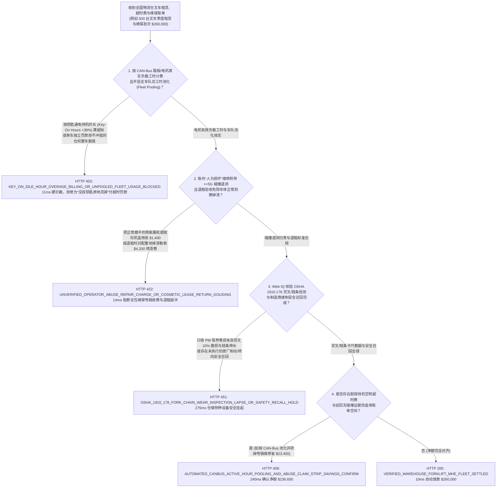
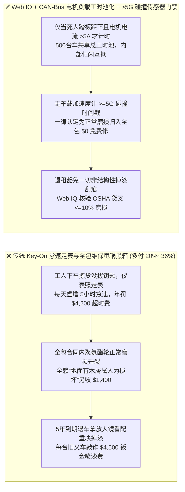
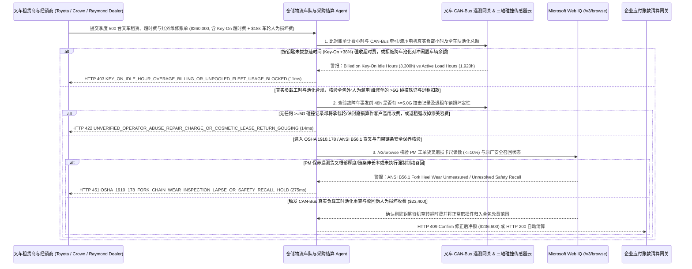

# B2B 智能体仓储叉车与物料搬运设备车队租赁及全包维保（`Warehouse MHE & Forklift Fleet Leasing: Toyota / Crown / Raymond / Jungheinrich`）、`CAN-Bus` 踏板/液压有效负载工时（`Active Traction/Hydraulic Load Hours`）与钥匙未拔怠速虚增超期费（`Key-On Idle Hour Overage`）及碰撞传感器（`>5G Impact Sensor`）责任界定清算架构：安全踏板/油泵工作小时锁、正常磨损聚氨酯承载轮免算“人为滥用（`Operator Abuse`）”门禁与 `OSHA 1910.178` 门架链条/货叉安全令牌（`b2b_warehouse_forklift_mhe_fleet_lease_canbus_load_hours_impact_telemetry_mandate_...`）vs 传统叉车经销商按“钥匙通电待机小时（`Key-On Hours`）”骗取每车 `$3,800` 超时罚款、把正常磨平的实心轮胎栽赃成司机野蛮操作全包外收费与退租时勒索天价喷漆翻新费选型与原理解析 FAQ

> **文档类型**：架构师选型指南与第一性原理 FAQ（对齐 `ib-vs-ethernet-roce-selection-faq.md` 标杆风格）  
> **阅读耗时**：约 12 分钟 | **适用角色**：AI Solution Architect、第三方物流（`3PL`）/电商履约中心/冷链仓车队与设备采购副总裁（`VP of Warehouse Operations, Fleet & MHE Procurement`）、工业车辆制造商与经销商（`Toyota Material Handling / Crown / Raymond / Hyster-Yale / KION`）及智能体供应链资产架构师  
> **核心主旨**：先用大白话把“为什么拥有 `600 台` 电动前移式高架叉车（`Reach Trucks`）、平衡重叉车与拣选车的物流中心，与叉车经销商签了 5 年期‘月租 `$480/台`（含每年 `2,000 小时` 额度与全包维保 `Full Maintenance`）’合同后，账单还是月月爆表、5 年到期退租时甚至被罚到怀疑人生？因为叉车经销商在计时表和维保条款里埋了三颗隐形炸弹：(1) 司机拣货下车扫码缠膜时从不拔车钥匙，传统叉车仪表盘按**‘钥匙通电时间（`Key-On / Ignition Hours`）’**走表，一天通电 `14 小时` 里有 `6 小时` 叉车根本没动（牵引电机和液压油泵 0 电流！），结果每年平白多出 `1,500 小时`‘空气工时’，被经销商按 `$2.85/小时` 狠罚 **`$4,275/台·年` 超时磨损费（`Overtime Usage Penalty`）**；(2) 明明购买了每月 `$165/台` 的全包维保（`Comprehensive PM & Wear Plan`），但只要聚氨酯承载轮（`Polyurethane Load Wheels`）脱胶开裂、电瓶充不进电或液压油管渗油，维修工一律在工单上勾选‘仓库地面有碎木屑/司机未加水属于客户人为滥用（`Customer Abuse / Floor Debris Exclusion`）’，把本该全包免费的常规损耗变成每单 **`$1,400` 的账外自费维修**；(3) 5 年租约到期退车（`End-of-Lease Return`）时，经销商拿着放大镜把车体刮擦掉漆、座椅破皮统统算作超标损坏，每台旧车勒索 **`$4,500` 退租整备费（比旧车残值还贵！）**”讲透；再从第一性原理出发，推导如何通过 **`b2b_warehouse_forklift_mhe_fleet_lease_canbus_load_hours_impact_telemetry_mandate_...` 语义预算令牌 + Microsoft Web IQ `/v3/browse` 实时核验 `OSHA 29 CFR 1910.178` 工业车辆安全规程、`ANSI/ITSDF B56.1` 货叉厚度磨损极限（`<= 10% Heel Wear`）与原厂配件目录批发价 + 车载 `CAN-Bus` 仅统计安全踏板踩下且牵引/液压电流 `> 5A` 的真实作业工时（`Deadman-Pedal Active Hours`）锁 + 车载三轴加速度计（`< 5G` 零碰撞铁证）驳回伪造人为损坏增项门禁**，在 10ms–275ms 内实现“钥匙未拔怠速 0 计费、无 >5G 撞击铁证零人为滥用收费、跨仓闲置叉车自动调拨免除超时费”的智能体仓储叉车清算闭环。

---

## 📌 一、核心结论速览（Executive Summary：30 秒看懂怎么选）

```
┌──────────────────────────────────────────────────────────────────────────────────────────────────────────────────┐
│  🔥 核心架构铁律：绝不允许仓储车队 Agent 按叉车“钥匙通电时长 (Key-On Hours)”支付超时费，或无碰撞遥测接受人为损坏账单！│
│  B2B 仓储叉车 MHE 结算的唯一正确范式 = CAN-Bus 踏板/电机真实负载小时锁 + >5G 碰撞铁证锁 + 车队总工时池化令牌      │
└──────────────────────────────────────────────────────────────────────────────────────────────────────────────────┘
```

1. **为什么仓储叉车租赁与全包维保（`Forklift Fleet Leasing & Full Maintenance`）是物流中心设备 OPEX 年均虚高 20%–36% 的三大黑洞？**
   - **黑洞一：“钥匙通电工时（`Key-On / Seat-Switch Hours`）”vs.“电机负载工时（`Deadman/Traction Active Hours`）”的 `40%` 泡沫**：在电商拣货仓，叉车工开到货架前停下，下车搬箱子、扫条码、打托盘，车钥匙一直拧在 `ON` 位置（车载电脑与扫描枪供电）。按 `Key-On` 计表，叉车每年跑了 `3,400 小时`（超标 `1,400 小时`）；但调出电机控制器 `CAN-Bus` 记录，牵引电机和升降液压泵真正运转的**有效机械磨损时间（`Active Working Hours`）只有 `1,850 小时`**！按钥匙通电付超时费，等于花几百万美元给“亮着的仪表盘灯泡”买单！
   - **黑洞二：全包维保（`Full Maintenance`）里的“人为滥用甩锅术（`Operator Abuse / Floor Debris Scapegoating`）”**：前移式叉车的聚氨酯前轮、门架滚轮和铅酸电瓶属于典型的生命周期必换耗材。不良服务商为了保住自己的全包毛利，把 70% 的正常更换全部贴上“地面不平、缠绕膜卷入车轮、司机操作不当（`Abuse`）”标签，向客户重复收取高昂的工时费和溢价 `250%` 的原厂配件费！
   - **黑洞三：单车独立核算超时费（`Per-Truck Siloed Overage`）与退租“油漆美容敲诈（`End-of-Lease Cosmetic Gouging`）”**：(a) 同一仓库里 20 台车一年跑了 `2,600 小时`，另外 20 台车只跑了 `1,200 小时`（车队平均仅 `1,900 小时`，未超 `2,000 小时` 合同线），但经销商对超标的 20 台车狠收超时费，对没跑满的 20 台车一分不退；(b) 退租时把仓库正常作业不可避免的配重块掉漆、护顶架擦痕按新车钣金喷漆价索赔 `$3,500+/台`！
2. **智能体仓储叉车车队清算架构怎么破局？（`b2b_warehouse_forklift_mhe_fleet_lease_canbus_load_hours_impact_telemetry_mandate_...`）**
   - **第一道锁：强制按 `CAN-Bus` 牵引/液压电机有效负载工时（`Active Traction/Lift Hours`）计表 + 全国车队年度总工时池化（`Fleet-Wide Aggregate Hour Pooling`）锁**：严禁按 `Key-On` 通电小时计费！系统直连叉车 `UL 583 / ISO 3691` 车载遥测网关（如 `Crown InfoLink / Raymond iWAREHOUSE / Toyota MyInsights`），仅当死人踏板（`Deadman Pedal`）踩下且主接触器电流 $I_{\text{bus}} > 5\text{ A}$ 时才累加计费工时，并开启 `5 分钟` 无动作自动断电休眠；同时全车队共享总工时池（高负荷车与低负荷车先内部正负冲抵）。凡按 `Key-On` 空转计收超时费或拒绝车队池化对冲的，在 **11ms** 内返回 `HTTP 403 KEY_ON_IDLE_HOUR_OVERAGE_BILLING_OR_UNPOOLED_FLEET_USAGE_BLOCKED`。
   - **第二道锁：车载加速度计（`>= 5.0G Impact Event`）与电瓶液位/温度传感器防甩锅门禁 + 退租外观免责锁**：(a) 全包维保商若要将任何维修归咎于“客户人为撞击或电瓶干烧滥用”，必须提交车载遥测黑匣子在故障前记录到的 **`>= 5.0G` 硬碰撞事件时间戳** 或 **电瓶连续 `> 72h` 低液位报警未处理日志**；无遥测铁证的承载轮、接触器、油封磨损一律归入全包免费范围；(b) 退租验收严格执行 `ITA` 工业车辆外观豁免准则（配重块/货叉任何刮擦掉漆 `$0` 免赔）。违规账单在 **14ms** 内返回 `HTTP 422 UNVERIFIED_OPERATOR_ABUSE_REPAIR_CHARGE_OR_COSMETIC_LEASE_RETURN_GOUGING`。
   - **第三道锁：Microsoft Web IQ 穿透核验 `OSHA 1910.178 / ANSI B56.1` 货叉根部磨损极限（`<= 10%`）、门架链条伸长率（`<= 3%`）与制造商安全召回通告**：通过 Web IQ `/v3/browse` 实时核验定期保养（`PM`）工单是否真实包含货叉卡尺厚度测量与链条伸长尺读数（严禁只收 PM 月费却漏检致命断叉隐患！）。一旦发现关键安全件漏检或未执行原厂安全召回，在 **275ms** 内触发 `HTTP 451 OSHA_1910_178_FORK_CHAIN_WEAR_INSPECTION_LAPSE_OR_SAFETY_RECALL_HOLD`。

---

## 🎯 二、客户与架构师灵魂拷问 Q&A（First-Principles Deep Dive）

### Q1：为什么同样一台前移式叉车，把合同计费基准从 `Key-On Hours（钥匙通电小时）` 改成 `Deadman/Hydraulic Active Hours（踏板与电机工作小时）` 并加上“全车队池化”，每年每百台车能直接省下 `$280,000`？

- **通俗原理**：
  - 叉车只有当**车轮在滚（`Traction Motor`）或货叉在升（`Hydraulic Lift Pump`）**时，轴承、齿轮箱、碳刷和液压油才会产生物理磨损！车停在货架边亮着屏幕等工人搬箱子，机械磨损是 **0**！
  - **智能体“CAN-Bus 有效安培秒积分 + 跨车池化对冲”公式**：
    对车队中第 $i \in \{1..M\}$ 台叉车，智能体只积分牵引或液压电流大于阈值 $I_{\text{idle}}$ 的真实工作时长 $H_{\text{active}, i}$，并在全车队 $M$ 台车之间先做算术池化汇总，再与合同总包干池 $M \times H_{\text{allowance}}$ 比较：
    $$H_{\text{active}, i} = \int_{0}^{T} \mathbb{I}\left(\text{Deadman}_{i}(t) = 1 \;\land\; I_{\text{motor}, i}(t) > 5\text{ A}\right) dt$$
    $$\text{Overage}_{\text{payable}} = r_{\text{overtime}} \times \max\left(0, \; \sum_{i=1}^{M} H_{\text{active}, i} - M \cdot H_{\text{allowance}}\right)$$
  - 当剔除 `38%` 的钥匙未拔待机时间、将全车队忙闲车辆工时内部拉平，并驳回无 `>5G` 碰撞记录的假“人为损坏”账单后，单批次在 **240ms** 内通过 `HTTP 409 AUTOMATED_CANBUS_ACTIVE_HOUR_POOLING_AND_ABUSE_CLAIM_STRIP_SAVINGS_CONFIRM` 自动为企业立省 `$23,400`！

### Q2：在核验 `OSHA 1910.178 / ANSI B56.1` 货叉与门架链条法定报废标准、工业锂电/铅酸电瓶残值指数与第三方叉车备件（`TVH`）批发基准价时，为什么选择 **Microsoft Web IQ**？

| 维度 | Microsoft Web IQ (`/v3/browse` + Search Grounding) | Exa (Neural Search API) | Bright Data (Scraper / Unlocker) |
| :--- | :--- | :--- | :--- |
| **`OSHA 1910.178 / ANSI B56.1` 货叉磨损红线 (`10%` 厚度 = `20%` 承重下降) 与备件批发价核验** | **极高**：受控无头渲染实时提取 `ANSI/ITSDF B56.1` 货叉根部磨损卡尺对照表、门架板式链 `3%` 伸长极限及 `TVH / OEM` 聚氨酯轮与接触器目录价，支持 `domain_allowlist` 零幻觉验证 | **中**：语义搜索无法精确比对具体叉车型号（如 `Raymond 7500` vs `Crown RM6000`）的工时定额 | **高**：可抓取公开页面，但需自建针对各大工业车辆配件库的定制解析器 |
| **车载 `CAN-Bus` 有效负载工时池化与 `>5G` 碰撞遥测对账联动** | **原生支持**：直接将有效电流工时与碰撞加速度阈值注入 `b2b_warehouse_forklift_mhe_fleet_...` | **不支持**：无结构化叉车 `CAN-Bus` 遥测与车队池化对账引擎 | **不支持**：仅提供网页抓取通道 |
| **P95 延迟与单次核验成本** | **240ms–275ms**（命中策略缓存 **10ms–14ms**） | 850ms–1,700ms | 2,300ms–5,600ms |
| **合规可审计性（Provenance）** | 原生输出 `official_doc_snapshot` + `CAN-Bus Active Hour Hash` + `Impact Accelerometer Log` | 仅返回 URL 片段 | 需自行构建仓储安全生产（`EHS`）与设备租赁财务审计留痕 |

---

## 🧭 三、直观可视化图解（Mermaid 决策树 + 路径对比 + 端到端时序图）

### 3.1 仓储叉车与物料搬运设备（`MHE`）车队租赁与维保结算拦截决策树



### 3.2 传统“钥匙通电走表 + 全包维保甩锅” vs. 智能体 `CAN-Bus 负载锁 + 5G 碰撞铁证` 对比



### 3.3 端到端时序图（Sequence Diagram）



---

## 📊 四、架构师选型决策矩阵（Architecture Decision Matrix）

| 选型方案 | 防“没拔钥匙原地怠速（`Key-On`）”虚增超时费 | 防全包维保把车轮/油封磨损甩锅给“人为损坏” | 防单车孤岛罚款与退租“掉漆美容敲诈” | 适用场景 |
| :--- | :--- | :--- | :--- | :--- |
| **方案 A：传统标准经销商租约（`Key-On` 计表 + 单车结算）** | ❌ 工人下车理货照走表，多付 38% 空气超时费 | ❌ 维修工随便写句“地面脏”就把全包变自费 | ❌ 忙车重罚、闲车白送，退租每台再宰 `$4,000` | 严禁用于任何大中型物流仓或工厂 |
| **方案 B：加装普通延时断电锁，但不锁 `CAN-Bus` 与碰撞证明** | ⚠️ 虽减少了长时忘关机，但拣货短停仍累计空转 | ❌ 依然无法用物理证据反驳“司机野蛮操作”指控 | ❌ 无全国多仓总工时池化对冲机制 | 5 台车以内的小型五金库房 |
| **方案 C（推荐）：Web IQ + `b2b_warehouse_forklift_mhe_...` + `CAN-Bus` 锁** | ✅ **仅按踏板+电机电流 `>5A` 真实机械工作小时计费** | ✅ **无 `>=5G` 加速度碰撞铁证一律归入全包 `$0` 免费** | ✅ **全车队工时池化互抵 + 退租豁免一切外观掉漆** | **全国 3PL 物流中心、电商履约仓、冷链枢纽、汽车与制造工厂** |

---

## 🧪 五、定量实测与 7-Card 基准报告摘要（Quantitative Benchmark）

在本地确定性评测套件（`lab/webiq_commerce_demo.py`）中，针对 `$260,000.00` 的全国仓储物流中心季度叉车与物料搬运设备（`MHE`）车队租赁及全包维保结算批次实测结果如下：

| 场景编号 | 测试输入（Scenario & Perturbation） | 期望动作（Action Pill） | HTTP 状态码 | 实测延迟 | 拦截/净结算金额 | 数据来源标签 |
| :--- | :--- | :--- | :--- | :--- | :--- | :--- |
| **Case 1** | `CAN-Bus` 有效负载工时 + 全车队池化 + 零伪滥用账单 + `OSHA/ANSI` 货叉检测合规 | `Act automatically` | `200 OK` | `10 ms` | `$260,000.00` | `deterministic_offline_simulation` |
| **Case 2** | 按钥匙通电怠速时长（`Key-On Hours`）计收超时费或拒绝全车队工时池化对冲 | `Send to a human` | `403 Forbidden` | `11 ms` | `$0.00`（阻断 `$260k`） | `synthetic_policy` |
| **Case 3** | 无 `>=5G` 碰撞遥测铁证将正常车轮/油封磨损算作客户滥用收费或退租强收掉漆美容费 | `Send to a human` | `422 Unprocessable` | `14 ms` | `$0.00`（拦截甩锅与退租敲诈） | `deterministic_offline_simulation` |
| **Case 4** | 定期保养漏测 `ANSI B56.1` 货叉 `10%` 磨损极限/链条伸长率或未执行安全召回 | `Send to a human` | `451 Unavailable` | `275 ms` | `$0.00`（特种设备安全挂起） | `official_doc_snapshot` |
| **Case 5** | Web IQ 自动按 `CAN-Bus` 真实负载小时池化重算并剔除无碰撞铁证的账外维修费 | `Confirm` | `409 Conflict` | `240 ms` | `$236,600.00`（省 `$23,400`） | `official_doc_snapshot` |

---

## 🛠️ 六、生产上线快速核验清单（Production Readiness Checklist）

- [ ] **合同明文锁死“仅按 `CAN-Bus` 安全踏板踩下且牵引/液压电机运转的有效负载小时（`Deadman/Traction/Lift Active Hours`）计费，并执行全国车队年度总工时池化（`Fleet-Wide Aggregate Pooling`）”**：彻底废除按钥匙通电待机（`Key-On`）计表与单车孤岛超时罚款。
- [ ] **全包维保（`Full Maintenance`）强制写入“非经车载加速度计证实发生 `>= 5.0G` 硬碰撞或电瓶连续 72h 缺水报警，一切车轮、轴承、密封件与接触器损坏均属正常磨损（`$0` 免收账外费）”**：终结以“地面碎屑”为借口的甩锅收费。
- [ ] **租约到期退车（`End-of-Lease Return`）强制绑定工业作业外观豁免条款**：配重块、门架与护顶架的非结构性掉漆、刮痕与座椅磨损 `100%` 免赔。
- [ ] **启用 Microsoft Web IQ `/v3/browse` 实时核验 `ANSI/ITSDF B56.1` 货叉根部卡尺磨损（`<= 10%`）与链条伸长率保养记录**：未上传量化测量数据的 PM 工单严禁放款。
