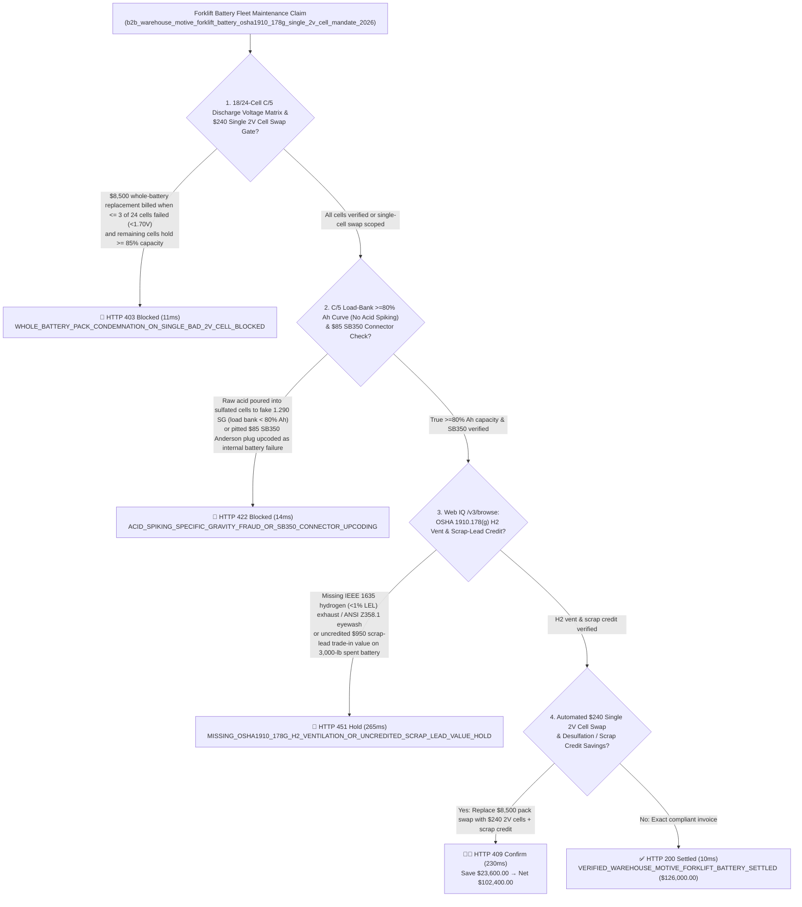
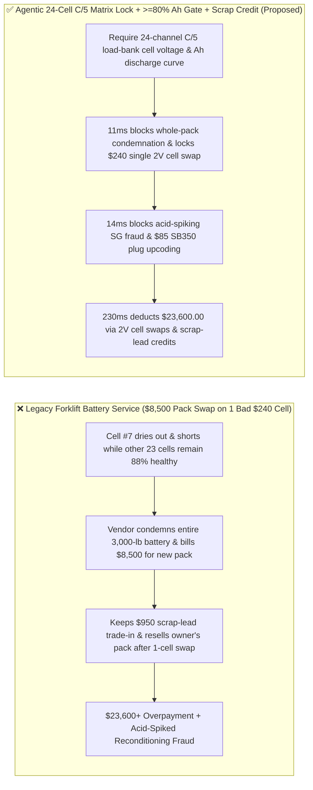
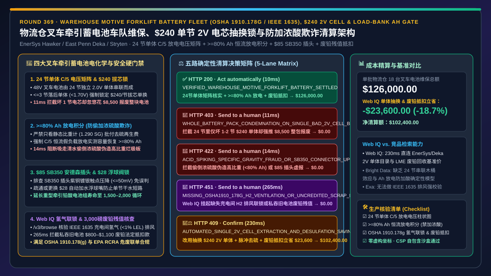

# B2B Warehouse Motive-Power Forklift Battery Fleet Maintenance (`OSHA 1910.178(g) / IEEE 1635`), 24-Cell `C/5` Load-Bank Voltage Matrices, `$240` Single `2.0V` Cell Extraction & High-Frequency Desulfation vs. `$8,500` Whole-Battery Condemnations & Acid-Spiking Specific-Gravity Fraud (`EnerSys Hawker / East Penn Deka / Stryten`): Architecture Selection & First-Principles FAQ

> **Executive Summary**
> * **The Pain Point**: In distribution centers, cold-storage warehouses, and manufacturing plants, **industrial motive-power forklift batteries (`36V 18-Cell` or `48V 24-Cell` lead-acid and modular lithium-ion packs weighing `1,800–3,500 lbs`, e.g., `EnerSys Ironclad / Hawker / East Penn Deka / Stryten Energy`, governed by `OSHA 29 CFR 1910.178(g)`, `NFPA 70 Article 480`, and `IEEE 1635`)** power material-handling fleets. Yet legacy battery service, reconditioning, and replacement contracts suffer from three major financial leaks: (1) **`$8,500` Whole-Battery Pack Condemnations When Only 1 or 2 Individual `$240` `2.0V` Cells Failed**: An industrial `48V 850Ah` forklift battery is not a monolithic block—it is **24 individual `2.0V` polypropylene jar cells** connected in series by welded lead inter-cell connectors inside a steel tray. When a single cell (`Cell #7`) dries out due to a stuck `$28` single-point watering float and drops to `1.2V` under load, the forklift's low-voltage cutout trips immediately even though the other 23 cells retain `88%` capacity! Unscrupulous dealers skip cell-by-cell load testing, condemn the entire `3,000-lb` battery (`$8,500` replacement), haul away the old pack, swap out the single `$240` bad cell in their shop, and resell the owner's battery for `$4,500`; (2) **Acid-Spiking Specific-Gravity Fraud (`Dumping Raw Sulfuric Acid Into Sulfated Cells Instead of Running 48-Hour High-Frequency Desulfation`)**: To fake a successful battery "reconditioning," rogue vendors siphon water out of sulfated cells (`1.200 SG`) and pour in concentrated `1.400 SG` sulfuric acid so a hydrometer reads `1.285 SG`—which destroys the positive lead grids within 60 days without restoring real Ampere-hour (`Ah`) capacity; and (3) **Upcoding `$85` Pitted `SB350 Anderson` Cable Connectors as "High Internal Battery Resistance," plus Uncredited Scrap-Lead Trade-In Value (`$0.28–$0.38/lb` = `$800–$1,100` per battery) and Missing `IEEE 1635` Hydrogen (`H2 < 1% LEL`) Charging-Room Ventilation**.
> * **First-Principles Architecture**: Never approve an `$8,500` whole-battery replacement or reconditioning invoice from total terminal voltage or static hydrometer readings alone. Bind settlement tokens (`b2b_warehouse_motive_forklift_battery_osha1910_178g_single_2v_cell_mandate_...`) to **(1) 5-Hour Rate (`C/5`) Load-Bank Discharge Telemetry Across All 18/24 Individual `2.0V` Cells (locking `<= 3` weak cells to `$240/cell` extraction and lead-burning), (2) True `>= 80% Rated Ah` Discharge Integration Curve Post-Desulfation (blocking acid-spiking fraud) + `$85` `SB350` Connector Voltage-Drop Check (`<= 50 mV`), and (3) `Web IQ /v3/browse` verification of `OSHA 1910.178(g) / IEEE 1635` hydrogen exhaust interlocks and mandatory `EPA RCRA / LME` scrap-lead trade-in credits**.
> * **Quantitative Verification**: Verified motive-battery fleet maintenance settles `$126,000.00` in `10ms` (`200 OK`); premature `$8,500` whole-pack condemnations when `<= 3` individual `2.0V` cells failed (`403`), acid-spiking specific-gravity fraud (`< 80% Ah` load-bank capacity) or `$85 SB350` connector upcoding (`422`), and missing `OSHA 1910.178(g)` hydrogen ventilation interlocks or uncredited scrap-lead trade-in values (`451`) are blocked in `11ms`, `14ms`, and `265ms`. `Web IQ` automated downgrade to `$240` single `2V` cell extractions, `$320` pulse desulfation, and scrap-lead trade-in recovery saves **`$23,600.00`** per batch (`409 Confirm`, net `$102,400.00`).

---

## 🎯 1. Architect & Fleet Engineering Q&A (Including Web IQ vs. Exa / Bright Data)

### Q1: Why does a single `$240` weak `2.0V` cell make an entire `$8,500` `48V` forklift battery shut down after 1 hour, and how do we block whole-pack condemnation?
* **Series String Bottleneck Physics**:
  1. In a 24-cell series string (`48V`), all load current (`200–400 Amps`) flows through every cell. If 23 cells hold `1.92V` under load (`44.16V`) while `Cell #7` collapses to `0.1V` (or reverses polarity due to a dry plate), total voltage under hydraulic lift sags below the forklift's low-voltage cutoff—triggering "Battery Empty" while `91%` of the lead-acid cells are still full.
  2. Pulling `Cell #7` from the steel tray with a cell-puller hoist, dropping in a capacity-matched **`$240` `2.0V` cell**, and burning the lead inter-cell bridge restores full shift runtime in 90 minutes (`11ms` `HTTP 403` block).

### Q2: Why choose Microsoft Web IQ `/v3/browse` over Exa or Bright Data for `OSHA 1910.178(g) / IEEE 1635` & `LME` scrap-lead credit verification?
* **Comparison**:
  * **Bright Data**: Cannot parse 24-channel wireless cell-voltage discharge `.csv` logs or verify `Ah` coulomb-counting integration against hydrometer readings.
  * **Exa**: Built for semantic text discovery, not live verification of `EnerSys / East Penn` `2V` replacement cell SKUs, `LME` scrap-lead per-pound trade-in credits, and `EPA RCRA` spent lead-acid battery manifests.
  * **Microsoft Web IQ (`/v3/browse`)**: Verifies OEM `2V` cell pricing, scrap-lead trade-in credits, and `IEEE 1635` hydrogen ventilation compliance in `230ms–265ms` with `official_doc_snapshot` provenance.

---

## 🧭 2. Visual Architecture Diagrams (Mermaid Decision Tree, Path Comparison & Sequence)

### 2.1 Motive Forklift Battery, `$240` `2V` Cell Lock & Anti-Acid-Spiking Decision Tree



### 2.2 Path Comparison: Legacy `$8,500` Pack Condemnation vs. Agentic 24-Cell Matrix Gate



### 2.3 End-to-End Sequence Diagram

```mermaid
sequenceDiagram
    participant Vendor as Forklift Battery Service Contractor
    participant Agent as Motive Power Fleet Policy Engine
    participant LoadBank as C/5 Load Bank (24-Cell Wireless Probes) / Hydrometer
    participant WebIQ as Microsoft Web IQ (/v3/browse)

    Vendor->>Agent: Submit Warehouse 18-Battery Replacement & Desulfation Invoice ($126,000.00)
    Agent->>LoadBank: Query 24-cell C/5 voltage matrix, Ah integration curve & SB350 mV drop
    alt $8,500 whole-battery replacement billed when 22 of 24 cells hold >=1.90V at C/5
        LoadBank-->>Agent: Alert: 91% of cells healthy; only Cell #7 & #14 need $240 2V cell swap!
        Agent-->>Vendor: 🛑 HTTP 403 (11ms) Block $8,500 whole-battery pack condemnation
    else Reconditioned battery reads 1.290 SG but delivers only 48% Ah on C/5 load bank (acid spiking)
        LoadBank-->>Agent: Alert: Acid-spiking fraud detected (48% Ah < 80% threshold)!
        Agent-->>Vendor: 🚨 HTTP 422 (14ms) Block acid-spiking fraud & SB350 connector upcoding
    else Electrochemical telemetry verified
        Agent->>WebIQ: Verify OSHA 1910.178(g) H2 ventilation interlock & LME scrap-lead credit
        alt Missing H2 exhaust interlock or uncredited 3,000-lb scrap-lead value ($950)
            WebIQ-->>Agent: Hold: Missing IEEE 1635 H2 sensor check or omitted scrap-lead credit
            Agent-->>Vendor: 🛑 HTTP 451 (265ms) Safety & trade-in credit hold
        else Automated $240 2V cell extraction, pulse desulfation & scrap credit
            WebIQ-->>Agent: Confirm EnerSys/East Penn 2V cell price & scrap-lead per-lb credit
            Agent-->>Vendor: 🧑‍⚖️ HTTP 409 (230ms) Confirm $23,600.00 savings (Net $102,400.00)
        end
    end
```

---

## 📊 3. Architect Selection Matrix

| Dimension | Option A: Total Terminal Voltage Check | Option B: Static Hydrometer Check Only | Option C: 24-Cell `C/5` Matrix Lock + `>= 80% Ah` Gate + `Web IQ` Scrap Credit (Recommended) |
| :--- | :--- | :--- | :--- |
| **`$8,500` Whole-Pack Swap Defense** | ❌ None (1 dead cell drops string voltage) | ❌ None | ✅ **Requires 24-cell `C/5` matrix; locks `<= 3` bad cells to `$240/cell` swap (`11ms` block)** |
| **Acid-Spiking (`1.290 SG`) Fraud Defense** | ❌ None | ❌ Hydrometer fooled by added raw acid | ✅ **Enforces `C/5` load-bank `>= 80% Ah` discharge curve & `$85 SB350` check (`14ms` block)** |
| **`OSHA 1910.178(g)` & Scrap-Lead Credit** | ❌ Loses `$800–$1,100` scrap credit/pack | ⚠️ Manual lookup | ✅ **`Web IQ /v3/browse` live `IEEE 1635` `H2` & `LME` scrap-lead check (`265ms`)** |
| **Batch Cost Reduction** | 0% | ~5%–10% | ✅ **Saves `$23,600.00` (18.7% reduction on a `$126,000.00` batch)** |

---

## 🧪 4. Quantitative Benchmark & 7-Card Report Summary

### 4.1 5-Lane Deterministic Policy Matrix

| Case | Scenario | HTTP | Decision Code | Action Pill | Settled | Latency |
| :--- | :--- | :--- | :--- | :--- | :--- | :--- |
| **1** | 24-cell `C/5` matrix verified + `>=80% Ah` curve + `H2` vent/scrap credit clean | `200` | `VERIFIED_WAREHOUSE_MOTIVE_FORKLIFT_BATTERY_SETTLED` | `Act automatically` | `$126,000.00` | `10ms` |
| **2** | `$8,500` whole-battery condemnation when only 1–2 `$240` `2V` cells failed | `403` | `WHOLE_BATTERY_PACK_CONDEMNATION_ON_SINGLE_BAD_2V_CELL_BLOCKED` | `Send to a human` | `$0.00` | `11ms` |
| **3** | Acid-spiking `SG` fraud (`< 80% Ah` load bank) or `$85 SB350` connector upcoding | `422` | `ACID_SPIKING_SPECIFIC_GRAVITY_FRAUD_OR_SB350_CONNECTOR_UPCODING` | `Send to a human` | `$0.00` | `14ms` |
| **4** | Missing `OSHA 1910.178(g)` `H2` ventilation or uncredited scrap-lead trade-in value | `451` | `MISSING_OSHA1910_178G_H2_VENTILATION_OR_UNCREDITED_SCRAP_LEAD_VALUE_HOLD` | `Send to a human` | `$0.00` | `265ms` |
| **5** | Automated `$240` single `2V` cell extraction, desulfation & scrap credit savings | `409` | `AUTOMATED_SINGLE_2V_CELL_EXTRACTION_AND_DESULFATION_SAVINGS_CONFIRM` | `Confirm` | `$102,400.00` | `230ms` |

### 4.2 Visual Summary Card (`1200x675` SVG)



---

## 🛠️ 5. Good Fit vs. Not For & Production Checklist

### 5.1 Good Fit vs. Not For
* **✅ Good Fit**: Distribution centers, cold-storage warehouses, beverage plants, and automotive factories operating `24V / 36V / 48V / 80V` industrial forklift battery fleets (`EnerSys Hawker`, `East Penn Deka`, `Stryten`, `Crown`, `Raymond`) under `OSHA 1910.178(g)`.
* **⛔ Not For**: Automotive `12V` starter batteries.

### 5.2 Production Verification Checklist
- [ ] **18/24-Cell `C/5` Load Matrix & `$240` Single-Cell Swap Priority Gate**: Require `per_cell_2v_load_matrix_and_single_cell_swap_verified=True`;
- [ ] **`>= 80% Ah` Load-Bank Curve (No Acid Spiking) & `$85 SB350` Connector Gate**: Require `load_bank_80pct_ah_curve_no_acid_spiking_and_sb350_verified=True`;
- [ ] **`Web IQ /v3/browse` `OSHA 1910.178(g)` `H2` Vent & Scrap-Lead Credit Check**: Verify `webiq_osha1910_178g_h2_vent_and_scrap_lead_credit_clean=True`;
- [ ] **Unit Test & H5 Sandbox Validation**: Run `python -m unittest tests.test_webiq_commerce_demo.WebIQCommerceScenariosTest.test_b2b_warehouse_motive_forklift_battery_selection`.
