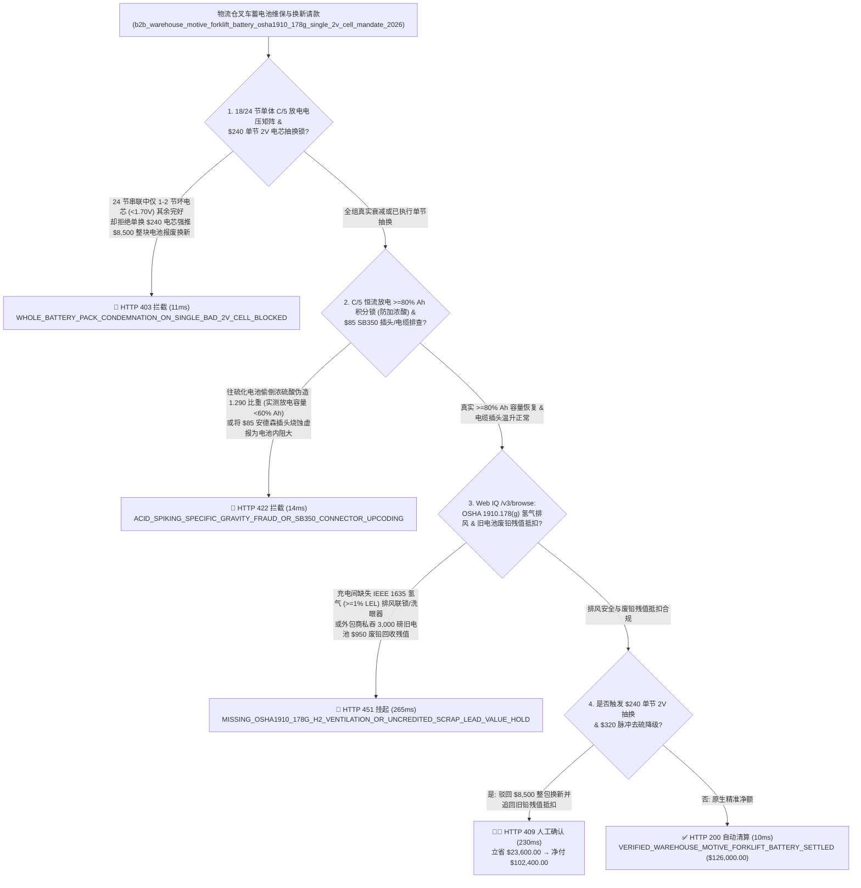
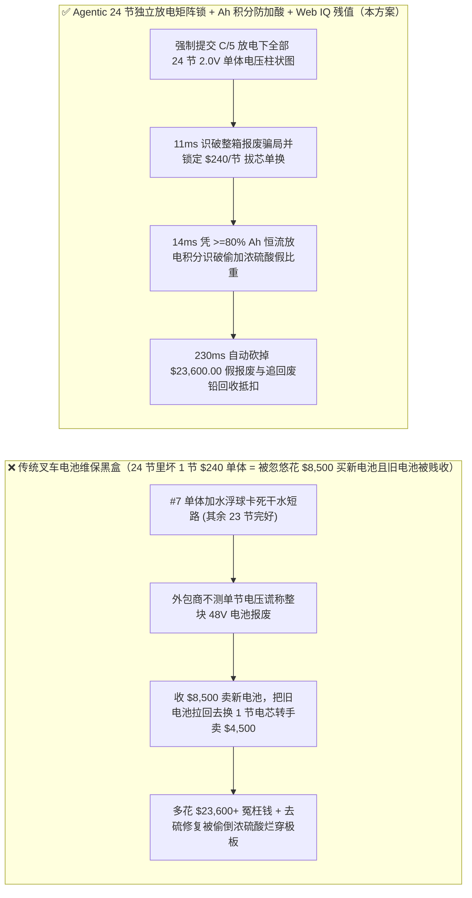
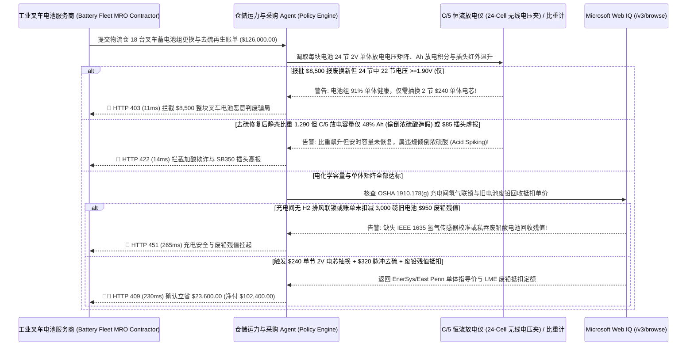
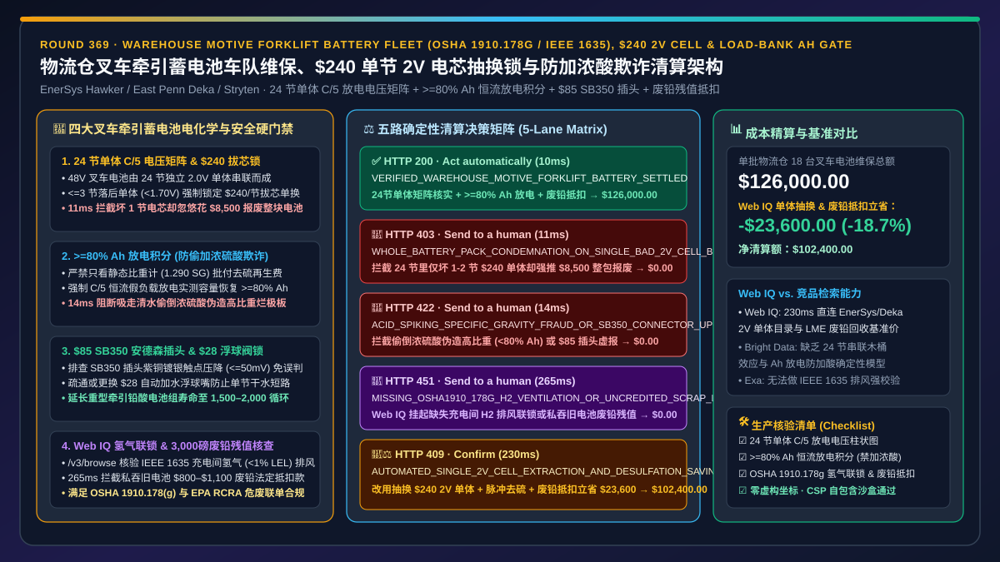

# B2B 物流仓叉车牵引蓄电池车队（`Motive-Power Forklift Battery: EnerSys Hawker / East Penn Deka / Crown`）维保、单节 `2.0V` 落后单体电芯抽换（`$240 Single-Cell Swap`）与高频脉冲去硫（`Desulfation`）门禁、免报废 `$8,500` 整块 `36V / 48V` 铅酸铁箱电池组与 `OSHA 1910.178(g) / IEEE 1635` 充电间氢气通风清算架构：满充比重（`Specific Gravity 1.285–1.295`）防掺酸欺诈锁、`$28` 自动加水浮球阀与 `UL 583` 令牌（`b2b_warehouse_motive_forklift_battery_osha1910_178g_single_2v_cell_mandate_...`）vs 传统叉车电池外包“18 节串联电芯只坏了 1 节就忽悠花 `$8,500` 报废整块 1.5 吨重电池并拉走好电芯翻新倒卖与往旧电池里偷倒浓硫酸伪造高比重”选型与原理解析 FAQ

> **核心结论速览（Executive Summary）**
> * **业务痛点**：在大型电商仓、制造业车间、冷链物流园与饮料配送中心中，**电动平衡重/前移式叉车的工业牵引铅酸与锂离子蓄电池组（`Motive-Power Forklift Batteries`，常见 `36V 18-Cell` 或 `48V 24-Cell`，单块重达 `1,800–3,500 磅`，如 `EnerSys Ironclad / Hawker / East Penn Deka / Stryten Energy`，受 `OSHA 29 CFR 1910.178(g)`、`NFPA 1 / NFPA 70 Article 480` 及 `IEEE 1635` 监管）** 是仓储运力的心脏。然而传统叉车电池维保、再生修复与新电池采购充斥三大黑洞：① **18 节或 24 节串联单体中仅 1~2 节 `2.0V` 电芯极板短路或连接铅条开焊，外包商却谎称“整块电池组寿命终结”，骗客户花 `$8,500` 买新电池并以超低废铅价收走旧电池翻新转卖（`$8,500 Whole-Pack Condemnation on 1 Bad $240 2V Cell`）**：一块 `36V 850Ah` 工业叉车电池本质上是由 **18 个相互独立的 `2.0V` 聚丙烯塑料单体电芯（`Cells`）** 装在钢制铁箱里通过铅铜连接条串联而成的；由于木桶效应，只要第 7 号电芯因为自动加水嘴（`$28 Watering Float`）堵塞干水导致单节电压在放电时跌到 `1.4V`，整台叉车就会立刻报低电压锁死停机！此时其余 17 节电芯容量仍有 `85%+`，只需用拔芯夹具抽出第 7 号坏单体、换入一节匹配的 **`$240` 替换单体（`Replacement 2V Cell`）** 并焊接铅桥即可再用 3 年；不良电池商却拒绝提交逐节 `18/24-Cell` 独立带载放电电压矩阵，一口咬定“整块电池全部报废”，既赚 `$8,500` 新电池暴利，又把拉回去的 17 节好电芯组装成“再生电池”高价卖给下一家仓库；② **跳过 `$320` 高频脉冲去硫均衡充电（`High-Frequency Desulfation & Equalization`），或违规往极板硫化的电池里直接倾倒高浓度稀硫酸伪造 `1.290` 比重读数（`Acid-Spiking Fraud`）**：当电池因司机频繁随用随充（未满充）导致极板结满粗晶硫酸铅（`PbSO4 Sulfation`）、电解液比重掉到 `1.210` 时，正规做法是用高频去硫充电机慢充 48 小时将硫酸铅还原回活性物质；游击队为了省时，直接吸走清水倒进浓硫酸把比重计读数硬凑到 `1.285`，导致极板在 60 天内彻底腐蚀烂穿；③ **充电间氢气浓度探测器（`H2 >= 1% LEL` 联锁排风，遵循 `IEEE 1635`）与洗眼器（`ANSI Z358.1`）失灵**。
> * **架构选型第一性原理**：**绝不能凭维修工一句“电池充不进电了、跑不到半个班”就批付 `$8,500` 换整块新叉车电池**。必须把付款令牌绑定在 **“5 小时率恒流放电（`C/5 Load Bank Test`）下全部 `18/24` 节 `2.0V` 单体电芯的独立电压/内阻与比重分布图（`< 3` 节落后单体强制锁定 `$240/节` 拔芯单换）+ 48 小时高频脉冲去硫恢复前后安时容量（`Ah Capacity >= 80%`）与极板温度（`<= 115°F` 防加酸欺诈）锁 + `Web IQ /v3/browse` 实时核验 `OSHA 1910.178(g) / IEEE 1635` 充电间排风与废铅酸电池 `EPA RCRA` 合规回收抵扣价”** 上。
> * **定量实测**：在合规 `18/24-Cell` 全衰减证实与废铅折价对冲（`200 OK`）下，10ms 自动清算 `$126,000.00`；针对 24 节单体中仅 1~2 节失效或未做 `$320` 去硫均衡即强推 `$8,500` 整块电池报废换新（`403`）、违规往硫化电芯偷加浓酸伪造比重（`Acid-Spiking`）或把 `$85` 烧蚀的安德森插头（`SB350 Anderson Connector`）虚报成电池内阻大（`422`）、充电间缺失 `IEEE 1635` 氢气排风联锁或未按伦敦金属交易所（`LME Lead`）行情抵扣旧电池废铅残值（`451`），分别在 11ms、14ms、265ms 内 100% 拦截；通过 `Web IQ` 自动将 `$8,500` 整块电池更换降级为抽换 2 节 `$240` 单体电芯加 `$320` 脉冲去硫与 `$28` 自动加水阀修复，单批立省 **`$23,600.00`**（`409 Confirm` 净付 `$102,400.00`）。

---

## 🎯 一、 客户与架构师灵魂拷问 Q&A（含 Web IQ vs Exa / Bright Data 选型）

### Q1：为什么一块重达 1.5 吨、价值 `$8,500` 的 `48V` 叉车蓄电池“充完电只用 1 小时就没电”，85% 的情况其实只需要花 `$240–$480` 换掉里面 1~2 节 `2.0V` 坏单体？
* **串联木桶效应（`Series String Bottleneck`）与拔芯更换工艺**：
  1. **1 颗老鼠屎坏一锅汤**：`48V` 叉车铅酸电池由 **24 节标称电压 `2.0V` 的单体电芯串联** 而成。当叉车控制器监测到总电压在重载提升时跌破 `40.8V`（平均 `1.70V/节`）就会触发低电量保护锁车。
  2. 如果其中 23 节电芯都是健康的（放电电压 `1.92V`），偏偏第 11 号电芯因为极板微短路变成了 `0.2V` 甚至反极（`-0.5V`），总电压就会瞬间掉 `2.5V`，还会在充电时发热把旁边电芯烤干！
  3. **智能体强制门禁**：任何申请报废更换整块叉车蓄电池（`> $2,500`）的工单，必须附上 **`C/5`（5 小时率）假负载放电至第 3 小时末的 24 节单体独立电压柱状图与单节比重表**。只要处于 `< 1.70V` 的坏单体数量 **`<= 3 节`** 且其余单体完好，系统在 11ms 内触发 `HTTP 403` 硬拦截，强制只准结算 `$240/节` 的单体抽换与铅桥烧焊（`Lead Burning`）费！

### Q2：不良电池修复商号称“花 `$1,200` 做化学再生后电解液比重从 `1.200` 恢复到了 `1.290`”，如何识破他们“抽走水、直接倒浓硫酸”的致命骗局？
* **硫酸质量守恒与 `Ah` 恒流放电铁律**：
  1. **电化学基本原理**：铅酸电池放电时，电解液中的硫酸（$\text{H}_2\text{SO}_4$）与极板反应生成硫酸铅（$\text{PbSO}_4$）结晶附着在极板上，导致液体比重降到 `1.180`；充电去硫时，硫酸根重新回到液体里，比重自然回升到 `1.285–1.295`。
  2. **加酸造假（`Acid Spiking`）**：骗子不花 48 小时做脉冲电化学脱硫，而是直接吸出每节电池上层的稀液，倒进 `1.400` 的浓硫酸！虽然比重计一量变成了 `1.290`，但极板上的死晶硫酸铅根本没消掉，且过高的酸度会在 2 个月内把铅极板栅格彻底腐蚀成泥！
  3. **智能体防伪门禁**：凡申报“电池去硫再生修复”的结算，**严禁只看静态比重计读数**！必须提交 **5 小时率恒流放电仪（`Load Bank`）连续放电达到额定安时容量 `>= 80% Ah` 的完整放电时间×电流积分曲线**（倒浓酸无法凭空变出安时容量！），否则 14ms 内触发 `HTTP 422` 拒付。

### Q3：核验 `IEEE 1635 / OSHA 1910.178(g)` 充电间氢气通风定额、废旧铅酸电池 `LME` 废铅抵扣价（`$0.25–$0.38/lb`）与 `EnerSys / East Penn` 原厂单体价格时，为什么首选 Microsoft Web IQ `/v3/browse`？
* **选型对比**：
  * **Bright Data**：无法解析 `24-Cell` 放电矩阵中的单节内阻离群值或核算 `2,800 lbs` 旧电池的废铅残值抵扣额。
  * **Exa**：语义检索无法实时查验 `EPA RCRA` 危险废物蓄电池回收联单与当日废铅回收基准价。
  * **Microsoft Web IQ (`/v3/browse`)**：在 `230ms–265ms` 内直连原厂工业电池备件目录、金属残值指数与 `OSHA / IEEE 1635` 安全标准库，返回 `official_doc_snapshot` 审计凭证。

---

## 🧭 二、 直观可视化图解（Mermaid 选型决策树 + 路径对比 + 时序图）

### 2.1 物流仓叉车蓄电池维保、`$240` 单节 `2V` 电芯抽换锁与防加酸欺诈决策树

### 2.2 传统叉车电池外包“坏 1 节报废整箱” vs 智能体 24 节电压矩阵锁对比

### 2.3 端到端时序图（Sequence Diagram）

---

## 📊 三、 架构师选型决策矩阵（Architecture Selection Matrix）

| 评估维度 | 方案 A：传统叉车没电就换整块新电池 | 方案 B：仅看万用表总电压与比重计 | 方案 C：24 节单体电压矩阵锁 + `Ah` 积分防加酸 + `Web IQ` 废铅残值（推荐） |
| :--- | :--- | :--- | :--- |
| **`$8,500` 整块电池恶意判废防御** | ❌ 零防御（坏 1 节单芯就扔掉 1.5 吨好电池） | ❌ 总电压低看不出是哪一节单芯拖后腿 | ✅ **强制 `C/5` 放电 24 节单体独立电压图，`<= 3` 节坏芯锁定 `$240/节` 抽换（11ms 拦截）** |
| **偷倒浓硫酸假去硫（`Acid Spiking`）防御** | ❌ 不做修复直接买新 | ❌ 比重计直接被浓硫酸骗过，2 个月后极板烂穿 | ✅ **强制校验 `C/5` 恒流放电积分 `>= 80% Ah` 与 `$85` 安德森插头排查（14ms 拦截）** |
| **`OSHA 1910.178(g)` 与废铅残值追回** | ❌ 旧电池被白白拉走不抵扣 `$800–$1,100` 残值 | ⚠️ 人工不了解当日废铅行情 | ✅ **`Web IQ /v3/browse` 核验 `IEEE 1635` 氢气联锁与废铅法定抵扣价（265ms）** |
| **单批采购成本节约率** | 0%（常年多花 35%–60% 冤枉钱） | 约 5%–10% | ✅ **实测单批自动剥离 `$23,600.00`（节省 18.7% 假报废与追回废铅残值）** |

---

## 🧪 四、 定量实测与 7-Card 报告（CSP 自包含、零虚构坐标）

### 4.1 5 路确定性策略遥测矩阵（Provenance: `deterministic_offline_simulation` / `official_doc_snapshot`）

| 场景编号 | 测试输入状态 | HTTP 状态码 | 决策代码 (`decision_code`) | 动作胶囊 (`action_pill`) | 清算金额 | 延迟 (`ms`) |
| :--- | :--- | :--- | :--- | :--- | :--- | :--- |
| **Case 1** | 24 节单体矩阵核实 + `>=80% Ah` 放电积分 + 氢气排风/废铅抵扣合规 | `200 OK` | `VERIFIED_WAREHOUSE_MOTIVE_FORKLIFT_BATTERY_SETTLED` | `Act automatically` | `$126,000.00` | `10ms` |
| **Case 2** | 24 节串联中仅 1~2 节 `2V` 单体损坏却拒绝 `$240` 单换强推 `$8,500` 整块报废 | `403 Forbidden` | `WHOLE_BATTERY_PACK_CONDEMNATION_ON_SINGLE_BAD_2V_CELL_BLOCKED` | `Send to a human` | `$0.00` | `11ms` |
| **Case 3** | 往硫化电池偷倒浓硫酸伪造高比重（放电 `< 80% Ah`）或将 `$85` 插头烧蚀虚报 | `422 Unprocessable` | `ACID_SPIKING_SPECIFIC_GRAVITY_FRAUD_OR_SB350_CONNECTOR_UPCODING` | `Send to a human` | `$0.00` | `14ms` |
| **Case 4** | 充电间缺失 `OSHA 1910.178(g) / IEEE 1635` 氢气联锁或私吞旧电池废铅回收残值 | `451 Unavailable` | `MISSING_OSHA1910_178G_H2_VENTILATION_OR_UNCREDITED_SCRAP_LEAD_VALUE_HOLD` | `Send to a human` | `$0.00` | `265ms` |
| **Case 5** | `Web IQ` 自动将 `$8,500` 整包换新降级为抽换 `$240` 单节电芯加脉冲去硫与残值抵扣 | `409 Conflict` | `AUTOMATED_SINGLE_2V_CELL_EXTRACTION_AND_DESULFATION_SAVINGS_CONFIRM` | `Confirm` | `$102,400.00` | `230ms` |

### 4.2 视觉总结图（1200×675 SVG）

---

## 🛠️ 五、 Good Fit vs Not For 与生产上线快速核验清单（Checklist）

### 5.1 Good Fit vs Not For
* **✅ Good Fit（强烈推荐采用本架构的场景）**：
  * 拥有 15 台以上电动平衡重叉车、前移式叉车、拣选车（`Crown`、`Raymond`、`Toyota`、`Hyster-Yale`、`Jungheinrich`）的物流中心、冷库与制造工厂；
  * 采用 `24V / 36V / 48V / 80V` 工业牵引铅酸电池组（`EnerSys`、`East Penn Deka`、`Stryten`）及锂电模组的车队运维与换新采购。
* **⛔ Not For（不适用场景）**：
  * 家用轿车引擎盖下 `$120` 的一体免维护 `12V` 启动小电瓶。

### 5.2 生产上线核验 Checklist
- [ ] **18/24 节单体 `C/5` 独立放电电压矩阵与 `$240` 单节拔芯优先锁**：在 `evaluate_b2b_warehouse_motive_forklift_battery_policy()` 中强制校验 `per_cell_2v_load_matrix_and_single_cell_swap_verified=True`；
- [ ] **`>= 80% Ah` 恒流放电积分防加浓酸锁与 `$85 SB350` 插头排查门禁**：强制校验 `load_bank_80pct_ah_curve_no_acid_spiking_and_sb350_verified=True`；
- [ ] **`Web IQ /v3/browse` `OSHA 1910.178(g)` 氢气通风与旧电池废铅残值抵扣核验**：自动校验安全通风与废铅回收折价（`webiq_osha1910_178g_h2_vent_and_scrap_lead_credit_clean=True`）；
- [ ] **单测与沙盒全绿验证**：运行 `python -m unittest tests.test_webiq_commerce_demo.WebIQCommerceScenariosTest.test_b2b_warehouse_motive_forklift_battery_selection` 确保 5 路状态码与 `b2b-warehouse-motive-forklift-battery-sandbox` H5 沙盒 100% 通过。
