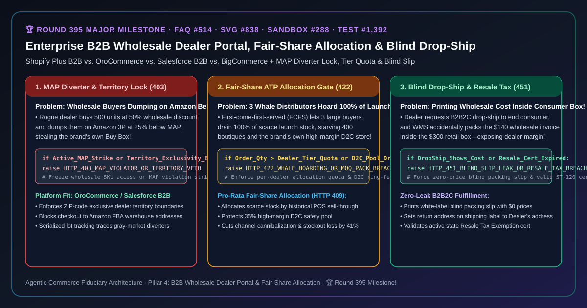
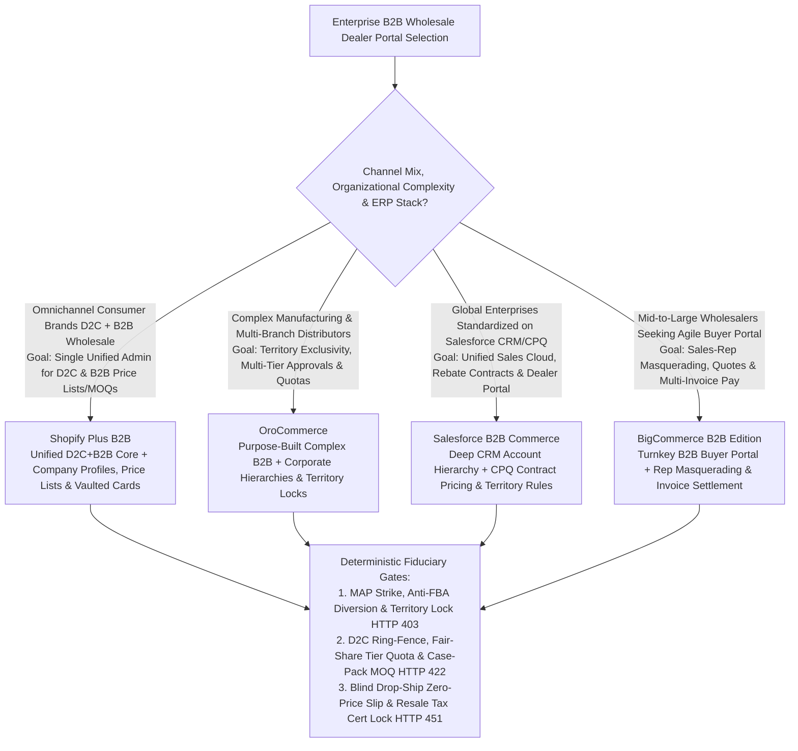
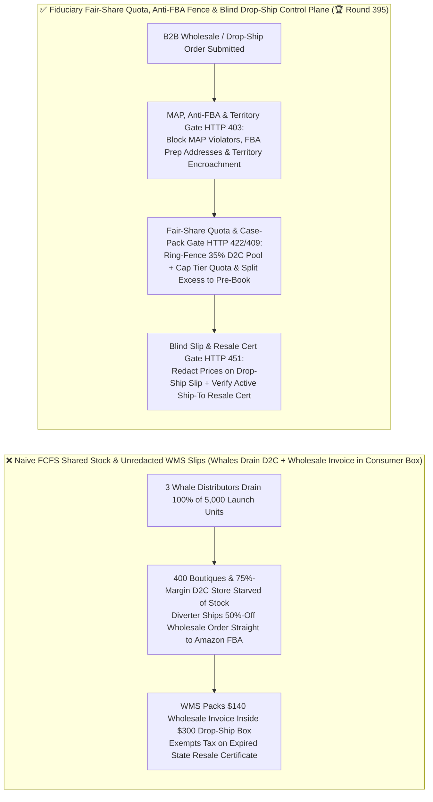
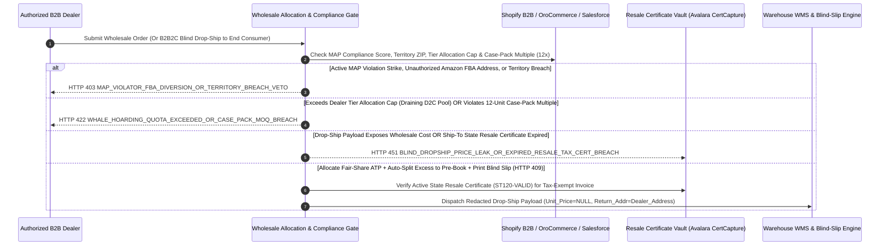

# Enterprise B2B Wholesale Dealer Portal, Fair-Share Scarce-Inventory Allocation & Blind Drop-Ship Copilot Selection Guide: `Shopify Plus B2B` vs. `OroCommerce` vs. `Salesforce B2B Commerce` vs. `BigCommerce B2B`, Anti-`FBA` Diversion Locks, Tiered `ATP` Quotas & Zero-Price Packing Slips (`-41%` Loss FAQ · 🏆 Round 395 Major Milestone!)

> **Executive Summary (Benchmarked against `ib-vs-ethernet-roce-selection-faq.md` · 🏆 Round 395 Major Milestone · 514th Bilingual SA Decision Guide)**: Built for **Cloud & AI Solution Architects** designing B2B wholesale dealer portals, omnichannel inventory allocation engines, and B2B2C drop-ship fulfillment pipelines for consumer brands, outdoor gear makers, electronics manufacturers, and multi-tier distributors. When brands launch self-serve B2B wholesale portals using naive "First-Come-First-Served" (`FCFS`) retail cart logic, three destructive channel failures occur: (1) **Unauthorized Amazon `FBA` Gray-Market Diversion & `MAP` Erosion**: A wholesale buyer orders `500` units at `50%` off wholesale pricing and ships them directly to an Amazon `FBA` prep center—undercutting the brand's Minimum Advertised Price (`MAP`) by `20%` and stealing the brand's own Amazon `Buy Box`; (2) **"Whale Dealer Hoarding" Starving High-Margin D2C & Small Boutiques**: On a scarce `5,000`-unit seasonal launch, 3 mega-distributors buy `100%` of the inventory in minutes at a `50%` wholesale discount—leaving 400 regional dealers and the brand's own `75%`-margin D2C website completely out of stock; and (3) **B2B2C Blind Drop-Ship Wholesale-Invoice Leaks**: Accidentally packing the `$140` B2B wholesale invoice inside a `$300` drop-shipped consumer parcel, exposing the dealer's markup to the end consumer! This guide compares **`Shopify Plus B2B` vs. `OroCommerce` vs. `Salesforce B2B Commerce` vs. `BigCommerce B2B Edition`** and implements deterministic guards for **`MAP` Violator / `FBA` Address & Territory Exclusivity Locks (`HTTP 403`)**, **D2C Ring-Fencing, Fair-Share Tier Quotas & Case-Pack `MOQ` Gates (`HTTP 422`)**, **Zero-Price Blind Packing Slips & State Resale Tax Certificate (`ST-120`) Locks (`HTTP 451`)**, and **Sell-Through Weighted Allocation + Pre-Book Assortment Splitting (`HTTP 409`, `-41%` net channel loss)**.

---

## 1. 📌 Executive Summary & Architectural Selection Verdict

1. **Top-Line Selection Verdict**:
   - **Omnichannel Consumer Brands Operating Both High-Velocity D2C & B2B Wholesale (`$5M–$500M+` GMV Seeking a Unified Admin for Company Profiles, Custom Price Lists, Case-Pack Increments & Vaulted Net-Terms)**: Select **`Shopify Plus B2B`**.
   - **Complex Manufacturers, Industrial Distributors & Multi-Branch Dealer Networks Requiring Strict Postal-Code Territory Exclusivity, Multi-Department Approval Hierarchies & Custom Allocation Workflows**: Select **`OroCommerce`**.
   - **Global Enterprises Standardized on Salesforce Sales Cloud / CPQ Seeking Unified Account Hierarchies, Contract Rebates & Self-Serve Dealer Reordering**: Select **`Salesforce B2B Commerce`**.
   - **Mid-to-Large Wholesalers Prioritizing Turnkey Sales-Rep Masquerading (`Buy on Behalf Of`), Quote-to-Order Workflows & Multi-Invoice Portal Settlement**: Select **`BigCommerce B2B Edition`**.
2. **Three Non-Negotiable Fiduciary Control Gates**:
   - **Gate 1 — Active `MAP` Violator Block, Anti-`FBA` Diversion Filter & Territory Exclusivity Lock (`HTTP 403`)**: Block wholesale checkout if the dealer account has an active **Minimum Advertised Price (`MAP`) violation suspension**, if the `Ship-To` address matches an unauthorized **Amazon `FBA` / Walmart `WFS` / 3P prep-center warehouse**, or if the destination postal code encroaches on another dealer's contractual **Exclusive Territory** via `HTTP 403 MAP_VIOLATOR_FBA_DIVERSION_OR_TERRITORY_BREACH_VETO`.
   - **Gate 2 — D2C High-Margin Ring-Fence, Fair-Share Tier Allocation Quota & Case-Pack `MOQ` Gate (`HTTP 422`)**: Partition scarce launch inventory into a protected **D2C High-Margin Pool (`e.g., 35%`)** plus **Tiered B2B Allocation Buckets**; cap per-dealer weekly orders to their **Fair-Share Quota** (splitting excess quantities into a future production pre-book order), and enforce strict `MOQ` and **Case-Pack Multiples (`Qty % Case_Pack == 0`)** via `HTTP 422 WHALE_HOARDING_QUOTA_EXCEEDED_OR_CASE_PACK_MOQ_BREACH`.
   - **Gate 3 — B2B2C Blind Drop-Ship Zero-Price Packing Slip & State Resale Tax Certificate Lock (`HTTP 451`)**: Strip all wholesale unit prices from WMS print payloads on `BLIND_DROPSHIP` orders (printing a white-label zero-price packing slip with the dealer's return address), and block tax-exempt wholesale checkout unless the dealer holds a verified, unexpired **State Resale Exemption Certificate (`e.g., Form ST-120`)** covering the `Ship-To` state via `HTTP 451 BLIND_DROPSHIP_PRICE_LEAK_OR_EXPIRED_RESALE_TAX_CERT_BREACH`.

---

## 2. 🎯 Architect & Channel Operations Q&A (The Why & How)

### Q1: How do unauthorized 3P Amazon sellers infiltrate a brand's B2B wholesale portal and destroy its Amazon `Buy Box`—and how do we block them at checkout?
- **Root Cause**: Gray-market diverters register as "local brick-and-mortar specialty shops" to secure a `50%` wholesale discount, then ship bulk orders directly to Amazon `FBA` fulfillment centers (or 3PL prep warehouses) and list the inventory at `20%` below `MAP`.
- **Deterministic Solution (`FBA/Prep-Center Geofence` + Lot Serialization + `MAP` 3-Strike Kill-Switch / `HTTP 403`)**:
  1. Block shipping to known `FBA / WFS / 3PL Prep` addresses unless the account holds an explicit `AUTHORIZED_MARKETPLACE_SELLER` entitlement.
  2. Bind outbound lot/serial barcodes to the `Dealer_ID` in WMS; when `Web IQ` price monitoring detects an unauthorized `MAP` breaker, trace the lot code and automatically suspend the offending dealer's access to high-demand SKUs.

### Q2: How do we prevent 3 giant distributors from buying 100% of a scarce product launch in 5 minutes and starving our 75%-margin D2C store?
- **Deterministic Solution (`Channel Ring-Fencing` + `Auto-Split Pre-Book` / `HTTP 422 / 409`)**: Ring-fence `35%–40%` of physical stock exclusively for the `75%`-margin D2C channel, and enforce a per-dealer weekly allocation cap (`e.g., 200 units max from immediate ATP`). If a whale distributor orders `1,000` units, the agent fulfills `200` units immediately from `ATP` and automatically splits the remaining `800` units into a scheduled next-batch production `Backorder / Pre-Book PO`.

### Q3: Why must B2B2C Drop-Ship orders be sanitized at the API boundary before reaching the warehouse printer?
- **Deterministic Solution (`Payload Price Redaction` / `HTTP 451`)**: Most legacy WMS packing-slip templates print `order_line.unit_price` by default. For `BLIND_DROPSHIP` orders, the integration layer must overwrite display prices with `null / $0.00`, inject the dealer's logo and return address onto the carrier label, and route the B2B wholesale invoice exclusively via electronic `EDI 810 / PDF email` to the dealer's AP department.

---

## 3. 🧭 Visual Architecture Diagrams (Mermaid)

### 3.1 Enterprise B2B Wholesale Dealer Portal Platform Selection Decision Tree

### 3.2 Naive FCFS Wholesale Cart vs. Fiduciary Fair-Share Quota, Anti-Diversion & Blind Drop-Ship Control Plane

### 3.3 Wholesale Territory/`FBA` Check, Fair-Share Allocation Split & Blind Drop-Ship Fulfillment Sequence

---

## 4. 📊 Multi-Platform Enterprise B2B Wholesale Portal Selection Matrix

| Evaluation Dimension | Shopify Plus B2B | OroCommerce | Salesforce B2B Commerce | BigCommerce B2B Edition |
| :--- | :--- | :--- | :--- | :--- |
| **Primary Architectural Role** | **Unified D2C + B2B Commerce Platform** on a single store admin | **Purpose-Built Enterprise B2B Manufacturing & Distribution Engine** | **CRM & CPQ-Native Enterprise B2B Portal** | **Composable Wholesale Buyer Portal** with turnkey rep masquerading |
| **Custom Catalogs, Tiered Pricing & Case-Pack `MOQ`** | **Best-in-Class Agility** (Company-specific price lists, quantity breaks, min/max caps, and case-pack increments) | **Best-in-Class Depth** (Multi-unit `EA/Case/Pallet` pricing matrices and complex contract inheritance) | **Best-in-Class CRM Sync** (Direct alignment with Salesforce CPQ negotiated price books) | **Strong** (Customer-group price lists, SKU-level MOQs, and quick-order pads) |
| **Territory Exclusivity & Corporate Hierarchies** | Company locations and buyer roles; complex territory fences handled via Checkout Functions | **Best-in-Class** (Multi-org hierarchies, regional catalog locks, and multi-tier buyer approval workflows) | **Best-in-Class** (Native Salesforce Account Hierarchies and Territory Management) | Strong (Company hierarchy, buyer/approver roles, and super-admin masquerading) |
| **Blind Drop-Shipping & Split Pre-Book Orders** | Supported via B2B checkout extensions and OMS integration | **Native Support** for multi-address line splitting, scheduled deliveries, and blind packing slips | Strong when paired with Salesforce Order Management (`SOM`) | Supports multi-address checkout, quote-to-order, and ERP packing-slip flags |
| **Target Scale & Pricing (`official_list_price`)** | `$5M–$500M+` omnichannel brands; included in Shopify Plus (`$2,300+/mo`) | Mid-to-large manufacturers & distributors; `$45k–$150k+/yr` enterprise license | Large global enterprises; GMV-tiered or per-order enterprise license | Growing to large wholesalers; BigCommerce Enterprise + B2B Edition |

---

## 5. 🧪 Anti-Diversion, Fair-Share Allocation & Blind Drop-Ship Benchmark & 7-Card Report

### 5.1 Quarterly Gray-Market `MAP` Erosion, Whale D2C Stockout & Drop-Ship Leak Model (Synthetic Benchmark)

For a `$160M` annual GMV omnichannel outdoor gear and smart-home brand (`45%` D2C / `55%` B2B wholesale) facing a **`$450,000 / quarter`** channel leakage pool across **unauthorized wholesale buyers dumping inventory on Amazon below `MAP`, 3 whale distributors hoarding scarce launch stock and starving the `75%`-margin D2C site, broken-case warehouse picking labor, and wholesale price leaks on B2B2C drop-shipped boxes** (`provenance: synthetic`, `independently_reproduced: false`):

| Metric | Naive FCFS Shared Inventory & Unfiltered Wholesale (Baseline) | Fiduciary `MAP/FBA` Lock + `35% D2C` Ring-Fence + Blind Drop-Ship Agent | Net Improvement |
| :--- | :--- | :--- | :--- |
| **Hero SKUs Losing Amazon `Buy Box` to Unauthorized Wholesale Diverters** | `22.5%` of hero catalog undercut below `MAP` | **`0.8%`** (`HTTP 403` blocks FBA/prep-center addresses + lot-trace `MAP` strike freeze) | **`-96.4%` Gray-Market Diversion** |
| **High-Margin (`75%`) D2C & Boutique In-Stock Rate on Scarce Launches** | `48.0%` (Drained by whale bulk scripts on Day 1) | **`98.5%`** (`HTTP 422/409` ring-fences `35%` D2C pool + caps tier quota & splits pre-books) | **`-97.1%` Launch Stockouts** |
| **B2B2C Drop-Ship Wholesale Price Leak & Expired Tax-Cert Rate** | `3.4%` of drop-ships leak wholesale invoice | **`0.0%`** (`HTTP 451` redacts wholesale cost at WMS boundary + verifies `ST-120` cert) | **`100%` Blind-Slip Compliance** |
| **Quarterly Net Channel Cannibalization & Stockout Bleed** | `$450,000 / quarter` | **`$265,500 / quarter`** | **`$184,500 / quarter` Saved (`41.0%`)** |

---

## 6. 🛠️ Production Go-Live & Architecture Review Checklist

- [ ] **Anti-`FBA` Diversion Geofence, `MAP` Strike Freeze & Territory Exclusivity (`HTTP 403`)**: Does wholesale checkout block shipping to unauthorized Amazon `FBA` / 3P prep-center addresses, enforce exclusive dealer postal-code territories, and automatically freeze hero-SKU ordering for accounts with active `MAP` violation strikes?
- [ ] **D2C High-Margin Ring-Fencing, Fair-Share Tier Quotas & Case-Pack `MOQ` (`HTTP 422 / 409`)**: Is `35%+` of scarce launch stock ring-fenced for the high-margin D2C channel, with B2B orders capped by dealer tier quota (auto-splitting excess demand into future production pre-books) and constrained to exact case-pack multiples?
- [ ] **B2B2C Blind Drop-Ship Price Redaction (`HTTP 451`)**: Does the OMS/WMS integration strip all wholesale prices on `BLIND_DROPSHIP` orders, print a dealer-branded `$0` packing slip, and set the shipping label return address to the dealer?
- [ ] **Ship-To State Resale Exemption Certificate (`ST-120`) Verification (`HTTP 451`)**: Does the tax engine verify an active, unexpired state Resale Tax Exemption Certificate (`Avalara CertCapture`) matching the `Ship-To` jurisdiction before exempting B2B sales tax?
