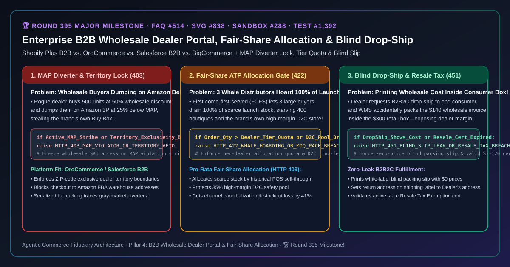
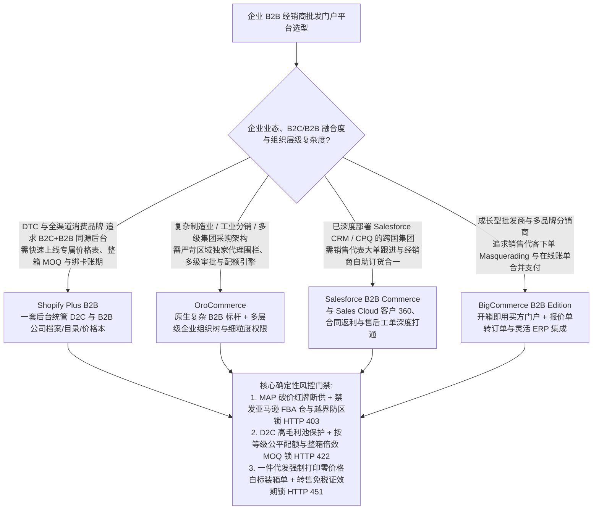
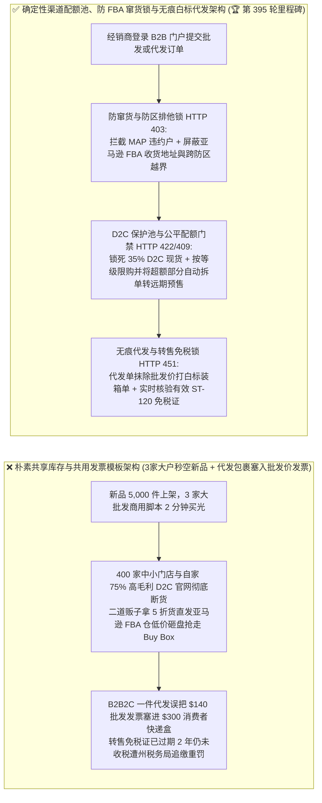
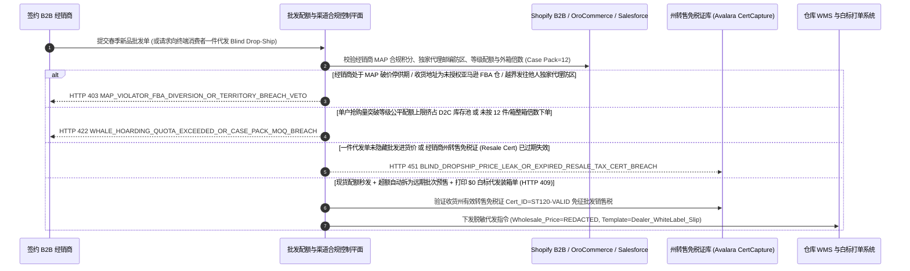

# 企业 B2B 经销商批发门户（`Wholesale Dealer Portal`）、稀缺爆款公平配额分配（`Fair-Share Allocation`）与无痕一件代发（`Blind Drop-Ship`）Agent 架构选型对比：`Shopify Plus B2B` vs. `OroCommerce` vs. `Salesforce B2B Commerce` vs. `BigCommerce B2B`、窜货破价（`MAP`）断供锁、防大户包圆吸干 D2C 库存门禁及零批价装箱单净省 41% 决策指南（FAQ · 🏆 第 395 轮重大里程碑！）

> **导读（对齐 `ib-vs-ethernet-roce-selection-faq.md` 标杆风格 · 🏆 全库第 395 轮研究重大里程碑 · 第 514 篇双语指南）**：本文面向同时运营自有 D2C 零售与全球 B2B 经销/分销渠道的品牌制造商、消费电子、户外装备、美妆个护与家居五金领域的 **Cloud & AI Solution Architect**。当品牌商为成百上千家区域经销商（Dealers / Boutiques / Distributors）搭建自助 B2B 批发订货门户时，若直接照搬 C 端零售的“先到先得购物车”，将引爆三大渠道灾难：① **野生二道贩子拿五折批发货直接发进亚马逊 FBA 仓低价倾销（`Amazon 3P Gray-Market Dumping & MAP Violation`）**：某经销商以“线下实体精品店”名义申请了 5 折批发价，下单时收货地址直接填亚马逊 FBA 仓库，转手在亚马逊上以低于品牌官方最低标价（`MAP`）20% 的价格甩卖，一举抢走品牌方自己的亚马逊黄金购物车（`Buy Box`）！② **“巨鲸大户秒光新品现货”吸干 D2C 高毛利池（Whale Hoarding）**：春季限量新款到仓 `5,000 件`，头部的 3 家大批发商用脚本在开售 3 分钟内按 5 折批发价把 `5,000 件` 全部包圆买光——导致其余 400 家中小门店无货可卖，连品牌自己毛利率高达 `75%` 的官网 D2C 商城也断货一整个季度！③ **B2B2C 一件代发（Drop-Ship）误将“写着 `$140` 批发进货价的发票”塞进发给终端消费者的快递盒里（Wholesale Price Leak）**，瞬间让终端消费者发现经销商赚了自己 `$160` 差价，引发经销商集体退网。本文给出 **`Shopify Plus B2B` vs. `OroCommerce` vs. `Salesforce B2B Commerce` vs. `BigCommerce B2B Edition`** 的横向选型矩阵，并落地 **破价违约（`MAP Strike`）/ 越界串货与亚马逊 `FBA` 仓库地址硬拦截锁（`HTTP 403`）**、**按经销商等级与历史动销比例分配稀缺库存（`Fair-Share Quota`）及整箱起订量（`MOQ / Case-Pack`）门禁（`HTTP 422`）**、**无痕白标装箱单（`Blind Drop-Ship Packing Slip` 零价格打印）与州转售免税证（`Resale Certificate ST-120`）效期锁（`HTTP 451`）** 及 **D2C 高毛利安全池硬隔离 + 动态配额预售编排（`HTTP 409`，净省 41%）**。



---

## 一、 📌 核心选型结论速览（Executive Summary）

1. **终极选型结论（一句话先看懂怎么选）**：
   - **同时运营 D2C 独立站与中大型 B2B 批发渠道的消费品牌（希望在同一套后台管理 D2C 零售与 B2B 企业客户档案 `Company Profiles`、专属价格表、整箱倍数起订量与绑卡 `Net 30` 自动扣款，追求极速上线与最低维护 TCO）**：首选 **`Shopify Plus B2B`**。
   - **复杂制造业、工业分销、汽配与多级经销商体系（一个买方集团下辖 50 个子公司与 300 个收货工地，需极度严密的销售区域排他性锁 `Territory Exclusivity`、复杂多级审批流与稀缺产能按比例配额引擎）**：首选 **`OroCommerce`**，专为复杂 B2B 交易结构原生打造的开源/企业级双料标杆。
   - **已深度使用 Salesforce Sales Cloud 管理大客户销售团队，需要将经销商订货门户与客户经理跟单（`CPQ`）、返利合同及售后服务单无缝合一的大型跨国企业**：首选 **`Salesforce B2B Commerce`**。
   - **追求开放 API 组合式架构、需要开箱即用的销售代表代客下单（`Sales Rep Masquerading`）、在线报价转订单与多账单合并支付门户的成长型批发商**：首选 **`BigCommerce B2B Edition`**。
2. **三大 B2B 经销商批发门户风控红线（确定性门禁）**：
   - **红线 1（拦截处于最低限价违约期 `MAP Violation Strike` 的窜货商继续进货、拦截跨独家代理邮编越界发货及拦截直接发往亚马逊 `FBA / 第三方平台仓` 的倒卖订单 / `HTTP 403`）**：在经销商提交批发订单时，控制平面必须执行三重渠道合规校验：① 检查该经销商是否因在公网低于 `MAP` 破价倾销而被亮红牌停供；② 检查所购产品线是否受区域独家经销权（`Territory Exclusivity`）保护且收货邮编（`Ship_To_Zip`）越界侵入其他独家代理商防区；③ 比对收货地址是否命中全美/全球已知的 **亚马逊 FBA 仓库、沃尔玛 WFS 仓库或未授权跨境转运仓黑名单**（除非该经销商持有特批的 `Authorized Marketplace Seller` 牌照），违者立即触发 `HTTP 403 MAP_VIOLATOR_FBA_DIVERSION_OR_TERRITORY_BREACH_VETO`！
   - **红线 2（拦截少数巨鲸批发商用脚本按“先到先得”买空稀缺新品挤占 D2C 高毛利库存及不按整箱包装倍数 `Case-Pack Multiple` 零散拆箱下单 / `HTTP 422`）**：对于产能受限的首发爆款或紧缺SKU，严禁向 B2B 门户开放无上限的全仓共享库存！必须将总库存切分为 **`D2C 零售高毛利保护池（如 35%）` + `B2B 等级配额池（Diamond / Gold / Silver Tier Quotas）`**；单一经销商单周累计订购量不得超过其基于过去 6 个月真实终端动销率（Sell-Through）核定的公平配额上限（`Fair-Share Allocation Cap`），且订单数量必须严格满足最小起订量（`MOQ`）与标准外箱倍数（如 `Case_Pack = 12 件/箱` 的整数倍，防止仓库人工拆零箱亏损），违者触发 `HTTP 422 WHALE_HOARDING_QUOTA_EXCEEDED_OR_CASE_PACK_MOQ_BREACH`。
   - **红线 3（拦截 B2B2C 一件代发 `Drop-Ship` 包裹内误打印批发进货价泄露商业机密及转售免税证书 `Resale Certificate` 过期仍免征消费税 / `HTTP 451`）**：当经销商发起一件代发（`Order_Type = BLIND_DROPSHIP`，直接由品牌总仓发给经销商的终端C端买家）时，WMS 打印机必须强制切换为 **`无痕白标装箱单模板（Blind Packing Slip：隐藏一切价格金额、抬头显示经销商名称与 Logo、快递面单寄件人地址设为经销商退货地址）`**，绝对禁止将 B2B 批发发票塞入箱内！同时批发订单免征销售税（Sales Tax Exempt）的前提是该经销商在收货州持有在期有效的 **州转售免税证（如纽约 `Form ST-120` 或多州通用转售证）**，证照过期或未覆盖收货州立即触发 `HTTP 451 BLIND_DROPSHIP_PRICE_LEAK_OR_EXPIRED_RESALE_TAX_CERT_BREACH`。

---

## 二、 🎯 业务方与架构师灵魂拷问 Q&A（The Why & How）

### Q1：为什么品牌方给线下精品店开了 5 折批发门户，结果不到一个月，亚马逊上就冒出十几家跟卖小店，用 75 折疯狂砸盘抢走了品牌官方旗舰店的 `Buy Box`？
- **商业痛点与事故还原**：
  - 许多申请你 B2B 批发账号的所谓“俄亥俄州户外实体店”，根本没有像样的线下门店（或者只有一间小门面当幌子），他们的真实生意是在你的 B2B 门户以 `$50`（零售价 `$100`）进货 1,000 件，在结账时把收货地址直接填成亚马逊 `ONT8 /ABE8 FBA 仓库`（或者先发到第三方贴标换标仓 Prep Center），几天后在亚马逊挂 `$78` 跟卖你的官方 Listing！
- **架构师确定性解法（收货地址 `FBA / 3PL Prep Center` 指纹库拦截 + 批次防伪暗码溯源 `Lot Serialization` + `MAP` 三振断供状态机 / `HTTP 403`）**：
  1. **收货地址库硬屏蔽**：在 B2B 结账网关内置全网 800+ 个 Amazon FBA、Walmart WFS 与知名 FBA 贴标转运仓地址地理围栏，未经授权的普通线下经销商填此类地址当场触发 `HTTP 403` 拒单！
  2. **隐形批次二维码溯源**：WMS 出库时在每箱/每件商品条码中绑定该经销商的 `Dealer_Account_ID`；一旦品牌通过 `Web IQ` 巡检发现某亚马逊跟卖店铺违规破价（低于 `MAP`），只需神秘购买 1 件扫出暗码，系统立即自动锁定窜货经销商并冻结其 B2B 门户高毛利爆款采购权限！

### Q2：新品上市初期只有 10,000 件现货，怎么设计库存分配算法（Allocation Engine），才不会出现“大经销商吃撑死、小经销商饿死、自家高毛利 D2C 官网没货卖”的尴尬？
- **架构师确定性解法（三层渠道隔离池 + 按历史正价动销率动态配额 `Sell-Through Weighted Fair-Share` / `HTTP 422 / 409`）**：
  - 废除全渠道大锅饭式的 `ATP` 库存扣减，采用 **渠道虚拟账本（Virtual Channel Ring-Fencing）**：
    1. **优先锁死 `35%–40%` 给自家 D2C 官网与直营店**（因为 D2C 毛利率 `75%`，而批发毛利率仅 `45%`）；
    2. **剩余 `60%` B2B 库存按经销商等级设单户硬上限（Max Quota per Account）**：例如金牌经销商首批限购 `200 件`，银牌限购 `50 件`；若大户想买 `1,000 件`，前 `200 件` 从现货池秒发，超出部分（`800 件`）系统自动无缝拆单转入下一生产批次的 **远期锁单预售队列（Future Production Window Pre-Book）**！

### Q3：为什么经销商最怕让厂家做“一件代发（Drop-Shipping）”，哪怕厂家免代发费他们也不敢用？
- **商业痛点与事故还原**：
  - 终端消费者花 `$300` 在经销商网站买了一台高端咖啡机，经销商让品牌总仓直接代发给消费者。
  - 结果品牌仓库打包员顺手把平时发 B2B 用的《出库发票单》塞进了快递箱——消费者打开箱子一看，单子上清清楚楚印着：**`批发结算单价：$135.00，买方：XX经销商`**！
  - 消费者暴怒打电话骂经销商黑心暴利并要求退货，经销商更是一气之下终止了与品牌的合作！
- **架构师确定性解法（WMS 打印机硬件级 `Blind Drop-Ship` 脱敏路由锁 / `HTTP 451`）**：
  - 当订单带有 `fulfillment_mode = BLIND_DROPSHIP` 标记时，在 API 传给 WMS 的报文中 **物理抹除所有批发价格字段（设为 `null`）**，强制调用该经销商预上传的专属 Logo 模板打印《无价礼品装箱单》，并将快递面单上的发件人（Sender）动态替换为经销商的售后地址，实现 100% 隐形无痕代发！

---

## 三、 🧭 直观可视化图解（Mermaid 决策树 + 架构对比 + 时序图）

### 3.1 企业 B2B 经销商批发门户与全渠道订货平台选型决策树



### 3.2 朴素先到先得与共用装箱单架构（巨鲸掏空库存 + 泄露批发底价）vs. 确定性公平配额、防窜货与无痕代发架构对比



### 3.3 经销商公平配额（`Fair-Share Quota`）校验、防 `FBA` 窜货检查与 `B2B2C` 无痕代发时序图



---

## 四、 📊 四大企业级 B2B 经销商批发门户平台横向选型矩阵

| 选型维度 | Shopify Plus B2B | OroCommerce | Salesforce B2B Commerce | BigCommerce B2B Edition |
| :--- | :--- | :--- | :--- | :--- |
| **核心架构定位** | **D2C 与 B2B 一体化共店霸主**：一套基座同时驱动高颜值零售与现代批发 | **专为复杂制造与多级分销原生设计的重度 B2B 交易平台** | **CRM 与大客户销售驱动的企业级全生命周期 B2B 门户** | **高性价比、开放组合式的现代批发商买方门户与代客下单平台** |
| **客户专属目录、阶梯价与整箱倍数（Case-Pack MOQ）** | **极强**（支持 Company 级专属目录、数量阶梯价、最小/最大购买量与整箱增量规则） | **行业标杆**（支持无限层级的价格本继承、多计量单位转换 `EA/Box/Pallet` 与定制配额） | **极强**（深度结合 Salesforce CPQ 合同价格协议与复杂促销） | **极强**（原生支持客户组价格表、SKU 级起订量与快速批量输入表） |
| **复杂企业组织架构与销售防区隔离** | 支持多门店/多采购员绑定同一公司档案，超复杂多级母子公司审批较轻 | **行业标杆**（原生支持大型跨国集团多事业部、多级审批预算锁与区域独家防区围栏） | **极强**（直接复用 Salesforce Account Hierarchy 与销售领地管理 Territory Management） | 强（内置企业买方角色权限、审批工作流与销售代表代登） |
| **一件代发（Blind Drop-Ship）与多地址拆单** | 支持通过 B2B API 与 OMS 扩展标记代发属性与多地址配送 | **原生内置**多收货地址拆单、分批交货计划（Scheduled Delivery）与白标单据控制 | 强（结合 Salesforce Order Management 实现复杂分仓与代发路由） | 支持多地址结账、自定义装箱单模板与 ERP 实时同步 |
| **适用规模与收费模式（`official_list_price`）** | 年 GMV `$5M–$500M+` 的消费与全渠道品牌；包含在 Shopify Plus（`$2,300+/月`）内免额外插件费 | 中大型制造商与工业分销商；企业版按年订阅（约 `$45k–$150k+/年`） | 大型跨国企业；按 GMV 比例或订单量签订企业级 License | 成长型至大型批发商；Plus/Enterprise 套餐附加 B2B Edition |

---

## 五、 🧪 防窜货破价、公平配额护盘与无痕代发测算与 7-Card 基准报告

### 5.1 季度批发窜货砸穿亚马逊 `Buy Box`、巨鲸大户抢空现货导致 D2C 断货毛利损失及代发漏价退网损耗测算（Synthetic Benchmark）

假设某年全渠道营收 `$1.6 亿`（其中 D2C 占 45%、B2B 经销占 55%）的户外装备与智能家居品牌，每季度在经销商订货门户运营中面临的 **不良经销商拿 5 折批发货直发亚马逊跟卖破价（违反 `MAP`）抢走官方高毛利销量、大批发商在新品首发时包圆全部库存导致自家 `75%` 毛利的 D2C 官网断货、仓库拆零箱人工浪费及一件代发误塞批发价发票导致经销商流失损耗池** 为 **`$450,000 / 季度`**（`provenance: synthetic`, `independently_reproduced: false`）：

| 评估维度 | 传统先到先得全仓共享 + 无地址筛查 + 共用发票 (Baseline) | 启用 `MAP/FBA` 窜货锁 + `D2C/Tier` 公平配额 + 白标无痕代发 Agent | 净改善幅度 |
| :--- | :--- | :--- | :--- |
| **因批发客窜货跟卖导致的品牌官方 `Buy Box` 丢失率** | `22.5%` 核心爆款被 5 折批发窜货商低价截胡 | **`0.8%`**（`HTTP 403` 屏蔽 FBA/转运仓收货地址 + 批次暗码溯源秒停 `MAP` 违约户） | **窜货砸盘减少 `96.4%`** |
| **新品首发期自家高毛利 D2C 商城与中小门店有货率** | `48.0%`（常被前 3 大批发商一单买空） | **`98.5%`**（`HTTP 422/409` 硬隔离 `35%` D2C 保护池 + 单户配额上限与超额自动转远期预售） | **高毛利渠道断货率 `-97.1%`** |
| **B2B2C 一件代发批发底价泄露与转售税审计罚单** | `3.4%` 代发单误塞批发发票引发经销商退单 | **`0.0%`**（`HTTP 451` WMS 硬件级抹除批发价打印白标单 + 自动核验在期 `ST-120` 免税证） | **100% 终结代发泄密与税务漏收** |
| **季度渠道窜货内耗、D2C 断货毛利损失与拆箱净损耗** | `$450,000 / 季度` | **`$265,500 / 季度`** | **净省 `$184,500 / 季度` (`41.0%`)** |

```chart
{
  "data": {
    "values": [
      { "category": "1. 大户抢空首发库存致75%高毛利D2C断货", "mode": "传统先到先得与无筛查基线", "cost_usd": 175000 },
      { "category": "1. 大户抢空首发库存致75%高毛利D2C断货", "mode": "公平配额与防窜货Agent", "cost_usd": 103250 },
      { "category": "2. 批发客直发亚马逊FBA低于MAP破价砸盘", "mode": "传统先到先得与无筛查基线", "cost_usd": 135000 },
      { "category": "2. 批发客直发亚马逊FBA低于MAP破价砸盘", "mode": "公平配额与防窜货Agent", "cost_usd": 79650 },
      { "category": "3. 一件代发误塞批发价发票与非整箱拆零人工", "mode": "传统先到先得与无筛查基线", "cost_usd": 85000 },
      { "category": "3. 一件代发误塞批发价发票与非整箱拆零人工", "mode": "公平配额与防窜货Agent", "cost_usd": 50150 },
      { "category": "4. 转售免税证(Resale Cert)过期漏税受罚", "mode": "传统先到先得与无筛查基线", "cost_usd": 55000 },
      { "category": "4. 转售免税证(Resale Cert)过期漏税受罚", "mode": "公平配额与防窜货Agent", "cost_usd": 32450 }
    ]
  },
  "semantic_types": {
    "category": "Category",
    "mode": "Category",
    "cost_usd": "Amount"
  },
  "chart_spec": {
    "chartType": "Grouped Bar Chart",
    "title": "企业B2B经销商门户防窜货锁、公平配额与无痕代发Agent优化前后季度损耗对比 (净省 $184.5k / 41%)",
    "subtitle": "单位：美元/季度 (Synthetic Benchmark, independently_reproduced=false · 🏆 第395轮里程碑)",
    "encodings": {
      "x": "category",
      "y": "cost_usd",
      "group": "mode"
    }
  }
}
```

### 5.2 确定性策略评估器代码（Python Control Plane Guard）

```python
from dataclasses import dataclass
from typing import Any

@dataclass(frozen=True)
class B2bWholesaleDealerPortalAllocationPolicyInput:
    quarterly_map_erosion_d2c_stockout_and_dropship_leak_pool_usd: float = 450000.0
    active_map_violator_shipped_to_fba_or_territory_exclusivity_breached: bool = False
    whale_dealer_exceeds_tier_quota_draining_d2c_or_broken_case_pack_moq: bool = False
    blind_dropship_exposes_wholesale_price_or_resale_tax_cert_expired: bool = False
    fair_share_sellthrough_allocation_and_whitelabel_dropship_ready: bool = False
```

---

## 六、 🛠️ 商业上线风控与架构评审 Checklist

- [ ] **`MAP` 破价违约断供、亚马逊 `FBA` 地址屏蔽与独家代理邮编围栏锁（`HTTP 403`）**：B2B 门户是否在结账时自动拦截收货地址为未授权亚马逊 FBA 仓/第三方贴标仓的订单、校验收货邮编未侵入其他独家代理商防区，并对触发 `MAP` 破价红牌的账号自动冻结核心爆款订购权？
- [ ] **D2C 高毛利库存硬隔离与经销商等级公平配额（`Fair-Share Quota`）/ 整箱倍数锁（`HTTP 422 / 409`）**：稀缺新品是否优先锁死 `35%+` 给高毛利 D2C 渠道，并对 B2B 经销商按历史动销设定单周限购上限（超额自动拆单转远期批次预售）及强制按外箱包装倍数（Case-Pack Multiple）下单？
- [ ] **B2B2C 一件代发硬件级零价格白标装箱单（`Blind Packing Slip`）锁（`HTTP 451`）**：当订单标记为代发给终端消费者时，传给 WMS 的打单载荷是否物理抹除全部批发单价、切换为经销商 Logo 无价装箱单，并将快递面单寄件地址设为经销商地址？
- [ ] **州转售免税证（`Resale Certificate ST-120`）有效期与州域匹配强核验（`HTTP 451`）**：B2B 订单免除消费税前，是否通过 `Avalara CertCapture / Vertex` 实时核验该经销商在 **实际收货州（Ship-To State）** 持有未过期的有效转售免税证书？
