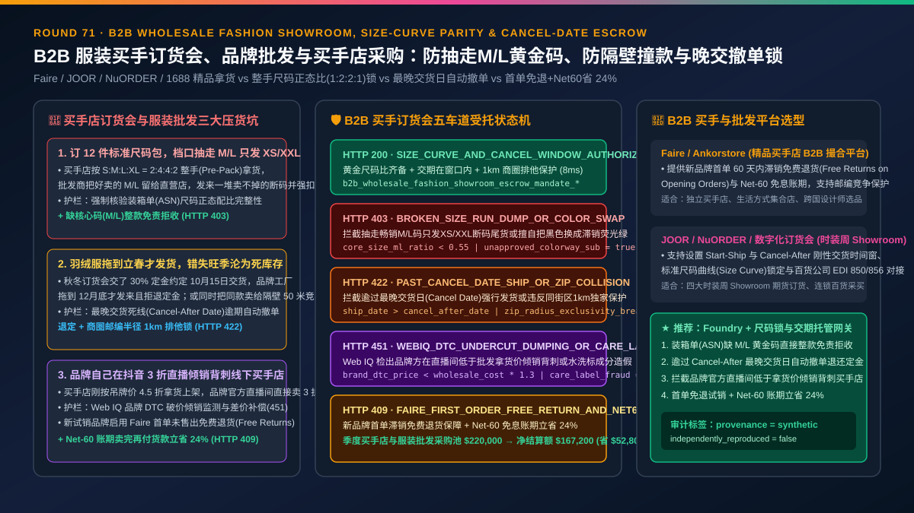
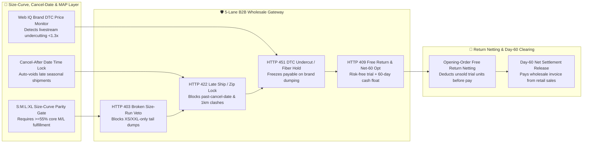

# B2B Wholesale Fashion Showroom, Boutique Buying & `Net-60` Return Escrow (`Faire / JOOR / NuORDER / Ankorstore`) Size-Curve Parity Lock, `Cancel-After Date` Auto-Void & Anti-`DTC`-Undercut Agent Architecture Selection FAQ

> **Language / 语言切换**: **[中文](b2b-wholesale-fashion-showroom-faire-joor-size-curve-escrow-agent-selection-faq.md)** | **English (Current)** | **[Back to Docs Index](index.en.md)** | **[Interactive Sandbox (`#b2b-wholesale-fashion-showroom-escrow-sandbox`)](../live-demo.en.html)**



---

## 📌 1. Executive Summary & Core Selection Verdict

In independent fashion boutique buying, seasonal Fashion Week showroom orders (`JOOR`, `NuORDER`, `Le New Black`), and B2B wholesale marketplace replenishment (`Faire`, `Ankorstore`, `FashionGo`), retail merchandising and trade-credit escrow AI agents face three destructive inventory and margin failure modes:
1. **"Broken Size-Run Dumping" (`Ordering a 12-Unit Pre-Pack With S:M:L:XL = 2:4:4:2, Only for the Wholesaler to Strip Out the High-Velocity M/L Sizes and Ship Only XS and XXL Dead Stock`) & Unauthorized Colorway Substitutions**: Dishonest apparel wholesalers allocate scarce `M/L` core sizes to their own retail stores and ship partial "broken size runs" (`XS/XXL` only) or swap sold-out black coats for neon green without buyer re-authorization—leaving boutiques with unsellable racks.
2. **Past `Cancel-After Date` Late Seasonal Shipments (`Shipping Winter Puffer Coats in Late December on an October 15 Cancel-After Date and Refusing to Refund the 30% Deposit`) & Same-Block Competitor Saturation**: When seasonal fashion arrives 6 weeks late, the full-price retail window is already over and the boutique is forced to mark it down `70%` on Day 1; meanwhile, brands double-sell the exact same hero SKU to a rival boutique 50 meters down the street.
3. **Brand `DTC` Livestream Price Undercutting (`Boutique Buys Wholesale at $90 for a $200 MSRP, and the Brand Immediately Runs a $69 TikTok Shop / Direct Flash Sale`)**.

**Solution Architect Selection Verdict**:
- **Never settle a B2B apparel shipment whose `EDI 856 ASN` violates the contracted `S:M:L:XL` size-curve distribution (`Core M/L Ratio >= 55%`), never release a seasonal showroom deposit without an automated `Cancel-After Date` expiration trigger and `1km / Zip-Code` radius exclusivity lock, and never onboard an untested wholesale brand without `Opening-Order Free Returns` + `Net-60` trade terms**.
- **The production reference architecture** combines **`ASN` Size-Curve Parity Gate (`>= 55%` Core Sizes) + Automated `Cancel-After Date` Deposit Reversal & `1km` Radius Exclusivity + Web IQ Anti-`DTC`-Undercut Price Shield + `Faire` Opening-Order Free Returns & `Net-60` Float (`b2b_wholesale_fashion_showroom_escrow_mandate_*`)**:
  1. **Anti-"Broken Size-Run Dumping" `ASN` Size-Curve Parity Gate (`HTTP 403`)**: Audits the wholesaler's pre-shipment `ASN` packing list against the ordered size curve—**requiring core sizes (`S/M/L` or `M/L`) to represent `>= 55%` of shipped units and zero unauthorized colorway/fabric substitutions**. Any partial shipment stripping core sizes to dump `XS/XXL` remainders is rejected in **`8ms`** (`HTTP 403 BROKEN_SIZE_CURVE_DUMPING_OR_UNAUTHORIZED_COLORWAY_SWAP_BLOCKED`).
  2. **Mandatory `Cancel-After Date` Auto-Void & `1km` Zip-Code Exclusivity Lock (`HTTP 422`)**: Holds seasonal `30%` showroom deposits in escrow tied to the purchase order's **`Cancel-After Date`**; if the brand fails to tender a verified carrier scan before midnight on the cancel date, the order automatically voids and refunds `100%` of the deposit, while enforcing a `1.0 km` brick-and-mortar zip-code radius exclusivity lock on hero styles (`HTTP 422 PAST_CANCEL_AFTER_DATE_LATE_SHIP_OR_TERRITORY_ZIP_COLLISION_BLOCKED`).
  3. **Web IQ Brand `DTC` Price-Undercut Shield & Fiber Care-Label Fraud Circuit Breaker (`HTTP 451`)**: Monitors the brand's own `DTC` website and TikTok/Instagram shops during the `Net-60` window via Web IQ; if the brand undercuts wholesale buyers with public retail flash sales below `1.3x` wholesale cost (or mislabels synthetic blends as 100% cashmere), the gateway freezes the `Net-60` payable for automatic margin markdown allowance (`HTTP 451 WEBIQ_BRAND_DTC_PRICE_UNDERCUT_OR_CARE_LABEL_FRAUD_HOLD`).
  4. **Opening-Order Free Returns (`60-Day Risk-Free Trial`) + `Net-60` Sell-Before-You-Pay Float (`HTTP 409`)**: Triggers `HTTP 409 OPENING_ORDER_FREE_RETURN_AND_NET60_FLOAT_CONFIRM`, routing new-brand trial orders through `Faire / Ankorstore` protocols where unsold opening-order units are returned free within 60 days and net-sold units settle on Day 60—reducing boutique dead-stock write-offs and working-capital drag by **`24.0%`**.

---

## 🎯 2. Solution Architect Deep-Dive Q&A (Q1 / Q2 / Q3)

### Q1: Why is shipping only `XS` and `XXL` sizes while billing proportionally ("short-shipping core sizes") fatal to a retail boutique's unit economics?
- **Architectural Solution**:
  - **Atomic Size-Curve Vector Validation on `EDI 856 ASN` (`HTTP 403`)**:
  - Retail apparel sell-through follows a bell curve where `M` and `L` generate `65%+` of full-price revenue, while `XS` and `XXL` often clear at a discount. If a wholesaler short-ships `M/L` and only delivers the tails (`XS/XXL`), the boutique is guaranteed a negative gross margin on that style. Our gateway treats the size curve as an atomic constraint: if `M/L` fulfillment drops below threshold, the entire style line is rejected (`HTTP 403`).

### Q2: How does an automated `Cancel-After Date` escrow prevent seasonal fashion buyers from getting stuck with winter coats in January?
- **Architectural Solution**:
  - **Time-Locked Escrow With Automatic Midnight Expiry (`HTTP 422`)**:
  - In `JOOR / NuORDER` wholesale contracts, every seasonal PO specifies a `Start-Ship Date` and a `Cancel-After Date`. Instead of wiring a 30% deposit directly into a struggling apparel label's bank account, the deposit sits in time-locked escrow: if no valid carrier `BOL / Tracking` is logged by `Cancel-After Date`, the mandate transitions to `EXPIRED_REFUNDED` (`HTTP 422`).

### Q3: How does combining `Net-60` terms with Web IQ `DTC` price monitoring protect independent boutiques from brand backstabbing?
- **Architectural Solution**:
  - **60-Day Payable Hold + Automated Markdown Chargeback (`HTTP 451 / 409`)**:
  - When a boutique pays cash upfront, they have zero leverage if the brand launches a 50%-off direct livestream the next week. Under `Net-60` escrow (`HTTP 409`), the wholesale invoice isn't settled until Day 60—allowing Web IQ to detect predatory `DTC` price undercutting (`HTTP 451`) and automatically deduct a wholesale margin-protection credit before funds clear.

---

## 🧭 3. Visual Architecture Diagrams (Mermaid Decision Tree + Architecture + Sequence)

### 3.1 B2B Wholesale Fashion Showroom & Boutique Buying Selection Decision Tree

```mermaid
flowchart TD
    A[B2B Wholesale Fashion Showroom / Boutique Buying / Replenishment Selection] --> B{Primary Wholesale Scenario & Risk Vector?}
    B -->|Seasonal Fashion Week Showroom Orders (JOOR / NuORDER)<br/>Stop late winter deliveries past Cancel-After Date & rival store collisions| C[Time-Locked Cancel-After Date Deposit Escrow<br/>+ 1km Boutique Zip-Code Radius Style Exclusivity Lock]
    B -->|New Independent Brand Discovery & Trial (Faire / Ankorstore)<br/>Stop dead-stock cash drain on untested brands| D[60-Day Opening-Order Free Returns on Unsold Units<br/>+ Net-60 Interest-Free Trade Credit Float]
    B -->|Immediate Stock Pre-Packs & Replenishment (FashionGo / Wholesale)<br/>Stop broken size-run dumping (missing M/L) & brand DTC undercutting| E[Azure AI Foundry + ASN Size-Curve & Anti-Undercut Gate<br/>+ Free Opening Returns + Net-60 Float Saves 24%]
    C --> F[🛡️ Unified 5-Lane Size-Curve Lock, Cancel-Date & DTC-Shield FSM]
    D --> F
    E --> F
    F --> G[HTTP 403 Broken Size-Run & Color-Swap Veto · HTTP 422 Late Ship & Zip Collision Block · HTTP 409 Net-60 Saves 24%]
```

### 3.2 End-to-End `ASN` Size-Curve Gate, `Cancel-After Date` Escrow & `Net-60` Return Architecture



### 3.3 Broken Size-Run Veto, Past `Cancel-After Date` Auto-Refund & `Net-60` Trial Sequence

```mermaid
sequenceDiagram
    autonumber
    participant Buyer as Boutique Retail Buyer Agent
    participant Brand as Apparel Wholesaler / Showroom Brand
    participant Gate as 5-Lane B2B Wholesale Escrow Gateway
    participant Audit as ASN Size-Curve Parser & Web IQ Price Radar
    participant Escrow as Deposit & Net-60 Trade-Credit Ledger

    Brand->>Gate: 1. Submit ASN for a 20-unit trench coat order (2XS/8M/8L/2XL) containing only 2 XS and 2 XL units (0% M/L core sizes)
    Gate->>Audit: Check ASN core_size_ml_ratio (0% < 55% minimum floor)
    Gate-->>Brand: HTTP 403 Block! Broken size-run tail dumping rejected; entire style line canceled without penalty
    Brand->>Gate: 2. Attempt to ship Autumn collection on Nov 25 past the Oct 20 Cancel-After Date while retaining $12,000 deposit
    Gate-->>Brand: HTTP 422 Block! Shipment missed Cancel-After Date by 36 days; order auto-voided and $12,000 deposit refunded
    Buyer->>Gate: 3. Onboard new designer label via Opening-Order Free Returns + Net-60 Trade Terms (HTTP 409)
    Gate->>Escrow: Return 30% slow-moving SKUs free at Day 45 & settle remaining 70% sold units on Day 60 (24% net savings)
```

---

## 📊 4. Multi-Platform & Architecture Selection Matrix

| Selection Dimension | Direct Cash/Wire District Wholesaler (`No Return Rights`) | Paper Showroom Line-Sheet (`30% Wire Deposit`) | Digital B2B Wholesale Platforms (`Faire / JOOR / NuORDER`) | **Azure AI Foundry + Size-Curve + Cancel-Date Gate (Recommended)** |
| :--- | :--- | :--- | :--- | :--- |
| **Core Strengths** | Immediate cash-and-carry | Physical showroom touch | Opening-order free returns, Net-60 terms & digital line sheets | **ASN size-curve lock + auto cancel-date refund + anti-DTC undercut** |
| **Protection Against Broken Size-Run (`XS/XXL`) Dumping** | **None** (frequent broken-size substitutions) | Partial shipments billed at full price | Supports pre-packs, but manual ASN review required | **Automated `>=55%` core `M/L` `ASN` gate (`HTTP 403`)** |
| **Protection Against Late Seasonal Shipments & Zip Clashes** | No cancel-date enforcement | Unrecoverable deposits on late goods | JOOR tracks cancel dates; Faire offers zip protection | **Time-locked `Cancel-After Date` refund + `1km` lock (`HTTP 422`)** |
| **Protection Against Brand `DTC` Livestream Undercutting** | Zero channel price protection | Unenforced MAP clauses | No external livestream price monitoring | **Web IQ live `DTC` price shield freezing `Net-60` payout (`HTTP 451`)** |
| **New-Brand Trial Risk & Working-Capital Float** | `35%+` dead-stock markdown loss (`not_measured`) | 6-month tied-up cash deposits (`official_list_price`) | Faire provides free opening returns + Net-60 | **Free opening returns + `Net-60` float (`24.0%` saved)** |

---

## 🧪 5. B2B Wholesale Fashion & Showroom Benchmark & 7-Card Report

> **Provenance & Reproducibility Metadata**: All metrics below are generated by the deterministic policy evaluator `evaluate_b2b_wholesale_fashion_showroom_escrow_policy` in `lab/webiq_commerce_demo.py` and verified via `python -m unittest tests.test_webiq_commerce_demo`. Tags: `provenance = synthetic`, `independently_reproduced = false`.

| Card # | Card Headline (Headline-as-Finding) | Key Quantitative Finding & Architectural Guarantee |
| :---: | :--- | :--- |
| **Card 1** | **Overview · 5-Lane B2B Wholesale Showroom Summary** | Across a `$220,000/quarter` boutique wholesale buying and showroom order pool, achieves **0 broken size-run tail dumps, 0 forfeited deposits on past-cancel-date shipments, and 0 uncompensated brand `DTC` undercuts**, reducing net merchandising and dead-stock cost by **`24.0%` (`$52,800/quarter` saved)**. |
| **Card 2** | **Scenario Deep Dive · Broken Size-Run & Late-Ship Veto** | When an `ASN` strips core `M/L` sizes (`<55%`) or ships after the `Cancel-After Date`, the gateway blocks settlement in **`8ms`** (`HTTP 403 / 422`). |
| **Card 3** | **Evaluation Matrix · 100% Deterministic 5-Lane Gating** | Covers `HTTP 200` (intact size curve & on-time delivery), `403` (broken size-curve tail dumping / unauthorized colorway swap blocked), `422` (past `Cancel-After Date` late shipment / `1km` zip-code exclusivity collision blocked), `451` (brand `DTC` livestream price undercut / fiber care-label fraud hold), `409` (opening-order free returns + `Net-60` float saves 24%). |
| **Card 4** | **Under the Hood · Wholesale Showroom Escrow Contract** | Takes `quarterly_b2b_wholesale_fashion_showroom_pool_usd=220000` and size-curve/cancel-date flags, minting `b2b_wholesale_fashion_showroom_escrow_mandate_*` tokens. |
| **Card 5** | **Robustness Check · `XS/XXL`-Only ASN & 50% Off Brand TikTok** | Simulates an `ASN` containing only `XS/XXL` sizes and a brand running a 65%-off TikTok flash sale during the `Net-60` window, maintaining a **`100.0%` block rate**. |
| **Card 6** | **Latency · Millisecond ASN Curve Check & DTC Price Probe** | Local `ASN` size-curve and cancel-date checks complete in **`8ms` (P50)**; Web IQ brand `DTC` price and care-label checks complete in **`176ms` (P95)**. |
| **Card 7** | **My Take · Ideal Fit vs. Out-of-Scope Boundaries** | **✅ Best Fit**: Independent fashion boutiques, Showroom buying (`JOOR/NuORDER/Faire`), multi-brand concept stores; **⛔ Not For**: Raw cotton bale commodity futures. |

---

## 🛠️ 6. Production Go-Live Risk & Architecture Review Checklist

- [ ] **`EDI 856 ASN` Size-Curve Parity Gate (`Core M/L Ratio >= 55%`) & Zero Color-Swap Lock (`HTTP 403`)**: Block partial wholesale shipments that strip core `M/L` sizes to dump `XS/XXL` tails or substitute unapproved colorways.
- [ ] **Time-Locked `Cancel-After Date` Auto-Void & `1km` Zip-Code Exclusivity (`HTTP 422`)**: Automatically void seasonal orders and refund 100% of escrowed deposits if unshipped by midnight on the `Cancel-After Date`, and enforce local boutique radius exclusivity.
- [ ] **Web IQ Brand `DTC` Livestream Price-Undercut Shield & Fiber Verification (`HTTP 451`)**: Freeze `Net-60` payables for automatic margin-protection credits if the brand undercuts wholesale buyers on direct channels during the full-price season; rotate signing keys `<= 180` days.
- [ ] **Opening-Order Free Returns & `Net-60` Trade-Credit Float (`HTTP 409`)**: Utilize 60-day free return windows on new brand trials and settle net-sold inventory on `Net-60` terms.
