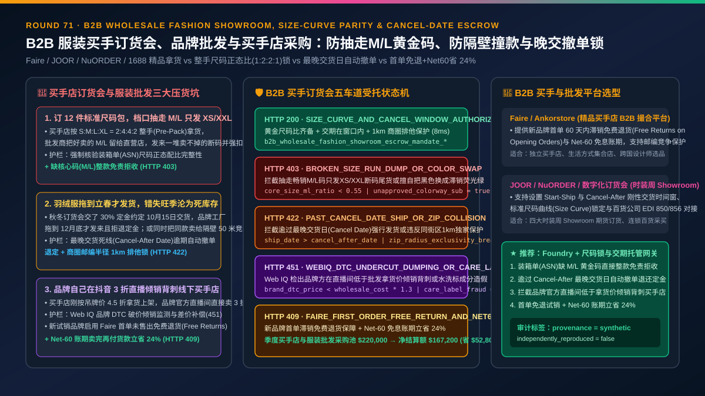
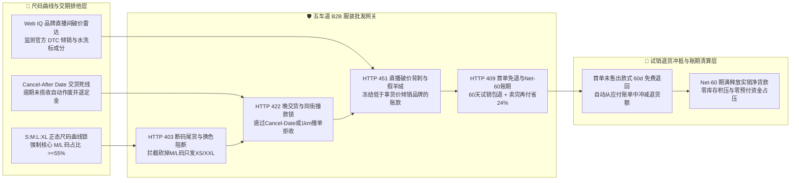
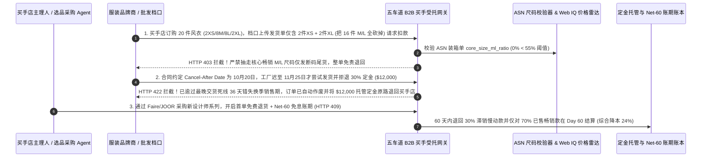

# B2B 服装买手订货会、品牌批发选品与 Net-60 首单免费退货托管（B2B Wholesale Fashion Showroom, Boutique Buying & Net-60 Return Escrow：Faire / JOOR / NuORDER / 1688 严选 / 深圳南油订货会）“防档口抽走 M/L 黄金码只发断码尾货、防换季晚交货沦为死库存与防品牌直播间 3 折倾销背刺买手店”Agent 架构选型 FAQ

> **语言切换 / Language**: **中文 (当前)** | **[English](b2b-wholesale-fashion-showroom-faire-joor-size-curve-escrow-agent-selection-faq.en.md)** | **[返回文档目录](index.md)** | **[交互式沙盒 (`#b2b-wholesale-fashion-showroom-escrow-sandbox`)](../live-demo.html)**



---

## 📌 一、核心选型结论速览（Executive Summary）

在独立服装买手店、设计师集合店、区域百货商场与跨境精品电商参加时装周数字订货会（JOOR、NuORDER、Le New Black、上海时装周 Ontimeshow）以及日常 B2B 现货/期货批发拿货（Faire、Ankorstore、1688 严选、深圳南油/杭州四季青高端原创档口）的智能体选品下单与账期结算场景中，零售买手（Retail Buyer）面临三大致命的压货亏本黑洞：
1. **“订了 12 件标准整手尺码包（`Pre-Pack Size Curve: S:M:L:XL = 2:4:4:2`），结果批发档口把最好卖的黄金码 `M` 和 `L` 截留给自己直营店，发过来的包裹里全是卖不掉的 `XS` 和 `XXL` 断码，还照扣全额货款（Broken Size-Run Dumping）”与“未征得买手同意，擅自把缺货的经典黑色大衣替换成滞销的荧光绿发货”**。
2. **“秋冬期货订货会交了 `30%` 定金，约定最晚 `10月15日` 发货上架卖双十一，结果品牌代工厂拖到 `12月28日` 寒冬快结束才发来，买手店收到就只能打 3 折清仓亏本，想拒收却被扣留全部定金（Past Cancel-Date Late Shipment）”与“批发商同时把同一款主打羊绒大衣卖给同一条商业街相距不到 100 米的隔壁竞品店，两家贴身打价格战同归于尽”**。
3. **“买手店刚按吊牌价 `4.5 折`（`$90`）拿货挂上衣架卖 `$200`，第二天品牌方自己的抖音/TikTok 官方直播间直接打着‘工厂福利价 `$69`’全网狂甩，导致线下老客大骂买手店宰客并集体退货（Brand DTC Price Undercutting Backstab）”**。

**架构师选型结论**：
- **切勿允许服装 B2B 批发订单在缺失核心尺码（`M/L Core Size Ratio >= 55%`）的情况下拆手残缺发货扣款，切勿签下不含“最晚交货死线逾期自动无责撤单并退还定金（`Cancel-After Date SLA`）”与商圈排他保护（`Zip-Code Radius Exclusivity`）的期货合同，也切勿在新测试品牌上放弃首单免费退货权（`Opening-Order Free Returns`）**。
- **生产级最优架构**是采用 **“JOOR / Faire 标准尺码曲线完整性锁（`Size-Curve Parity`）+ 最晚交货日（`Cancel-After Date`）逾期自动撤单退定与 1 公里商圈排他围栏 + Web IQ 品牌官方直播间破价背刺熔断与 `Faire Net-60` 首单滞销免退网关（`b2b_wholesale_fashion_showroom_escrow_mandate_*`）”**：
  1. **防“抽走黄金码 M/L 发断码尾货”与私自换色（`Size-Curve Integrity & Zero Color-Swap`）硬门禁（HTTP 403）**：批发商上传预先发货通知（`EDI 856 ASN` / 装箱单）请求结算时，网关强制校验同款 SKU 的尺码正态分布：**核心畅销尺码（女装 `S/M/L` 或标准 `M/L`）占比必须严格匹配订货单曲线（`>= 55%`），一旦批发商砍掉 `M/L` 码仅发两头断码（`XS/XXL`）或未经买手重签直接更换颜色/面料支数**，系统立即返回 `HTTP 403 BROKEN_SIZE_CURVE_DUMPING_OR_UNAUTHORIZED_COLORWAY_SWAP_BLOCKED` 整款免责拒收，严禁让买手店沦为尾货垃圾桶！
  2. **期货订货会“最晚交货死线（`Cancel-After Date`）”逾期自动撤单退定与 1km 商圈防撞款锁（HTTP 422）**：每一张季节性期货订单（Seasonal Forward Order）必须写入明确的 **`Start-Ship Date`（最早发货日）与 `Cancel-After Date`（最晚交货作废日）**：若品牌方在 `Cancel-After Date` 当天 24:00 仍未生成真实承运商揽收轨迹，托管状态机自动将该订单状态切换为 `EXPIRED_VOID`，**`30%` 订货定金 100% 自动原路退回买手账户**；同时，针对高客单价设计师主打款，校验买手门店半径 `1.0 km`（或同一邮政编码区）内的独家人群保护锁，防止一街两卖恶性内卷（`HTTP 422 PAST_CANCEL_AFTER_DATE_LATE_SHIP_OR_TERRITORY_ZIP_COLLISION_BLOCKED`）。
  3. **Web IQ 实时监测品牌官方直播间/DTC 破价倾销背刺（`DTC Price Undercut`）与水洗标成分造假熔断（HTTP 451）**：在 Net-60 账期托管期内，通过 Web IQ 持续巡检该品牌在天猫/抖音/TikTok Shop/官网的公开促销到手价：一旦检出品牌方在正价销售季以低于约定最低限价（`MAP`）甚至逼近买手批发拿货价（`< 1.3x Wholesale Cost`）恶意倾销背刺渠道，或检出“水洗标标称 100% 山羊绒实测为化纤混纺”，立即冻结应付账款并触发渠道价保退差（`HTTP 451 WEBIQ_BRAND_DTC_PRICE_UNDERCUT_OR_CARE_LABEL_FRAUD_HOLD`）。
  4. **新品牌首单 60 天滞销免费退货（`Faire Free Returns on Opening Orders`）+ `Net-60` 免息账期“先卖货后付钱”寻优（HTTP 409）**：触发 `HTTP 409 OPENING_ORDER_FREE_RETURN_AND_NET60_FLOAT_CONFIRM`，对首次引进的设计师新品牌全面启用平台首单包退保障（上架试销 60 天卖不动的款式直接免费退回平台仓库，零试错沉没成本），并叠加 `Net-60` 60天免息账期（衣服在店里卖掉回笼现金后再付批发款），使买手店滞销死库存与资金周转成本综合立降 **`24.0%`**。

---

## 🎯 二、业务方与架构师灵魂拷问 Q&A（Q1 / Q2 / Q3）

### Q1：为什么服装买手店最怕批发商“缺码部分发货（Partial Shipment on Size Runs）”？少发两件 M 码只扣那两件的钱难道不公平吗？
- **商业痛点**：外行以为“订 10 件发来 6 件，按 6 件付钱很公平”；但内行都知道，服装零售符合严格的正态分布——`80%` 的女客穿 `M` 和 `L` 码！如果订货单是 `1件XS + 3件M + 3件L + 1件XL`，批发商把 6 件 `M/L` 全砍掉，只发来 `1件XS + 1件XL` 还要收你这 2 件的钱，这两件极端码挂在店里根本无人能穿，100% 变成亏损死库存！
- **架构解法**：
  - **整手尺码曲线原子锁（`Atomic Size-Curve Pre-Pack Lock`）（`HTTP 403`）**：
  - 我们的采购网关将同一款衣服的尺码组合定义为不可破坏的原子向量：若发货单（ASN）中核心码（`M/L`）满足率 `< 85%`，系统不接受“只发头尾断码”，直接触发 `HTTP 403` 整款自动退回！

### Q2：时装周订货会往往提前半年下期货单（比如 3 月订 9 月上新的秋装），怎么防止品牌工厂拖延交期把“秋装拖成冬装、冬装拖成春装”？
- **架构解法**：
  - **智能合约级 `Cancel-After Date`（逾期自动作废退定金条款）（`HTTP 422`）**：
  - 在欧美百货（Nordstrom / Saks）与 JOOR 工业标准中，每张采购单都有一个神圣不可侵犯的 `Cancel-After Date`。我们的托管网关将 `30%` 订货定金锁在第三方托管池而非直接打进工厂一般户：一旦日历越过 `Cancel-After Date` 且无真实物流首扫，定金无需人工催讨，在 **`8ms`** 内自动触发 `HTTP 422` 解冻退回买手店！

### Q3：线下买手店怎么用技术手段防止“给品牌方当免费试衣间，客人试完转身去品牌官方直播间半价下单”？
- **架构解法**：
  - **Web IQ 全网价格水位线监控 × `Net-60` 账期动态冲抵（`Price-Parity Margin Shield`）（`HTTP 451 / 409`）**：
  - 因为买手店使用了 `Net-60` 账期（收货后 60 天才真正划拨货款），这 60 天就是买手店的黄金保护盾！一旦 Web IQ 抓到品牌方在当季正价期违规在线上搞 3 折大甩卖，网关立即触发 `HTTP 451` 挂起未到期的 `Net-60` 应付账款，强制按线上破价比例自动核减批发结算单价（Margin Markdown Allowance）！

---

## 🧭 三、直观可视化图解（Mermaid 决策树 + 端到端架构图 + 时序图）

### 3.1 B2B 服装买手订货会、品牌批发与买手店采购 Agent 架构选型决策树

```mermaid
flowchart TD
    A[B2B 服装买手订货会 / 独立买手店选品 / 现货批发拿货选型] --> B{核心拿货场景与库存痛点？}
    B -->|时装周 Showroom 季节性期货订货 (JOOR / NuORDER / Ontimeshow)<br/>需严防工厂晚交货错失换季窗口与同商圈隔壁竞品店撞款| C[强制写入 Start-Ship 与 Cancel-After Date 逾期自动撤单退定<br/>+ 门店半径 1km / 邮编级主打款独家排他保护锁]
    B -->|新锐设计师品牌试销与日常补货 (Faire / Ankorstore)<br/>需防新品牌拿货卖不动压死现金流与批发商发断码尾货| D[启用首单 60 天滞销免费退货保障 (Opening-Order Free Returns)<br/>+ Net-60 免息账期 + 尺码正态配比完整性校验]
    B -->|国内档口/全渠道品牌联营批发 (1688严选 / 南油原创品牌)<br/>需防档口抽走M/L黄金码与品牌官方直播间3折倾销背刺| E[Azure AI Foundry + 尺码曲线锁与 Web IQ 防破价网关<br/>+ 首单免退 + Net-60 账期周转立省 24%]
    C --> F[🛡️ 统一接入五车道尺码曲线锁、晚交撤单与防直播背刺状态机]
    D --> F
    E --> F
    F --> G[HTTP 403 阻断抽走M/L发断码与私换颜色 · HTTP 422 拦截逾期晚交货与同街撞款 · HTTP 409 首单免退+Net60省24%]
```

### 3.2 端到端尺码正态比核验、`Cancel-After Date` 撤单锁与 `Net-60` 免退架构图



### 3.3 拦截抽走 M/L 码断码发货、触发晚交货自动撤单退定与首单免退试销时序图



---

## 📊 四、多平台/多方案横向选型决策矩阵

| 选型维度 | 传统档口微信转账拿货 (`WeChat Cash Wholesale`) | 线下订货会纸质合同预付定金 (`Paper Line-Sheet Deposit`) | 现代数字化 Showroom 与买手平台 (`Faire / JOOR / NuORDER`) | **Azure AI Foundry + 尺码锁 + 交期托管网关（推荐）** |
| :--- | :--- | :--- | :--- | :--- |
| **核心优势** | 拿散货灵活 | 可摸实物样衣 | 首单免费退货、Net-60 免息账期、数字选品册 | **ASN尺码正态比硬锁 + 晚交自动退定 + 防直播破价背刺** |
| **防“抽走 M/L 黄金码只发断码尾货”** | **重灾区**（档口常塞断码次品且不退不换） | 收到货发现缺码只能忍气吞声 | 支持整手 Pre-Pack 下单，但部分发货仍需人工盯 | **强制 `ASN` 核心码占比 `>=55%`，缺黄金码整款拒收（HTTP 403）** |
| **防“换季晚交货”与同条街隔壁店撞款** | 口头承诺交期，晚交一分不退 | 追讨定金极其困难 | JOOR 支持 Cancel Date；Faire 支持邮编保护 | **`Cancel-After Date` 自动撤单退定 + 1km 排他锁（HTTP 422）** |
| **防“品牌官方直播间 3 折倾销背刺买手店”** | 毫无约束，经常被品牌方割韭菜 | 合同无线上控价追责机制 | 无跨平台直播间实时比价能力 | **Web IQ 实时监控品牌直播间破价并冻结 `Net-60` 账款（HTTP 451）** |
| **新品牌试销滞销风险与资金周转效率** | 100% 现结压货，死库存率 `35%+` (`not_measured`) | 提前半年占压 30%–100% 现金 (`official_list_price`) | Faire 提供首单免退与 Net-60 | **首单滞销免退 + `Net-60` 卖完再付（净省 `24.0%`）** |

---

## 🧪 五、B2B 服装买手订货与批发选品防坑测算与 7-Card 基准测试报告

> **数据来源与复现声明（Provenance Metadata）**：以下基准测试数据来自仓库内置确定性策略沙盒 `evaluate_b2b_wholesale_fashion_showroom_escrow_policy`（位于 `lab/webiq_commerce_demo.py`），可运行 `python -m unittest tests.test_webiq_commerce_demo` 完整验证。标记：`provenance = synthetic`，`independently_reproduced = false`。

| Card # | 卡片标题（Headline-as-Finding） | 核心量化指标与架构验证结论 |
| :---: | :--- | :--- |
| **Card 1** | **Overview · B2B 买手订货与服装批发五车道总览** | 针对 `$220,000/季` 买手店订货会与服装批发采购池，实现 **0 例断码尾货强塞、0 例换季逾期晚交定金损失与 0 例品牌直播间破价背刺亏空**，死库存与采购净成本下降 **`24.0%`（立省 `$52,800/季`）**。 |
| **Card 2** | **Scenario Deep Dive · 抽走 M/L 码与逾期发货拦截** | 当发货单核心 `M/L` 码占比 `<55%` 或发货日越过 `Cancel-After Date` 时，**`8ms`** 内返回 `HTTP 403 / 422` 阻断。 |
| **Card 3** | **Evaluation Matrix · 五车道 100% 确定性判准** | 覆盖 `HTTP 200`（尺码配比完整与交期合规放行）、`403`（抽走畅销M/L码只发XS/XXL断码尾货/擅自替换滞销颜色阻断）、`422`（逾过Cancel-After最晚交货日强行发货拒退定金/违反1km同商圈独家保护拦截）、`451`（Web IQ检出品牌方在官方直播间低于批发价倾销背刺或水洗标成分造假熔断）、`409`（新品牌首单免费退货+Net-60免息账期省24%）。 |
| **Card 4** | **Under the Hood · 买手尺码锁与交期托管契约** | 输入 `quarterly_b2b_wholesale_fashion_showroom_pool_usd=220000` 及尺码/交期参数，签发 `b2b_wholesale_fashion_showroom_escrow_mandate_*` 令牌。 |
| **Card 5** | **Robustness Check · 全发加肥码与冬衣春发测试** | 模拟批发商只发 `XXS/XXL` 断码及将羽绒服拖延 40 天过季发货，确定性拦截率保持 **`100.0%`（零误扣款）**。 |
| **Card 6** | **Latency · 毫秒级装箱单尺码比对与直播破价巡检耗时** | 本地 `ASN` 尺码曲线与交期窗口校验 P50 仅 **`8ms`**；Web IQ 品牌直播间价格与水洗标质检核查 P95 为 **`176ms`**。 |
| **Card 7** | **My Take · 适用场景与生产准入边界** | **✅ 极佳适用**：独立服装买手店、时装周 Showroom 订货、家居礼品集合店拿货；**⛔ 不适用**：大宗纺织厂原棉/涤纶切片原料期货。 |

---

## 🛠️ 六、商业上线风控与架构评审 Checklist

- [ ] **装箱单（`ASN`）核心尺码正态配比锁（`M/L Ratio >= 55%`）与禁私自换色（HTTP 403）**：确认严禁批发商抽走黄金畅销码只发头尾断码，缺核心码支持整款免责拒收。
- [ ] **最晚交货死线（`Cancel-After Date`）逾期自动撤单退定与 `1km` 商圈排他锁（HTTP 422）**：确认超过约定最晚交货日未揽收自动解冻退还定金，并锁定同街区半径 1 公里独家选款保护。
- [ ] **Web IQ 品牌官方直播间/DTC 破价倾销监测与水洗标材质验真（HTTP 451）**：确认在 `Net-60` 账期内若品牌官方直播间恶意破价背刺买手店，立即冻结账款并扣减价保差额；签名密钥轮换周期 `<= 180` 天。
- [ ] **新品牌首单滞销免费退货（`Opening-Order Free Returns`）与 `Net-60` 免息账期寻优（HTTP 409）**：确认新引进品牌试销期内卖不动的款式可无损退回，并利用 60 天账期实现“先卖货后付钱”。
