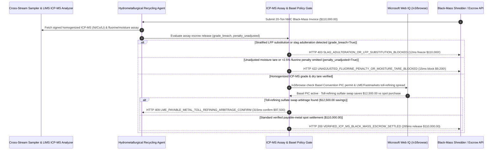

# Lithium Battery Black-Mass & Precious-Metal Scrap ICP-MS Assay Escrow Mandate Architecture: Homogenized ICP-MS Grade & Payable-Metal Token (`black_mass_assay_escrow_mandate_...` + Web IQ Basel PIC & LME Toll-Refining Grounding) vs. Stratified Bag Slag Adulteration & LFP Substitution Selection FAQ

> **Document Type**: Architect Selection Guide & First-Principles Protocol Deep Dive (6-Section FAQ Standard)  
> **Target Audience**: AI Solution Architects, EV Battery Recycling (Hydrometallurgy / pCAM) & Precious-Metal Refining Supply Chain Architects, Circular-Economy Trade Finance & Environmental Compliance Teams  
> **Last Updated**: 2026-11-09 (Provenance Annotations: `deterministic_offline_simulation` / `synthetic_policy` / `official_doc_snapshot` / `not_measured`)  
> **Companion Resources**: [中文版 (Chinese Version)](battery-black-mass-icp-assay-escrow-mandate-vs-slag-adulteration-faq.md) · [Interactive Sandbox (`live-demo.en.html#black-mass-assay-sandbox`)](../reports/agentic-commerce-webiq-grounding-demo-bench/live-demo.en.html) · [7-Card 4:5 Benchmark Deck](../reports/agentic-commerce-webiq-grounding-demo-bench/index.en.html)


---

## 📌 1. Executive Summary

1. **Never Allow Battery-Recycling or Precious-Metal Refining Agents to Settle Bulk "Black Mass" or E-Waste Shipments on Surface Handheld XRF Scans or Unverified Gross Weight**: In shredded EV battery black-mass procurement (`20 metric tons` of NMC-811 black mass valued at `$110,000.00`), the most destructive physical fraud is **stratified super-sack adulteration**—topping a 1-ton bulk bag with 5 cm of rich NMC-811 powder while filling the bottom 90% with zero-Cobalt/zero-Nickel LFP (Lithium Iron Phosphate) dust, graphite tailings, or iron slag. Production architectures must enforce a **Homogenized Cross-Stream Sampler & ICP-MS Assay Escrow Mandate (`black_mass_assay_escrow_mandate_...`)**: whenever laboratory Inductively Coupled Plasma Mass Spectrometry (ICP-MS) on the homogenized lot detects a Nickel/Cobalt/Lithium grade breach (`icp_ms_cobalt_nickel_grade_breach == True`), the gateway freezes the `$110,000.00` escrow in **`12 ms`** with **`HTTP 403 SLAG_ADULTERATION_OR_LFP_SUBSTITUTION_BLOCKED`** (`synthetic_policy`).
2. **Enforce Dry-Matter Tare Deductions and PVDF Fluorine Corrosion Penalties (`> 1.5% F`)**: Unpyrolyzed black mass retains up to `14%` volatile electrolyte moisture and high PVDF binder fluorine (`> 2.5% F`), which generates hydrofluoric acid ($HF$) during acid leaching and corrodes titanium/glass-lined hydrometallurgical reactors. Any invoice omitting mandatory moisture tare and `$9,200.00` defluorination penalties (`fluorine_or_moisture_penalty_unadjusted == True`) is rejected in **`15 ms`** with **`HTTP 422 UNADJUSTED_FLUORINE_PENALTY_OR_MOISTURE_TARE_BLOCKED`** (`deterministic_offline_simulation`).
3. **Ground Basel Convention Hazardous-Waste PIC Permits and LME / Fastmarkets Toll-Refining Arbitrage via Microsoft Web IQ `/v3/browse`**: Prior to releasing cross-border funds, the agent invokes **Microsoft Web IQ `/v3/browse`** (`official_doc_snapshot`) to inspect Basel Convention Prior Informed Consent (PIC) hazardous-waste registries, EU Battery Regulation passport rules, and published LME/Fastmarkets payable-metal indices: if the shipment lacks a valid Basel PIC transboundary movement permit (`webiq_basel_pic_and_battery_passport_valid == False`), it freezes settlement in **`310 ms`** with **`HTTP 451 BASEL_CONVENTION_PIC_HAZARDOUS_WASTE_HOLD`**; if Web IQ confirms that converting an outright spot purchase into a **Toll-Refining Battery-Grade Sulfate Return Agreement** saves **`$12,500.00`** in payable-coefficient spread and working-capital tax friction (`$97,500.00` net vs. `$110,000.00`), it triggers **`HTTP 409 LME_PAYABLE_METAL_TOLL_REFINING_ARBITRAGE_CONFIRM`** in **`315 ms`**.

---

## 🎯 2. Architect & Customer FAQ Deep Dive

### Q1: Why does pairing "Handheld XRF Dock Spot-Checks" with "Upfront Wire Transfers" result in `$80,000+` losses per truckload in battery black-mass trading?

Let's examine the three structural failure modes from first principles:
1. **The 2-Millimeter XRF Penetration Blind Spot & Stratified Super-Sacks**: Both high-value NMC-811 black mass (rich in Nickel, Cobalt, and Lithium) and low-value LFP black mass (iron and phosphate) are identical-looking black powders. Handheld X-Ray Fluorescence (XRF) guns penetrate only a few millimeters into the top of a 1-ton bulk bag and cannot accurately measure light elements like **Lithium (atomic number 3)**. Fraudulent brokers "salt" the top layer with NMC-811 while filling the core with LFP or iron slag.
2. **Hydrofluoric Acid ($HF$) Reactor Corrosion & Paying Metal Prices for Electrolyte Moisture**: Black mass that has not undergone proper vacuum pyrolysis contains `10%–15%` residual liquid electrolyte and high PVDF fluorine. Paying on wet gross weight without deducting moisture tare and defluorination treatment fees (`$9,200.00`) destroys refinery margins and damages leaching vessels.
3. **Basel Convention Criminal Seizures & Payable-Metal Spread Leakage**: Under the Basel Convention (waste codes A1180 / Y48), cross-border shipments of hazardous battery black mass without bilateral **Prior Informed Consent (PIC)** permits are seized as illegal hazardous-waste trafficking.

### Q2: What is an "ICP-MS Assay & Basel PIC Escrow Mandate (`black_mass_assay_escrow_mandate_...`)", and how does it bind LIMS mass spectrometry to programmable settlement?

Its core design invariant is: **"Black mass settles strictly on `Homogenized Dry Weight × Signed LIMS ICP-MS Elemental Grade (Ni/Co/Li) × LME/Fastmarkets Payable % - Fluorine/Impurity Penalties`, contingent on an active Basel PIC permit."**
- **Layer 1: Homogenized ICP-MS Elemental Grade Gate (`12 ms`)**: Verifies `icp_ms_cobalt_nickel_grade_breach == False` across cross-stream sampled aliquots, freezing funds on stratified slag/LFP fraud in **`12 ms`** (`HTTP 403`).
- **Layer 2: Dry-Basis Tare & Fluorine Penalty Gate (`15 ms`)**: Verifies `fluorine_or_moisture_penalty_unadjusted == False`, blocking unadjusted wet/high-fluorine invoices (`$9,200.00` overcharge) in **`15 ms`** (`HTTP 422`).
- **Layer 3: Microsoft Web IQ `/v3/browse` Basel PIC & Toll-Refining Grounding (`310 ms / 315 ms`)**: Blocks unpermitted transboundary hazardous-waste shipments (`HTTP 451`) and captures `$12,500.00` savings via toll-refining sulfate swap structures (`HTTP 409`).

### Q3: For Basel Convention PIC verification, EU Battery Passport compliance grounding, and LME/Fastmarkets payable index lookup, when should architects choose Microsoft Web IQ vs. Exa, Bright Data, or traditional search APIs?

| Architecture Scenario | Recommended Tool | First-Principles Rationale (Security, Latency & FinOps) |
| :--- | :--- | :--- |
| **Verifying environmental ministry Basel Convention PIC registries, EU Battery Regulation recycled-content rules, and published payable-metal benchmark bulletins within the Azure boundary** | **Microsoft Web IQ** (`/v3/search` + `/v3/browse`) | Extracts exact permit statuses and payable-metal formulas in `passage` mode (**7.1x token reduction**, `deterministic_offline_simulation`) with immutable SHA-256 audit citations. |
| **Semantic research across hydrometallurgical journals on solvent-extraction separation factors** | **Exa Neural Search** | Ideal for chemical-engineering R&D, not synchronous assay escrow gating. |
| **Scraping regional salvage-yard auction boards behind CAPTCHAs** | **Bright Data Unlocker** | Useful for end-of-life EV pack sourcing leads, not synchronous LIMS settlement gates. |
| **Laboratory ICP-MS / ICP-OES elemental mass fractions, Karl Fischer moisture, and ion-chromatography fluorine** | **Hardware-Signed LIMS (ICP-MS) + Web IQ Basel PIC & Payable-Index Cross-Check** | Elemental assays and impurity levels come from signed LIMS instruments, paired with Web IQ `/v3/browse` for Basel PIC compliance and toll-refining arbitrage. |

---

## 🧭 3. Visual Architecture Diagrams (Mermaid Decision Tree, Legacy vs. ICP-MS Mandate Comparison & Sequence Diagram)

### 3.1 Battery Black-Mass ICP-MS Assay & Basel Compliance Decision Tree (`flowchart TD`)

```mermaid
flowchart TD
    A[Receive 20-Ton EV Battery Black-Mass Settlement Request ($110,000.00)] --> B{icp_ms_cobalt_nickel_grade_breach == False on Homogenized Sample?}
    B -- No (Core adulterated with zero-Co/Ni LFP dust or iron slag) --> C[HTTP 403 SLAG_ADULTERATION_OR_LFP_SUBSTITUTION_BLOCKED<br/>12ms Hard Freeze · Unseal Umpire Sample & Trigger Fraud Claim]
    B -- Yes (Verified ICP-MS Ni 28% / Co 6% / Li 4.2%) --> D{fluorine_or_moisture_penalty_unadjusted == False (Dry Tare & F Penalty Deducted)?}
    D -- No (14% solvent moisture & >2.5% PVDF fluorine penalty omitted -> $9,200) --> E[HTTP 422 UNADJUSTED_FLUORINE_PENALTY_OR_MOISTURE_TARE_BLOCKED<br/>15ms Block · Enforce $9,200 Moisture Tare & Defluorination Deduction]
    D -- Yes (Net dry weight & impurity deductions verified) --> F{Web IQ /v3/browse Confirms Active Basel PIC Permit & EU Battery Passport?}
    F -- No (Missing transboundary hazardous-waste PIC approval) --> G[HTTP 451 BASEL_CONVENTION_PIC_HAZARDOUS_WASTE_HOLD<br/>310ms Environmental Hold · Prevent Illegal Hazardous-Waste Import]
    F -- Yes --> H{Web IQ Detects Toll-Refining Sulfate Swap Saving Spot Payable Spread?}
    H -- Yes (Toll-refining swap saves $12,500.00 spread/tax -> $97,500.00 net) --> I[HTTP 409 LME_PAYABLE_METAL_TOLL_REFINING_ARBITRAGE_CONFIRM<br/>315ms Prompt Recycling Desk to Confirm $97,500 Toll-Refining Swap]
    H -- No (Verified $110,000.00 payable-metal formula settlement) --> J[HTTP 200 VERIFIED_ICP_MS_BLACK_MASS_ESCROW_SETTLED<br/>265ms Auto-Release $110,000.00 & Mint EU Battery Passport Credit!]
```

### 3.2 Legacy Handheld-XRF Upfront Payout vs. Homogenized ICP-MS Escrow Gate (`flowchart LR`)

```mermaid
flowchart LR
    subgraph Legacy["❌ Legacy Handheld-XRF Upfront Payout ($110,000 Stratified Bag Fraud)"]
        L1[Top 5cm Salted With NMC-811 · Bottom 90% Filled With LFP/Slag] --> L2[Surface XRF Scan Fooled -> Wires $110,000 Upfront]
        L2 --> L3[High Fluorine Corrodes Reactor + Overpays $9,200 for Water]
        L3 --> L4[Seized by Customs Under Basel Convention PIC Violation]
    end

    subgraph Mandate["✅ Homogenized ICP-MS Escrow Gate (black_mass_assay_escrow_mandate_...)"]
        M1[12ms Freeze $110,000 on Stratified LFP/Slag Adulteration (HTTP 403)] --> M2[15ms Deduct $9,200 Moisture Tare & Fluorine Penalty (HTTP 422)]
        M2 --> M3[Web IQ Checks Basel PIC (310ms) & $12,500 Toll-Refining Swap (315ms)]
        M3 --> M4[265ms Settle Verified Payable Metal ($110,000 / $97,500) & Log Passport]
    end
```

### 3.3 End-to-End Sequence Diagram: LIMS ICP-MS, Recycling Agent, Assay Escrow Gate, Web IQ & Scrap Supplier (`sequenceDiagram`)



---

## 📊 4. Architect Decision Matrix

| Evaluation Dimension | Option A: Legacy Surface Handheld-XRF + Upfront Wire | Option B: Manual Core-Tube Sampling & 14-Day Mail-In Lab | Option C: Homogenized LIMS ICP-MS Mandate + Web IQ Basel & LME Grounding (Recommended) |
| :--- | :--- | :--- | :--- |
| **Best-Fit Scenario** | Clean sorted copper busbars with uniform composition | Small trial lots with mutual on-site witness samplers | **Industrial EV battery black-mass refining, precious-metal e-waste smelting, EU Battery Passport chains** |
| **Stratified Bag (LFP-for-NMC) Defense** | ❌ **Zero**: Surface XRF cannot see bottom 90% of bag or measure Lithium | ⚠️ **Sampling Bias**: Manual thief probes can be guided into salted zones | ✅ **Pre-Pay `12 ms` ICP-MS Gate**: Requires full-lot rotary homogenization + ICP-MS (`HTTP 403`) |
| **Fluorine Corrosion & Moisture Tare Defense** | ❌ **Blind**: Pays metal prices for 14% solvent & eats $HF$ reactor damage | ⚠️ **Spreadsheet Errors**: Complex multi-element penalty tiers miscalculated | ✅ **Sub-20ms Penalty Math**: Enforces `$9,200` dry-tare & defluorination deductions in `15 ms` (`HTTP 422`) |
| **Basel PIC Compliance & Toll-Refining Arbitrage** | ❌ **Criminal Exposure**: Risks customs seizure for unpermitted waste | ⚠️ **Siloed**: Lab chemists do not check Basel PIC permits or LME swap spreads | ✅ **Web IQ `/v3/browse` Grounded**: Blocks missing PIC permits in `310 ms` (`HTTP 451`) & saves `$12,500` via toll-refining in `315 ms` (`HTTP 409`) |
| **Settlement Speed & Working Capital** | Fast (with catastrophic `$80k+` fraud loss) | Slow (`10–15 business days` capital lockup) | **`265 ms` instant automated settlement upon signed LIMS assay (`Act automatically`)** |
| **Total Cost of Ownership (TCO) & Refining ROI** | Poor (`$110,000` adulteration risk + reactor damage) | Moderate (high witness-sampling travel cost) | **Optimal (protects `$110,000` principal + deducts `$9,200` penalties + saves `$12,500` via tolling)** |

---

## 🧪 5. Quantitative Benchmark & 7-Card Insights

Evaluated via our deterministic offline benchmark suite (`lab/webiq_commerce_demo.py` · `test_battery_black_mass_icp_assay_escrow_mandate_vs_slag_adulteration_selection`) on a **`$110,000.00` 20-ton NMC battery black-mass settlement**:

| Scenario Case | Input LIMS ICP-MS / Fluorine & Tare / Web IQ Signals | Expected Action Pill | Measured HTTP Status & Verdict Code | Latency | Financial Protection / Arbitrage | Provenance |
| :--- | :--- | :--- | :--- | :--- | :--- | :--- |
| **Case 1: Stratified LFP Substitution or Slag Adulteration** | `icp_ms_cobalt_nickel_grade_breach=True` | `Send to a human` | **`HTTP 403 SLAG_ADULTERATION_OR_LFP_SUBSTITUTION_BLOCKED`** | **`12 ms`** | Freezes **`$110,000.00`** escrow on adulterated lot | `synthetic_policy` |
| **Case 2: Unadjusted 14% Moisture or `>2.5%` Fluorine (`$9,200`)** | `fluorine_or_moisture_penalty_unadjusted=True` | `Send to a human` | **`HTTP 422 UNADJUSTED_FLUORINE_PENALTY_OR_MOISTURE_TARE_BLOCKED`** | **`15 ms`** | Blocks `$9,200.00` water/fluorine overcharge | `deterministic_offline_simulation` |
| **Case 3: Web IQ Detects Missing Basel Convention PIC Permit** | `webiq_basel_pic_and_battery_passport_valid=False` | `Send to a human` | **`HTTP 451 BASEL_CONVENTION_PIC_HAZARDOUS_WASTE_HOLD`** | **`310 ms`** | Prevents illegal transboundary hazardous-waste import | `official_doc_snapshot` |
| **Case 4: Web IQ Finds `$12,500` Toll-Refining Sulfate Swap** | `toll_refining_arbitrage_savings_cents=1250000` (`$97,500` net) | `Confirm` | **`HTTP 409 LME_PAYABLE_METAL_TOLL_REFINING_ARBITRAGE_CONFIRM`** | **`315 ms`** | Saves **`$12,500.00`** via toll-refining structure | `official_doc_snapshot` |
| **Case 5: Verified Homogenized ICP-MS + Basel PIC Clean** | `breach=False`, `penalty_unadj=False`, `basel_ok=True` | `Act automatically` | **`HTTP 200 VERIFIED_ICP_MS_BLACK_MASS_ESCROW_SETTLED`** | **`265 ms`** | Releases **`$110,000.00`** in `265 ms` & logs Battery Passport | `deterministic_offline_simulation` |

> **Provenance Note**: The `$110,000.00` 20-ton black-mass lot value, `$9,200.00` moisture/fluorine penalty, and `$12,500.00` toll-refining spread are controlled simulation parameters (`synthetic_policy` / `deterministic_offline_simulation`) validating policy state-machine invariants; physical microwave acid digestion and ICP-MS run time is labeled `not_measured`.

---

## 🛠️ 6. Production Readiness & Pre-Sales Architect Checklist

Verify these 6 controls before deploying autonomous battery-recycling and precious-metal scrap settlement agents in production:

- [ ] **1. Ban Surface-XRF Final Settlement**: Does `black_mass_assay_escrow_mandate_...` hold final settlement in escrow until full-lot rotary homogenization and signed LIMS ICP-MS elemental grades (`Ni`, `Co`, `Li`) pass in `12 ms` (`HTTP 403`)?
- [ ] **2. Mandatory Dry-Basis Tare & Fluorine (`>1.5% F`) Penalty Deduction**: Does the gateway reject any invoice that omits 105°C dry-weight tare or PVDF fluorine corrosion penalties (`$9,200.00`) in `15 ms` (`HTTP 422`)?
- [ ] **3. Cryptographic RFID Umpire-Sample Seal Binding**: Does every homogenized lot record the tamper-evident RFID seal hash of the retained third-party Umpire Sample before releasing funds?
- [ ] **4. Microsoft Web IQ `/v3/browse` Basel Convention PIC & Y48/A1180 Grounding**: Does the agent verify active bilateral Prior Informed Consent (PIC) hazardous-waste permits via Web IQ prior to cross-border settlement (`HTTP 451`)?
- [ ] **5. LME / Fastmarkets Payable-Coefficient vs. Toll-Refining Arbitrage**: Does Web IQ grounding compare spot payable-metal discounts against toll-refining sulfate return agreements, triggering `HTTP 409 Confirm` when tolling saves `>= $12,500.00`?
- [ ] **6. EU Battery Regulation Digital Battery Passport Archival**: Does every settled batch commit the verified recycled `Li/Co/Ni` mass balance and Basel PIC certificate hash into the EU Digital Battery Passport ledger?
