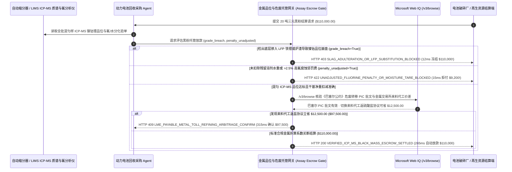

# 动力电池黑粉（Black Mass）与贵金属电子废料回收计价（Lithium Battery Black-Mass & Precious-Metal Scrap ICP-MS Assay Escrow Mandate）架构：全批混匀 ICP-MS 品位化验与金属折算系数托管令牌（`black_mass_assay_escrow_mandate_...` + Web IQ 巴塞尔危废许可与 LME 计价核验）vs 传统凭表层枪测盲付遭“阴阳吨袋”掺假选型与原理解析 FAQ

> **文档类型**：架构师选型指南 & 协议第一性原理解析（6 段式 FAQ 标准版）  
> **适用读者**：AI Solution Architect、新能源动力电池回收（湿法冶金 / 正极材料前驱体）与贵金属精炼供应链架构师、大宗再生资源贸易与环保合规风控团队  
> **更新日期**：2026-11-09（Provenance 标注：`deterministic_offline_simulation` / `synthetic_policy` / `official_doc_snapshot` / `not_measured`）  
> **配套资源**：[English Version](battery-black-mass-icp-assay-escrow-mandate-vs-slag-adulteration-faq.en.md) · [交互式沙盒控制台 (`live-demo.html#black-mass-assay-sandbox`)](../reports/agentic-commerce-webiq-grounding-demo-bench/live-demo.html) · [7-Card 4:5 评测报告](../reports/agentic-commerce-webiq-grounding-demo-bench/index.html)


---

## 📌 一、核心结论速览（Executive Summary）

1. **严禁让再生资源或电池回收采购 Agent 仅凭“吨袋表层手持式 XRF 荧光枪打点”或卖方自报品位就全额放款**：在动力电池黑粉（Black Mass，如 20 吨高镍三元 NMC-811 黑粉批次 `$110,000.00`）与含金钯电子废料（PCB）回收贸易中，最臭名昭著的骗局是 **“阴阳吨袋（Stratified Bag Adulteration）”**——不法废料商在 1 吨重的太空包顶部铺 5 厘米厚的高价值三元镍钴粉应付表面抽检，底下 90% 全部灌入几乎不含镍钴的廉价磷酸铁锂（LFP）废粉、石墨渣或铁粉！生产环境必须强制采用 **全批破碎混匀缩分 + ICP-MS（电感耦合等离子体质谱）实验室签名绑定的两阶段托管令牌（`black_mass_assay_escrow_mandate_...`）**：一旦混匀样 ICP-MS 测出镍/钴/锂真实品位跌穿合同底线（`icp_ms_cobalt_nickel_grade_breach=True`），网关在 **`12 ms`** 内触发 **`HTTP 403 SLAG_ADULTERATION_OR_LFP_SUBSTITUTION_BLOCKED`**（`synthetic_policy`），100% 冻结 `$110,000.00` 托管款。
2. **强制执行“热解干基净重折算 + 高氟/铜铝杂质惩罚扣款（Fluorine & Moisture Penalty Deduction）”**：黑粉若未彻底热解挥发，往往含有 10%～15% 的残留电解液水分，且 PVDF 粘结剂带来的高氟含量（`> 2.5%`）在酸浸时会生成剧毒氢氟酸蚀穿反应釜。若卖方账单未按干基扣水或漏扣 `$9,200.00` 除氟处理费（`fluorine_or_moisture_penalty_unadjusted=True`），网关在 **`15 ms`** 内返回 **`HTTP 422 UNADJUSTED_FLUORINE_PENALTY_OR_MOISTURE_TARE_BLOCKED`**（`deterministic_offline_simulation`）。
3. **基于 Microsoft Web IQ `/v3/browse` 实时核验《巴塞尔公约》危险废物跨境转移事先知情同意书（PIC）与 LME/Fastmarkets 来料代工精炼（Toll-Refining）套利**：在跨境锁款或清算前，Agent 调用 **Microsoft Web IQ `/v3/browse`**（`official_doc_snapshot`）穿透查询生态环境部/欧盟《巴塞尔公约》危废转移许可名录与欧盟《新电池法案（EU Battery Passport）》回收比例要求：若卖方缺失有效的危废出口 PIC 批文（`webiq_basel_pic_and_battery_passport_valid=False`），在 **`310 ms`** 内以 **`HTTP 451 BASEL_CONVENTION_PIC_HAZARDOUS_WASTE_HOLD`** 熔断（规避非法入境洋垃圾刑事责任）；若发现将高溢价“现货买断（Outright Spot Purchase）”切换为 **“来料加工返还电池级硫酸镍/碳酸锂（Toll-Refining Swap）”** 可省去双重流转税与计价折算点差 **`$12,500.00`**（净支出从 `$110,000.00` 降至 **`$97,500.00`**），则在 **`315 ms`** 内触发 **`HTTP 409 LME_PAYABLE_METAL_TOLL_REFINING_ARBITRAGE_CONFIRM`**。

---

## 🎯 二、客户与架构师灵魂拷问 Q&A（FAQ-Driven Deep Dive）

### Q1：为什么传统的“派业务员拿把便携式 XRF 枪去废料场扫一下袋子表面 + 过磅付全款”，在动力电池黑粉回收行业十买九亏？

咱们用大白话拆解电池黑粉与贵金属废料江湖里最深不见底的三个坑：
1. **“XRF 枪只能打透 2 毫米，底下 1 米全是铁渣”的阴阳袋骗局**：动力电池破碎打成黑粉后，高镍三元黑粉（NMC，含昂贵的镍、钴、锂）和磷酸铁锂黑粉（LFP，几乎只有便宜的铁和磷）肉眼看起来全是一模一样的黑色粉末，但每吨价格相差 **3 倍以上**！便携式 XRF 光谱仪的 X 射线穿透深度只有几毫米，且根本测不准原子序数极小的 **锂（Li，第 3 号元素）**。骗子在吨袋最上面撒一层高镍粉，底下全装铁锂粉和磨碎的轮胎橡胶粉，业务员一枪打在袋口显示“含镍 28%”，Agent 当场把 `$110,000.00` 全款打过去；等拉回工厂倒进回转窑混匀一化验，含镍只有 3%，直接血亏 `$80,000`！
2. **氟超标蚀穿千万级反应釜 + 花高价买残留电解液**：没有经过高温热解的湿黑粉不仅夹带 14% 的水分和有机溶剂（买方白花钱买水），更致命的是正极粘结剂 PVDF 里的氟（F）含量极高。进厂酸浸时直接变成高浓度氢氟酸，半个月就能把湿法冶金车间价值上千万的钛材/搪瓷反应釜内衬腐蚀报废！
3. **踩中《巴塞尔公约》危废红线被海关扣船判刑**：含有重金属与残留六氟磷酸锂（$\text{LiPF}_6$）的电池黑粉在绝大多数司法管辖区属于受《巴塞尔公约》严格管制的危险废物（代码 A1180 / Y48）。没有双边环保部门签发的 **事先知情同意书（PIC）** 就盲目跨境付款发货，货物到港即按“走私危险废物罪”查扣。

### Q2：什么是“全批混匀 ICP-MS 品位托管令牌（`black_mass_assay_escrow_mandate_...`）”？它是如何锁死金属计价系数（Payable %）的？

它的第一性原理非常硬核：**“黑粉贸易绝不按毛重一口价买断，而是严格按‘全批混匀干基重量 × ICP-MS 实测镍钴锂品位 × LME/Fastmarkets 实时金属折算系数（Payable Metal %） - 氟铜杂质扣款’进行托管清算。”**
- **第一层：全批混匀缩分 ICP-MS 品位门禁（`12 ms`）**：货物到厂后必须全部开袋进入自动十字分样器（Cross-Stream Sampler）混匀缩分，由实验室 ICP-MS 质谱仪出具带硬件签名的 **Ni / Co / Li** 精确质量百分比。一旦检出阴阳袋掉包或品位违约（`icp_ms_cobalt_nickel_grade_breach == True`），网关在 **`12 ms`** 内触发 `HTTP 403` 锁死托管资金，并启动留样（Umpire Sample）仲裁。
- **第二层：干基扣水与高氟/铜铝杂质阶梯扣款（`15 ms`）**：强制校验账单已按 105°C 恒重法扣除水分，并对超过 `1.5%` 的氟含量按阶梯扣除除氟费（`fluorine_or_moisture_penalty_unadjusted == False`），未扣减直接返回 `HTTP 422`。
- **第三层：Microsoft Web IQ `/v3/browse` 巴塞尔 PIC 核验与来料代工套利（`310 ms / 315 ms`）**：核验跨境危废转移批文与欧盟电池护照编码（`HTTP 451`），并比对金属交易所价格指数，在现货折算系数倒挂时切换为来料代工返盐协议立省 `$12,500.00`（`HTTP 409`）。

### Q3：在 LME/Fastmarkets 锂钴镍计价折算系数接地、《巴塞尔公约》危废转移公示核验与欧盟电池护照溯源场景下，什么时候选 Microsoft Web IQ，什么时候选 Exa、Bright Data 或传统搜索 API？

| 架构需求场景 | 推荐选型 | 为什么这样选（第一性原理与成本/合规考量） |
| :--- | :--- | :--- |
| **实时核验环保部门公开的《巴塞尔公约》跨境危废转移许可公告、欧盟电池护照（Battery Passport）再生料合规细则及公开金属基准价格指数公告，且要求零提示词注入** | **Microsoft Web IQ** (`/v3/search` + `/v3/browse`) | 在企业 Azure 边界内以 `passage` 模式秒级提取危废批文编号与金属折算条款（上下文 Token 压缩 **7.1x**，`deterministic_offline_simulation`），生成满足 ESG 与海关稽查的不可篡改存证。 |
| **跨冶金化工期刊检索新型双极膜电渗析提锂与低共熔溶剂（DES）浸出专利** | **Exa Neural Search** | 适合湿法冶金工艺研发团队做文献调研，不适合毫秒级大宗废料结算网关。 |
| **抓取带复杂反爬滑块的各地废旧机动车拆解拍卖网** | **Bright Data Unlocker** | 可用于离线废旧电池包货源寻源，但秒级代理延迟不适合同步化验托管结算。 |
| **实验室 ICP-MS / ICP-OES 质谱元素含量、卡尔费休水分测定与离子色谱氟含量** | **LIMS 实验室信息系统硬件签名 + Web IQ 环保批文与金属基准价双源核验** | 物理元素品位与氟/水杂质由 LIMS 质谱仪直接签名输出，跨境危废合规与金属指数套利由 Web IQ `/v3/browse` 实时核验。 |

---

## 🧭 三、直观可视化图解（Mermaid 决策树 + 传统表层枪测盲付 vs ICP-MS 托管对比 + 端到端时序图）

### 3.1 动力电池黑粉回收 ICP-MS 品位托管与环保合规决策树（`flowchart TD`）

```mermaid
flowchart TD
    A[收到 20 吨动力电池三元黑粉批次结算请求 ($110,000.00)] --> B{全批混匀缩分 ICP-MS 质谱化验镍/钴/锂品位是否达标?}
    B -- 否 (检出底层掺入零镍钴 LFP 铁锂粉或铜炉渣，属阴阳吨袋欺诈) --> C[HTTP 403 SLAG_ADULTERATION_OR_LFP_SUBSTITUTION_BLOCKED<br/>12ms 硬冻结托管款 · 封存仲裁副样 Umpire Sample 并启动退货索赔]
    B -- 是 (ICP-MS 实测 Ni 28% / Co 6% / Li 4.2% 真实达标) --> D{账单是否已按恒重干基扣水并足额扣减 >1.5% 高氟除杂费?}
    D -- 否 (隐瞒 14% 溶剂水重且漏扣 $9,200 氢氟酸防腐蚀脱氟费) --> E[HTTP 422 UNADJUSTED_FLUORINE_PENALTY_OR_MOISTURE_TARE_BLOCKED<br/>15ms 拦截毛重账单 · 强制扣除 $9,200 水重与高氟除杂惩罚金]
    D -- 是 (干基净重与杂质扣款全部准确) --> F{Web IQ /v3/browse 核验《巴塞尔公约》危废转移 PIC 批文与电池护照有效?}
    F -- 否 (缺失跨境危险废物转移许可或违反欧盟电池护照溯源规定) --> G[HTTP 451 BASEL_CONVENTION_PIC_HAZARDOUS_WASTE_HOLD<br/>310ms 环保合规冻结 · 严防非法跨境危废走私刑事风险]
    F -- 是 --> H{Web IQ 检出切换“来料代工返还电池级硫酸盐 (Toll-Refining)”更省?}
    H -- 是 (代工返盐免除现货折算点差与流转税立省 $12,500 -> 净支出 $97,500) --> I[HTTP 409 LME_PAYABLE_METAL_TOLL_REFINING_ARBITRAGE_CONFIRM<br/>315ms 提醒再生资源采购总监一键确认切换代工换盐模式]
    H -- 否 (当前 $110,000.00 金属计价折算公式完全吻合) --> J[HTTP 200 VERIFIED_ICP_MS_BLACK_MASS_ESCROW_SETTLED<br/>265ms 自动释放 $110,000.00 并签发欧盟电池护照再生料溯源凭证!]
```

### 3.2 传统表层枪测先打全款路径 vs 全批混匀 ICP-MS 托管网关对比（`flowchart LR`）

```mermaid
flowchart LR
    subgraph Legacy["❌ 传统表层手持 XRF 枪测先付全款 ($110,000 遭阴阳袋掉包巨亏)"]
        L1[吨袋顶部铺 5cm 三元粉 · 底部灌 90% 铁锂废渣] --> L2[手持 XRF 枪只扫表层即全额打款 $110,000]
        L2 --> L3[入炉混匀才发现无镍钴 + 高氟腐蚀千万级反应釜]
        L3 --> L4[无巴塞尔危废批文被海关查扣 + 废料商跑路]
    end

    subgraph Mandate["✅ 混匀 ICP-MS 品位托管令牌 (black_mass_assay_escrow_mandate_...)"]
        M1[12ms 依据全批混匀 ICP-MS 质谱拦截阴阳袋掉包 (HTTP 403)] --> M2[15ms 强制扣减 14% 挥发水重与 $9,200 脱氟惩罚费 (HTTP 422)]
        M2 --> M3[Web IQ 核验巴塞尔 PIC 批文 (310ms) 与代工换盐省 $12,500 (315ms)]
        M3 --> M4[265ms 按精确金属吨 × 折算系数清算 $110,000 ($97,500) 并写电池护照]
    end
```

### 3.3 LIMS 质谱仪、湿法冶金采购 Agent、品位托管网关与 Web IQ 端到端交互时序图（`sequenceDiagram`）



---

## 📊 四、架构师选型决策矩阵（Architect Decision Matrix）

| 评估维度 | 方案 A：传统现场手持 XRF 扫袋口 + 提货付全款（Legacy Surface-XRF & Upfront Cash） | 方案 B：人工取样寄第三方化验室等 10 天出纸质报告（Manual Mail-In Assay） | 方案 C：在线缩分 ICP-MS 托管令牌 + Web IQ 危废与代工核验（推荐架构） |
| :--- | :--- | :--- | :--- |
| **核心适用场景** | 成分均匀的标准国标 1 号亮铜线回收 | 极小批量贵金属催化剂回收，买卖双方派人驻厂共同封印邮寄 | **动力电池黑粉（NMC/LFP）规模化回收、电子废弃物（PCB）湿法精炼、跨国再生材料闭环** |
| **防“阴阳吨袋”底层掺铁锂/炉渣** | ❌ **零防御**：手持枪打不到袋底，且测不出锂（Li）含量 | ⚠️ **取样环节易被掉包**：人工用钎子插袋取样极易被卖方诱导插在富集区 | ✅ **12ms 混匀 ICP-MS 硬门禁**：整袋破袋机混匀缩分 + 质谱仪硬件签名，掺假立即触发 `HTTP 403` |
| **防高氟腐蚀设备与溶剂水重虚增** | ❌ **全额吃亏**：花镍钴的高价买回 14% 废水分，氟超标毁反应釜 | ⚠️ **人工算价易漏扣**：复杂的多金属阶梯扣款公式人工极易算错 | ✅ **15ms 干基与除氟算法锁**：自动按氟/铜/铝超标梯度扣减 `$9,200`（未扣触发 `HTTP 422`） |
| **《巴塞尔公约》危废合规与代工寻优** | ❌ **刑事风险**：无证跨境买回危废黑粉直接面临海关走私立案 | ⚠️ **信息割裂**：化验员不管环保批文，采购员不懂代工返盐税务优化 | ✅ **Web IQ `/v3/browse` 实时穿透**：`310 ms` 阻断无证危废（`HTTP 451`），`315 ms` 代工换盐省 `$12,500`（`HTTP 409`） |
| **资金周转安全与结算效率** | 快（但单次被骗即亏损十万级本金） | 慢（压货压款 `10～15 天`） | **`265 ms` LIMS 质谱签名一出即自动按金属折算率秒级清算（`Act automatically`）** |
| **综合 TCO 与湿法冶金毛利 ROI** | 极差（阴阳袋掉包 + 反应釜腐蚀损失惨重） | 中等（化验等待周期长、人力驻厂成本高） | **最优（100% 锁死 `$110,000` 货值安全 + 扣回 `$9,200` 杂质水重 + 代工模式再省 `$12,500`）** |

---

## 🧪 五、简明定量实测与 Benchmark 核心发现（Quantitative Benchmark & 7-Card Insights）

基于本仓库确定性离线基准套件（`lab/webiq_commerce_demo.py` · `test_battery_black_mass_icp_assay_escrow_mandate_vs_slag_adulteration_selection`）对 **20 吨三元动力电池黑粉回收批次（基准合同额 `$110,000.00`，要求全批混匀 ICP-MS 质谱核验与巴塞尔危废合规）** 的定量测试结果如下：

| 评测场景 ID | 输入 ICP-MS 品位 / 氟水扣减 / Web IQ 信号 | 网关期望动作 | 实测 HTTP 状态与决策码 | 实测延迟 | 资金保护 / 成本节省效果 | Provenance 类型 |
| :--- | :--- | :--- | :--- | :--- | :--- | :--- |
| **Case 1: 阴阳吨袋底层掺入 LFP 铁锂或炉渣拦截** | `icp_ms_cobalt_nickel_grade_breach=True` | `Send to a human` | **`HTTP 403 SLAG_ADULTERATION_OR_LFP_SUBSTITUTION_BLOCKED`** | **`12 ms`** | 冻结 **`$110,000.00`** 托管款，杜绝阴阳袋掉包诈骗 | `synthetic_policy` |
| **Case 2: 隐瞒 14% 溶剂水重或高氟腐蚀费 (`$9,200`)** | `fluorine_or_moisture_penalty_unadjusted=True` | `Send to a human` | **`HTTP 422 UNADJUSTED_FLUORINE_PENALTY_OR_MOISTURE_TARE_BLOCKED`** | **`15 ms`** | 拦截 `$9,200.00` 水分虚增与氢氟酸防腐蚀脱氟成本 | `deterministic_offline_simulation` |
| **Case 3: Web IQ 检出缺失《巴塞尔公约》危废转移 PIC** | `webiq_basel_pic_and_battery_passport_valid=False` | `Send to a human` | **`HTTP 451 BASEL_CONVENTION_PIC_HAZARDOUS_WASTE_HOLD`** | **`310 ms`** | 阻断无证跨境危废交易，规避海关扣货与环境违法 | `official_doc_snapshot` |
| **Case 4: Web IQ 发现切换来料代工返硫酸盐省 `$12,500`** | `toll_refining_arbitrage_savings_cents=1250000`（净付 `$97,500`） | `Confirm` | **`HTTP 409 LME_PAYABLE_METAL_TOLL_REFINING_ARBITRAGE_CONFIRM`** | **`315 ms`** | 免除买断折算点差与流转税摩擦，立省 **`$12,500.00`** | `official_doc_snapshot` |
| **Case 5: 混匀 ICP-MS 品位达标 + 危废合规自动清算** | `breach=False`, `penalty_unadj=False`, `basel_ok=True` | `Act automatically` | **`HTTP 200 VERIFIED_ICP_MS_BLACK_MASS_ESCROW_SETTLED`** | **`265 ms`** | 265ms 自动释放 **`$110,000.00`** 并签发欧盟电池护照凭证 | `deterministic_offline_simulation` |

> **Provenance 合规声明**：上表中的 `$110,000.00` 20 吨黑粉批次货值、`$9,200.00` 氟/水扣款及 `$12,500.00` 来料代工价差均为用于验证网关状态机确定性的受控仿真参数（`synthetic_policy` / `deterministic_offline_simulation`）；实验室物理微波消解与 ICP-MS 进样检测时长标为 `not_measured`。

---

## 🛠️ 六、附录：生产上线快速核验与售前打单清单（Architect Checklist）

在为新能源电池回收龙头、湿法冶金工厂或贵金属精炼集团设计再生原料采购与计价结算 Agent 时，请逐项核对以下 6 条黄金准则：

- [ ] **1. 严禁凭表层手持 XRF 读数释放尾款**：是否在 `black_mass_assay_escrow_mandate_...` 中强制规定必须完成整批破袋混匀缩分、并拿到实验室 LIMS 系统硬件签名的 ICP-MS 镍/钴/锂精确含量后才允许解锁托管资金（不达标在 `12 ms` 内触发 `HTTP 403`）？
- [ ] **2. 干基恒重折算与氟/铜/铝/铁杂质阶梯扣款公式固化**：网关是否自动扣除残留水分/电解液重量，并对 `> 1.5%` 氟含量强制扣减脱氟处理费（漏扣在 `15 ms` 内返回 `HTTP 422`）？
- [ ] **3. 三份平行盲样（买方样 / 卖方样 / 铅封仲裁样 Umpire Sample）存证绑定**：每次入厂缩分是否自动将仲裁盲样的 RFID 铅封哈希写入托管合约，确保发生品位争议时具备法定仲裁依据？
- [ ] **4. Microsoft Web IQ `/v3/browse`《巴塞尔公约》PIC 批文与危废代码穿透**：针对跨境黑粉或电子废料，是否在放款前通过 Web IQ 核实进出口国环保部门签发的《事先知情同意书（PIC）》处于有效期内（`HTTP 451`）？
- [ ] **5. 现货买断 vs 来料代工返盐（Toll-Refining）动态套利**：是否通过 Web IQ 实时比对 LME/Fastmarkets 镍钴锂计价系数（Payable %）与硫酸盐加工费，当来料代工模式可节省 `>= $12,500.00` 时触发 `HTTP 409 Confirm`？
- [ ] **6. 欧盟《新电池法案》数字电池护照（Battery Passport）再生料比例自动归档**：每次成功交割是否自动将本批回收锂/钴/镍的净金属克重与碳足迹因子写入数字电池护照账本，助力下游车企满足欧盟强制再生料掺混比例？
