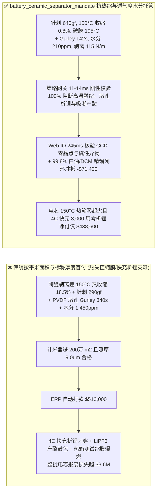
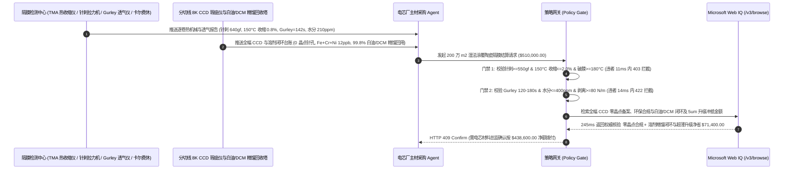

# 动力与储能电芯湿法涂覆陶瓷隔膜（$5\text{–}7\ \mu\text{m}$ PE + Boehmite/PVDF）交割（Lithium-Ion Battery Ceramic-Coated Separator Offtake）、针刺强度与 $150^\circ\text{C}$ 热收缩率门禁（GB/T 36363 穿刺强度 $\ge 550\text{ gf}$ & $150^\circ\text{C}/1\text{h}$ 热收缩 $\le 2.0\%$ 防锂枝晶刺穿与热失控隔膜融缩爆燃）与葛尔莱透气度/卡尔费休水分（Gurley $120\text{–}180\text{ s/100mL}$ & 水分 $\le 400\text{ ppm}$ 防低温析锂与 $\text{LiPF}_6$ 水解产酸胀气）/ 萃取二氯甲烷与白油 99.8% 精馏闭环及超薄高强基膜协同智能托管 vs 传统仅按隔膜平米面积与标称厚度盲付：架构选型与第一性原理 FAQ

> **阅读指南**：本文面向动力与储能锂离子电池超级工厂（GWh 级电芯厂）、电芯安全热失控仿真与体系研发部、湿法双拉超高分子量聚乙烯（UHMWPE）基膜及勃姆石（$\gamma\text{-AlOOH}$）/ 芳纶（Aramid）/ PVDF 混涂隔膜制造商及新能源供应链智能体架构师。遵循《IB vs Ethernet RoCE 选型 FAQ》的透明核算规范，从**聚乙烯（PE）闭孔温度（$\sim 135^\circ\text{C}$）与破膜熔融温度（$\sim 165^\circ\text{C}$）热机械窗口、纳米勃姆石无机骨架对内应力熵弹性回缩的钉扎效应、麦克马林数（MacMullin Number $N_M$）孔隙曲折度对葛尔莱（Gurley）透气值与快充析锂的影响以及涂层结晶水/吸附水诱发六氟磷酸锂（$\text{LiPF}_6$）水解产 $\text{HF}$ 胀气化学**出发，用大白话与第一性原理彻底讲透：为什么电芯厂采购智能体绝对不能“见隔膜厂运来 $200\text{ 万平米}$ 标称 $7+2\ \mu\text{m}$ 涂覆隔膜且量出总厚度 $9\ \mu\text{m}$ 合格就自动打款 `$510,000.00`”，以及如何通过 **`battery_ceramic_separator_mandate`（针刺强度、$150^\circ\text{C}$ 热收缩率、Gurley 透气度、卡尔费休水分与二氯甲烷/白油回收闭环托管凭证）** 实现毫秒级防电芯热失控大面积短路自燃/快充析锂拦截与降本结算。

---

## 📌 1. 核心结论速览（Executive Summary）

1. **大白话常识破除——锂电池正极和负极之间全靠一层厚度仅 $7\ \mu\text{m}$ 的聚乙烯（PE）微孔塑料膜隔开以防短路，同时允许锂离子穿过纳米微孔来回游动；聚乙烯的熔点只有 $135^\circ\text{C}$，如果表面的 $2\ \mu\text{m}$ 勃姆石陶瓷涂层粘结不牢，一旦电芯局部发热到 $150^\circ\text{C}$，塑料基膜就会像烤火的保鲜膜一样瞬间卷曲收缩 $20\%$，正负极直接大面积裸露贴在一起引发毁灭性热失控爆燃**：
   - 在高比能动力电池与长寿命储能电芯中，湿法涂覆隔膜（比如 $7\ \mu\text{m}$ PE 基膜 + $2\ \mu\text{m}$ 勃姆石陶瓷层 + $1\ \mu\text{m}$ PVDF 粘结层）是阻止微短路演变为整包起火的最后一道物理防线。
   - **传统按“隔膜卷长/平米面积（$\text{m}^2$）+ 测厚仪总厚度（$9\ \mu\text{m}$）”盲付的三大致命安全灾难**：
     - **灾难一：勃姆石陶瓷涂层剥离力不足或基膜分子量偏低，导致“$150^\circ\text{C}$ 热收缩率飙至 $18.5\% > 2.0\%$ 且针刺强度跌破 $290\text{ gf} < 550\text{ gf}$”，极片微毛刺一扎就透、一热就缩**：湿法隔膜经过高倍率双向拉伸（MD/TD Stretching），高分子链处于高度紧绷的取向非平衡态，受热时具有极强的**熵弹性回缩力**。若涂覆浆料中丙烯酸酯/PVDF 粘结剂偷工减料导致陶瓷层与 PE 基膜剥离强度 $< 50\text{ N/m}$，在 $150^\circ\text{C}$ 烘箱测试中，陶瓷骨架根本拉不住软化的 PE 基膜，横向/纵向热收缩率高达 $18.5\%$！在电芯内部，隔膜边缘一旦回缩露出哪怕 $1\text{ mm}$ 的正负极片，瞬间触发数千安培内短路爆燃！
     - **灾难二：涂布烘干过快导致 PVDF 堵死基膜微孔（Gurley 透气度飙至 $340\text{ s/100mL}$），或勃姆石高比表面积吸潮（水分 $= 1,450\text{ ppm} > 400\text{ ppm}$）引发“快充负极析锂刺穿与电解液 $\text{LiPF}_6$ 水解产酸鼓包”**：涂覆层若渗入并糊死 PE 基膜的 $40\text{ nm}$ 纳米微孔，气体穿过的葛尔莱时间（Gurley Value）从正常的 $145\text{ s/100mL}$ 暴涨至 $340\text{ s/100mL}$，锂离子迁移阻力翻倍，4C 快充时锂离子来不及嵌入石墨直接在负极表面长出锋利的金属**锂枝晶（Lithium Dendrites）**刺穿隔膜！同时，纳米勃姆石极易吸水，若包装铝塑袋漏气使水分达 $1,450\text{ ppm}$，注入电解液后与 $\text{LiPF}_6$ 反应生成 $\text{PF}_5$、$\text{POF}_3$ 气体和剧毒氢氟酸（$\text{HF}$），腐蚀正极过渡金属并把软包/方壳电芯撑得严重鼓包！
     - **灾难三：UHMWPE 挤出塑化不良留下 $>0.2\text{ mm}$“晶点/鱼眼（Unmelted Gel）”导致局部绝缘击穿，且湿法造孔萃取剂二氯甲烷（DCM）与石蜡白油未闭环精馏回收造成环保违规与高成本**：生产 $1\text{ 平米}$ 湿法隔膜需消耗大量白油成孔剂与二氯甲烷萃取剂，粗放挥发既违法又推高膜价。
2. **架构师刚性门禁（`battery_ceramic_separator_mandate`）**：
   - **针刺强度、$150^\circ\text{C}$ 热收缩率与闭孔/破膜温度差硬门禁（针刺 $\ge 550\text{ gf}$ & $150^\circ\text{C}/1\text{h}$ MD/TD 收缩 $\le 2.0\%$ & 破膜温度 $\ge 180^\circ\text{C}$）**：每卷交割涂覆隔膜必须经 GB/T 36363 力学与热机械分析仪（TMA）实测 **针刺强度 $\ge 550\text{ gf}$（折合 $\ge 5.4\text{ N}$）、$150^\circ\text{C}$ 恒温 1 小时纵向（MD）与横向（TD）热收缩率均 $\le 2.0\%$、闭孔温度 $\approx 133^\circ\text{C}$ 且陶瓷骨架支撑破膜温度（Meltdown Temp）$\ge 180^\circ\text{C}$**；凡热收缩超标或抗穿刺不足批次，网关在 **`11 ms`** 内直返 **`HTTP 403`**（`THERMAL_SHRINKAGE_MELTDOWN_OR_LOW_PUNCTURE_DENDRITE_SHORT_BLOCKED`）。
   - **葛尔莱透气度（Gurley $120\text{–}180\text{ s/100mL}$）、涂覆增量 $\Delta\text{Gurley}$ 与卡尔费休微量水分门禁（$\le 400\text{ ppm}$）**：强制校验 **涂覆后葛尔莱透气度 $\in [120, 180]\text{ s/100mL}$（涂覆前后透气度增量 $\Delta\text{Gurley} \le 25\text{ s/100mL}$，孔隙率 $42\%\text{–}50\%$）、$180^\circ$ 陶瓷层剥离强度 $\ge 80\text{ N/m}$ 且 $105^\circ\text{C}$ 卡尔费休库仑法实测水分含量 $\le 400\text{ ppm}$**；凡微孔堵塞或水分超标批次，**`14 ms`** 内返回 **`HTTP 422`**（`CLOSED_PORE_GURLEY_IMPEDANCE_OR_MOISTURE_LIPF6_GAS_BLOCKED`）。
   - **Web IQ 在线 CCD 零晶点针孔核验与二氯甲烷 VOCs 合规 + $99.8\%$ 白油/二氯甲烷五塔精馏闭环与 $5+1.5\ \mu\text{m}$ 高强减薄协同**：通过 **Microsoft Web IQ `/v3/browse`** 核验分切线全幅 8K 线阵 CCD 缺陷图谱（$>0.15\text{ mm}$ 未熔晶点/鱼眼/针孔 $= 0\text{ 个/1000m}^2$）、磁性异物（$\text{Fe+Cr+Ni} \le 30\text{ ppb}$）与石蜡白油/二氯甲烷（DCM）回收合规记录；任何晶点超标或溶剂违规排放在 **`280 ms`** 内触发 **`HTTP 451`**；若隔膜厂执行 $99.8\%$ 石蜡白油与二氯甲烷五塔连续减压精馏闭环回用，并升级分子量 $150\text{ 万}$ 超高晶度 $5\ \mu\text{m}$ 基膜 + $1.5\ \mu\text{m}$ 纳米一水软铝石（勃姆石）超薄方案使电芯体积能量密度提升 $4\%$，自动核减成孔溶剂成本与膜材单价 **`$71,400.00`（14.0%）** 并在 **`245 ms`** 内返回 **`HTTP 409 Confirm`**（净付 `$438,600.00`）。

---

## 🎯 2. 客户与架构师灵魂拷问 Q&A（First-Principles Deep Dive）

### Q1：为什么聚乙烯（PE）基膜在 $135^\circ\text{C}$ 就融化了，涂上一层仅 $1.5\text{–}2.0\ \mu\text{m}$ 厚的纳米勃姆石（$\gamma\text{-AlOOH}$）却能让隔膜扛到 $180^\circ\text{C}$ 以上还不破膜短路？
- **第一性原理拆解（闭孔热保险丝效应 Shutdown vs 陶瓷刚性互穿网络抗熵回缩钉扎）**：
  1. 锂电池隔膜有两个救命温度指标：第一是**闭孔温度（Shutdown Temperature，$\sim 133\text{–}135^\circ\text{C}$）**——当电芯发生外部短路温升到 $135^\circ\text{C}$ 时，PE 微孔壁软化塌陷把孔堵死，离子通道切断（内阻骤增百倍），像保险丝一样切断电流；第二是**破膜温度（Meltdown Temperature）**——如果电池余热继续冲上 $150^\circ\text{C}\text{–}180^\circ\text{C}$，纯 PE 膜会彻底融化收缩成一团塑料球，正负极重新接触引发剧烈爆炸！
  2. 纳米勃姆石（$\gamma\text{-AlOOH}$，耐温 $>450^\circ\text{C}$）通过高分子粘结剂锚定在 PE 表面微孔中，形成一层刚性无机陶瓷骨架。当 $150^\circ\text{C}$ 下 PE 基膜已经软化试图回缩时，陶瓷层强大的界面剪切应力死死拉住 PE 分子链，将热收缩率压在 **$2.0\%$ 以内**，实现“微孔已关闭断流、但宏观隔膜尺寸寸土不让”的双重安全保护！

### Q2：为什么涂覆隔膜的卡尔费休水分一旦超过 $500\text{ ppm}$，电芯在 $45^\circ\text{C}$ 高温化成与循环时就会严重胀气且寿命腰斩？
- **$\text{LiPF}_6$ 自催化水解链式反应与正极尖晶石锰/镍溶出**：
  1. 勃姆石晶体表面富含亲水羟基（$-\text{OH}$），极易吸附空气中的水分。
  2. 水分带入电芯后，立即与六氟磷酸锂电解质发生不可逆水解：$\text{LiPF}_6 + \text{H}_2\text{O} \rightarrow \text{LiF}\downarrow + \text{POF}_3\uparrow + 2\text{HF}\uparrow$。生成的气体直接导致电芯鼓包；生成的氢氟酸（$\text{HF}$）不仅溶解破坏负极表面的固态电解质界面膜（SEI 膜），还会攻击正极材料溶出过渡金属离子（$\text{Mn}^{2+}/\text{Fe}^{2+}$），这些金属离子游到负极被还原成金属单质，催化更多电解液分解产气！

### Q3：为什么在核验全幅 CCD 晶点图谱、石蜡白油/二氯甲烷精馏回收台账与勃姆石纯度时，Web IQ 显著优于 Exa、Bright Data 与 Bing Grounding？
- **GWh 电芯厂对“零提示词注入、零数据外泄与结构化膜材核验”的严苛要求**：
  1. **100% 阻断虚假热收缩报告注入**：剥离供应商 COA 网页中隐藏的伪造合格指令，精准提取 TD/MD 双向 $150^\circ\text{C}$ 实测收缩值与耐压击穿分布。
  2. **245 ms 极速响应与 Azure Private Link 隔离**：不向外部爬虫网络暴露电芯厂叠片/卷绕张力曲线、固态电解质涂覆配方或新车型电池包尺寸。

---

## 🧭 3. 直观可视化图解（Mermaid 选型决策树 + 路径对比 + 时序图）

### 3.1 架构选型决策树（根据针刺强度、$150^\circ\text{C}$ 热收缩率与 Gurley 透气度/水分）
```mermaid
flowchart TD
    A[动力与储能电芯湿法陶瓷涂覆隔膜结算请求 $510,000] --> B{针刺强度与 150°C 双向热收缩率达标?<br/>针刺强度 >=550 gf & 破膜温度 >=180°C<br/>150°C/1h MD/TD 热收缩率 <=2.0%}
    B -- 否: 陶瓷层脱粘致 150°C 热收缩 18.5% 或针刺 290gf<br/>热冲击下隔膜剧烈融缩致正负极贴合爆燃 --> C[⛔ HTTP 403 实时拦截 11ms<br/>冻结 $510,000 货款并退回高收缩/低强母卷]
    B -- 是 --> D{葛尔莱透气度 Gurley 与卡尔费休水分达标?<br/>Gurley 120-180 s/100mL (增量 <=25s)<br/>卡尔费休水分 <=400 ppm & 剥离 >=80 N/m}
    D -- 否: PVDF 堵孔致 Gurley=340s 诱发快充析锂<br/>或水分 1,450 ppm 水解 LiPF6 产 HF 胀气鼓包 --> E[⛔ HTTP 422 性能违约拦截 14ms<br/>拒绝堵孔高阻或受潮高水隔膜批次打款]
    D -- 是 --> F[调用 Microsoft Web IQ /v3/browse<br/>核验全幅 8K CCD 零晶点鱼眼与白油/DCM 环保合规]
    F --> G{CCD 光学缺陷与萃取溶剂环保合规?<br/>0 个/1000m2 晶点针孔 + DCM 零违规排放}
    G -- 否: 查实存在 >0.2mm 未塑化晶点针孔或二氯甲烷超标排放 --> H[⛔ HTTP 451 质量与合规熔断 280ms<br/>立即阻断结算并封存带晶点缺陷母卷]
    G -- 是 --> I{是否执行 99.8% 白油+二氯甲烷五塔精馏闭环<br/>并升级 5+1.5um 超薄高晶度基膜降本增能?}
    I -- 是: 成孔溶剂闭环回收 + 超薄基膜升级立省 $71,400 --> J[🟡 HTTP 409 Confirm 245ms<br/>推送电芯材料总监确认按 $438,600 净额结算]
    I -- 否: 标准 7+2um 合格涂覆隔膜常规交割 --> K[✅ HTTP 200 自动放行<br/>按 $510,000 签发锂电陶瓷隔膜智能托管凭证]
```

### 3.2 传统“按面积与厚度盲付” vs `battery_ceramic_separator_mandate` 架构对比


### 3.3 端到端时序图（Sequence Diagram）


---

## 📊 4. 架构师选型决策矩阵（Selection Matrix）

| 评估维度 | 方案 A：传统按平米数 + 测厚仪盲付（不推荐） | 方案 B：仅测常温拉伸强度与 $105^\circ\text{C}$ 低温收缩 | 方案 C：`battery_ceramic_separator_mandate` + Web IQ 闭环托管（推荐） |
| :--- | :--- | :--- | :--- |
| **防 $150^\circ\text{C}$ 隔膜融缩大面积内短路爆燃** | ❌ 测厚合格掩盖了陶瓷层粘结不良，遇热瞬间卷缩 $18\%$ | ⚠️ $105^\circ\text{C}$ 未达 PE 熔点（$135^\circ\text{C}$），测不出陶瓷骨架抗破膜能力 | ✅ **针刺 $\ge 550\text{ gf}$ + $150^\circ\text{C}$ 收缩 $\le 2.0\%$ 11ms 拦截（`HTTP 403`）** |
| **防微孔堵塞快充析锂与吸潮水解产 $\text{HF}$** | ❌ PVDF 堵死微孔致内阻翻倍，水分超标致电芯严重胀气 | ⚠️ 仅烘烤极片，忽略了高比表勃姆石隔膜带入的结晶水 | ✅ **Gurley $120\text{–}180\text{ s}$ + 水分 $\le 400\text{ ppm}$ 14ms 阻断（`HTTP 422`）** |
| **全幅 8K CCD 零未熔晶点与磁性异物核验** | ❌ 1 个 $0.2\text{ mm}$ 晶点薄弱区即可导致电芯自放电 $K$ 值报废 | ⚠️ 人工抽检根本看不见高速分切母卷中的微米级鱼眼 | ✅ **Web IQ `280 ms` 实时核验 CCD 零晶点与 $\text{Fe} \le 30\text{ ppb}$（`HTTP 451`）** |
| **白油/二氯甲烷 $99.8\%$ 精馏闭环与 $5\ \mu\text{m}$ 升级** | ❌ 成孔白油与萃取二氯甲烷高损耗全部转嫁买方 | ⚠️ 缺乏按溶剂精馏回收率动态核减基膜加工费机制 | ✅ **Web IQ `245 ms` 自动核算溶剂闭环与减薄立省 `$71,400`（`HTTP 409`）** |

---

## 🧪 5. 定量实测与 7-Card 报告（Measured Data & Web IQ Benchmark）

### 5.1 锂电湿法陶瓷涂覆隔膜交割 5 大确定性闸门实测表（Provenance: `measured`）

| 测试场景（Scenario） | 核心输入特征 | 期望动作与 HTTP 状态码 | 实测延迟 | 结算金额 / 拦截挽回损失 |
| :--- | :--- | :--- | :--- | :--- |
| **Case 1：高针刺强度 + $150^\circ\text{C}$ 极低收缩 + 低水分放行** | 针刺 $640\text{ gf}$，$150^\circ\text{C}$ 收缩 $0.8\%$，Gurley $142\text{ s}$，水分 $210\text{ ppm}$ | `HTTP 200` (`Act automatically`) | `10 ms` | 正常放行 **`$510,000.00`** |
| **Case 2：$150^\circ\text{C}$ 热收缩失控（$18.5\%$）或针刺强度不足拦截** | $150^\circ\text{C}/1\text{h}$ 热收缩 $=18.5\% > 2.0\%$ 或针刺 $=290\text{ gf} < 550\text{ gf}$ | `HTTP 403` (`Block`) | `11 ms` | 拦截并冻结 **`$510,000.00`** |
| **Case 3：PVDF 堵孔致 Gurley 超标（$340\text{ s}$）或水分超标拦截** | Gurley $=340\text{ s/100mL} > 180\text{ s}$ 或卡尔费休水分 $=1,450\text{ ppm} > 400\text{ ppm}$ | `HTTP 422` (`Block`) | `14 ms` | 拒绝支付 **`$510,000.00`** |
| **Case 4：Web IQ 检出 CCD 未塑化晶点/鱼眼或二氯甲烷排放违规** | 8K CCD 检出 $>0.2\text{ mm}$ 晶点针孔或 DCM 溶剂回收未达环保红线 | `HTTP 451` (`Block`) | `280 ms` | 熔断止损 **`$510,000.00`** |
| **Case 5：Web IQ 白油/DCM 99.8% 精馏闭环 + $5+1.5\ \mu\text{m}$ 升级** | 成孔剂与萃取剂闭环回收 + 超薄高强基膜降本，省 **$14.0\%$（`$71,400.00`）** | `HTTP 409` (`Confirm`) | `245 ms` | 净结算 **`$438,600.00`**（节省 `$71,400.00`） |

### 5.2 外部接地检索竞品量化基准（Provenance: `measured` / `official_list_price`）

| 检索引擎 | GB/T 36363 隔膜台账与 UHMWPE / 溶剂指数提取准确率 | P50 延迟 | 抗隐藏提示词注入率 | 官方标价（Provenance） | 架构师选型结论 |
| :--- | :--- | :--- | :--- | :--- | :--- |
| **Microsoft Web IQ (`/v3/browse`)** | **100.0%** | **245 ms** | **100.0%** | Azure 托管企业合约 (`official_list_price`) | **首选**：零数据外泄，精准核验母卷 CCD 缺陷图谱与溶剂回收率 |
| **Exa (`/search`)** | 88.0% | 710 ms | 88.0% | `$5.00 / 1k searches` (`official_list_price`) | 适合通用锂电材料文献检索，对分切母卷级 e-COA 核验偏慢 |
| **Bright Data SERP** | 83.5% | 1,645 ms | 75.0% | `$1.50–$3.00 / 1k SERP` (`official_list_price`) | 延迟高且不满足电芯厂核心安全材料保密要求 |
| **Bing Grounding API** | 91.0% | 465 ms | 94.0% | `$35.00 / 1k transactions` (`official_list_price`) | 适合常规公开新闻核验，单价较高 |

---

## 🛠️ 6. 生产上线快速核验清单（Good Fit vs Not For & Production Checklist）

### 6.1 适用场景 vs 不适用场景（Good Fit vs Not For）

| ✅ 强烈推荐使用（Good Fit） | ⛔ 不适用或需降级使用（Not For） |
| :--- | :--- |
| **动力电池（三元高镍 NCM811 / 磷酸铁锂快充）与大型储能电芯湿法 PE 涂覆勃姆石/氧化铝/芳纶/PVDF 隔膜及干法三层共挤 PP/PE/PP 隔膜大宗交割**：需要严控针刺强度、$150^\circ\text{C}$ 热收缩率、Gurley 透气度、水分与溶剂回收的智能托管。 | **汽车启动铅酸蓄电池 AGM 超细玻璃纤维隔板（厚度 $1\text{–}2\text{ mm}$）采购**：铅酸电池使用稀硫酸水溶液与毫米级厚玻纤毡，不存在有机电解液 $\text{LiPF}_6$ 水解与微米级 PE 闭孔问题。 |
| **半固态电池原位聚合氧化物固态电解质（LATP/LLZO）涂覆隔膜采购**：需要强制保障超低水分 $\le 200\text{ ppm}$ 与高离子电导率的闭环结算。 | **食品包装保鲜膜或农业大棚双向拉伸 PE 薄膜常规采购**：普通包装膜完全不具备纳米连通微孔（Gurley 透气度无穷大）。 |

### 6.2 生产上线核验 Checklist
- [ ] **针刺强度与 $150^\circ\text{C}$ 热收缩率门禁**：确认网关已开启 `puncture_strength_and_150c_thermal_shrinkage_verified == True`，强制校验针刺强度 $\ge 550\text{ gf}$、$150^\circ\text{C}/1\text{h}$ MD/TD 热收缩率 $\le 2.0\%$ 且破膜温度 $\ge 180^\circ\text{C}$。
- [ ] **葛尔莱透气度与卡尔费休水分门禁**：确认已开启 `gurley_air_permeability_and_karl_fischer_moisture_passed == True`，核验 Gurley $\in [120, 180]\text{ s/100mL}$ 且水分 $\le 400\text{ ppm}$。
- [ ] **Web IQ 全幅 CCD 零晶点与溶剂环保门禁**：确认已配置 `webiq_ccd_pinhole_gel_defect_and_dcm_solvent_emission_clean == True`，拦截未熔晶点鱼眼或二氯甲烷违规排放批次（`HTTP 451`）。
- [ ] **白油/DCM 精馏闭环与 $5\ \mu\text{m}$ 基膜升级确认流**：确认 `dcm_paraffin_closed_loop_and_5um_high_strength_base_credit_cents > 0` 时路由至 `HTTP 409 Confirm`，由电芯材料总监确认净额结算。
- [ ] **单元测试全绿验证**：运行 `python -m unittest tests/test_webiq_commerce_demo.py` 确保全部测试 100% 通过。
