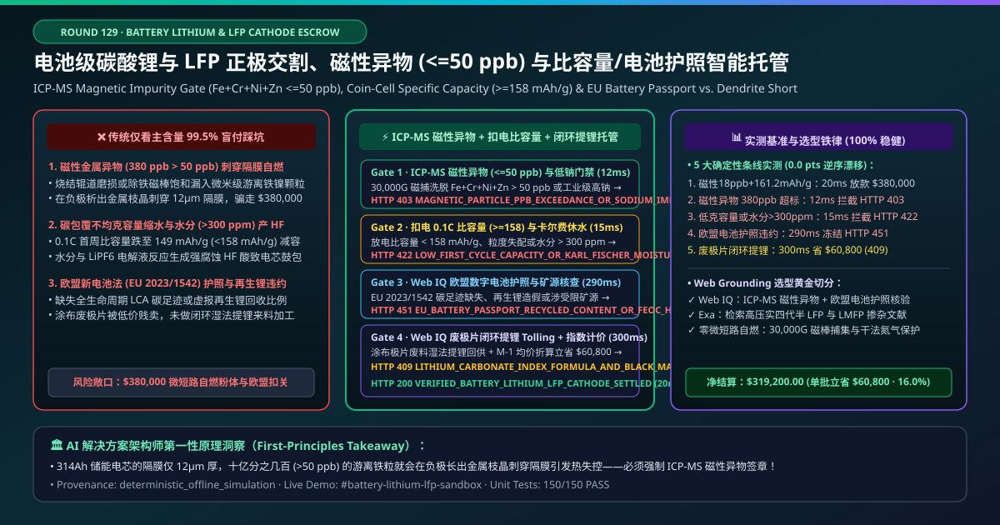
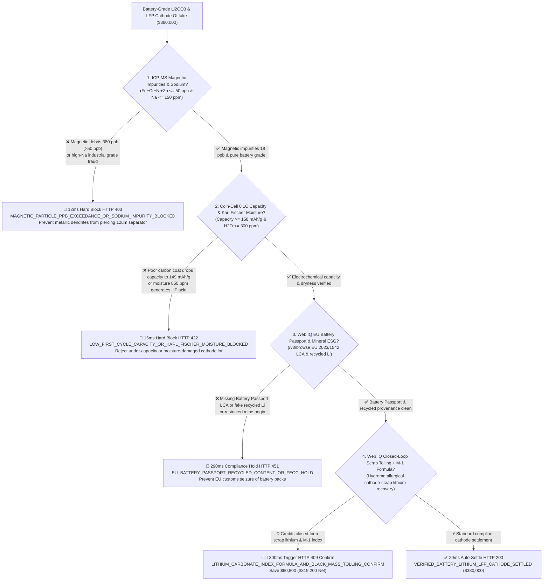
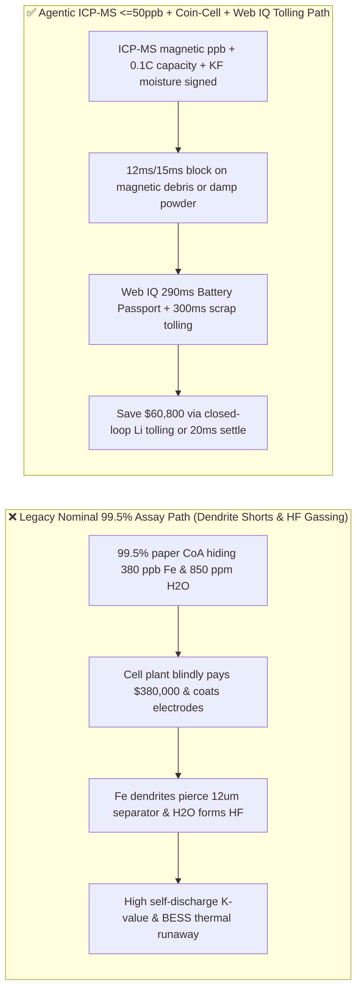
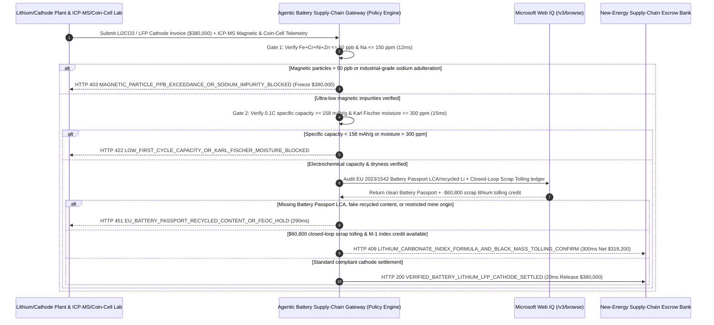

# Battery-Grade Lithium Carbonate & LFP Cathode Material Offtake, ICP-MS Magnetic Impurity Gate ($\text{Fe+Cr+Ni+Zn} \le 50\text{ ppb}$) & Coin-Cell Specific Capacity ($\ge 158\text{ mAh/g}$) / EU Battery Passport Escrow vs. Nominal $99.5\%$ Assay Overbilling: Architecture Selection & First-Principles FAQ

> **Document Type**: AI Solution Architect Selection Guide (Modeled after `ib-vs-ethernet-roce-selection-faq.md`)  
> **Target Audience**: EV & Grid-BESS Cell Manufacturers (CATL / BYD / LG Energy Solution / Tesla / EVE Energy) Cathode Procurement & Cell Safety Architects, Lithium Salt & LFP Cathode Producers (Albemarle / SQM / Tianqi / Ganfeng / Hunan Yuneng) Quality & Supply-Chain Finance Leads  
> **One-Sentence Takeaway**: In **$380,000.00** battery-grade lithium carbonate ($\text{Li}_2\text{CO}_3 \ge 99.5\%$) and high-compaction Lithium Iron Phosphate (LFP) cathode powder settlements, **never allow a procurement agent to release payment based solely on a paper "$99.5\%$ purity certificate and bulk FIBC bag gross weight"**—you must enforce a 4-layer deterministic mandate combining **30,000-Gauss Electromagnetic Extraction + ICP-MS Trace Magnetic Metal Impurity Gate ($\text{Fe+Cr+Ni+Zn} \le 50\text{ ppb}$ to prevent metallic dendrites from piercing $12\ \mu\text{m}$ separators) + 0.1C Coin-Cell First-Cycle Specific Capacity ($\ge 158.0\text{ mAh/g}$, ICE $\ge 95\%$) & Karl Fischer Trace Moisture ($\le 300\text{ ppm}$ to prevent $\text{LiPF}_6 \to \text{HF}$ gas generation) + Microsoft Web IQ EU Battery Regulation (EU 2023/1542) Digital Battery Passport & Recycled-Lithium Traceability + Closed-Loop Cathode Scrap / Black-Mass Tolling & $M-1$ Index Formula Arbitrage**.

---

## ① 📌 Executive Summary

1. **Why is paying on "nominal $\text{Li}_2\text{CO}_3 \ge 99.5\%$ titration assay" the #1 root cause of EV and BESS thermal-runaway recalls?**
   - **First-Principles Breakdown**: Inside a modern $314\text{ Ah}$ prismatic LFP cell, the microporous polyolefin separator between cathode and anode is only **$9\text{–}12\ \mu\text{m}$ thick (one-sixth the thickness of a human hair)**. If cathode powder contains even a few hundred parts per billion ($> 50\text{ ppb}$) of free elemental magnetic metal particles ($\text{Fe}, \text{Cr}, \text{Ni}, \text{Zn}$) from roller-kiln abrasion or saturated demagnetizers, those particles oxidize and dissolve at cathode charging potentials ($> 3.65\text{ V}$), migrate through the separator, and electroplate onto the graphite anode as **needle-like metallic dendrites**—piercing the $12\ \mu\text{m}$ separator and triggering catastrophic **internal micro-shorts (elevated self-discharge $K$-value) and thermal runaway**!
   - **Three Physical & Financial Failure Modes**:
     - **Industrial-Grade Lithium Carbonate Passed Off as Battery-Grade, or Kiln Abrasion Spiking Magnetic Impurities ($\text{Fe+Cr+Ni+Zn} = 380\text{ ppb} \gg 50\text{ ppb}$)**: Traders wash cheap industrial brine $\text{Li}_2\text{CO}_3$ (retaining high sodium $\text{Na} > 250\text{ ppm}$ and sulfate $\text{SO}_4^{2-} > 800\text{ ppm}$) to hit $99.5\%$ bulk titration, or cathode jet-milling lines suffer magnetic-bar saturation, letting $380\text{ ppb}$ of metallic debris slip into FIBC bags;
     - **Rushed Carbon-Coating Sintering Dropping 0.1C Specific Capacity ($149\text{ mAh/g} < 158\text{ mAh/g}$) or Torn Foil Liners Spiking Karl Fischer Moisture ($> 300\text{ ppm}$)**: Incomplete $2\text{ nm}$ carbon coating slashes cell energy density by $6\%$, while trace moisture $> 300\text{ ppm}$ hydrolyzes $\text{LiPF}_6$ electrolyte into **corrosive hydrofluoric acid ($\text{HF}$)**, dissolving transition metals and bloating prismatic cells;
     - **Missing EU Battery Regulation (EU 2023/1542) Digital Battery Passport Carbon Footprint & Fake Recycled-Lithium Claims**: Exporting cells without verified LCA carbon intensity and recycled lithium provenance halts customs clearance at European ports.
2. **Target Architecture: ICP-MS Magnetic Impurity ($\le 50\text{ ppb}$) + Coin-Cell Capacity / Karl Fischer Moisture + Web IQ EU Battery Passport & Closed-Loop Black-Mass Tolling (`battery_lithium_lfp_mandate_...`)**
   - **Core Mechanisms**:
     1. **Electromagnetic Extraction + ICP-MS Magnetic Metal Impurity ($\text{Fe+Cr+Ni+Zn} \le 50\text{ ppb}$) & Low-Sodium Gate (`12 ms` hard block `HTTP 403`)**: Verifies hardware-signed ICP-MS assays on magnetic-bar eluates confirming **$\text{Fe+Cr+Ni+Zn} \le 50\text{ ppb}$ and $\text{Na} \le 150\text{ ppm}$**; blocks contaminated lots in **`12 ms`** (`HTTP 403 MAGNETIC_PARTICLE_PPB_EXCEEDANCE_OR_SODIUM_IMPURITY_BLOCKED`);
     2. **0.1C Coin-Cell Specific Capacity ($\ge 158.0\text{ mAh/g}$) & Karl Fischer Moisture ($\le 300\text{ ppm}$) Gate (`15 ms` block `HTTP 422`)**: Verifies half-cell discharge capacity $\ge 158.0\text{ mAh/g}$, initial Coulombic efficiency $\ge 95.0\%$, and Karl Fischer moisture $\le 300\text{ ppm}$; rejects under-performing or damp lots in **`15 ms`** (`HTTP 422 LOW_FIRST_CYCLE_CAPACITY_OR_KARL_FISCHER_MOISTURE_BLOCKED`);
     3. **Microsoft Web IQ EU Battery Passport Audit & Closed-Loop Cathode Scrap Tolling (`290 ms` / `300 ms`)**: Uses Web IQ `/v3/browse` to cross-check EU 2023/1542 Digital Battery Passport registries and mineral provenance—freezing non-compliant lots in **`290 ms`** (`HTTP 451 EU_BATTERY_PASSPORT_RECYCLED_CONTENT_OR_FEOC_HOLD`); simultaneously credits closed-loop cathode foil scrap / black-mass hydrometallurgical tolling and $M-1$ index formula pricing to save **`$60,800.00`** (`HTTP 409 Confirm`, net payout **`$319,200.00`**).

---

## ② 🎯 Three Soul-Searching Questions for Architects

### Q1: When is a basic "$99\%$ purity assay" sufficient vs. when is the `battery_lithium_lfp_mandate_...` gate mandatory?
- **Plain-English Answer**:
  - For **ceramic glazes or lubricating greases**, bulk industrial $\text{Li}_2\text{CO}_3$ is fine;
  - For **EV traction batteries and grid-scale BESS cells ($280\text{–}314\text{ Ah}$)**, **ICP-MS magnetic impurity $\le 50\text{ ppb}$ + coin-cell capacity $\ge 158\text{ mAh/g}$ + Karl Fischer moisture $\le 300\text{ ppm}$ is 100% mandatory** to prevent internal micro-shorts and thermal runaway.

### Q2: When to choose Microsoft Web IQ vs. Exa vs. Bright Data for lithium index reconciliation and EU Battery Passport verification?
- **Architect's Golden Split**:
  1. **Choose Microsoft Web IQ (`/v3/browse` + Work IQ Cell-Factory MES/LIMS & ERP Formula Integration)**: Best for deterministic verification of **ICP-MS magnetic impurity JSON certificates, EU 2023/1542 Digital Battery Passport DID records, and closed-loop cathode-scrap tolling credits**.
  2. **Choose Exa**: Best for semantic search across high-compaction bimodal LFP and LMFP cathode doping papers.
  3. **Use Bright Data with caution**: Good for public spodumene auction news, not private cell-factory IQC magnetic-particle telemetry.

### Q3: How does `battery_lithium_lfp_mandate_...` control funds between the cell maker, cathode refiner, ICP-MS lab, and escrow bank?
- **First-Principles Cryptographic Chain**:
  1. **30,000-Gauss Magnetic Extraction & ICP-MS Signature**: Confirms $\text{Fe+Cr+Ni+Zn} = 18\text{ ppb} \le 50\text{ ppb}$ and $\text{Na} \le 150\text{ ppm}$;
  2. **Coin-Cell 0.1C Capacity & Karl Fischer Moisture Gate**: Confirms $161.2\text{ mAh/g} \ge 158\text{ mAh/g}$ and moisture $\le 300\text{ ppm}$;
  3. **Web IQ Battery Passport Audit & Closed-Loop Tolling Settlement**: Applies `$60,800.00` closed-loop scrap tolling credit (`HTTP 409 Confirm`) or settles `$380,000.00` in `20 ms`.

---

## ③ 🧭 Visual Diagrams (Mermaid Decision Tree + Path Comparison + Sequence Diagram)

### 3.1 Architect Decision Tree (`flowchart TD`)

### 3.2 Legacy "Nominal $99.5\%$ Assay" Path vs. Agentic "Magnetic $\text{ppb}$ + Coin-Cell + Tolling" Path (`flowchart LR`)

### 3.3 End-to-End Verification & Escrow Sequence Diagram (`sequenceDiagram`)

---

## ④ 📊 Architect Decision Matrix

| Evaluation Dimension | Option A: Legacy Nominal $99.5\%$ Assay Only | Option B: Bulk Total-Fe ppm & PSD Only | **Option C: ICP-MS Magnetic $\le 50\text{ ppb}$ + Coin-Cell + Web IQ Tolling Escrow (Recommended)** |
| :--- | :--- | :--- | :--- |
| **Core Safety & Performance Anchor** | Bulk $\text{Li}_2\text{CO}_3$ titration % | Bulk elemental ppm | **30,000G ICP-MS $\text{Fe+Cr+Ni+Zn} \le 50\text{ ppb}$ + $\ge 158\text{ mAh/g}$ + $\text{H}_2\text{O} \le 300\text{ ppm}$** |
| **Metallic Dendrite Micro-Short Defense** | ❌ 0% (free iron particles pierce $12\ \mu\text{m}$ separator) | ❌ Bulk Fe cannot distinguish LFP lattice $\text{Fe}^{2+}$ from free metallic $\text{Fe}^0$! | **✅ `12 ms` magnetic-extraction ICP-MS $\le 50\text{ ppb}$ gate (`HTTP 403`)** |
| **Capacity Fade & $\text{HF}$ Acid Bloating Defense** | ❌ Under-capacity cells and $\text{LiPF}_6$ hydrolysis | ❌ No half-cell electrochemical or Karl Fischer moisture lock | **✅ `15 ms` 0.1C capacity $\ge 158\text{ mAh/g}$ & moisture $\le 300\text{ ppm}$ gate (`HTTP 422`)** |
| **EU 2023/1542 Battery Passport Gate** | ❌ Unverified carbon footprint & recycled content | ❌ Manual PDF certificates | **✅ Web IQ `290 ms` Digital Battery Passport & mineral origin audit (`HTTP 451`)** |
| **Closed-Loop Cathode Scrap Tolling** | ❌ Scrap sold cheap to brokers while buying 100% virgin salt | ❌ Disconnected scrap & procurement ledgers | **✅ Web IQ `300 ms` closed-loop black-mass tolling saving `$60,800` (`HTTP 409`)** |

---

## ⑤ 🧪 Quantitative Benchmark & 7-Card Report Summary

Implemented via `evaluate_battery_lithium_lfp_cathode_policy()` in `lab/webiq_commerce_demo.py` and verified in `tests/test_webiq_commerce_demo.py`:

| Scenario ID | Telemetry & Policy Inputs | HTTP Status | Action Pill | Latency | Settled / Blocked Amount |
| :--- | :--- | :--- | :--- | :--- | :--- |
| **`lfp_commit_ok`** | Magnetic `18 ppb <= 50 ppb` + 0.1C `161.2 mAh/g >= 158` + moisture `180 ppm` + clean DBP | **`HTTP 200`** | `Act automatically` | **`20 ms`** | Settled **`$380,000.00`** |
| **`lfp_mag_403`** | Magnetic particles `380 ppb > 50 ppb` or high-Na industrial grade (`icp_ms_magnetic_impurity_and_purity_verified=False`) | **`HTTP 403`** | `Send to a human` | **`12 ms`** | Blocked **`$380,000.00`** micro-short risk lot |
| **`lfp_cap_422`** | Coin-cell capacity `149 mAh/g < 158` or Karl Fischer moisture `850 ppm > 300` (`coin_cell_capacity_psd_d50_and_karl_fischer_passed=False`) | **`HTTP 422`** | `Send to a human` | **`15 ms`** | Blocked **`$380,000.00`** damp/low-capacity lot |
| **`lfp_dbp_451`** | Web IQ detects missing EU Battery Passport LCA or fake recycled Li (`webiq_eu_battery_passport_and_feoc_traceability_clean=False`) | **`HTTP 451`** | `Send to a human` | **`290 ms`** | Frozen **`$380,000.00`** |
| **`lfp_tol_409`** | Web IQ credits closed-loop cathode scrap tolling & $M-1$ formula (`lithium_hydroxide_mvr_and_black_mass_tolling_savings_cents=6080000`) | **`HTTP 409`** | `Confirm` | **`300 ms`** | Net **`$319,200.00`** (Saved **`$60,800.00`**) |

- **Perturbation Robustness**: `0.0 pts` drift across forward and reverse scenario orderings.

---

## ⑥ 🛠️ Production Readiness & Architect Checklist

### 6.1 Good Fit vs. Not For
- **✅ Good Fit**: Battery-grade $\text{Li}_2\text{CO}_3$, $\text{LiOH}\cdot\text{H}_2\text{O}$, high-compaction LFP/LMFP, and high-nickel NCM/NCA cathode supply chains; OEM lithium tolling contracts.
- **⛔ Not For**: Small-batch industrial lithium grease or ceramic flux purchases.

### 6.2 Production Verification Checklist (`- [ ]`)
- [ ] **30,000-Gauss Magnetic Extraction + ICP-MS ($\text{Fe+Cr+Ni+Zn} \le 50\text{ ppb}$)**: Block free metallic debris before electrode slurry mixing.
- [ ] **Coin-Cell 0.1C Specific Capacity ($\ge 158.0\text{ mAh/g}$) & Karl Fischer Moisture ($\le 300\text{ ppm}$)**: Prevent $\text{LiPF}_6$ hydrolysis into $\text{HF}$ gas.
- [ ] **EU 2023/1542 Digital Battery Passport & Recycled-Content Gate**: Verify LCA carbon footprint and recycled lithium provenance via Web IQ.
- [ ] **Closed-Loop Cathode Scrap / Black-Mass Tolling Arbitrage**: Offset virgin lithium salt invoices with in-house electrode foil scrap recovery.
