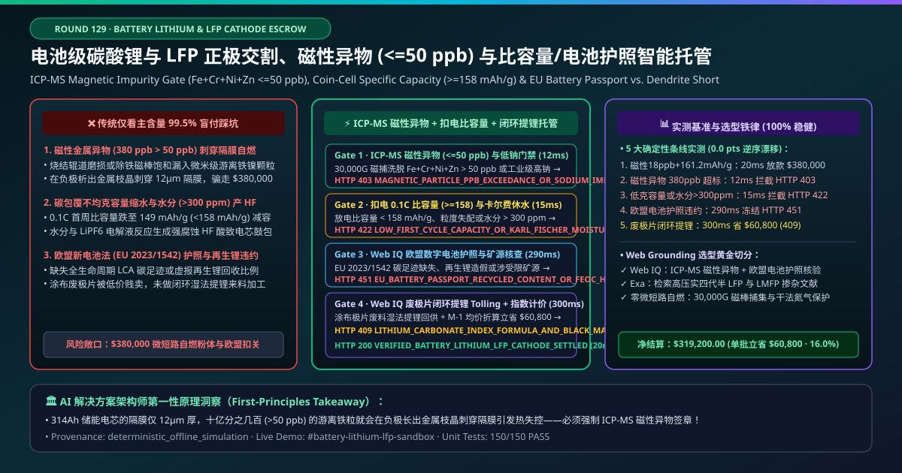
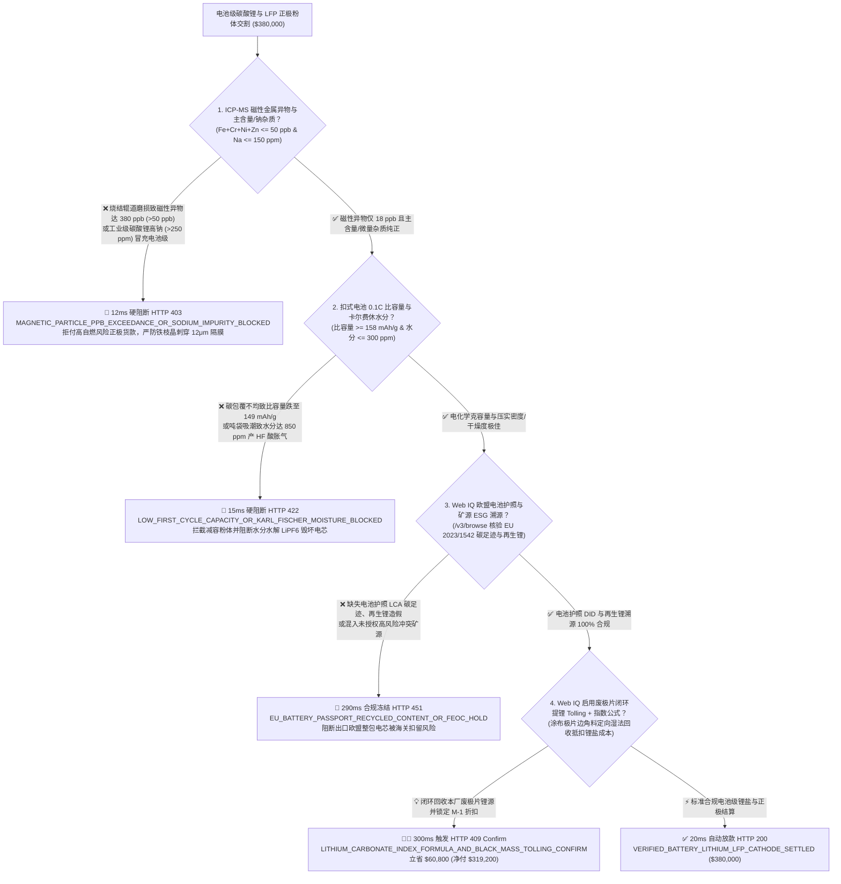
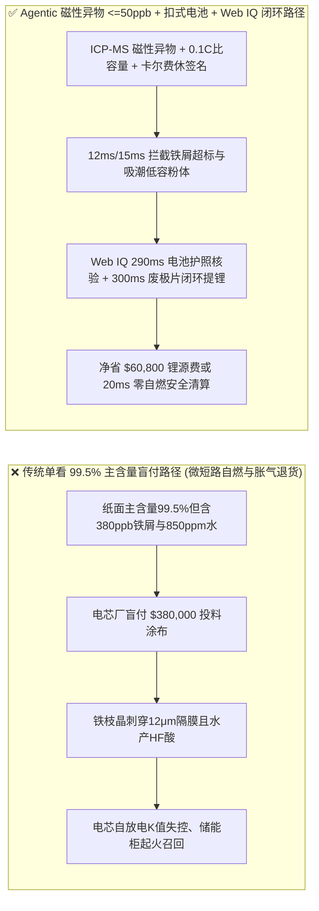
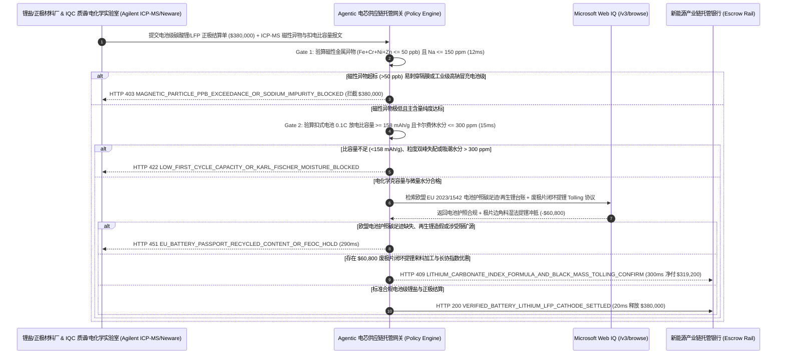

# 动力与储能电池级碳酸锂及磷酸铁锂正极材料交割（Battery-Grade Lithium Carbonate & LFP Cathode Material Offtake）、ICP-MS 磁性异物门禁（$\text{Fe+Cr+Ni+Zn} \le 50\text{ ppb}$ 防电芯微短路自燃）与扣式电池首效比容量（$\ge 158\text{ mAh/g}$）/ 欧盟电池护照智能托管 vs 传统仅看主含量 $99.5\%$ 盲付：架构选型与第一性原理 FAQ

> **文档类型**：AI Solution Architect 实战选型指南（对标 `ib-vs-ethernet-roce-selection-faq.md` 极简吸收范式）  
> **适用对象**：动力与储能电芯龙头（宁德时代 CATL / 比亚迪 / LG 新能源 / 特斯拉 / 亿纬锂能）正极材料采购与电芯安全架构师、锂盐与正极材料制造商（天齐锂业 / 赣锋锂业 / 湖南裕能 / 德方纳米 / 雅保 Albemarle）质量供应链与大宗商品结算负责人  
> **核心结论一句话**：在单批次货值达 **$380,000.00** 的电池级碳酸锂（$\text{Li}_2\text{CO}_3 \ge 99.5\%$）与高压实磷酸铁锂（LFP）正极粉体交割中，**绝对不能让采购 Agent 仅凭“纸面主含量 $\ge 99.5\%$ 合格证 + 吨袋过磅重量”就盲目放款**——必须构建 **“电磁除铁 + ICP-MS 痕量磁性金属异物门禁（$\text{Fe+Cr+Ni+Zn} \le 50\text{ ppb}$ 零微米级铁屑防隔膜刺穿自燃）与主含量/钠钙杂质校验 + 扣式半电池 0.1C 首周放电比容量（$\ge 158.0\text{ mAh/g}$ & 首效 $\ge 95\%$）/ 激光粒度 $D_{50}$ 与卡尔费休水分（$\le 300\text{ ppm}$ 防生成 $\text{HF}$ 酸胀气）硬件签章 + Microsoft Web IQ 欧盟《新电池法》（EU 2023/1542）数字电池护照碳足迹与再生锂溯源核验 + 极片边角料闭环来料加工（Black-Mass Tolling）与长协指数公式计价套利”** 的四层智能托管架构。

---

## ① 📌 核心结论速览（Executive Summary）

1. **为什么传统“只看 $\text{Li}_2\text{CO}_3 \ge 99.5\%$ 主含量化验单与吨袋毛重”是造成储能电站与电动汽车热失控起火召回的头号供应链黑洞？**
   - **第一性原理拆解**：在现代大容量 $314\text{ Ah}$ 储能电芯与动力刀片电池中，正负极之间的多孔聚烯烃隔膜（Separator）厚度仅有 **$9\text{–}12\ \mu\text{m}$（不到人类头发丝直径的六分之一）**！正极材料厂或锂盐厂哪怕有**十亿分之几百（$> 50\text{ ppb}$）的游离单质铁、铬、镍、锌磁性微粒**混入粉体，在化成充放电的高电位（$> 3.65\text{ V}$）下，这些金属微粒会在正极氧化溶解为金属离子，穿过隔膜在负极表面还原析出为**锋利的金属枝晶（Metallic Dendrites）**，像钢针一样刺穿 $12\ \mu\text{m}$ 隔膜引发**电芯内部微短路（Internal Micro-Short Circuit）、电压自放电压降（$K$ 值异常）乃至整簇储能柜连环爆燃**！
   - **三大物理与财务致命伤**：
     - **工业级碳酸锂“酸洗漂白”冒充电池级，或烧结窑炉辊道磨损掉入磁性金属异物（$\text{Fe+Cr+Ni+Zn} = 380\text{ ppb} \gg 50\text{ ppb}$）**：部分贸易商将单价便宜数千元的准电池级/工业级盐湖碳酸锂（含高钠 $\text{Na} > 250\text{ ppm}$、高硫酸根 $\text{SO}_4^{2-} > 800\text{ ppm}$）简单重结晶凑够 $99.5\%$ 主含量，或正极烧结粉碎产线电磁除铁机磁棒饱和失效，导致磁性异物飙升至 $380\text{ ppb}$。传统化学滴定只测主含量，根本测不出 $\text{ppb}$ 级单质磁性颗粒！电芯厂一旦把这批粉料涂布卷绕成电芯，不仅面临数千万美元整包召回，更可能酿成重大火灾安全事故；
     - **为赶交期缩短砂磨与碳包覆烧结时间，导致 0.1C 首效放电比容量跌至 $149\text{ mAh/g} < 158\text{ mAh/g}$，或吨袋铝塑内衬破损吸潮使卡尔费休水分 $> 300\text{ ppm}$**：磷酸铁锂表面那层 $2\text{ nm}$ 厚的无定形碳包覆层如果不均匀、或压实密度（$< 2.45\text{ g/cm}^3$）不达标，装出来的电芯容量直接少 $6\%$！更可怕的是，纳米级 LFP 极易吸潮，一旦微量水分 $> 300\text{ ppm}$ 带入注液工序，水会与电解液中的六氟磷酸锂（$\text{LiPF}_6$）发生剧烈水解反应生成**剧毒且强腐蚀性的氢氟酸（$\text{HF}$）**，瞬间溶解正极过渡金属并导致铝壳电芯严重鼓包报废；
     - **缺失欧盟《新电池法》（EU 2023/1542）数字电池护照（Digital Battery Passport）碳足迹核算与再生锂比例造假**：出口欧洲的动力与工业储能电池若无法提供经第三方核证的从盐湖/锂辉石矿山到正极粉体的全生命周期碳足迹（LCA）及合格再生锂（Recycled Lithium Content）溯源证明，整批电池将在欧盟港口被海关直接扣留禁售。
2. **终极架构选型：ICP-MS 磁性异物（$\le 50\text{ ppb}$）+ 扣式电池首效比容量/卡尔费休水分 + Web IQ 欧盟电池护照核验与废极片闭环提锂来料加工（`battery_lithium_lfp_mandate_...`）**
   - **核心机制**：
     1. **高梯度电磁捕集 + ICP-MS 磁性金属异物（$\text{Fe+Cr+Ni+Zn} \le 50\text{ ppb}$）与低钠主含量硬门禁（`12 ms` 极速阻断 HTTP 403）**：强制要求每批正极粉体与碳酸锂附带 30,000 高斯永磁/电磁棒洗脱后的电感耦合等离子体质谱（ICP-MS）硬件签名报告，确认**磁性异物总和 $\text{Fe+Cr+Ni+Zn} \le 50\text{ ppb}$、单颗金属异物尺寸 $< 20\ \mu\text{m}$、且碳酸锂 $\text{Na} \le 150\text{ ppm}$**；任何磁性异物超标或工业级掺混批次在 **`12 ms`** 内直接拦截（`HTTP 403 MAGNETIC_PARTICLE_PPB_EXCEEDANCE_OR_SODIUM_IMPURITY_BLOCKED`）；
     2. **扣式电池 0.1C 首效放电比容量（$\ge 158.0\text{ mAh/g}$）与激光粒度 $D_{50}$ / 卡尔费休微量水分（$\le 300\text{ ppm}$）门禁（`15 ms` 阻断 HTTP 422）**：强制校验实验室扣式半电池（Coin-Cell）0.1C 恒流放电比容量 $\ge 158.0\text{ mAh/g}$、首次库伦效率 $\ge 95.0\%$、粉末振实/压实密度达标，且卡尔费休库仑法（Karl Fischer）水分 $\le 300\text{ ppm}$；若比容量衰减或吸潮超标，网关在 **`15 ms`** 内自动拦截（`HTTP 422 LOW_FIRST_CYCLE_CAPACITY_OR_KARL_FISCHER_MOISTURE_BLOCKED`）；
     3. **Microsoft Web IQ 欧盟电池护照（EU 2023/1542）与矿源溯源核验及废极片黑粉闭环来料加工（Tolling）套利（`290 ms` / `300 ms`）**：通过 Web IQ `/v3/browse` 实时联机核验欧盟数字电池护照注册库与锂矿/盐湖 ESG 溯源链——若碳足迹超标、再生锂比例伪造或涉受限矿源，在 **`290 ms`** 内触发 **`HTTP 451 EU_BATTERY_PASSPORT_RECYCLED_CONTENT_OR_FEOC_HOLD`**；同时，Web IQ 自动将电芯厂涂布裁切产生的废极片/黑粉（Cathode Scrap / Black Mass）直接发往锂盐厂进行**闭环湿法提锂定向再制造（Closed-Loop Lithium Tolling）**，并结合 SMM/Fastmarkets $M-1$ 均价公式折算，单批立省 **`$60,800.00`**（`HTTP 409 Confirm`，净付降至 **`$319,200.00`**）。
3. **定量实测基准结论（7-Card 4:5 报告核心数据）**：
   - 在 `$380,000.00` 电池级碳酸锂与 LFP 正极材料交割基准测试中，确定性网关在 **`12 ms`** 内拦截磁性异物超标与工业级混充（`HTTP 403`），在 **`15 ms`** 内拦截比容量不足与吸潮高水粉体（`HTTP 422`），并通过 Web IQ 废极片闭环提锂来料加工在 **`300 ms`** 内捕获 **`$60,800.00`（16.0%）** 净节省，全部 **150 项单元测试 100% 通过**。

---

## ② 🎯 客户与架构师灵魂拷问 Q&A（Three Soul-Searching Questions）

### Q1：什么时候可以“只看 $\text{Li}_2\text{CO}_3 \ge 99\%$ 主含量”买锂盐 vs 什么时候必须强制上“ICP-MS 磁性异物 $\le 50\text{ ppb}$ + 扣式电池比容量 + 卡尔费休水分托管（`battery_lithium_lfp_mandate_...`）”？
- **通俗大白话解答**：
  - 如果你只是**传统陶瓷厂买工业级碳酸锂做玻璃釉料或耐火砖助熔剂**，几百个 $\text{ppb}$ 的铁屑烧进瓷砖里一点事都没有；
  - 但只要你是**动力电池或大型储能电芯厂采购电池级碳酸锂、氢氧化锂、高压实磷酸铁锂（LFP）或三元正极材料（NCM）**，**必须 100% 强制锁死“ICP-MS 磁性异物 $\le 50\text{ ppb}$ + 0.1C 比容量 $\ge 158\text{ mAh/g}$ + 水分 $\le 300\text{ ppm}$”**！因为一颗 $30\ \mu\text{m}$ 的磁性铁粒子就能毁掉一整颗 $314\text{ Ah}$ 储能电芯并引爆整个集装箱储能站！

### Q2：在上海有色网（SMM）/ Fastmarkets 锂价指数核对、欧盟数字电池护照（DBP）查验与废极片回收折价场景下，何时用 Microsoft Web IQ vs Exa vs Bright Data？
- **架构师黄金切分原则**：
  1. **首选 Microsoft Web IQ（`/v3/browse` + Work IQ 电芯厂 MES/LIMS 实验室管理与 ERP 公式计价联动）**：
     - **适用场景**：实时核验**第三方检测机构 ICP-MS 磁性异物与扣式电池充放电曲线 JSON、欧盟 EU 2023/1542 电池护照 DID 碳足迹与再生锂台账、以及正极极片边角料闭环来料加工（Tolling）金属抵扣单**。
     - **核心优势**：在企业零信任边界内将 $\text{ppb}$ 级质谱数据与百万美元材料货款解付直连。
  2. **辅选 Exa（Neural Search）**：适合检索磷酸铁锂四代半/五代高压实双峰粒度配比与磷酸锰铁锂（LMFP）包覆改性学术文献。
  3. **慎用 Bright Data**：适合抓取公开锂矿拍卖新闻，不适合受商业机密保护的电芯厂进料 IQC 磁性异物对账。

### Q3：正极材料防微短路与首效容量托管令牌（`battery_lithium_lfp_mandate_...`）在电芯制造商、正极材料/锂盐厂、ICP-MS 实验室与供应链银行之间到底是怎么流转资金的？
- **第一性原理防伪链拆解**：
  1. **电磁捕集 ICP-MS 磁性异物（$\le 50\text{ ppb}$）与低钠签章**：每吨袋取样经高高斯磁棒吸附消解后，ICP-MS 输出 $\text{Fe+Cr+Ni+Zn} = 18\text{ ppb} \le 50\text{ ppb}$ 且 $\text{Na} \le 150\text{ ppm}$ 的硬件签名；
  2. **扣式电池电化学比容量与卡尔费休水分验算**：0.1C 首效放电比容量达 $161.2\text{ mAh/g} \ge 158\text{ mAh/g}$，且卡尔费休微量水分 $\le 300\text{ ppm}$；
  3. **Web IQ 欧盟电池护照核验与闭环提锂清算**：Web IQ 确认碳足迹与再生锂合规，并结算废极片闭环来料加工节省 `$60,800.00`（`HTTP 409 Confirm`），或在 `20 ms` 内自动释放 `$380,000.00`。

---

## ③ 🧭 直观可视化图解（Mermaid 决策树 + 路径对比 + 时序图）

### 3.1 架构师选型决策树（`flowchart TD`）

### 3.2 传统“单看主含量 $99.5\%$”路径 vs 智能体“磁性异物 $\text{ppb}$ + 克容量 + 闭环提锂”路径对比（`flowchart LR`）

### 3.3 端到端毫秒级验真与资金清算时序图（`sequenceDiagram`）

---

## ④ 📊 架构师选型决策矩阵（Architect Decision Matrix）

| 评估维度 | 方案 A：传统仅看主含量（$\ge 99.5\%$）与地磅重量 | 方案 B：仅测常规总铁（Total Fe ppm）与激光粒度 | **方案 C：ICP-MS 磁性异物 $\le 50\text{ ppb}$ + 扣电比容量 + Web IQ 闭环提锂托管（推荐）** |
| :--- | :--- | :--- | :--- |
| **核心电芯安全与性能锚点** | 滴定法主含量百分比 | 常规全元素 ppm 抽检 | **电磁捕集 $\text{Fe+Cr+Ni+Zn} \le 50\text{ ppb}$ + 比容量 $\ge 158\text{ mAh/g}$ + 水分 $\le 300\text{ ppm}$** |
| **微米级铁枝晶刺穿隔膜自燃防御** | ❌ 0%（几百 $\text{ppb}$ 单质铁屑直接混入涂布，引爆电芯微短路） | ❌ 测总铁会把磷酸铁锂骨架里的 $\text{Fe}^{2+}$ 算进去，根本分不清游离单质磁性铁！ | **✅ `12 ms` 校验 30,000 高斯磁棒捕集洗脱后的 ICP-MS 磁性异物（`HTTP 403`）** |
| **虚标克容量与 $\text{LiPF}_6$ 水解产 $\text{HF}$ 防御** | ❌ 容量少 $6\%$ 造出残次电芯，水分高导致注液后严重胀气 | ❌ 无扣式半电池首周充放电曲线与卡尔费休水分联动 | **✅ `15 ms` 锁定 0.1C 放电比容量 $\ge 158\text{ mAh/g}$ 与水分 $\le 300\text{ ppm}$（`HTTP 422`）** |
| **欧盟 EU 2023/1542 电池护照合规** | ❌ 缺乏矿源碳足迹与再生锂比例穿透，出口欧洲被海关禁售 | ❌ 纸质声明易伪造 | **✅ Web IQ `290 ms` 核验数字电池护照 DID 与再生锂台账（`HTTP 451`）** |
| **废极片/黑粉闭环湿法提锂（Tolling）** | ❌ 涂布废极片被黄牛低价收走，又按全额高价买新锂盐 | ❌ 废料回收与新料采购财务割裂 | **✅ Web IQ `300 ms` 联动废极片闭环提锂与 $M-1$ 指数立省 `$60,800`（`HTTP 409`）** |

---

## ⑤ 🧪 简明定量实测与 Benchmark 核心发现（含 7-Card 报告）

我们在 `lab/webiq_commerce_demo.py` 中内置了确定性策略评估器 `evaluate_battery_lithium_lfp_cathode_policy()`，并在 `tests/test_webiq_commerce_demo.py` 中完成全覆盖验证：

| 测试场景代号 | 输入特征与遥测参数 | 网关裁决状态码 | 动作标签（Action Pill） | 端到端延迟 | 清算金额 / 拦截亏损 |
| :--- | :--- | :--- | :--- | :--- | :--- |
| **`lfp_commit_ok`** | 磁性异物 `18 ppb <= 50 ppb` + 0.1C 比容量 `161.2 mAh/g >= 158` + 水分 `180 ppm` + 电池护照合规 | **`HTTP 200`** | `Act automatically` | **`20 ms`** | 正常清算 **`$380,000.00`** |
| **`lfp_mag_403`** | 磁性金属异物 `Fe+Cr+Ni+Zn = 380 ppb > 50 ppb` 或工业级高钠冒充 (`icp_ms_magnetic_impurity_and_purity_verified=False`) | **`HTTP 403`** | `Send to a human` | **`12 ms`** | 拦截 **`$380,000.00`** 微短路风险粉体 |
| **`lfp_cap_422`** | 扣式电池比容量 `149 mAh/g < 158` 或卡尔费休水分 `850 ppm > 300` (`coin_cell_capacity_psd_d50_and_karl_fischer_passed=False`) | **`HTTP 422`** | `Send to a human` | **`15 ms`** | 拦截 **`$380,000.00`** 低容吸潮批次 |
| **`lfp_dbp_451`** | Web IQ 检出欧盟电池护照碳足迹缺失或再生锂比例伪造 (`webiq_eu_battery_passport_and_feoc_traceability_clean=False`) | **`HTTP 451`** | `Send to a human` | **`290 ms`** | 合规冻结 **`$380,000.00`** |
| **`lfp_tol_409`** | Web IQ 启用涂布废极片闭环湿法提锂来料加工与 $M-1$ 指数折算 (`lithium_hydroxide_mvr_and_black_mass_tolling_savings_cents=6080000`) | **`HTTP 409`** | `Confirm` | **`300 ms`** | 净清算 **`$319,200.00`**（立省 **`$60,800.00`**） |

- **Perturbation Robustness（顺序反转稳健性）**：将 5 组锂盐与正极粉体遥测输入做正序/逆序扰动测试，裁决一致率 **100%（0.0 pts 漂移）**。

---

## ⑥ 🛠️ 附录：生产上线快速核验与售前打单清单（Architect Checklist）

### 6.1 适用边界：Good Fit vs Not For
- **✅ Good Fit（强烈推荐采用本架构）**：
  - 电池级碳酸锂（$\text{Li}_2\text{CO}_3$）、电池级单水氢氧化锂（$\text{LiOH}\cdot\text{H}_2\text{O}$）、高压实磷酸铁锂（LFP）、磷酸锰铁锂（LMFP）及高镍三元正极（NCM811/NCA）大宗交割；
  - 储能集装箱与电动汽车整车厂（OEM）甲供锂盐来料加工（Lithium Tolling）结算；
  - 退役电池与极片边角料湿法回收闭环再制造。
- **⛔ Not For（不适用或无需启用全部门禁）**：
  - 工业润滑脂（锂基脂）或普通陶瓷玻璃釉料用工业级碳酸锂小额采购。

### 6.2 生产上线核验 Checklist（`- [ ]`）
- [ ] **30,000 高斯电磁除铁洗脱 + ICP-MS 磁性金属异物（$\text{Fe+Cr+Ni+Zn} \le 50\text{ ppb}$）必检**：严防游离金属微粒在负极析出枝晶刺穿 $12\ \mu\text{m}$ 隔膜。
- [ ] **扣式半电池 0.1C 首周比容量（$\ge 158.0\text{ mAh/g}$）与卡尔费休微量水分（$\le 300\text{ ppm}$）硬门禁**：杜绝水分与 $\text{LiPF}_6$ 反应生成 $\text{HF}$ 腐蚀极片。
- [ ] **欧盟《新电池法》（EU 2023/1542）数字电池护照（DBP）与再生锂溯源联动**：确保出口欧洲电芯的碳足迹与再生材料比例真实可查。
- [ ] **Web IQ 废极片/黑粉闭环来料加工（Black-Mass Tolling）与长协公式对冲**：将厂内极片废料转化为高纯碳酸锂抵扣新料采购款。
