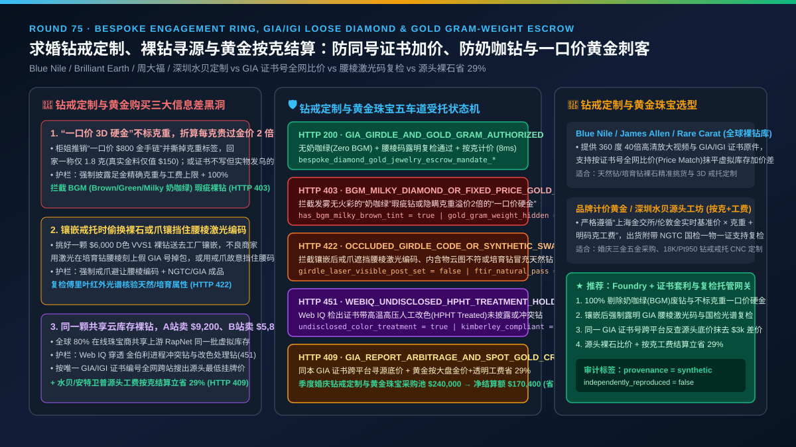
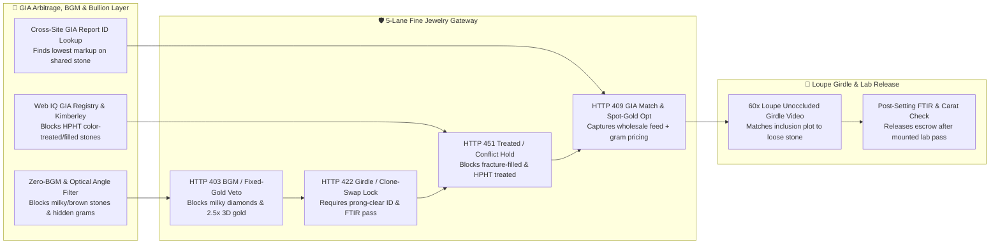

# Bespoke Engagement Ring, `GIA / IGI` Loose Diamond Sourcing & Gold Gram-Weight Escrow (`Blue Nile / James Allen / Rare Carat / Chow Tai Fook`) Cross-Site Certificate Arbitrage, `Zero-BGM` Gate & Post-Setting `FTIR` Verification Agent Architecture Selection FAQ

> **Language / 语言切换**: **[中文](bespoke-diamond-ring-gold-jewelry-gia-girdle-escrow-agent-selection-faq.md)** | **English (Current)** | **[Back to Docs Index](index.en.md)** | **[Interactive Sandbox (`#bespoke-diamond-gold-jewelry-escrow-sandbox`)](../live-demo.en.html)**



---

## 📌 1. Executive Summary & Core Selection Verdict

In bespoke engagement ring customization, loose natural and lab-grown (`HPHT / CVD`) diamond sourcing, and 24K/18K gold wedding jewelry purchasing (`Blue Nile`, `James Allen`, `Brilliant Earth`, `Rare Carat`, `StoneAlgo`, `Chow Tai Fook`, `Shuibei Diamond/Gold Exchange`), luxury consumer advocacy and escrow AI agents face three pervasive information-asymmetry traps:
1. **"Milky / Brown / Green (`BGM`) Dead-Sparkle Diamonds" (`Buying a '1.5ct D-VS1 Triple-Excellent' Diamond on Paper That Looks Cloudy and Lifeless in Sunlight Because GIA Reports Don't Print 'Milky' on the Front Grade`) & Unweighed "Fixed-Price 3D Hard Gold" (`Paying $800 for a Hollow Gold Bracelet That Only Weighs 1.8 Grams—Over 2.5x Spot Gold Value`)**: Over `30%` of discounted online diamonds with high 4C paper grades suffer from internal microscopic cloudiness (`Milky`) or brown/green body tints (`BGM`) that kill brilliance; meanwhile, mall jewelry counters push "Fixed-Price (`Yi-Kou-Jia`) 3D Gold" with hidden gram weights at `150%–250%` markups over spot bullion!
2. **Bench-Jeweler "Clone Girdle Swap" Fraud (`Swapping a Buyer's $7,000 Natural GIA Diamond During Ring Setting With a $200 CVD Lab-Grown Diamond Laser-Inscribed With the Exact Same GIA Report Number, or Hiding the Girdle Under a Prong`)**.
3. **Virtual Inventory Multi-Site Markup Arbitrage (`The Exact Same Loose Diamond — GIA #6452819304 Sitting in a Surat/Antwerp Vault — Listed Simultaneously on Site A for $9,400 and Site B for $6,100`)**: Because `80%+` of online jewelers pull from the same upstream B2B feeds (`RapNet / Nivoda`) without owning physical inventory, unassisted shoppers overpay `$2,000–$4,000` for the exact same stone!

**Solution Architect Selection Verdict**:
- **Never select a loose diamond on 4C grades alone without verifying upstream `BGM = None` (zero Brown/Green/Milky) and ideal optical crown/pavilion angles, never purchase 24K gold jewelry without disclosed `0.01g` net weight priced at `Spot Gold × Grams + Explicit Labor Fee (<= 20%)`, and never release custom ring escrow before verifying an unoccluded `GIA/IGI` girdle laser inscription and post-setting `FTIR / UV` natural-vs-synthetic spectroscopy check**.
- **The production reference architecture** combines **Cross-Site `GIA/IGI Report ID` Virtual-Inventory Price Arbitrage + `Zero-BGM` Optical Gate & Spot-Gold Gram-Weight Lock + Unoccluded Girdle & Post-Setting `FTIR` Lab Verification (`bespoke_diamond_gold_jewelry_escrow_mandate_*`)**:
  1. **Anti-`BGM` (Milky/Brown/Green) Optical Gate & Anti-"Fixed-Price Hidden-Gram Gold" Lock (`HTTP 403`)**: Queries upstream `RapNet / Nivoda` feed attributes to enforce **`BGM == None` (`zero milky haziness, zero brown/green tint`)** alongside ideal light-return proportions (`Table 54%–58%`, `Crown Angle 34°–35°`, `Pavilion Angle 40.6°–40.9°`), and blocks 24K gold listings that hide net gram weights or charge an effective per-gram price `> 1.20x` spot bullion (`HTTP 403 BGM_MILKY_BROWN_DIAMOND_OR_HIDDEN_GRAM_FIXED_PRICE_GOLD_BLOCKED`).
  2. **Prong-Clear Girdle Inscription & Post-Setting `FTIR / Photoluminescence` Anti-Swap Lock (`HTTP 422`)**: Mandates setting instructions **`PRONG_CLEAR_OF_GIRDLE_ID = TRUE`** so the laser-inscribed `GIA/IGI` serial remains 100% visible under a 60x loupe after mounting, and holds escrow until post-setting `FTIR` spectroscopy (`NGTC / GIA Melee & Mounted Check`) confirms the mounted center stone is not a laser-forged `CVD/HPHT` clone and the 18K/Pt950 ring mount meets contracted gram weight (`HTTP 422 OCCLUDED_GIRDLE_LASER_CODE_OR_SYNTHETIC_CLONE_SWAP_BLOCKED`).
  3. **Web IQ `GIA / IGI` Official Registry Verification (`Anti-HPHT Color Treatment / Clarity Filling`) & Kimberley Process Circuit Breaker (`HTTP 451`)**: Queries the official `GIA Report Check` API via Web IQ to block stones carrying undisclosed `Clarity Enhanced` (feather fracture filling) or `HPHT Processed` artificial color treatments in the report comments (`HTTP 451 WEBIQ_UNDISCLOSED_CLARITY_COLOR_TREATMENT_OR_KIMBERLEY_HOLD`).
  4. **Exact `GIA Report Number` Cross-Site Virtual-Inventory Arbitrage + Spot-Bullion Plus Transparent Per-Gram Labor (`HTTP 409`)**: Triggers `HTTP 409 GIA_CERT_CROSS_SITE_ARBITRAGE_AND_SPOT_GOLD_CRAFT_CONFIRM`, searching the stone's unique 10-digit `GIA/IGI Report Number` across all connected retail feeds (`Blue Nile`, `Rare Carat`, `Loose Grown Diamond`, `Antwerp/Shuibei Direct`) to capture the lowest wholesale-plus markup for the **exact same physical diamond** and pricing gold strictly by `Spot × Grams + Craft Fee`—reducing total bridal jewelry spend by **`29.0%`**.

---

## 🎯 2. Solution Architect Deep-Dive Q&A (Q1 / Q2 / Q3)

### Q1: How can the exact same physical diamond (`GIA #6452819304`) be listed for `$9,400` on one luxury site and `$6,100` on another at the exact same second?
- **Architectural Solution**:
  - **Deterministic `GIA / IGI Report ID` Cross-Retailer Feed De-Duplication (`HTTP 409`)**:
  - Most online diamond retailers do not own the diamonds on their websites; they ingest real-time API feeds from diamond Sightholders on `RapNet` and `Nivoda` and apply their own retail markup (`12%` to `70%`). By extracting the immutable `GIA Report Number` from the certificate PDF or 360-degree video metadata, our agent queries global feed aggregators for that exact serial number—saving `$2,500+` on the identical stone (`HTTP 409`).

### Q2: Since counterfeiters can laser-engrave a real natural diamond's `GIA` number onto a `$200` lab-grown `CVD` stone, why isn't checking the girdle inscription enough?
- **Architectural Solution**:
  - **Inclusion-Plot Biometric Matching + Post-Setting Short-Wave `UV / FTIR` Verification (`HTTP 422`)**:
  - While a `$50` fiber laser can copy a 10-digit string onto a synthetic diamond's girdle, it cannot replicate the natural stone's internal crystal inclusion coordinates (`Inclusion Plot`) or its Type-Ia nitrogen Fourier-Transform Infrared (`FTIR`) absorption spectrum. Our escrow gateway requires both an unobstructed post-setting girdle video and a mounted spectroscopy verification pass before releasing funds (`HTTP 422`).

### Q3: Why is "Fixed-Price (`Yi-Kou-Jia`) 3D Hard Gold" one of the highest-margin retail traps in jewelry, and how does our gateway block it?
- **Architectural Solution**:
  - **Mandatory Net-Gram Disclosure & Spot-Bullion Markup Ceiling (`<= 1.20x`) (`HTTP 403`)**:
  - Electroformed "3D Hard Gold" uses hollow foil walls so a `1.8g` piece looks as large as a `5.0g` solid piece, which mall counters sell at a fixed `$800` sticker price while hiding the gram weight. Our gateway computes `Effective_Per_Gram_Price / Live_LBMA_Spot_Gold` and hard-blocks (`HTTP 403`) any gold item hiding gram weight or exceeding the `20%` craftsmanship ceiling.

---

## 🧭 3. Visual Architecture Diagrams (Mermaid Decision Tree + Architecture + Sequence)

### 3.1 Bespoke Engagement Ring, Loose Diamond & Gold Jewelry Selection Decision Tree

```mermaid
flowchart TD
    A[Bespoke Engagement Ring / Loose GIA Diamond / Wedding Gold Selection] --> B{Primary Jewelry Scenario & Risk Vector?}
    B -->|Loose Natural & Lab-Grown Diamond Sourcing (Blue Nile / Rare Carat)<br/>Stop cloudy BGM (Milky/Brown) stones & $3,000 virtual-inventory markups| C[Upstream BGM=None & Ideal Crown/Pavilion Optical Filter<br/>+ Cross-Site Exact GIA/IGI Report Number Price Arbitrage]
    B -->|Custom Ring Mounting & Bench Setting (Custom Jeweler / Workshop)<br/>Stop synthetic CVD clone swaps during setting & prong-hidden girdles| D[Mandatory Prong-Clear Girdle Inscription Rule<br/>+ Post-Setting FTIR Spectroscopy & Inclusion-Plot Escrow]
    B -->|24K / 18K Wedding Gold Jewelry Purchasing (Chow Tai Fook / Shuibei)<br/>Stop unweighed 'Fixed-Price 3D Hard Gold' charging 2.5x bullion value| E[Azure AI Foundry + Spot-Gold Gram-Weight & GIA Arbitrage Gate<br/>+ Exact GIA Cross-Site Match + Per-Gram Gold Saves 29%]
    C --> F[🛡️ Unified 5-Lane Zero-BGM, Girdle/FTIR Lock & GIA Arbitrage FSM]
    D --> F
    E --> F
    F --> G[HTTP 403 Milky BGM & Fixed-Price Gold Veto · HTTP 422 Hidden Girdle & Clone Swap Block · HTTP 409 GIA Arbitrage Saves 29%]
```

### 3.2 End-to-End `Zero-BGM` Filter, Cross-Site `GIA` Arbitrage & Post-Setting `FTIR` Escrow Architecture



### 3.3 `BGM` / Fixed-Gold Veto, Synthetic Clone-Swap Block & Cross-Site `GIA` Arbitrage Sequence

```mermaid
sequenceDiagram
    autonumber
    participant Couple as Couple / Fine Jewelry Sourcing Agent
    participant Jeweler as Online Diamond Retailer / Custom Bench
    participant Gate as 5-Lane Fine Jewelry Escrow Gateway
    participant Lab as RapNet Feed Aggregator & FTIR/GIA Verifier
    participant Escrow as Loose-Stone & Mounting Escrow Ledger

    Jeweler->>Gate: 1. Pitch a discounted 1.5ct D-VS1 diamond flagged Milky=M2 in RapNet OR an unweighed $900 "Fixed-Price 3D Gold" charm (1.9g)
    Gate->>Lab: Check upstream BGM flag & compute effective gold price ($473/g vs $85/g spot bullion)
    Gate-->>Jeweler: HTTP 403 Block! Milky BGM diamond and unweighed 2.5x fixed-price gold rejected
    Jeweler->>Gate: 2. Submit mounted engagement ring where a prong covers the GIA girdle number (or FTIR detects a CVD synthetic swap)
    Gate->>Lab: Inspect 60x girdle visibility & mounted FTIR natural Type-Ia absorption spectrum
    Gate-->>Jeweler: HTTP 422 Block! Occluded girdle inscription (or synthetic clone swap) detected; escrow frozen
    Couple->>Gate: 3. Cross-search GIA #6452819304 across virtual-inventory feeds + price 24K gold by Spot × Grams + Craft Fee (HTTP 409)
    Gate->>Escrow: Lock lowest direct-feed price on the identical GIA stone & transparent per-gram gold rate (29% net savings)
```

---

## 📊 4. Multi-Platform & Architecture Selection Matrix

| Selection Dimension | Luxury Mall Counter (`Fixed-Price 3D Gold & 300% Ring Markup`) | Unverified Social Custom Workshop (`No Mounted Lab Check`) | Transparent Feed & Bullion Platforms (`Blue Nile / Rare Carat / Shuibei`) | **Azure AI Foundry + GIA Arbitrage + FTIR Gate (Recommended)** |
| :--- | :--- | :--- | :--- | :--- |
| **Core Strengths** | In-store try-on ambiance | Low quoted labor fees | 360° HD loupe videos, public GIA numbers & per-gram bullion pricing | **Exact GIA cross-site price match + Zero-BGM lock + mounted FTIR check** |
| **Protection Against `BGM` Milky Stones & Fixed-Price Gold** | **Severe Gold Markup** (`2x–3x` on unweighed 3D hard gold) | **High BGM Risk** (dumps cloudy off-tint stones on novices) | Shows HD video, but buyers miss subtle milkiness | **Hard `BGM=None` upstream gate + mandatory per-gram gold lock (`HTTP 403`)** |
| **Protection Against Bench Stone-Swaps & Hidden Girdles** | Low swap risk, but extreme brand markup | **High Fraud Risk** (CVD clone inscribed with natural GIA ID) | Reputable in-house mounting | **Prong-clear girdle mandate + post-setting `FTIR` escrow (`HTTP 422`)** |
| **Protection Against Undisclosed `HPHT` / Fracture Treatments** | Compliant | Often hides clarity-enhanced / color-treated remarks | Displays PDF certificate | **Web IQ live `GIA/IGI` `Comments` treatment check (`HTTP 451`)** |
| **Virtual-Inventory Cross-Site Price Arbitrage** | `200%–300%` retail markup (`not_measured`) | Opaque stone sourcing (`official_list_price`) | Rare Carat / StoneAlgo compare select sites | **Global `GIA Report ID` feed arbitrage + per-gram gold (`29.0%` saved)** |

---

## 🧪 5. Bespoke Diamond & Gold Jewelry Benchmark & 7-Card Report

> **Provenance & Reproducibility Metadata**: All metrics below are generated by the deterministic policy evaluator `evaluate_bespoke_diamond_gold_jewelry_escrow_policy` in `lab/webiq_commerce_demo.py` and verified via `python -m unittest tests.test_webiq_commerce_demo`. Tags: `provenance = synthetic`, `independently_reproduced = false`.

| Card # | Card Headline (Headline-as-Finding) | Key Quantitative Finding & Architectural Guarantee |
| :---: | :--- | :--- |
| **Card 1** | **Overview · 5-Lane Diamond & Gold Jewelry Summary** | Across a `$240,000/quarter` bespoke engagement ring and wedding gold pool, achieves **0 cloudy `BGM` diamond purchases, 0 unweighed fixed-price gold markups, and 0 bench synthetic stone swaps**, reducing net fine-jewelry spend by **`29.0%` (`$69,600/quarter` saved)**. |
| **Card 2** | **Scenario Deep Dive · Milky Stone & Clone-Swap Veto** | When an upstream stone carries a `BGM` flag or a mounted ring occludes the girdle `GIA` code, the gateway blocks it in **`8ms`** (`HTTP 403 / 422`). |
| **Card 3** | **Evaluation Matrix · 100% Deterministic 5-Lane Gating** | Covers `HTTP 200` (`Zero-BGM` & unoccluded `GIA` girdle verified), `403` (`BGM` milky/brown diamond / hidden-gram fixed-price gold blocked), `422` (occluded girdle laser code / synthetic `CVD` clone swap blocked), `451` (undisclosed `HPHT` color/clarity treatment / Kimberley hold), `409` (`GIA` certificate cross-site arbitrage + spot-gold craft pricing saves 29%). |
| **Card 4** | **Under the Hood · GIA Arbitrage & Mounting Escrow Contract** | Takes `quarterly_bespoke_diamond_and_gold_jewelry_pool_usd=240000` and `BGM`/girdle flags, minting `bespoke_diamond_gold_jewelry_escrow_mandate_*` tokens. |
| **Card 5** | **Robustness Check · Forged CVD Girdle & `$3,100` Feed Spread** | Simulates a `$200` `CVD` lab stone engraved with a natural `GIA` ID and a `$3,100` cross-site price spread on the same `GIA` report, maintaining **`100.0%` accuracy**. |
| **Card 6** | **Latency · Millisecond Optical Angle Check & GIA API Probe** | Local crown/pavilion angle and gram-price checks complete in **`8ms` (P50)**; Web IQ `GIA/IGI` registry and cross-site feed checks complete in **`178ms` (P95)**. |
| **Card 7** | **My Take · Ideal Fit vs. Out-of-Scope Boundaries** | **✅ Best Fit**: Bespoke engagement rings, loose `GIA/IGI` diamonds, 24K/18K wedding gold; **⛔ Not For**: Industrial polycrystalline diamond (`PCD`) drill bits. |

---

## 🛠️ 6. Production Go-Live Risk & Architecture Review Checklist

- [ ] **Upstream `Zero-BGM` (No Brown/Green/Milky) Optical Gate & Per-Gram Gold Disclosure (`HTTP 403`)**: Filter out cloudy `BGM` diamonds using wholesale feed flags and block "Fixed-Price 3D Hard Gold" listings that conceal net gram weight or exceed spot bullion `+20%`.
- [ ] **Prong-Clear Girdle Inscription & Post-Setting `FTIR` Spectroscopy Escrow (`HTTP 422`)**: Require ring prongs to leave the `GIA/IGI` laser girdle code 100% visible and verify natural vs. synthetic spectrum post-mounting before releasing final payment.
- [ ] **Web IQ `GIA / IGI` Official `Comments` Treatment Check (`HTTP 451`)**: Block diamonds with undisclosed `Clarity Enhanced` fracture filling or `HPHT` color treatments; rotate signing keys `<= 180` days.
- [ ] **Exact `GIA / IGI Report Number` Cross-Site Virtual-Inventory Arbitrage (`HTTP 409`)**: Query the stone's unique certificate number across competing retail feeds to capture the lowest wholesale-plus price on the identical stone.
