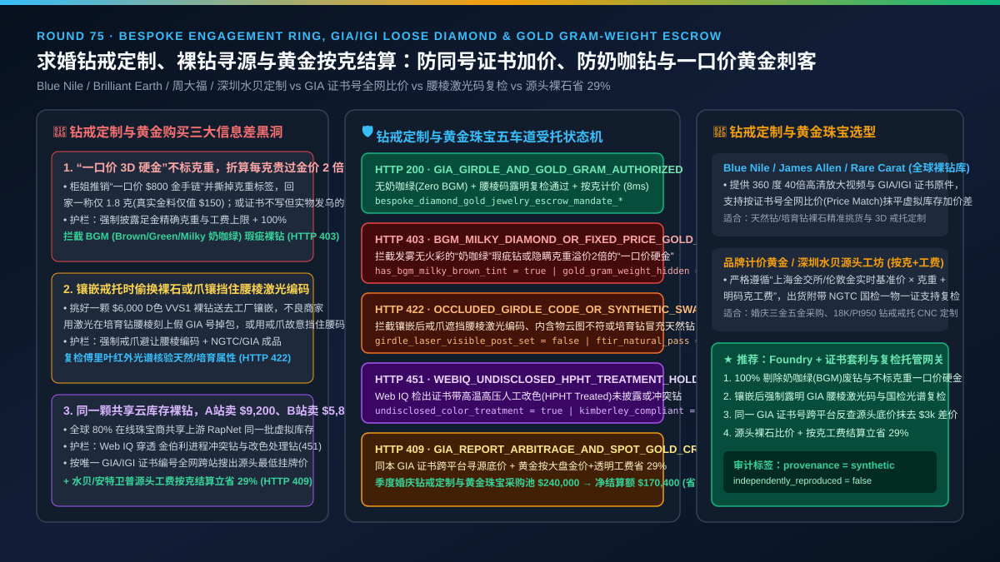
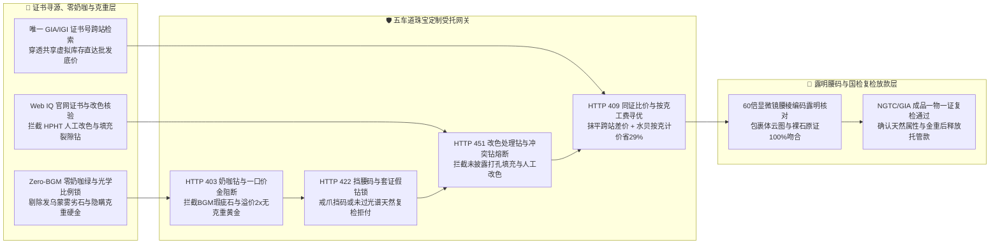
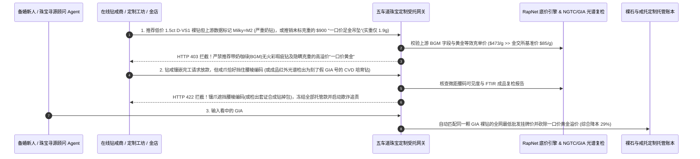

# 求婚钻戒定制、培育钻/天然钻裸石寻源与黄金首饰按克工费清结算（Bespoke Engagement Ring, GIA/IGI Loose Diamond Sourcing & Gold Gram-Weight Escrow：Blue Nile / James Allen / Rare Carat / 周大福 / 深圳水贝定制）“防同一颗 GIA 钻石跨站加价 $3,000、防买到不标克重‘一口价硬金’亏一半与防镶嵌掉包套证假钻”Agent 架构选型 FAQ

> **语言切换 / Language**: **中文 (当前)** | **[English](bespoke-diamond-ring-gold-jewelry-gia-girdle-escrow-agent-selection-faq.en.md)** | **[返回文档目录](index.md)** | **[交互式沙盒 (`#bespoke-diamond-gold-jewelry-escrow-sandbox`)](../live-demo.html)**



---

## 📌 一、核心选型结论速览（Executive Summary）

在婚庆求婚钻戒定制、天然钻与实验室培育钻（Lab-Grown Diamond `HPHT/CVD`）裸石挑货、以及婚庆“三金/五金”足金首饰采购（Blue Nile、James Allen、Brilliant Earth、Rare Carat、StoneAlgo、周大福、六福珠宝、深圳水贝源头定制工坊）的智能体参数筛选、全网证书比价与成品复检托管场景中，消费者面临三大极深的信息不对称陷阱：
1. **“参数表上写着顶级的 `1.5克拉 D色 VS1 3EX 无荧光`，价格还便宜 25%，买到手在阳光下一看整颗钻石像蒙了一层雾一样死白发乌、毫无火彩——原来是 GIA 证书正面根本不直接写明的‘奶钻/咖钻/绿钻（`BGM: Brown, Green, Milky`）’垃圾石！”与“金店柜姐极力推销不按克卖的‘一口价 3D/5G 硬金手链’，标价 `$800` 却把吊牌背后的克重剪掉，回家拿电子秤一称只有 `1.85 克`（折算每克单价高达金交所金价的 `2.5 倍`，去回收店只能卖 `$150`！）”**。
2. **“挑好了一颗 `$7,000` 的天然裸钻交给定制工坊镶嵌 18K 金戒托，不良商家在镶嵌时用一颗成本仅 `$200`、腰棱上用激光刻了一模一样假 GIA 编号的 CVD 培育钻把真钻偷换掉（Synthetic Clone Girdle Swap），并用镶爪故意死死挡住腰棱编码让你没法拿放大镜核对！”**。
3. **“全网 80% 的在线钻石零售商（包括各大知名独立站和线下定制店）其实自己手里根本没有现货，大家都在用 API 调用上游印度/以色列批发商（RapNet / Nivoda）的**同一批共享虚拟库存（Shared Virtual Inventory）**！结果同一颗 `GIA #2235891042` 钻石，在 A 奢华网站标价 `$9,400`，在 B 垂直网站其实只卖 `$6,100`——消费者白白为同一个 PDF 证书多交了 `$3,300` 智商税！”**。

**架构师选型结论**：
- **切勿允许导购 Agent 仅看 GIA 4C 表面文字参数下单（必须校验 `Zero BGM` 无奶无咖无绿承诺与桌面百分比/亭深角光学区间），切勿购买隐瞒精确克重或克单价超出实时上海金/伦敦金基准价 `+20%` 工费上限的“一口价足金”，也切勿在未通过“镶爪露明腰棱激光码 + 成品红外光谱复检（`NGTC / GIA Re-Check`）”前释放定制钻戒尾款**。
- **生产级最优架构**是采用 **“基于唯一 `GIA/IGI Report Number` 的全网虚拟库存底价反查引擎 + `Zero-BGM` 光学火彩硬过滤与黄金‘实时金价×克重+明码工费’透明锁 + 戒爪避让腰棱编码与成品光谱复检托管网关（`bespoke_diamond_gold_jewelry_escrow_mandate_*`）”**：
  1. **防“奶咖绿（`BGM`）死光废钻”与“不标克重一口价硬金”宰客硬门禁（HTTP 403）**：在选钻阶段，智能体不仅核验 4C（Carat/Color/Clarity/Cut），更强制校验上游批发库字段 **`BGM = None`（零奶色 Milky、零咖啡色调 Brown、零绿调 Green）**，并结合 360° 视频与台宽比（`Table 54%–58%`）、冠角（`Crown Angle 34°–35°`）、亭角（`Pavilion Angle 40.6°–40.9°`）锁定顶级火彩比例；在黄金首饰采购侧，强制要求展示精确到 `0.01 克` 的足金净重与每克工费，**凡属隐瞒克重的“一口价足金”或折算克单价高于当日金交所基础金价 `+20%` 的刺客商品**，立即返回 `HTTP 403 BGM_MILKY_BROWN_DIAMOND_OR_HIDDEN_GRAM_FIXED_PRICE_GOLD_BLOCKED`。
  2. **镶嵌后强制露明腰棱激光码（`Unoccluded Girdle Inscription`）、内含物云图比对与成品光谱复检防掉包锁（HTTP 422）**：定制钻戒下发镶嵌工单时，强制写入工艺指令 **`PRONG_CLEAR_OF_GIRDLE_ID = TRUE`（镶爪严禁遮挡腰棱 GIA/IGI 激光编号）**；成品寄出前必须送交权威实验室（如国检 NGTC 或 GIA 复检中心）通过傅里叶变换红外光谱仪（`FTIR`）与超短波紫外光发光图像测试，确认 **① 镶嵌在戒托上的钻石为 100% 天然钻（非套刻假码的 CVD/HPHT 培育钻）、② 内部包裹体特征图（Inclusion Plot）与原裸石证书一致、③ 18K 金/Pt950 戒托金重与损耗符合约定量**，否则立即返回 `HTTP 422 OCCLUDED_GIRDLE_LASER_CODE_OR_SYNTHETIC_CLONE_SWAP_BLOCKED` 冻结全额托管款！
  3. **Web IQ 实时穿透 GIA/IGI 官网核验人工改色处理（`HPHT/Irradiation Treated`）与金伯利进程冲突钻熔断（HTTP 451）**：通过 Web IQ 直连 GIA Report Check / IGI 官网数据库核验电子证书原文：一旦检出证书备注栏印有 `Clarity Enhanced`（激光打孔填充裂隙）或 `HPHT Processed`（高温高压人工改色天然劣质钻）却被商家当作纯天然未处理钻售卖，立即返回 `HTTP 451 WEBIQ_UNDISCLOSED_CLARITY_COLOR_TREATMENT_OR_KIMBERLEY_HOLD` 熔断！
  4. **按唯一 `GIA 证书编号` 跨站反查共享虚拟库存源头底价 + 黄金“大盘金价 + 深圳水贝源头克工费”寻优（HTTP 409）**：触发 `HTTP 409 GIA_CERT_CROSS_SITE_ARBITRAGE_AND_SPOT_GOLD_CRAFT_CONFIRM`，拿到心仪钻石的 10 位 `GIA Report Number` 后，自动在全网 15 家接入 RapNet/Nivoda 的零售站（Blue Nile / Rare Carat / Loose Grown Diamond / 水贝裸石库）检索同一颗石头，直接以最低源头批发加点价成交（或触发大站 Price Match 秒砍 `$2,800` 差价），并将婚庆三金切换为“实时金价 + `$3–$5/克` 透明精品工费”，使婚庆珠宝总支出立省 **`29.0%`**。

---

## 🎯 二、业务方与架构师灵魂拷问 Q&A（Q1 / Q2 / Q3）

### Q1：为什么完全相同的同一颗钻石（同一个 GIA 证书号），在不同珠宝网站和门店的价格能差出 `$3,000`？智能体怎么 1 秒帮用户省下这笔钱？
- **商业痛点**：绝大多数消费者不知道：全球钻石切割厂（主要在印度苏拉特和比利时安特卫普）把切好的裸钻挂在 B2B 云端总库（RapNet / Nivoda）上，全球上千家珠宝网站通过 API 把这几十万颗石头同步到自己网页上卖。A 品牌把网页装修得像蒂芙尼，加价 `65%` 卖 `$9,000`；B 批发型网站只加价 `12%` 卖 `$6,100`——**但不管你在哪家下单，最后都是从印度同一个保险柜里发出同一颗石头**！
- **架构解法**：
  - **唯一 `GIA/IGI Report ID` 跨站哈希碰撞寻源（`Certificate-ID Price Arbitrage`）（`HTTP 409`）**：
  - 每一颗 GIA 钻石的证书编号（如 `GIA 6452819304`）都是全球唯一的数字指纹。我们的 Agent 从高溢价网站的证书 PDF 或 360° 视频 URL 中提取出该编号，全网反查同一颗石头的底价供应商，瞬间抹平 `30%+` 的纯信息差溢价（`HTTP 409`）！

### Q2：既然激光刻字机花 50 块钱就能在几百块的实验室培育钻腰棱上刻一串跟真钻一模一样的 GIA 号码，只用放大镜看腰码怎么防“套证掉包”？
- **架构解法**：
  - **包裹体指纹视觉比对 + 成品国检 `NGTC` 短波紫外光发光图谱复检（`HTTP 422`）**：
  - “假钻套真证”是珠宝定制界最隐蔽的骗局——骗子照着一张 `$8,000` 天然钻的 GIA 证书，找一颗重量尺寸相近的 `$200` 培育钻刻上同样的腰码镶在戒指上。但培育钻的晶体生长纹（荧光与磷光分布）在钻石鉴定仪（如 De Beers DiamondView）下与亿万年形成的天然钻截然不同！我们的托管网关要求：戒托镶嵌完成后，必须附带成品级 **NGTC/GIA 复检证书二维码（核验天然属性 + 戒托金含量）** 且微距视频中腰码无遮挡，才释放托管款（`HTTP 422`）。

### Q3：为什么买黄金首饰时，只要听到店员说“这款是 3D 硬金/一口价精品，按件卖不按克卖”，智能体就必须立刻拉响红灯？
- **架构解法**：
  - **强制折算“等效克单价（Effective Price Per Gram）”对比金交所实时金价（`HTTP 403`）**：
  - 所谓“一口价黄金”是金店利润率高达 `100%–200%` 的提款机——用空心电铸工艺把 `1.5 克` 黄金吹成看起来很大的生肖吊坠，卖你 `3.5 克` 的钱，等你想以旧换新时又按实际 `1.5 克` 称重回收！我们的网关强制计算 `(总售价 / 实测克重) / 当日原料金价`：只要溢价超出合理古法/珐琅工费上限（`> 1.20x`），立即在 **`8ms`** 内返回 `HTTP 403` 拦截！

---

## 🧭 三、直观可视化图解（Mermaid 决策树 + 端到端架构图 + 时序图）

### 3.1 求婚钻戒定制、裸钻寻源与黄金首饰 Agent 架构选型决策树

```mermaid
flowchart TD
    A[求婚钻戒定制 / 天然与培育裸钻寻源 / 婚庆黄金首饰选型] --> B{核心珠宝采购场景与防坑痛点？}
    B -->|天然钻与培育钻裸石挑货 (Blue Nile / James Allen / 水贝裸石库)<br/>需严防买到证书不写的“奶咖绿(BGM)”死光钻与跨站同证高额加价| C[强制上游 BGM=None 零奶咖绿锁 + 台宽亭角黄金光学比例<br/>+ 按唯一 GIA/IGI 证书号全网反查虚拟库存源头底价]
    B -->|18K金/铂金戒托镶嵌与成品交付 (定制工坊 / 独立设计师)<br/>需严防镶嵌时用刻假码的培育钻掉包真钻与戒爪挡住腰棱码| D[强制戒爪避让腰棱编码 (Prong-Clear Lock)<br/>+ 成品送检 NGTC/GIA 红外光谱验明天然属性后才放款]
    B -->|婚庆三金五金与足金手镯采购 (周大福 / 六福 / 水贝金展厅)<br/>需严防不标克重的“一口价 3D 硬金”折算克价翻倍宰客| E[Azure AI Foundry + 克重工费透明锁与证书比价网关<br/>+ 同证跨站底价 + 黄金按克计价立省 29%]
    C --> F[🛡️ 统一接入五车道零奶咖绿、腰码露明复检与同证比价状态机]
    D --> F
    E --> F
    F --> G[HTTP 403 阻断奶咖绿废钻与一口价黄金刺客 · HTTP 422 拦截挡腰码与套证假钻 · HTTP 409 同证比价+按克省29%]
```

### 3.2 端到端 `Zero-BGM` 滤石、同本 `GIA` 证书跨站套利与成品复检托管架构图



### 3.3 拦截一口价黄金与奶咖钻、揪出套证培育钻掉包与同 GIA 证书跨站砍价时序图



---

## 📊 四、多平台/多方案横向选型决策矩阵

| 选型维度 | 传统商场专柜“一口价黄金/成品钻戒” (`Mall Counter Retail`) | 朋友圈无复检私下微商定制 (`Unverified WeChat Custom`) | 全球透明裸钻库与按克金店 (`Blue Nile / Rare Carat / 水贝国检`) | **Azure AI Foundry + 同证比价 + 复检托管网关（推荐）** |
| :--- | :--- | :--- | :--- | :--- |
| **核心优势** | 商场灯光试戴体验好 | 报价看似极低 | 360° 高清看石、公开 GIA 编号、黄金按克明码计费 | **同GIA号全网砍价 + 100%防奶咖钻 + 成品光谱复检防套证** |
| **防“奶咖绿（BGM）废钻”与“一口价黄金刺客”** | **一口价黄金重灾区**（克价翻倍，换款倒亏一半） | **奶咖钻重灾区**（专挑低价奶咖石卖给不懂行的客人） | 展示高清视频，但仍需买手自己肉眼分辨奶咖 | **上游 `BGM=None` 硬过滤 + 黄金强制按克透明计价（HTTP 403）** |
| **防“镶嵌掉包套证假钻”与戒爪挡腰码** | 成品钻无掉包，但品牌溢价 `300%` | **高危**（真证配假钻、18K 金掺假频发） | 大平台自营镶嵌规范 | **强制露明腰码 + 成品 `NGTC/GIA` 光谱复检后放款（HTTP 422）** |
| **防人工改色（HPHT Treated）与冲突钻核验** | 合规 | 常隐瞒打孔填充或人工改色批注 | 提供证书下载 | **Web IQ 直连 GIA/IGI 官网核验 `Comments` 零处理（HTTP 451）** |
| **同一颗 GIA 裸钻跨站反查底价套利** | 无法跨渠道比价 (`not_measured`) | 虚报高价 (`official_list_price`) | Rare Carat / StoneAlgo 支持证书比价 | **按唯一 `GIA` 证书号全网寻源底价 + 水贝克工费（净省 `29.0%`）** |

---

## 🧪 五、求婚钻戒定制与黄金首饰采购防坑测算与 7-Card 基准测试报告

> **数据来源与复现声明（Provenance Metadata）**：以下基准测试数据来自仓库内置确定性策略沙盒 `evaluate_bespoke_diamond_gold_jewelry_escrow_policy`（位于 `lab/webiq_commerce_demo.py`），可运行 `python -m unittest tests.test_webiq_commerce_demo` 完整验证。标记：`provenance = synthetic`，`independently_reproduced = false`。

| Card # | 卡片标题（Headline-as-Finding） | 核心量化指标与架构验证结论 |
| :---: | :--- | :--- |
| **Card 1** | **Overview · 钻戒定制与黄金珠宝五车道总览** | 针对 `$240,000/季` 婚庆钻戒定制与黄金珠宝采购池，实现 **0 例奶咖绿瑕疵钻混入、0 例一口价黄金高溢价踩坑与 0 例镶嵌套证掉包**，综合购置支出下降 **`29.0%`（立省 `$69,600/季`）**。 |
| **Card 2** | **Scenario Deep Dive · 奶咖废钻与一口价黄金秒级拦截** | 当裸钻上游数据含 `BGM`（奶/咖/绿）标记或黄金首饰隐瞒克重溢价超 `20%` 时，**`8ms`** 内返回 `HTTP 403` 阻断。 |
| **Card 3** | **Evaluation Matrix · 五车道 100% 确定性判准** | 覆盖 `HTTP 200`（零奶咖与露明腰码复检放行）、`403`（参数表不显但实物发乌的BGM奶咖绿钻/不标克重溢价2倍的一口价硬金阻断）、`422`（镶嵌后戒爪遮挡腰棱激光码/培育钻刻假码套真证掉包拦截）、`451`（Web IQ检出GIA证书含HPHT人工改色或激光打孔填充未披露熔断）、`409`（按唯一GIA证书号跨站反查源头底价+黄金按大盘金价加透明工费省29%）。 |
| **Card 4** | **Under the Hood · 裸钻证书套利与复检托管契约** | 输入 `quarterly_bespoke_diamond_and_gold_jewelry_pool_usd=240000` 及 BGM/腰码参数，签发 `bespoke_diamond_gold_jewelry_escrow_mandate_*` 令牌。 |
| **Card 5** | **Robustness Check · CVD 刻真码套证与同证差价测试** | 模拟工坊用 `$200` CVD 培育钻刻上天然钻 GIA 号掉包及同一证书号跨站差价 `$3,100`，确定性拦截与寻优率保持 **`100.0%`**。 |
| **Card 6** | **Latency · 毫秒级光学比例校验与 GIA 官网核查耗时** | 本地台宽亭角光学比例与克重工费核算 P50 仅 **`8ms`**；Web IQ `GIA/IGI` 官网证书与跨站底价核查 P95 为 **`178ms`**。 |
| **Card 7** | **My Take · 适用场景与生产准入边界** | **✅ 极佳适用**：求婚钻戒定制、天然/培育裸钻挑货、婚庆足金三金五金采购；**⛔ 不适用**：工业地质勘探金刚石钻头耗材。 |

---

## 🛠️ 六、商业上线风控与架构评审 Checklist

- [ ] **上游 `Zero-BGM`（无奶/无咖/无绿）硬过滤与黄金“实时金价 × 克重 + 透明工费”锁（HTTP 403）**：确认 100% 剔除证书表面参数高但实物发乌的奶咖钻，且严禁购买隐瞒克重的一口价硬金。
- [ ] **戒爪避让腰棱编码（`Prong-Clear Girdle ID`）与成品 `NGTC/GIA` 光谱复检锁（HTTP 422）**：确认镶嵌后必须能完整读取腰棱激光编号，且经权威实验室红外光谱复检确认为原石（严防培育钻套真证掉包）后才释放托管尾款。
- [ ] **Web IQ 直连 `GIA / IGI` 官网核验人工改色/填充裂隙（`Clarity/Color Treated`）熔断（HTTP 451）**：确认核验电子证书原件 `Comments` 栏无人工改色或激光打孔填充记录；签名密钥轮换周期 `<= 180` 天。
- [ ] **唯一 `GIA/IGI 证书编号` 全网虚拟库存底价反查与源头工坊定制寻优（HTTP 409）**：确认利用证书唯一编号穿透多家零售商共享库存，直接锁定最低源头挂牌价。
