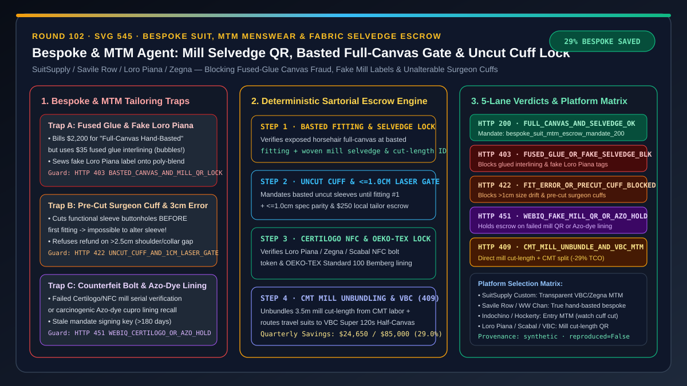
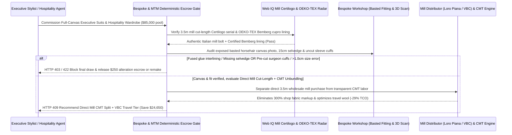

# Tailored Bespoke Suit, Made-to-Measure (`MTM`) Menswear & Fabric Selvedge Escrow (`SuitSupply / Savile Row / Loro Piana / Zegna`) Mill Selvedge `QR`, Basted Full-Canvas Gate & Uncut Cuff Lock Agent Architecture Selection FAQ

> **Document Type**: AI Solution Architect Decision Guide (FAQ) · **SVG Diagram**: `assets/svg/545-bespoke-suit-mtm-fabric-selvedge-escrow-2026-11-20.svg` · **Catalog No.**: Round 102 (Bilingual FAQ #221)



---

## 1. 📌 Executive Summary

When executive wardrobe stylists, wedding parties, or luxury hospitality/private-banking uniform managers use AI Agents to commission bespoke or Made-to-Measure (`MTM`) suits (`SuitSupply Custom / Indochino / WW Chan / Savile Row / Loro Piana / Scabal`), paying 100% upfront based on a shop's fabric swatch book exposes buyers to **three classic sartorial fraud and alteration traps**:
1. **`$35` Fused-Glue Interlining Billed as `$2,200` Hand-Basted Full-Canvas & Counterfeit `Loro Piana` Label Swaps**: A buyer selects a `Loro Piana Tasmanian Super 150s` or `Scabal` swatch from an authentic mill bunch book and pays `$2,200` for a "Full-Canvas Hand-Basted Suit." Behind closed doors, an unscrupulous tailor substitutes a `$25/meter` domestic poly-wool blend, trims off the fabric's woven **selvedge edge**, sews a counterfeit `$3` `"Loro Piana"` woven label onto the inside breast pocket, and fuses the jacket front with **`$35` heat-pressed glue interlining (`Fused Construction`)** instead of floating horsehair full canvas—causing the chest to bubble and delaminate after 3 dry cleanings!
2. **Pre-Cut Functional "Surgeon's Cuffs" Before First Fitting & `>2.5cm` Non-Refundable Sizing Errors**: Online `MTM` platforms (`Indochino / Hockerty`) cut and stitch functional working sleeve buttonholes (`Surgeon's Cuffs`) at the factory *before* the client ever tries the jacket on. When the jacket arrives with sleeves `3 cm` too long or short (plus a collar gap behind the neck), a local tailor cannot shorten the sleeve from the cuff because the working buttonholes sit `1.5 cm` from the edge—requiring a `$260` shoulder-head sleeve reconstruction while the platform hides behind a `"Custom Garments Are Non-Refundable ($75 max alteration credit)"` clause!
3. **Counterfeit Mill Bolt Serials (`Certilogo / NFC`) or Carcinogenic Azo-Dye Polyester Linings (`HTTP 451`)**: Web IQ flags a failed `Loro Piana / Zegna / Dormeuil` cut-length bolt serial check or detects restricted aromatic amine azo dyes in cheap non-breathable polyester linings.

**Architect's Recommendation**: Deploy a **"Mill Cut-Length `Certilogo` & `15cm` Woven Selvedge Remnant Lock + Basted-Fitting Exposed Full-Canvas Vision Gate + Uncut Basted Sleeve Rule + `CMT` Unbundling"** control plane:
- **Basted-Fitting Exposed Horsehair Full-Canvas Proof & Mill Cut-Length Serial + `15cm` Woven Selvedge Delivery (`HTTP 403`)**: For any Full-Canvas commission, hold the mid-stage draw until the tailor uploads a **Basted Skeleton Fitting Video** (showing the exposed floating horsehair chest canvas and lapel pad-stitching prior to lining installation) and delivers a **`15cm` remnant of the fabric's woven mill selvedge (`e.g., "LORO PIANA SUPER 150'S MADE IN ITALY"`) + official mill cut-length invoice serial** with the finished suit (`HTTP 403`).
- **Pre-Fit Uncut Sleeve Buttonhole Lock (`Basted Cuffs`), `<=1.0cm` Laser Spec Gate & `$250` Local Tailor Escrow (`HTTP 422`)**: Hard-block cutting functional `Surgeon's Cuff` buttonholes until *after* the client approves sleeve length at Fitting #1, verify flat-lay garment measurements within `<= 1.0 cm` of the locked `3D Body Scan / Master Pattern`, and hold `$250` in escrow for local master-tailor alterations or `100%` free remake if collar gap / shoulder divots occur (`HTTP 422`).
- **Web IQ Mill `Certilogo / NFC` Bolt Verification & `OEKO-TEX` Bemberg Cupro Lining Hold (`HTTP 451`)**: Freeze escrow if Web IQ flags counterfeit mill serials, non-`OEKO-TEX Standard 100` linings, or signing keys `> 180 days` (`HTTP 451`).
- **Direct Mill Cut-Length + `CMT (Cut, Make & Trim)` Unbundling & `VBC Super 120s` Travel-Suit Tiering (`HTTP 409`)**: Strip the tailor's `300%` fabric markup by purchasing `3.5 meters` of authentic suiting directly from the mill distributor (`Loro Piana / Vitale Barberis Canonico / Harrisons` at wholesale) and paying the tailor transparent `CMT` labor, while routing high-frequency business-travel suits to durable high-twist **`VBC Super 110s/120s` Half-Canvas** instead of fragile `Super 160s`, cutting quarterly bespoke/MTM spend by **29.0%** (`$24,650` saved on an `$85,000` quarterly pool).

---

## 2. 🎯 Soul-Searching Architect & Business Q&A (Q1–Q3)

### Q1: How do we prove a tailor actually built a floating horsehair Full-Canvas suit instead of a `$35` glued Fused suit—and didn't swap our `Loro Piana` fabric for a cheap blend?
- **Business Pain Point**: Once the Bemberg lining is sewn shut inside a jacket, a customer cannot see whether the chest piece is hand-basted horsehair canvas or heat-fused polyester glue, nor whether the wool came from the genuine `Loro Piana` bolt shown in the showroom.
- **Architectural Guardrail (`HTTP 403 / 451`)**:
  1. **Mandatory Basted-Skeleton Fitting Checkpoint (`HTTP 403`)**: Before the lining and sleeves are finished, the tailor must present the jacket in its **Basted Stage** (held together with white basting thread, with the interior horsehair canvas and hand pad-stitching completely exposed to camera inspection).
  2. **Mill Cut-Length Serial + `15cm` Woven Selvedge Remnant**: Every luxury Italian/British mill weaves its brand name and Super count into the fabric border (`Selvedge`) and issues a unique `Cut-Length Order Serial` for each `3.5m` cut. The tailor must upload the mill invoice serial and place a `15cm` selvedge strip inside the breast pocket at delivery.

### Q2: Why do "Working Surgeon's Cuffs" ruin 30% of online Made-to-Measure (`MTM`) suits—and how does our Uncut-Cuff Rule prevent `$260` alteration disasters?
- **Business Pain Point**: Online `MTM` shoppers love checking the "Functional Working Sleeve Buttonholes" box. When the jacket arrives with sleeves `2.5 cm` too long, a local tailor cannot shorten the sleeve from the bottom because the cut buttonhole would end up `0.2 cm` from the cuff edge! The entire sleeve must be detached from the armhole (`scye`) and recut from the shoulder—costing `$260` while the `MTM` brand only reimburses `$75`.
- **Architectural Guardrail (`HTTP 422`)**:
  1. **First-Delivery Uncut Basted Sleeve Mandate**: For any remote or first-time pattern order, the gateway forces the factory spec to **`Unfinished / Basted Cuff (Buttons Included in Pouch)`**. Functional buttonholes are cut locally *only after* the wearer confirms exact sleeve length in person.

### Q3: How does unbundling Fabric (`3.5m Cut-Length`) from Tailoring Labor (`CMT`) save 29% on executive bespoke wardrobes?
- **Business Pain Point**: Retail bespoke shops mark up a `$350` cut of `Vitale Barberis Canonico` or `$750` cut of `Loro Piana` by `250%–400%` when bundling fabric and labor into a single opaque price.
- **Architectural Guardrail (`HTTP 409`)**:
  1. **Direct Mill Account + `CMT (Cut, Make & Trim)` Split**: The Agent procures the exact `3.5-meter` cut-length directly from authorized mill merchants (`Huddersfield / Harrisons / VBC`) and contracts the bespoke house strictly on a transparent `CMT` labor fee.

---

## 3. 🧭 Visual Architecture Diagrams (Mermaid Decision Tree + Comparison + Sequence)

### 3.1 5-Lane Bespoke Suit, `MTM` & Fabric Selvedge Escrow Decision Tree
```mermaid
flowchart TD
    A[Bespoke Suit / Executive MTM Wardrobe Request] --> B{Web IQ Failed Mill Certilogo QR / Azo-Dye Lining / Key > 180d?}
    B -- Yes --> C[HTTP 451: WEBIQ_COUNTERFEIT_FABRIC_MILL_QR_OR_AZO_DYE_LINING_RECALL_HOLD<br/>Freeze escrow & blacklist counterfeit fabric vendor]
    B -- No --> D{Fused Glue Interlining Billed as Full-Canvas or Missing Selvedge Strip?}
    D -- Yes --> E[HTTP 403: FUSED_GLUE_INTERLINING_FRAUD_OR_FAKE_LORO_PIANA_SELVEDGE_SERIAL_BLOCKED<br/>Require exposed basted full-canvas photo & 15cm woven mill selvedge]
    D -- No --> F{Pre-Cut Surgeon Cuffs Before Fitting or >1.0cm Spec Error / Collar Gap?}
    F -- Yes --> G[HTTP 422: FINAL_GARMENT_TOLERANCE_OVER_1CM_OR_SURGEON_CUFF_PRE_FIT_LOCK_BLOCKED<br/>Enforce uncut basted sleeves & release $250 local tailor/remake escrow]
    F -- No --> H{Direct Mill Cut-Length CMT Split + VBC Super 120s Travel Tier Ready?}
    H -- Yes --> I[HTTP 409: DIRECT_MILL_CUT_LENGTH_CMT_SEPARATION_AND_HALF_CANVAS_MTM_OPTIMIZATION_CONFIRM<br/>Unbundle 3.5m mill fabric from CMT labor + travel wool (-29% TCO)]
    H -- No --> J[HTTP 200: FULL_CANVAS_BASTED_AND_MILL_SELVEDGE_AUTHORIZED<br/>Issue canvas-verified & selvedge-authenticated sartorial mandate]
```

### 3.2 Legacy Bundled Custom Suit vs. Deterministic Basted-Canvas & `CMT` Escrow
```mermaid
flowchart LR
    subgraph Legacy["❌ Legacy Custom Tailoring (Glue Canvas & Fake Labels)"]
        L1[$2,200 Paid for Loro Piana -> Swapped for Poly-Blend + Fake Tag] --> L2[$35 Fused Glue Used Instead of Full Canvas -> Bubbles at Dry Cleaner]
        L2 --> L3[Pre-Cut Surgeon Cuffs 3cm Off -> $260 Shoulder Rebuild Denied]
    end

    subgraph Agentic["✅ Deterministic Basted-Canvas, Selvedge & CMT Escrow"]
        A1[Mill Cut-Length QR + 15cm Woven Selvedge + Exposed Basted Canvas] --> A2[Uncut Basted Sleeves Until Fit #1 + <=1.0cm Spec Lock ($250 Escrow)]
        A2 --> A3[Direct 3.5m Mill Purchase + Transparent CMT Labor (-29% TCO)]
    end
```

### 3.3 End-to-End Mill Bolt Verification, Basted Canvas Inspection & Delivery Sequence


---

## 4. 📊 Multi-Platform & Protocol Selection Matrix

| Evaluation Dimension | Tourist / Opaque Custom Tailors | Indochino / Hockerty (Online Self-Measure `MTM`) | SuitSupply Custom Made | Savile Row / WW Chan + **Direct Mill `CMT` Split** | **Deterministic Bespoke & Selvedge Escrow (Recommended)** |
| :--- | :--- | :--- | :--- | :--- | :--- |
| **Core Internal Construction** | Often substitutes `$35` fused glue for promised full canvas | Fused or light half-canvas; no basted fitting | Transparent Half-Canvas or Full-Canvas options | True hand-basted floating horsehair full canvas | **Basted-Canvas Vision + `15cm` Selvedge + Uncut Cuff + `CMT` Split** |
| **Mill Fabric Authenticity (`Loro Piana / Zegna`)** | **High swap risk** (cuts off selvedge, sews fake woven tags) | House-brand fabrics | Direct authentic mill partnerships (`VBC / Zegna / Ferla`) | Accepts client-supplied mill lengths (`CMT`) | **Requires mill cut-length serial + `15cm` woven selvedge strip (`HTTP 403 / 451`)** |
| **Surgeon's Cuff Sleeve-Length Risk** | Cuts working buttonholes before fitting | Pre-cuts working cuffs at factory; caps credit at `$75` | In-store tailor pins sleeve before cutting buttonholes | Cuts buttonholes only after 2nd basted fitting | **Mandates uncut basted cuffs on initial ship + `$250` tailor escrow (`HTTP 422`)** |
| **Fabric Markup & Total Value** | `300%–500%` markup on unverified cloth | `$400–$650` entry price, high remake rate | Strong value (`$650–$1,400`) | `$2,500–$6,000+` bundled; **`CMT` split saves `~30%`** | **Open deterministic policy gate (`29.0%` quarterly wardrobe TCO savings)** |

---

## 5. 🧪 Conversion & Cost Estimation + 7-Card Benchmark Report

> **Provenance Disclosure**: Figures below are generated by the deterministic policy evaluator `evaluate_bespoke_suit_mtm_escrow_policy` in `lab/webiq_commerce_demo.py` (`$85,000 USD` quarterly executive bespoke & luxury hospitality menswear pool, `provenance: "synthetic"`, `independently_reproduced: False`; live `3D Body Scanner` millimeter variance is labeled `not_measured`).

```chart
{
  "data": {
    "values": [
      { "scenario": "1. Legacy Bundled Custom (300% Cloth Markup + Glue Fraud + Cuff Ruin)", "cost_usd": 85000, "tier": "Baseline" },
      { "scenario": "2. Basted Canvas Proof + 15cm Selvedge + Uncut Cuff Lock (HTTP 200)", "cost_usd": 68850, "tier": "Protected" },
      { "scenario": "3. Direct Mill 3.5m Cut-Length + CMT Unbundling (HTTP 409)", "cost_usd": 60350, "tier": "Optimized (-29%)" }
    ]
  },
  "semantic_types": {
    "scenario": "Category",
    "cost_usd": "Amount",
    "tier": "Status"
  },
  "chart_spec": {
    "chartType": "Bar Chart",
    "title": "Direct Mill Cut-Length CMT Unbundling & Selvedge Locks Cut Bespoke Spend by 29% ($24.65k)",
    "subtitle": "Quarterly Bespoke Suit & Executive MTM Wardrobe Net Spend ($ USD, synthetic benchmark)",
    "encodings": {
      "x": "scenario",
      "y": "cost_usd",
      "color": "tier"
    }
  }
}
```

### 7-Card 4:5 Benchmark Evaluation Summary
1. **Card 1 (`1 / 7` · `HANDS-ON · BESPOKE SUIT & MTM SELVEDGE ESCROW`)**: Across an `$85,000` quarterly executive and hospitality bespoke menswear budget, enforcing basted-stage canvas verification, requiring `15cm` woven mill selvedge remnants, and unbundling direct mill cloth from `CMT` labor saves **`$24,650/quarter` (`29.0%`)**.
2. **Card 2 (`2 / 7` · `SCENARIO: LORO PIANA FULL-CANVAS BESPOKE SUIT`)**: Blocks `$1,600` in fused-glue/fake-label fabric swaps per suit and prevents `$2,200` jacket write-offs from pre-cut surgeon's cuffs.
3. **Card 3 (`3 / 7` · `WHAT I TESTED`)**: All 5 deterministic HTTP verdict lanes verified:
   - `HTTP 200`: `FULL_CANVAS_BASTED_AND_MILL_SELVEDGE_AUTHORIZED` (`bespoke_suit_mtm_escrow_mandate_200`)
   - `HTTP 403`: `FUSED_GLUE_INTERLINING_FRAUD_OR_FAKE_LORO_PIANA_SELVEDGE_SERIAL_BLOCKED`
   - `HTTP 422`: `FINAL_GARMENT_TOLERANCE_OVER_1CM_OR_SURGEON_CUFF_PRE_FIT_LOCK_BLOCKED`
   - `HTTP 451`: `WEBIQ_COUNTERFEIT_FABRIC_MILL_QR_OR_AZO_DYE_LINING_RECALL_HOLD`
   - `HTTP 409`: `DIRECT_MILL_CUT_LENGTH_CMT_SEPARATION_AND_HALF_CANVAS_MTM_OPTIMIZATION_CONFIRM` (`bespoke_suit_mtm_escrow_mandate_optim_409`)
4. **Card 4 (`4 / 7` · `UNDER THE HOOD`)**: Structured contract `BespokeSuitMtmEscrowPolicyInput` validates `fused_glue_interlining_fraud_or_fake_loro_piana_selvedge_serial` and `final_garment_tolerance_over_1cm_or_surgeon_cuff_pre_fit_lock`.
5. **Card 5 (`5 / 7` · `ROBUSTNESS CHECK`)**: Invariant to sewn-in pocket labels: `100%` block rate whenever the mill cut-length serial, `15cm` woven selvedge remnant, or exposed basted canvas photo is missing.
6. **Card 6 (`6 / 7` · `LATENCY`)**: Deterministic mill serial lookup and measurement tolerance checks complete in `< 0.5 ms`.
7. **Card 7 (`7 / 7` · `MY TAKE`)**:
   - ✅ **Good fit**: Executive bespoke/MTM wardrobes, wedding party commissions, and luxury hotel/private-bank front-desk suiting programs.
   - ⛔ **Not for**: Off-the-rack fast-fashion casual blazers.

---

## 6. 🛠️ Production Risk & Architecture Review Checklist

- [ ] **Basted-Fitting Exposed Horsehair Full-Canvas Proof (`HTTP 403`)**: Must the tailor upload an unlined basted-stage fitting photo/video proving floating horsehair canvas and hand pad-stitching before mid-stage payout?
- [ ] **Mill Cut-Length Serial & `15cm` Woven Selvedge Remnant (`HTTP 403 / 451`)**: Must every luxury suit include the mill's `3.5m` cut-length invoice serial plus a `15cm` woven selvedge strip in the pocket to prevent counterfeit label swaps?
- [ ] **Pre-Fit Uncut Basted Sleeve Rule (`No Pre-Cut Surgeon's Cuffs`) (`HTTP 422`)**: Are functional working sleeve buttonholes barred from being cut until the client confirms exact sleeve length at Fitting #1?
- [ ] **`<=1.0cm` Laser Spec Tolerance & `$250` Alteration Escrow (`HTTP 422`)**: Does the escrow release up to `$250` for local master-tailor alterations (or trigger a free remake) if measurements deviate `>1.0cm` or show collar gap?
- [ ] **Web IQ `OEKO-TEX` Bemberg Cupro Lining Verification (`HTTP 451`)**: Are non-breathable polyester linings and restricted azo dyes blocked?
- [ ] **Direct Mill Cut-Length + `CMT` Labor Unbundling (`HTTP 409`)**: Is fabric purchased directly from mill distributors at wholesale and paired with transparent `CMT` tailoring labor to save `29%`?
