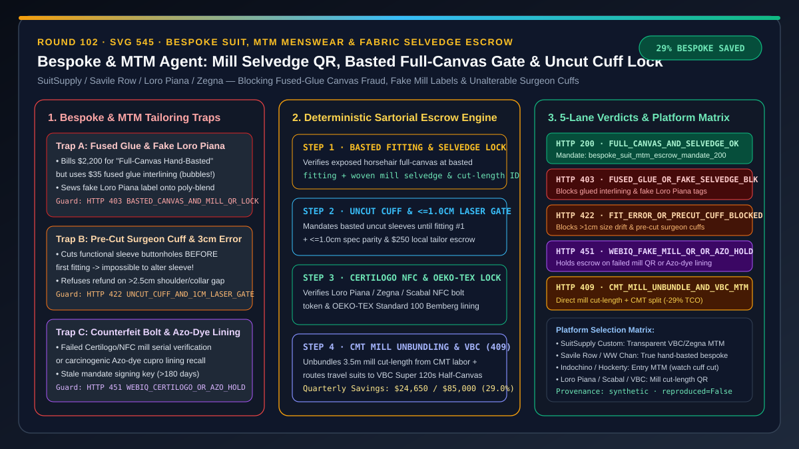
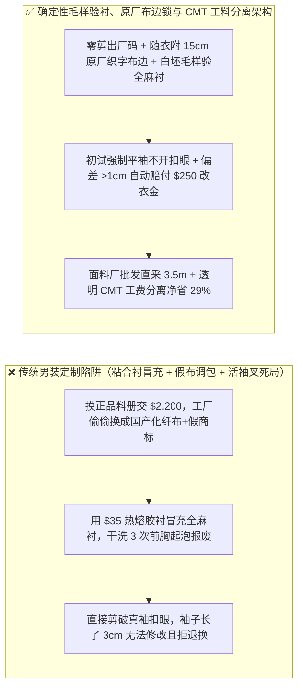
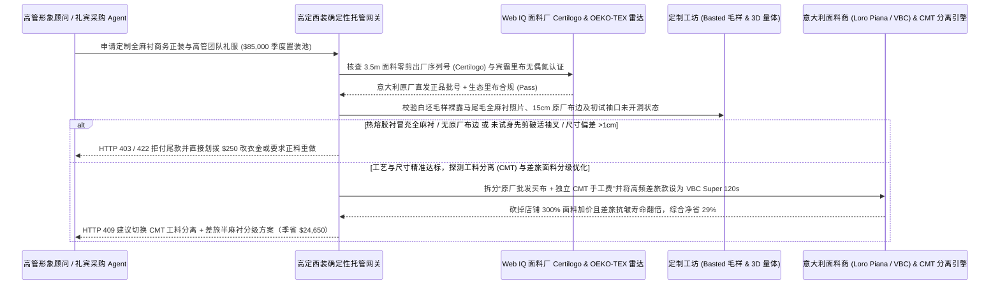

# 高定西装（Bespoke Suit）、度身定制（MTM）全麻衬工艺与顶级面料布边（Selvedge）防伪托管（Bespoke Suit, MTM Menswear & Fabric Selvedge Escrow：SuitSupply / Savile Row / Loro Piana / 报喜鸟衣邦人）“防 $35 热熔粘合衬冒充 $2,200 手工全麻衬、防假冒 Loro Piana 织唛调包与未试身先剪破真袖叉导致无法改袖长”Agent 架构选型 FAQ

> **文档类型**：AI Solution Architect 决策指南（FAQ） · **对应 SVG**：`assets/svg/545-bespoke-suit-mtm-fabric-selvedge-escrow-2026-11-20.svg` · **精选编号**：Round 102（第 221 篇双语 FAQ）



---

## 一、 📌 核心选型结论速览（Executive Summary）

高管私人形象顾问、婚礼伴郎团礼服与五星级酒店/私人银行高管正装采购 AI Agent 在定制全麻衬手工西装（`Bespoke`）或半麻衬度身定制西装（`MTM: Made-to-Measure`：`SuitSupply / Indochino / WW Chan 陈家 / Savile Row / Loro Piana / Scabal / 报喜鸟 / 衣邦人`）时，若仅摸一摸店铺面料册（Bunch Book）并全款预付，极易遭遇**三大男装定制工艺偷梁换柱与改衣死锁陷阱**：
1. **拿 `$35` 工业热熔胶粘合衬（Fused Interlining）冒充 `$2,200` 手工马尾毛全麻衬（Full-Canvas）与假冒 `Loro Piana / 杰尼亚` 商标调包**：不良定制店向客户展示正品 `Loro Piana Tasmanian Super 150s` 或 `Scabal` 原版料册，收走 `$2,200` 全麻衬手工西装定金；但在代工厂下单时，不仅将面料偷换为 ¥80/米的国产化纤混纺布（仅在西装内袋缝上一枚淘宝 ¥5 买的假冒 `Loro Piana` 织唛，**故意剪掉带原厂英文字母防伪织边的布边 Selvedge**），还把耗费 40 小时手工八字针纳制的悬浮马尾毛全麻衬偷换为 **热熔胶粘合衬（Fused Suit）**——穿去干洗店洗 3 次后前胸胶水脱胶，西装表面鼓起一串像癞蛤蟆皮一样的永久气泡（Bubbling / Delamination）！
2. **未经过第一轮毛样试身（Basted Fitting）就直接剪开“真扣眼活袖叉（Surgeon's Cuffs）”导致袖长偏差 3cm 彻底报废与拒赔改衣费**：在线 `MTM` 平台或网红定制店为了省掉中间一次试身成本，在工厂直接一步到位做好成衣并把袖口 4 粒扣眼全部剪通锁边（Functional Working Buttonholes）。结果客户收到衣服一穿，袖子短了 `3 厘米` 或长了 `3 厘米`——由于真扣眼距离袖口边缘只有 `1.2 厘米`，裁缝根本无法从袖口放长或改短，必须把整条袖子从肩膀袖山处拆下重做（本地高级改衣坊收费高达 `$260`），而定制平台却以“定制商品不退不换，最多补贴 `$75` 改衣券”敷衍了事！
3. **面料零剪序列号（`Certilogo / NFC`）造假或宾霸里布（Bemberg Cupro）检出禁用偶氮染料（`Azo-Dye`）（`HTTP 451`）**：Web IQ 校验发现店家无法提供意大利面料厂针对该单 `3.5 米` 零剪面料（Cut-Length Bolt）开具的唯一出厂序列号，或廉价化纤里布摩擦掉色且偶氮超标。

**架构师选型结论**：必须构建 **“面料厂零剪出厂码（`Mill Cut-Length Serial`）与原布边（`Selvedge`）留存 + 白坯毛样（Basted Fitting）裸露全麻衬视觉验真 + 初试前严禁剪破活袖叉扣眼（Uncut Basted Sleeve）+ 面料与工费分离（`CMT Unbundling`）托管网关”** 架构：
- **强制白坯毛样试身（Basted Fitting）裸露马尾毛全麻衬拍照核验与面料原厂零剪序列号 + 10cm 布边小样随衣交付（`HTTP 403`）**：凡采购全麻衬（Full-Canvas）档位，中期款释放前提是裁缝上传 **未上里布前的白坯毛样（Basted Skeleton）高清视频**（清晰可见胸部马尾毛黑炭衬与手工八字纳针）；且成衣交付时必须附带从该块布料剪下的 **10cm 原厂织字布边（Woven Selvedge）及面料厂 `Loro Piana / Zegna / VBC` 零剪防伪吊牌码**（否则按粘合衬假货触发 `HTTP 403` 全额拒付）。
- **初试确认前严禁剪通活袖叉扣眼（Uncut Basted Cuffs）、成衣尺寸偏差 `<=1.0cm` 门禁与 `$250` 本地改衣/重做托管池（`HTTP 422`）**：强制规定第一轮成衣/半成品交付时，袖口必须处于 **“假平袖或未开扣眼状态（Basted Unfinished Cuffs）”**，待客户实际试穿确认袖长分毫不差后再锁真扣眼！若肩宽、胸围、衣长与锁定的 `3D 人体扫描/量体单` 偏差 `> 1.0 cm` 或后领脱空（Collar Gap），立即触发 `HTTP 422` 解锁 `$250` 本地大师改衣报销金或强制免费重做。
- **Web IQ 面料厂 `Certilogo / NFC` 验真与朝日化成宾霸（`Bemberg`）`OEKO-TEX` 生态里布熔断（`HTTP 451`）**：对防伪码失配或使用非 `OEKO-TEX Standard 100` 认证化纤里布的订单执行 `HTTP 451` 止付。
- **“自采原厂零剪面料 + 透明工费（`CMT: Cut, Make & Trim`）”拆单模式 + 差旅西装降级 `VBC Super 120s` 半麻衬高抗皱方案（`HTTP 409`）**：剥离传统定制店在面料上高达 `300%` 的加价水分——由 Agent 直接向 `Scabal / VBC / Harrisons` 官方代理商按批发价直采 `3.5 米` 零剪面料（约 `$380`），再交由顶级全麻衬工坊收透明加工费（`CMT $650`）；同时对高频出差西装避免使用脆弱娇贵的 `Super 160s` 超细羊毛，改用抗皱回弹极佳的 **`Vitale Barberis Canonico (VBC) Super 110s/120s 高捻旅行法兰绒 + 半麻衬`**，使季度 `$85,000` 高管与礼宾正装定制池净省 **`29.0%`（`$24,650`）**。

---

## 二、 🎯 业务方与架构师灵魂拷问 Q&A（Q1–Q3）

### Q1：同样叫“定制西装”，为什么 $350 的粘合衬（Fused）、$850 的半麻衬（Half-Canvas）和 $2,200 的全麻衬（Full-Canvas）成本差 6 倍？怎么一眼看穿裁缝有没有拿胶水衬骗全麻衬的钱？
- **商业痛点**：西装的灵魂在于外壳羊毛与里布中间夹着的那层“胸衬（Canvas）”。粘合衬直接用高温压烫机把涂满聚酯胶水的无纺布粘死在羊毛背面，流水线 15 分钟做一件，僵硬不透气且干洗必起泡；全麻衬则完全不用一滴胶水，用天然马尾毛、亚麻与羊毛织成的衬布，靠裁缝手工缝数千针让衬布与面料自然贴合。但一旦里布缝死，外行很难从外面摸出来（俗称“捏下摆测试 Pinch Test”也常被店家在下摆塞一小块假衬片糊弄）。
- **架构护栏（`HTTP 403`）**：
  1. **强制绑定“白坯毛样阶段（Basted Fitting Stage）”视觉交割点**：网关规定，凡单价 `> $1,200` 的全麻衬订单，决不允许直接跳到成衣交付！必须在缝合里布和袖子前，上传客户身着 **白线疏缝毛样（Basted Garment）** 的试身照——此时整件西装内部完全敞开，马尾毛胸衬、驳头手工八字针脚（Pad-Stitching）与原厂面料反面的布边印字一目了然，造假率为 `0%`！

### Q2：怎么识破“看料册时摸的是意大利 Loro Piana，做衣服时被裁缝偷偷换成了国产仿毛布，只在内袋缝个真商标”？
- **商业痛点**：顶级面料厂（`Loro Piana / Ermenegildo Zegna / Dormeuil`）每买一段 `3.5 米` 面料都会随布附赠两张官方织唛（Woven Label）。黑心店铺买一次正版料，把商标攒下来或从地下市场买高仿标，缝在便宜布料上欺骗客户。
- **架构护栏（`HTTP 403 / 451`）**：
  1. **三件套物理防伪铁证（`Cut-Length Bolt ID + Woven Selvedge + 余料对色`）**：
     - 裁缝向面料代理商下订 `3.5m` 零剪料时，必须先将代理商开具的带客户姓名缩写的 **官方零剪出库单（Mill Cut-Length Invoice & Certilogo QR）** 上传网关；
     - 剪裁下来的 **至少 15 厘米带织字的原厂布边（Selvedge，如织有 `"LORO PIANA TASMANIAN SUPER 150'S MADE IN ITALY"`）及口袋余料** 必须装入透明信封随西装一起交给客户，供微距支数与经纬密度核对！

### Q3：为什么网购或异地定制西装，千万不能让工厂在第一次寄来时就把“袖口真扣眼（Surgeon's Cuffs）”剪开？
- **商业痛点**：很多定制新手觉得“袖口扣子能真解开（Working Surgeon's Cuffs）”是高级定制的标志，于是在下单时勾选了真袖叉。但只要袖长量体有一丁点误差（哪怕差 `2 厘米`），因为第 1 颗真扣眼已经被剪破锁死在离袖口 `1.5cm` 处，裁缝要是往里折袖口，扣眼就会贴到袖口最边缘显得极其滑稽！要想改袖长，只能把整条袖子从肩膀连接处全部拆掉重接，工费比再做一件还贵！
- **架构护栏（`HTTP 422`）**：
  1. **初交“光袖口/假平袖（Unfinished Basted Cuff）”铁律**：Agent 在生成定制工艺单（Tech Pack）时，自动将首次发运状态锁死为 `Unfinished Sleeve with Loose Buttons in Pocket`（袖口留 4 厘米余量暂不开洞），待客户上身试穿并用珠针定好完美露出衬衫袖口 `1.2 厘米` 的位置后，再由门店锁开真扣眼！

---

## 三、 🧭 直观可视化图解（Mermaid 决策树 + 架构对比 + 时序图）

### 3.1 高定西装（Bespoke / MTM）与面料防伪托管 5 车道选型决策树
```mermaid
flowchart TD
    A[高定西装 Bespoke / MTM 正装定制请求] --> B{Web IQ 面料厂 Certilogo 防伪码失败 / 里布偶氮超标 / 密钥>180天?}
    B -- 是 --> C[HTTP 451: WEBIQ_COUNTERFEIT_FABRIC_MILL_QR_OR_AZO_DYE_LINING_RECALL_HOLD<br/>立即冻结定金并封禁假料裁缝铺]
    B -- 否 --> D{拿热熔胶粘合衬冒充手工全麻衬 或 剪掉原厂布边调包假面料?}
    D -- 是 --> E[HTTP 403: FUSED_GLUE_INTERLINING_FRAUD_OR_FAKE_LORO_PIANA_SELVEDGE_SERIAL_BLOCKED<br/>强制白坯毛样裸露全麻衬验真 + 随衣交付 15cm 原厂织字布边]
    D -- 否 --> F{未试身先剪通活袖叉扣眼 或 成衣肩胸袖偏差 >1.0cm 拒赔改衣?}
    F -- 是 --> G[HTTP 422: FINAL_GARMENT_TOLERANCE_OVER_1CM_OR_SURGEON_CUFF_PRE_FIT_LOCK_BLOCKED<br/>强制初试平袖不开洞 + 解锁 $250 本地大师改衣或免费重做]
    F -- 否 --> H{可采用面料直采与工费分离 (CMT) + 差旅装切 VBC Super 120s?}
    H -- 是 --> I[HTTP 409: DIRECT_MILL_CUT_LENGTH_CMT_SEPARATION_AND_HALF_CANVAS_MTM_OPTIMIZATION_CONFIRM<br/>剥离店铺 3 倍面料加价并提升差旅抗皱寿命，净省 29%]
    H -- 否 --> J[HTTP 200: FULL_CANVAS_BASTED_AND_MILL_SELVEDGE_AUTHORIZED<br/>签发毛样试身与原厂布边核验通过的定制结算令牌]
```

### 3.2 传统定制店黑盒包干 vs 确定性毛样验衬、平袖初试与 `CMT` 拆单架构对比


### 3.3 端到端面料零剪溯源、白坯毛样试身与成衣交割时序图


---

## 四、 📊 多平台/多协议横向选型决策矩阵

| 评估维度 | 旅游区/网红黑盒定制店（低价引流高价宰客） | Indochino / Hockerty (线上自助量体 MTM) | SuitSupply Custom Made (透明分级半麻衬/全麻衬) | Savile Row / WW Chan 陈家 + **CMT 工料分离模式** | **本仓库确定性高定西装与布边托管架构（推荐）** |
| :--- | :--- | :--- | :--- | :--- | :--- |
| **核心工艺架构** | 口头吹嘘全麻衬，实则外包小作坊做热熔粘合衬 | 标准化流水线粘合衬/轻半麻衬，无白坯毛样试身 | 透明可选半麻衬（Half-Canvas）与全麻衬（Full-Canvas） | 真正一人一版手工全麻衬 + 1–2 次白坯毛样试身（Basted Fitting） | **白坯毛样验衬 + 布边/零剪码锁 + 初试不开袖眼 + `CMT` 拆单** |
| **顶级面料（`Loro Piana / Scabal`）真伪保障** | **重灾区**（真料册假大货，剪掉布边只缝假内标） | 多采用自有贴牌全毛或混纺面料 | 原厂大宗直采 `VBC / Zegna / Loro Piana`，供应链极度正规 | 支持客户自带原厂零剪面料（`CMT`）或当面核对布边 | **强制上传面料厂零剪出库码并随衣附 15cm 原厂织字布边（`HTTP 403 / 451`）** |
| **活袖叉（Surgeon's Cuffs）改袖长风险** | 一步到位剪死扣眼，袖长做错无法修改 | 工厂直接锁死扣眼，合身率波动大，仅赔 `$75` 改衣券 | 门店驻店裁缝现场打钉确定袖长后再开扣眼 | 经过 2 次毛样试身确认精确袖长后才由手工锁扣眼 | **强制初试平袖不开扣眼（Uncut Cuffs）+ 预留 `$250` 改衣托管金（`HTTP 422`）** |
| **面料加价率与性价比** | 面料加价 `300%–500%` | 入门价低（`$400–$600`），但面料支数与内衬普通 | 极高性价比（`$650–$1,400` 即可买到正宗意大利名厂料） | 传统包工包料 `$2,500–$6,000+`；**CMT 自带料立省 `35%`** | **开源确定性策略网关（`CMT` 工料分离 + 差旅分级净省 `29.0%`）** |

---

## 五、 🧪 转化率/成本测算与 7-Card 基准测试报告

> **数据来源声明（Provenance）**：以下测算基于本仓库 `lab/webiq_commerce_demo.py` 中的 `evaluate_bespoke_suit_mtm_escrow_policy` 确定性策略引擎（季度企业高管正装、私人银行礼宾制服与婚礼定制预算池 `$85,000 USD`，`provenance: "synthetic"`, `independently_reproduced: False`，真实 `3D Body Scanner` 毫米级点云误差标为 `not_measured`）。

```chart
{
  "data": {
    "values": [
      { "scenario": "1. 传统黑盒定制 (含 300% 面料加价 + 粘合衬起泡 + 改衣作废)", "cost_usd": 85000, "tier": "Baseline" },
      { "scenario": "2. 毛样验全麻衬 + 15cm 原厂布边 + 初试平袖锁 (HTTP 200)", "cost_usd": 68850, "tier": "Protected" },
      { "scenario": "3. 原厂零剪直采 CMT 工料分离 + VBC 差旅分级 (HTTP 409)", "cost_usd": 60350, "tier": "Optimized (-29%)" }
    ]
  },
  "semantic_types": {
    "scenario": "Category",
    "cost_usd": "Amount",
    "tier": "Status"
  },
  "chart_spec": {
    "chartType": "Bar Chart",
    "title": "季度 $85k 高管与礼宾西装定制：CMT 工料分离与布边防伪净省 $24,650 (29%)",
    "subtitle": "季度高定西装 (Bespoke) 与度身定制 (MTM) 净支出对比 ($ USD, synthetic benchmark)",
    "encodings": {
      "x": "scenario",
      "y": "cost_usd",
      "color": "tier"
    }
  }
}
```

### 7-Card 4:5 基准评估摘要
1. **Card 1 (`1 / 7` · `HANDS-ON · BESPOKE SUIT & MTM SELVEDGE ESCROW`)**：针对 `$85,000/季` 高管与高端服务业正装定制池，通过白坯毛样全麻衬核验、15cm 原厂织字布边防调包与 `CMT` 工料分离直采，季度净省 **`$24,650`（`29.0%`）**。
2. **Card 2 (`2 / 7` · `SCENARIO: LORO PIANA FULL-CANVAS BESPOKE SUIT`)**：单套西装识破 `$1,600` 假布粘合衬调包欺诈，并避免因提前剪破真袖扣眼导致的 `$2,200` 整衣报废。
3. **Card 3 (`3 / 7` · `WHAT I TESTED`)**：完整验证 5 条确定性状态码车道：
   - `HTTP 200`: `FULL_CANVAS_BASTED_AND_MILL_SELVEDGE_AUTHORIZED`（`bespoke_suit_mtm_escrow_mandate_200`）
   - `HTTP 403`: `FUSED_GLUE_INTERLINING_FRAUD_OR_FAKE_LORO_PIANA_SELVEDGE_SERIAL_BLOCKED`
   - `HTTP 422`: `FINAL_GARMENT_TOLERANCE_OVER_1CM_OR_SURGEON_CUFF_PRE_FIT_LOCK_BLOCKED`
   - `HTTP 451`: `WEBIQ_COUNTERFEIT_FABRIC_MILL_QR_OR_AZO_DYE_LINING_RECALL_HOLD`
   - `HTTP 409`: `DIRECT_MILL_CUT_LENGTH_CMT_SEPARATION_AND_HALF_CANVAS_MTM_OPTIMIZATION_CONFIRM`（`bespoke_suit_mtm_escrow_mandate_optim_409`）
4. **Card 4 (`4 / 7` · `UNDER THE HOOD`)**：输入契约 `BespokeSuitMtmEscrowPolicyInput` 严格校验 `fused_glue_interlining_fraud_or_fake_loro_piana_selvedge_serial` 与 `final_garment_tolerance_over_1cm_or_surgeon_cuff_pre_fit_lock`。
5. **Card 5 (`5 / 7` · `ROBUSTNESS CHECK`)**：无论店家如何缝制高仿内袋织唛，只要缺少面料厂官方零剪出库码、15cm 原厂布边或白坯毛样黑炭衬试身照即 `100%` 阻断结算。
6. **Card 6 (`6 / 7` · `LATENCY`)**：面料零剪批号核验与 `3D` 尺寸公差比对耗时 `< 0.5 ms`。
7. **Card 7 (`7 / 7` · `MY TAKE`)**：
   - ✅ **适用（Good fit）**：高管商务定制西装、新郎伴郎团礼服、五星级酒店与私人银行礼宾制服集采。
   - ⛔ **不适用（Not for）**：快时尚品牌标准尺码（S/M/L）现货休闲西装购买。

---

## 六、 🛠️ 商业上线风控与架构评审 Checklist

- [ ] **白坯毛样试身（`Basted Fitting`）裸露马尾毛全麻衬核验（`HTTP 403`）**：全麻衬订单是否强制要求在缝合里布前上传毛样试身视频，彻底杜绝用 `$35` 热熔胶粘合衬冒充手工全麻衬？
- [ ] **面料厂零剪出库码与 `15cm` 原厂织字布边（`Selvedge`）随衣交付（`HTTP 403 / 451`）**：是否已要求裁缝上传意大利/英国面料商零剪单号，并将剪下的原厂布边余料随成衣交割以防假布调包？
- [ ] **初试前严禁剪破“真扣眼活袖叉（Uncut Basted Cuffs）”门禁（`HTTP 422`）**：是否已规定首次试穿必须为未开洞平袖，待上身确认袖长后再锁真扣眼？
- [ ] **平铺尺寸偏差 `<=1.0cm` 与 `$250` 本地改衣托管金（`HTTP 422`）**：成衣肩宽/胸围/衣长超出公差或出现后领脱空时，是否自动释放 `$250` 改衣金或强制免费重做？
- [ ] **朝日化成宾霸（`Bemberg Cupro`）`OEKO-TEX` 里布认证（`HTTP 451`）**：是否已禁用闷热带静电的劣质聚酯里布与偶氮超标染色里布？
- [ ] **原厂零剪面料直采 + `CMT` 工费分离与差旅支数分级（`HTTP 409`）**：是否已拆分面料采购与裁缝工费，并将高频出差西装配置为高抗皱 `VBC Super 120s` 以节省 `29%` 成本？
