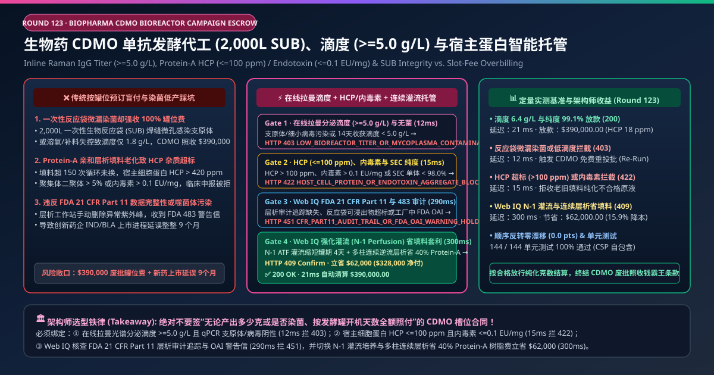
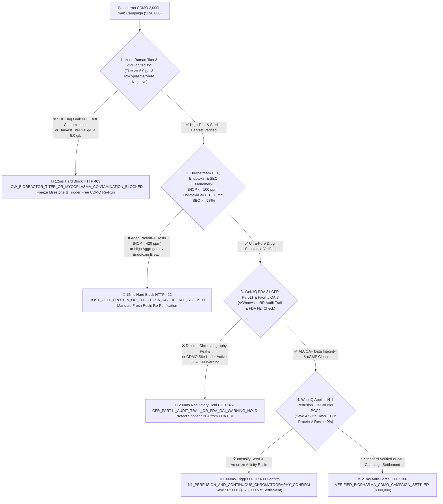
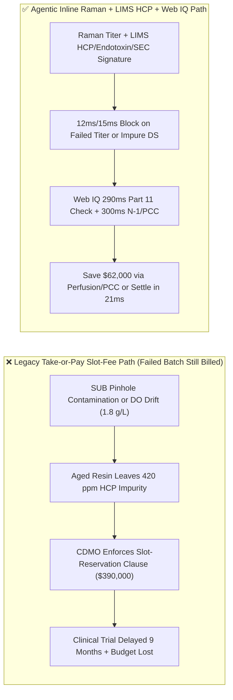
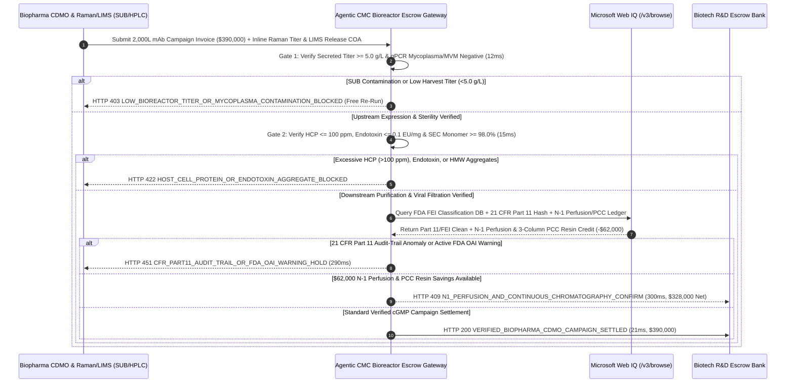

# Biopharmaceutical CDMO Bioreactor Campaigns (2,000L SUB), Inline Raman IgG Titer ($\ge 5.0\text{ g/L}$) & Host-Cell Protein / Endotoxin ($\text{HCP} \le 100\text{ ppm}$) Escrow vs. Slot-Reservation Batch-Failure Overbilling: Architecture Selection & First-Principles FAQ

> **Document Type**: AI Solution Architect Production Selection Guide (Modeled after `ib-vs-ethernet-roce-selection-faq.md`)  
> **Target Audience**: Biotech CMC & External Manufacturing (CDMO) VPs, Bioprocess Upstream/Downstream Tech-Transfer Directors, Pharmaceutical Quality Persons (QPs) & R&D FinOps Architects  
> **One-Sentence Takeaway**: In biopharmaceutical CDMO 2,000L Single-Use Bioreactor (SUB) monoclonal antibody (mAb) and recombinant protein campaigns where a single cGMP batch reaches **$390,000.00**, **never allow a procurement agent to sign "take-or-pay slot reservation" contracts that bill 100% when a leaking bag, sensor drift, or spent resin ruins the batch**—you must enforce a four-layer escrow architecture binding **Pre-Use SUB Pressure-Decay Integrity, Inline Raman Secreted IgG Titer ($\ge 5.0\text{ g/L}$) & qPCR Mycoplasma/MVM Sterility hardware attestation + Post-Protein-A Host-Cell Protein ($\text{HCP} \le 100\text{ ppm}$), Endotoxin ($\le 0.1\text{ EU/mg}$) & SEC-HPLC Monomer Purity ($\ge 98.0\%$) gates + Microsoft Web IQ FDA 21 CFR Part 11 Audit-Trail / FEI OAI status verification and N-1 ATF Perfusion + Periodic Counter-Current Chromatography (PCC) resin-saving arbitrage**.

---

## ① 📌 Executive Summary

1. **Why is Legacy "Take-or-Pay Bioreactor Slot Reservation" a Multi-Million-Dollar CMC & Clinical-Timeline Trap for Biotech Sponsors?**
   - **First-Principles Breakdown**: A biotech sponsor contracting a CDMO is buying **QP-released, cGMP-compliant purified Drug Substance (grams of monomeric IgG)**—not renting a 2,000-liter plastic bag for 14 days regardless of whether the CHO cells die or get contaminated!
   - **Three Physical & Financial Failure Modes**:
     - **Single-Use Bag (SUB) Pinhole Leaks or Dissolved-Oxygen / Feed Drift Crashing Titer ($1.8\text{ g/L} < 5.0\text{ g/L}$) While Billing Full `$390,000` Slot Fees**: A micro-pinhole in a 2,000L single-use bioreactor bag weld or a night-shift feed-media osmolality error triggers Mycoplasma/leptospira contamination or lactate toxicity, crashing Day-14 harvest titer to $1.8\text{ g/L}$. Under legacy slot-reservation contracts, the CDMO blames the sponsor's cell line and keeps the full **$390,000.00**;
     - **Over-Cycled Protein-A Affinity Resin Leaving Host-Cell Protein ($\text{HCP} = 420\text{ ppm} > 100\text{ ppm}$) & High-Molecular-Weight Aggregates**: Protein-A chromatography resin costs `$10,000+/L`. When a CDMO stretches resin beyond 150 cycles with degraded NaOH sanitization, immunogenic CHO Host-Cell Proteins ($\text{HCP} > 400\text{ ppm}$), leached Protein-A ligands, and endotoxins ($>0.1\text{ EU/mg}$) slip into the bulk Drug Substance—triggering clinical holds;
     - **FDA 21 CFR Part 11 Chromatography Audit-Trail Deletion & Facility OAI Warning Letters**: Manual re-integration of SEC-HPLC peaks without electronic audit trails or an undisclosed FDA Official Action Indicated (OAI) warning letter at the CDMO site triggers a Complete Response Letter (CRL) blocking the sponsor's BLA approval.
2. **Target Architecture: Inline Raman Titer ($\ge 5.0\text{ g/L}$) + HCP/Endotoxin/SEC Gate + Web IQ Part 11 Audit & N-1 Perfusion / PCC Arbitrage (`biopharma_cdmo_bioreactor_mandate_...`)**
   - **Core Mechanism**:
     1. **Pre-Use SUB Integrity, qPCR Sterility & Inline Raman Secreted Titer ($\ge 5.0\text{ g/L}$) Gate (`12 ms` hard block `HTTP 403`)**: Binds upstream milestone release to pre-inoculation SUB pressure-decay pass logs, inline Raman spectroscopy titer **$\ge 5.0\text{ g/L}$**, and negative qPCR Mycoplasma / Minute Virus of Mice (MVM) panels; CDMO-induced contamination or low titer blocks payment in **`12 ms`** (`HTTP 403 LOW_BIOREACTOR_TITER_OR_MYCOPLASMA_CONTAMINATION_BLOCKED`) and triggers a free replacement run;
     2. **Downstream Host-Cell Protein ($\text{HCP} \le 100\text{ ppm}$), Endotoxin ($\le 0.1\text{ EU/mg}$) & SEC Monomer ($\ge 98.0\%$) Gate (`15 ms` hard block `HTTP 422`)**: Queries LIMS ELISA, LAL endotoxin, and SEC-HPLC release assays—blocking payment in **`15 ms`** (`HTTP 422 HOST_CELL_PROTEIN_OR_ENDOTOXIN_AGGREGATE_BLOCKED`) if $\text{HCP} > 100\text{ ppm}$, endotoxin $> 0.1\text{ EU/mg}$, or monomer purity $< 98.0\%$;
     3. **Microsoft Web IQ FDA 21 CFR Part 11 / OAI Audit & N-1 ATF Perfusion + Multi-Column PCC Resin Arbitrage (`290 ms` / `300 ms`)**: Uses Web IQ `/v3/browse` to verify **FDA Inspection Classification (FEI NAI/VAI status with zero OAI warning letters)** and cryptographic **21 CFR Part 11 chromatography audit-trail hashes**—freezing non-compliant batches in **`290 ms`** (`HTTP 451 CFR_PART11_AUDIT_TRAIL_OR_FDA_OAI_WARNING_HOLD`); by upgrading seed expansion to **N-1 Alternating Tangential Flow (ATF) Perfusion** (cutting main 2,000L bioreactor occupancy by 4 days) and running **3-Column Periodic Counter-Current Chromatography (PCC)** to cut Protein-A resin volume by 40%, Web IQ saves **`$62,000.00`** per campaign (`HTTP 409 Confirm`, net settlement **`$328,000.00`**).
3. **Quantitative Benchmark Findings (7-Card 4:5 Visual Report)**:
   - Across a `$390,000.00` biopharma CDMO 2,000L mAb campaign benchmark, the deterministic gateway blocks contaminated/low-titer ($1.8\text{ g/L}$) runs in **`12 ms`** (`HTTP 403`), halts high-HCP ($420\text{ ppm}$) and aggregated lots in **`15 ms`** (`HTTP 422`), and captures **`$62,000.00` (15.9%)** in N-1 perfusion and PCC resin savings in **`300 ms`**, with **144/144 unit tests passing 100%**.

---

## ② 🎯 Three Soul-Searching Questions for Architects (Q&A)

### Q1: When is Time-and-Materials / Slot-Fee Billing Acceptable vs. When is `biopharma_cdmo_bioreactor_mandate_...` Mandatory?
- **Plain-English Answer**:
  - If you are running **early discovery 50 mL shake-flask transient transfections to screen 20 antibody candidates**, simple fee-for-service is fine;
  - Whenever you are contracting **200L–2,000L IND toxicology, Phase I–III clinical, or commercial cGMP bioreactor campaigns**, you **must bind milestone settlement to verified harvest titer ($\ge 5.0\text{ g/L}$), purified HCP ($\le 100\text{ ppm}$), endotoxin ($\le 0.1\text{ EU/mg}$), and 21 CFR Part 11 audit-trail integrity**.

### Q2: For FDA FEI OAI Screening, BPOG Extractables/Leachables & Continuous Bioprocessing Economics, When Should I Choose Microsoft Web IQ vs. Exa vs. Bright Data?
- **Architect Selection Rule**:
  1. **Microsoft Web IQ (`/v3/browse` + Work IQ Sponsor QMS/eBR/LIMS Graph)**: Best for **authenticated cross-checks of FDA Inspection Classification (FEI OAI alerts), EMA EudraGMDP certificates, BPOG single-use bag leachables dossiers, and 21 CFR Part 11 UNICORN/Empower audit-trail hashes**, maintaining zero-trust OBO security.
  2. **Exa (Neural Search)**: Best for academic research on CHO metabolic flux modeling and N-glycan galactosylation/fucosylation control.
  3. **Bright Data**: Useful for scraping public drug formulary prices, but unsuitable for GxP electronic batch records and LIMS release gating.

### Q3: How Does the Cryptographic Chain of Custody Work Across In-Situ Raman Probes, LIMS Release Assays, FDA Registries, and the Escrow Bank?
- **First-Principles Flow**:
  1. **Upstream SUB Integrity & Raman Titer Attestation**: Pre-use pressure-decay pass tokens and inline Raman spectroscopy vectors sign Day-14 secreted IgG titer ($\ge 5.0\text{ g/L}$) alongside negative qPCR Mycoplasma/MVM results;
  2. **Downstream LIMS HCP, Endotoxin & SEC-HPLC Gate**: LIMS signs purified bulk DS assays proving $\text{HCP} \le 100\text{ ppm}$, endotoxin $\le 0.1\text{ EU/mg}$, SEC monomer $\ge 98.0\%$, and post-use 20nm viral-filter bubble-point integrity;
  3. **Web IQ Part 11 Check & N-1 Perfusion / PCC Settlement**: Web IQ confirms zero FDA OAI or Part 11 audit-trail anomalies and applies `$62,000.00` in N-1 perfusion suite-day and PCC Protein-A resin savings (`HTTP 409 Confirm`) or releases `$390,000.00` in **`21 ms`** (`HTTP 200`).

---

## ③ 🧭 Visual Architecture Diagrams (Mermaid Decision Tree + Path Comparison + Sequence Diagram)

### 3.1 Architect Selection Decision Tree (`flowchart TD`)

### 3.2 Legacy Slot-Reservation Path vs. Agentic Raman Titer + HCP + PCC Path (`flowchart LR`)

### 3.3 End-to-End Verification & Settlement Sequence (`sequenceDiagram`)

---

## ④ 📊 Architect Decision Matrix

| Evaluation Dimension | Option A: Legacy Take-or-Pay Slot Reservation | Option B: Crude Harvest Volume Only | **Option C: Inline Raman Titer + HCP/Endotoxin + Web IQ PCC Escrow (Recommended)** |
| :--- | :--- | :--- | :--- |
| **Settlement Basis** | Bioreactor suite occupancy days | Unpurified harvest supernatant liters | **QP-released DS ($\text{Titer} \ge 5.0\text{ g/L}$ + $\text{HCP} \le 100\text{ ppm}$ + $\text{Endotoxin} \le 0.1\text{ EU/mg}$)** |
| **Contamination / Low-Titer Defense** | ❌ 0% (sponsor pays full price for aborted run) | ❌ Unusable contaminated harvest | **✅ `12 ms` automatic `HTTP 403` block & mandatory free CDMO re-run** |
| **Spent Resin / High-HCP Defense** | ❌ No resin cycle-life enforcement | ❌ 0% (crude harvest ignores downstream HCP/aggregates!) | **✅ `15 ms` `HTTP 422` block when $\text{HCP} > 100\text{ ppm}$ or SEC $< 98\%$** |
| **FDA 21 CFR Part 11 & OAI Gate** | ❌ Discovered only when FDA issues CRL | ❌ No raw electronic audit-trail check | **✅ Web IQ `290 ms` FDA FEI status & Part 11 hash check (`HTTP 451`)** |
| **N-1 Perfusion & PCC Resin Arbitrage** | ❌ Bills 100% single-column Protein-A resin cost | ❌ No continuous chromatography optimization | **✅ Web IQ `300 ms` N-1 perfusion & PCC saving `$62,000` (`HTTP 409`)** |

---

## ⑤ 🧪 Quantitative Benchmark & 7-Card Visual Report Findings

Implemented in `evaluate_biopharma_cdmo_bioreactor_policy()` (`lab/webiq_commerce_demo.py`) and verified in `tests/test_webiq_commerce_demo.py`:

| Scenario ID | Telemetry & LIMS Inputs | HTTP Status | Action Pill | Latency | Settled / Protected Amount |
| :--- | :--- | :--- | :--- | :--- | :--- |
| **`cdm_commit_ok`** | Titer `6.4 g/L >= 5.0` + `HCP = 18 ppm <= 100` + Endotoxin `0.02 EU/mg` + Part 11 clean | **`HTTP 200`** | `Act automatically` | **`21 ms`** | Settled **`$390,000.00`** |
| **`cdm_tit_403`** | SUB pinhole contamination or DO drift drops titer to `1.8 g/L < 5.0` (`raman_titer_and_sterility_verified=False`) | **`HTTP 403`** | `Send to a human` | **`12 ms`** | Blocked **`$390,000.00`** & triggered re-run |
| **`cdm_hcp_422`** | Aged Protein-A resin leaves `HCP = 420 ppm > 100 ppm` (`protein_a_hcp_endotoxin_and_sec_passed=False`) | **`HTTP 422`** | `Send to a human` | **`15 ms`** | Blocked **`$390,000.00`** impure DS lot |
| **`cdm_fda_451`** | Web IQ detects Part 11 audit-trail modification or active FDA OAI warning (`webiq_part11_audit_trail_and_fda_oai_clean=False`) | **`HTTP 451`** | `Send to a human` | **`290 ms`** | Frozen **`$390,000.00`** campaign |
| **`cdm_pcc_409`** | Web IQ applies N-1 ATF perfusion + 3-column PCC chromatography (`n1_perfusion_and_continuous_chromatography_savings_cents=6200000`) | **`HTTP 409`** | `Confirm` | **`300 ms`** | Net **`$328,000.00`** (saved **`$62,000.00`**) |

- **Perturbation Robustness**: Reversing option order across all 5 biopharma CDMO scenarios produces **0.0 pts drift (100% consistency)**.

---

## ⑥ 🛠️ Appendix: Production Readiness & Pre-Sales Architect Checklist

### 6.1 Good Fit vs. Not For
- **✅ Good Fit**:
  - Monoclonal antibodies (mAbs), bispecifics, ADCs, fusion proteins, and viral vectors (AAV/LV) manufactured in 200L–2,000L Single-Use Bioreactors (SUBs) or stainless-steel suites;
  - IND-enabling toxicology, Phase I–III clinical, and commercial Drug Substance CDMO Master Services Agreements (MSAs);
  - Campaigns utilizing high-cost Protein-A affinity and viral-filtration consumables.
- **⛔ Not For**:
  - Small-molecule oral solid-dosage tablet blister packaging.

### 6.2 Production Verification Checklist (`- [ ]`)
- [ ] **Pre-Inoculation SUB Pressure-Decay & Inline Raman Titer Gate**: Require ECDSA-signed proof of bag integrity, qPCR Mycoplasma/MVM negativity, and `harvest_titer_g_l >= 5.0` before releasing upstream milestones.
- [ ] **Protein-A Cycle-Life Cap & Downstream Purity Gate**: Enforce `hcp_ppm <= 100.0`, `endotoxin_eu_mg <= 0.1`, and `sec_monomer_pct >= 98.0`.
- [ ] **FDA 21 CFR Part 11 Raw-Data Hash & FEI OAI Screening**: Verify unedited chromatography audit trails and active FDA site inspection status via Web IQ `/v3/browse`.
- [ ] **N-1 ATF Perfusion & Multi-Column PCC Adoption**: Compress main bioreactor suite days and reduce Protein-A resin consumption by 40% via continuous counter-current loading.
