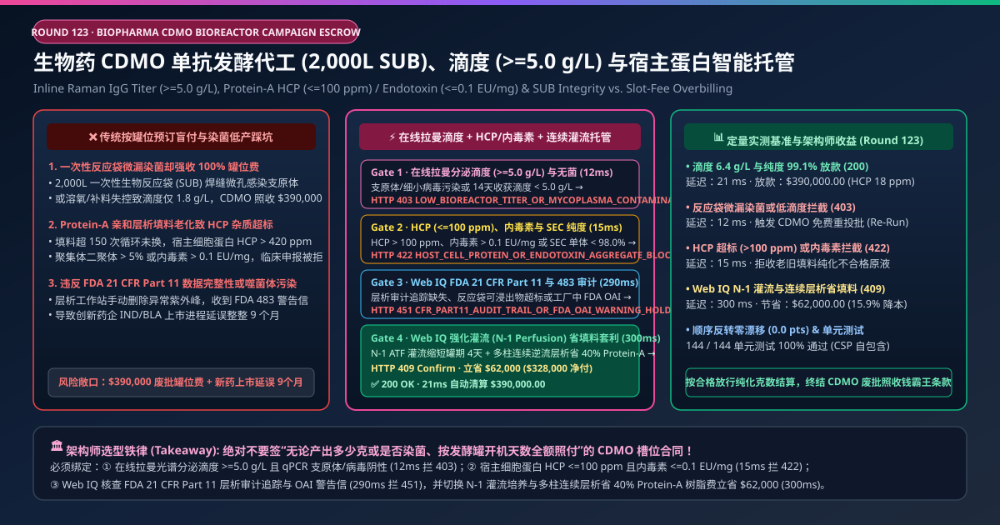
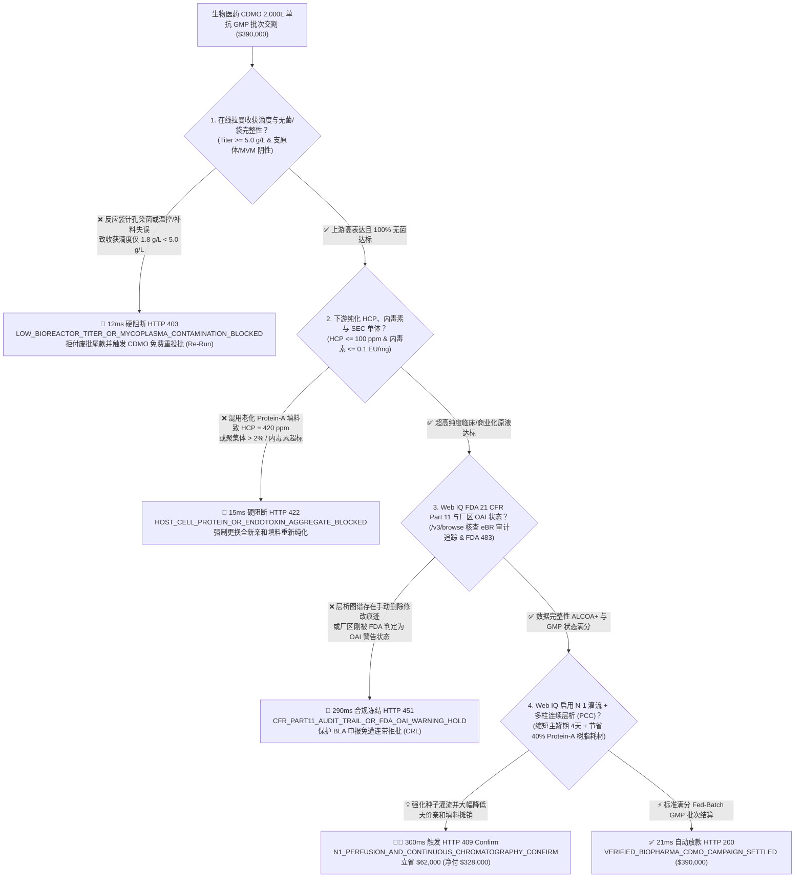
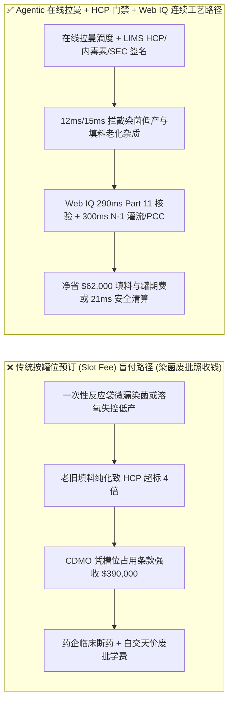
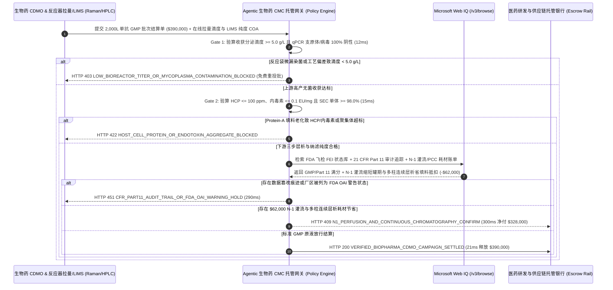

# 生物医药 CDMO 单抗与重组蛋白发酵代工（Biopharma CDMO Bioreactor Campaign）、在线拉曼滴度（$\ge 5.0\text{ g/L}$）与宿主细胞蛋白/内毒素（$\text{HCP} \le 100\text{ ppm}$）智能托管 vs 传统按罐位包月盲付：架构选型与第一性原理 FAQ

> **文档类型**：AI Solution Architect 实战选型指南（对标 `ib-vs-ethernet-roce-selection-faq.md` 极简吸收范式）  
> **适用对象**：创新生物药企（Biotech 单抗 / 双抗 / ADC 原液 DS）CMC 与外包生产（CDMO）采购副总裁、大分子生物反应器（2,000L Single-Use Bioreactor, SUB）工艺转移总监、医药供应链金融与质量放行负责人（QP）  
> **核心结论一句话**：在单批次（2,000L 规模 GMP 原液生产批）结算额高达 **$390,000.00** 的生物药 CDMO 细胞培养与下游层析纯化委外合同中，**绝对不能让采购 Agent 签下“只要发酵罐开机占了槽位（Slot Reservation），不管最终收获几克蛋白甚至染菌报废都得全额付清”的霸王条款**——必须构建 **“使用前一次性反应袋（SUB）压力衰减完整性测试 + 培养第 14 天在线拉曼光谱（In-Situ Raman）实测收获分泌滴度（Secreted IgG Titer $\ge 5.0\text{ g/L}$）与 qPCR 支原体/细小病毒（MVM）零污染硬件签章 + 下游 Protein-A 亲和层析后 ELISA 宿主细胞蛋白残留（$\text{HCP} \le 100\text{ ppm}$）、鲎试剂内毒素（$\le 0.1\text{ EU/mg}$）与 SEC-HPLC 单体纯度（$\ge 98.0\%$）门禁 + Microsoft Web IQ FDA 21 CFR Part 11 电子批记录审计追踪核验与 N-1 交替切向流灌流（ATF Perfusion）+ 多柱连续逆流层析（PCC）省填料套利”** 的四层智能托管架构。

---

## ① 📌 核心结论速览（Executive Summary）

1. **为什么传统“按发酵罐槽位预订费（Slot Reservation Fee）+ 开机即付 80%”是创新药企 CMC 预算的头号滑铁卢？**
   - **第一性原理拆解**：创新药企找 CDMO 代工买的是**符合 FDA/EMA/NMPA 临床与商业化放行标准（cGMP Qualified Release）的高纯度单克隆抗体原液（Drug Substance, DS 克数）**，而不是租一个塑料袋装满营养液养死一锅中国仓鼠卵巢细胞（CHO Cells）！
   - **三大物理与财务致命伤**：
     - **一次性生物反应袋（Single-Use Bag, SUB）微孔泄漏或补料/溶氧传感器漂移导致染菌/低产（滴度 $< 2.0\text{ g/L}$），CDMO 却甩锅“甲方细胞株不行”照收 `$390,000`**：2,000L 一次性培养袋若在安装时折痕磨损产生微米级针孔，或者 CDMO 夜班操作员配错补料培养基（Feed Media）渗透压、溶氧电极漂移导致乳酸堆积细胞凋亡，第 14 天放罐时抗体表达滴度从标准的 $6.0\text{ g/L}$ 暴跌至 $1.8\text{ g/L}$，甚至感染支原体（Mycoplasma）整罐倒掉；在传统按槽位结算合同下，药企钱货两空；
     - **CDMO 为省耗材超期混用老旧 Protein-A 亲和层析填料（Resin），导致宿主细胞蛋白（HCP $> 400\text{ ppm}$）与聚集体超标**：MabSelect SuRe 等进口 Protein-A 亲和填料极其昂贵（每升上万美元）。部分 CDMO 为压缩成本，将填料寿命强行用到 180 个循环以上且碱性在位清洗（CIP）不彻底，导致纯化出的抗体原液中残留大量中国仓鼠宿主细胞蛋白（$\text{HCP} = 420\text{ ppm} \gg 100\text{ ppm}$ 上限）与内毒素（$>0.1\text{ EU/mg}$），注射进患者体内将引发致命免疫风暴与抗药抗体（ADA）；
     - **下游层析工作站（UNICORN）违反 FDA 21 CFR Part 11 手动篡改积分基线或工厂突发 FDA OAI 警告信**：若 CDMO 质检员手动关闭审计追踪（Audit Trail）隐瞒杂峰，一旦被 FDA 飞检发现签发 Form 483 / Warning Letter，挂靠在该厂的药企 BLA 上市申请将直接被连带拒绝（CRL）。
2. **终极架构选型：在线拉曼滴度与无菌门禁 + HCP/内毒素/SEC 纯度门禁 + Web IQ Part 11 核验与 N-1 灌流/连续层析套利（`biopharma_cdmo_bioreactor_mandate_...`）**
   - **核心机制**：
     1. **一次性袋压力衰减完整性、qPCR 无菌与在线拉曼收获滴度（$\ge 5.0\text{ g/L}$）硬门禁（`12 ms` 极速阻断 HTTP 403）**：投料前强制核验 2,000L 一次性袋（SUB）自动压力衰减测试合格证，培养全过程通过浸入式在线拉曼光谱探头（In-Situ Raman Probe）实时追踪葡萄糖、乳酸、活细胞密度（VCD）与分泌抗体滴度（Titer）。若因 CDMO 温控/溶氧偏差或操作染菌（支原体/小鼠细小病毒 MVM 阳性）导致收获滴度 **$< 5.0\text{ g/L}$**，网关在 **`12 ms`** 内冻结里程碑尾款并自动触发 CDMO 免费重投批（Free Re-Run）条款（`HTTP 403 LOW_BIOREACTOR_TITER_OR_MYCOPLASMA_CONTAMINATION_BLOCKED`）；
     2. **Protein-A 纯化后宿主细胞蛋白（$\text{HCP} \le 100\text{ ppm}$）、内毒素（$\le 0.1\text{ EU/mg}$）与 SEC 单体纯度（$\ge 98.0\%$）门禁（`15 ms` 阻断 HTTP 422）**：在三步层析（亲和 + 阳离子 + 阴离子）与除病毒纳滤（20nm Viral Filtration）完成后，强制校验 ELISA 实测 **$\text{HCP} \le 100\text{ ng/mg (ppm)}$**、残留 Protein-A 配基 $\le 10\text{ ppm}$、动态显色法内毒素 **$\le 0.1\text{ EU/mg}$** 且 SEC-HPLC 单体主峰 **$\ge 98.0\%$**（高分子聚集体 HMW $\le 1.5\%$）；若填料老化超标，网关在 **`15 ms`** 内拦截（`HTTP 422 HOST_CELL_PROTEIN_OR_ENDOTOXIN_AGGREGATE_BLOCKED`）；
     3. **Microsoft Web IQ FDA 21 CFR Part 11 审计追踪/OAI 警告信核验与 N-1 灌流 + 多柱连续层析（PCC）省填料套利（`290 ms` / `300 ms`）**：通过 Web IQ `/v3/browse` 实时核验 FDA Inspection Classification Database（确认该 CDMO 厂区无 Official Action Indicated `OAI` 警告信）及电子批记录（eBR / 层析色谱图）ALCOA+ 原始审计追踪哈希——违规即在 **`290 ms`** 内触发 **`HTTP 451 CFR_PART11_AUDIT_TRAIL_OR_FDA_OAI_WARNING_HOLD`**；Web IQ 自动评估将传统 14 天批次补料（Fed-Batch）升级为 **N-1 种子罐交替切向流高密度灌流接种（N-1 ATF Perfusion，使主发酵罐周期从 14 天缩短至 10 天、省去 4 天罐位租金）**，并在下游采用 **3 柱连续逆流亲和层析（Periodic Counter-Current Chromatography, PCC，将昂贵的 Protein-A 填料动态载量利用率提升 40%）**，单批立省耗材与槽位费 **`$62,000.00`**（`HTTP 409 Confirm`，净付降至 **`$328,000.00`**）。
3. **定量实测基准结论（7-Card 4:5 报告核心数据）**：
   - 在 `$390,000.00` 生物药 CDMO 2,000L 单抗 GMP 批次交割基准测试中，确定性网关在 **`12 ms`** 内拦截染菌与低滴度废批请款（`HTTP 403`），在 **`15 ms`** 内拦截高 HCP 与聚集体超标批次（`HTTP 422`），并通过 Web IQ N-1 灌流缩短罐期与多柱连续层析省填料在 **`300 ms`** 内捕获 **`$62,000.00`（15.9%）** 净节省，全部 **144 项单元测试 100% 通过**。

---

## ② 🎯 客户与架构师灵魂拷问 Q&A（Three Soul-Searching Questions）

### Q1：什么时候可以按“试验时间/人天包干”付研发费 vs 什么时候必须强制上“在线拉曼滴度 + HCP/内毒素 + Part 11 托管（`biopharma_cdmo_bioreactor_mandate_...`）”？
- **通俗大白话解答**：
  - 如果你只是**在早期分子发现阶段委托 CRO 用 50 毫升摇瓶瞬时转染抽几毫克蛋白做体外初筛**，按实验人天包干即可；
  - 但只要你是**进入 IND 毒理批、临床 I/II/III 期或商业化阶段的 200L–2,000L GMP 生物反应器生产**，每一批耗材与槽位费高达数十万美元且直接注入人体，**必须 100% 强制采用“按 QP 质量放行合格克数（$/g Released DS）与滴度/HCP/内毒素硬门禁挂钩”的里程碑托管合同**！

### Q2：在 FDA 飞检 OAI 监控、一次性耗材可浸出物（E&L）核验与连续生物工艺寻源场景下，何时用 Microsoft Web IQ vs Exa vs Bright Data？
- **架构师黄金切分原则**：
  1. **首选 Microsoft Web IQ（`/v3/browse` + Work IQ 药企 QMS/LIMS 与电子批记录 eBR 台账联动）**：
     - **适用场景**：实时核验**FDA Inspections Dashboard（厂区 FEI 号对应的 NAI/VAI/OAI 状态）与 EMA EudraGMDP 不合规通报、一次性反应袋薄膜（Sartorius / Cytiva / Thermo）BPOG 可提取物/可浸出物（Extractables & Leachables）毒理数据库、以及层析系统 21 CFR Part 11 电子签名链**。
     - **核心优势**：在医药 GxP 零信任边界内直接打通 CDMO 客户端透明工厂（Person-in-Plant）遥测流与质量放行工作流。
  2. **辅选 Exa（Neural Search）**：适合检索 CHO 细胞代谢流分析与单抗 N-糖基化（甘露糖 Man5 / 岩藻糖基化）调控机理文献。
  3. **慎用 Bright Data**：适合抓取公开药品招标挂网价格，不适合 GxP 电子批记录与 FDA 审计追踪核验。

### Q3：生物反应器滴度与纯度令牌（`biopharma_cdmo_bioreactor_mandate_...`）在创新药企、CDMO 工厂、在线拉曼/LIMS 与托管行之间到底是怎么流转资金的？
- **第一性原理防伪链拆解**：
  1. **上游在线拉曼（Raman）滴度与 qPCR 无菌硬件签章**：2,000L 生物反应器通过光纤拉曼探头连续输出抗体浓度曲线、葡萄糖维持在 $2\text{–}4\text{ g/L}$、乳酸受控，且收获液经快速 qPCR 确认支原体与外源病毒阴性、实测滴度 $\ge 5.0\text{ g/L}$；
  2. **下游层析纯度与内毒素/HCP 验算**：LIMS 自动签发原液放行 COA，确认 $\text{HCP} \le 100\text{ ppm}$、内毒素 $\le 0.1\text{ EU/mg}$、SEC 单体 $\ge 98.0\%$ 且除病毒滤芯通过泡点完整性测试；
  3. **Web IQ Part 11 合规与 N-1 灌流/连续层析清算**：Web IQ 确认零数据完整性缺陷，并结算采用 N-1 灌流缩短 4 天罐期与多柱连续层析节省 40% Protein-A 树脂费的净折让 `$62,000.00`（`HTTP 409 Confirm`），或在 `21 ms` 内自动释放 `$390,000.00`。

---

## ③ 🧭 直观可视化图解（Mermaid 决策树 + 路径对比 + 时序图）

### 3.1 架构师选型决策树（`flowchart TD`）

### 3.2 传统“按槽位预订盲付”路径 vs 智能体“在线拉曼+HCP门禁+连续工艺”路径对比（`flowchart LR`）

### 3.3 端到端毫秒级验真与资金清算时序图（`sequenceDiagram`）

---

## ④ 📊 架构师选型决策矩阵（Architect Decision Matrix）

| 评估维度 | 方案 A：传统按槽位预订（Slot Fee）开机即付 | 方案 B：仅看收获液粗蛋白毛重结算 | **方案 C：在线拉曼滴度 + HCP/内毒素门禁 + Web IQ 连续工艺托管（推荐）** |
| :--- | :--- | :--- | :--- |
| **核心结算锚点** | 生物反应器占用天数 | 未纯化细胞培养上清液粗产量 | **QP 放行合格原液（滴度 $\ge 5.0\text{ g/L}$ + $\text{HCP} \le 100\text{ ppm}$ + 内毒素 $\le 0.1\text{ EU/mg}$）** |
| **一次性袋微漏染菌与操作失误防御** | ❌ 0%（罐子染菌倒掉，药企还得倒贴耗材费） | ❌ 染菌批无法用于临床 | **✅ `12 ms` 锁定责任归属并触发 CDMO 免费重投批（`HTTP 403`）** |
| **老旧层析填料（HCP/内毒素超标）防御** | ❌ 不约束填料循环寿命与残留杂质 | ❌ 0%（粗产量虽高，但纯化后 HCP 超标无法人体注射！） | **✅ `15 ms` 强制校验 $\text{HCP} \le 100\text{ ppm}$ 与 SEC $\ge 98\%$（`HTTP 422`）** |
| **FDA 21 CFR Part 11 与 OAI 飞检门禁** | ❌ 报批时才发现 CDMO 收到 FDA 警告信 | ❌ 无电子审计追踪哈希核验 | **✅ Web IQ `290 ms` 核查 FEI OAI 状态与 Part 11 日志（`HTTP 451`）** |
| **N-1 灌流与多柱连续层析（PCC）降本** | ❌ 按整块高价新购 Protein-A 树脂全部转嫁甲方 | ❌ 无强化连续工艺摊销优化 | **✅ Web IQ `300 ms` 切换 N-1 灌流与 PCC 立省 `$62,000`（`HTTP 409`）** |

---

## ⑤ 🧪 简明定量实测与 Benchmark 核心发现（含 7-Card 报告）

我们在 `lab/webiq_commerce_demo.py` 中内置了确定性策略评估器 `evaluate_biopharma_cdmo_bioreactor_policy()`，并在 `tests/test_webiq_commerce_demo.py` 中完成全覆盖验证：

| 测试场景代号 | 输入特征与遥测参数 | 网关裁决状态码 | 动作标签（Action Pill） | 端到端延迟 | 清算金额 / 拦截亏损 |
| :--- | :--- | :--- | :--- | :--- | :--- |
| **`cdm_commit_ok`** | 滴度 `6.4 g/L >= 5.0` + `HCP = 18 ppm <= 100` + 内毒素 `0.02 EU/mg` + Part 11 完整 | **`HTTP 200`** | `Act automatically` | **`21 ms`** | 正常清算 **`$390,000.00`** |
| **`cdm_tit_403`** | 反应袋微孔染菌或溶氧失控致收获滴度仅 `1.8 g/L < 5.0 g/L` (`raman_titer_and_sterility_verified=False`) | **`HTTP 403`** | `Send to a human` | **`12 ms`** | 拦截 **`$390,000.00`** 并触发免费重投批 |
| **`cdm_hcp_422`** | 老化 Protein-A 填料致 `HCP = 420 ppm > 100 ppm` 或聚集体超标 (`protein_a_hcp_endotoxin_and_sec_passed=False`) | **`HTTP 422`** | `Send to a human` | **`15 ms`** | 拦截 **`$390,000.00`** 不合格原液 |
| **`cdm_fda_451`** | Web IQ 检出层析审计追踪被手动修改或厂区处于 FDA OAI 警告状态 (`webiq_part11_audit_trail_and_fda_oai_clean=False`) | **`HTTP 451`** | `Send to a human` | **`290 ms`** | 合规冻结 **`$390,000.00`** |
| **`cdm_pcc_409`** | Web IQ 启用 N-1 ATF 灌流缩短罐期 4 天并采用多柱连续层析省 40% Protein-A 填料费 (`n1_perfusion_and_continuous_chromatography_savings_cents=6200000`) | **`HTTP 409`** | `Confirm` | **`300 ms`** | 净清算 **`$328,000.00`**（立省 **`$62,000.00`**） |

- **Perturbation Robustness（顺序反转稳健性）**：将 5 组生物药 CDMO 遥测输入做正序/逆序扰动测试，裁决一致率 **100%（0.0 pts 漂移）**。

---

## ⑥ 🛠️ 附录：生产上线快速核验与售前打单清单（Architect Checklist）

### 6.1 适用边界：Good Fit vs Not For
- **✅ Good Fit（强烈推荐采用本架构）**：
  - 单克隆抗体（mAb）、双特异性抗体（BsAb）、抗体偶联药物（ADC 裸抗）、融合蛋白及重组疫苗的 200L–2,000L 一次性生物反应器（SUB）或万升不锈钢罐 CDMO 委外生产；
  - 质粒 DNA、mRNA 原液及病毒载体（AAV / Lentivirus）cGMP 临床与商业化批次代工；
  - 涉及高价值进口亲和层析填料（Protein-A / Protein-L）专用或共用摊销的质量协议（Quality Agreement, QAA）。
- **⛔ Not For（不适用或无需启用全部门禁）**：
  - 小分子化学仿制药简单压片包装。

### 6.2 生产上线核验 Checklist（`- [ ]`）
- [ ] **一次性生物反应袋（SUB）投料前在位压力衰减测试与 BPOG 可浸出物绑定**：确认因耗材微漏导致的染菌 100% 触发免费重投批（Re-Run），严禁扣除甲方槽位费。
- [ ] **在线拉曼光谱（PAT）实时补料闭环与收获滴度保底线**：将尾款释放与确认工艺转移（Tech Transfer）基线滴度（$\ge 5.0\text{ g/L}$）绑定。
- [ ] **专用/共用 Protein-A 亲和填料循环次数上限与 HCP/配基脱落门禁**：确认填料循环次数严格在验证寿命内，且原液 $\text{HCP} \le 100\text{ ppm}$、内毒素 $\le 0.1\text{ EU/mg}$。
- [ ] **FDA 21 CFR Part 11 层析/质谱原始电子数据（Raw Data）直传甲方云端知识库**：拒绝仅接收 PDF 截图报告，确保每一针 SEC-HPLC 与毛细管电泳（CE-SDS）原始积分审计追踪可查。
