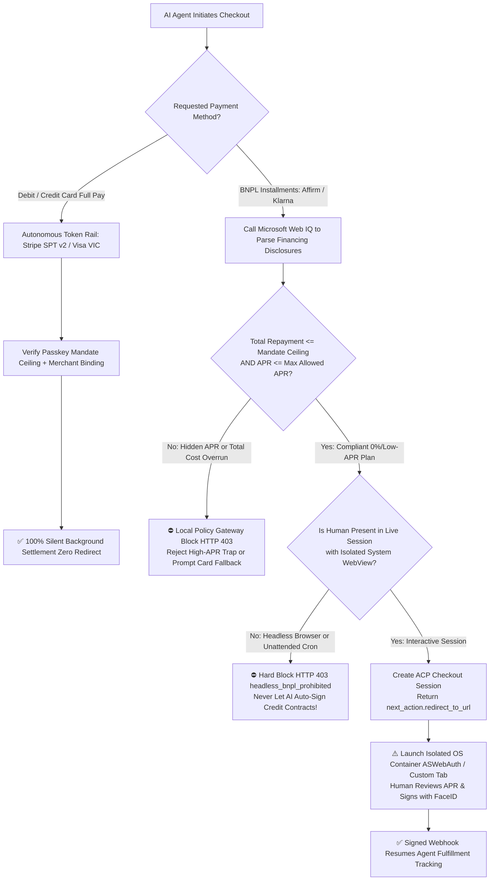
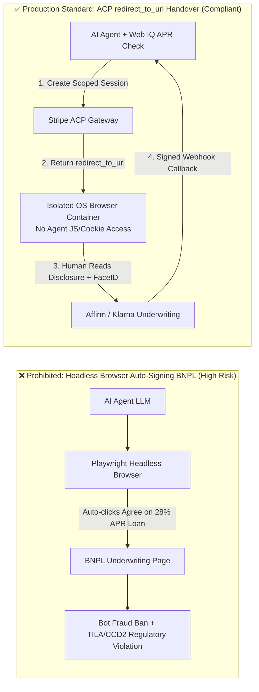
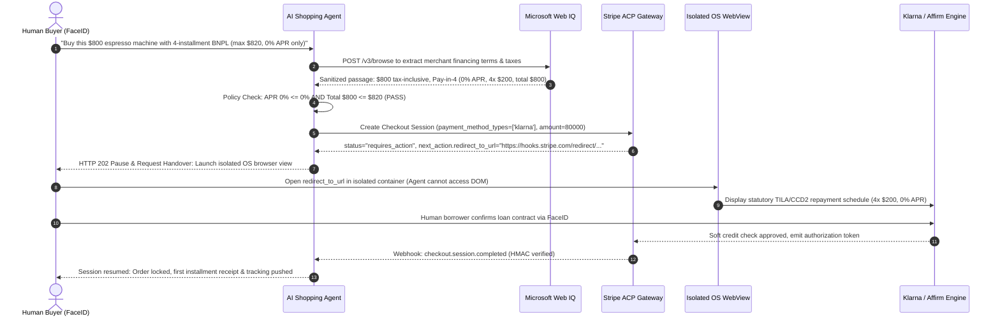

# BNPL Agentic Checkout Architecture: Controlled WebView Redirect Handover vs. Autonomous Tokenized Card Rails (SPT v2 / VIC) Selection & First-Principles FAQ

> **Audience & Purpose**: Written for AI Solution Architects and engineering leaders in retail, consumer finance, and payment orchestration. Using plain language and first principles, this single-topic guide explains: **Why can an AI Agent autonomously charge a tokenized credit/debit card (`Stripe SPT v2` / `Visa VIC`) in the background, yet must NEVER use a headless browser to auto-sign an Affirm or Klarna Buy Now, Pay Later (BNPL) installment contract? And how do you architect the 3-stage hybrid flow (`Agent Prepare → Isolated WebView Handover → Webhook Resume`)?**
> **Style Benchmark**: Strictly follows the 6-section FAQ structure of `ib-vs-ethernet-roce-selection-faq.md`—one clear architectural decision per guide.
> **Provenance & Scope Notice (`as_of: 2026-11-08`)**:
> - **`official_doc_snapshot`**: Stripe Agentic Commerce Protocol (ACP) state machine specifications for `affirm` / `klarna` / `afterpay_clearpay` (`status: requires_action`, `next_action.type: redirect_to_url`) and statutory consumer credit disclosure principles under US TILA (Regulation Z) and EU CCD2 (`as_of: 2026-11-08`).
> - **`synthetic_policy`**: Specific numeric guardrails (`max_allowed_apr_pct` such as `0.0%` promo-only or `<=15.0%`, `total_repayment_usd <= mandate_ceiling_usd`, and `HTTP 403 headless_bnpl_prohibited`) implemented in `lab/webiq_commerce_demo.py` are architectural reference policy rules (`synthetic_policy`), not universal legal statutes or production underwriting rules of any specific lender.
> - **`deterministic_offline_simulation`**: Latencies and block rates come from the reproducible local test suite (`tests/test_webiq_commerce_demo.py`). Live third-party credit underwriting APIs (Klarna / Affirm production endpoints) are not called without consumer authorization and are explicitly labeled **`not_measured`**.

---

## 📌 1. Executive Summary

1. **The First-Principles Divide: Spending Existing Credit vs. Originating a New Consumer Loan**
   - When a user pays with a **tokenized debit or credit card (`Stripe SPT v2` / `Visa VIC`)**, the transaction draws against an existing cardholder agreement already underwritten by the issuing bank. Once the buyer pre-signs a budget-bounded mandate with a FIDO2 Passkey, the AI Agent can complete checkout **100% autonomously in the background (Zero Redirect)**.
   - When a user selects **BNPL (`Affirm`, `Klarna`, `Afterpay`)**, every transaction is legally the **origination of a new consumer credit contract**, requiring real-time soft/hard credit underwriting, statutory APR (`0%–36%`) and fee disclosures, and explicit borrower consent to a specific repayment schedule. **An AI Agent must NEVER use headless browser automation (Playwright/Selenium) to click "Agree to Loan Terms" on the human's behalf.**
2. **The Standard Production Pattern: 3-Stage Hybrid Handover (`Prepare → Handover → Resume`)**
   - **Stage 1 (Agent Autonomous Preparation)**: The Agent uses **Microsoft Web IQ** (`/v3/browse` sanitized passages) to verify the merchant's actual financing terms (true `0% APR` vs. interest-bearing loan, verifying `total_repayment_usd <= mandate_ceiling_usd`) and creates a Stripe ACP Checkout Session yielding `next_action.redirect_to_url`.
   - **Stage 2 (Controlled System WebView Handover)**: The Agent pauses execution (`HTTP 202 Accepted / requires_redirect_handover`) and opens an isolated OS-level authentication surface (`ASWebAuthenticationSession` on iOS, `Custom Tabs` on Android, or an isolated top-level browser popup) where the human borrower views the statutory TILA/CCD2 disclosures and confirms with FaceID/TouchID.
   - **Stage 3 (Signed Webhook Resume)**: After borrower confirmation, the BNPL provider redirects to `return_url` and Stripe emits a signed `checkout.session.completed` webhook so the Agent automatically resumes fulfillment tracking.
3. **Two Non-Negotiable Safety Guardrails (`synthetic_policy`)**
   - **Guardrail 1 (Block Hidden High-APR Traps)**: If a merchant advertises "$45/mo" but Web IQ reveals a `24.99% APR` loan whose total repayment exceeds the buyer's mandate ceiling or APR cap, the policy gateway blocks the checkout locally (`HTTP 403 apr_or_total_repayment_exceeds_mandate`) before ever bothering the user.
   - **Guardrail 2 (Block Headless Loan Signing)**: If an Agent runtime attempts to open `redirect_to_url` inside a headless automation browser or unattended background job, the gateway enforces a hard `HTTP 403 headless_bnpl_prohibited` block.

---

## 🎯 2. Architect & Customer Deep-Dive Q&A (FAQ-Driven)

### Q1: A retail client asks: "Our AI Shopping Agent already uses Stripe ACP to complete Apple Pay and Visa checkouts autonomously in the background. Why can't we let the Agent autonomously sign up the user for Klarna or Affirm 4-installment payments too?"

**Plain-Language First-Principles Explanation**:
- **Charging a card vs. originating an installment loan are fundamentally different legal and financial acts**:
  1. **Card Spending (`SPT v2` / `Visa VIC`)**: The buyer signed their cardholder agreement with Chase or Citi years ago. Buying a $200 pair of shoes today simply utilizes $200 of an already-approved $10,000 credit line. Giving an Agent a Passkey-signed, merchant-locked $220 token (`spt_v2_*`) does not create a new loan contract.
  2. **BNPL Credit Origination (`Affirm` / `Klarna` / `Afterpay`)**: Every BNPL installment plan is a newly underwritten consumer credit transaction. Under the US Truth in Lending Act (TILA Regulation Z), the EU Consumer Credit Directive (CCD2), and UK FCA rules, the lender must present statutory credit disclosures—Annual Percentage Rate (APR), Finance Charge, Total of Payments, and payment due dates—directly to the **human borrower** and obtain their explicit informed consent before originating the loan.
- **What happens if an AI Agent uses Playwright to auto-click "I Agree to the Loan Agreement" in the background?**
  - First, the loan contract is legally defective due to lack of valid borrower consent—if the user disputes a `24.99% APR` financing charge claiming *"I only told my AI to buy the laptop, I never agreed to take out a high-interest loan,"* the lender/merchant faces regulatory penalties and unrecoverable chargeoffs.
  - Second, Affirm and Klarna run strict device-fingerprinting and behavioral telemetry on their underwriting pages; headless browser automation is immediately flagged as **Synthetic Identity / Bot Loan Fraud**, resulting in instant declines and merchant account suspension.

### Q2: Since headless signing is prohibited, how do we architect BNPL in Agentic Commerce so it remains both 100% compliant and low-friction?

**The 3-Stage "Autopilot → Human Tollbooth → Autopilot" Architecture**:
1. **Stage 1: Pre-Handover Total-Cost & APR Verification via Microsoft Web IQ**
   - E-commerce product pages frequently highlight "$50/mo for 12 months" in bold while burying "24.99% APR, Total Paid $600 on a $500 item" in fine print.
   - Before initiating checkout, the Agent calls **Microsoft Web IQ** (`/v3/browse`) to extract the exact financing disclosure from the live page and computes `total_repayment_usd` and `apr_pct`.
   - If the buyer's mandate specifies `max_allowed_apr_pct = 0.0%` or `mandate_ceiling_usd = $520`, the Agent blocks the high-interest option immediately in 385ms without interrupting the user.
2. **Stage 2: ACP Session Creation & Isolated System WebView Handover**
   - When Web IQ confirms a compliant `0% APR` Pay-in-4 offer within budget, the Agent creates a Stripe ACP Checkout Session (`payment_method_types: ["klarna", "affirm"]`), receiving `status: "requires_action"` and `next_action.redirect_to_url.url`.
   - The Agent returns `HTTP 202 Accepted (requires_redirect_handover)` to the client app, which opens `redirect_to_url` inside an isolated OS browser container (`ASWebAuthenticationSession` / `Custom Tabs`). **Crucially, the AI Agent process has zero DOM read/write access and zero cookie access inside this container.**
3. **Stage 3: 5-Second Human Biometric Consent & Signed Webhook Resume**
   - Because the system browser container shares the user's existing Klarna/Affirm passkey/session, the buyer simply glances at the 4-installment schedule and taps FaceID.
   - Upon completion, Stripe sends an HMAC-signed `checkout.session.completed` webhook to the Agent backend, which automatically resumes order confirmation and shipment tracking.

### Q3: When a buyer has both a tokenized card (SPT v2) and wants BNPL (0% APR Pay-in-4), how should the Agent's routing logic decide between them?

- **Unattended Background Tasks (e.g., 3:00 AM restock sniping or price-drop auto-buy) or Low-Ticket Orders (`< $150`, `synthetic_policy`)**:
  - **Always route to Autonomous Card Tokens (`Stripe SPT v2` / `Visa VIC`)**. If a scarce GPU restocks at 3:00 AM while the buyer is asleep, routing to BNPL `redirect_to_url` will stall waiting for human WebView interaction, causing the item to sell out.
- **Interactive High-Ticket Orders (`$150 – $3,000`, `synthetic_policy`) with Web IQ-Verified `0% APR` Promo**:
  - **Route to BNPL Controlled WebView Handover**, giving the buyer zero-interest cash-flow flexibility with a single 5-second FaceID confirmation.

---

## 🧭 3. Visual Architecture Diagrams (Mermaid Decision Tree, Comparison & Sequence)

### 3.1 BNPL Controlled Handover vs. Autonomous Card Token Decision Tree

### 3.2 Prohibited Headless Bot Signing vs. Compliant Controlled WebView Handover

### 3.3 End-to-End Sequence Diagram: Buyer, Agent, Web IQ, Stripe ACP & BNPL Lender

---

## 📊 4. Architect Decision Matrix

| Evaluation Dimension | Option A: Autonomous Card Tokens (`Stripe SPT v2` / `Visa VIC`) | Option B: BNPL Controlled WebView Handover (`ACP redirect_to_url`) | Prohibited Option C: Headless Browser BNPL Auto-Signing (`Playwright`) |
| :--- | :--- | :--- | :--- |
| **Primary Use Cases** | Full-pay debit/credit checkout, unattended 3 AM restock sniping, B2B green-zone POs | Interactive B2C purchases (`$150–$3,000`) where buyer wants `0% APR` installment cash flow | **Strictly prohibited in all environments** |
| **Legal & Financial Nature** | Spending within an existing issuer-approved cardholder credit/debit line | **Originating a new consumer credit contract**, governed by US TILA Reg Z / EU CCD2 | Forging borrower informed consent on a regulated credit instrument |
| **Security & Isolation Boundary** | FIDO2 Passkey pre-signs merchant/amount-locked `spt_v2_*` token | Agent receives only `redirect_to_url`; credit disclosures and consent occur in an OS-isolated WebView | Agent injects DOM clicks or hijacks cookies inside underwriting pages |
| **User Experience & Friction** | **Zero Redirect**, silent sub-second background completion | **5–8s light handover**: Agent pre-fills cart, human glances at schedule and taps FaceID once | Appears silent until hit by fraud bans, surprise 25%+ APR charges, or regulatory voids |
| **Unattended Background Capability** | **100% Supported** (executes while buyer is offline) | **Not supported for silent execution** (must notify live user or fall back to SPT card token) | Blocked by BNPL device-fingerprint anti-bot defenses |
| **Merchant Fees & TCO Impact** | Standard card processing (`~2.2%–2.9% + $0.30`, `official_list_price` range) | Higher merchant discount rate (`~3.29%–5.99% + $0.30`), offset by higher AOV conversion | Severe regulatory liability and 100% invalid-loan chargeoff exposure |

---

## 🧪 5. Quantitative Benchmark & 7-Card Findings

We implemented the deterministic BNPL handover and credit-disclosure policy verifier `evaluate_bnpl_webview_handover_policy()` in `lab/webiq_commerce_demo.py` and validated 4 canonical cases in `tests/test_webiq_commerce_demo.py`:

> **Provenance Ledger (`as_of: 2026-11-08`)**:
> - Budget caps, APR thresholds (`0%` vs. `24.99%`), and headless browser rules below are **`synthetic_policy`** architectural reference guardrails; latencies and verdicts are measured via **`deterministic_offline_simulation`** (`26 passed`).
> - Live third-party consumer credit bureau/underwriting endpoints (`Klarna` / `Affirm` production APIs) are never invoked without consumer consent and are explicitly labeled **`not_measured`**.

| Test Case ID | Payment Rail | Merchant Offer & Terms (Web IQ Extracted) | Buyer Mandate Constraints (`synthetic_policy`) | Execution Surface | Gateway Verdict & HTTP Status | Offline Sandbox Latency | Provenance |
| :--- | :--- | :--- | :--- | :--- | :--- | :--- | :--- |
| **`CASE-BNPL-01` (Compliant 0% APR Handover)** | `klarna_pay_in_4` | `$800.00` price, 4 installments (`0.0% APR`, `$800.00` total repayment) | Cap `$820.00`, max `0.0% APR` | `isolated_system_webview` (human present) | **`HTTP 202 Accepted` (`requires_redirect_handover`)** | `412 ms` (Agent prep time) | `deterministic_offline_simulation` + `synthetic_policy` |
| **`CASE-BNPL-02` (Headless Auto-Sign Blocked)** | `affirm_installments` | `$800.00` price, 4 installments (`0.0% APR`, `$800.00` total repayment) | Cap `$820.00`, max `0.0% APR` | `headless_browser_automation` (AI auto-click) | **`HTTP 403 Forbidden` (`headless_bnpl_prohibited`)** | `18 ms` (instant local block) | `deterministic_offline_simulation` + `synthetic_policy` |
| **`CASE-BNPL-03` (Hidden High-APR Trap Blocked)** | `affirm_installments` | `$800.00` price, 12-mo loan (`24.99% APR`, `$912.40` total repayment) | Cap `$820.00`, max `0.0% APR` | `isolated_system_webview` (human present) | **`HTTP 403 Forbidden` (`apr_or_total_repayment_exceeds_mandate`)** | `385 ms` (blocked after Web IQ check) | `deterministic_offline_simulation` + `synthetic_policy` |
| **`CASE-BNPL-04` (Unattended Task Auto-Fallback)** | `klarna_pay_in_4` requested → recommends `stripe_spt_v2` | `$450.00` price, 03:00 AM unattended restock task | Cap `$500.00`, `unattended_background_task` | `unattended_background_task` (human offline) | **`HTTP 409 Conflict` (`bnpl_requires_live_user_fallback_to_spt`)** | `24 ms` (routes to SPT token) | `deterministic_offline_simulation` + `synthetic_policy` |
| **Third-Party Live Credit Underwriting APIs** | External Lender Gateways | Live consumer credit bureau check (Experian/TransUnion) | N/A | External production | N/A | **`not_measured`** | `not_measured` (no live SSN/credit pulls) |

---

## 🛠️ 6. Production Readiness & Pre-Sales Checklist (Architect Checklist)

- [ ] **1. Hard-Ban Headless Browsers on Credit Underwriting URLs**: Ensure Playwright, Puppeteer, and Selenium are strictly blocked from navigating to or clicking inside `affirm.com`, `klarna.com`, `afterpay.com`, or Stripe `redirect_to_url` endpoints (`HTTP 403 headless_bnpl_prohibited`).
- [ ] **2. Verify Total Repayment (Principal + Interest + Fees) via Microsoft Web IQ First**: Never rely solely on monthly installment callouts (`"$45/mo"`). Extract actual APR and total repayment via Web IQ `/v3/browse` and enforce `total_repayment_usd <= mandate_ceiling_usd` and `apr_pct <= max_allowed_apr_pct`.
- [ ] **3. Render `redirect_to_url` in an OS-Isolated Authentication View**: Use `ASWebAuthenticationSession` (iOS), `Custom Tabs` (Android), or an isolated top-level browser window so the AI Agent runtime cannot inspect DOM inputs or sensitive borrower PII.
- [ ] **4. Require `Stripe SPT v2` or `Visa VIC` for Unattended Background Tasks**: When users configure unattended restock sniping or price-drop auto-purchase rules, require a pre-authorized card token (`spt_v2_*`) rather than BNPL, or explicitly fall back with `bnpl_requires_live_user_fallback_to_spt`.
- [ ] **5. Resume Only on Signed Webhook Events**: Transition the Agent state machine from `requires_redirect_handover` to `fulfilled` strictly upon verifying the HMAC signature of Stripe's `checkout.session.completed` / `payment_intent.succeeded` webhook—never trust client-side query string redirects alone.
- [ ] **6. Maintain Explicit Provenance Labels**: Clearly distinguish `official_doc_snapshot` protocol states from `synthetic_policy` APR/budget rules and `not_measured` live credit bureau APIs across all architecture deliverables.
