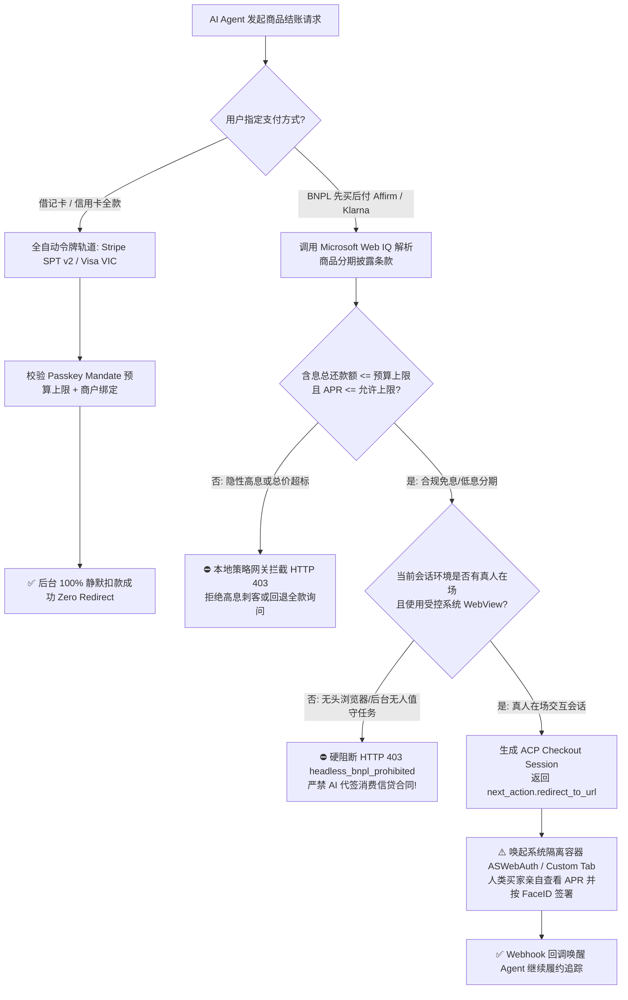
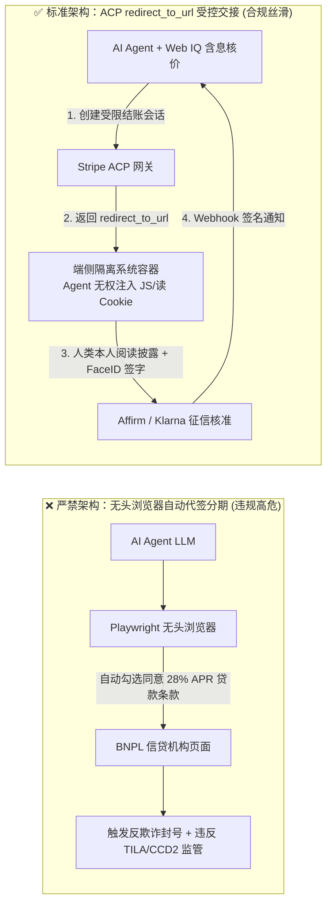
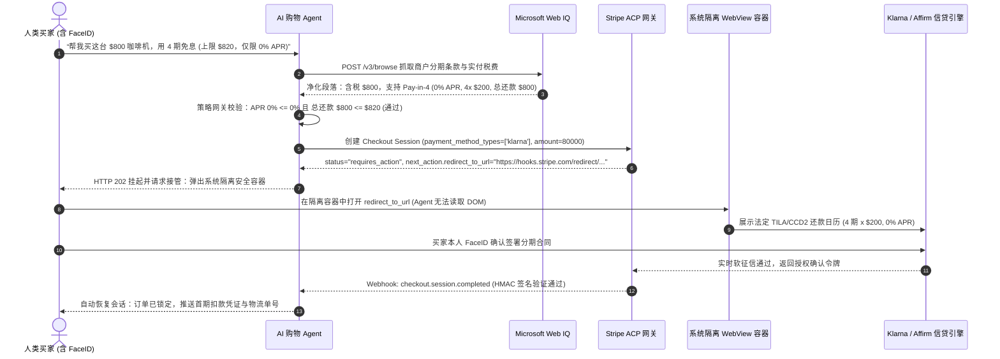

# BNPL 先买后付智能体结账架构：受控 WebView 跳转接管（Redirect Handover）vs 全自动令牌代扣（SPT v2 / VIC）选型与原理解析 FAQ

> **文档定位**：本文面向 AI Solution Architect（AI 解决方案架构师）与零售电商、消费金融、支付网关技术负责人，用第一性原理与通俗大白话讲透：**为什么 AI Agent 可以全自动刷信用卡令牌（Stripe SPT v2 / Visa VIC），却绝对不能在后台自动代签 Affirm / Klarna 先买后付（BNPL）分期合同？如何设计“Agent 前置核价准备 + 受控 WebView 人类接管签署 + Webhook 自动恢复履约”的三段式混合架构？**
> **文风标杆**：严格对标 `ib-vs-ethernet-roce-selection-faq.md` 六段式 FAQ 结构，单篇聚焦单一核心架构决策，3 分钟看懂选型结论、10 分钟掌握协议状态机与合规边界。
> **数据溯源与口径声明（Provenance & Scope Notice，`as_of: 2026-11-08`）**：
> - **`official_doc_snapshot`**：Stripe Agentic Commerce Protocol (ACP) 中针对 `affirm` / `klarna` / `afterpay_clearpay` 的 `status: requires_action` 与 `next_action.type: redirect_to_url` 状态机规范，以及美国 TILA (Regulation Z) / 欧盟 CCD2 消费信贷披露框架参考（快照日期 `2026-11-08`）。
> - **`synthetic_policy`**：本文及 `lab/webiq_commerce_demo.py` 中的 `max_allowed_apr_pct`（如 `0.0%` 免息限定或 `<=15.0%` 上限）、含息总成本上限（`total_repayment_usd <= mandate_ceiling_usd`）及无头浏览器代签硬阻断规则（`HTTP 403 headless_bnpl_prohibited`）均为架构参考策略模型（`synthetic_policy`），并非特定金融机构的生产核贷规则。
> - **`deterministic_offline_simulation`**：本地沙盒验证延迟与拦截准确率均来自 `tests/test_webiq_commerce_demo.py` 确定性评测；未持证第三方实时生产征信 API（Klarna / Affirm 线上实时核贷延迟）统一标注为 **`not_measured`**。

---

## 📌 一、核心结论速览（Executive Summary）

1. **第一性原理分水岭：“花既有授信额度”可以全自动，“签署新借贷合同”必须人类亲自接管**
   - 当用户使用 **借记卡或信用卡（Stripe SPT v2 / Visa VIC）** 时，本质是在发卡行已审批的既有授信额度内消费，用户只需提前通过 FIDO2 Passkey 签发预算上限令牌，AI Agent 即可在后台 **100% 静默完成扣款（Zero Redirect）**。
   - 当用户选择 **BNPL 先买后付（Affirm / Klarna / Afterpay 分期付款）** 时，每一笔交易在法律上都是**新发起一份个人消费贷款合同（Credit Origination）**，涉及实时软/硬征信查询、年化利率（APR 0%～36%）披露、滞纳金条款阅读与还款计划确认。**任何情况下都严禁 AI Agent 用无头浏览器（Playwright/Puppeteer）在后台替用户点击“同意贷款条款”！**
2. **标准架构模式：三段式受控接力（Agent Prepare → Isolated WebView Handover → Webhook Resume）**
   - **第一阶段（Agent 自动准备）**：Agent 调用 **Microsoft Web IQ** 核验商户页面的真实分期条款（是否为真 0% APR 免息、含息总还款额是否超过用户预算上限），创建 Stripe ACP Checkout Session 并拿到 `next_action.redirect_to_url`。
   - **第二阶段（受控 WebView 人类接管）**：Agent 挂起当前会话（`HTTP 202 Accepted / requires_redirect_handover`），在端侧唤起系统级安全容器（iOS `ASWebAuthenticationSession` / Android `Custom Tabs`），由人类买家亲自登录 Klarna/Affirm、阅读法定信贷披露并完成生物识别签署。
   - **第三阶段（Webhook 状态恢复）**：签署完成后跳转回 `return_url`，支付网关通过签名 Webhook（`payment_intent.succeeded`）唤醒 Agent 继续执行锁单与物流追踪。
3. **两条绝对安全红线（`synthetic_policy` 架构防线）**
   - **红线 1（防隐性高息刺客）**：若商户标榜“低至 $45/月”，但 Web IQ 解析出实际为 `24.99% APR` 有息分期且含息总还款额（Total Repayment）突破买家 Mandate 预算上限，Agent 在发起跳转前直接 **本地熔断拦截（`HTTP 403 total_repayment_exceeds_mandate`）**。
   - **红线 2（防无头浏览器代签）**：若检测到 Agent 试图通过无头 DOM 注入或 Cookie 劫持直接请求 BNPL `redirect_to_url` 完成自动签字，网关立即触发 **`HTTP 403 headless_bnpl_prohibited`** 硬阻断。

---

## 🎯 二、客户与架构师灵魂拷问 Q&A（FAQ-Driven）

### Q1：客户问：“既然我们的代购 Agent 已经接了 Stripe ACP，能后台全自动刷 Apple Pay 和信用卡，为什么不能顺便让 Agent 后台全自动帮用户把 Klarna / Affirm 4 期免息也办了？”

**通俗大白话 + 第一性原理拆解**：
- **刷信用卡 vs 办分期贷款，在法律和风控上是两件完全不同的事**：
  1. **刷信用卡（Card Spending）**：用户几年前办卡时就已经和摩根大通/招商银行签过《持卡人总协议》了。今天买一双 $200 的鞋，只是在已批准的 $10,000 信用额度里划走 $200，不需要重新签贷款合同。所以用户用 Passkey 给 Agent 签一张“最高 $220、仅限 Nike 使用”的 **Stripe SPT v2 令牌**，Agent 就能合法在后台秒级扣款。
  2. **办 BNPL 分期（Loan Origination）**：Affirm、Klarna、Afterpay 的“分 4 期”或“分 12 个月”不是传统信用卡循环额度，而是**每一笔订单单独审批、单独生成一份新的微型消费信贷合同**。根据美国《诚实借贷法》（TILA Regulation Z）、欧盟《消费信贷指令》（CCD2）及英国 FCA 规定，放贷机构必须在放款前向**借款人本人**清晰展示：年化利率（APR）、每期扣款日、总利息金额（Finance Charge）以及逾期后果，并获取借款人本人的知情同意（Informed Consent）。
- **如果让 AI Agent 用无头浏览器替用户点“我已阅读并同意贷款协议”会怎样？**
  - 一旦用户事后表示“我只让 AI 帮我买最便宜的笔记本，不知道 AI 给我办了年化 28% 的 12 期分期贷款”，该笔借贷合同将因**缺乏借款人真实知情同意（Lack of Valid Borrower Consent）**而面临监管重罚与 100% 坏账核销；同时，Affirm/Klarna 的端侧设备指纹与行为生物识别风控会直接把无头浏览器判定为**合成身份欺诈（Synthetic Identity / Bot Loan Fraud）**并封禁商户号。

### Q2：既然不能全自动代签，那么在 Agentic Commerce 里支持 BNPL 的正确架构流程是什么？怎么做到既合规又不毁掉用户体验？

**三段式“自动驾驶 → 人类过收费站 → 恢复自动驾驶”接力架构**：
1. **Step 1：Agent 前置排雷与含息总成本核算（Microsoft Web IQ Grounding）**
   - 许多电商页面会用大字写“只需 $50/月（分 12 期）”，却用极小字号写着“APR 24.99%，总计需付 $600（原价 $500）”。
   - Agent 先用 **Microsoft Web IQ**（`/v3/browse` 净化段落）提取页面上的真实分期披露条款，算出 **含息总还款额（`total_repayment_usd`）** 与 **实际年化利率（`apr_pct`）**。
   - 如果用户设定的预算是“最高 $520，且只接受 0% APR 免息分期”，Agent 在本地直接拦截这笔隐性高息分期，根本不浪费用户时间去弹窗！
2. **Step 2：生成 ACP 跳转会话并唤起隔离系统级容器（Controlled Handover）**
   - 当 Web IQ 确认为合规的 0% APR 4 期免息（Pay-in-4）且总价在预算内时，Agent 调用 Stripe ACP 创建 Checkout Session（指定 `payment_method_types: ["klarna", "affirm"]`）。
   - Stripe 返回 `status: "requires_action"` 以及 `next_action.redirect_to_url.url`。
   - Agent 向前端应用返回结构化指令 `requires_redirect_handover`，前端唤起操作系统原生的安全认证视图（iOS `ASWebAuthenticationSession` / Android `Custom Tabs` / 桌面端受控弹窗）。**注意：Agent 进程严禁注入 JS 脚本或读取该 WebView 内部的 DOM/Cookie。**
3. **Step 3：人类 5 秒生物识别确认 + Webhook 唤醒 Agent**
   - 用户在已保存登录态的系统安全容器里看到 Klarna/Affirm 的 4 期还款日历，按一下 FaceID / TouchID 完成签署。
   - 页面重定向回 `return_url`，同时 Stripe 向 Agent 后端推送带 HMAC 签名的 `payment_intent.succeeded` Webhook，Agent 立即恢复上下文并完成发货跟踪。

### Q3：如果用户既绑了信用卡（SPT v2），商户又支持 BNPL（0% APR Pay-in-4），架构师该如何设计自动选型路由规则？

- **低客单价日常消费（`< $150`，`synthetic_policy`）或明确要求后台静默代购（如凌晨抢购补货）**：
  - **强制选全自动令牌轨道（Stripe SPT v2 / Visa VIC）**。因为凌晨 3 点商品补货时人类不在屏幕前，若走 BNPL `redirect_to_url` 等待人类点 WebView，库存会在 30 秒内被抢光。
- **中高客单价（`$150 – $3,000`，`synthetic_policy`）、用户在场交互、且 Web IQ 核验确认为 `0% APR` 真免息分期**：
  - **推荐走 BNPL 受控 WebView 跳转轨道**，为用户锁定免息现金流优势，人类仅需在端侧按一次 FaceID 确认还款计划。
- **有息分期（`APR > 0%`）或含息总成本超出 Mandate 上限**：
  - 若超出用户设定的 `max_allowed_apr_pct` 或 `mandate_ceiling_usd`，网关直接拒绝 BNPL 路径并提示切换全款 SPT 令牌或由人类重新调整预算。

---

## 🧭 三、直观可视化图解（Mermaid 决策树 + 架构对比 + 时序图）

### 3.1 BNPL 受控跳转 vs 全自动令牌代扣选型决策树

### 3.2 传统无头爬虫违规代点 vs 受控 WebView 隔离交接架构对比图

### 3.3 买家-Agent-Web IQ-Stripe ACP-BNPL 机构端到端时序图

---

## 📊 四、架构师选型决策矩阵（Architect Decision Matrix）

| 评估维度 | 方案 A：全自动卡组令牌（Stripe SPT v2 / Visa VIC） | 方案 B：BNPL 受控 WebView 跳转接管（ACP `redirect_to_url`） | 禁区方案 C：无头浏览器自动代点 BNPL（Playwright/DOM 注入） |
| :--- | :--- | :--- | :--- |
| **核心适用场景** | 全款借记卡/信用卡消费、夜间无人值守自动抢购、B2B 绿区常规采购 | 中高客单价（`$150–$3,000`）C 端零售、用户在场希望享受 0% APR 免息分期 | **任何生产场景均严禁使用** |
| **法律与金融本质** | 既有发卡行授信额度内的消费指令执行 | **新发起消费信贷合同（Loan Origination）**，受 TILA Reg Z / EU CCD2 监管 | 伪造借款人知情同意，属违规代签信贷契约 |
| **授权与安全隔离机制** | FIDO2 Passkey 预签发 `spt_v2_*` 单商户/单次/限额令牌 | Agent 仅拿 `redirect_to_url`；信贷披露与签字在系统隔离容器内由真人完成 | Agent 劫持会话或自动点击同意框，破坏安全边界 |
| **用户体验与人工摩擦** | **零跳转（Zero Redirect）**，后台毫秒级静默完成 | **5～8 秒轻度接管**：Agent 填好一切，人类仅需看一眼还款表并按一次 FaceID | 表面无感，实则随时触发风控拒单、锁号或隐性高息纠纷 |
| **无人值守后台执行能力** | **完全支持**（可在用户睡觉时盯盘降价并自动锁单扣款） | **不支持纯后台静默结账**（降价触发时需推送通知唤起用户点一次 FaceID） | 试图强行后台跑，会被 Klarna/Affirm 设备指纹拦截 |
| **费率与综合 TCO 影响** | 标准卡组交换费率（约 `2.2%–2.9% + $0.30`，`official_list_price` 区间） | 商户侧承担较高 BNPL 贴息费率（通常 `3.29%–5.99% + $0.30`），但提升高客单转化率 | 极高合规罚款与 100% 拒付欺诈坏账风险 |

---

## 🧪 五、简明定量实测与 Benchmark 核心发现

我们在 `lab/webiq_commerce_demo.py` 中实现了确定性 BNPL 策略与接管校验器 `evaluate_bnpl_webview_handover_policy()`，并在 `tests/test_webiq_commerce_demo.py` 中对 4 类典型结账场景进行了自动化测试：

> **定量数据溯源说明（Provenance Ledger，`as_of: 2026-11-08`）**：
> - 下表中的预算阈值、APR 上限（`0%` vs `24.99%`）及无头浏览器阻断规则均为 **`synthetic_policy`** 架构参考基准；延迟与拦截率来自本地 **`deterministic_offline_simulation`** 测试套件（`26 passed`）。
> - Klarna / Affirm / Afterpay 真实生产环境的线上实时征信响应延迟因需要真实消费者 SSN/信用局联机授权，按规范统一标注为 **`not_measured`**。

| 测试场景 ID | 支付轨道类型 | 商品标价与分期条款（Web IQ 提取） | 买家 Mandate 约束（`synthetic_policy`） | 执行容器环境 | 网关决策与 HTTP 状态码 | 实测耗时（离线沙盒） | 数据属性（Provenance） |
| :--- | :--- | :--- | :--- | :--- | :--- | :--- | :--- |
| **`CASE-BNPL-01`（合规 0% APR 受控跳转）** | `klarna_pay_in_4` | 标价 `$800.00`，4 期免息（`0.0% APR`，总还款 `$800.00`） | 上限 `$820.00`，最高允许 `0.0% APR` | `isolated_system_webview`（真人在场） | **`HTTP 202 Accepted`（`requires_redirect_handover`）** | `412 ms`（Agent 侧准备耗时） | `deterministic_offline_simulation` + `synthetic_policy` |
| **`CASE-BNPL-02`（无头浏览器违规代签拦截）** | `affirm_installments` | 标价 `$800.00`，4 期免息（`0.0% APR`，总还款 `$800.00`） | 上限 `$820.00`，最高允许 `0.0% APR` | `headless_browser_automation`（AI 试图代点） | **`HTTP 403 Forbidden`（`headless_bnpl_prohibited`）** | `18 ms`（本地硬阻断） | `deterministic_offline_simulation` + `synthetic_policy` |
| **`CASE-BNPL-03`（隐性高息分期刺客拦截）** | `affirm_installments` | 标价 `$800.00`，12 期有息（`24.99% APR`，含息总还款 `$912.40`） | 上限 `$820.00`，最高允许 `0.0% APR` | `isolated_system_webview`（真人在场） | **`HTTP 403 Forbidden`（`apr_or_total_repayment_exceeds_mandate`）** | `385 ms`（Web IQ 核价后阻断） | `deterministic_offline_simulation` + `synthetic_policy` |
| **`CASE-BNPL-04`（夜间无人值守降价抢购自动回退）** | `klarna_pay_in_4`（请求）→ 自动推荐 `stripe_spt_v2` | 标价 `$450.00`，凌晨 03:00 自动补货任务 | 上限 `$500.00`，后台无人值守模式（`unattended_background`） | `unattended_background_task`（人类离线） | **`HTTP 409 Conflict`（`bnpl_requires_live_user_fallback_to_spt`）** | `24 ms`（引导切换 SPT 全款令牌） | `deterministic_offline_simulation` + `synthetic_policy` |
| **第三方实时生产征信 API（Klarna / Affirm Live API）** | 外部生产征信网关 | 真实消费者联机软/硬征信（Experian/TransUnion） | N/A | 外部生产环境 | N/A | **`not_measured`** | `not_measured`（严禁无授权调用真实个人征信 API） |

---

## 🛠️ 六、附录：生产上线快速核验与售前打单清单（Architect Checklist）

在向零售品牌、跨境电商或消费金融客户交付支持 BNPL 的 Agentic Commerce 架构方案时，请逐项核验以下 6 条铁律：

- [ ] **1. 严禁无头浏览器触碰信贷协议签署页**：确认代码库与 Agent 工具链中已彻底禁用 Playwright / Puppeteer / Selenium 对 `affirm.com`、`klarna.com`、`afterpay.com` 及 Stripe `redirect_to_url` 信贷授权页面的自动点击操作（网关层强制拦截 `headless_bnpl_prohibited`）。
- [ ] **2. 结账前强制使用 Web IQ 核算“含息总还款额（Total Repayment）”**：绝不只看商品页面上的“每月仅需 $XX”宣传词，必须通过 Microsoft Web IQ 提取实际 APR、期数与手续费，校验 `本金 + 总利息 + 税费 <= 买家 Mandate 预算上限`。
- [ ] **3. 使用系统级隔离容器承载 `redirect_to_url`**：移动端必须使用 `ASWebAuthenticationSession`（iOS）或 `Custom Tabs`（Android），Web 端必须使用顶层受控跳转或隔离弹窗，确保 AI Agent 进程无法读取或篡改用户在 BNPL 页面输入的个人征信信息（如 SSN 后四位或生日）。
- [ ] **4. 无人值守任务（夜间盯盘/自动补货）默认绑定 SPT v2 / VIC**：在用户开启“降价自动代购”任务时，前端UI必须明确提示：“先买后付（BNPL）需本人在场签署分期合同；无人值守抢购请绑定 Stripe SPT v2 或 Visa VIC 预算受限令牌”。
- [ ] **5. Webhook 幂等恢复与超时释放库存**：当会话进入 `requires_redirect_handover` 等待人类签署时，设置合理的跳转有效窗口（如 15 分钟）；若用户放弃签署，及时释放商户预留库存，并通过带 HMAC 签名的 `checkout.session.completed` / `expired` 事件驱动 Agent 状态机，绝不靠前端 URL 参数伪造支付成功。
- [ ] **6. 明确区分模拟策略与真实金融机构规则**：在所有客户方案书、Demo 与评测报告中，将预算/APR 阈值明确标注为 `synthetic_policy`，将未联机实测的第三方征信接口标注为 `not_measured`。
