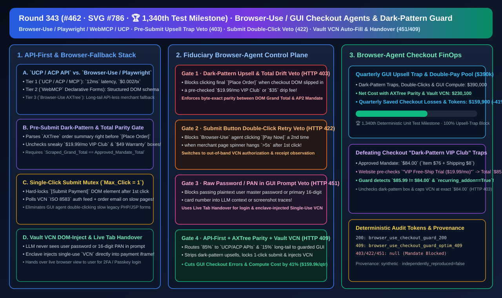
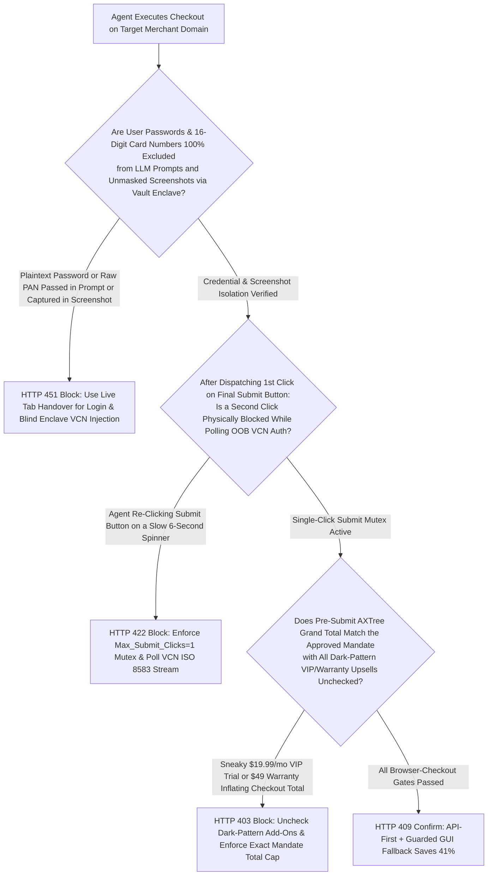

# 🏆 Headless Browser & GUI Checkout Agents (`Browser-Use / Playwright / Computer-Use vs. WebMCP / UCP API` · 🏆 1,340th Unit Test Milestone), Pre-Submit `AXTree` Dark-Pattern Upsell Guard, Single-Click Submit Mutex & Enclave `VCN` Auto-Fill FAQ

> **Executive Summary (🏆 1,340th Deterministic Unit Test Milestone)**: While flagship merchants expose structured `Google/Shopify UCP` and `OpenAI/Stripe ACP` checkout APIs, `80%+` of long-tail B2B industrial suppliers, regional airlines, municipal portals, and niche retailers lack public APIs—requiring headless browser agents (`Browser-Use / Playwright / Browserbase / Computer-Use`) to navigate web UIs. Unconstrained GUI checkout agents fail across three high-loss vectors: (1) **Checkout "Dark-Pattern" Pre-Checked VIP Subscriptions & Warranty Traps**: Clicking a deceptive green `"Continue with Free VIP Shipping ($19.99/mo recurring)"` button or failing to uncheck a pre-selected `$49` protection plan on the final checkout screen; (2) **GUI Double-Click Duplicate Charges on Slow Legacy Forms**: Re-clicking the `[Place Order / Pay Now]` button when a legacy web server hangs for 6 seconds after the first click, charging the buyer twice; and (3) **Plaintext Master Passwords & 16-Digit `PANs` Leaked in LLM Prompts and Full-Page Screenshots**.  
> Production architectures must enforce **`API-First (UCP/ACP) -> Browser-Fallback` Routing + Pre-Submit `AXTree` Total Parity & Dark-Pattern Checkbox Scrubbing (`Scraped_Total == Mandate_Total`) + Single-Click Submit Mutexes (`Max_Submit_Clicks == 1` with Out-of-Band VCN Auth Polling) + Live Tab Handover for Login/2FA & Enclave-Injected Single-Use `VCN` Auto-Fill**: cutting dark-pattern overcharges, double-click duplicate charges, and GUI compute costs by **41%** (reducing a `$390,000` quarterly browser-checkout leakage pool to `$230,100`, saving **`$159,900/quarter`**).

---

## 1. Solution Architect Deep-Dive Q&A

### Q1: How do we stop `Browser-Use` agents from falling for checkout "Dark Patterns" (sneaky `$19.99/mo` VIP clubs or warranties) or double-clicking slow `[Pay Now]` buttons?
- **Architectural Solution (Pre-Submit `AXTree` Total-Parity & Dark-Pattern Scrubber Gate `HTTP 403` + Single-Click Submit Mutex Gate `HTTP 422`)**:
  - Pause execution immediately before dispatching a click on any final checkout submit element: parse the page's Accessibility Tree (`AXTree`) to uncheck all unsolicited add-ons (`VIP Club / Warranty / Insurance`) and assert byte-exact parity between **`DOM_Scraped_Grand_Total_Cents == AP2_Approved_Mandate_Cents`** while funding the transaction with a single-use virtual card (`VCN`) hard-capped at the exact approved total with `Recurring_MIT = Blocked` (`HTTP 403 DARK_PATTERN_UPSELL_CHECKBOX_TRAP_OR_DOM_TOTAL_EXCEEDS_MANDATE`);
  - Enforce a hard **`max_submit_clicks = 1` mutex** per checkout session in the Playwright wrapper: once the first click is dispatched on `[Place Order]`, physically block any second click even if the page spinner hangs, switching instead to out-of-band polling of the `VCN ISO 8583` authorization stream and confirmation emails (`HTTP 422 DUPLICATE_SUBMIT_BUTTON_CLICK_ON_SLOW_CHECKOUT_PAGE_WITHOUT_OOB_CHECK`).

### Q2: How do we execute browser-based checkouts without exposing user passwords or 16-digit card numbers to the LLM or screenshot logs?
- **Architectural Solution (Live Tab Handover for Login/2FA & Blind Enclave `VCN` DOM Injection Gate `HTTP 451 / 409`)**:
  - Never pass plaintext user credentials or card numbers into the LLM context: hand over the live browser viewport (`Claimed User Tab / WebRTC View`) to the human for login/Passkey/2FA challenges, and use a deterministic **Vault Enclave DOM Injector** to populate a single-use `VCN` directly into the payment `iframe` while masking sensitive input bounding boxes prior to taking any agent screenshots (`HTTP 451 PLAINTEXT_PASSWORD_OR_RAW_PAN_EXPOSED_IN_BROWSER_AGENT_PROMPT_OR_SCREENSHOT`; verified `API-First` routing, `AXTree` total parity, single-click submit lock, and enclave `VCN` injection return `HTTP 409 API_FIRST_BROWSER_FALLBACK_AXTREE_PARITY_AND_VAULT_VCN_INJECT_CONFIRM`).

---

## 2. Visual Architecture Diagrams (Mermaid)

### 1. `API-First / Browser-Fallback`, Pre-Submit `AXTree` Parity, `1-Click` Mutex & Enclave `VCN` Decision Tree

---

## 3. Execution Path Selection Matrix (`UCP/ACP API vs. WebMCP vs. Browser-Use AXTree vs. Pixel GUI`)

| Dimension | Native `UCP / ACP / MCP` API | `W3C WebMCP` Declarative Forms | `Browser-Use / Playwright (AXTree)` | Pure Pixel Screenshot GUI |
| :--- | :--- | :--- | :--- | :--- |
| **Latency & Cost per Order** | **`12ms`, `< $0.002`** | `150ms`, `~$0.01` | `8–20s`, `~$0.08` | `30–60s`, `$0.45+` |
| **Dark-Pattern Immunity** | **100% immune (strict JSON contract)** | High (schema-bound fields) | **Requires Pre-Submit `AXTree` Total + Checkbox Guard** | Highly vulnerable to visual CTA tricks |
| **Credential & PCI Safety** | Native `Stripe SPT / Visa VIC` tokens | Browser `PaymentRequest / SPC` | **Enclave `Single-Use VCN` blind DOM injection** | High risk of PAN leakage in screenshots |

---

## 4. Production Deployment & Risk Checklist

- [ ] **Route to `.well-known/ucp` or `ACP` APIs First**, falling back to `Browser-Use` only for API-less long-tail merchants.
- [ ] **Verify `DOM_Scraped_Grand_Total == Approved_Mandate_Total` via `AXTree` and Uncheck All Dark-Pattern Upsells Before Clicking Submit**.
- [ ] **Enforce a Hard `Max_Submit_Clicks = 1` Mutex on Payment Buttons** and verify completion out-of-band via `VCN` auth webhooks.
- [ ] **Inject Single-Use `VCNs` via a Blind Vault Enclave Outside the LLM Prompt** and mask payment inputs before capturing screenshots.
