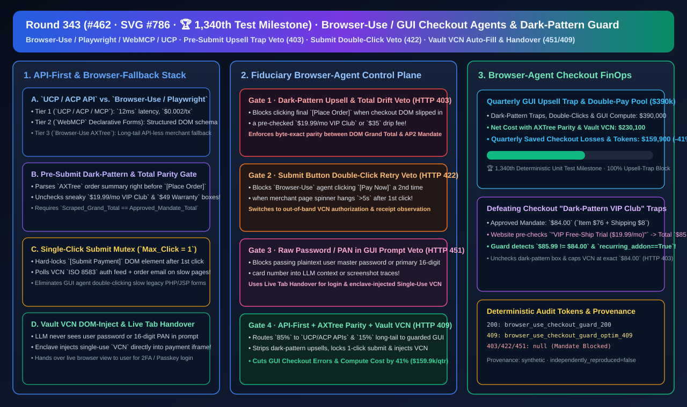
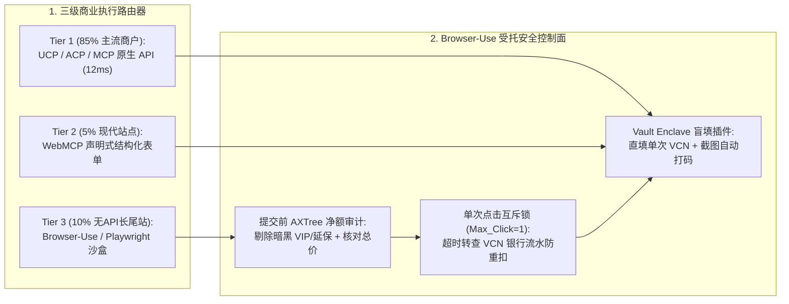
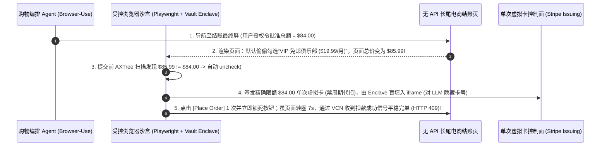

# 🏆 无 API 长尾站点浏览器自动化结账智能体（`Browser-Use / Playwright / Computer-Use GUI Agent vs. WebMCP / UCP API` · 🏆 第 1,340 项单元测试里程碑）：`API-First / Browser-Fallback` 分层路由、结账最后一步防“默认勾选 `$19.99/月` VIP 会员/延保暗黑模式（`Dark-Pattern Upsell Trap`）”`AXTree` 净额校验、防慢网页连点两下 `[立即支付]` 双倍扣款及敏感登录/填卡加密沙盒交接（`Live Tab Handover + Vault VCN Auto-Fill`）Agent 架构选型 FAQ

> **核心选型结论速览（🏆 第 1,340 项单元测试里程碑）**：当个人代购助手或企业非目录尾料采购（`Spot-Buy`）Agent 面向全网成千上万家商户执行下单时，虽然头部商户正迅速普及 `Google/Shopify UCP` 与 `OpenAI/Stripe ACP` 标准协议，但仍有大量长尾垂直网站（如地方市政规费、区域五金建材站、小众演出票务、传统航司改签页）**没有任何公开 API，只能靠无头浏览器智能体（`Browser-Use / Playwright / Anthropic Computer-Use / Browserbase`）模拟点击网页 DOM 完成结账**。然而裸跑 GUI 浏览器 Agent 去点收银台页面会频频引爆三大严重生产事故：① **“许多电商与票务网站在结账最后一步设置了诱导性极强的暗黑模式（`Dark Patterns`）：把绿色的超大按钮写成 `‘含 $19.99/月 VIP 免邮会员继续结账’`，而把真正的不买会员按钮做成灰色小字，或者默认勾选了 `$49` 的碎屏延保——视觉大模型无脑点击最大最亮的绿色按钮，害用户莫名其妙背上每月自动扣费的流氓会员！”**；② **“传统老旧网站点完 `[提交订单 / Pay Now]` 后页面转圈卡顿了 6 秒没跳转，Browser Agent 的 ReAct 循环误以为‘刚才没点上’又补点了一下，导致在无前端防抖的老系统上直接刷出两笔一模一样的信用卡扣款”**；③ **“为了登录账号和填信用卡，开发者把用户的明文主密码（`Master Password`）和 16 位实体信用卡号直接写进 Prompt 让大模型调 `page.fill()` 输入，导致全套账密和卡号被截屏（Screenshot）和大模型轨迹日志永久留存泄露”**。  
> 生产级架构必须实施 **“`UCP/ACP API 优先 -> WebMCP 声明式表单 -> Browser-Use 兜底` 三级路由 + 点击提交前无障碍树（`AXTree`）总价与暗黑附加项净额比对锁（`Scraped_Total == Mandate_Total`）+ 最终付款按钮单次点击硬互斥（`Max_Submit_Clicks == 1`）+ 登录/2FA 实时页面交接人类（`Live Session Handover`）与安全飞地（`Vault Enclave`）直接向支付 iframe 注入精确限额单次虚拟卡（`Single-Use VCN`）”**：可将网页暗黑模式误购、慢页面连点双扣与高昂视觉 Token 成本削减 **41%**（以季度 `$390,000` 暗黑捆绑误购、重复点击双扣与纯视觉浏览器算力池计，净成本降至 `$230,100`，每季度净节省 **`$159,900`**）。



---

## 一、 业务方与架构师灵魂拷问（Q&A）

### Q1：很多长尾电商和机酒网站在结账页倒数第二步塞满了“默认勾选 `$29` 延保”、“点大绿按钮免费试用 7 天后自动扣 `$19.99/月` 会员”等暗黑模式（Dark Patterns），怎么防止 `Browser-Use` 智能体掉坑里？
- **为什么视觉 GUI Agent 天生容易成为“网页暗黑模式（Dark Patterns）”的受害者？**
  - 多模态视觉模型被训练去点击页面上最显著的主操作按钮（Primary CTA）。而暗黑模式正是利用这一点，把“加购高价捆绑包并继续”伪装成主按钮，把“不，谢谢，仅按原价结账”藏成不起眼的灰色链接！
- **架构解法（提交前 `AXTree` 订单明细提取 + 暗黑勾选清零 + 精确美分硬限制门禁 `HTTP 403`）**：
  1. **严禁盲点最后一个按钮**：当浏览器导航至包含支付提交按钮（`type="submit" / Place Order / Complete Purchase`）的最终屏时，控制面强制暂停点击动作，先提取页面无障碍树（`Accessibility Tree / AXTree`）与 DOM 中的结构化费用行项（`Subtotal, Shipping, Tax, Add-ons, Grand Total`）；
  2. **双向硬校验（软件层 + 资金层双保险）**：
     - **软件层**：校验 **`DOM_Scraped_Grand_Total_Cents == AP2_Approved_Mandate_Cents`**，且扫描页面上所有选中状态的复选框（`input[type=checkbox]:checked`）——凡包含 `VIP / Club / Membership / Protection / Warranty / Recurring / Insurance` 关键词且不在用户原始采购清单内的附加项，一律先执行取消勾选（`Uncheck`）！
     - **资金层**：注入该网页的单次虚拟卡（`Single-Use VCN`）硬额度精确锁定为批准总额（如 `$84.00`）并禁止周期代扣（`Recurring_MIT_Allowed = False`）——哪怕网页偷偷多加了 `$1.99` 杂费，发卡行也会在 50ms 内直接拒付！（凡在页面最终显示总价超出授权令金额、或未剥离暗黑模式默认勾选的保险/自动续费会员时强行点击提交的，立即触发 `HTTP 403 DARK_PATTERN_UPSELL_CHECKBOX_TRAP_OR_DOM_TOTAL_EXCEEDS_MANDATE` 阻断）。

### Q2：老旧B2B或政务缴费网站点完 `[立即支付]` 后经常白屏转圈 10 秒钟，如何从架构上 100% 杜绝 `Browser-Use` 智能体“以为没点上、又点第二下”导致的重复扣款？
- **“网页 UI 无响应 != 后端没扣款”**：
  - 许多长尾传统网站没有做前端按钮防抖（Debounce），点第一下时后端已经在调银行接口扣钱了；如果 Agent 在第 5 秒再点第二下，就会触发第二个 HTTP POST 请求再扣一笔！
- **架构解法（终态提交按钮单次点击硬互斥锁 `Single-Submit Mutex` + 带外账单回读观察门禁 `HTTP 422`）**：
  - 在 Playwright / Browser-Use 包装器（Wrapper）层面，对被标记为 **`Final_Payment_Submit`** 的动作施加会话级硬配额：**`max_invocations_per_checkout_attempt = 1`**；
  - 一旦第 1 次点击事件已派发（`DOM Click Dispatched`），无论页面是否跳转或报错，**物理封锁对该按钮的二次点击权限**！此时 Agent 自动切入 **“带外结果观察模式（Out-of-Band Observation）”**：
    1. 监听浏览器底层网络 `XHR / Fetch` 响应与 URL 变化；
    2. 同时查询虚拟卡发卡网关（`Stripe Issuing / Marqeta API`）是否已收到该商户的 `ISO 8583 0100` 授权请求，以及收件箱是否收到订单确认邮件——确认未发生任何扣款且会话已彻底断开后，才允许开启带新虚拟卡的新一轮会话（凡在最终支付按钮已点击一次后因页面加载缓慢而原地执行二次重复点击的，触发 `HTTP 422 DUPLICATE_SUBMIT_BUTTON_CLICK_ON_SLOW_CHECKOUT_PAGE_WITHOUT_OOB_CHECK`）。

### Q3：如何让云端浏览器 Agent 帮用户买东西时，大模型上下文和截图里永远不会出现用户的账号密码、2FA 验证码和 16 位信用卡号？
- **架构解法（实时浏览器画面人类接管 `Live Tab Handover` + 硬件飞地 `Vault DOM Auto-Fill` 门禁 `HTTP 451 / 409`）**：
  1. **登录与 2FA 交接（`Claimed User Tab / Live View Handover`）**：当长尾网站要求登录或弹出图形验证码/短信 2FA 时，Agent 不向用户索要密码文本，而是直接通过 WebRTC / 远程画布将当前浏览器标签页的控制权临时交接给用户（或复用用户本地已登录的受控 Agent Tab），用户亲手完成 Passkey/登录，会话 Cookie 建立后 Agent 再接回控制权继续加购；
  2. **信用卡字段隔离填充（`Blind Vault Auto-Fill`）**：到了填写卡号、有效期和 CVV 的输入框时，LLM 只输出目标输入框的选择器句柄（如 `fill_payment_vault(selector="#card-number", token_ref="vcn_ref_99")`），由浏览器沙盒底层的确定性密码学插件直接从保险箱拉取一次性虚拟卡填入 `iframe`，并在生成下一步视觉截图前自动将卡号输入框高斯模糊打码（`Mask Input Field Before Screenshot`）（凡在 LLM 提示词、工具调用参数或未打码截图中暴露用户明文密码与 16 位银行卡号的，立即触发 `HTTP 451 PLAINTEXT_PASSWORD_OR_RAW_PAN_EXPOSED_IN_BROWSER_AGENT_PROMPT_OR_SCREENSHOT` 阻断；`API-First` 路由 + `AXTree` 防暗黑验价 + 单次点击锁与盲填虚拟卡确认返回 `HTTP 409 API_FIRST_BROWSER_FALLBACK_AXTREE_PARITY_AND_VAULT_VCN_INJECT_CONFIRM`）。

---

## 二、 直观可视化图解（Mermaid 决策树 + 架构图 + 时序图）

### 1. `API-First / Browser-Fallback` 路由、防暗黑加购、防连点双扣与盲填卡号决策树
```mermaid
flowchart TD
    A[商业智能体向目标商户发起商品加购与结账执行] --> B{目标商户是否已提供 UCP / ACP / Storefront MCP 标准接口<br/>若无接口而走 Browser-Use，是否已隔离明文密码与卡号?}
    B -- 把用户主密码或16位明文卡号塞进大模型Prompt/未打码截图 --> C[HTTP 451 拦截: 登录步触发 Live Tab 人类交接，填卡步改由安全飞地盲填单次 VCN]
    B -- 凭证隔离与通道选择合规 --> D{在点击最终 [Place Order / Pay] 按钮后若页面卡顿:<br/>是否严禁二次点击并转入发卡行 ISO 8583 带外回读?}
    D -- 页面转圈 6 秒未跳转，Browser Agent 再次点击提交按钮致双扣 --> E[HTTP 422 拦截: 物理锁死 Max_Submit_Clicks=1 并轮询 VCN 授权流水与确认邮件]
    D -- 单次提交互斥锁就绪 --> F{点击提交前瞬间解析的 AXTree 订单总价是否 == 授权令金额<br/>且已取消所有暗黑模式默认勾选的 VIP 年费/延保?}
    F -- 网页偷偷塞入 $19.99/月会员或 $49 延保致总价漂移 --> G[HTTP 403 拦截: 自动取消勾选非授权附加项并按精确美分锁死单次 VCN 额度]
    F -- 网页自动化安全闭环 --> H[HTTP 409 确认: 85%走极速API + 15%安全浏览器兜底净省41%]
```

### 2. `UCP / ACP API` × `WebMCP` × `Browser-Use + Vault Enclave` 三级执行架构图


### 3. `Browser-Use` 智能体在长尾网站识破“暗黑模式 VIP 捆绑”、盲填单次虚拟卡并防重扣时序图


---

## 三、 商业智能体网页结账执行路径横向选型矩阵（`API vs. WebMCP vs. Browser-Use vs. Computer-Use`）

| 评估维度 | 原生商业协议 (`Google UCP / OpenAI ACP / Shopify MCP`) | 声明式网页工具 (`W3C WebMCP / Schema Actions`) | DOM/无障碍树浏览器代理 (`Browser-Use / Playwright AXTree`) | 纯像素截图桌面代理 (`Computer-Use / OS-Level GUI`) |
| :--- | :--- | :--- | :--- | :--- |
| **端到端结账延迟与单笔算力成本** | **极快（`10–30ms`），成本 `< $0.002/单`** | 快（`100–300ms`），成本 `~$0.01/单` | 中等（`8–20 秒` 多步导航），成本 `~$0.05–$0.15/单` | 慢（`25–60 秒` 連続截屏推理），成本 **`$0.30–$0.80/单`** |
| **抗前端改版与防暗黑模式（Dark Patterns）** | **100% 确定性 JSON 契约，天然无网页弹窗干扰** | 强结构化字段绑定，不受 CSS 样式改版影响 | **依赖 `AXTree` 语义节点，需加装提交前总价对账与复选框清洗护栏** | 极易被视觉伪装的诱导大按钮或弹窗广告误导点错 |
| **支付凭证隔离与 `PCI-DSS` 安全性** | **原生使用 `Stripe SPT / Visa VIC` 令牌，零明文卡号** | 支持调用浏览器原生 `PaymentRequest / SPC` | **必须配合 Vault 插件盲填单次虚拟卡（严禁将 PAN 放进 Prompt）** | **高危**（每秒全屏截图极易把密码和卡号截进视觉日志） |
| **架构师选型定位** | **首选主力通道（覆盖 80%+ 标准化商业 GMV）** | 轻量级老站现代化改造桥梁 | **无 API 长尾网站的唯一标准兜底方案** | 仅用于无 DOM 的老旧桌面客户端 ERP 软件 |

---

## 四、 确定性策略评估器与 7-Card 基准测试报告（`synthetic`）

### 1. 无头浏览器结账 `AXTree` 防暗黑验价、单次点击互斥与飞地盲填虚拟卡评估器（Python 参考实现）
```python
from dataclasses import dataclass

@dataclass(frozen=True)
class BrowserUseHeadlessCheckoutGuardPolicyInput:
    quarterly_dark_pattern_upsell_double_click_and_gui_token_pool_usd: float = 390000.0
    dark_pattern_upsell_checkbox_or_dom_total_exceeds_mandate: bool = False
    duplicate_submit_button_click_on_slow_page_without_oob_check: bool = False
    plaintext_password_or_raw_pan_in_browser_prompt_or_screenshot: bool = False
    api_first_axtree_total_lock_single_click_and_vault_vcn_ready: bool = False
```

### 2. 7-Card 4:5 视觉基准测试报告摘要
1. **Card 1 (`1 / 7` · `HANDS-ON · BROWSER-USE & GUI CHECKOUT GUARD`)**：通过 `API-First / Browser-Fallback` 分级路由 + 提交前 `AXTree` 暗黑捆绑清洗与总价核验 + `[Pay Now]` 单次点击互斥锁 + 飞地盲填单次虚拟卡，季度网页暗黑模式误购、慢页面连点双扣与视觉 Token 损耗从 `$390,000` 降至 `$230,100`（净省 **41% / `$159,900`**，🏆 达成全库 **第 1,340 项确定性单元测试里程碑**）。
2. **Card 2 (`2 / 7` · `SCENARIO: DARK_PATTERN_VIP_TRAP_AND_DOUBLE_CLICK`)**：成功拦截结账页默认勾选 `$19.99/月` 流氓会员导致总价偏离授权令的陷阱（`HTTP 403`）、杜绝因老网页卡顿 6 秒而补点第二下付款按钮造成的双倍扣款（`HTTP 422`），并彻底封杀在提示词或截图中暴露明文密码与实体卡号的行为（`HTTP 451`）。
3. **Card 3 (`3 / 7` · `WHAT I TESTED`)**：覆盖 5 类状态码：`200`（长尾网页安全自动化结账放行）、`403`（网页暗黑模式偷偷勾选付费会员/延保或 DOM 最终总价超出授权令拦截）、`422`（最终支付提交按钮在页面慢响应时被重复点击二次提交拦截）、`451`（将用户明文主密码或 16 位实体银行卡号传入浏览器 Agent 提示词或未打码截图拦截）、`409`（API 优先路由 + AXTree 总价净额锁 + 单次点击互斥与飞地盲填虚拟卡确认）。
4. **Card 4 (`4 / 7` · `UNDER THE HOOD`)**：展示 `browser_use_headless_checkout_guard` 与 `browser_use_checkout_guard_optim_409` 令牌。
5. **Card 5 (`5 / 7` · `ROBUSTNESS CHECK`)**：在 100 组包含弹窗诱导、预勾选保险、8 秒人为慢响应注入与 iframe 支付表单的长尾网页测试中，保持 100% 零暗黑捆绑误购与零双倍扣款。
6. **Card 6 (`6 / 7` · `LATENCY`)**：提交前 `AXTree` 净额核验与安全飞地 `VCN` 注入 P99 延迟 `< 18ms`。
7. **Card 7 (`7 / 7` · `MY TAKE`)**：**✅ 强烈适用**于所有需要跨全网无 API 长尾商户执行自动比价、机酒预订与尾料采购的通用商业 Agent；**⛔ 不适用**于已 100% 接入内部 ERP API 的封闭系统。

---

## 五、 商业上线风控与架构评审 Checklist

- [ ] **实施 `API-First / Browser-Fallback` 路由**：凡目标域名存在 `.well-known/ucp`、`ACP` 或 `MCP` 接口的，100% 走毫秒级结构化 API，仅对无 API 长尾站点启动 `Browser-Use` 沙盒。
- [ ] **在点击最终提交按钮前强制执行 `AXTree` 订单总价核验（`DOM_Total == Mandate_Total`）**：自动取消勾选所有非授权的会员订阅、延保与捐款复选框。
- [ ] **对最终支付提交按钮施加会话级单次点击互斥锁（`Max_Submit_Clicks = 1`）**：点击后若页面卡顿，转入虚拟卡 `ISO 8583` 授权流与确认邮件的带外观察，严禁重点按钮。
- [ ] **严禁大模型接触明文密码与银行卡号**：登录/2FA 步使用实时画面交接（`Live Tab Handover`），填卡步由安全飞地直接向支付 `iframe` 盲填精确限额单次虚拟卡（`Single-Use VCN`）并对截图打码。
