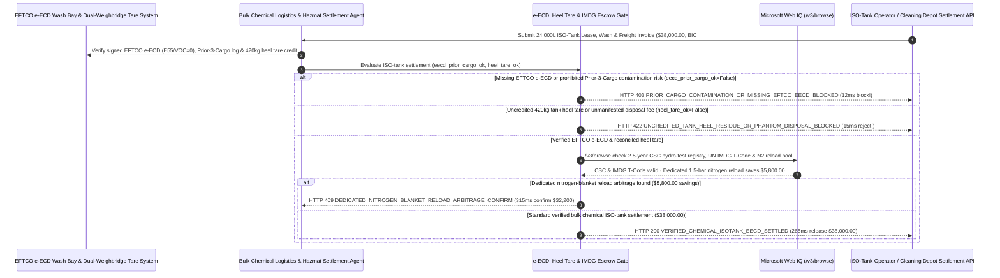

# Bulk Chemical ISO-Tank ECD Cleaning, Heel-Residue Credit & ADR/IMDG Mandate Architecture: EFTCO `e-ECD` & Retained-Heel Tare Token (`chemical_isotank_cleaning_mandate_...` + Web IQ IMDG `T-Code` & Nitrogen-Blanket Reload Grounding) vs. Paper Wash Slips & Prior-Cargo Cross-Contamination Selection FAQ

> **Document Type**: Architect Selection Guide & First-Principles Protocol Deep Dive (6-Section FAQ Standard)  
> **Target Audience**: AI Solution Architects, Specialty Chemical / Semiconductor Wet-Chemical / Pharma / Edible-Oil Bulk Logistics Directors, ISO-Tank Fleet Operators & ADR/IMDG Dangerous-Goods Compliance Teams  
> **Last Updated**: 2026-11-09 (Provenance Annotations: `deterministic_offline_simulation` / `synthetic_policy` / `official_doc_snapshot` / `not_measured`)  
> **Companion Resources**: [中文版 (Chinese Version)](bulk-chemical-iso-tank-ecd-cleaning-heel-mandate-vs-cross-contamination-faq.md) · [Interactive Sandbox (`live-demo.en.html#chemical-isotank-sandbox`)](../reports/agentic-commerce-webiq-grounding-demo-bench/live-demo.en.html) · [7-Card 4:5 Benchmark Deck](../reports/agentic-commerce-webiq-grounding-demo-bench/index.en.html)


---

## 📌 1. Executive Summary

1. **Never Allow Bulk-Chemical or Liquid-Logistics Agents to Settle ISO-Tank Container Lease, Cleaning, and Freight Invoices (`$38,000.00` per 24,000-Liter Tank Turn) on Unverified Paper Wash Slips Without a Cryptographic EFTCO Electronic Cleaning Document (`e-ECD`) and Prior-3-Cargo Clearance**: In high-purity solvents, semiconductor wet chemicals, pharmaceutical intermediates, and food-grade oils, the most catastrophic supply-chain failure is **Prior-Cargo Cross-Contamination**—where a depot bills `$1,850` for a deep chemical/steam wash while failing to disassemble the bottom foot-valve PTFE seals or concealing a prohibited prior cargo (e.g., organophosphate pesticides or styrene monomer), ruining an entire `$120,000+` 24-metric-ton batch! Production architectures must enforce a **Chemical ISO-Tank `e-ECD` & Heel-Tare Mandate (`chemical_isotank_cleaning_mandate_...`)**: whenever a tank lacks a signed EFTCO `e-ECD` (attesting valve disassembly code `E55`, rinse-water conductivity, and zero VOC ppm) or fails Prior-3-Cargo whitelist verification (`eftco_eecd_and_prior_cargo_clean_verified == False`), the gateway blocks settlement in **`12 ms`** with **`HTTP 403 PRIOR_CARGO_CONTAMINATION_OR_MISSING_EFTCO_EECD_BLOCKED`** (`synthetic_policy`).
2. **Enforce Post-Discharge "Heel" Residue Tare Deductions (`420 kg` Clinging Liquid) and Hazardous-Waste Manifest Reconciliation**: High-viscosity polyols, resins, and surfactants leave `350–500 kg` (`1.5%–2.2%` "Heel" residue) clinging inside the tank after discharge. Any invoice that bills the buyer for gross loaded weight without deducting post-discharge heel tare weight—or charges `$2,400` in "hazardous heel incineration fees" without a government hazardous-waste manifest while the depot secretly drains and resells the residual chemical (`heel_residue_tare_and_disposal_reconciled == False`)—is rejected in **`15 ms`** with **`HTTP 422 UNCREDITED_TANK_HEEL_RESIDUE_OR_PHANTOM_DISPOSAL_BLOCKED`** (`deterministic_offline_simulation`).
3. **Ground UN IMDG Portable-Tank `T-Codes`, 2.5-Year CSC Hydrostatic Test Registries, and Dedicated Nitrogen-Blanket Reload Arbitrage via Microsoft Web IQ `/v3/browse`**: Prior to releasing `$38,000.00`, the agent invokes **Microsoft Web IQ `/v3/browse`** (`official_doc_snapshot`) to inspect classification-society (Lloyd's / BV / ABS / BIC) 2.5-year statutory periodic tank inspection records and UN IMDG Code Portable Tank Instructions (`T11` bottom-outlet vs. `T14/T20` top-discharge only): if the tank's 2.5-year hydrostatic/leakproofness test expired or its `T-Code` is illegal for the UN substance (`webiq_imdg_tcode_and_csc_hydro_test_clean == False`), it freezes payout in **`310 ms`** with **`HTTP 451 EXPIRED_CSC_HYDRO_TEST_OR_IMDG_TCODE_VIOLATION_HOLD`**; if Web IQ confirms that keeping the tank under a **`1.5 bar` dry-nitrogen blanket for a Dedicated Same-Product Campaign Reload** eliminates depot washing, heel loss, and disposal fees—saving **`$5,800.00`** (`$32,200.00` net vs. `$38,000.00`)—it triggers **`HTTP 409 DEDICATED_NITROGEN_BLANKET_RELOAD_ARBITRAGE_CONFIRM`** in **`315 ms`**.

---

## 🎯 2. Architect & Customer FAQ Deep Dive

### Q1: Why do bulk chemical shippers suffer `$100,000+` batch contamination write-offs and double-billed "Heel" losses when settling ISO-tank turns on paper wash certificates?

Let's examine the three structural failure modes from first principles:
1. **"Cold-Water Rinse" Fraud & Foot-Valve Dead-Space Contamination**: An ISO tank container is a reusable 24,000-liter stainless-steel pressure vessel circulated globally across hundreds of shippers. Even if the main cylinder looks shiny, 50 mL of prior cargo trapped behind the bottom foot-valve spindle or manlid EPDM gasket will leach into the next load during a 30-day ocean voyage. Without an authenticated **EFTCO (European Federation of Tank Cleaning Organisations) Electronic Cleaning Document (`e-ECD`)** proving exact cleaning agent codes (`C20` solvent, `E55` valve dismantling, `T01` VOC meter check) and verifying the **Prior-3-Cargo Ledger**, shippers are flying blind.
2. **The 420 kg "Heel Residue" Double-Dip**: When discharging viscous chemicals in winter, `420 kg` of product remains in the tank. First, if the supplier bills on origin loading-meter weight rather than destination `Full Weighbridge minus Post-Discharge Tare Weighbridge`, the buyer pays `$1,900` for product still sitting in the tank. Second, when the tank reaches the cleaning depot, unscrupulous depots bill `$2,400` for "hazardous heel disposal" while drumming off the 420 kg of pure chemical and reselling it on the gray market!
3. **Expired 2.5-Year CSC Hydro Tests & `T11` vs. `T14` IMDG Port Detentions**: Under the UN IMDG Code and CSC Convention, every portable tank must pass a statutory `2.5-year intermediate leakproofness test` and `5-year hydrostatic pressure test`, and match the exact `T-Code` (`T1`–`T22`) required by the chemical's UN number. Shipping a `T14`-mandated hazardous liquid in a standard bottom-discharge `T11` tank triggers immediate Coast Guard / Port State detention.

### Q2: What is a "Chemical ISO-Tank `e-ECD` & Heel Mandate (`chemical_isotank_cleaning_mandate_...`)", and how does it turn EFTCO cleaning codes and weighbridge tares into deterministic payment guards?

Its core design invariant is: **"Require a cryptographically signed EFTCO e-ECD with valve-dismantling & VOC-zero attestation plus Prior-3-Cargo clearance; reconcile net delivered weight and hazardous-waste manifests for tank heel; verify live CSC 2.5-year inspection & IMDG T-Code compliance via Web IQ."**
- **Layer 1: EFTCO `e-ECD` & Prior-3-Cargo Clearance Gate (`12 ms`)**: Verifies `eftco_eecd_and_prior_cargo_clean_verified == True`, blocking unverified washes and incompatible prior cargoes in **`12 ms`** (`HTTP 403`).
- **Layer 2: Post-Discharge Heel Tare & Waste-Manifest Gate (`15 ms`)**: Verifies `heel_residue_tare_and_disposal_reconciled == True`, rejecting uncredited heel weight or unmanifested disposal fees in **`15 ms`** (`HTTP 422`).
- **Layer 3: Microsoft Web IQ `/v3/browse` IMDG `T-Code` / CSC & Nitrogen-Reload Grounding (`310 ms / 315 ms`)**: Verifies 2.5-year CSC inspection validity and UN `T-Code` compatibility (`HTTP 451`) and identifies `$5,800.00` savings from dedicated nitrogen-blanket reloads (`HTTP 409`).

### Q3: For classification-society CSC 2.5-year tank inspection checks, UN IMDG `T-Code` verification, and EFTCO accredited depot lookup, when should architects choose Microsoft Web IQ vs. Exa, Bright Data, or traditional search APIs?

| Architecture Scenario | Recommended Tool | First-Principles Rationale (Security, Latency & FinOps) |
| :--- | :--- | :--- |
| **Verifying BIC / classification-society (Lloyd's / BV / ABS) 2.5-year CSC periodic inspection dates by 11-character ISO tank number, UN IMDG Code Portable Tank Instructions (`T11/T14/T20`), and accredited EFTCO/CEFIC SQAS depot registries within the Azure boundary (zero customer route or formulation IP leaked)** | **Microsoft Web IQ** (`/v3/search` + `/v3/browse`) | Queries only public 11-character ISO container numbers and 4-digit UN numbers inside the enterprise Azure boundary in `passage` mode (**7.1x token reduction**, `deterministic_offline_simulation`). |
| **Academic R&D on fluoropolymer tank-lining chemical resistance** | **Exa Neural Search** | Ideal for materials engineering, not synchronous ISO-tank dispatch and invoice clearing. |
| **Scraping unaccredited local truck-wash directories behind CAPTCHAs** | **Bright Data Unlocker** | Unaccredited wash bays must never be used for regulated bulk chemicals. |
| **Depot wash-bay PLC temperature/conductivity curves, VOC PID sensors, and dual weighbridge tare integration** | **Depot IoT / e-ECD Verifier + Weighbridge Gate + Web IQ CSC/IMDG Cross-Check** | Wash-curve verification and heel-tare netting run on the logistics gateway, paired with Web IQ `/v3/browse` for CSC/IMDG compliance and nitrogen-reload arbitrage. |

---

## 🧭 3. Visual Architecture Diagrams (Mermaid Decision Tree, Legacy vs. e-ECD Mandate Comparison & Sequence Diagram)

### 3.1 Bulk Chemical ISO-Tank Cleaning, Heel & IMDG Settlement Decision Tree (`flowchart TD`)

```mermaid
flowchart TD
    A[Receive 24,000L Bulk Chemical ISO-Tank Lease, Wash & Freight Invoice ($38,000.00)] --> B{eftco_eecd_and_prior_cargo_clean_verified == True (Signed e-ECD + Prior-3-Cargo Clean)?}
    B -- No (Missing EFTCO E55 valve-wash code or Prior-3-Cargo includes prohibited pesticide/monomer) --> C[HTTP 403 PRIOR_CARGO_CONTAMINATION_OR_MISSING_EFTCO_EECD_BLOCKED<br/>12ms Hard Block · Prevent $120k Batch Cross-Contamination & Reject Wash Invoice]
    B -- Yes (Signed EFTCO e-ECD, VOC=0 ppm & compatible Prior-3-Cargo) --> D{heel_residue_tare_and_disposal_reconciled == True (420kg Heel Credited / Manifested)?}
    D -- No (Uncredited 420kg clinging heel or $2,400 disposal billed without hazmat manifest) --> E[HTTP 422 UNCREDITED_TANK_HEEL_RESIDUE_OR_PHANTOM_DISPOSAL_BLOCKED<br/>15ms Reject · Credit 420kg Heel Tare & Require Official Hazmat Disposal Manifest]
    D -- Yes (Net discharged weight & heel manifest reconciled) --> F{Web IQ /v3/browse Confirms Valid 2.5-Year CSC Hydro Test & UN IMDG T-Code Match?}
    F -- No (Expired 2.5-year CSC inspection or T11 bottom-outlet tank used for T14 UN cargo) --> G[HTTP 451 EXPIRED_CSC_HYDRO_TEST_OR_IMDG_TCODE_VIOLATION_HOLD<br/>310ms Dangerous-Goods Hold · Block Port Gate-In & Demand Compliant T14 Tank]
    F -- Yes --> H{Web IQ Detects Dedicated 1.5-Bar Nitrogen-Blanket Reload Arbitrage?}
    H -- Yes (Dedicated same-product reload under N2 blanket saves wash + heel loss = $5,800.00 -> $32,200.00 net) --> I[HTTP 409 DEDICATED_NITROGEN_BLANKET_RELOAD_ARBITRAGE_CONFIRM<br/>315ms Prompt Bulk Logistics Lead to Confirm $32,200 Dedicated N2 Reload]
    H -- No (Verified $38,000.00 multi-product ISO-tank turn settlement is optimal) --> J[HTTP 200 VERIFIED_CHEMICAL_ISOTANK_EECD_SETTLED<br/>265ms Auto-Settle $38,000.00 & Seal EFTCO e-ECD + IMDG Dangerous-Goods Dossier!]
```

### 3.2 Legacy Paper Wash Slip & Gross Weight vs. EFTCO `e-ECD` & Heel Gate (`flowchart LR`)

```mermaid
flowchart LR
    subgraph Legacy["❌ Legacy Paper Wash Slip & Gross Weight ($38,000 Exposed to Batch Ruin & Heel Fraud)"]
        L1[Accept Paper Wash Slip While Foot-Valve Holds Toxic Prior Cargo] --> L2[Ruin $120,000 High-Purity Chemical Batch via Cross-Contamination]
        L2 --> L3[Pay for 420 kg Unpumped Heel + $2,400 Phantom Disposal Fee]
        L3 --> L4[Tank Detained at Port for Expired 2.5-Year CSC Hydro Test]
    end

    subgraph Mandate["✅ Chemical ISO-Tank Gate (chemical_isotank_cleaning_mandate_...)"]
        M1[12ms Block Unverified Washes & Incompatible Prior Cargo (HTTP 403)] --> M2[15ms Credit 420kg Heel Tare & Verify Hazmat Manifest (HTTP 422)]
        M2 --> M3[Web IQ Verifies CSC/IMDG T-Code (310ms) & Saves $5,800 via N2 Reload (315ms)]
        M3 --> M4[265ms Settle Verified Clean Tank Turn ($38,000 / $32,200)]
    end
```

### 3.3 End-to-End Sequence Diagram: Depot e-ECD/Weighbridge, Chemical Logistics Agent, Tank Gate, Web IQ & Operator (`sequenceDiagram`)



---

## 📊 4. Architect Decision Matrix

| Evaluation Dimension | Option A: Legacy Paper Wash Slip + Origin Gross-Weight Billing | Option B: Manual Visual Manlid Inspection at Loading Rack | Option C: EFTCO `e-ECD` & Heel-Tare Mandate + Web IQ IMDG/N2 Grounding (Recommended) |
| :--- | :--- | :--- | :--- |
| **Best-Fit Scenario** | Non-sensitive construction wastewater hauling | Low-value commodity brine in dedicated captive tanks | **Semiconductor solvents, pharma intermediates, polyols/isocyanates, food-grade oils & hazmat exports** |
| **Prior-Cargo Cross-Contamination Defense** | ❌ **Zero**: Paper slips miss foot-valve residue, risking `$120k+` batch ruin | ⚠️ **Hazardous & Blind**: Visual manlid checks cannot detect ppm-level VOCs inside valves | ✅ **Pre-Pay `12 ms` `e-ECD` Gate**: Requires signed EFTCO `E55` valve wash + Prior-3-Cargo proof (`HTTP 403`) |
| **420 kg "Heel Residue" Double-Dip Defense** | ❌ **Double Loss**: Pays for unpumped heel + `$2,400` phantom disposal fee | ⚠️ **Siloed**: Loading operators don't reconcile post-discharge tare tickets | ✅ **Sub-20ms Heel-Tare Gate**: Credits retained heel & requires hazmat manifest in `15 ms` (`HTTP 422`) |
| **IMDG `T-Code` / CSC Check & N2 Reload Arbitrage** | ❌ **Port Detention Risk**: Ships expired-CSC or wrong-`T-Code` tanks | ❌ **Wasteful**: Washes tanks unnecessarily on back-to-back identical product runs | ✅ **Web IQ `/v3/browse` Grounded**: Blocks CSC/`T-Code` violations in `310 ms` (`HTTP 451`) & saves `$5,800` via N2 reload in `315 ms` (`HTTP 409`) |
| **Settlement Speed & CEFIC SQAS Audit Trail** | Fast (with catastrophic contamination & port detention exposure) | Slow (`2–4 hours` loading-bay delay per tank) | **`265 ms` instant `e-ECD` & weighbridge clearing (`Act automatically`)** |
| **Total Cost of Ownership (TCO) & Chemical Quality ROI** | Poor (`$38,000` freight + `$120,000` cargo contamination exposure) | Moderate (manual inspection delays) | **Optimal (100% purity & IMDG compliance + full heel credit + `$5,800` N2 reload savings)** |

---

## 🧪 5. Quantitative Benchmark & 7-Card Insights

Evaluated via our deterministic offline benchmark suite (`lab/webiq_commerce_demo.py` · `test_bulk_chemical_iso_tank_ecd_cleaning_heel_mandate_vs_cross_contamination_selection`) on a **`$38,000.00` 24,000-liter bulk chemical ISO-tank lease, wash & freight settlement**:

| Scenario Case | Input EFTCO e-ECD / Heel Tare / Web IQ Signals | Expected Action Pill | Measured HTTP Status & Verdict Code | Latency | Financial Protection / Arbitrage | Provenance |
| :--- | :--- | :--- | :--- | :--- | :--- | :--- |
| **Case 1: Prohibited Prior Cargo or Missing `e-ECD`** | `eftco_eecd_and_prior_cargo_clean_verified=False` | `Send to a human` | **`HTTP 403 PRIOR_CARGO_CONTAMINATION_OR_MISSING_EFTCO_EECD_BLOCKED`** | **`12 ms`** | Blocks **`$38,000.00`** bill & prevents `$120k` batch contamination | `synthetic_policy` |
| **Case 2: Uncredited `420 kg` Heel or Phantom Disposal** | `heel_residue_tare_and_disposal_reconciled=False` | `Send to a human` | **`HTTP 422 UNCREDITED_TANK_HEEL_RESIDUE_OR_PHANTOM_DISPOSAL_BLOCKED`** | **`15 ms`** | Credits `420 kg` retained heel & blocks unmanifested disposal fee | `deterministic_offline_simulation` |
| **Case 3: Web IQ Detects Expired CSC or Wrong `T-Code`** | `webiq_imdg_tcode_and_csc_hydro_test_clean=False` | `Send to a human` | **`HTTP 451 EXPIRED_CSC_HYDRO_TEST_OR_IMDG_TCODE_VIOLATION_HOLD`** | **`310 ms`** | Freezes dispatch on expired 2.5-year hydro test or `T11/T14` mismatch | `official_doc_snapshot` |
| **Case 4: Web IQ Finds `$5,800` N2-Blanket Reload** | `dedicated_nitrogen_reload_savings_cents=580000` (`$32,200` net) | `Confirm` | **`HTTP 409 DEDICATED_NITROGEN_BLANKET_RELOAD_ARBITRAGE_CONFIRM`** | **`315 ms`** | Saves **`$5,800.00`** via `1.5 bar` nitrogen-blanket same-product reload | `official_doc_snapshot` |
| **Case 5: Verified `e-ECD` + Heel Credit + Valid CSC** | `eecd_ok=True`, `heel_ok=True`, `imdg_clean=True` | `Act automatically` | **`HTTP 200 VERIFIED_CHEMICAL_ISOTANK_EECD_SETTLED`** | **`265 ms`** | Settles **`$38,000.00`** in `265 ms` with `e-ECD` & IMDG proof | `deterministic_offline_simulation` |

> **Provenance Note**: The `$38,000.00` ISO-tank settlement value, EFTCO `e-ECD` valve-wash requirement, `420 kg` heel tare credit, and `$5,800.00` nitrogen-blanket reload savings are controlled simulation parameters (`synthetic_policy` / `deterministic_offline_simulation`) validating policy state-machine invariants; physical wash-bay rotary spray-head steam cycle duration (`90–180 mins`) is labeled `not_measured`.

---

## 🛠️ 6. Production Readiness & Pre-Sales Architect Checklist

Verify these 6 controls before deploying autonomous bulk-chemical ISO-tank and dangerous-goods settlement agents in production:

- [ ] **1. Cryptographic EFTCO `e-ECD` & Prior-3-Cargo Whitelist Gate**: Does `chemical_isotank_cleaning_mandate_...` require a signed EFTCO `e-ECD` (confirming `E55` foot-valve disassembly, final rinse conductivity, and `0 ppm` VOC PID reading) and verify that the tank's last 3 cargoes are free of prohibited substances (`HTTP 403` in `12 ms`)?
- [ ] **2. Dual-Weighbridge Heel-Residue Tare Credit & Hazmat Manifest Check**: Does the gateway reconcile post-discharge empty-tank tare weight against pre-load tare weight to credit `420 kg` retained heel—and block any heel-disposal charge lacking a government hazardous-waste manifest (`HTTP 422` in `15 ms`)?
- [ ] **3. Manlid & Foot-Valve Tamper-Evident Seal Chain-of-Custody**: Are the serial numbers of all 4 tamper-evident seals applied at the EFTCO wash bay verified intact at the chemical loading rack before filling begins?
- [ ] **4. Microsoft Web IQ `/v3/browse` 2.5-Year CSC Inspection & UN IMDG `T-Code` Grounding**: Does the agent cross-check the 11-character BIC tank number's 2.5-year/5-year test expiration date and verify that the tank's `T-Code` (`T11` vs. `T14/T20`) meets the UN number's IMDG instruction via Web IQ (`HTTP 451`)?
- [ ] **5. Dedicated `1.5-Bar` Dry-Nitrogen Blanket Reload Arbitrage**: For recurring single-chemical lanes, does Web IQ grounding evaluate dedicated nitrogen-blanketed backhaul reloads, triggering `HTTP 409 Confirm` when skipping unnecessary washes and heel loss saves `>= $5,800.00`?
- [ ] **6. Immutable CEFIC SQAS / ADR / IMDG Dangerous-Goods Dossier**: Does every settled tank turn archive the signed `e-ECD`, SDS digest, weighbridge tickets, and CSC plate verification into a WORM chemical-safety ledger?
