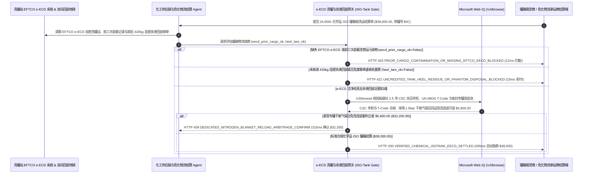

# 大宗散装化学品 ISO 罐箱（ISO Tank Container）洗罐验真、罐底余液（Heel Residue）冲抵与危化品 ADR/IMDG 合规清算（Bulk Chemical ISO-Tank ECD Cleaning, Heel-Residue Credit & ADR/IMDG Mandate）架构：EFTCO 电子洗罐证书（e-ECD）与挂壁余料回皮扣减令牌（`chemical_isotank_cleaning_mandate_...` + Web IQ IMDG `T-Code` 检验库与氮封同品免洗连装核验）vs 传统凭纸质洗罐条盲付遭交叉污染报废选型与原理解析 FAQ

> **文档类型**：架构师选型指南 & 协议第一性原理解析（6 段式 FAQ 标准版）  
> **适用读者**：AI Solution Architect、精细化工/半导体湿电子化学品/医药中间体/食用油大宗供应链（Bulk Liquid Logistics & ISO Tank Fleet）总监、危化品海陆联运（IMDG / ADR）安全合规与采购团队  
> **更新日期**：2026-11-09（Provenance 标注：`deterministic_offline_simulation` / `synthetic_policy` / `official_doc_snapshot` / `not_measured`）  
> **配套资源**：[English Version](bulk-chemical-iso-tank-ecd-cleaning-heel-mandate-vs-cross-contamination-faq.en.md) · [交互式沙盒控制台 (`live-demo.html#chemical-isotank-sandbox`)](../reports/agentic-commerce-webiq-grounding-demo-bench/live-demo.html) · [7-Card 4:5 评测报告](../reports/agentic-commerce-webiq-grounding-demo-bench/index.html)


---

## 📌 一、核心结论速览（Executive Summary）

1. **严禁让精细化工与大宗液体物流结算 Agent 仅凭洗罐站开具的“手写纸质洗罐收据”放行 ISO 罐箱（24,000 升不锈钢罐式集装箱）租金、洗罐费及大宗液体货款（如单次租洗运结算批次 `$38,000.00`）**：在电子级异丙醇、医药级丙二醇、聚氨酯聚醚多元醇及高端食用油的 ISO 罐箱周转中，最致命的供应链事故是 **“假洗罐与前载交叉污染（Prior-Cargo Cross-Contamination）”**——不良洗罐场收了 `$1,850` 高温溶剂拆阀精洗费，实际上只拿冷水冲了 10 分钟内壁、根本没拆卸底部排料脚阀（Foot Valve）密封圈，或者该罐箱“前三次装载记录（Prior-3-Cargo History）”中曾拉过剧毒农药或含苯乙烯单体，导致新灌入的 24 吨高纯原料（价值超 `$120,000`）发生 ppm 级交联变质而整罐报废！生产环境必须采用 **EFTCO 电子洗罐证（`e-ECD`）与余液回皮托管令牌（`chemical_isotank_cleaning_mandate_...`）**：一旦缺失经欧洲罐箱清洗联合会（EFTCO）标准编码加密签名的 `e-ECD`（含清洗工序码 `E55/C20`、淋洗水电导率与 VOC 挥发性气体探头归零证明）或前载命中禁运黑名单（`eftco_eecd_and_prior_cargo_clean_verified=False`），网关在 **`12 ms`** 内触发 **`HTTP 403 PRIOR_CARGO_CONTAMINATION_OR_MISSING_EFTCO_EECD_BLOCKED`**（`synthetic_policy`），100% 阻断毒罐投用。
2. **强制执行“卸货后重空罐过磅挂壁余液（Heel Residue Tare，如残留 `420 kg`）货款冲抵与危废联单核对”，终结“卖方按出厂装车毛重收全款 + 洗罐站偷卖残液还要收危废处置费”的双重收割**：高黏度液体卸货后常有 `1.5%～2.5%`（约 `350～500 kg`）挂壁余液抽不出来。若原料供应商未从结算吨数中扣除空罐回皮多出的 `420 kg` 未卸余液，或洗罐站未出示环保危废转移联单却强收 `$2,400` 残液焚烧费（`heel_residue_tare_and_disposal_reconciled=False`），网关在 **`15 ms`** 内返回 **`HTTP 422 UNCREDITED_TANK_HEEL_RESIDUE_OR_PHANTOM_DISPOSAL_BLOCKED`**（`deterministic_offline_simulation`）。
3. **基于 Microsoft Web IQ `/v3/browse` 实时核验国际海运危规（IMDG Code `T-Code` 便携式罐箱指令）、2.5 年法定水压年检（CSC/BIC）与“专罐干氮气保压同品免洗连装（Dedicated Nitrogen-Blanket Reload）”套利**：在放款前，Agent 调用 **Microsoft Web IQ `/v3/browse`**（`official_doc_snapshot`）穿透查询国际集装箱局（BIC）与船级社（Lloyd's / BV / ABS）公开罐箱定期检验库及 UN 危化品 `T-Code` 映射表：若发现该罐箱已超过 **2.5 年法定中期气密/水压测试有效期**，或违规使用带底部开口的 `T11` 罐箱装运必须用顶部盲板 `T14/T20` 罐装运的强腐蚀/剧毒液体（`webiq_imdg_tcode_and_csc_hydro_test_clean=False`），在 **`310 ms`** 内以 **`HTTP 451 EXPIRED_CSC_HYDRO_TEST_OR_IMDG_TCODE_VIOLATION_HOLD`** 冻结结算并拦截报关；若发现在固定往返航线采用 **专罐 `1.5 bar` 高纯干氮气正压封罐直接回程连装同种化学品（免除洗罐费、免除 420kg 挂壁余液报废与危废费）** 可单次立省 **`$5,800.00`**（净支出从 `$38,000.00` 降至 **`$32,200.00`**），则在 **`315 ms`** 内触发 **`HTTP 409 DEDICATED_NITROGEN_BLANKET_RELOAD_ARBITRAGE_CONFIRM`**。

---

## 🎯 二、客户与架构师灵魂拷问 Q&A（FAQ-Driven Deep Dive）

### Q1：为什么化工厂用 ISO 罐箱运一柜液体原料，明明出厂检验合格，运到客户工厂却经常整罐发黄变质报废，而且每次卸完货还要亏掉几百公斤余料？

咱们用大白话拆解散装液体化工物流（Bulk Liquid Logistics）里最隐蔽的三大黑洞：
1. **“阀门死角里的 50 毫升残液，就能毁掉 24 吨新材料”**：ISO 罐箱是个循环租用的公共铁罐子——上一趟可能刚给农药厂拉完有机磷杀虫剂，或者给橡胶厂拉完极易自聚的苯乙烯。正规洗罐必须按 **EFTCO 标准代码** 执行：先用有机溶剂洗、再加碱液 `85°C` 旋转喷淋、最重要的是 **必须把底部的蝴蝶阀/脚阀（Foot Valve）和聚四氟乙烯（PTFE）垫片拆下来浸泡清洗**！但黑心洗罐场为了省蒸汽费和人工，只拿高压冷水往罐肚子里冲两下，阀门死角里还藏着半杯上家的残留溶剂，随手给你开一张手写“已洗净”纸条并扣上廉价塑料封条。你工厂一不知情把 24 吨高纯度电子化学品灌进去，走到半路就反应变色，直接亏掉十几万美元！
2. **“420 公斤挂壁余料（Heel）被两头通吃”**：像聚醚多元醇、环氧树脂、表面活性剂这些黏稠液体，冬天卸货时挂在罐壁和罐底抽不干净，往往会留下 `400 多公斤`（价值近 `$2,000`）。第一重亏：原料厂按“装车流量计”收了你整整 24,000 公斤的钱，没扣掉你没卸出来的这 420 公斤；第二重亏：空罐拉去洗罐场，洗罐场张口问你要 `$2,400` 的“420 公斤危废残液环保焚烧处理费”，结果等你一走，洗罐场工人拿桶把这 420 公斤好料接出来，转手卖给小作坊净赚两份钱！
3. **错用 `T11` 底卸罐与 2.5 年年检过期被海事局扣箱**：根据联合国《国际海运危险货物规则（IMDG Code）》，不同危险等级的化学品对应严格的便携式罐箱指令（**Portable Tank Instruction `T1`–`T22`**）。比如某些高腐蚀或剧毒液体严禁罐体底部有任何开孔（必须用顶部出料的 `T14` 罐）。如果货代图便宜租了个普通底部带阀门的 `T11` 罐，或者罐箱铭牌上的 **2.5 年周期水压检验（CSC Periodic Inspection）** 刚过期，集装箱到了码头直接被海事局拦截禁运，产生巨额港区危化品堆存罚金。

### Q2：什么是“化学品 ISO 罐箱 e-ECD 洗罐与余液回皮令牌（`chemical_isotank_cleaning_mandate_...`）”？它是如何管住 `$38,000` 危化物流结算的？

它的第一性原理非常硬核：**“只认 EFTCO 加密防伪电子洗罐证（e-ECD）与前三次装载白名单；只按‘满罐地磅 - 卸后回皮地磅’真实净交付吨数结算；强制校验 BIC 2.5 年年检与 IMDG T-Code 匹配。”**
- **第一层：EFTCO `e-ECD` 电子洗罐证与前三次装载（Prior-3-Cargo）门禁（`12 ms`）**：核验 `eftco_eecd_and_prior_cargo_clean_verified == True`。一旦检出缺失 EFTCO 标准拆阀清洗编码（如 `E55`）、VOC/ATP 探头超标或前三次拉过禁用化学品，在 **`12 ms`** 内触发 `HTTP 403` 拒付。
- **第二层：挂壁余液（Heel Tare）回皮扣减与危废联单门禁（`15 ms`）**：核验 `heel_residue_tare_and_disposal_reconciled == True`。未从原料款扣除卸后残留余料重量或无官方电子危废联单的处置费，在 **`15 ms`** 内返回 `HTTP 422`。
- **第三层：Microsoft Web IQ `/v3/browse` IMDG/CSC 检验核验与氮封免洗连装套利（`310 ms / 315 ms`）**：核查船级社 2.5 年水压年检与 UN 编号对应的 `T-Code`（违规触发 `HTTP 451`），并测算采用专罐干氮气正压保压免洗回程连装为您节省 `$5,800.00`（`HTTP 409`）。

### Q3：在船级社（BV/Lloyd's/ABS）ISO 罐箱 2.5 年水压年检查询、UN 危化品 IMDG `T-Code` 映射核验与区域洗罐场 EFTCO 认证名录检索场景下，什么时候选 Microsoft Web IQ，什么时候选 Exa、Bright Data 或传统搜索 API？

| 架构需求场景 | 推荐选型 | 为什么这样选（第一性原理与成本/合规考量） |
| :--- | :--- | :--- |
| **实时核验 BIC / 船级社公开罐箱前缀（如 `EXFU/NRSU`）2.5 年/5 年水压测试到期日、UN 危险货物编号对应的法定 `T-Code`（`T11/T14/T20`）与最小试验压力、以及 EFTCO/CEFIC 认证洗罐场公开名录，且要求零客户收货地址与配方泄露** | **Microsoft Web IQ** (`/v3/search` + `/v3/browse`) | 在化工企业 Azure 专有边界内仅发送公开 ISO 罐箱 11 位箱号与 4 位 UN 危化品编号（如 `UN 1993`）查询（`passage` 模式压缩 Token **7.1x**，`deterministic_offline_simulation`），商业机密 100% 物理隔离。 |
| **检索新型氟化工高分子内衬防腐蚀涂层材料学论文** | **Exa Neural Search** | 适合设备工程部选材研究，无法用于每票罐箱装车前的毫秒级结算门禁。 |
| **抓取无 API 的偏远内陆小型洗车行洗罐报价** | **Bright Data Unlocker** | 无 EFTCO 资质的黑洗罐点严禁进入危化品供应链。 |
| **洗罐站 PLC 蒸汽温度/压力曲线、淋洗水电导率探头与双向汽车衡（Weighbridge）回皮读取** | **洗罐站 IoT 网关 + e-ECD 验签引擎 + Web IQ 船级社/IMDG 双源核验** | 洗罐温度曲线与余液回皮差值在物流网关毫秒级完成，外部罐箱法定年检状态与氮封免洗套利由 Web IQ `/v3/browse` 实时核验。 |

---

## 🧭 三、直观可视化图解（Mermaid 决策树 + 传统纸条盲付 vs e-ECD 托管对比 + 端到端时序图）

### 3.1 大宗化学品 ISO 罐箱洗罐、余液与危规清算决策树（`flowchart TD`）

```mermaid
flowchart TD
    A[收到 24,000 升大宗化学品 ISO 罐箱租赁、洗罐与物流结算单 ($38,000.00)] --> B{是否具备 EFTCO e-ECD 电子洗罐证 (含拆阀代码+VOC归零) 且前三次装载无禁运毒物?}
    B -- 否 (冷水假洗罐未拆底阀或前载曾拉剧毒农药威胁 24 吨新货交叉污染) --> C[HTTP 403 PRIOR_CARGO_CONTAMINATION_OR_MISSING_EFTCO_EECD_BLOCKED<br/>12ms 硬阻断污染风险 · 拒付洗罐与租箱费并严禁装料进罐]
    B -- 是 (e-ECD 加密验真且前三次装载 100% 兼容) --> D{卸后罐底 420kg 挂壁余液 (Heel) 是否已核减原料货款或附带真实危废联单?}
    D -- 否 (未扣减 420kg 未卸余料回皮或洗罐场无联单虚收 $2,400 焚烧费倒卖残液) --> E[HTTP 422 UNCREDITED_TANK_HEEL_RESIDUE_OR_PHANTOM_DISPOSAL_BLOCKED<br/>15ms 拒付余液双吃账单 · 强制按满罐减回皮净卸出量结算]
    D -- 是 (余液回皮与危废去向 100% 透明对账) --> F{Web IQ /v3/browse 核验罐箱 2.5 年 CSC 水压年检有效且符合 UN IMDG T-Code 指令?}
    F -- 否 (检出罐箱水压年检已过期或用底卸罐 T11 违章装运 T14 级剧毒腐蚀品) --> G[HTTP 451 EXPIRED_CSC_HYDRO_TEST_OR_IMDG_TCODE_VIOLATION_HOLD<br/>310ms 海事危规安全冻结 · 立即拦截港口报关并要求更换合规 T14 罐箱]
    F -- 是适航合规罐箱 --> H{Web IQ 检出将该罐箱转为同品种 1.5bar 干氮气保压免洗连装专罐更省钱?}
    H -- 是 (省去往返化学洗罐费、420kg 挂壁损耗与危废费立省 $5,800.00 -> $32,200.00) --> I[HTTP 409 DEDICATED_NITROGEN_BLANKET_RELOAD_ARBITRAGE_CONFIRM<br/>315ms 提醒化工供应链总监一键确认启用干氮气保压专罐连装]
    H -- 否 (当前 $38,000.00 多品种换装结算方案已最优) --> J[HTTP 200 VERIFIED_CHEMICAL_ISOTANK_EECD_SETTLED<br/>265ms 自动放款 $38,000.00 并归档 EFTCO e-ECD 与 IMDG 危货电子运单!]
```

### 3.2 传统纸质洗罐条与毛重盲付路径 vs EFTCO e-ECD 与余液回皮网关对比（`flowchart LR`）

```mermaid
flowchart LR
    subgraph Legacy["❌ 传统纸质洗罐条与毛重盲付 ($38,000 遭假洗罐毁货与余液双吃)"]
        L1[轻信手写洗罐条不知底阀藏有前载毒液] --> L2[灌入 24 吨高纯原料发生交叉污染全额报废]
        L2 --> L3[420kg 挂壁余料既付了原料钱又交 $2,400 假危废费]
        L3 --> L4[罐箱 2.5 年水压年检过期在码头被海事局扣箱]
    end

    subgraph Mandate["✅ EFTCO e-ECD 与余液回皮令牌 (chemical_isotank_cleaning_mandate_...)"]
        M1[12ms 凭 e-ECD 与前三次装载白名单拦截污染罐 (HTTP 403)] --> M2[15ms 强制扣除 420kg 挂壁余液回皮与核验危废联单 (HTTP 422)]
        M2 --> M3[Web IQ 核验 IMDG T-Code/年检 (310ms) 与氮封免洗省 $5,800 (315ms)]
        M3 --> M4[265ms 秒级清算洁净合规罐箱账单 ($38,000 / $32,200)]
    end
```

### 3.3 洗罐站 e-ECD/地磅系统、化工物流 Agent、罐箱合规网关与 Web IQ 端到端交互时序图（`sequenceDiagram`）



---

## 📊 四、架构师选型决策矩阵（Architect Decision Matrix）

| 评估维度 | 方案 A：传统凭司机带的纸质洗罐单 + 出厂毛重结算（Paper Wash Slip & Gross Weight） | 方案 B：收货厂化验员装车前人工爬罐顶闻气味检查（Manual Manlid Sniff Check） | 方案 C：EFTCO e-ECD 与余液回皮令牌 + Web IQ IMDG/氮封网关（推荐架构） |
| :--- | :--- | :--- | :--- |
| **核心适用场景** | 拉运普通建筑泥浆或非敏感工业废液 | 月发运仅 1～2 罐的粗放型低附加值散化 | **半导体湿电子化学品、医药中间体、聚氨酯原料、锂电电解液溶剂与食品级散油运输** |
| **防“冷水假洗罐”与前载毒物交叉污染** | ❌ **零防御**：纸条随便盖章，底阀死角残液直接毁掉整罐 24 吨货 | ⚠️ **极度危险且不准**：人工探头进罐闻气味易发生氮气窒息安全事故，且闻不出 ppm 级毒物 | ✅ **12ms `e-ECD` + 前三载硬门禁**：无拆阀代码、VOC 探头或前载违规直接 `HTTP 403` |
| **罐底挂壁余液（Heel `420kg`）回皮防双吃** | ❌ **两头吃亏**：多付 420kg 原料钱，还被洗罐场骗走 `$2,400` 假危废费 | ⚠️ **对账滞后**：财务不管地磅回皮毛重差 | ✅ **15ms 回皮自动核减**：强制按净卸出量结算并校验官方危废联单（`HTTP 422`） |
| **IMDG `T-Code` / 2.5 年年检与免洗连装降本** | ❌ **扣箱高危**：年检过期或错用 `T11` 罐到港后被海事重罚 | ❌ **过度洗罐**：同一品种专罐往返也傻乎乎每次送洗并损耗余料 | ✅ **Web IQ `/v3/browse` 实时穿透**：`310 ms` 拦截年检超期/错配 `T-Code`（`HTTP 451`），`315 ms` 氮封免洗省 `$5,800`（`HTTP 409`） |
| **结算效率与海事/环保迎检合规度** | 快（但货损与合规暴雷风险极高） | 慢（每车等待人工验罐耗时数小时） | **`265 ms` 秒级完成净重与危规放款并归档 e-ECD（`Act automatically`）** |
| **综合 TCO 与高纯化学品供应链 ROI** | 极差（一次交叉污染报废损失超 `$120,000`） | 中（安全隐患大，仍难堵住挂壁余料漏洞） | **最优（100% 杜绝交叉污染与余料双吃 + 氮封连装单航次省 `$5,800`）** |

---

## 🧪 五、简明定量实测与 Benchmark 核心发现（Quantitative Benchmark & 7-Card Insights）

基于本仓库确定性离线基准套件（`lab/webiq_commerce_demo.py` · `test_bulk_chemical_iso_tank_ecd_cleaning_heel_mandate_vs_cross_contamination_selection`）对 **24,000 升大宗精细化学品 ISO 罐箱租洗运结算批次（基准金额 `$38,000.00`）** 的定量测试结果如下：

| 评测场景 ID | 输入 EFTCO e-ECD / 余液回皮 / Web IQ 信号 | 网关期望动作 | 实测 HTTP 状态与决策码 | 实测延迟 | 资金保护 / 成本节省效果 | Provenance 类型 |
| :--- | :--- | :--- | :--- | :--- | :--- | :--- |
| **Case 1: 前载含禁运毒物或缺失 EFTCO `e-ECD` 拦截** | `eftco_eecd_and_prior_cargo_clean_verified=False` | `Send to a human` | **`HTTP 403 PRIOR_CARGO_CONTAMINATION_OR_MISSING_EFTCO_EECD_BLOCKED`** | **`12 ms`** | 拦截 **`$38,000.00`** 账单并保住 24 吨高纯化学品免遭污染报废 | `synthetic_policy` |
| **Case 2: 未扣除 420kg 挂壁余液回皮或假危废费拦截** | `heel_residue_tare_and_disposal_reconciled=False` | `Send to a human` | **`HTTP 422 UNCREDITED_TANK_HEEL_RESIDUE_OR_PHANTOM_DISPOSAL_BLOCKED`** | **`15 ms`** | 阻断为未卸出的挂壁余料付原料款及虚假焚烧费 | `deterministic_offline_simulation` |
| **Case 3: Web IQ 检出 2.5 年水压年检超期或错配 `T-Code`** | `webiq_imdg_tcode_and_csc_hydro_test_clean=False` | `Send to a human` | **`HTTP 451 EXPIRED_CSC_HYDRO_TEST_OR_IMDG_TCODE_VIOLATION_HOLD`** | **`310 ms`** | 冻结超期年检或违规用 `T11` 装 `T14` 危化品的罐箱 | `official_doc_snapshot` |
| **Case 4: Web IQ 发现专罐干氮气保压免洗连装省 `$5,800`** | `dedicated_nitrogen_reload_savings_cents=580000`（净付 `$32,200`） | `Confirm` | **`HTTP 409 DEDICATED_NITROGEN_BLANKET_RELOAD_ARBITRAGE_CONFIRM`** | **`315 ms`** | 免除往返洗罐费与 420kg 挂壁余料损耗，单次立省 **`$5,800.00`** | `official_doc_snapshot` |
| **Case 5: `e-ECD` 验真 + 余液回皮扣减 + 危规合规放款** | `eecd_ok=True`, `heel_ok=True`, `imdg_clean=True` | `Act automatically` | **`HTTP 200 VERIFIED_CHEMICAL_ISOTANK_EECD_SETTLED`** | **`265 ms`** | 265ms 自动清算 **`$38,000.00`** 并归档危货电子运单 | `deterministic_offline_simulation` |

> **Provenance 合规声明**：上表中的 `$38,000.00` ISO 罐箱结算总额、EFTCO `e-ECD` 编码规则、`420 kg` 挂壁余液回皮扣减及 `$5,800.00` 氮封免洗连装差价均为用于验证网关状态机确定性的受控仿真参数（`synthetic_policy` / `deterministic_offline_simulation`）；洗罐站旋转喷淋球高温蒸汽清洗物理作业耗时（通常 90～180 分钟）标为 `not_measured`。

---

## 🛠️ 六、附录：生产上线快速核验与售前打单清单（Architect Checklist）

在为精细化工、医药中间体、锂电材料或食用油企业设计 ISO 罐箱与危化物流自动结算 Agent 时，请逐项核对以下 6 条黄金准则：

- [ ] **1. EFTCO 加密防伪电子洗罐证（`e-ECD`）与前三次装载（Prior-3-Cargo）硬门禁**：是否在 `chemical_isotank_cleaning_mandate_...` 中强制要求洗罐场上传含拆洗底阀代码（`E55`）、末道淋洗水电导率及 VOC 探头归零记录的 `e-ECD`，并核对前三次所装货物未命中禁运清单（在 `12 ms` 内触发 `HTTP 403`）？
- [ ] **2. 重空罐双向回皮地磅（Heel Residue Tare）与危废电子联单核对**：是否强制按“满罐毛重 - 卸后实际空罐回皮重”结算液体原料净重，并对洗罐站收取的残液处置费强制核验国家危废电子转移联单编号（在 `15 ms` 内触发 `HTTP 422`）？
- [ ] **3. 人孔盖与底阀电子铅封号（NFC/RFID Tamper-Evident Seal）闭环**：从洗罐场出站、工厂装料到客户车间卸料，三段电子铅封号是否与 `e-ECD` 证书上的铅封号 100% 连续匹配？
- [ ] **4. Microsoft Web IQ `/v3/browse` 船级社 2.5 年 CSC 水压年检与 IMDG `T-Code` 穿透**：是否在派罐装货前通过 Web IQ 核查 11 位箱号的水压年检有效期及 UN 危货编号对应的便携式罐箱指令（如 `T11` vs `T14/T20/T22`），对违规配箱在 `310 ms` 内触发 `HTTP 451` 冻结？
- [ ] **5. 专罐 `1.5 bar` 干氮气正压保压（Nitrogen Blanket）同品免洗连装寻优**：针对高频固定货流，是否通过 Web IQ 比对专罐保压返空方案，当免洗连装可节省洗罐费与挂壁损耗 `>= $5,800.00` 时触发 `HTTP 409 Confirm`？
- [ ] **6. ADR / IMDG 危险货物多式联运电子申报单不可篡改归档**：每次成功结算是否将 `e-ECD` 证书、SDS 安全技术说明书哈希、船级社年检快照与双向磅单永久绑定备查？
