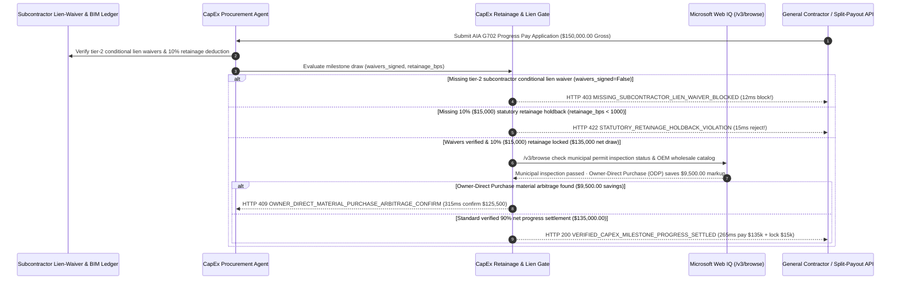

# CapEx Milestone Retainage & Subcontractor Lien-Waiver Mandate Architecture: Conditional Lien-Waiver & 10% Retainage Escrow Token (`capex_lien_waiver_mandate_...` + Web IQ Municipal Permit & ODP Material Grounding) vs. Blind GC Progress Payout & Mechanic's Lien Double-Payment Selection FAQ

> **Document Type**: Architect Selection Guide & First-Principles Protocol Deep Dive (6-Section FAQ Standard)  
> **Target Audience**: AI Solution Architects, Data Center & Enterprise CapEx Procurement Architects, Construction FinOps & Project Controls Leads, Legal & Title Risk Teams  
> **Last Updated**: 2026-11-09 (Provenance Annotations: `deterministic_offline_simulation` / `synthetic_policy` / `official_doc_snapshot` / `not_measured`)  
> **Companion Resources**: [中文版 (Chinese Version)](capex-milestone-retainage-lien-waiver-vs-double-payment-faq.md) · [Interactive Sandbox (`live-demo.en.html#capex-lien-waiver-sandbox`)](../reports/agentic-commerce-webiq-grounding-demo-bench/live-demo.en.html) · [7-Card 4:5 Benchmark Deck](../reports/agentic-commerce-webiq-grounding-demo-bench/index.en.html)


---

## 📌 1. Executive Summary

1. **Never Allow CapEx or Data-Center Construction Agents to Pay General Contractor (GC) Progress Invoices Without Signed Subcontractor Lien Waivers**: In data-center MEP (mechanical, electrical, plumbing) buildouts and commercial CapEx projects (`$150,000.00` monthly AIA G702/G703 pay application), paying the GC unconditionally exposes the property owner to **Mechanic's Lien double-payment liability**—if the GC diverts the funds and fails to pay downstream subcontractors, those subcontractors can legally encumber the owner's facility and force the owner to **pay twice for the same work**. Production systems must enforce a **Subcontractor Lien-Waiver & Split-Payout Mandate (`capex_lien_waiver_mandate_...`)**: whenever `subcontractor_lien_waivers_signed == False`, the gateway blocks payout in **`12 ms`** with **`HTTP 403 MISSING_SUBCONTRACTOR_LIEN_WAIVER_BLOCKED`** (`synthetic_policy`).
2. **Enforce Mandatory 10% Statutory Retainage Holdbacks (`1000 bps` = `$15,000.00`)**: Every progress payment must withhold at least `10.0%` (`$15,000.00` locked in a completion retainage escrow pool, releasing at most `90.0%` / `$135,000.00` net) to guarantee punch-list defect remediation. Any pay application with `retainage_withheld_bps < 1000` is rejected in **`15 ms`** with **`HTTP 422 STATUTORY_RETAINAGE_HOLDBACK_VIOLATION`** (`deterministic_offline_simulation`).
3. **Ground Municipal Building Permit Inspections and Owner-Direct Purchase (ODP) Material Arbitrage via Microsoft Web IQ `/v3/browse`**: Before releasing milestone funds, the agent invokes **Microsoft Web IQ `/v3/browse`** (`official_doc_snapshot`) to inspect municipal building department portals and OEM wholesale equipment catalogs: if the project site has an active Stop-Work Order or failed municipal electrical inspection (`webiq_municipal_permit_inspection_passed == False`), it freezes payout in **`310 ms`** with **`HTTP 451 MUNICIPAL_INSPECTION_FAILURE_OR_STOP_WORK_HOLD`**; if Web IQ confirms that purchasing switchgear/chillers via an Owner-Direct Purchase (ODP) eliminates the GC's 15% material markup and saves **`$9,500.00`** (lowering current net disbursement from `$135,000.00` to **`$125,500.00`**), it triggers **`HTTP 409 OWNER_DIRECT_MATERIAL_PURCHASE_ARBITRAGE_CONFIRM`** in **`315 ms`**.

---

## 🎯 2. Architect & Customer FAQ Deep Dive

### Q1: Why does pairing "Automated GC Invoice Payment" with "Paper Lien-Waiver Chasing" expose enterprise CapEx projects to property liens and punch-list abandonment?

Let's examine the three structural failure modes in CapEx progress billing from first principles:
1. **The Mechanic's Lien "Pay Twice" Trap**: Suppose an enterprise pays its General Contractor `$150,000.00` for Milestone #3 of a data-center electrical buildout. The GC uses those funds to cover losses on another project and leaves the electrical subcontractor unpaid. Under statutory Mechanic's Lien laws, the unpaid subcontractor files a lien directly against the enterprise's data-center title. Even though the owner already paid the GC `$150,000.00` in full, the owner must pay the subcontractor a second time to clear the title and energize the building.
2. **Zero Punch-List Leverage When 10% Retainage Is Omitted**: Construction contracts mandate withholding `10%` (`$15,000.00`) from each progress draw until Final Completion. If an automated AP agent pays 100% of the billed line items upfront, contractors have minimal financial incentive to return and fix final commissioning defects.
3. **Paying Ahead of Municipal Inspections & Absorbing 15% GC Material Markups**: Contractors frequently submit progress bills before municipal electrical or fire-marshal inspections actually pass, and tack a 15% markup onto high-ticket OEM equipment (transformers, CRAC units) that the owner could procure directly via an Owner-Direct Purchase (ODP) addendum.

### Q2: What is a "CapEx Lien-Waiver & Retainage Mandate (`capex_lien_waiver_mandate_...`)", and how does it synchronize subcontractor waivers, 10% retainage escrow, and municipal inspection grounding?

Its core design invariant is: **"No progress draw releases without cryptographic conditional lien waivers from all active tier-2 subcontractors, a 10% statutory retainage lock, and a passed municipal permit inspection."**
- **Layer 1: Subcontractor Conditional Lien-Waiver Gate (`12 ms`)**: Verifies `subcontractor_lien_waivers_signed == True` across all registered subcontractors on the schedule of values, blocking unwaived draws in **`12 ms`** (`HTTP 403`).
- **Layer 2: 10% Statutory Retainage Holdback Gate (`15 ms`)**: Verifies `retainage_withheld_bps >= 1000`, locking `$15,000.00` in retainage escrow and rejecting overbilled draws in **`15 ms`** (`HTTP 422`).
- **Layer 3: Microsoft Web IQ `/v3/browse` Municipal Permit & ODP Material Grounding (`310 ms / 315 ms`)**: Verifies official municipal inspection pass status (`HTTP 451`) and identifies `$9,500.00` Owner-Direct Purchase material markup savings (`HTTP 409`).

### Q3: For municipal building permit verification, OSHA site citation checks, and OEM equipment wholesale price grounding, when should architects choose Microsoft Web IQ vs. Exa, Bright Data, or traditional search APIs?

| Architecture Scenario | Recommended Tool | First-Principles Rationale (Security, Latency & FinOps) |
| :--- | :--- | :--- |
| **Verifying municipal building permit inspection portals, OSHA stop-work citations, and OEM switchgear wholesale price sheets within the Azure boundary** | **Microsoft Web IQ** (`/v3/search` + `/v3/browse`) | Extracts structured permit status and pricing passages (**7.1x token reduction**, `deterministic_offline_simulation`) with immutable SHA-256 audit trails for title insurance and CapEx governance. |
| **Broad technical discovery of next-generation liquid-to-liquid CDU cooling vendors** | **Exa Neural Search** | High semantic recall across engineering whitepapers during early RFPs, not synchronous progress-draw gating. |
| **Scraping legacy county clerk portals protected by interactive CAPTCHAs** | **Bright Data Unlocker** | Unlocks legacy web portals via proxy pools, though multi-second latency is unsuitable for synchronous payment gates. |
| **On-site BIM progress verification, LiDAR point-cloud diffs, and Clerk-of-the-Works sign-off** | **BIM / Engineer Attestation Ledger + Web IQ Municipal & OEM Price Cross-Check** | Physical completion comes from signed engineering attestations, paired with Web IQ `/v3/browse` for municipal permit clearance and ODP material arbitrage. |

---

## 🧭 3. Visual Architecture Diagrams (Mermaid Decision Tree, Legacy vs. Lien-Waiver Mandate Comparison & Sequence Diagram)

### 3.1 CapEx Milestone Retainage & Subcontractor Lien-Waiver Decision Tree (`flowchart TD`)

```mermaid
flowchart TD
    A[Receive GC Monthly Progress Pay Application AIA G702 ($150,000.00 Gross)] --> B{subcontractor_lien_waivers_signed == True Across All Tier-2 Subs?}
    B -- No (Missing MEP subcontractor conditional lien waiver) --> C[HTTP 403 MISSING_SUBCONTRACTOR_LIEN_WAIVER_BLOCKED<br/>12ms Hard Block · Prevent Mechanic's Lien Double-Payment Exposure]
    B -- Yes (All subcontractor waivers & split-pay routing verified) --> D{retainage_withheld_bps >= 1000 (10% / $15,000.00 Statutory Holdback)?}
    D -- No (GC billed 100% gross without 10% retainage deduction) --> E[HTTP 422 STATUTORY_RETAINAGE_HOLDBACK_VIOLATION<br/>15ms Block · Enforce 10% ($15,000) Punch-List Retainage Lock]
    D -- Yes ($15,000 held in retainage; $135,000 net draw) --> F{Web IQ /v3/browse Confirms Municipal Permit Inspection Passed?}
    F -- No (Municipal portal shows failed inspection or Stop-Work Order) --> G[HTTP 451 MUNICIPAL_INSPECTION_FAILURE_OR_STOP_WORK_HOLD<br/>310ms Regulatory Hold · Freeze Draw Until Re-Inspection Passes]
    F -- Yes --> H{Web IQ Detects Owner-Direct Purchase (ODP) Material Markup Savings?}
    H -- Yes (Direct OEM purchase saves $9,500.00 GC markup -> $125,500.00 net) --> I[HTTP 409 OWNER_DIRECT_MATERIAL_PURCHASE_ARBITRAGE_CONFIRM<br/>315ms Prompt CapEx Director to Confirm $9,500 ODP Split]
    H -- No (Verified $135,000.00 net draw + $15,000.00 retainage locked) --> J[HTTP 200 VERIFIED_CAPEX_MILESTONE_PROGRESS_SETTLED<br/>265ms Auto-Disburse $135,000.00 & Lock $15,000.00 Retainage!]
```

### 3.2 Legacy Unconditional GC Payout vs. Lien-Waiver & Retainage Escrow Gate (`flowchart LR`)

```mermaid
flowchart LR
    subgraph Legacy["❌ Legacy Unconditional GC Payout ($150,000 Double-Payment & Lien Risk)"]
        L1[Owner Pays GC $150,000 Gross (0% Retainage Held)] --> L2[GC Fails to Pay Electrical Subcontractor]
        L2 --> L3[Subcontractor Files Mechanic's Lien on Owner Data Center]
        L3 --> L4[Owner Forced to Pay Twice + Zero Leverage on Punch List]
    end

    subgraph Mandate["✅ CapEx Lien-Waiver & Retainage Gate (capex_lien_waiver_mandate_...)"]
        M1[12ms Enforce Signed Subcontractor Lien Waivers (HTTP 403)] --> M2[15ms Lock 10% ($15,000) Statutory Retainage (HTTP 422)]
        M2 --> M3[Web IQ Verifies Municipal Permit (310ms) & $9,500 ODP Savings (315ms)]
        M3 --> M4[265ms Disburse $135,000 Net via Split-Pay & Lock $15,000 Retainage]
    end
```

### 3.3 End-to-End Sequence Diagram: Lien-Waiver Registry, CapEx Agent, Retainage Gate, Web IQ & GC/Subcontractors (`sequenceDiagram`)



---

## 📊 4. Architect Decision Matrix

| Evaluation Dimension | Option A: Legacy Unconditional GC Progress Payout | Option B: Manual Paper Lien-Waiver Collection | Option C: Cryptographic Lien-Waiver & Retainage Mandate + Web IQ Grounding (Recommended) |
| :--- | :--- | :--- | :--- |
| **Best-Fit Scenario** | Minor handyman repairs (`< $1,000`) with no subcontractors | Single small renovation audited manually by legal counsel | **Data-center construction, multi-site retail/industrial CapEx rollouts, automated project finance** |
| **Mechanic's Lien Double-Payment Defense** | ❌ **Zero**: Owner is fully exposed if GC fails to pay subs | ⚠️ **Forgery & Lag Risk**: Paper waivers take weeks and lack cryptographic verification | ✅ **Pre-Pay `12 ms` Hard Block**: Requires signed subcontractor waivers (`HTTP 403`) + direct split-pay |
| **10% Statutory Retainage Enforcement** | ❌ **Frequently Missed**: Overpays 100% gross on early draws | ⚠️ **Spreadsheet Drift**: Change orders frequently corrupt manual retainage math | ✅ **Sub-20ms Escrow Lock**: Enforces `retainage_withheld_bps >= 1000` in `15 ms` (`HTTP 422`) |
| **Municipal Permit & ODP Material Arbitrage** | ❌ **Blind**: Pays during stop-work orders & eats 15% GC markups | ⚠️ **Disconnected**: Quantity surveyors rarely check live OEM wholesale feeds | ✅ **Web IQ `/v3/browse` Grounded**: Blocks failed inspections in `310 ms` (`HTTP 451`) & saves `$9,500` via ODP in `315 ms` (`HTTP 409`) |
| **Disbursement Speed & Subcontractor Trust** | Fast (with severe title encumbrance risk) | Slow (`30–60 days` DSO, causing subcontractors to slow-walk work) | **`265 ms` automated verification & split disbursement (`Act automatically`)** |
| **Total Cost of Ownership (TCO) & ROI** | Poor (`$150,000` double-payment exposure) | Moderate (high legal/QS administrative overhead) | **Optimal (eliminates lien risk + locks `$15,000` retainage + saves `$9,500` on ODP materials)** |

---

## 🧪 5. Quantitative Benchmark & 7-Card Insights

Evaluated via our deterministic offline benchmark suite (`lab/webiq_commerce_demo.py` · `test_capex_milestone_retainage_lien_waiver_vs_double_payment_selection`) on a **`$150,000.00` gross CapEx progress billing draw (`1000 bps / 10.0%` statutory retainage = `$15,000.00` holdback, `$135,000.00` net progress payout)**:

| Scenario Case | Input Waiver / Retainage / Web IQ Signals | Expected Action Pill | Measured HTTP Status & Verdict Code | Latency | Financial Protection / Arbitrage | Provenance |
| :--- | :--- | :--- | :--- | :--- | :--- | :--- |
| **Case 1: Missing Tier-2 Subcontractor Lien Waiver** | `subcontractor_lien_waivers_signed=False` | `Send to a human` | **`HTTP 403 MISSING_SUBCONTRACTOR_LIEN_WAIVER_BLOCKED`** | **`12 ms`** | Blocks `$150,000.00` draw to prevent Mechanic's Lien | `synthetic_policy` |
| **Case 2: Omitted 10% Statutory Retainage Holdback** | `retainage_withheld_bps=0 < 1000` | `Send to a human` | **`HTTP 422 STATUTORY_RETAINAGE_HOLDBACK_VIOLATION`** | **`15 ms`** | Enforces `$15,000.00` (10%) punch-list retainage lock | `deterministic_offline_simulation` |
| **Case 3: Web IQ Detects Failed Municipal Inspection** | `webiq_municipal_permit_inspection_passed=False` | `Send to a human` | **`HTTP 451 MUNICIPAL_INSPECTION_FAILURE_OR_STOP_WORK_HOLD`** | **`310 ms`** | Freezes draw during active municipal stop-work order | `official_doc_snapshot` |
| **Case 4: Web IQ Finds `$9,500` Owner-Direct Purchase Savings** | `odp_material_savings_cents=950000` (`$125,500.00` net) | `Confirm` | **`HTTP 409 OWNER_DIRECT_MATERIAL_PURCHASE_ARBITRAGE_CONFIRM`** | **`315 ms`** | Saves **`$9,500.00`** by stripping GC material markup | `official_doc_snapshot` |
| **Case 5: Verified Waivers + 10% Retainage Held (`$135k` Net)** | `waivers_signed=True`, `retainage_bps=1000` | `Act automatically` | **`HTTP 200 VERIFIED_CAPEX_MILESTONE_PROGRESS_SETTLED`** | **`265 ms`** | Disburses **`$135,000.00`** & locks **`$15,000.00`** retainage | `deterministic_offline_simulation` |

> **Provenance Note**: The `$150,000.00` gross draw, `1000 bps` (10%) statutory retainage rate, `$15,000.00` holdback, and `$9,500.00` ODP material savings are controlled simulation parameters (`synthetic_policy` / `deterministic_offline_simulation`) validating policy state-machine invariants; external municipal permit portal response latency is labeled `not_measured`.

---

## 🛠️ 6. Production Readiness & Pre-Sales Architect Checklist

Verify these 6 controls before deploying autonomous CapEx construction progress-billing agents in production:

- [ ] **1. Preliminary Notice & Subcontractor Schedule Binding**: Does `capex_lien_waiver_mandate_...` register every tier-2 subcontractor and material supplier on the Schedule of Values before the first draw?
- [ ] **2. Cryptographic Conditional Lien-Waiver Gate & Direct Split-Pay**: Does the gateway block any GC draw lacking signed subcontractor conditional lien waivers in `12 ms` (`HTTP 403`) and route subcontractor shares directly on release?
- [ ] **3. Mandatory 10% Statutory Retainage Escrow Split**: Does the gateway enforce `retainage_withheld_bps >= 1000` in `15 ms` (`HTTP 422`), locking `$15,000.00` in retainage escrow until Final Completion and unconditional waiver sign-off?
- [ ] **4. Microsoft Web IQ `/v3/browse` Municipal Permit & Stop-Work Verification**: Does the agent verify official municipal building department inspection passes via Web IQ before releasing milestone funds (`HTTP 451`)?
- [ ] **5. Owner-Direct Purchase (ODP) High-Ticket Material Arbitrage**: Does Web IQ grounding compare GC equipment line items against OEM wholesale catalogs, triggering `HTTP 409 Confirm` when ODP direct procurement saves `>= $9,500.00`?
- [ ] **6. Title-Insurance & AIA G702/G703 Audit Trail Archival**: Does every settled draw archive the signed lien waivers, retainage escrow receipt, and Web IQ municipal permit snapshot hash for clean property title audits?
