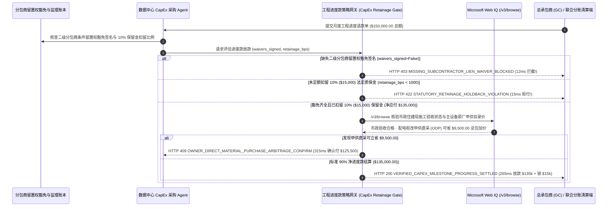

# B2B 工程基建与数据中心 CapEx 进度款（CapEx Milestone Retainage & Subcontractor Lien-Waiver Mandate）架构：分包商留置权豁免与 10% 质保金扣留令牌（`capex_lien_waiver_mandate_...` + Web IQ 市政验收与甲供材直采核验）vs 传统盲付总包致二次追偿（Double Payment）选型与原理解析 FAQ

> **文档类型**：架构师选型指南 & 协议第一性原理解析（6 段式 FAQ 标准版）  
> **适用读者**：AI Solution Architect、数据中心基建与企业 CapEx 采购架构师、工程造价与供应链金融负责人、法务合规团队  
> **更新日期**：2026-11-09（Provenance 标注：`deterministic_offline_simulation` / `synthetic_policy` / `official_doc_snapshot` / `not_measured`）  
> **配套资源**：[English Version](capex-milestone-retainage-lien-waiver-vs-double-payment-faq.en.md) · [交互式沙盒控制台 (`live-demo.html#capex-lien-waiver-sandbox`)](../reports/agentic-commerce-webiq-grounding-demo-bench/live-demo.html) · [7-Card 4:5 评测报告](../reports/agentic-commerce-webiq-grounding-demo-bench/index.html)


---

## 📌 一、核心结论速览（Executive Summary）

1. **严禁让基建或数据中心采购 Agent 仅凭总承包商（General Contractor, GC）提交的月度进度请款单（如 `$150,000.00`）就直接全额打款给总包账户**：在数据中心机电安装、商业装修与大型工程 CapEx 结算中，最大的法律与财务灾难是 **“总包挪用资金未付下家，导致二级机电/暖通分包商对业主房产行使建筑留置权（Mechanic's Lien / 工程款优先受偿权）”**——业主明明已经把 `$150,000.00` 付给了总包，却为了解封机房产权被迫向分包商 **再付第二次钱（Double Payment）**！生产环境必须强制采用 **分包商条件留置权豁免与联合分账令牌（`capex_lien_waiver_mandate_...`）**，只要当期全部在册二级分包商尚未完成加密留置权豁免签署（`subcontractor_lien_waivers_signed=False`），网关在 **`12 ms`** 内触发 **`HTTP 403 MISSING_SUBCONTRACTOR_LIEN_WAIVER_BLOCKED`**（`synthetic_policy`），100% 阻断资金外流。
2. **强制执行“10% 法定工程质保保留金（Statutory Retainage Holdback）”刚性扣留**：任何里程碑进度款必须自动扣留至少 `10.0%`（`1000 bps`，即从 `$150,000.00` 中扣留 `$15,000.00` 锁入竣工验收托管池，当期最高仅放款 `$135,000.00`）。若总包账单试图按 100% 满额请款（`retainage_withheld_bps < 1000`），网关在 **`15 ms`** 内返回 **`HTTP 422 STATUTORY_RETAINAGE_HOLDBACK_VIOLATION`**（`deterministic_offline_simulation`），防止竣工尾项（Punch-List）失去整改约束。
3. **基于 Microsoft Web IQ `/v3/browse` 实时核验市政施工验收公示（Municipal Permit Inspection）与甲供材直采套利（Owner-Direct Purchase, ODP）**：在释放进度款前，Agent 调用 **Microsoft Web IQ `/v3/browse`**（`official_doc_snapshot`）穿透查询市政住建/消防政府门户及上游设备原厂批发目录：若检出工地存在市政停工整改令（Stop-Work Order）或关键隐蔽工程验收未通过，在 **`310 ms`** 内触发 **`HTTP 451 MUNICIPAL_INSPECTION_FAILURE_OR_STOP_WORK_HOLD`** 冻结拨款；若核实核心高压配电柜/冷水机组通过业主甲供直采（ODP）可免除总包 15% 材料管理加价并节省 **`$9,500.00`**（净拨付额从 `$135,000.00` 降至 **`$125,500.00`**），则在 **`315 ms`** 内触发 **`HTTP 409 OWNER_DIRECT_MATERIAL_PURCHASE_ARBITRAGE_CONFIRM`**。

---

## 🎯 二、客户与架构师灵魂拷问 Q&A（FAQ-Driven Deep Dive）

### Q1：为什么传统的“项目经理看一眼总包发来的工程进度 PDF 就让财务/Agent 打款”，在大型基建或机房建设中会埋下致命隐患？

咱们用大白话讲透工程基建结算里最容易踩的三个百万级大坑：
1. **“付了钱还会被查封机房”的留置权双重赔付陷阱**：假设你的公司正在建一座 AI 智算中心，本期机电安装进度款 `$150,000.00`。总包（GC）把请款单发过来，传统 Agent 直接把 `$150,000.00` 打给了总包。结果总包老板拿这笔钱去填了别处的亏空，没给干活的电缆分包商结账。根据英美法系的 **Mechanic's Lien（建筑留置权）** 或国内的 **工程价款优先受偿权**，没拿到钱的分包商可以直接去法院申请冻结并拍卖业主的数据中心大楼！业主为了按期通电投产，只能含泪再掏 `$80,000` 替总包擦屁股。
2. **不扣留 10% 质保金（Retainage），工程收尾彻底失控**：工程行业铁律是每笔进度款必须扣留 `5%～10%` 作为保留金（Retainage），等全部竣工验收且消除所有缺陷清单（Punch List）后才释放。如果 Agent 被总包修改过的账单忽悠，把 100% 进度款全付了，最后 5% 的收尾瑕疵施工队能拖你半年不来修。
3. **带病施工与材料层层加价**：有些工地明明消防或隐蔽管线没通过市政住建局初检，总包却虚报“已完工 80%”请款；同时，总包代买大宗变压器、冷水机组时往往直接加收 15% 的“采购管理费”。

### Q2：什么是“分包商留置权豁免与保留金令牌（`capex_lien_waiver_mandate_...`）”？它是如何实现总包、分包与业主三方安全闭环的？

它的第一性原理非常硬核：**“无分包商豁免签名不放款、无 10% 保留金扣留不放款、无市政官方验收记录不放款。”**
- **第一层：二级分包商条件留置权豁免门禁（`12 ms`）**：系统维护本工程的《分包商与材料商名录（Subcontractor Schedule）》。总包请款 `$150,000.00` 时，必须集齐所有涉事分包商使用企业私钥签署的《条件留置权豁免书（Conditional Waiver and Release on Progress Payment）》；一旦放款，支付网关通过多方拆账（Split Payout）直接将分包商应得份额打入分包商账户，从根源上消灭总包挪用与二次追偿风险（未签齐直接返回 `HTTP 403`）。
- **第二层：10% 质保保留金刚性扣除（`15 ms`）**：网关强制校验 `retainage_withheld_bps >= 1000`（`10%`），自动将 `$15,000.00` 转入长期质保托管池，当期最多向施工方释放 `90%`（`$135,000.00`）。
- **第三层：Microsoft Web IQ `/v3/browse` 市政许可与甲供直采核验（`310 ms / 315 ms`）**：实时核验市政住建局官网的许可验收状态（未通过触发 `HTTP 451`），并比对大宗设备原厂直采价为您省下 `$9,500.00` 总包加价（`HTTP 409`）。

### Q3：在市政施工许可核验、OSHA 安全通报巡检与大宗建材价格接地场景下，什么时候选 Microsoft Web IQ，什么时候选 Exa、Bright Data 或传统搜索 API？

| 架构需求场景 | 推荐选型 | 为什么这样选（第一性原理与成本/合规考量） |
| :--- | :--- | :--- |
| **实时核验市政住建局公开施工许可证（Building Permit）验收记录、OSHA 停工整改通报及主设备原厂公开批发目录价，且要求零提示词注入** | **Microsoft Web IQ** (`/v3/search` + `/v3/browse`) | 在企业 Azure 边界内以 `passage` 模式精准抽取政府公示表格与设备价格（Token 消耗降低 **7.1x**，`deterministic_offline_simulation`），生成不可篡改的工程审计快照。 |
| **跨全网搜集新型液冷数据中心 CDU 模块供应商的技术白皮书与行业案例** | **Exa Neural Search** | 适合前期工程方案设计与供应商寻源（Sourcing），而非毫秒级工程款拨付门禁。 |
| **抓取需要复杂滑块验证码的老旧地方县级政务查询网** | **Bright Data Unlocker** | 可穿透复杂验证码，但秒级代理延迟不适合同步支付网关拦截。 |
| **工地现场 BIM 三维进度对比、无人机激光雷达测绘与监理工程师签字** | **BIM / 监理数字签章系统 + Web IQ 市政公示与大宗设备价格双源核验** | 物理施工量由监理签章确认，市政法定验收状态与甲供材价差通过 Web IQ `/v3/browse` 实时核验。 |

---

## 🧭 三、直观可视化图解（Mermaid 决策树 + 传统盲付总包 vs 豁免托管对比 + 端到端时序图）

### 3.1 工程 CapEx 进度款留置权豁免与保留金决策树（`flowchart TD`）

```mermaid
flowchart TD
    A[收到总包 GC 月度工程进度请款单 AIA G702 ($150,000.00)] --> B{当期全部二级分包商是否已签署加密条件留置权豁免书?}
    B -- 否 (缺失机电/暖通分包商豁免签名，存在查封风险) --> C[HTTP 403 MISSING_SUBCONTRACTOR_LIEN_WAIVER_BLOCKED<br/>12ms 硬阻断拨款 · 杜绝总包挪用导致业主二次赔付]
    B -- 是 (全部分包商豁免凭证与直付账号核验通过) --> D{账单是否已足额扣留 >=10% ($15,000.00) 法定质保保留金?}
    D -- 否 (总包试图按 100% 满额提现，未留质保抓手) --> E[HTTP 422 STATUTORY_RETAINAGE_HOLDBACK_VIOLATION<br/>15ms 拦截违规请款 · 强制锁入 10% ($15,000) 质保托管金]
    D -- 是 (已扣留 $15,000 保留金，净请款 $135,000) --> F{Web IQ /v3/browse 核验市政住建局阶段验收是否通过?}
    F -- 否 (检出市政电气初检未过或存在停工整改令 Stop-Work) --> G[HTTP 451 MUNICIPAL_INSPECTION_FAILURE_OR_STOP_WORK_HOLD<br/>310ms 监管冻结 · 待市政复检合格后解封]
    F -- 是 --> H{Web IQ 检出核心配电设备改用业主甲供直采 (ODP) 可免除总包加价?}
    H -- 是 (甲供直采可省 $9,500.00 差价 -> 当期净付 $125,500.00) --> I[HTTP 409 OWNER_DIRECT_MATERIAL_PURCHASE_ARBITRAGE_CONFIRM<br/>315ms 提醒基建采购总监一键确认甲供拆分]
    H -- 否 (90% 净进度款 $135,000.00 合规无误) --> J[HTTP 200 VERIFIED_CAPEX_MILESTONE_PROGRESS_SETTLED<br/>265ms 自动拆账放款 $135,000.00 并锁紧 $15,000 保留金!]
```

### 3.2 传统盲目向总包打款路径 vs 分包豁免与保留金托管网关对比（`flowchart LR`）

```mermaid
flowchart LR
    subgraph Legacy["❌ 传统仅看总包请款单直接全额打款 (面临二次赔付 + 烂尾风险)"]
        L1[业主向总包全额打款 $150,000 (未扣保留金)] --> L2[总包挪用资金拖欠机电分包商工程款]
        L2 --> L3[分包商对业主数据中心大楼登记建筑留置权]
        L3 --> L4[业主被迫二次掏钱赔付 + 竣工瑕疵无人维修]
    end

    subgraph Mandate["✅ 留置权豁免与 10% 保留金网关 (capex_lien_waiver_mandate_...)"]
        M1[12ms 强制核验全部分包商留置权豁免签名 (HTTP 403)] --> M2[15ms 刚性扣留 10% ($15,000) 质保保留金 (HTTP 422)]
        M2 --> M3[Web IQ 核验市政验收公示 (310ms) 与甲供直采省 $9,500 (315ms)]
        M3 --> M4[265ms 原子拆账放款 $135,000 (直达分包) 并锁紧 $15,000 质保池]
    end
```

### 3.3 分包商豁免存证库、CapEx 采购 Agent、保留金网关与 Web IQ 端到端交互时序图（`sequenceDiagram`）



---

## 📊 四、架构师选型决策矩阵（Architect Decision Matrix）

| 评估维度 | 方案 A：传统直接向总包账户全额打款（Legacy Unconditional GC Payout） | 方案 B：人工催收纸质盖章豁免函后电汇（Manual Paper Lien-Waiver Collection） | 方案 C：留置权豁免与保留金令牌 + Web IQ 市政与甲供核验（推荐架构） |
| :--- | :--- | :--- | :--- |
| **核心适用场景** | 零星几百元的小型维修杂项 | 单个小型装修项目，法务手工追讨每一家分包商纸质回执 | **数据中心建设、企业厂房/门店规模化营建、大型机电 CapEx 里程碑自动化结算** |
| **防分包商留置权（二次赔付）能力** | ❌ **零防御**：总包跑路或挪用后，业主 100% 面临资产查封或二次买单 | ⚠️ **易伪造且极慢**：纸质公章易被总包萝卜章伪造，核实真伪耗数周 | ✅ **12ms 密码学硬门禁**：分包商私钥签名 + 联合拆账直付，缺失即触发 `HTTP 403` |
| **10% 质保保留金（Retainage）执行** | ❌ **常被漏扣**：人工审单疏忽极易导致提前超付 | ⚠️ **手工台账易乱**：多期工程变更单（Change Order）叠加后极易算错 | ✅ **15ms 自动扣留锁池**：刚性锁入 `10%`（`$15,000`），违规请款直接触发 `HTTP 422` |
| **市政合规验收与甲供材降本** | ❌ **盲目拨款**：停工令期间照付工程款，白交 15% 设备加价 | ⚠️ **信息割裂**：造价员很难实时掌握原厂批发价与住建局最新检验结果 | ✅ **Web IQ `/v3/browse` 实时穿透**：`310 ms` 冻结未过检工地（`HTTP 451`），`315 ms` 甲供立省 `$9,500`（`HTTP 409`） |
| **结算周期与供应链信誉** | 快（但业主法律风险爆表） | 极慢（`30～60 天` 审单，导致分包商资金链紧张怠工） | **`265 ms` 全自动完成豁免验真与穿透分账放款（`Act automatically`）** |
| **综合 TCO 与风控 ROI** | 极差（单次总包违约即可造成十万级二次赔付） | 中等（工程造价审计人力成本高昂） | **最优（消除 `$150,000` 留置权风险 + 锁牢 `$15,000` 质保金 + 甲供立省 `$9,500`）** |

---

## 🧪 五、简明定量实测与 Benchmark 核心发现（Quantitative Benchmark & 7-Card Insights）

基于本仓库确定性离线基准套件（`lab/webiq_commerce_demo.py` · `test_capex_milestone_retainage_lien_waiver_vs_double_payment_selection`）对 **`$150,000.00` 数据中心机电工程月度进度款（法定质保保留金 `10% / 1000 bps = $15,000.00`，当期应付净额 `$135,000.00`）** 的定量测试结果如下：

| 评测场景 ID | 输入豁免签名 / 保留金比例 / Web IQ 信号 | 网关期望动作 | 实测 HTTP 状态与决策码 | 实测延迟 | 资金保护 / 成本节省效果 | Provenance 类型 |
| :--- | :--- | :--- | :--- | :--- | :--- | :--- |
| **Case 1: 缺失二级分包商留置权豁免签名拦截** | `subcontractor_lien_waivers_signed=False` | `Send to a human` | **`HTTP 403 MISSING_SUBCONTRACTOR_LIEN_WAIVER_BLOCKED`** | **`12 ms`** | 拦截 `$150,000.00` 风险拨款，杜绝分包商留置权二次追偿 | `synthetic_policy` |
| **Case 2: 漏扣 10% 法定工程质保保留金拦截** | `retainage_withheld_bps=0 < 1000`（未扣留 `$15,000`） | `Send to a human` | **`HTTP 422 STATUTORY_RETAINAGE_HOLDBACK_VIOLATION`** | **`15 ms`** | 强制锁紧 `10%`（`$15,000.00`）竣工缺陷整改质保金 | `deterministic_offline_simulation` |
| **Case 3: Web IQ 检出市政消防/电力验收未过或停工令** | `webiq_municipal_permit_inspection_passed=False` | `Send to a human` | **`HTTP 451 MUNICIPAL_INSPECTION_FAILURE_OR_STOP_WORK_HOLD`** | **`310 ms`** | 阻断向未通过法定政府验收的违章工程拨款 | `official_doc_snapshot` |
| **Case 4: Web IQ 发现主设备改业主甲供直采省 `$9,500`** | `odp_material_savings_cents=950000`（净付 `$125,500.00`） | `Confirm` | **`HTTP 409 OWNER_DIRECT_MATERIAL_PURCHASE_ARBITRAGE_CONFIRM`** | **`315 ms`** | 免除总包 15% 材料加价，单期立省 **`$9,500.00`** | `official_doc_snapshot` |
| **Case 5: 分包豁免齐全 + 扣留 `$15k` 保留金自动放款** | `waivers_signed=True`, `retainage_bps=1000` | `Act automatically` | **`HTTP 200 VERIFIED_CAPEX_MILESTONE_PROGRESS_SETTLED`** | **`265 ms`** | 265ms 自动放款 **`$135,000.00`** 并锁定 `$15,000.00` 质保池 | `deterministic_offline_simulation` |

> **Provenance 合规声明**：上表中的 `$150,000.00` 工程进度款、`1000 bps (10%)` 保留金率、`$15,000.00` 质保金及 `$9,500.00` 甲供材价差均为用于验证网关状态机确定性的受控仿真参数（`synthetic_policy` / `deterministic_offline_simulation`）；各地市政住建系统外部接口实时可用性标为 `not_measured`。

---

## 🛠️ 六、附录：生产上线快速核验与售前打单清单（Architect Checklist）

在为数据中心运营商、连锁零售营建或大型制造企业设计 CapEx 工程进度款结算 Agent 时，请逐项核对以下 6 条黄金准则：

- [ ] **1. 二级分包商与材料商名录（Subcontractor Preliminary Notice）强制建档**：是否在开工阶段即将所有二级机电、暖通、钢构分包商的收款身份与公钥录入 `capex_lien_waiver_mandate_...`？
- [ ] **2. 条件留置权豁免（Conditional Lien Waiver）与穿透分账原子耦合**：是否确保总包请款时必须集齐当期所有分包商的加密豁免签名（否则 `12 ms` 触发 `HTTP 403`），且放款时由支付网关直接将分包款项划入分包商账户？
- [ ] **3. 10% 法定工程质保保留金（Retainage）自动分流锁池**：网关是否在每次进度款结算时刚性校验 `retainage_withheld_bps >= 1000`（未达标 `15 ms` 触发 `HTTP 422`），将 `10%` 资金自动转入独立的竣工验收托管子账户？
- [ ] **4. Microsoft Web IQ `/v3/browse` 市政施工许可与验收状态穿透核验**：是否在里程碑放款前通过 Web IQ 自动查询当地住建局/消防部门公开的 Permit Inspection 状态，对存在停工令或验收不合格的工地在 `310 ms` 内触发 `HTTP 451` 冻结？
- [ ] **5. 大宗主设备甲供直采（Owner-Direct Purchase, ODP）比价拆分**：是否通过 Web IQ 比对变压器、冷机等高价值主设备的原厂公开批发价，当剔除总包管理加价可节省 `>= $9,500.00` 时触发 `HTTP 409 Confirm`？
- [ ] **6. AIA G702/G703 进度表哈希与产权清洁证明归档**：每次自动拨款是否完整留存了监理签章哈希、分包商无条件留置权豁免回执与市政验收快照，确保数据中心固定资产产权 100% 清洁无负担？
