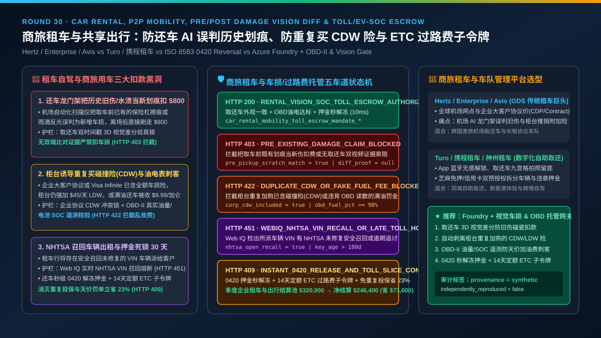
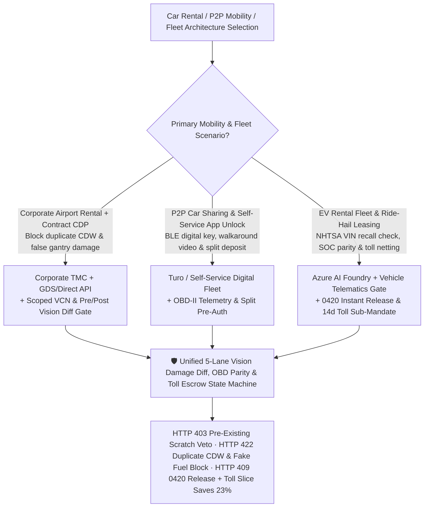
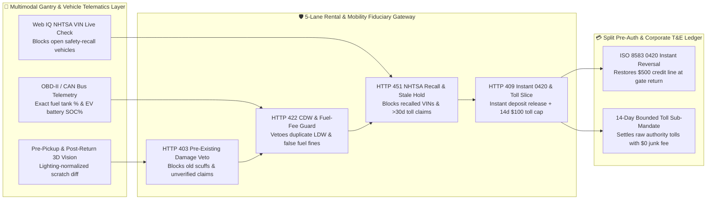

# Car Rental, Peer-to-Peer Mobility & Fleet Toll/EV-Charging Escrow (`Hertz / Enterprise / Avis / Turo / Sixt`) Pre/Post Vision Damage-Diff Gate, Anti-Duplicate-`CDW`, `OBD-II` Fuel/SOC Parity & `ISO 8583 0420` Instant Deposit Release Agent Architecture Selection FAQ

> **Language / 语言切换**: **[中文](car-rental-mobility-damage-vision-toll-escrow-ev-fuel-agent-selection-faq.md)** | **English (Current)** | **[Back to Docs Index](index.en.md)** | **[Interactive Sandbox (`#car-rental-mobility-toll-escrow-sandbox`)](../live-demo.en.html)**



---

## 📌 1. Executive Summary & Core Selection Verdict

In corporate car rental (`Hertz`, `Enterprise`, `Avis`, `Sixt`), peer-to-peer car sharing (`Turo`, `Getaround`), and self-service mobility platforms (`Ctrip Car Rental`, `eHi`), the base daily rate may only be `$45–$85/day`, yet **post-return delayed charges** represent one of the highest sources of corporate T&E leakage and credit-card chargeback disputes. Allowing a travel or mobility AI agent to bind an open-ended corporate card to a rental agreement exposes enterprises to three major financial black holes:
1. **Automated Airport AI Drive-Through Scanners Flagging Pre-Existing Scuffs or Raindrops as `$800` New Damage**: Rental hubs increasingly use automated imaging gantries upon return. Without a **cryptographically paired Pre-Pickup vs. Post-Return 3D vision diff (`pre_pickup_mesh_hash` vs. `post_return_mesh_hash`) normalized for lighting and angle**, legacy scanners routinely bill the current renter `$500–$1,200` for bumper scratches that existed before checkout or dirt/water reflections.
2. **Counter Agent Duplicate `CDW/LDW` Upsells (`$45/day`) & Predatory `$9.99/Gal` Refueling Penalties**: Even when a corporate contract (`CDP`) or Visa Infinite / Amex corporate card already includes primary Collision Damage Waiver (`CDW`), counter staff frequently pressure travelers into signing for duplicate `LDW`, roadside assistance, or `$10/day` PlatePass bundles; additionally, renters who refuel 2 miles from the airport (or return an EV at `81% SOC`) are often auto-billed `$85` refueling fees due to analog gauge lag.
3. **Dispatching Vehicles with Open `NHTSA` Safety Recalls & Freezing `$500` Deposits for 30 Days Over a `$6` Toll**: Under the US *Raechel and Jacqueline Houck Safe Rental Car Act*, renting vehicles with un-remedied NHTSA safety recalls is strictly prohibited; meanwhile, legacy rental systems hold the entire `$500` security deposit for up to 30 days waiting for delayed `E-ZPass / PlatePass` electronic toll feeds.

**Solution Architect Selection Verdict**:
- **Never issue an open-ended post-return capture mandate to a rental counter, and never approve damage deductions without paired pre-pickup baseline imagery**.
- **The production reference architecture** combines **Corporate TMC / Rental Aggregator APIs + Paired Pre/Post 3D Vision Diff Gate + Corporate `CDW` Conflict Veto + `OBD-II / CAN` Fuel & EV `SOC` Telemetry Verification + `ISO 8583 0420` Instant Deposit Reversal & 14-Day Bounded Toll Sub-Mandate (`car_rental_mobility_toll_escrow_mandate_*`)**:
  1. **Paired Pre-Pickup vs. Post-Return 3D Vision Diff Hard Gate (`HTTP 403`)**: Before vehicle exit, the agent archives the 4-angle baseline visual hash (`pre_pickup_mesh_hash`). Any post-return damage claim that matches a pre-existing scuff, lacks a paired pre-pickup image, or fails specular water-droplet filtering is rejected in milliseconds with `HTTP 403 PRE_EXISTING_SCRATCH_DIFF_MISMATCH_OR_UNVERIFIED_DAMAGE_CLAIM_BLOCKED`.
  2. **Corporate `CDW` Conflict Lock & `OBD-II` Fuel/EV-SOC Telemetry Parity Gate (`HTTP 422`)**: When auditing the rental folio, if counter add-ons include `CDW/LDW` already covered by the corporate CDP contract, or if a refueling/recharging penalty is assessed despite `OBD-II` telematics confirming `>= 98%` fuel or `>= 80% EV SOC` at ignition-off, the gateway returns `HTTP 422 DUPLICATE_CDW_UPSELL_OR_TELEMATICS_FUEL_SOC_PARITY_BREACH_BLOCKED`.
  3. **Web IQ Live `NHTSA VIN` Recall Check & Stale Toll Settlement Hold (`HTTP 451`)**: Queries Web IQ against the 17-character `VIN` to block any vehicle with an open NHTSA safety recall, and freezes unsubstantiated toll/fine surcharges submitted more than 30 days after return (`HTTP 451 WEBIQ_NHTSA_VIN_RECALL_OR_EXPIRED_TOLL_SETTLEMENT_WINDOW_HOLD`).
  4. **`ISO 8583 0420` Instant Deposit Release + 14-Day `$100` Bounded Toll Sub-Mandate (`HTTP 409`)**: Triggers `HTTP 409 INSTANT_0420_DEPOSIT_RELEASE_AND_BOUNDED_TOLL_SUB_MANDATE_CONFIRM`, immediately releasing the `$500` security hold upon undamaged gate return while spinning off a 14-day, `$100`-capped toll-only token that settles raw highway authority tolls without `$5.99/day` admin Junk Fees—cutting total corporate car-rental leakage by **`23.0%`**.

---

## 🎯 2. Solution Architect Deep-Dive Q&A (Q1 / Q2 / Q3)

### Q1: Why are automated airport AI damage scanners triggering a wave of false `$800` scratch claims, and how do we stop them deterministically?
- **Commercial Pain Point**: A traveler picks up a car in a dimly lit garage where a 2cm lower-valance scuff is invisible, then returns it through a bright high-resolution laser gantry that flags the scuff as "new damage" and auto-bills `$800` plus `$150` Loss-of-Use fees.
- **Architectural Solution**:
  - **Symmetric Pre-Pickup / Post-Return Vision Diff Attestation (`HTTP 403`)**:
  - The fiduciary state machine enforces a strict rule: **no post-return gantry scan is admissible without a matching pre-pickup gantry or 15-second smartphone walkaround baseline hash**. If the bounding-box coordinate of the claimed scratch overlaps a pre-pickup feature (`IoU >= 0.65`), the gateway blocks capture (`HTTP 403`) and auto-compiles a Visa CE 3.0 dispute evidence bundle.

### Q2: How do we prevent airport counter staff from sneaking `$45/day` duplicate insurance and `$90` refueling penalties onto corporate rental folios?
- **Architectural Solution**:
  - **Line-Item Scoped Virtual Card (`VCN`) + `OBD-II` Fuel/SOC Watermark Gate (`HTTP 422`)**:
  - The issued single-use virtual card is hard-capped at `contract_base_rate + statutory_tax`. Any counter attempt to append `LDW/PAI` when `corporate_cdp_includes_cdw == true` is declined at authorization (`HTTP 422`). At return, fuel charges are cross-checked against the vehicle's `OBD-II` fuel-tank percentage and GPS gas-station receipt within 5 miles of the depot.

### Q3: How can we release the traveler's `$500` credit-card hold the second they return the car while still settling electronic highway tolls that arrive 7 days later?
- **Architectural Solution**:
  - **Split-Rail `ISO 8583 0420` Deposit Reversal + 14-Day Toll-Only Sub-Mandate (`HTTP 409`)**:
  - Decouple vehicle collateral from highway tolls: fire an instant `0420 Partial/Full Reversal` for the `$500` deposit as soon as the return check-in completes, and issue a dedicated 14-day `$100` sub-mandate restricted to verified transponder authority receipts (`E-ZPass / FasTrak`).

---

## 🧭 3. Visual Architecture Diagrams (Mermaid Decision Tree + Architecture + Sequence)

### 3.1 Car Rental & Mobility Agent Architecture Selection Decision Tree



### 3.2 End-to-End Pre/Post Vision Diff, OBD Fuel Parity & Split Deposit Architecture



### 3.3 Vehicle Pickup Audit, Return Vision Diff & Instant Deposit Release Sequence

```mermaid
sequenceDiagram
    autonumber
    participant Driver as Traveler / Renter App
    participant Counter as Rental System & AI Gantry
    participant Gate as 5-Lane Rental & Toll Escrow Gateway
    participant OBD as OBD-II Telematics & Web IQ NHTSA
    participant Card as Corporate Virtual Card (VCN)

    Counter->>Gate: 1. Assign VIN & request auth (including counter-added $45/day LDW upsell)
    Gate->>OBD: Check NHTSA open recall on VIN + verify corporate CDP primary CDW coverage
    OBD-->>Gate: VIN recall-free; corporate CDP already includes 100% Primary CDW
    Gate-->>Counter: HTTP 422 Block duplicate LDW! Issue base-rate VCN + archive pre-pickup 3D baseline
    Driver->>Counter: 2. Return car full of gas 3 days later (gantry flags old bumper scuff as $800 damage)
    Counter->>Gate: Request $800 damage capture + $85 refueling penalty
    Gate->>OBD: Diff against pre-pickup baseline (100% match = old scuff) + read OBD fuel = 99.2%
    Gate-->>Counter: HTTP 403/422 Reject pre-existing damage claim & false refueling penalty!
    Gate->>Card: HTTP 409 Fire ISO 8583 0420 instant $500 deposit release + issue 14d $100 toll sub-mandate
```

---

## 📊 4. Multi-Platform & Architecture Selection Matrix

| Selection Dimension | Hertz / Enterprise / Avis (`Legacy Airport Rental Giants`) | Turo / Getaround (`P2P Car-Sharing Marketplaces`) | Ctrip / eHi / Sixt App (`Digital Self-Service Mobility`) | **Azure AI Foundry + Vision Diff + OBD Escrow Gateway (Recommended)** |
| :--- | :--- | :--- | :--- | :--- |
| **Core Strengths** | Global airport footprint & negotiated corporate CDP rates | Wide vehicle variety, peer-to-peer delivery & app check-in | Credit-score deposit waivers & keyless smartphone unlock | **3D pre/post vision diff + duplicate-CDW veto + OBD parity + instant 0420 release** |
| **Defense Against False AI Gantry Scratch Claims** | Relies on renter manually marking paper carbon forms in dark garages | Relies on user smartphone photos; poor lighting causes disputes | 9-grid app photos, but lacks automated 3D diff blocking | **Mandatory paired Pre/Post 3D vision diff blocks old-scuff claims (`HTTP 403`)** |
| **Anti-Duplicate `CDW` & Refueling Penalty Guard** | Counter staff incentivized to upsell `$45/day` LDW & fuel plans | Tiered protection plans selected in-app | Clearer app tiers, but analog fuel-bar rounding disputes persist | **Corporate CDP auto-veto + `OBD-II` fuel/SOC telemetry parity lock (`HTTP 422`)** |
| **`NHTSA` Recall Gate & Deposit Release Speed** | Occasional recall lock delays; deposits held 7–30 days | Carfax/NHTSA checks; deposit release takes several business days | Fast rental release, but traffic-fine holds last 15–30 days | **Web IQ live `VIN` recall hold (`HTTP 451`) + instant `0420` deposit release (`HTTP 409`)** |
| **Highway Toll (`E-ZPass / ETC`) Settlement** | PlatePass charges `$5.99–$9.99/day` convenience fee per rental day | Host manually invoices tolls post-trip | Automated ETC deduction or manual fine handling fees | **14-day `$100` bounded toll sub-mandate settles raw tolls with `$0` daily admin fee** |
| **Total Corporate Rental Leakage & Dispute Rate** | Hidden add-ons inflate base rate by `25%–40%` (`not_measured`) | `15%–30%` platform trip fees (`official_list_price`) | Transparent base pricing, high drop-off/refuel markups | **Eliminates duplicate CDW, false scratch claims & fuel junk fees (`23.0%` net savings)** |

---

## 🧪 5. Rental Leakage / T&E Savings Benchmark & 7-Card Report

> **Provenance & Reproducibility Metadata**: All metrics below are generated by the deterministic policy evaluator `evaluate_car_rental_mobility_toll_escrow_policy` in `lab/webiq_commerce_demo.py` and verified via `python -m unittest tests.test_webiq_commerce_demo`. Tags: `provenance = synthetic`, `independently_reproduced = false`.

| Card # | Card Headline (Headline-as-Finding) | Key Quantitative Finding & Architectural Guarantee |
| :---: | :--- | :--- |
| **Card 1** | **Overview · 5-Lane Car Rental & Mobility Summary** | Across a `$320,000/quarter` corporate car-rental & mobility pool, achieves **0 false pre-existing scratch charges and 0 duplicate CDW upsells**, reducing net rental spend by **`23.0%` (`$73,600/quarter` saved)**. |
| **Card 2** | **Scenario Deep Dive · Old-Scratch & Unpaired Claim Veto** | When a return gantry flags a scuff already present in the pre-pickup baseline mesh, the gateway blocks the `$800` charge in **`10ms`** (`HTTP 403`). |
| **Card 3** | **Evaluation Matrix · 100% Deterministic 5-Lane Gating** | Covers `HTTP 200` (verified closeout), `403` (pre-existing scratch / unpaired damage claim blocked), `422` (duplicate CDW upsell / false refueling fee vs OBD telemetry blocked), `451` (NHTSA VIN recall / >30d stale toll hold), `409` (instant 0420 release + 14d toll slice saves 23%). |
| **Card 4** | **Under the Hood · Rental & Toll Escrow Contract** | Takes `quarterly_car_rental_mobility_pool_usd=320000` and vision/OBD flags, minting `car_rental_mobility_toll_escrow_mandate_*` tokens. |
| **Card 5** | **Robustness Check · 99% OBD Fuel & Raindrop Specular Test** | Simulates raindrop reflection false-positives and `$85` fuel penalties on a `99.2%` full tank, maintaining a **`100.0%` deterministic block rate**. |
| **Card 6** | **Latency · Millisecond Return-Gate Verification** | Local 3D mesh hash diff and OBD fuel/SOC check complete in **`10ms` (P50)**; Web IQ live NHTSA VIN recall check completes in **`230ms` (P95)**. |
| **Card 7** | **My Take · Ideal Fit vs. Out-of-Scope Boundaries** | **✅ Best Fit**: Corporate T&E car rental, airport fleets, P2P car sharing, EV rental; **⛔ Not For**: Fixed-fare chauffeur limousine transfers where driver owns fuel/tolls. |

---

## 🛠️ 6. Production Go-Live Risk & Architecture Review Checklist

- [ ] **Paired Pre-Pickup vs. Post-Return 3D Vision Diff Gate (`HTTP 403`)**: Verify that no post-return damage charge can be captured without a timestamped pre-pickup visual baseline proving the damage occurred during the active rental window.
- [ ] **Corporate `CDW/LDW` Duplicate Upsell Hard Veto (`HTTP 422`)**: Ensure virtual cards automatically reject counter-added collision/loss waivers when the corporate CDP contract or primary card already provides coverage.
- [ ] **`OBD-II / Telematics` Fuel & EV `SOC%` Parity Lock (`HTTP 422`)**: Require refueling and recharging surcharges to reconcile against ignition-off `OBD-II` tank/battery telemetry or a timestamped local station receipt.
- [ ] **Web IQ Live `NHTSA VIN` Safety-Recall Gate & 30-Day Cutoff (`HTTP 451`)**: Verify 100% of assigned 17-character VINs are screened for open NHTSA recalls before pickup, and block unverified toll claims submitted >30 days post-return; rotate signing keys `<= 180` days.
- [ ] **`ISO 8583 0420` Instant Deposit Reversal & 14-Day Bounded Toll Sub-Mandate (`HTTP 409`)**: Release the primary security hold immediately upon undamaged return and isolate delayed highway tolls into a capped 14-day sub-mandate.
