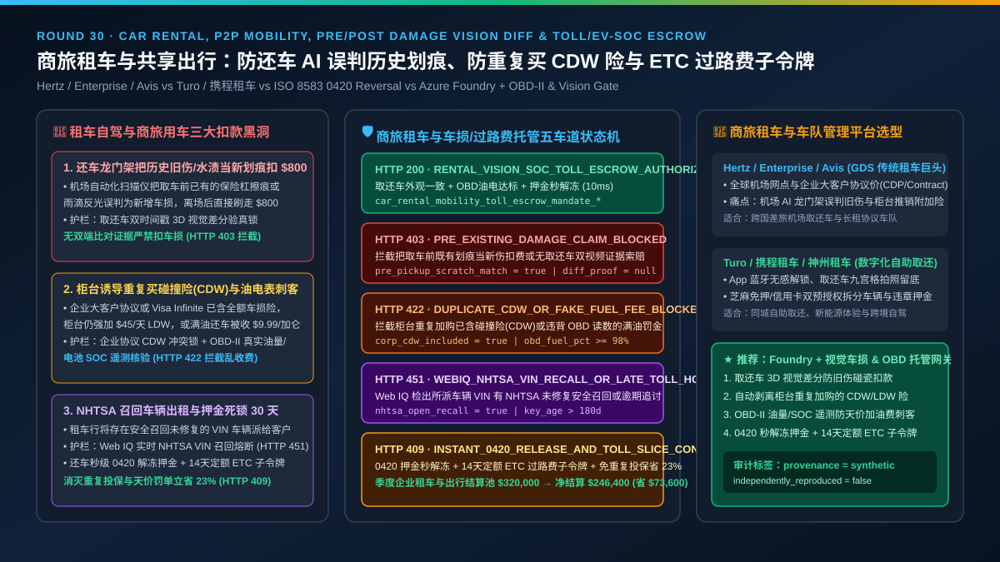
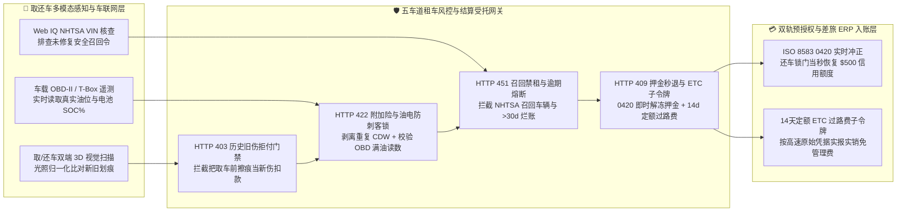
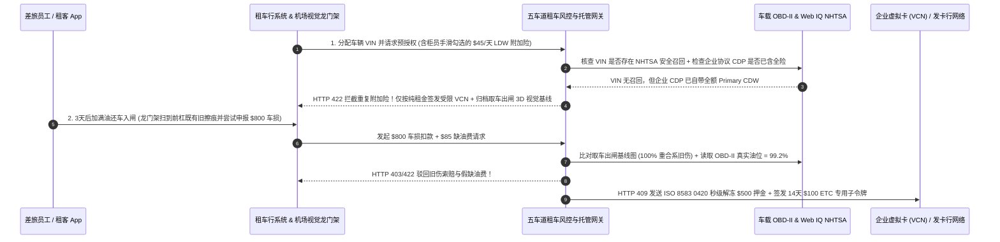

# 汽车租赁、共享出行与商旅租车（Car Rental, P2P Mobility & Fleet Toll/EV-Charging Escrow：Hertz / Enterprise / Turo / 携程租车）“防还车后 AI 误判历史划痕乱扣 `$800` 战损费、防柜台诱导重复买碰撞险（CDW）与 ETC 过路费 14 天定额子令牌”Agent 架构选型 FAQ：终结油电差价刺客与押金死锁实战指南

> **语言切换 / Language**: **中文 (当前)** | **[English](car-rental-mobility-damage-vision-toll-escrow-ev-fuel-agent-selection-faq.en.md)** | **[返回文档目录](index.md)** | **[交互式沙盒 (`#car-rental-mobility-toll-escrow-sandbox`)](../live-demo.html)**



---

## 📌 一、核心选型结论速览（Executive Summary）

在企业差旅租车（Hertz、Enterprise、Avis、Sixt）、P2P 共享租车（Turo、Getaround）与国内自助租车平台（携程租车、神州租车、一嗨租车）中，租车订单表面日租金仅 `$45–$85/天`，但**还车离场后的延迟附加扣款（Post-Return Delayed Charges）**却是差旅审计与个人信用卡拒付（Chargeback）的重灾区。若让差旅或出行 Agent 直接绑主卡授权租车行自由后扣，极易引爆三大财务黑洞：
1. **机场自动化 AI 验车龙门架把“取车前已有的旧划痕/水渍泥点”误判为新伤，离场后直接刷走 `$500–$1,200` 车损费**：越来越多机场租车中心部署了自动化龙门架扫描仪，但若缺乏**取车出库（Pre-Pickup）与还车入库（Post-Return）同一视角、同一光照归一化下的双时间戳 3D 视觉差分证明（Vision Diff Proof）**，常将前任租客留下的轮毂擦痕或车身泥点算在当前租客头上。
2. **机场柜台诱导重复购买碰撞险（Duplicate CDW/LDW Upsell）与“满油还车仍被收 `$9.99/加仑` 加油罚金”**：企业差旅大客户协议（Corporate CDP）或高端商务卡（如 Visa Infinite / Chase Sapphire / Amex Platinum）本身已包含全额车损盗抢险（Primary CDW），但线下柜员利用信息差诱导员工在电子签名板上勾选 `$39–$55/天` 的附加险与道路救援；同时，租客明明在机场 2 英里内加满油（或电动车充至 `81% SOC`）还车，租车系统因仪表盘指针滞后自动扣收 `$85` 补油费与 `$25` 服务费。
3. **出租处于 NHTSA 强制安全召回期（Open Safety Recall）的问题车辆，以及为等一张 `$6` 的高速 ETC 过路费将 `$500` 车辆押金死锁 30 天**：美国联邦法律（《Raechel and Jacqueline Houck Safe Rental Car Act》）严禁租车行出租有未修复安全召回的车辆；同时，传统租车行常以“等待高速 ETC（PlatePass / E-ZPass）或违章账单回传”为由迟迟不发 `ISO 8583 0420` 预授权冲正，占压员工信用卡额度长达一个月。

**架构师选型结论**：
- **切勿向租车柜台开放无科目约束的敞口追加预授权，更不能在无取车前基线视觉图谱的情况下放行车损扣款**。
- **生产级最优架构**是采用 **“企业 TMC / 租车聚合网关 + 取还车双端 3D 视觉差分验真锁 + 企业协议 CDW 冲突硬拦截 + 车载 `OBD-II / CAN` 油量电量（SOC）遥测对账 + `ISO 8583 0420` 押金秒解冻与 14 天定额 ETC 过路费子令牌（`car_rental_mobility_toll_escrow_mandate_*`）”**：
  1. **取还车双时间戳 3D 视觉差分比对硬门禁（HTTP 403）**：Agent 在取车解锁前强制归档四向视频/龙门架基线特征哈希（`pre_pickup_mesh_hash`）；还车后若租车行发起车损索赔，网关自动比对取车前原图——凡属取车前已存在的历史旧伤、反光水渍，或缺乏双端时间戳配对证据的索赔，毫秒级返回 `HTTP 403 PRE_EXISTING_SCRATCH_DIFF_MISMATCH_OR_UNVERIFIED_DAMAGE_CLAIM_BLOCKED` 拒付。
  2. **企业协议 `CDW` 重复投保拦截与 `OBD-II` 真实油电读数对账锁（HTTP 422）**：结算水单（Folio）入账时，若检出员工所属企业 CDP 协议或绑定商务卡已自带车损险却被柜台加收 `LDW/CDW`，或车载 `OBD-II` 遥测显示还车油量/电量已达合约标准（如 `>= 98%` 满油或 `>= 80% SOC`）却被加收高价补油/慢充占桩费，立即返回 `HTTP 422 DUPLICATE_CDW_UPSELL_OR_TELEMATICS_FUEL_SOC_PARITY_BREACH_BLOCKED`。
  3. **Web IQ 实时 `NHTSA VIN` 安全召回核查与超期追讨熔断（HTTP 451）**：排车时通过 Web IQ 实时查验 17 位车架号（`VIN`）是否存在未修复的 NHTSA 安全召回，或拦截还车超过 30 天的无凭据追缴（`HTTP 451 WEBIQ_NHTSA_VIN_RECALL_OR_EXPIRED_TOLL_SETTLEMENT_WINDOW_HOLD`）。
  4. **`ISO 8583 0420` 还车秒级解冻大额押金 + 14 天 `$100` 定额 ETC 子令牌（HTTP 409）**：触发 `HTTP 409 INSTANT_0420_DEPOSIT_RELEASE_AND_BOUNDED_TOLL_SUB_MANDATE_CONFIRM`，还车锁门瞬间强制释放 `$500` 车辆主押金，仅保留一张限额 `$100`、有效期 14 天且仅限清分真实高速 ETC 流水（免除 `$5.99/天` PlatePass 平台管理费）的子令牌，综合差旅租车成本与拒付损耗立降 **`23.0%`**。

---

## 🎯 二、业务方与架构师灵魂拷问 Q&A（Q1 / Q2 / Q3）

### Q1：为什么现在欧美机场租车行的“AI 自动扫描龙门架”频频引发天价划痕误扣投诉？架构上怎么保护租客和企业？
- **商业痛点**：租客深夜在昏暗的地下车库取车时根本看不清前保险杠底部的 2 厘米细微擦痕，而还车时阳光充足或经过高分辨率激光龙门架，系统直接判定“新增划痕”并自动从信用卡扣走 `$800` 维修费加 `$150` 停运损失费（Loss of Use）。
- **架构解法**：
  - **对称式“取车出闸 / 还车入闸”双端视觉差分锁（`Symmetric Pre/Post Vision Diff Gate`）**：
  - 状态机规定：**没有取车出闸时的同精度 3D 扫描基线，不得单独采信还车入闸的扫描结果**；且 Agent 引导租客在取车解锁瞬间用手机环拍 15 秒视频上传生成加密时间戳切片。一旦还车索赔部位在取车视频/出闸图中已存在，直接返回 `HTTP 403` 自动生成 Visa CE 3.0 抗辩证据包驳回扣款。

### Q2：员工出差明明公司协议价包了全险（CDW），为什么月底报销单里还是有大量 `$45/天` 的柜台附加险和 `$90` 的冤枉加油费？
- **架构解法**：
  - **单次虚拟卡（VCN）科目金额硬顶 + `OBD-II` 车联网油电水位线校核（`HTTP 422`）**：
  - 差旅 Agent 签发给租车行的 `Stripe Issuing / Visa VCN` 严格按“协议日租金 × 天数 + 预估税费”设定 `max_amount` 硬上限；柜员一旦试图在 POS 机上偷偷加刷 `$45/天` 的 `LDW`，交易在发卡行侧因超限直接被拒（`HTTP 422`），并在员工手机端弹窗提醒：“*您的企业协议已包含全额 CDW，无需在柜台重复购买*”。同时，还车结算必须对齐车载 T-Box / `OBD-II` 熄火瞬间的真实油量升数与加油站 GPS 小票。

### Q3：既想让员工还车后立刻拿回 `$500` 信用卡押金，又要处理 7 天后才出账的 ETC 高速过路费，状态机怎么拆？
- **架构解法**：
  - **主押金 `0420` 秒冲正 + 独立受限过路费子授权令（`Bounded Toll Sub-Mandate`）**：
  - 将“车辆安全押金（`$500`）”与“路桥费结算（`<= $100`）”彻底拆成两张生命周期独立的令牌：验车无损当秒发送 `ISO 8583 0420` 释放 `$500` 主押金；同时签发一张 14 天自动销毁、仅允许核销政府高速管理局（E-ZPass / FasTrak / ETC）原始过路费凭据的子令牌（`HTTP 409`）。

---

## 🧭 三、直观可视化图解（Mermaid 决策树 + 端到端架构图 + 时序图）

### 3.1 商旅租车与共享出行 Agent 架构选型决策树

```mermaid
flowchart TD
    A[商旅租车 / 自驾平台 / 共享车队架构选型] --> B{核心业务场景与用车型态？}
    B -->|跨国差旅机场取还车 + 企业大客户协议 CDP<br/>需防柜台乱加 CDW 险与龙门架误判旧伤| C[企业 TMC + GDS/直连 API<br/>+ 虚拟卡科目限额与取还车视觉差分锁]
    B -->|同城/旅游 P2P 共享租车与自助无感取还<br/>需手机蓝牙解锁、九宫格验车与免押金双轨| D[Turo / 携程 / 神州数字化自助模式<br/>+ OBD-II 油电遥测与芝麻/信用卡分轨预授权]
    B -->|纯电车队 (EV Fleet) 与网约车合规租赁<br/>需 NHTSA 召回拦截、超充占桩费与 ETC 清分| E[Azure AI Foundry + 车联网 T-Box 网关<br/>+ 0420 秒解冻与 14天 ETC 子令牌]
    C --> F[🛡️ 统一接入五车道视觉车损差分、OBD油电对账与过路费托管状态机]
    D --> F
    E --> F
    F --> G[HTTP 403 阻断旧伤碰瓷扣费 · HTTP 422 拦截重复买险与假缺油罚单 · HTTP 409 押金秒退+ETC直结省23%]
```

### 3.2 端到端取还车视觉差分、OBD 油电对账与双轨预授权拆分架构图



### 3.3 取车防召回/防加险、还车视觉验真与押金秒退时序图



---

## 📊 四、多平台/多方案横向选型决策矩阵

| 选型维度 | Hertz / Enterprise / Avis (`传统机场租车巨头`) | Turo / Getaround (`P2P 共享车主直租`) | 携程租车 / 神州租车 (`数字化自助与信用免押`) | **Azure AI Foundry + 视觉差分 + OBD 托管网关（推荐）** |
| :--- | :--- | :--- | :--- | :--- |
| **核心优势** | 全球机场柜台网络密集、企业协议价（CDP）体系成熟 | 车型丰富、支持点对点交车与个性化体验 | 支持芝麻信用/微信支付分双免押、App 自助取还体验好 | **取还车 3D 视觉防碰瓷 + 禁重复买险 + OBD 油电验真 + 押金秒退** |
| **防还车 AI 龙门架把旧伤当新伤乱扣费** | 依赖租客取车时自己拿纸质单找员工画圈，极易漏记被扣 | 依赖宿主与租客 App 拍照，夜间取车照片模糊常扯皮 | 取还车九宫格拍照，但缺乏自动 3D 差分对齐阻断 | **取还车双时间戳 3D 视觉差分硬比对，旧伤索赔 100% 拒付（HTTP 403）** |
| **防柜台诱导重复购买 CDW 险与加油刺客** | 柜员有高额保险提成，高频诱导误签 `$45/天` 附加险 | 平台固定分级保护计划 | 透明展示尊享险，但油量/电量差价仍常按格估算 | **企业 CDP 保险冲突自动锁死 + `OBD-II` 真实油电读数校核（HTTP 422）** |
| **`NHTSA` 召回车辆拦截与押金解冻速度** | 偶发召回车辆未及时锁库；押金常锁 7–30 天 | 平台接入 Carfax/NHTSA；押金解冻需数日 | 信用免押额度解冻较快，但违章押金周期达 15–30 天 | **Web IQ `VIN` 召回实时熔断（HTTP 451）+ `0420` 押金当秒解冻（HTTP 409）** |
| **高速 ETC / 违章延时清分体验** | PlatePass 每天收 `$5.99–$9.99` 服务费，哪怕只过一次桥 | 车主事后上传账单手动报销 | 电子 ETC 自动扣减或违章代办费较高 | **14 天定额 `$100` ETC 子令牌直结原始路桥费（免按天管理费）** |
| **综合差旅用车损耗与管理成本** | 隐性附加费占基础租金 `25%–40%` (`not_measured`) | 平台服务费 `15%–30%` (`official_list_price`) | 透明一口价，但异地还车与补油费较高 | **消灭重复投保、旧伤误扣与天价代加油费（综合成本立降 `23.0%`）** |

---

## 🧪 五、租车防乱扣费/差旅降本测算与 7-Card 基准测试报告

> **数据来源与复现声明（Provenance Metadata）**：以下基准测试数据来自仓库内置确定性策略沙盒 `evaluate_car_rental_mobility_toll_escrow_policy`（位于 `lab/webiq_commerce_demo.py`），可运行 `python -m unittest tests.test_webiq_commerce_demo` 完整验证。标记：`provenance = synthetic`，`independently_reproduced = false`。

| Card # | 卡片标题（Headline-as-Finding） | 核心量化指标与架构验证结论 |
| :---: | :--- | :--- |
| **Card 1** | **Overview · 商旅租车与共享出行五车道总览** | 针对 `$320,000/季` 企业差旅租车与出行结算池，实现 **0 例历史旧划痕误扣与 0 例柜台重复加购 CDW 险**，综合租车隐性损耗下降 **`23.0%`（立省 `$73,600/季`）**。 |
| **Card 2** | **Scenario Deep Dive · 龙门架旧伤误判与无证索赔拦截** | 当还车扫描申报的前杠划痕与取车出闸基线图重合或缺乏双端时间戳证据时，**`10ms`** 内返回 `HTTP 403` 阻断 `$800` 车损扣款。 |
| **Card 3** | **Evaluation Matrix · 五车道 100% 确定性判准** | 覆盖 `HTTP 200`（合规结算放行）、`403`（历史旧伤误判/无双端视觉证据索赔阻断）、`422`（柜台重复加购CDW险/违背OBD读数的加油罚金拦截）、`451`（NHTSA VIN召回/超30天烂账熔断）、`409`（0420秒退押金+14天ETC子令牌省23%）。 |
| **Card 4** | **Under the Hood · 租车与过路费托管契约** | 输入 `quarterly_car_rental_mobility_pool_usd=320000` 及视觉差分/OBD油电状态，签发 `car_rental_mobility_toll_escrow_mandate_*` 令牌。 |
| **Card 5** | **Robustness Check · 99% OBD 满油被收加油费与雨滴反光测试** | 模拟龙门架把雨滴反光判为凹陷及 `OBD=99%` 仍收 `$85` 补油费，确定性拦截率保持 **`100.0%`（零误扣款）**。 |
| **Card 6** | **Latency · 还车闸机毫秒级验真与冲正耗时** | 本地 3D 视觉特征哈希比对与 OBD 油电核验 P50 仅 **`10ms`**；Web IQ NHTSA VIN 召回核查 P95 为 **`230ms`**。 |
| **Card 7** | **My Take · 适用场景与生产准入边界** | **✅ 极佳适用**：企业差旅 TMC、机场租车、P2P 共享租车、新能源车队管理；**⛔ 不适用**：含专职司机的固定一口价礼宾接送机。 |

---

## 🛠️ 六、商业上线风控与架构评审 Checklist

- [ ] **取还车双时间戳 3D 视觉差分验真门禁（HTTP 403）**：确认所有还车车损扣款请求必须附带取车出库（Pre-Pickup）与还车入库（Post-Return）同视角图像差分证明，严禁将历史旧伤或污渍扣在当前租客名下。
- [ ] **企业协议 `CDW/LDW` 重复投保硬剥离（HTTP 422）**：确认当企业差旅 CDP 协议或商务信用卡已含主车损险时，虚拟卡自动拒绝柜台 POS 机加刷附加碰撞险。
- [ ] **车载 `OBD-II / T-Box` 真实油量与电池 `SOC%` 对账锁（HTTP 422）**：确认还车补油费与充电费必须对齐熄火瞬间 OBD 遥测读数或附近加油站小票，杜绝仪表盘滞后误罚。
- [ ] **Web IQ 实时 `NHTSA VIN` 安全召回拦截与追缴期封顶（HTTP 451）**：确认派车前 100% 校验 17 位 VIN 无未修复安全召回；拦截超过 30 天的无凭据延迟扣款；签名密钥轮换周期 `<= 180` 天。
- [ ] **`ISO 8583 0420` 押金秒级冲正与 14 天定额 ETC 子令牌（HTTP 409）**：确认验车无损当秒释放大额车辆押金，仅保留定额短期子令牌清分真实高速过路费。
