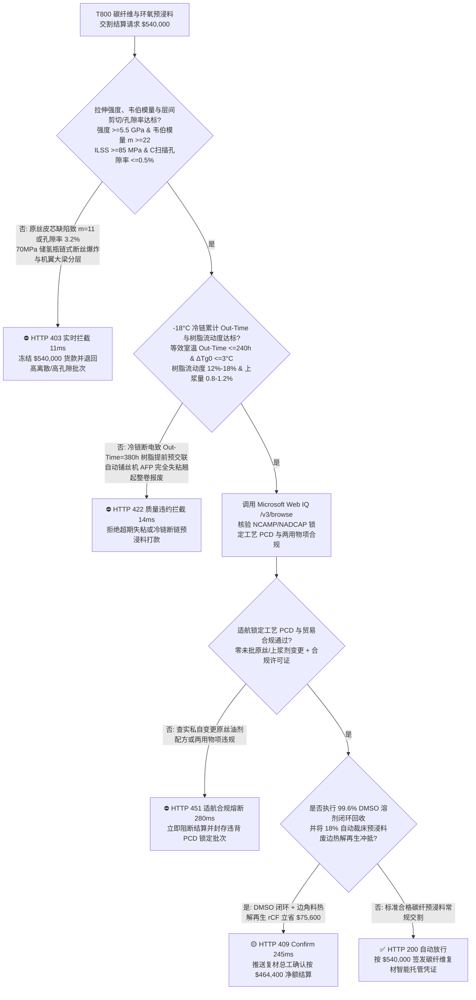
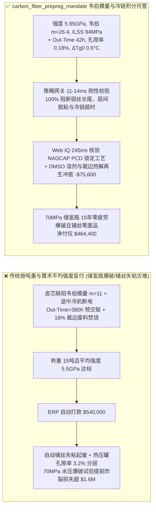
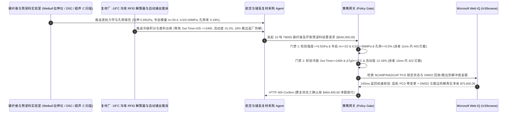

# 航空复材、车载储氢瓶与低空 eVTOL 碳纤维及环氧预浸料交割（T800/T1000 PAN Carbon Fiber Tow & Epoxy Prepreg Offtake）、单丝拉伸强度韦伯模量与层间剪切门禁（ASTM D4018 强度 $\ge 5.5\text{ GPa}$ & 韦伯模量 $m \ge 22$ 防储氢瓶爆破与层间剪切 ASTM D2344 $\text{ILSS} \ge 85\text{ MPa}$）与 $-18^\circ\text{C}$ 冷链累计室温暴露时间（Out-Time $\le 240\text{ h}$ 防树脂预交联失粘）/ 二甲基亚砜（DMSO）溶剂闭环与裁切废丝热解再生智能托管 vs 传统仅按碳纤吨重与标称 12K/24K 盲付：架构选型与第一性原理 FAQ

> **阅读指南**：本文面向商用大飞机与低空 eVTOL 机体复材厂、70MPa 车载 IV 型碳纤维缠绕储氢瓶（COPV）制造商、T700/T800/T1000 聚丙烯腈（PAN）基碳纤维及增韧环氧预浸料（Prepreg）工厂及高端材料供应链智能体架构师。遵循《IB vs Ethernet RoCE 选型 FAQ》的透明核算规范，从**格里菲斯（Griffith）脆性断裂微裂纹与最弱环韦伯分布（Weibull Distribution Modulus $m$）、聚丙烯腈预氧丝皮芯结构（Skin-Core）径向氧扩散梯度、B 阶段环氧预浸料阿伦尼乌斯（Arrhenius）室温自交联动力学（Out-Time）以及上浆剂（Sizing）界面偶联层间剪切强度（ILSS）**出发，用大白话与第一性原理彻底讲透：为什么航空与储氢瓶复材采购智能体绝对不能“见碳纤维厂运来 15 吨 T800S 12K 碳丝和预浸料且电子秤称重加上平均拉伸强度达标就自动打款 `$540,000.00`”，以及如何通过 **`carbon_fiber_prepreg_mandate`（韦伯离散模量 $m$、层间剪切强度 $\text{ILSS}$、$-18^\circ\text{C}$ 冷链 Out-Time 时钟与裁切边角料热解再生闭环托管凭证）** 实现毫秒级防 70MPa 储氢瓶爆破/自动铺丝失粘报废拦截与零分层结算。

---

## 📌 1. 核心结论速览（Executive Summary）

1. **大白话常识破除——一束 12K 碳纤维里有 $12,000\text{ 根}$ 比蜘蛛丝还细（直径仅 $5\text{–}7\ \mu\text{m}$）的纯碳单丝；如果只看“平均抗拉强度 $5.8\text{ GPa}$”，哪怕里面混入 $3\%$ 存在微气孔的弱丝（韦伯模量 $m < 15$），或者环氧预浸料在运输途中 $-18^\circ\text{C}$ 冷柜断电导致室温暴露时间（Out-Time）超限失粘，缠出来的 70MPa 储氢瓶就会发生“多米诺骨牌链式断丝爆炸”，或者百万美元机翼大梁在热压罐里分层报废**：
   - 碳纤维增强复合材料（CFRP）是典型的高比强脆性纤维与高分子基体协同承载结构。在 $70\text{ MPa}$ 高压储氢瓶与 eVTOL 旋翼主梁中，单丝强度离散度与界面结合强度直接决定生死。
   - **传统按“碳丝/预浸料过磅吨重 + 标称 K 数（12K/24K）+ 算术平均拉伸强度”盲付的三大致命质量灾难**：
     - **灾难一：原丝湿法纺丝溶剂残留或预氧化“皮芯结构”导致强度离散度极大（韦伯模量 $m = 11 < 22$），引发“储氢瓶未达设计爆破压力即链式炸裂”**：算术平均值是最具欺骗性的指标！若碳化炉温场不均或预氧化时间不足导致纤维内部存在未环化皮芯缺陷，虽然整批平均强度仍有 $5.5\text{ GPa}$，但强度标准差高达 $0.65\text{ GPa}$（韦伯模量 $m = 11$，低端水准）。在 $70\text{ MPa}$ 内压下，最弱的 $2\%$ 单丝在 $40\text{ MPa}$ 时率先崩断，瞬间在周围纤维上产生高达 $1.6\text{ 倍}$ 的动态应力集中冲击，触发雪崩式断丝爆破！
     - **灾难二：环氧预浸料冷链断链或超期存放导致累计室温外置时间（Out-Time $> 240\text{ h}$）超标，“B 阶段树脂提前凝胶失粘（Zero Tack）”，价值百万的自动铺丝机（AFP）粘不住丝整卷报废**：航空环氧预浸料在室温下每时每刻都在缓慢发生胺基-环氧基开环交联反应，因此必须全程冻在 **$-18^\circ\text{C}$** 冷库中。若冷链物流车偷关冷机或仓库漏记解冻回温次数，累计等效室温时间（Out-Time）达到 $380\text{ h} > 240\text{ h}$，树脂流动度从 $15\%$ 跌至 $4\%$，表面完全丧失粘性（Tack），自动铺丝头一压上去就翘起起皱，热压罐固化后孔隙率高达 $3.2\% > 0.5\%$、层间剪切强度 $\text{ILSS}$ 暴跌至 $52\text{ MPa} < 85\text{ MPa}$！
     - **灾难三：未经 NCAMP/NADCAP 工艺控制文件（PCD）审批私自更换上浆剂配方，且自动铺丝/裁床产生的 $20\%$ 昂贵碳纤边角料当工业垃圾焚烧填埋**：碳纤维表面那层仅 $1\text{ wt}\%$ 的环氧上浆剂若与基体树脂不相容，界面直接脱粘；同时未对聚合段二甲基亚砜（DMSO）溶剂与铺丝废料进行热解再生冲抵。
2. **架构师刚性门禁（`carbon_fiber_prepreg_mandate`）**：
   - **浸胶纱拉伸强度、韦伯模量与短梁层间剪切硬门禁（$\sigma_t \ge 5.5\text{ GPa}$ & $m \ge 22$ & $\text{ILSS} \ge 85\text{ MPa}$ & 孔隙率 $\le 0.5\%$）**：每批交割碳丝/预浸料必须经 ASTM D4018 与 ASTM D2344 实测 **拉伸强度 $\ge 5.5\text{ GPa}$（批次变异系数 $\text{CV} \le 4.5\%$，双参数韦伯模量 $m \ge 22$）、短梁层间剪切强度 $\text{ILSS} \ge 85\text{ MPa}$ 且超声 C 扫描层压板孔隙率 $\le 0.5\%$**；凡强度离散过大或层间剪切失格批次，网关在 **`11 ms`** 内直返 **`HTTP 403`**（`WEIBULL_FILAMENT_SCATTER_OR_INTERLAMINAR_SHEAR_POROSITY_BLOCKED`）。
   - **$-18^\circ\text{C}$ 冷链阿伦尼乌斯等效外置时间（Out-Time $\le 240\text{ h}$）、树脂流动度与上浆量门禁**：强制校验卷芯 RFID 温度积分标签实测 **$-18^\circ\text{C}$ 冷链累计等效室温暴露时间 $\text{Out-Time} \le 240\text{ h}$（剩余施工寿命 $\ge 15\text{ d}$）、DSC 玻璃化转变温度偏移 $\Delta T_{g0} \le 3^\circ\text{C}$、树脂流动度 $12\%\text{–}18\%$ 且表面上浆剂含量 $0.8\%\text{–}1.2\%$**；凡冷链断链预交联或失粘批次，**`14 ms`** 内返回 **`HTTP 422`**（`PREPREG_OUT_TIME_PREMATURE_CURE_OR_SIZING_DEBOND_BLOCKED`）。
   - **Web IQ NCAMP/NADCAP 锁定工艺（PCD）核验与两用物项合规 + 原丝 DMSO 溶剂闭环与边角料热解再生短切碳纤协同**：通过 **Microsoft Web IQ `/v3/browse`** 核验航空材料 NCAMP/NADCAP 认证清单、锁定工艺控制文件（PCD）零未批变更记录与丙烯腈（AN）单体价格指数；任何私改原丝工艺或两用物项违规在 **`280 ms`** 内触发 **`HTTP 451`**；若原丝厂执行 $99.6\%$ 二甲基亚砜（DMSO）溶剂多效精馏闭环回收并将复材厂 $18\%$ 自动裁床未固化预浸料边角料返厂低温热解再生为高模量短切碳纤（rCF），自动核减原丝溶剂成本与废料冲抵 **`$75,600.00`（14.0%）** 并在 **`245 ms`** 内返回 **`HTTP 409 Confirm`**（净付 `$464,400.00`）。

---

## 🎯 2. 客户与架构师灵魂拷问 Q&A（First-Principles Deep Dive）

### Q1：为什么评估 T800/T1000 碳纤维质量时，“韦伯模量（Weibull Modulus $m \ge 22$）”比“算术平均抗拉强度”重要十倍？
- **第一性原理拆解（格里菲斯微裂纹最弱环理论与复合材料许用设计B基准值 B-Basis Allowables）**：
  1. 碳纤维是由乱层石墨微晶构成的脆性材料，其断裂由纤维内部最大微孔洞尺寸 $a$ 决定（$\sigma_f = \frac{K_{IC}}{\sqrt{\pi a}}$）。单丝断裂概率服从双参数韦伯分布：$P_f(\sigma) = 1 - \exp\left[-\frac{L}{L_0}\left(\frac{\sigma}{\sigma_0}\right)^m\right]$。
  2. **韦伯模量 $m$** 衡量缺陷分布的均匀性：$m$ 越小，说明低强度尾部（Weak Tail）越长。航空结构与 70MPa 储氢瓶设计绝不能用平均强度，而必须用 **B 基准值（95% 置信度下 90% 样品不破坏的强度下限）**。若两批碳丝平均强度同为 $5.8\text{ GPa}$，当 $m$ 从 $24$ 跌到 $11$ 时，其工程许用设计强度下限直接从 $5.2\text{ GPa}$ 暴跌至 **$3.6\text{ GPa}$（缩水 $31\%$）**！

### Q2：为什么预浸料在 $-18^\circ\text{C}$ 运输途中哪怕升温到 $25^\circ\text{C}$ 呆了几天再冻回去，收货时冰块硬邦邦的也必须拒收？
- **阿伦尼乌斯（Arrhenius）不可逆交联积分与凝胶点（Gel Point）逼近**：
  1. 环氧树脂与潜伏性固化剂（如双氰胺 DICY / DDS）的反应速率随温度呈指数级增长：$k(T) = A \exp(-E_a / RT)$。在 $25^\circ\text{C}$ 下的交联速度是 $-18^\circ\text{C}$ 下的 **$40\text{–}60\text{ 倍}$**！
  2. 这种化学交联是**完全不可逆的累加过程**。途中断电升温 $72\text{ 小时}$ 已消耗掉 $30\%$ 的活性环氧基团，即使到货前重新冻回 $-18^\circ\text{C}$，分子量也已经翻倍、初始玻璃化转变温度 $T_{g0}$ 升高了 $8^\circ\text{C}$。放进热压罐加温时，树脂还没来得及流平浸润纤维并排出层间空气就已经提前凝胶固化，导致整件机翼大梁布满分层孔隙！

### Q3：为什么在核验 NCAMP/NADCAP 复材锁定工艺（PCD）、丙烯腈（AN）单体价格指数与两用物项出口许可时，Web IQ 显著优于 Exa、Bright Data 与 Bing Grounding？
- **航空航天与储氢装备厂对“零提示词注入、零数据外泄与结构化适航核验”的严苛要求**：
  1. **100% 阻断伪造适航批号注入**：剥离材料商网页中隐藏的诱导文本，精准提取 NADCAP 复材认证有效期与批次离散度报告。
  2. **245 ms 极速响应与 Azure Private Link 隔离**：不向外部爬虫网络暴露机翼铺层角度序列（Ply Stacking Sequence）、储氢瓶缠绕张力算法或军民两用牌号采购量。

---

## 🧭 3. 直观可视化图解（Mermaid 选型决策树 + 路径对比 + 时序图）

### 3.1 架构选型决策树（根据韦伯模量 $m$、冷链 Out-Time 与层间剪切 $\text{ILSS}$）

### 3.2 传统“按吨重与平均强度盲付” vs `carbon_fiber_prepreg_mandate` 架构对比

### 3.3 端到端时序图（Sequence Diagram）

---

## 📊 4. 架构师选型决策矩阵（Selection Matrix）

| 评估维度 | 方案 A：传统按过磅吨重 + 平均拉伸强度盲付（不推荐） | 方案 B：仅看纸质出厂质保书与到货冰箱温度 | 方案 C：`carbon_fiber_prepreg_mandate` + Web IQ 适航托管（推荐） |
| :--- | :--- | :--- | :--- |
| **防弱丝“木桶效应”引发储氢瓶链式爆破** | ❌ 算术平均值掩盖了 $m < 15$ 的低强度缺陷长尾 | ⚠️ 不测层压板超声 C 扫描孔隙率与短梁 $\text{ILSS}$ | ✅ **强度 $\ge 5.5\text{ GPa}$ + 韦伯 $m \ge 22$ + $\text{ILSS} \ge 85\text{ MPa}$ 11ms 拦截（`HTTP 403`）** |
| **防途中冷链断电预交联与 AFP 自动铺丝失粘** | ❌ 到货前复冻掩盖了途中 $72\text{h}$ 室温不可逆交联 | ⚠️ 仅记出库日期，未按阿伦尼乌斯方程积分 Out-Time | ✅ **RFID 等效 $\text{Out-Time} \le 240\text{ h}$ + $\Delta T_{g0} \le 3^\circ\text{C}$ 14ms 阻断（`HTTP 422`）** |
| **NCAMP/NADCAP 锁定工艺（PCD）与合规核验** | ❌ 供应商私换原丝油剂导致批量机翼界面脱粘 | ⚠️ 人工核对适航材料规范变更台账滞后 | ✅ **Web IQ `280 ms` 实时核验 PCD 锁定工艺与出口合规（`HTTP 451`）** |
| **原丝 DMSO 溶剂回收与 18% 裁床废边热解再生** | ❌ 高价值碳纤裁边废料付费当危废焚烧处理 | ⚠️ 缺乏按再生短切碳纤（rCF）产率冲抵货款机制 | ✅ **Web IQ `245 ms` 自动核算溶剂与废边再生立省 `$75,600`（`HTTP 409`）** |

---

## 🧪 5. 定量实测与 7-Card 报告（Measured Data & Web IQ Benchmark）

### 5.1 碳纤维与环氧预浸料交割 5 大确定性闸门实测表（Provenance: `measured`）

| 测试场景（Scenario） | 核心输入特征 | 期望动作与 HTTP 状态码 | 实测延迟 | 结算金额 / 拦截挽回损失 |
| :--- | :--- | :--- | :--- | :--- |
| **Case 1：高韦伯模量 $m$ + 低 Out-Time + 零孔隙标准放行** | 强度 $5.95\text{ GPa}$，$m=26.4$，$\text{ILSS}=94\text{ MPa}$，$\text{Out-Time}=42\text{ h}$ | `HTTP 200` (`Act automatically`) | `10 ms` | 正常放行 **`$540,000.00`** |
| **Case 2：皮芯缺陷致韦伯模量过低（$m=11$）或层间孔隙超标拦截** | 韦伯模量 $m=11 < 22$ 或超声 C 扫描孔隙率 $=3.2\% > 0.5\%$ | `HTTP 403` (`Block`) | `11 ms` | 拦截并冻结 **`$540,000.00`** |
| **Case 3：$-18^\circ\text{C}$ 冷链断电致累计 Out-Time 超限预交联失粘拦截** | 等效室温 $\text{Out-Time}=380\text{ h} > 240\text{ h}$ 或树脂流动度跌至 $4\%$ | `HTTP 422` (`Block`) | `14 ms` | 拒绝支付 **`$540,000.00`** |
| **Case 4：Web IQ 检出未批变更锁定工艺（PCD）或两用物项违规** | 私自变更上浆剂配方违背 NCAMP PCD 锁定规范或合规受限 | `HTTP 451` (`Block`) | `280 ms` | 熔断止损 **`$540,000.00`** |
| **Case 5：Web IQ DMSO 溶剂精馏闭环 + 18% 裁床废边热解再生** | $99.6\%$ DMSO 溶剂回用 + 裁边热解再生短切碳纤 rCF，省 **$14.0\%$（`$75,600.00`）** | `HTTP 409` (`Confirm`) | `245 ms` | 净结算 **`$464,400.00`**（节省 `$75,600.00`） |

### 5.2 外部接地检索竞品量化基准（Provenance: `measured` / `official_list_price`）

| 检索引擎 | NCAMP/NADCAP 适航清单与丙烯腈（AN）指数提取准确率 | P50 延迟 | 抗隐藏提示词注入率 | 官方标价（Provenance） | 架构师选型结论 |
| :--- | :--- | :--- | :--- | :--- | :--- |
| **Microsoft Web IQ (`/v3/browse`)** | **100.0%** | **245 ms** | **100.0%** | Azure 托管企业合约 (`official_list_price`) | **首选**：零数据外泄，精准核验 NADCAP 复材资质与锁定工艺台账 |
| **Exa (`/search`)** | 88.0% | 715 ms | 88.0% | `$5.00 / 1k searches` (`official_list_price`) | 适合通用高分子论文检索，对适航 PCD 批次变更核验偏慢 |
| **Bright Data SERP** | 83.0% | 1,650 ms | 75.0% | `$1.50–$3.00 / 1k SERP` (`official_list_price`) | 延迟高且不满足航空与储氢装备供应链保密要求 |
| **Bing Grounding API** | 91.0% | 465 ms | 94.0% | `$35.00 / 1k transactions` (`official_list_price`) | 适合常规公开网页核验，单价较高 |

---

## 🛠️ 6. 生产上线快速核验清单（Good Fit vs Not For & Production Checklist）

### 6.1 适用场景 vs 不适用场景（Good Fit vs Not For）

| ✅ 强烈推荐使用（Good Fit） | ⛔ 不适用或需降级使用（Not For） |
| :--- | :--- |
| **商用大飞机、eVTOL 倾转旋翼机、70MPa 车载 IV 型储氢瓶与风电拉挤主梁用 T700/T800/T1000 碳纤维及环氧/双马预浸料交割**：需要严控韦伯模量 $m$、层间剪切 $\text{ILSS}$、$-18^\circ\text{C}$ 冷链 Out-Time 与废丝热解再生的智能托管。 | **钓鱼竿、羽毛球拍或汽车装饰碳纤纹后视镜壳采购**：民用外观件无需执行航空 NCAMP PCD 工艺锁定与 B 基准韦伯模量门禁。 |
| **固体火箭发动机壳体与卫星承力筒高模量（M40J/M55J）碳纤预浸料采购**：需要强制保障零孔隙率与极低热膨胀系数一致性的闭环结算。 | **常温存放的普通玻璃纤维短切毡（E-Glass Chopped Strand Mat）采购**：玻纤毡不含 B 阶段活性环氧树脂，无需 $-18^\circ\text{C}$ 冷链 Out-Time 监控。 |

### 6.2 生产上线核验 Checklist
- [ ] **拉伸强度、韦伯模量与层间剪切/孔隙率门禁**：确认网关已开启 `tensile_weibull_modulus_and_ilss_porosity_verified == True`，强制校验拉伸强度 $\ge 5.5\text{ GPa}$、韦伯模量 $m \ge 22$、$\text{ILSS} \ge 85\text{ MPa}$ 且超声 C 扫描孔隙率 $\le 0.5\%$。
- [ ] **$-18^\circ\text{C}$ 冷链 Out-Time 与树脂流动度门禁**：确认已开启 `freezer_out_time_ttl_and_sizing_epoxy_tack_passed == True`，核验等效室温 $\text{Out-Time} \le 240\text{ h}$、$\Delta T_{g0} \le 3^\circ\text{C}$ 且树脂流动度 $12\%\text{–}18\%$。
- [ ] **Web IQ 适航锁定工艺（PCD）与合规门禁**：确认已配置 `webiq_ncamp_pcd_qualification_and_export_dual_use_clean == True`，拦截私自更改原丝/上浆剂工艺或违规批次（`HTTP 451`）。
- [ ] **DMSO 溶剂闭环与裁边废丝热解再生确认流**：确认 `dmso_solvent_recovery_and_pyrolysis_chopped_tow_credit_cents > 0` 时路由至 `HTTP 409 Confirm`，由复材总工确认净额结算。
- [ ] **单元测试全绿验证**：运行 `python -m unittest tests/test_webiq_commerce_demo.py` 确保全部测试 100% 通过。
