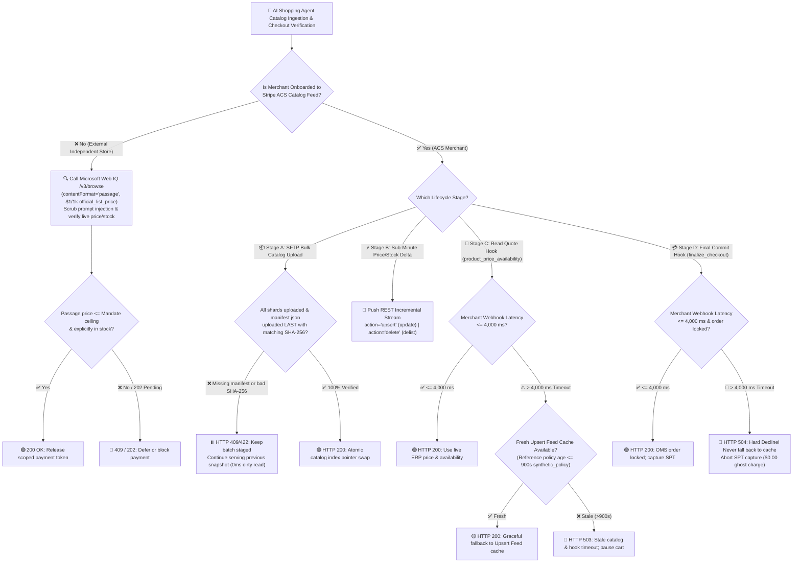
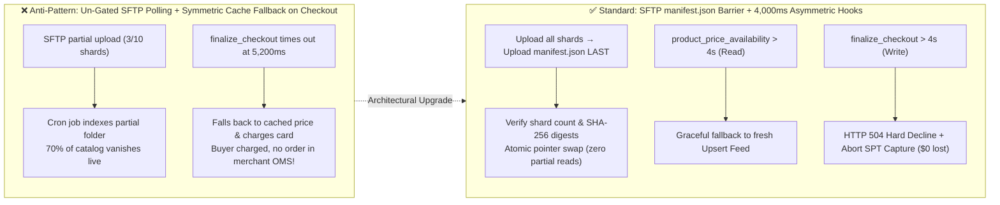

# Merchant Catalog Ingestion & Real-Time Checkout Hook Architecture: SFTP Atomic `manifest.json` Barrier + Incremental `upsert` Feed vs. 4,000 ms Asymmetric Webhook Fallback (`product_price_availability` vs. `finalize_checkout`) Selection & First-Principles FAQ

> **Language**: **[中文](catalog-feed-manifest-barrier-vs-webhook-4s-sla-faq.md)** | **English**  
> **Audience**: AI Solution Architects & Retail/E-Commerce Platform Architects (Single-Topic Selection & Protocol First-Principles Guide)  
> **Provenance & Scope Disclosure (`as_of: 2026-11-08`)**:
> - `official_doc_snapshot`: Stripe Agentic Commerce Suite (ACS) SFTP bulk catalog ingestion `manifest.json` completion barrier contract, incremental catalog stream `action="upsert" | "delete"` contract, and the 4,000 ms seller webhook asymmetric timeout rules (`product_price_availability` falls back to Catalog Feed on timeout vs. `finalize_checkout` hard-declines on timeout); Microsoft Web IQ `/v3/browse` (`$1 / 1,000 requests` `official_list_price`).
> - `synthetic_policy`: The cache freshness TTL threshold (`feed_age_seconds <= 900s` required for read-hook fallback; `> 900s` rejected with `HTTP 503`) is an architect reference policy (`synthetic_policy`), **not** a statutory mandate.
> - `deterministic_offline_simulation`: Sandbox evaluation latencies (`310 ms`, `380 ms`) and 100% partial-catalog / ghost-charge prevention rates come from deterministic local simulation (`evaluate_catalog_feed_and_webhook_sla_policy` in `lab/webiq_commerce_demo.py`). Live merchant ERP/OMS peak-traffic webhook latency is labeled `not_measured`.


---

## ① 📌 Executive Summary

1. **Merchant Catalog Synchronization Must Combine SFTP `manifest.json` Atomic Barriers with Incremental `upsert` Streams, Falling Back to `Web IQ /v3/browse` for Unindexed External Merchants (`official_doc_snapshot`)**:
   - **Onboarded Stripe ACS Merchants**: Use **SFTP multi-shard bulk uploads gated by a final `manifest.json` barrier** (uploaded **last** with shard counts and per-file `sha256` checksums so partial uploads never go live) for daily/hourly baseline reconciliation, paired with **real-time REST incremental updates (`action="upsert" | "delete"`)** for sub-minute price and stock changes.
   - **Unindexed External Independent Stores**: Before releasing a payment token, the shopping agent calls **Microsoft Web IQ `/v3/browse` (`contentFormat="passage"`, `$1 / 1,000 requests` `official_list_price`)** to verify live price and stock directly from the product URL.
2. **Why Does `product_price_availability` Fall Back to the Catalog Feed after 4,000 ms While `finalize_checkout` Enforces a 100% Hard Decline after 4,000 ms (`official_doc_snapshot`)?**
   - **First-Principles Read-vs-Write Asymmetry**:
     - **`product_price_availability` (Pre-Payment Read Hook)**: Invoked during cart building and quote estimation when **no buyer funds are being captured**. If the merchant's ERP experiences a transient spike (`> 4,000 ms`), falling back to a fresh `upsert` Catalog Feed record (e.g., `feed_age_seconds <= 900s` `synthetic_policy`) preserves checkout conversion without financial risk.
     - **`finalize_checkout` (Irreversible Inventory-Lock & Pre-Capture Write Hook)**: Invoked immediately before capturing the buyer's Shared Payment Token (SPT). If the merchant's Order Management System (OMS) fails to respond within `4,000 ms`, falling back to cached catalog data and capturing the SPT would cause a catastrophic **Ghost Charge**—charging the buyer's card when the merchant OMS never created the order or locked the inventory! Therefore, `finalize_checkout > 4,000 ms` **must hard-decline (`HTTP 504 Gateway Timeout`)** and abort SPT capture (`$0.00` charged).
3. **Missing `manifest.json` or Mismatched Shard Checksums Must Hold SFTP Batches in `staged_awaiting_manifest` (`official_doc_snapshot + deterministic_offline_simulation`)**:
   - Without an atomic barrier, a dropped SFTP connection after uploading `2 of 4` shards causes naive directory pollers to treat the missing 50% of SKUs as delisted. Enforcing that `manifest.json` arrives last and matches 100% of shard `sha256` digests before an atomic pointer swap guarantees a **`0 ms` partial-catalog dirty-read window**.

---

## ② 🎯 Architect & Customer First-Principles Q&A (FAQ-Driven)

### Q1: Why can't an AI shopping agent rely solely on live webpage scraping OR solely on overnight CSV batch dumps?

In plain language, e-commerce catalogs face the **Throughput vs. Freshness Paradox**:
1. **Why Pure Live Scraping Fails at Discovery Scale**:
   - When a buyer asks an agent to compare 50 candidate products across multiple attributes, scraping 50 product URLs live in the critical path adds seconds of latency and triggers target-site rate limits (`430 TooManyRequestsToTargetSite`).
2. **Why Pure Overnight Batch Dumps Fail at Checkout**:
   - An item priced at `$149` with `20 units` in stock at 02:00 AM may sell out or change price during a 10:00 AM flash sale. Charging a buyer based solely on an hours-old batch file leads to post-payment order cancellations and chargebacks.
3. **The Three-Tier Hybrid Architecture**:
   - **Tier 1 (High-Throughput Baseline)**: SFTP bulk shards + `manifest.json` atomic completion barrier;
   - **Tier 2 (Sub-Minute Delta Stream)**: Event-driven REST Catalog Feed updates (`action="upsert" | "delete"`);
   - **Tier 3 (Point-of-Sale Verification)**: `4,000 ms` Seller Webhooks (`product_price_availability` + `finalize_checkout`) for onboarded merchants, or `Web IQ /v3/browse` passage grounding for external merchants.

### Q2: How does the SFTP `manifest.json` atomic completion barrier work, and how does it prevent "half-catalog" outages?

When synchronizing millions of SKUs split across multiple compressed shard files (`catalog_part_01.jsonl.gz` ... `catalog_part_10.jsonl.gz`):
- **The Legacy Directory-Polling Failure Mode**: If an indexer polls the SFTP folder while shards `1..3` have finished uploading and shards `4..10` are still in flight, swapping the catalog index immediately deletes 70% of the merchant's catalog (`Phantom Delisting`) or mixes new bundle prices with old component prices.
- **The `manifest.json` Atomic Barrier (`official_doc_snapshot`)**:
  1. The merchant uploads all data shards (`1..N`) first. The ingestion pipeline keeps them in an inactive `staged` workspace while serving live queries from the previous verified snapshot.
  2. Only after every shard transfer succeeds does the merchant upload `manifest.json` **last**, declaring `batch_id`, `shard_count`, and the exact `sha256` digest of each shard.
  3. The ingestion verifier checks that all `shard_count` files exist and match their declared `sha256` digests:
     - **Verified (`100% match`)**: Executes an atomic index pointer swap (`200 OK`);
     - **Missing `manifest.json` or Checksum Mismatch**: Returns `HTTP 409 Conflict` / `422 Unprocessable`, leaving the previous verified snapshot untouched.

### Q3: Why do `product_price_availability` and `finalize_checkout` share the same 4,000 ms timeout but enforce opposite fallback behaviors?

| Dimension | Hook 1: `product_price_availability` (Read Quote Hook) | Hook 2: `finalize_checkout` (Write Commit Hook) |
| :--- | :--- | :--- |
| **When Invoked** | Cart construction, SKU selection, and shipping/tax estimation | Final order commit immediately prior to Stripe SPT payment capture |
| **Operation Type** | **Read-Only Query** (no hard inventory lock, no money movement) | **State-Mutating Write** (locks hard inventory & commits OMS order ID) |
| **Hard Timeout SLA** | `4,000 ms` (4 seconds, Stripe ACS `official_doc_snapshot`) | `4,000 ms` (4 seconds, Stripe ACS `official_doc_snapshot`) |
| **Behavior When `> 4,000 ms`** | **Graceful Fallback**: Reads the latest incremental `upsert` Catalog Feed record (if within freshness TTL `<= 900s` `synthetic_policy`) and returns `200 OK` | **Hard Decline (`HTTP 504`)**: **Never falls back to cache!** Aborts SPT capture immediately and releases holds (`$0.00` charged) |
| **First-Principles Rationale** | Failing a cart view due to a transient ERP hiccup destroys conversion; falling back to a fresh `upsert` feed is safe because `finalize_checkout` still guards actual payment | Capturing payment when the merchant OMS timed out creates a **Ghost Charge** (buyer charged, no merchant order created) |

---

## ③ 🧭 Visual Architecture Diagrams (Mermaid Decision Tree + Pattern Comparison + Sequence Diagram)

### 3.1 Catalog Ingestion & 4,000 ms Checkout Hook Decision Tree (`flowchart TD`)



### 3.2 Legacy Un-Gated Polling & Symmetric Fallback vs. ACS Atomic Barrier & Asymmetric Hooks (`flowchart LR`)



### 3.3 End-to-End Catalog Sync & 4,000 ms Asymmetric Webhook Sequence (`sequenceDiagram`)

```mermaid
sequenceDiagram
    autonumber
    participant Merchant as 🏪 Merchant Backend (ERP / OMS / SFTP)
    participant Catalog as 📦 ACS Catalog Indexer (SFTP + Upsert Feed)
    participant Agent as 🤖 AI Shopping Agent / Checkout Orchestrator
    participant Stripe as 💳 Stripe SPT v2 Gateway

    rect rgb(15, 23, 42)
    Note over Merchant,Catalog: Phase 1: SFTP Bulk Atomic Barrier + Incremental Upsert (official_doc_snapshot)
    Merchant->>Catalog: 1. Upload shards 1..N (.jsonl.gz) -> state: staged (inactive)
    Merchant->>Catalog: 2. Upload manifest.json LAST (shard_count + sha256 list)
    Catalog->>Catalog: 3. Verify 100% shard SHA-256 match -> Atomic index pointer swap
    Merchant->>Catalog: 4. Intra-day delta -> POST Catalog Feed (action="upsert" | "delete")
    end

    rect rgb(16, 42, 35)
    Note over Merchant,Agent: Phase 2: Read Quote Hook product_price_availability (4,000ms Graceful Fallback)
    Agent->>Merchant: 5. POST webhook: product_price_availability (SLA = 4,000 ms)
    alt Merchant ERP responds within 4,000 ms (e.g., 310 ms)
        Merchant-->>Agent: 6a. 200 OK (live price $149.00, available_qty=12)
    else Merchant ERP exceeds 4,000 ms (e.g., 4,380 ms)
        Merchant--xAgent: 6b. Timeout (> 4,000 ms)
        Agent->>Catalog: 7b. Read incremental Upsert Feed cache (age = 120s <= 900s synthetic_policy)
        Catalog-->>Agent: 8b. 200 OK: Graceful fallback to cached $149.00 quote
    end
    end

    rect rgb(45, 18, 24)
    Note over Merchant,Stripe: Phase 3: Write Commit Hook finalize_checkout (4,000ms Hard Decline)
    Agent->>Merchant: 9. POST webhook: finalize_checkout (SLA = 4,000 ms)
    alt Merchant OMS locks order within 4,000 ms (e.g., 380 ms)
        Merchant-->>Agent: 10a. 200 OK (oms_order_id="ord_9981", inventory_locked=true)
        Agent->>Stripe: 11a. Capture SPT PaymentIntent ($149.00)
        Stripe-->>Agent: 12a. 200 OK Payment Captured
    else Merchant OMS exceeds 4,000 ms (e.g., 4,190 ms)
        Merchant--xAgent: 10b. Timeout (> 4,000 ms SLA Breach!)
        Agent->>Agent: 11b. Never fall back to cache! Emit HTTP 504 Hard Decline
        Agent->>Stripe: 12b. Abort/Cancel SPT hold ($0.00 charged; zero ghost orders)
    end
    end
```

---

## ④ 📊 Architect Decision Matrix

| Evaluation Dimension | Option A: SFTP Bulk + `manifest.json` Barrier | Option B: REST Incremental Stream (`action="upsert" \| "delete"`) | Option C: Asymmetric 4,000 ms Webhooks (`product_price_availability` vs `finalize_checkout`) | Option D: Microsoft Web IQ `/v3/browse` Passage Grounding |
| :--- | :--- | :--- | :--- | :--- |
| **Primary Use Case** | Daily/hourly multi-million SKU baseline ingestion & full catalog reconciliation | Sub-minute flash-sale price updates, stock decrements, and instant SKU delisting | Real-time cart quote check (Hook 1) and final pre-payment OMS order commit (Hook 2) | Live price/stock verification for unindexed external stores without ACS feeds |
| **Consistency & Safety Mechanism** | Waits for `manifest.json` uploaded last + 100% shard `sha256` match before atomic pointer swap (`0 ms` dirty read) | Idempotent key overwrite (`upsert`) and tombstone removal (`delete`) with monotonic version timestamps | **Asymmetric SLA**: Read hook `>4s` falls back to fresh Feed cache; Write hook `>4s` **100% hard-declines** to prevent ghost charges | Caller-visible raw `passage` (`<=3000` chars) scrubbed for prompt injection before LLM |
| **Buyer UX & Friction** | Asynchronous background batching; zero buyer latency impact | Keeps discovery index fresh within seconds, preventing out-of-stock surprises | Read hook fallback preserves cart flow during ERP spikes; write hook timeout safely aborts without charging | Single-URL passage check in milliseconds; honors `202 Accepted` `retryAfter` |
| **Integration Effort** | Low (emit `manifest.json` at the end of existing warehouse export jobs) | Medium (publish delta events from PIM/inventory service to REST endpoint) | Medium-High (merchant ERP/OMS must serve both hooks within `< 4,000 ms` P99) | Very Low (zero merchant integration required; buyer agent calls Azure G3 resource) |
| **Ecosystem Coverage** | All onboarded Stripe ACS catalog merchants | High-velocity merchants with dynamic pricing or flash inventory | Mandatory seller webhook contract for Stripe ACS managed checkout | Any public merchant product page (interactive login/modals route to Bright Data) |
| **Pricing & TCO** | Included in Stripe ACS platform ingestion | Included in Stripe ACS platform ingestion | Included in ACS processing; hard-decline on `finalize_checkout` timeout prevents `$15+` chargeback fees | Official list price `/v3/browse` **`$1.00 / 1,000 requests`** (`/v3/web` `$7.00 / 1,000`, `official_list_price`) |

---

## ⑤ 🧪 Quantitative Sandbox Evaluation & 7-Card Findings

We validated all 5 catalog ingestion and 4,000 ms asymmetric webhook boundary scenarios in our deterministic offline sandbox (`evaluate_catalog_feed_and_webhook_sla_policy` in `lab/webiq_commerce_demo.py`):

| Scenario ID | Stage / Hook Type | Input State & Elapsed Time | Deterministic Guard Status (`status`) | HTTP Status | Buyer Charge & Business Outcome |
| :--- | :--- | :--- | :--- | :--- | :--- |
| **`sftp_missing_manifest_barrier`** | `sftp_bulk_ingest` | `3/4` shards uploaded, `manifest_present=False` | `staged_awaiting_manifest_barrier` | `409 Conflict` | `$0.00` (Blocks partial catalog swap; serves previous verified snapshot) |
| **`sftp_checksum_mismatch`** | `sftp_bulk_ingest` | `manifest_present=True`, shard `sha256` mismatch | `blocked_manifest_checksum_mismatch` | `422 Unprocessable` | `$0.00` (Rejects corrupted shard upload; zero index corruption) |
| **`price_hook_timeout_fresh_fallback`** | `product_price_availability` | Hook elapsed `4,380 ms` (`> 4,000 ms`), `upsert` feed age `120s <= 900s` | `fallback_to_fresh_upsert_feed` | `200 OK` | `$0.00` (Read hook gracefully falls back to `$149.00` fresh cache) |
| **`finalize_hook_timeout_hard_decline`** | `finalize_checkout` | Hook elapsed `4,190 ms` (`> 4,000 ms`), even with fresh cache | `hard_decline_finalize_timeout_no_charge` | `504 Gateway Timeout` | **`$0.00` (Never falls back to cache! Aborts SPT capture; 0 ghost orders)** |
| **`finalize_hook_within_sla_captured`** | `finalize_checkout` | Hook elapsed `380 ms` (`<= 4,000 ms`), `inventory_locked=True` | `finalize_checkout_confirmed_spt_captured` | `200 OK` | **`$149.00` (OMS order locked & SPT payment captured atomically)** |

> 📊 **Interactive Workbench & Provenance Note**:
> - Open **[`live-demo.en.html`](../../live-demo.en.html)** and jump to **`#catalog-webhook-sla-sandbox` (Merchant Catalog `manifest.json` Barrier & 4,000 ms Asymmetric Webhook Sandbox)** to interactively test all 4 presets.
> - **Provenance Guardrail**: Live merchant ERP/OMS peak-traffic latency depends on merchant infrastructure and remains explicitly labeled `not_measured`.

---

## ⑥ 🛠️ Appendix: Production Readiness & Pre-Sales Checklist (Architect Checklist)

- [ ] **1. SFTP Bulk Pipeline Uploads `manifest.json` Strictly Last**: Verify the ETL pipeline uploads `manifest.json` only after all data shards finish transferring, and the indexer verifies 100% shard count and `sha256` match before swapping the active catalog pointer.
- [ ] **2. Incremental Feed Distinguishes `action="upsert"` from `action="delete"`**: Confirm intra-day price/stock deltas emit `action="upsert"` and delisted SKUs emit `action="delete"` with monotonic version timestamps.
- [ ] **3. `product_price_availability` Fallback Enforces a Cache Freshness TTL Guard**: When the read hook exceeds `4,000 ms`, verify the fallback checks `feed_age_seconds <= 900s` (`synthetic_policy`) and rejects stale overnight records with `HTTP 503`.
- [ ] **4. `finalize_checkout` Enforces a Strict `> 4,000 ms` Hard Decline with Zero Cache Fallback**: Audit checkout orchestration code to ensure `finalize_checkout` never catches a timeout by reading cached catalog data; any response `> 4,000 ms` must emit `HTTP 504` and abort SPT capture.
- [ ] **5. Asynchronous Late-Order Reversal on `finalize_checkout` Timeout**: Confirm that if the merchant OMS finishes locking an order at `4,200 ms` after the platform already timed out at `4,000 ms`, an idempotent cancellation webhook releases the orphaned inventory lock.
- [ ] **6. Unindexed External Merchants Route Through Web IQ `/v3/browse` Pre-Checkout Grounding**: For external stores without ACS Catalog Feeds, require `Web IQ /v3/browse (contentFormat="passage")` verification before releasing a payment token.
