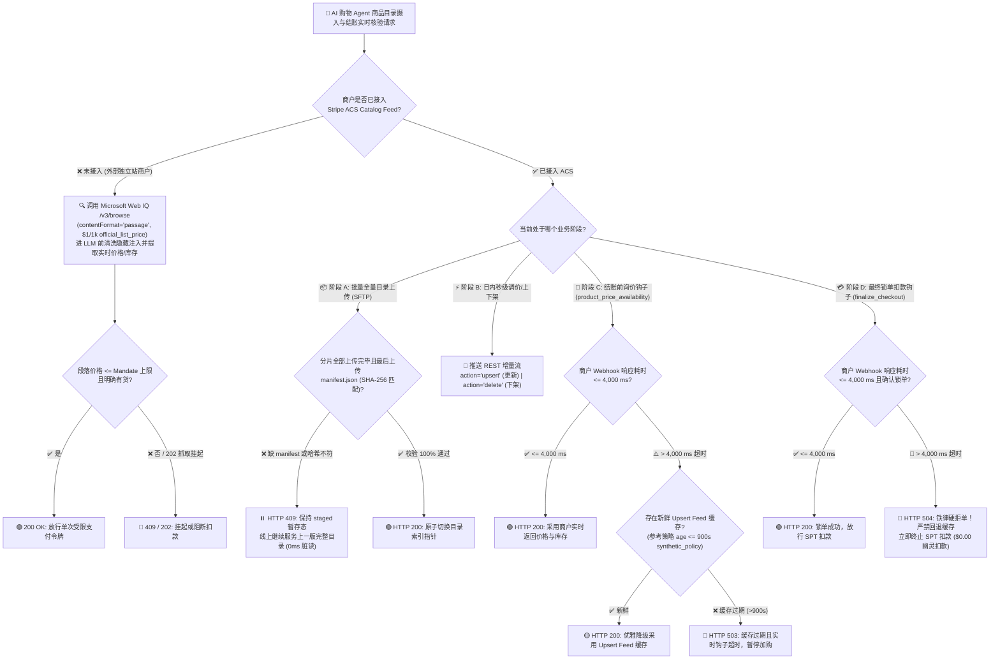
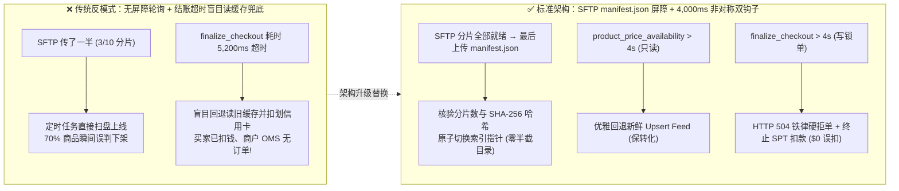

# 商户商品目录摄入与结账实时钩子架构：SFTP 原子清单屏障 + 增量 Upsert 目录流（Catalog Feed）vs 4,000 ms 双钩子非对称降级（`product_price_availability` vs `finalize_checkout`）选型与原理解析 FAQ

> **Language**: **中文** | **[English](catalog-feed-manifest-barrier-vs-webhook-4s-sla-faq.en.md)**  
> **定位**：面向 AI Solution Architect 与零售/电商平台架构师的单专题选型与协议原理解析指南（严格遵循一文一专题规范）  
> **数据口径声明（Provenance & Scope，`as_of: 2026-11-08`）**：
> - `official_doc_snapshot`：Stripe Agentic Commerce Suite (ACS) 商品目录 SFTP 全量上传完成屏障 `manifest.json` 规范、增量目录流 `action="upsert" | "delete"` 规范，以及卖家结账 Webhook 4,000 ms 超时非对称容错契约（`product_price_availability` 超时回退读 Catalog Feed vs. `finalize_checkout` 超时硬拒单）；Microsoft Web IQ `/v3/browse`（`$1 / 1,000 次请求` `official_list_price`）。
> - `synthetic_policy`：本文用于演示只读询价超时回退安全边界的 Catalog Feed 新鲜度阈值（如 `feed_age_seconds <= 900s` 允许降级、`> 900s` 返回 `503 Stale Catalog`），属于架构师参考策略（Reference Policy），**并非**固定法律限制。
> - `deterministic_offline_simulation`：沙盒测试（`evaluate_catalog_feed_and_webhook_sla_policy`）中的端到端延迟（如 `310 ms` / `325 ms`）与 100% 脏读/幽灵扣款拦截率来自本地确定性沙盒模拟；商户生产环境 ERP/OMS 在黑五高峰期的真实线上压测响应延迟统一标注为 `not_measured`。

---

## ① 📌 核心结论速览（Executive Summary）

1. **商品目录同步必须采用“SFTP `manifest.json` 原子屏障 + 增量 `upsert` 实时流”双轨制，未入驻外部商户回退 `Web IQ /v3/browse`（`official_doc_snapshot`）**：
   - **已入驻 Stripe ACS 的大中型商户**：每日/每小时大批量商品全量对账走 **SFTP 分片上传 + `manifest.json` 原子完成屏障**（全部分片传完后**最后**上传含分片数与 SHA-256 校验和的 `manifest.json`，严防“半截目录”上线导致全站误报缺货）；日内秒级调价与库存扣减走 REST 增量流（`action="upsert" | "delete"`）。
   - **未接入 ACS Catalog Feed 的外部独立站**：AI 导购 Agent 在下单前调用 **Microsoft Web IQ `/v3/browse` (`contentFormat="passage"`)**（`$1 / 1,000 次请求` `official_list_price`）按单商品 URL 实时提取最新价格与库存段落。
2. **为什么同样是 4,000 ms 超时，`product_price_availability` 允许降级读缓存，而 `finalize_checkout` 必须 100% 硬拒单（`official_doc_snapshot`）？**
   - **第一性原理（读写非对称容错）**：
     - **`product_price_availability`（加购与算费阶段的只读钩子）**：此时**尚未发生任何真实资金扣划**。若商户 ERP 因瞬时毛刺超过 `4,000 ms` 未响应，回退读取新鲜的 `upsert` Catalog Feed 缓存（如 `feed_age_seconds <= 900s` `synthetic_policy`）可以避免购物车在促销高峰期大面积报错崩溃，优先保障商业转化率。
     - **`finalize_checkout`（最终锁单与 SPT 扣款前的写操作钩子）**：此步紧接着 Stripe SPT 真实扣款。若商户 OMS 超过 `4,000 ms` 未确认锁库建单，说明商户后端可能已宕机或库存锁死锁；此时若盲目回退读缓存并执行 SPT 扣款，就会酿成**“买家信用卡已被扣款，但商户 OMS 根本没有生成订单（Ghost Charge）”**的严重生产事故！因此 `finalize_checkout > 4,000 ms` 必须 **100% 铁律硬拒单（`HTTP 504 Gateway Timeout`）** 并终止 SPT 扣划（`$0.00` 误扣款）。
3. **SFTP 分片上传缺失 `manifest.json` 或 SHA-256 哈希不匹配时，索引器必须保持 `staged_awaiting_manifest` 挂起状态（`official_doc_snapshot + deterministic_offline_simulation`）**：
   - 在网络抖动或脚本中断导致仅上传了 `2/4` 个分片文件时，若无 `manifest.json` 屏障，搜索引擎会将未传完的 50% 商品误判为下架删除。强制要求 `manifest.json` 最后上传并通过 SHA-256 核验后再做原子指针切换（Atomic Pointer Swap），可实现 **`0 ms` 半截目录脏读窗口**。

---

## ② 🎯 客户与架构师灵魂拷问 Q&A（FAQ-Driven）

### Q1：为什么 AI 购物智能体不能只靠“实时爬取商品网页”，也不能只靠“每天凌晨同步一次 CSV 商品表”？

用大白话讲透电商目录的**“吞吐量 vs 新鲜度悖论”**：
1. **如果只靠实时抓网页（Pure Live Scraping）**：
   - 当买家问“帮我找 5 款 $200 以内、支持 30 天免费退货、明天能到的降噪耳机”时，AI 需要从百万级 SKU 中筛选候选品。如果每次搜索都实时去抓几十个商户网页，不仅单次耗时高达 `2～5 秒`，还会瞬间触发商户源站限流（`430 TooManyRequestsToTargetSite`）。
2. **如果只靠凌晨全量 CSV 同步（Pure Batch Dump）**：
   - 凌晨 2 点同步的价格是 `$180`、库存 `50 件`，到了上午 10 点闪购已售罄或涨价到 `$220`。如果结账时还不去实时核验，Agent 就会按旧价格扣款，导致大量售后砍单与赔付。
3. **Stripe ACS + Web IQ 的三级协同标准答案**：
   - **第一级（全量基线）**：SFTP 分片上传 + `manifest.json` 原子屏障，建立高吞吐可检索商品索引；
   - **第二级（准实时增量）**：商品变价或库存异动时，商户实时推送 `action="upsert"`（下架推送 `action="delete"`）；
   - **第三级（结账点实时核验）**：已入驻商户走 `4,000 ms` 双钩子（`product_price_availability` + `finalize_checkout`）；未入驻外部商户走 `Web IQ /v3/browse` 实时段落核验。

### Q2：什么是 SFTP `manifest.json` 原子完成屏障？为什么没有它会导致“半截目录上线”的生产事故？

在企业大目录同步（例如 500 万 SKU 拆分为 10 个 `.jsonl.gz` 分片文件通过 SFTP 上传）中：
- **没有 `manifest.json` 的传统轮询陷阱**：如果平台每隔 5 分钟扫描一次 SFTP 目录，恰逢商户刚传完第 1～3 个分片、第 4～10 个分片还在传输中，平台就会把这 30% 的分片当成“最新全量目录”切上线——结果另外 70% 的商品瞬间在 AI 导购里全部消失（Phantom Delisting），甚至出现主商品已更新价格但配件还是旧价格的串价事故！
- **`manifest.json` 原子屏障的工作机制（`official_doc_snapshot`）**：
  1. 商户先通过 SFTP 上传所有数据分片（`catalog_part_01.jsonl.gz` ... `catalog_part_10.jsonl.gz`）；此时平台将它们标记为 `staged`（暂存未生效），线上继续服务上一版完整目录。
  2. 所有分片传输完毕后，商户**最后**上传一个极小的 `manifest.json` 文件，内含本次批次号、分片文件清单、每个分片的字节大小与 `sha256` 哈希值。
  3. 平台检测到 `manifest.json` 到达后，逐一校验所有分片是否存在且 `sha256` 完全一致：
     - **校验通过**：执行毫秒级**原子索引指针切换（Atomic Swap）**，新目录整体生效；
     - **缺 `manifest.json` 或任一分片 `sha256` 不符**：返回 `HTTP 409 Conflict (staged_awaiting_manifest / manifest_checksum_mismatch)`，拒绝切换并保留旧版完整目录。

### Q3：为什么 `product_price_availability` 和 `finalize_checkout` 同样规定 4,000 ms 超时，超时后的处理逻辑却截然相反？

这是客户架构评审中最常被问到的**“非对称容错设计（Asymmetric Fault Tolerance）”**：

| 对比维度 | 钩子 1：`product_price_availability`（只读询价与库存核验） | 钩子 2：`finalize_checkout`（最终锁单与扣款前确认） |
| :--- | :--- | :--- |
| **触发时机** | 买家浏览商品、加入购物车、计算税费与运费预算时 | 买家已确认授权、平台即将调用 Stripe SPT 执行真实资金扣划前的一瞬间 |
| **操作性质** | **只读查询（Read-Only Query）**，不锁定硬库存、不扣划买家资金 | **高危写操作（State-Mutating Write）**，要求商户 OMS 锁死库存并持久化订单号 |
| **硬超时阈值** | `4,000 ms`（4 秒，Stripe ACS 官方 SLA `official_doc_snapshot`） | `4,000 ms`（4 秒，Stripe ACS 官方 SLA `official_doc_snapshot`） |
| **超过 4,000 ms 后的标准动作** | **优雅降级（Graceful Fallback）**：自动回退读取最近的 `upsert` Catalog Feed 缓存（参考策略要求缓存年龄 `<= 900s` `synthetic_policy`），返回 `200 OK` 让买家继续结账流程 | **铁律硬拒单（Hard Decline）**：**严禁回退读缓存**！立即返回 `HTTP 504 Gateway Timeout`，中止 SPT 扣款并释放预留额度（`$0.00` 买家扣款） |
| **底层第一性原理** | 加购阶段偶发超时若直接报错，会白白流失高意向买家；用几分钟内的 `upsert` 缓存兜底风险极低，且在最终付款那一步还有 `finalize_checkout` 把关 | 付款阶段若超时还用缓存兜底扣钱，商户 OMS 没收到单子而买家钱已被扣走，会产生致命的“幽灵扣款（Ghost Charge）”与拒付投诉 |

---

## ③ 🧭 直观可视化图解（Mermaid 选型决策树 + 同步架构对比图 + 端到端时序图）

### 3.1 商品目录摄入与结账实时核验架构选型决策树（`flowchart TD`）

### 3.2 传统无屏障目录轮询/对称超时 vs. ACS 原子屏障 + 非对称双钩子架构对比（`flowchart LR`）

### 3.3 目录摄入与 4,000 ms 双钩子端到端交互时序图（`sequenceDiagram`）

```mermaid
sequenceDiagram
    autonumber
    participant Merchant as 🏪 商户后端 (ERP / OMS / SFTP)
    participant Catalog as 📦 ACS 目录索引器 (SFTP + Upsert Feed)
    participant Agent as 🤖 AI 购物 Agent / 结账编排器
    participant Stripe as 💳 Stripe SPT v2 支付网关

    rect rgb(15, 23, 42)
    Note over Merchant,Catalog: 阶段 1：SFTP 全量分片原子屏障 + 日内增量 Upsert (official_doc_snapshot)
    Merchant->>Catalog: 1. 上传 shards 1..N (.jsonl.gz) -> 状态: staged (未生效)
    Merchant->>Catalog: 2. 最后上传 manifest.json (shard_count + sha256 列表)
    Catalog->>Catalog: 3. 校验全部分片 SHA-256 100% 匹配 -> 原子切换线上索引
    Merchant->>Catalog: 4. 日内库存/价格异动 -> POST Catalog Feed (action="upsert" | "delete")
    end

    rect rgb(16, 42, 35)
    Note over Merchant,Agent: 阶段 2：加购算费只读钩子 product_price_availability (4,000ms 优雅降级)
    Agent->>Merchant: 5. POST webhook: product_price_availability (SLA = 4,000 ms)
    alt 商户 ERP 在 4,000 ms 内响应 (如 310 ms)
        Merchant-->>Agent: 6a. 200 OK (实时价格 $149.00, 库存 12 件)
    else 商户 ERP 超过 4,000 ms 超时 (如 4,380 ms)
        Merchant--xAgent: 6b. Timeout (> 4,000 ms)
        Agent->>Catalog: 7b. 查询增量 Upsert Feed 缓存 (age = 120s <= 900s synthetic_policy)
        Catalog-->>Agent: 8b. 200 OK: 优雅降级采用新鲜缓存价格 $149.00 继续结账
    end
    end

    rect rgb(45, 18, 24)
    Note over Merchant,Stripe: 阶段 3：最终锁单扣款写钩子 finalize_checkout (4,000ms 铁律硬拒单)
    Agent->>Merchant: 9. POST webhook: finalize_checkout (SLA = 4,000 ms)
    alt 商户 OMS 在 4,000 ms 内确认锁单 (如 380 ms)
        Merchant-->>Agent: 10a. 200 OK (oms_order_id="ord_9981", inventory_locked=true)
        Agent->>Stripe: 11a. 执行 SPT PaymentIntent Capture ($149.00)
        Stripe-->>Agent: 12a. 200 OK 扣款完成
    else 商户 OMS 超过 4,000 ms 超时 (如 4,190 ms)
        Merchant--xAgent: 10b. Timeout (> 4,000 ms SLA Breach!)
        Agent->>Agent: 11b. 严禁回退读缓存！触发 HTTP 504 Hard Decline
        Agent->>Stripe: 12b. 终止/撤销 SPT 预授权 ($0.00 实扣，彻底杜绝幽灵扣款)
    end
    end
```

---

## ④ 📊 架构师选型决策矩阵（Architect Decision Matrix）

| 评估维度 | 方案 A：SFTP 全量 + `manifest.json` 原子屏障 | 方案 B：REST 增量流（`action="upsert" \| "delete"`） | 方案 C：双钩子 `product_price_availability` vs `finalize_checkout`（4s SLA） | 方案 D：Microsoft Web IQ `/v3/browse` 实时段落接地 |
| :--- | :--- | :--- | :--- | :--- |
| **核心适用场景** | 每日/每小时百万级 SKU 全量商品基线同步与对账修复 | 秒级闪购调价、热销品库存扣减、违规/断货商品即时下架 | 买家加购算费实时核价（钩子 1）与付款前最终 OMS 锁单确认（钩子 2） | 尚未接入 ACS Catalog Feed 的外部独立站商品实时核价与防注入 |
| **数据一致性与安全隔离机制** | 必须等 `manifest.json` 最后到达且分片 `sha256` 校验全过才原子切换指针（`0 ms` 半截目录脏读） | 幂等主键覆写（`upsert`）与墓碑下架（`delete`），带版本时间戳防乱序覆盖 | **非对称容错**：只读询价超 4s 回退新鲜 Feed 缓存；最终锁单超 4s **100% 硬拒单**防幽灵扣款 | 调用方直接拿到原始 `passage`（`<=3000` 字符），进 LLM 前剥离隐藏提示词注入 |
| **用户体验与人工确认摩擦** | 后台异步批处理，对买家端零感知 | 准实时更新检索索引，大幅降低买家点击后才发现缺货的挫败感 | 询价超 4s 无感降级保转化；锁单超 4s 明确提示“商户系统繁忙未扣款” | 单 URL 毫秒级段落提取；若遇 `202 Accepted` 异步抓取则按 `retryAfter` 挂起 |
| **接入改造成本** | 低（改造现有数据仓库导出脚本，末尾生成并上传 `manifest.json`） | 中（在商户商品中心/库存中心接入事件驱动 Webhook 或 Kafka 消费者推送增量） | 中高（商户 ERP/OMS 需改造两个同步接口并确保 P99 响应时间 `< 4,000 ms`） | 极低（无需外部商户配合改造，买方 Agent 直接通过 Azure G3 资源调用） |
| **生态覆盖度** | 适用于所有已入驻 Stripe ACS 的大中型目录商户 | 适用于高频变价/闪购商户（与 SFTP 全量基线配合使用） | Stripe ACS 托管结账闭环强制要求的标准卖家钩子契约 | 覆盖全网公开可达的电商详情页（强 JS 登录弹窗需配合 Bright Data） |
| **费率与综合 TCO** | 包含在 Stripe ACS 平台能力内（传输与存储成本极低） | 包含在 Stripe ACS 平台能力内 | 包含在 Stripe ACS 交易费率内；超时硬拒单可为商户节省高额拒付罚金（`$15+/笔`） | 官方标价 `/v3/browse` **`$1.00 / 1,000 次请求`**（`/v3/web` `$7.00 / 1,000 次`，`official_list_price`） |

---

## ⑤ 🧪 简明定量实测与 Benchmark 核心发现（Offline Sandbox & 7-Card Findings）

我们在本地确定性沙盒（`lab/webiq_commerce_demo.py` 中的 `evaluate_catalog_feed_and_webhook_sla_policy`）中对 5 类目录摄入与 4,000 ms 双钩子边界场景进行了自动化回归验证（`pytest` 全部通过）：

| 测试场景 ID | 阶段 / 钩子类型 | 输入状态与耗时参数 | 确定性守卫裁决状态 (`status`) | HTTP 状态码 | 买家实扣金额与业务结果 |
| :--- | :--- | :--- | :--- | :--- | :--- |
| **`sftp_missing_manifest_barrier`** | `sftp_bulk_ingest` | 已传 `3/4` 分片，`manifest_present=False` | `staged_awaiting_manifest_barrier` | `409 Conflict` | `$0.00`（拒绝上线半截目录，保留旧版完整索引） |
| **`sftp_checksum_mismatch`** | `sftp_bulk_ingest` | `manifest_present=True`，但分片 `sha256` 校验失败 | `blocked_manifest_checksum_mismatch` | `422 Unprocessable` | `$0.00`（拦截损坏分片，零脏数据污染） |
| **`price_hook_timeout_fresh_fallback`** | `product_price_availability` | 钩子耗时 `4,380 ms`（`> 4,000 ms`），`upsert` 缓存年龄 `120s <= 900s` | `fallback_to_fresh_upsert_feed` | `200 OK` | `$0.00`（只读阶段优雅降级采用 `$149.00` 缓存，结账不中断） |
| **`finalize_hook_timeout_hard_decline`** | `finalize_checkout` | 钩子耗时 `4,190 ms`（`> 4,000 ms`），即便存在新鲜缓存 | `hard_decline_finalize_timeout_no_charge` | `504 Gateway Timeout` | **`$0.00`（严禁回退缓存！立即终止 SPT 扣款，0 幽灵订单）** |
| **`finalize_hook_within_sla_captured`** | `finalize_checkout` | 钩子耗时 `380 ms`（`<= 4,000 ms`），`inventory_locked=True` | `finalize_checkout_confirmed_spt_captured` | `200 OK` | **`$149.00`（OMS 锁单确认 + SPT 扣款一步完成）** |

> 📊 **配套交互式演示与 7-Card 报告**：
> - 在 **[`live-demo.html`](../../live-demo.html)** 的 **`#catalog-webhook-sla-sandbox`（商户目录 `manifest.json` 屏障与 4,000 ms 双钩子非对称降级交互式沙盒）** 中，点击 4 个预设按钮即可实时对比“缺 `manifest.json` 挂起”、“只读询价超 4s 优雅降级读 Upsert 缓存”、“最终锁单超 4s 铁律 504 硬拒单”与“380ms 正常锁单扣款”的完整状态机输出。
> - **真实性边界提醒**：商户生产环境 ERP/OMS 在大促高峰期的真实网络延迟受商户自身架构影响，未在本地沙盒虚构生产实测值，统一标注为 `not_measured`。

---

## ⑥ 🛠️ 附录：生产上线快速核验与售前打单清单（Architect Checklist）

在客户方案评审或生产上线验收时，请逐项核对以下 6 条铁律：

- [ ] **1. SFTP 全量目录上传已强制实施 `manifest.json` 末尾原子屏障**：确认数据导出流水线在所有 `.csv` / `.jsonl.gz` 分片传输完成后**最后**上传 `manifest.json`，且索引器在校验分片数与 `sha256` 100% 匹配前绝不切换线上目录指针。
- [ ] **2. 增量目录流已正确区分 `action="upsert"` 与 `action="delete"`**：确认日内价格/库存变更通过 `action="upsert"` 幂等推送，商品下架或合规禁售通过 `action="delete"` 即时清除索引，并携带单调递增版本号或时间戳防止乱序覆盖。
- [ ] **3. `product_price_availability` 超时降级已绑定缓存新鲜度 TTL 守卫**：当只读询价钩子耗时 `> 4,000 ms` 触发 Catalog Feed 回退时，确认已校验缓存年龄（如 `feed_age_seconds <= 900s` `synthetic_policy`）；过期缓存必须返回 `503` 而非拿隔夜旧价凑数。
- [ ] **4. `finalize_checkout` 已严格配置 `> 4,000 ms` 硬拒单且零缓存回退**：代码走查确认 `finalize_checkout` 分支中**绝对不存在**任何 `catch (TimeoutError) -> read_catalog_cache()` 的回退逻辑；一旦超过 `4,000 ms`，必须立即返回 `504` 并终止 SPT 扣款。
- [ ] **5. 商户 OMS 已针对 `finalize_checkout` 实现幂等冲正（Idempotent Reversal）**：若商户 OMS 在第 `4,200 ms` 才处理完内部建单，但平台已在第 `4,000 ms` 判定超时拒单，确认平台会发送异步取消通知或商户 OMS 会基于未完成支付状态自动释放超时库存锁。
- [ ] **6. 未入驻外部独立站已配置 Web IQ `/v3/browse` 结账前二次核验**：对于无 Catalog Feed 与 Seller Webhook 的外部商户，确认 Agent 在释放支付令牌前强制调用 `Web IQ /v3/browse (contentFormat="passage")` 核验实时价格与库存。
