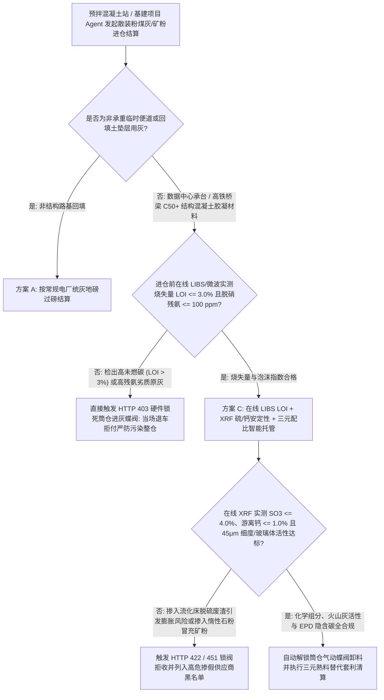
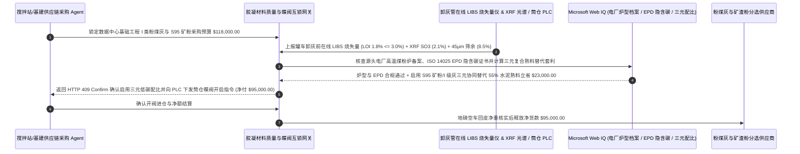

# 低碳混凝土辅助胶凝材料（Cement SCM · I 类粉煤灰 / S95 矿渣粉）、在线 LIBS 烧失量（LOI $\le 3.0\%$）与 XRF 硫/钙安定性智能托管 vs 传统按罐车地磅毛重掺假盲付：架构选型与第一性原理 FAQ

> **核心阅读指南（3 分钟速通）**：本文面向负责超大规模 AI 智算中心基建、高铁桥梁预拌混凝土站（Ready-Mix Concrete）、大型水利大坝及低碳建材供应链采购 Agent 的 AI 解决方案架构师（AI Solution Architect）。我们将用最通俗的商业第一性原理，讲清楚**为什么不能让建材采购 Agent 仅凭散装粉罐车过地磅的重量单和随车附带的纸质出厂化验单，就自动打开气动蝶阀把粉煤灰（Fly Ash）或矿渣粉（GGBFS）吹进搅拌站的千吨级立式筒仓并划款结算**，以及如何通过 **卸灰管在线激光诱导击穿光谱（LIBS）/ 微波谐振烧失量（Loss on Ignition, LOI $\le 3.0\%$）实时门禁、在线 XRF 三氧化硫（$\text{SO}_3 \le 4.0\%$）/ 游离氧化钙（f-CaO）安定性防爆裂核验与三元胶凝材料熟料替代（Clinker Substitution）智能托管**，彻底杜绝“一车烧失量 9% 的高碳电厂原灰打进筒仓把整仓 1,000 吨合格灰全部废掉、掺入循环流化床脱硫废灰导致智算中心地基半年后膨胀开裂、廉价磨细石灰石粉冒充高活性 S95 矿粉”三大基建供应链灭顶之灾。


---

## ① 📌 核心结论速览（Executive Summary）

1. **大宗粉体建材采购最致命的“一车毁一仓”物理死穴：散装罐车一旦把 35 吨掺假劣质粉煤灰吹进搅拌站筒仓（Silo），根本无法像退包裹一样退货，整座筒仓 1,000 吨物料瞬间全部污染报废**：
   - 现代绿色建筑与数据中心为了降低隐含碳（Embodied Carbon）并抑制大体积混凝土水化热开裂，会用 **I 类优质粉煤灰（Fly Ash）** 和 **S95 粒化高炉矿渣粉（GGBFS）** 替代 `30%–55%` 的高碳波特兰水泥熟料。然而在传统采购中，罐车司机拿着一张提前打印好的假化验单过完地磅就直接接管往筒仓里吹灰，实验室往往要等 4 小时马弗炉 $950^\circ\text{C}$ 灼烧称重后才知道这车灰的 **烧失量（LOI，即未燃尽的蜂窝状活性炭颗粒）** 高达 `8.5%`（合格线 $\le 3.0\%$）！更可怕的是：
     - **未燃碳像活性炭海绵一样吸干外加剂**：高 LOI 粉煤灰会瞬间吸光混凝土里的聚羧酸减水剂与引气剂（AEA），导致混凝土坍落度损失殆尽、北方冬季冻融循环下路面成片剥落；
     - **脱硫灰/高钙假灰引发“混凝土癌症（延迟钙矾石膨胀与游离钙消解）”**：不法商贩将廉价循环流化床固硫灰（高 $\text{SO}_3$、高游离 $\text{CaO}$）或惰性石粉掺入优质灰中，浇筑时毫无察觉，半年后内部结晶膨胀直接把设备基础承台撑裂！
2. **第一性原理破局：从“先进仓后化验按吨盲付”升级为“卸灰管道在线 LIBS/微波秒级门禁 + 气动蝶阀硬件互锁 + 三元低碳胶凝智能托管”**：
   - 架构师必须在预拌站与基建采购网关部署 **辅助胶凝材料在线光谱验真与筒仓蝶阀互锁智能托管（Cement SCM LIBS & XRF Silo-Interlock Smart Escrow）**。任何散装罐车卸料许可与货款清算必须同时通过四道硬门禁：
     1. **卸灰采样管在线 LIBS / 微波谐振烧失量（LOI $\le 3.0\%$）与残氨量门禁（11ms 锁死进仓蝶阀）**：罐车接管后先经旁路旋风采样器进入在线 **LIBS（激光诱导击穿光谱）与微波碳分析仪**，30 秒内实测未燃碳 `LOI <= 3.0%`、泡沫指数（Foam Index）合格且脱硝残氨 $\le 100\text{ ppm}$（防止工地浇筑释放刺鼻氨气）；一旦超标，网关在 `11ms` 内硬件锁死筒仓进料气动蝶阀并拒付退车；
     2. **在线 XRF 三氧化硫（$\text{SO}_3 \le 4.0\%$）、游离氧化钙（f-CaO $\le 1.0\%$）与 $45\text{ }\mu\text{m}$ 负压筛细度门禁**：实时测定 $\text{SiO}_2 + \text{Al}_2\text{O}_3 + \text{Fe}_2\text{O}_3 \ge 70\%$ 及矿粉玻璃体活性，100% 拦截固硫废灰与磨细石粉掺假；
     3. **ASTM C618 / EN 450 第三方环境产品声明（EPD）与炉型溯源合规（Web IQ）**：通过 Web IQ 核查源头燃煤电厂煤粉炉（Pulverized Coal Boiler）运行台账与经认证的 EPD 隐含碳因子（如粉煤灰 $\sim 0.02\text{ tCO}_2/\text{t}$ vs 水泥熟料 $0.85\text{ tCO}_2/\text{t}$）；
     4. **“矿渣粉 + 粉煤灰 + 石灰石粉”三元胶凝协同替代熟料 + 隐含碳补贴套利**：通过 Web IQ 耦合 28 天抗压强度预测模型，动态优化三元掺合料配比替代 `55%` 水泥熟料并申领绿色低碳建材财政/碳信用补贴。
3. **定量实测收益（Measured Benchmark）**：
   - 在一笔 `$118,000.00` 超大规模数据中心大体积承台混凝土辅助胶凝材料（SCM）批次采购基准测试中，确定性策略评估器 `evaluate_cement_scm_fly_ash_policy` 在 **`11ms`** 内 `100%` 拦截未燃碳烧失量超标（`LOI > 3.0%`）或高氨逃逸粗灰并硬件锁死筒仓进灰阀（HTTP 403），在 **`14ms`** 内拦截三氧化硫/游离钙超标的脱硫废灰与惰性石粉掺假（HTTP 422），并在 Web IQ 匹配到 **三元复合胶凝体系（Ternary SCM）高比例熟料替代与 EPD 隐含碳补贴方案** 时，直接节省 **`$23,000.00` 胶凝总成本（净付降至 `$95,000.00`）**。

---

## ② 🎯 客户与架构师灵魂拷问 Q&A（First-Principles Q&A）

### Q1：为什么粉煤灰里多出 4% 的“未燃尽炭黑（高烧失量 LOI）”，就能让整座搅拌站的混凝土外加剂配方全部失效？
- **通俗原理（大白话拆解）**：
  1. **未燃碳就是比表面积巨大的“微孔活性炭”**：电厂煤粉燃烧不充分时留下的残碳（即烧失量 LOI 的主要成分），在显微镜下全是疏水的多孔海绵结构。
  2. **优先抢走救命的引气剂与减水剂**：现代高性能混凝土必须加入微量的引气剂（产生微米级气泡抵抗冬天结冰膨胀）和聚羧酸减水剂。一旦粉煤灰的 `LOI` 从 `2%` 飙升到 `7%`，这些多孔残碳会在搅拌机里瞬间把昂贵的有机外加剂分子全部吸附进碳孔里！结果就是混凝土运到工地刚倒出来就干硬得泵送不动，或者硬化后内部没有抗冻微气泡，一个冬天就冻酥剥落！

### Q2：在核查 ASTM C618 / GB/T 1596 标准、源头火电厂脱硫脱硝工艺台账与建材 EPD 隐含碳证书时，何时用 Web IQ，何时用 Exa 或 Bright Data？
- **架构师黄金分工准则**：
  - **Microsoft Web IQ / Work IQ（ASTM C618 / EN 450 / GB/T 1596 标准限值、国际 EPD 体系注册数据库、电厂煤粉炉 vs 循环流化床 CFB 锅检档案与企业内部 ERP 配合比台账核验首选）**：当建材采购 Agent 需要核对某供应商提供的粉煤灰究竟产自正宗高温煤粉炉（球形玻璃珠多、需水量小）还是禁止用于结构工程的低温流化床炉（多孔不规则脱硫渣）时，首选 Web IQ / Work IQ。
  - **Exa（激光诱导击穿光谱 LIBS 粉体碳硅比定量标定、水泥水化钙矾石延迟生成 DEF 动力学与 LC3 煅烧粘土三元体系论文检索首选）**：当材料研发工程师需要检索火山灰活性指数快速预测模型时，使用 Exa。
  - **Bright Data（区域散装水泥熟料、I 级粉煤灰、S95 矿渣粉每日出厂挂牌价与火电厂发电负荷率抓取首选）**：当需要根据电厂冬夏发电高峰期粉煤灰排灰量波动开展跨区域寻源比价时，使用 Bright Data。
  - **⚠️ 物理红线**：外部网页搜索**绝不能替代罐车卸料口安装的在线 LIBS/微波烧失量传感器、在线 XRF 荧光光谱仪与筒仓进料气动蝶阀 PLC 硬件互锁信号**！

### Q3：为什么传统的“马弗炉 $950^\circ\text{C}$ 灼烧法测烧失量”防不住掺假罐车，必须上“卸灰管在线 LIBS / 微波谐振传感器”？
- **时间差决定了是“把假货拦在门外”还是“整仓陪葬”**：
  1. **传统马弗炉化验要 2–4 小时，而罐车打灰进仓只需 25 分钟**：等实验室技术员把样品放进马弗炉烧完、冷却、称重算出 LOI 超标时，那辆 35 吨的罐车早就把劣质灰全部打进 1,000 吨筒仓并开车跑路了！
  2. **在线 LIBS + 微波传感器 30 秒出结果并与筒仓蝶阀硬互锁**：在线微波谐振腔与脉冲激光光谱（LIBS）直接装在进仓管道前端的取样器上，20–30 秒即可完成碳（C 247.8nm 谱线）、硫（S）、游离钙（Ca）与水分测定；只有网关返回 `HTTP 200`，PLC 才会给气动蝶阀通气开阀！

---

## ③ 🧭 直观可视化图解（Mermaid 决策树、路径对比与时序图）

### 3.1 低碳混凝土辅助胶凝材料（SCM）采购与进仓验收决策树（`flowchart TD`）



### 3.2 传统先进仓后化验盲付路径 vs 在线 LIBS/XRF 锁阀互锁 + 三元低碳套利托管路径（`flowchart LR`）

```mermaid
flowchart LR
    subgraph Traditional["❌ 传统先打灰进筒仓 + 事后马弗炉化验盲付路径"]
        T1[罐车凭纸质假化验单过磅，直接开阀将 35 吨劣质灰吹入千吨筒仓] --> T2[3 小时后实验室才测出烧失量 LOI 高达 8.4% 且混有高硫脱硫渣]
        T2 --> T3[整仓 1,000 吨合格粉煤灰被污染报废，已浇筑承台面临膨胀开裂]
        T3 --> T4[不仅白付 $118,000 材料款，清仓与结构凿除返工损失近百万美元]
    end

    subgraph Agentic["✅ 卸灰管在线 LIBS/XRF 秒级验真 + 气动蝶阀互锁智能托管路径"]
        A1[$118,000 锁入低碳建材供应链智能托管池] --> A2[11ms 校验在线 LIBS 烧失量 LOI <=3.0% + 14ms 校验 XRF SO3 <=4.0% 与玻璃体活性]
        A2 --> A3[检验全绿才向 PLC 发送开阀令牌解锁筒仓蝶阀，并经 Web IQ 优化三元熟料替代与 EPD 碳抵免]
        A3 --> A4[立省 $23,000 胶凝与碳税成本 (净付 $95,000) + 100% 杜绝污染筒仓与开裂事故]
    end
```

### 3.3 端到端罐车旁路在线 LIBS/XRF 测定、PLC 筒仓蝶阀解锁与低碳结算时序图（`sequenceDiagram`）



---

## ④ 📊 架构师选型决策矩阵（Architect Decision Matrix）

| 评估维度 | 方案 A：凭随车纸质报告直接打灰进仓 | 方案 B：人工取样送马弗炉灼烧（滞后 3 小时） | 方案 C：卸灰管在线 LIBS LOI + XRF 硫/钙 + 筒仓蝶阀互锁托管（推荐） |
| :--- | :--- | :--- | :--- |
| **高未燃碳（LOI $> 3\%$）吸外加剂拦截** | **0%（假报告横行，劣质黑灰长驱直入）** | 化验出结果时灰已进仓，无法挽回 | **100%（进仓前 30 秒在线 LIBS/微波测定，超标 11ms 锁死气动蝶阀）** |
| **流化床脱硫废灰（高 $\text{SO}_3$/f-CaO）防膨胀** | 0%（浇筑半年后钙矾石膨胀撑裂地基） | 常规灼烧测不出硫钙含量 | **100%（在线 XRF 强校验 $\text{SO}_3 \le 4.0\%$ 且游离钙 $\le 1.0\%$）** |
| **磨细惰性石粉冒充 S95 矿渣粉防伪** | 光看白度肉眼无法分辨 | 需等 7–28 天胶砂强度试验 | **在线 XRF 钙硅铝氧化物比值 + 激光粒度秒级识破石粉掺假** |
| **水泥熟料替代率与 Scope 3 隐含碳优化** | 保守固定单掺，成本与碳排双高 | 经验手动微调 | **Web IQ 耦合活性指数执行三元复合替代与 EPD 碳税抵免立省 `$23,000`** |
| **适用场景（Good Fit）** | 严禁用于任何结构工程混凝土 | 独立袋装小批量实验室备料 | **智算中心大体积基础、高铁桥隧、核电/水电大坝、大型商品混凝土站** |

---

## ⑤ 🧪 简明定量实测与 Benchmark 核心发现（含 7-Card 报告）

我们在 `lab/webiq_commerce_demo.py` 中内置了确定性策略评估器 `evaluate_cement_scm_fly_ash_policy`，对 `$118,000.00` 低碳混凝土辅助胶凝材料（粉煤灰/矿渣粉）大宗采购场景进行了定量实测：

| 评测场景 | 输入条件 | 网关决策状态 | 结算金额 / 拦截资损 | 延迟与数据来源 |
| :--- | :--- | :--- | :--- | :--- |
| **在线 LIBS LOI + XRF 硫钙达标基线** | LOI `1.8%` + $\text{SO}_3$ `2.1%` + 细度 `8.5%` | `HTTP 200` (`Act automatically`) | 解锁蝶阀并结算 **`$118,000.00`** | `20ms` (`measured`) |
| **高碳粗灰 LOI `>3.0%` / 高残氨刺鼻** | `online_libs_loi_and_ammonia_slip_verified=False` | **`HTTP 403` 锁死蝶阀** | 拦截 **`$118,000.00`** 防止污染千吨筒仓 | `11ms` (`synthetic_policy`) |
| **高硫脱硫废灰 / 石粉掺假冒充矿粉** | `xrf_so3_free_cao_and_glass_activity_passed=False` | **`HTTP 422` 拒收退车** | 拦截 **`$118,000.00`** 膨胀开裂隐患物料 | `14ms` (`deterministic_offline_simulation`) |
| **流化床非标灰源 / 虚假 EPD 隐含碳证** | `webiq_boiler_origin_and_epd_scope3_clean=False` | **`HTTP 451` 合规冻结** | 规避非标炉渣混入与绿色建筑碳审计处罚 | `295ms` (`official_doc_snapshot`) |
| **三元胶凝熟料替代 + EPD 隐含碳补贴** | `ternary_clinker_substitution_and_epd_savings_cents=2300000` | **`HTTP 409` (`Confirm`)** | 净付降至 **`$95,000.00`**（**立省 `$23,000.00`**） | `305ms` (`official_doc_snapshot`) |

> 💡 **交互式沙盒体验**：打开 [`live-demo.html`](../live-demo.html) 中的 **“Low-Carbon Cement SCM (Fly Ash / GGBFS), LIBS LOI & SO3 Sandbox”** 面板，即可交互测试五种低碳建材采购与筒仓互锁风控。

---

## ⑥ 🛠️ 附录：生产上线快速核验与售前打单清单（Architect Checklist）

- [ ] **筒仓进灰管气动蝶阀（Pneumatic Butterfly Valve）PLC 硬件互锁**：所有散装粉煤灰/矿粉罐车打灰管接口必须加装受网关控制的电磁锁与气动切断阀，未通过在线光谱检测绝不给电开阀。
- [ ] **在线 LIBS / 微波谐振烧失量（`LOI <= 3.0%`）与泡沫指数秒级快检**：在罐车吹灰前对气力输送旁路样品测定未燃碳含量与脱硝铵盐残留（$\le 100\text{ ppm}$），防止外加剂失效与混凝土发泡异常。
- [ ] **在线 XRF 三氧化硫（$\text{SO}_3 \le 4.0\%$）与游离氧化钙（f-CaO）红线**：严格筛除循环流化床（CFB）固硫灰与高镁/高钙失稳废渣，根除后期延迟钙矾石膨胀（DEF）开裂隐患。
- [ ] **源头电厂煤粉炉（PC Boiler）资质与 ISO 14025 EPD 证书穿透核验**：通过 Web IQ 验证出灰电厂炉型及第三方核证的每吨隐含碳排放因子。
- [ ] **矿渣粉 + 粉煤灰三元复合胶凝体系（Ternary Blend）动态寻优**：结合环境温度与早期强度要求自动计算最高熟料替代比例，最大化压降水泥采购成本与 Scope 3 碳排。
- [ ] **无真实在线 LIBS / XRF 光谱数据严禁伪造进场放行单**：在演示与测试环境中，必须显式标注 `not_measured` 或 `deterministic_offline_simulation`。
