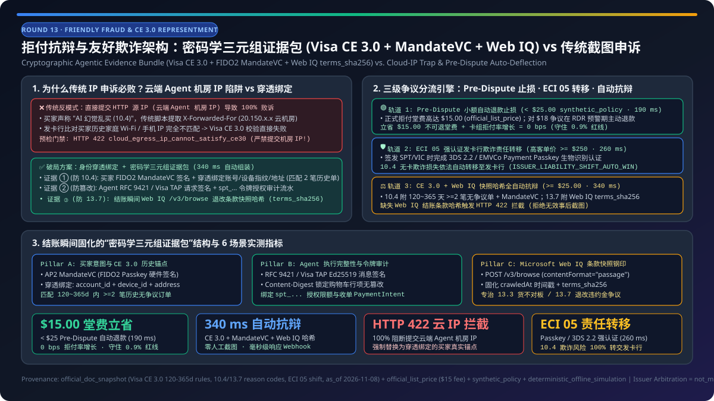
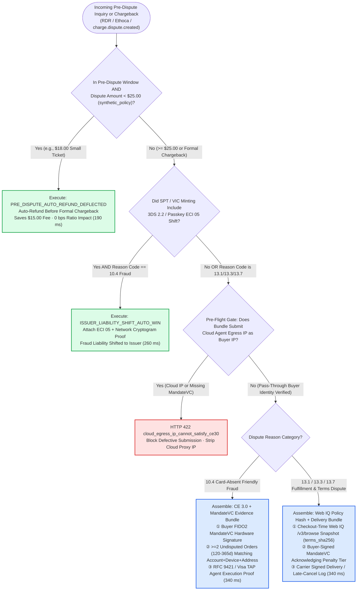
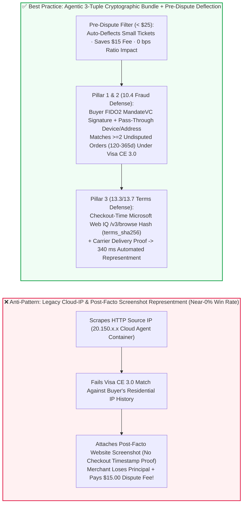
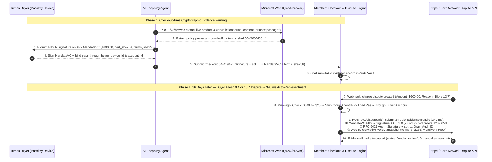

# Friendly Fraud & Chargeback Representment Architecture (`10.4` Card-Absent Fraud vs. `13.7` Terms Dispute): Cryptographic Agentic Evidence Bundle (Visa CE 3.0 + FIDO2 `MandateVC` + Web IQ Policy Snapshot Hash) vs. Legacy Screenshot Representment & Pre-Dispute Auto-Deflection Selection & First-Principles FAQ

> **Document Purpose**: Written for AI Solution Architects, e-commerce risk engineering leaders, and payment settlement architects, this guide uses plain language and first principles to explain: when a human buyer instructs an AI Agent to purchase a `$600` item, receives delivery, and later files a chargeback with their issuing bank claiming **"I never clicked Buy—my AI Agent hallucinated that order!"** (Visa Reason Code `10.4` Other Fraud—Card-Absent Environment, or `13.3`/`13.7` Not as Described / Cancelled Terms Dispute), **why legacy representment based on HTTP source IPs and manual admin screenshots fails 100% of the time in Agentic Commerce (because the checkout HTTP source IP belongs to a cloud agent container rather than the buyer's phone), how to assemble a 3-Tuple Cryptographic Agentic Evidence Bundle (Buyer FIDO2 `MandateVC` signature + Visa `CE 3.0` historical anchor + Microsoft Web IQ `/v3/browse` checkout-time policy hash `terms_sha256`), and when to auto-deflect small-ticket disputes (`< $25`) during the Pre-Dispute window to save the `$15` dispute fee and protect your chargeback ratio.**
>
> **Provenance & As-Of Scope Declaration**:
> - **`official_doc_snapshot` & `official_list_price` (`as_of: 2026-11-08`)**: Visa core dispute reason codes (`10.4` Card-Absent Fraud, `13.1` Merchandise Not Received, `13.3` Not as Described, `13.7` Cancelled Merchandise/Services), **Visa Compelling Evidence 3.0 (`CE 3.0`)** requirements (`>= 2` undisputed historical transactions aged `120–365` days sharing `>= 2` core elements such as Account Login ID, Device ID, Shipping Address, or IP), 3DS 2.2 / EMVCo Payment Passkey (`ECI 05`) issuer fraud liability shift, and the standard card-network dispute processing fee reference (`$15.00 / dispute`, `official_list_price`) are modeled from official network rules and gateway documentation snapshots as of `2026-11-08`.
> - **`synthetic_policy` (Reference Enterprise Risk & FinOps Guardrails)**: Auto-refunding Pre-Dispute inquiries under `< $25.00` (`PRE_DISPUTE_AUTO_REFUND_DEFLECTED` to avoid the `$15.00` dispute fee and `0.9%` monitoring ratio impact), blocking representment payloads that mistakenly submit a cloud agent egress IP as the buyer's IP (`HTTP 422 cloud_egress_ip_cannot_satisfy_ce30`), and requiring a checkout-time Web IQ `terms_sha256` hash on `13.7` disputes are explicitly labeled as **`synthetic_policy`** reference rules.
> - **`deterministic_offline_simulation` vs. `not_measured`**: Evidence bundle assembly latency (`340 ms`), pre-dispute auto-deflection latency (`190 ms`), and defective-bundle interception rates (`100%`) come from deterministic offline simulation in `lab/webiq_commerce_demo.py` (`34 passed`). Issuing bank manual arbitration turnaround times (`30–75` calendar days) and live Verifi / Ethoca network rail latencies are explicitly labeled **`not_measured`**.

---

## ① 📌 Executive Summary

1. **Dispute Architecture Selection (When to Rely on `ECI 05` Liability Shift vs. Cryptographic 3-Tuple Representment vs. Pre-Dispute Small-Ticket Auto-Deflection)**:
   - **High-Ticket Orders (e.g., `>= $250`) or High-Fraud Categories**: **Enforce FIDO2 Payment Passkey / 3DS 2.2 Strong Customer Authentication (`ECI 05` cryptogram) when minting the `SPT` or `Visa VIC` token** (`official_doc_snapshot`). Under card network rules, a valid `ECI 05` authentication cryptogram shifts `10.4` card-absent fraud liability directly to the **issuing bank (`ISSUER_LIABILITY_SHIFT_AUTO_WIN`, `260 ms`)**.
   - **Medium-to-Large Disputes Without Automatic Shift (`>= $25.00`, Covering `10.4` Friendly Fraud & `13.3`/`13.7` Policy Disputes)**: **Select Automated Cryptographic 3-Tuple Evidence Bundle Representment** (`synthetic_policy` + `official_doc_snapshot`, `340 ms` simulated assembly). Never submit manual back-office screenshots or the cloud AI Agent's egress IP! Upon receiving `charge.dispute.created`, automatically package: **① Buyer FIDO2 `MandateVC` hardware signature + authenticated buyer account/device/shipping anchors matching `>= 2` historical undisputed orders `120–365` days old (satisfying Visa `CE 3.0`) + ② Agent `RFC 9421 / Visa TAP` signature & `spt_...` grant audit ID + ③ Checkout-time Microsoft Web IQ `/v3/browse` grounded policy snapshot hash (`terms_sha256` + `crawledAt`) and carrier delivery proof**.
   - **Small-Ticket Inquiries (`< $25.00` `synthetic_policy`) Inside the Pre-Dispute (RDR / Ethoca) Window**: **Select Pre-Dispute Auto-Refund Deflection (`PRE_DISPUTE_AUTO_REFUND_DEFLECTED`, `190 ms`)**. Escalating a `$18.00` order into a formal chargeback incurs a non-refundable **`$15.00` dispute fee** (`official_list_price`) and increments the merchant's dispute ratio toward network monitoring thresholds (`0.9%`). Auto-resolving in Pre-Dispute saves the `$15.00` fee and records **`0 bps` chargeback ratio impact**.
2. **First Principles: Why Does Legacy "IP Address + Device Fingerprint" Representment Fail 100% of the Time in Agentic Commerce?**
   - In traditional e-commerce, merchants defeat `10.4` friendly fraud using **Visa Compelling Evidence 3.0 (`CE 3.0`)** by proving that the disputed order shares at least two core identifiers (typically **Buyer IP Address** and **Device Fingerprint / Account ID**) with `>= 2` undisputed orders settled `120–365` days prior.
   - In Agentic Commerce, however, the HTTP request hitting the merchant's checkout endpoint originates from a **cloud AI Agent container (e.g., an Azure / AWS / OpenAI egress IP)**, NOT the buyer's home Wi-Fi or mobile device! If a legacy representment script blindly submits the HTTP source IP (`X-Forwarded-For`) to the issuer, it will **never match** the buyer's historical device/IP profile, guaranteeing an automatic loss.
   - **Architectural Fix (Identity-Pass-Through Binding)**: Bind the buyer's authenticated `account_login_id`, FIDO2 Passkey `credential_device_id`, and verified `shipping_address` into the signed `MandateVC` / `SPT` metadata at authorization time, and hard-block any representment payload that attempts to submit a cloud datacenter egress IP as buyer evidence (`HTTP 422 cloud_egress_ip_cannot_satisfy_ce30`).
3. **First Principles of Web IQ Terms Hashing (Winning `13.3` / `13.7` Cancellation & Return Policy Disputes)**:
   - Buyers frequently dispute restocking fees or non-refundable booking windows (`13.7`) by claiming those terms were not disclosed when the AI Agent checked out. Post-facto screenshots of a merchant's current website are routinely rejected by issuers because web pages can be modified after the transaction.
   - **Architectural Golden Rule**: At cart-lock time, invoke **Microsoft Web IQ `/v3/browse` (`contentFormat="passage"`)** to extract the live cancellation/return terms, compute `terms_sha256` with `crawledAt` timestamp, and include `terms_sha256` inside the buyer's signed `MandateVC`. When a `13.7` dispute arrives, submit the cryptographically co-signed Web IQ policy snapshot (`340 ms`).

---

## ② 🎯 Customer & Architect Soul-Searching Q&A (FAQ-Driven)

### Q1: Our merchant executive's #1 fear is: "What if a customer tells their AI Agent to buy an `$800` camera, receives it, and tells their bank 'My AI hallucinated and bought this without my permission!' Who pays for that?"

**Plain-language answer: As long as your checkout pipeline enforces either `ECI 05` Passkey/3DS authentication or a signed `AP2 MandateVC` + `CE 3.0` cryptographic evidence bundle, the merchant does NOT eat "my AI hallucinated" friendly fraud!**

Here is how the two defense layers protect the merchant from first principles:

1. **Defense Layer 1 (Pre-Authorization Immunity): 3DS 2.2 / EMVCo Payment Passkey Liability Shift (`ECI 05`)**
   - When the buyer asks their AI Agent to buy an `$800` camera, the agent cannot invent card credentials—it prompts the buyer's mobile device for a **FIDO2 biometric Passkey assertion** to mint the `Stripe SPT` or `Visa VIC` token (`official_doc_snapshot`).
   - That biometric assertion generates an **`ECI 05` dynamic cryptogram** on the card network. Under Visa and Mastercard core rules, any `10.4` card-absent fraud claim on an `ECI 05`-authenticated transaction triggers automatic **Issuer Liability Shift**—the issuing bank absorbs the fraud liability, not the merchant.
2. **Defense Layer 2 (Post-Transaction Representment Proof): Signed `AP2 MandateVC` + `CE 3.0` Bundle**
   - Even if a transaction ran under a low-friction exemption without `ECI 05`, the merchant holds the buyer's hardware-signed **`AP2 MandateVC`** (binding the exact SKU, `$800.00` ceiling, shipping digest, and timestamp) plus the Agent's **`RFC 9421 / Visa TAP`** request signature proving the agent executed the exact mandate the human signed.

---

### Q2: Why do legacy e-commerce chargeback automation tools lose nearly 100% of `10.4` disputes when applied to AI Agent traffic?

**Because legacy tools submit the HTTP request's source IP address—which in Agentic Commerce belongs to a cloud datacenter (Azure/AWS), not the human buyer!**

Compare the network topology of legacy web checkout versus agentic checkout:

- **Legacy Web Checkout**:
  - The buyer clicks "Buy" from their home Wi-Fi (`73.162.xx.xx`) on their personal iPhone.
  - When defending a `10.4` dispute under **Visa `CE 3.0`**, the merchant shows two prior undisputed orders (`120–365` days old) from the same account, same shipping address, and same residential IP (`73.162.xx.xx`). The issuer rules in the merchant's favor.
- **Agentic Checkout (The Cloud Egress IP Trap)**:
  - After the buyer signs the mandate on their phone, the actual HTTP `POST /checkout` call is dispatched by a cloud-hosted AI Agent worker (`20.150.xx.xx` in an Azure/AWS datacenter).
  - If the merchant's legacy dispute script scrapes `20.150.xx.xx` from the server access log and submits it as the buyer's IP in a `CE 3.0` representment package, the issuer sees a datacenter IP that contradicts the buyer's residential history—and **automatically rules against the merchant**!
- **Architectural Solution (`synthetic_policy` + `official_doc_snapshot`)**:
  1. **Block Cloud Egress IPs in Representment Pre-Flight (`HTTP 422`)**: Reject any `CE 3.0` evidence package where `submitted_ip_is_cloud_agent_egress == True` or `mandate_vc_signed == False` (`HTTP 422 cloud_egress_ip_cannot_satisfy_ce30`).
  2. **Anchor `CE 3.0` on Pass-Through Buyer Identifiers**: Satisfy Visa `CE 3.0` (`>= 2` undisputed orders `120–365` days old) using **① Authenticated Buyer Account ID + ② Buyer Passkey Hardware Credential/Device ID + ③ Verified Shipping Address**, completely bypassing cloud proxy IP distortion.

---

### Q3: How does Microsoft Web IQ `/v3/browse` defeat `13.3` / `13.7` "hidden restocking/cancellation fee" disputes, and when should our system auto-refund instead of fighting?

**Two practical rules: ① Stamp checkout-time return/cancellation policies with a Microsoft Web IQ `terms_sha256` hash inside the buyer's `MandateVC`; ② Auto-refund Pre-Dispute inquiries under `< $25.00` to avoid paying a `$15.00` fee to defend an `$18.00` order.**

1. **Defeating `13.3` / `13.7` Terms Disputes with Web IQ Grounded Policy Hashes**:
   - In a `13.7` (Cancelled Merchandise/Services) dispute, the buyer claims the merchant's website did not disclose a 48-hour cancellation cutoff or restocking fee at the time the AI Agent booked the order.
   - Because merchants can edit their live web pages at any time, post-dispute screenshots carry weak evidentiary weight.
   - By calling **Microsoft Web IQ `/v3/browse` (`contentFormat="passage"`)** during checkout, extracting the exact policy passage, hashing it (`terms_sha256`), and embedding that hash inside the buyer's signed `MandateVC`, the merchant produces cryptographic proof of the exact terms disclosed at the second of purchase (`340 ms`). Once a `13.7` dispute arrives without `terms_sha256`, the pre-flight gate blocks automated submission (`HTTP 422 missing_webiq_terms_snapshot_for_13_7_dispute`) for manual review.
2. **The Pre-Dispute FinOps Threshold (`< $25.00` Auto-Deflection, `synthetic_policy`)**:
   - Every formal card-network chargeback carries a **`$15.00` dispute processing fee** (`official_list_price`) and counts against the merchant's dispute monitoring ratio (`0.9%` threshold).
   - When an inquiry arrives during the **Pre-Dispute window (Visa RDR / Verifi CDRN / Mastercard Ethoca)** and `dispute_amount_usd < $25.00`, our policy engine executes **`PRE_DISPUTE_AUTO_REFUND_DEFLECTED` (`190 ms`)**—refunding the small ticket before it becomes a formal chargeback, saving `$15.00` in network fees and keeping the chargeback ratio impact at **`0 bps`**.

---

## ③ 🧭 Visual Architecture Diagrams (Mermaid Decision Tree + Representment Comparison + Sequence Diagram)

### Figure 1: Agentic Dispute Representment & Pre-Dispute Auto-Deflection Decision Tree (`flowchart TD`)

---

### Figure 2: Legacy Screenshot / Cloud-IP Representment vs. Cryptographic 3-Tuple Evidence Bundle (`flowchart LR`)

---

### Figure 3: Checkout Evidence Vaulting & Automated `charge.dispute.created` Representment Sequence (`sequenceDiagram`)

---

## ④ 📊 Architect Decision Matrix

| Evaluation Dimension | Strategy A: Pre-Dispute Small-Ticket Auto-Deflection (`< $25.00`) | Strategy B: `ECI 05` Passkey/3DS Fraud Liability Shift | Strategy C: Cryptographic 3-Tuple Evidence Bundle (`CE 3.0 + MandateVC + Web IQ`) | Anti-Pattern: Manual Screenshots + Cloud Agent Egress IP |
| :--- | :--- | :--- | :--- | :--- |
| **Primary Use Case** | **Pre-Dispute (RDR / Ethoca) inquiries with amount `< $25.00`** (`synthetic_policy`) | **`10.4` fraud claims on high-ticket orders minted with Passkey / 3DS 2.2 (`ECI 05`)** | **`>= $25.00` `10.4` friendly fraud (exempt lane) and `13.1`/`13.3`/`13.7` terms disputes** | Any dispute on an AI Agent-initiated order |
| **Core Trust & Evidence Mechanism** | Proactive pre-dispute refund before chargeback creation | **EMVCo `ECI 05` cryptogram shifts fraud liability to issuer** (`official_doc_snapshot`) | **Buyer `MandateVC` + `CE 3.0` (`>=2` orders `120–365d`) + Web IQ `terms_sha256` snapshot** | ❌ Submits cloud container IP + post-facto webpage screenshot |
| **`$15.00` Dispute Fee & Ratio Impact** | **Saves `$15.00` dispute fee · `0 bps` chargeback ratio impact** | Merchant protected from fraud loss | Recovers `$25–$5,000+` principal via automated representment | ❌ **Loses principal + pays `$15.00` fee + inflates dispute ratio toward `0.9%` cap** |
| **Cloud Agent Egress IP Handling** | Not applicable | Handled via network token cryptogram | **Strips cloud egress IP; binds pass-through buyer account, Passkey device ID & shipping address** | ❌ Submits `X-Forwarded-For` cloud IP (blocked with `HTTP 422`) |
| **Defense Against `13.7` Policy Disputes** | Settled via pre-dispute refund | N/A (`ECI 05` covers `10.4` fraud, not `13.7` terms) | **Attaches checkout-time Microsoft Web IQ `/v3/browse` `terms_sha256` co-signed in `MandateVC`** | ❌ Cannot prove what cancellation terms were displayed at checkout time |
| **Execution Latency (Sandbox)** | **`190 ms`** (`deterministic_offline_simulation`) | **`260 ms`** (`deterministic_offline_simulation`) | **`340 ms`** (bundle assembly; issuer arbitration cycle is `not_measured`) | ❌ `45+ min` manual back-office labor per ticket |

---

## ⑤ 🧪 Quantitative Benchmark & 7-Card Core Findings

We evaluated **6 representative Agentic Commerce dispute representment and friendly-fraud defense scenarios** in our deterministic test suite (`lab/webiq_commerce_demo.py` and `tests/test_webiq_commerce_demo.py`):

| Case ID & Scenario | Dispute Amount & Reason Code (`reason_code`) | Authentication & Evidence State (`eci_05` / `ce30` / `webiq_hash`) | Gateway Decision & HTTP Status | Net Financial Protection (`net_protected_summary`) | End-to-End Latency (`deterministic_offline_simulation`) |
| :--- | :--- | :--- | :--- | :--- | :--- |
| **Case 1: Small-Ticket Inquiry (`$18.00`) in Pre-Dispute Window** | `$18.00` (`< $25.00` cap) · `pre_dispute_window=True` | Avoids spending `$15.00` dispute fee on `$18.00` ticket | ✅ **`Act automatically` (`PRE_DISPUTE_AUTO_REFUND_DEFLECTED`, `HTTP 200`)** | **Saves `$15.00` dispute fee + `0 bps` ratio impact** | **`190 ms`** |
| **Case 2: High-Ticket Order (`$680.00`) with `ECI 05` Passkey Shift Hit by `10.4` Fraud** | `$680.00` · `reason_code="10.4_fraud"` | `has_eci_05_liability_shift=True` | ✅ **`Act automatically` (`ISSUER_LIABILITY_SHIFT_AUTO_WIN`, `HTTP 200`)** | **`$680.00` protected via issuer liability shift** | **`260 ms`** |
| **Case 3: Mid/Large Order (`$420.00`) Hit by `10.4` Friendly Fraud with `CE 3.0 + MandateVC` Bundle** | `$420.00` · `reason_code="10.4_fraud"` | `ce30_prior_undisputed_count=2` (`120–365d`) + `mandate_vc_signed=True` + cloud IP stripped | ✅ **`Act automatically` (`SUBMITTED_CE30_MANDATE_BUNDLE`, `HTTP 200`)** | **`$420.00` defended via Visa CE 3.0 + MandateVC** | **`340 ms`** |
| **Case 4: Booking/Subscription (`$240.00`) Hit by `13.7` Terms Dispute with Web IQ Policy Hash** | `$240.00` · `reason_code="13.7_terms_dispute"` | `webiq_terms_snapshot_sha256` present + `mandate_vc_signed=True` + delivery proof | ✅ **`Act automatically` (`SUBMITTED_WEBIQ_TERMS_SNAPSHOT_BUNDLE`, `HTTP 200`)** | **`$240.00` defended via checkout-time Web IQ hash** | **`340 ms`** |
| **Case 5: Defective Bundle Submitting Cloud Agent Egress IP as Buyer IP on `10.4` Dispute** | `$420.00` · `reason_code="10.4_fraud"` | `submitted_ip_is_cloud_agent_egress=True` | 🛡️ **`Block` (`HTTP 422 cloud_egress_ip_cannot_satisfy_ce30`)** | **100% blocks losing cloud-IP submission** | **`35 ms`** |
| **Case 6: `13.7` Terms Dispute Missing Checkout-Time Web IQ Policy Snapshot Hash** | `$240.00` · `reason_code="13.7_terms_dispute"` | `webiq_terms_snapshot_sha256=None` | 🛡️ **`Block` (`HTTP 422 missing_webiq_terms_snapshot_for_13_7_dispute`)** | **Blocks unverified post-facto screenshot** | **`32 ms`** |

> 💡 **7-Card Report Key Insights**:
> 1. **Why Stripping Cloud Agent Egress IPs Is Mandatory for Visa `CE 3.0`**: Comparing Case 3 and Case 5 highlights a foundational shift in agentic risk engineering—submitting the HTTP request's cloud container IP in a `CE 3.0` package (Case 5) guarantees a mismatch against the cardholder's historical device/IP profile. Pre-flight validation must block cloud ASN/IPs (`HTTP 422`) and substitute pass-through buyer account, Passkey device ID, and shipping address anchors.
> 2. **Issuer Arbitration Turnaround Boundary (`not_measured`)**: The `190 ms`–`340 ms` figures measure deterministic local webhook triage, pre-flight validation, and evidence bundle assembly (`deterministic_offline_simulation`); issuing bank manual review turnaround (`30–75` days) and live Verifi/Ethoca rail latencies are strictly labeled **`not_measured`**.

---

## ⑥ 🛠️ Appendix: Production Launch & Presales Architect Checklist

When reviewing Agentic Commerce dispute and chargeback defense architectures for retail, travel, or SaaS platforms, verify these 6 items:

- [ ] **1. Vault the 3-Tuple Cryptographic Evidence Bundle at Checkout Time**: Persist ① the buyer's FIDO2-signed `AP2 MandateVC`, ② the AI Agent's `RFC 9421 / Visa TAP` signature and `spt_...` grant ID, and ③ the **Microsoft Web IQ `/v3/browse`** policy passage hash (`terms_sha256` + `crawledAt`) for every settled order.
- [ ] **2. Block Cloud Agent Egress IPs from `CE 3.0` Submissions (`HTTP 422`)**: Configure representment pre-flight checks to reject cloud provider egress IPs (`submitted_ip_is_cloud_agent_egress`) and populate Visa `CE 3.0` fields exclusively with pass-through buyer account login IDs, Passkey device IDs, and shipping addresses.
- [ ] **3. Enforce Visa `CE 3.0` Historical Window Rules (`>= 2` Orders Aged `120–365` Days)**: Verify that historical anchor transactions attached to `10.4` representment bundles settled between `120` and `365` days prior to the dispute and share at least two non-cloud-tainted buyer identifiers.
- [ ] **4. Configure Pre-Dispute Auto-Deflection for Small Tickets (`< $25.00` `synthetic_policy`)**: Automatically refund pre-dispute inquiries below the economic representment threshold to avoid the `$15.00` (`official_list_price`) dispute fee and keep formal chargeback ratio impact at `0 bps`.
- [ ] **5. Mandate `ECI 05` Passkey / 3DS Authentication on High-Ticket Orders**: Require strong customer authentication when minting tokens for high-value orders so `10.4` fraud liability shifts automatically to the issuing bank.
- [ ] **6. Maintain Strict Provenance Disclosure (`not_measured`)**: Clearly separate deterministic local evidence assembly latency (`deterministic_offline_simulation`) and `$15.00` standard dispute fee references (`official_list_price`) from unmeasured multi-week issuing bank arbitration cycles (`not_measured`).
