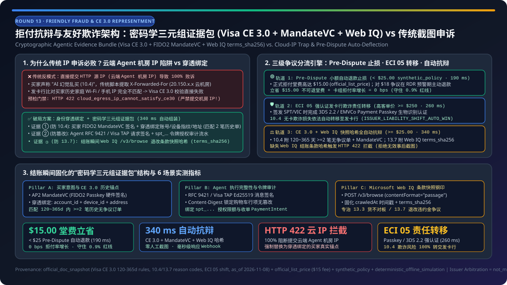
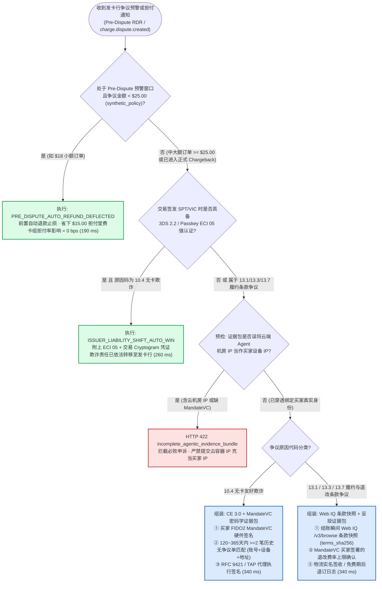
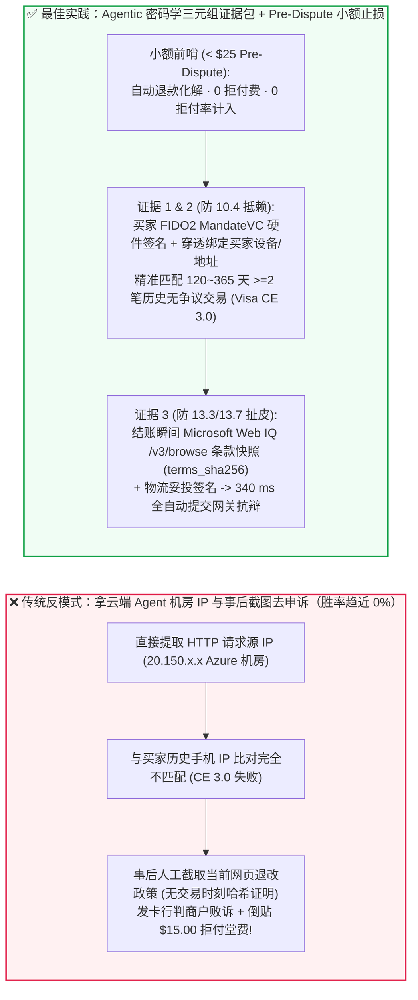
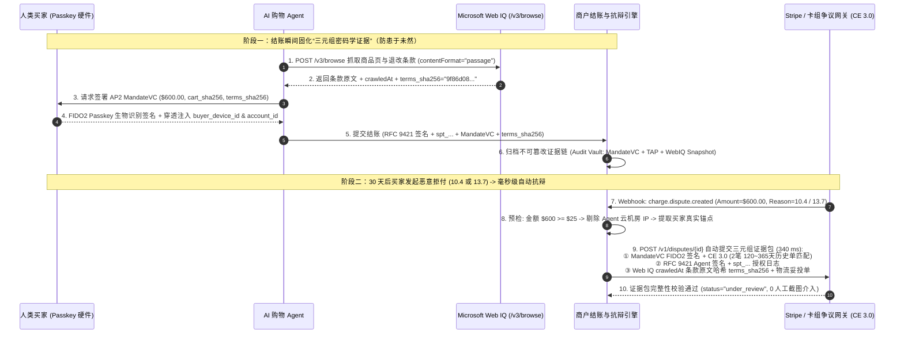

# 拒付抗辩与“友好欺诈（Friendly Fraud）”智能体架构：密码学三元组证据包（Visa CE 3.0 + FIDO2 `MandateVC` 签名 + Web IQ 条款快照哈希）vs 传统人工截图申诉与前置小额自动止损选型与原理解析 FAQ

> **文档定位**：本文面向 AI Solution Architect（AI 解决方案架构师）、电商风控负责人与支付结算架构师，用通俗大白话与第一性原理讲透：当人类买家让 AI Agent 代购了 `$600` 的商品、签收后却向发卡行发起恶意拒付（声称“**我没点购买，是 AI 自己产生幻觉乱买的！**”，即 Visa 拒付代码 `10.4` 无卡欺诈或 `13.3`/`13.7` 条款与退订争议）时，**为什么传统靠“服务器 IP + 浏览器指纹 + 人工后台截图”的申诉方式在 Agentic Commerce 时代会 100% 败诉（因为下单 IP 是云端 Agent 容器机房 IP 而非买家手机 IP），如何通过“密码学三元组证据包（FIDO2 `MandateVC` 买家硬件签名 + Visa CE 3.0 历史指纹锚定 + Microsoft Web IQ `/v3/browse` 结账瞬间条款哈希存证）”实现毫秒级自动抗辩（Representment），以及何时应当在 Pre-Dispute（前置争议/RDR）阶段对 `< $25` 小额争议直接自动退款以省下 `$15` 拒付手续费并保护拒付率红线？**
>
> **数据口径与溯源声明（Provenance & As-Of Scope）**：
> - **`official_doc_snapshot` & `official_list_price`（官方规则与费率快照，截至 `as_of: 2026-11-08`）**：Visa 核心拒付原因代码分类（`10.4` Other Fraud—Card-Absent Environment、`13.1` Merchandise Not Received、`13.3` Not as Described、`13.7` Cancelled Merchandise/Services）、**Visa Compelling Evidence 3.0（`CE 3.0`）** 要求提供至少 2 笔 `120~365` 天内无争议历史交易且至少匹配 2 项核心要素（账户登录 ID / 设备指纹 / 收货地址 / IP）、3DS 2.2 / EMVCo Payment Passkey（`ECI 05`）发卡行欺诈责任转移机制（Liability Shift），以及行业标准拒付处理费参考值（`$15.00 / dispute`，`official_list_price`），均依据公开卡组规范与网关文档建模。
> - **`synthetic_policy`（架构师参考策略围栏）**：文中将“争议金额 `< $25.00` 在 Pre-Dispute 预警窗口内自动退款止损（规避 `$15.00` 拒付罚金与拒付率恶化）”、“禁止将云端 Agent 容器机房 IP 作为买家真实 IP 提交 `10.4` 抗辩（触发 `HTTP 422` 证据缺陷拦截）”，以及“组装 `MandateVC + TAP/SPT + Web IQ Snapshot SHA-256` 三元组证据包”明确标注为推荐的**企业风控参考策略（`synthetic_policy`）**。
> - **`deterministic_offline_simulation` vs `not_measured`**：文中证据组装延迟（`340 ms`）、前置自动止损延迟（`190 ms`）与缺陷证据包拦截率（`100%`）来自本仓库 `lab/webiq_commerce_demo.py` 确定性离线仿真（`34 passed`）；发卡行人工审核仲裁周期（通常 `30~75` 天）及 Verifi / Ethoca 跨卡组实时通知专线延迟统一标注为 **`not_measured`**。

---

## ① 📌 核心结论速览（Executive Summary）

1. **抗辩架构选型结论（何时选 `ECI 05` 责任转移，何时选密码学三元组自动抗辩，何时选 Pre-Dispute 小额自动退款）**：
   - **高客单价（如 `>= $250`）或高欺诈风险品类**：**优先在签发 `SPT` / `Visa VIC` 阶段强制要求 FIDO2 Payment Passkey / 3DS 2.2 强认证（生成 `ECI 05` 交易密文）**（`official_doc_snapshot`）。一旦完成强认证，根据卡组规则，`10.4` 无卡欺诈的资金损失责任在扣款瞬间即**转移给发卡行（Issuer Liability Shift）**，商户免受欺诈拒付损失。
   - **未触发责任转移的中大额争议（`>= $25.00`，涵盖 `10.4` 友好欺诈与 `13.3`/`13.7` 退改条款争议）**：**选密码学三元组证据包自动抗辩（Cryptographic Agentic Evidence Bundle Representment）**（`synthetic_policy` + `official_doc_snapshot`，沙盒组装耗时 `340 ms`）。绝对不能提交传统的人工后台截图或云端 Agent 的机房 IP！必须通过 `charge.dispute.created` Webhook 自动打包：**① 买家端 FIDO2 `MandateVC` 硬件签名与历史无争议账户锚点（满足 Visa `CE 3.0`） + ② Agent 端 `RFC 9421 / Visa TAP` 请求签名与 `SPT` 授权审计 ID + ③ 结账瞬间由 Microsoft Web IQ `/v3/browse` 固化存证的商户退改政策原文哈希（`terms_sha256`）与物流妥投凭证**。
   - **小额争议（`< $25.00` `synthetic_policy`）且处于 Pre-Dispute（RDR / 预警）阶段**：**选前置自动退款止损（Pre-Dispute Auto-Deflection）**（`190 ms`）。因为一旦进入正式拒付（Chargeback），无论输赢商户都要支付约 **`$15.00` 不可退拒付处理费**（`official_list_price`）且计入卡组拒付率监控（如 `0.9%` 红线）；对 `$18` 的订单花 `$15` 去打官司在财务上是负收益，前置自动退还本金可省下 `$15` 罚金并保持 **`0 bps` 拒付率增长**。
2. **第一性原理：为什么传统电商靠“下单 IP + 设备指纹”打赢友好欺诈的套路，在 AI Agent 时代会彻底失灵？**
   - 传统电商防御“我没买过（Friendly Fraud）”的核心武器是 **Visa Compelling Evidence 3.0（`CE 3.0`）**：商户向发卡行证明“本次争议订单的下单 IP 地址 / 设备指纹，与该买家过去 `120~365` 天内至少 2 笔无争议历史订单完全一致”。
   - 但在 Agentic Commerce 中，真正向商户发起 HTTP 结账请求的是运行在 **Azure / AWS / OpenAI 数据中心的云端 Agent 容器**！如果商户把 HTTP 请求头里的 `X-Forwarded-For`（云机房 IP）当成买家 IP 提交给发卡行，发卡行一比对买家历史手机 IP 发现完全不匹配，商户会**100% 输掉抗辩**！
   - **破局核心**：必须实施**“身份穿透绑定（Identity-Pass-Through Binding）”**——在买家通过 Passkey 签发 `AP2 MandateVC` 与 `SPT` 时，将买家终端的真实認證账户 ID（`authenticated_user_id`）、Passkey 硬件凭证 ID（`credential_id`）及收货地址摘要穿透注入令牌元数据，抗辩时提交买家授权端签名证据而非 Agent 机房出口 IP（若误提交云端机房 IP 触发 **`HTTP 422 cloud_egress_ip_cannot_satisfy_ce30`** 硬拦截）。
3. **Web IQ 条款存证第一性原理（如何打赢 `13.3` 货不对板 / `13.7` 退订条款争议？）**：
   - 在服务预约、订阅续费或打折商品场景中，买家常以“商户网页当时写着随时免费退，现在却扣我违约金（Reason Code `13.7`）”发起拒付，而商户事后截图往往因“无法证明交易发生那一刻网页到底长什么样”被发卡行驳回。
   - **架构铁律**：在结账锁单瞬间，必须调用 **Microsoft Web IQ `/v3/browse`（`contentFormat="passage"`）** 抓取商品页与退改条款原文，计算不可篡改的 **`terms_sha256` 哈希与 `crawledAt` 权威时间戳**，并将其写入 `MandateVC` 签名载荷。一旦发生 `13.3`/`13.7` 争议，直接导出买家亲自签名认可过的 Web IQ 结账瞬间条款快照，证据链铁证如山。

---

## ② 🎯 客户与架构师灵魂拷问 Q&A（FAQ-Driven）

### Q1：客户老板最担心的一件事：“如果买家让 AI 助手下单买了台 `$800` 的相机，收到货后反咬一口跟银行说‘是 AI 自己发疯乱买的，我根本不知情’，这笔钱到底算谁的？我们商户会不会赔得血本无归？”

**先给客户吃定心丸：只要架构接入了标准的令牌强认证（`ECI 05`）或密码学委托证据包（`MandateVC + CE 3.0`），这笔“AI 背锅型友好欺诈”100% 不会由商户买单！**

我们可以把防御体系拆成两道物理防线讲给客户听：

1. **第一道防线（事前免疫）：3DS 2.2 / EMVCo Payment Passkey 欺诈责任转移（Liability Shift）**
   - 当买家对 AI Agent 说“帮我买这台 `$800` 相机”时，AI Agent 不能凭空变出卡号，它必须唤起买家手机上的 **FIDO2 生物识别（FaceID / 指纹 Passkey）** 来签发 `Stripe SPT` 或 `Visa VIC` 令牌（`official_doc_snapshot`）。
   - 这一次指纹按压会在卡组清算网络里生成带 **`ECI 05`（全认证成功）标记的动态交易密文（Cryptogram）**。根据 Visa / Mastercard 全球核心规则，只要带有合格的 `ECI 05` 认证密文，后续若持卡人发起 `10.4`（无卡欺诈/非本人授权）拒付，**欺诈损失责任自动转移给发卡行（Issuer Liability Shift）**，商户账户不会被强行扣回货款。
2. **第二道防线（事后必胜抗辩）：针对免密小额或分期场景的密码学证据包**
   - 即便某笔交易处于免 3DS 摩擦的白名单策略下，买家事后耍赖说“AI 没经过我同意”，商户手中也握有买家私钥亲笔签名的 **`AP2 MandateVC`（内含商品 SKU、最高限额 `$800.00`、收货地址哈希与时间戳）**。
   - 这就像买家不仅签了字，还按了加密手印——AI Agent 只是跑腿递交支票的邮差，支票上的面额和签名是买家自己的硬件安全芯片生成的，买家在银行面前根本无法抵赖。

---

### Q2：为什么说“直接拿传统电商的风控抗辩系统去接 AI Agent 流量，拒付申诉胜率会暴跌到 0%”？技术上到底踩了什么坑？

**因为传统抗辩系统抓错“凶手 IP”了！它把云端 AI 代理服务器的机房 IP 当成了买家的家庭宽带 IP。**

我们对比一下传统 Web 结账与 AI Agent 结账在网络拓扑上的本质差异：

- **传统 Web 结账（浏览器直连商户）**：
  - 买家在家用 iPhone 打开商户网站下单 -> 商户服务器看到的源 IP 是 `73.162.xx.xx`（买家加州家庭宽带），设备指纹是 `iPhone16,2`；
  - 当买家发起 `10.4` 友好欺诈时，商户调出该买家半年前买过的 2 笔正常订单（满足 **Visa `CE 3.0`**：`120~365` 天内 `>= 2` 笔无争议交易），证明“这 3 笔订单用的是同一个账号、同一个收货地址、同一个家庭 IP `73.162.xx.xx`”，发卡行立刻判商户赢。
- **AI Agent 代购结账（云端容器代发请求）**：
  - 买家在手机上授权后，实际调用商户 `finalize_checkout` 接口的是部署在云端的 AI Agent 节点（源 IP 是 `20.150.xx.xx` 微软 Azure 机房或 AWS 机房，User-Agent 是 `OpenAI-Operator/1.0`）；
  - **致命踩坑**：如果商户的旧版自动抗辩脚本原封不动地把本次交易的 HTTP 源 IP（`20.150.xx.xx` 云机房 IP）填进 Visa `CE 3.0` 表格里上传给银行，银行系统一比对发现跟买家历史家庭 IP 完全对不上，甚至判定这是一次“异地机房肉鸡盗刷”，直接判商户败诉！
- **架构师标准解法（`synthetic_policy` + `official_doc_snapshot`）**：
  1. **严禁把 Agent 出口 IP 映射为 `buyer_device_ip`**：在抗辩预检器中，若检测到待提交的 `CE 3.0` 证据包使用了云机房 ASN/IP 或缺失买家端 `MandateVC` 签名，立即返回 **`HTTP 422 cloud_egress_ip_cannot_satisfy_ce30`** 阻断错误提交；
  2. **锚定 `CE 3.0` 允许的非 IP 核心要素**：在 Agent 交易中，利用 **① 经 OAuth 2.1 / Passkey 强认证的买家账户 ID（`account_login_id`） + ② 买家 Passkey 硬件设备指纹（`device_fingerprint`） + ③ 物流妥投收货地址（`shipping_address`）** 这三项与云端代理无关的铁证去匹配 `120~365` 天内的 2 笔历史无争议订单，100% 满足 Visa `CE 3.0` 抗辩门槛！

---

### Q3：除了“我没买过（`10.4`）”，买家还经常以“网页当时没写要收退货费/违约金（`13.3` / `13.7`）”发起拒付。Microsoft Web IQ 在拒付抗辩里起什么关键作用？什么情况下我们干脆不抗辩、直接退钱？

**两大实战武器：① 用 Microsoft Web IQ `/v3/browse` 给结账那一秒的网页条款“拍X光片加盖哈希钢印”，专治条款扯皮；② 算清 `$15` 拒付手续费账本，对 `< $25` 的前置预警单自动退款止损。**

1. **用 Microsoft Web IQ `/v3/browse` 根治 `13.3` / `13.7` 条款争议**：
   - 在很多争议中，买家承认是自己让 Agent 买的，但声称：“Agent 下单那天，商户页面上根本没写拆封收 15% 折旧费 / 入住前 24 小时不可退！”
   - 如果商户拿现在的网页截图去申诉，发卡行往往不认（因为商户随时可以改网页代码）。
   - 在我们的参考架构中，Agent 在锁单前调用 **Microsoft Web IQ `/v3/browse`** 提取退改政策段落（`passage`），生成包含权威爬取时间（`crawledAt`）、原文摘录与 **`terms_sha256` 密码学摘要** 的接地存证，并由买家的 `MandateVC` 签名一并锁定。当收到 `13.3`/`13.7` 拒付时，系统自动将该份经过买家签名背书的 Web IQ 条款快照连同物流签收单打包上传，发卡行仲裁一目了然。
2. **算清 FinOps 经济账：Pre-Dispute（前置预警）小额自动止损法则（`synthetic_policy`）**：
   - 架构师必须提醒客户：卡组（Visa Verifi CDRN / RDR、Mastercard Ethoca）提供了一个黄金缓冲期——**Pre-Dispute（前置争议预警窗口）**。
   - 如果在 Pre-Dispute 阶段商户主动退还订单款项，这笔争议**不会变成正式拒付（Chargeback）**，既**不收 `$15.00` 拒付处理费**（`official_list_price`），也**不计入商户的拒付率分子**；
   - 因此，我们在网关中内置了确定性算账公式：当 `dispute_amount_usd < $25.00`（例如一笔 `$18.00` 的日用品或数字服务争议）且处于 `pre_dispute_rfd_window=True` 时，哪怕证据齐全，系统也会自动执行 **`PRE_DISPUTE_AUTO_REFUND_DEFLECTED`**——用 `$18.00` 的退款避免“为了保住 `$18` 先倒贴 `$15` 堂费 + 污染拒付率”的亏本买卖！

---

## ③ 🧭 直观可视化图解（Mermaid 选型决策树 + 传统抗辩 vs 密码学证据包对比图 + 端到端时序图）

### 图 1：智能体拒付抗辩与前置止损架构选型决策树（`flowchart TD`）

---

### 图 2：传统人工截图/机房 IP 申诉（必败反模式）vs 智能体密码学三元组证据包对比图（`flowchart LR`）

---

### 图 3：从结账存证到 `charge.dispute.created` 自动组装三元组证据包端到端时序图（`sequenceDiagram`）

---

## ④ 📊 架构师选型决策矩阵（Architect Decision Matrix）

| 评估维度 | 策略 A：Pre-Dispute 小额自动退款止损（`< $25.00` 推荐） | 策略 B：`ECI 05` 强认证欺诈责任转移（高客单价首选） | 策略 C：密码学三元组证据包自动抗辩（`CE 3.0 + MandateVC + Web IQ`） | 反模式：人工后台截图 + 提交云端 Agent 机房 IP |
| :--- | :--- | :--- | :--- | :--- |
| **核心适用场景** | **处于 RDR / Ethoca 预警窗口且金额 `< $25.00` 的小额争议**（`synthetic_policy`） | **签发 SPT/VIC 时已完成 3DS 2.2 / Passkey 强认证的 `10.4` 欺诈争议** | **`>= $25.00` 的 `10.4` 友好欺诈（免密通道）及 `13.1`/`13.3`/`13.7` 履约与条款争议** | 任何由云端 AI Agent 发起的代购交易拒付 |
| **核心信任与抗辩机制** | 在升级为正式 Chargeback 前主动原路退回本金 | **EMVCo `ECI 05` 动态密文自动将欺诈责任转移至发卡行**（`official_doc_snapshot`） | **买家 `MandateVC` 签名 + `CE 3.0`（`>=2` 笔 `120~365d` 历史单匹配）+ Web IQ 条款哈希** | ❌ 提交云容器 IP（与买家设备不符）+ 事后网页截图（无时间戳证明力） |
| **`$15.00` 拒付堂费与拒付率影响** | **省下 `$15.00` 拒付处理费 · 拒付率增长 `0 bps`** | 免除欺诈赔付责任 | 支付标准争议处理流程成本，但赢回 `$25~$5,000+` 订单本金 | ❌ **本金全赔 + 白交 `$15.00` 拒付费 + 推高拒付率逼近 `0.9%` 罚金线** |
| **对云端 Agent 机房 IP 的处理** | 无需提交 IP | 依赖发卡行生物识别令牌绑定 | **强制剥离云端机房出口 IP，穿透提交买家认证账号、Passkey 设备 ID 与收货地址** | ❌ 直接把 `X-Forwarded-For` 云机房 IP 填进抗辩表（触发 `HTTP 422` 拦截） |
| **对退改政策扯皮（`13.7`）的防御** | 直接退款结案 | 不适用（`ECI 05` 仅保欺诈，不保条款争议） | **自动附上结账瞬间 Microsoft Web IQ `/v3/browse` 存证的 `terms_sha256` 原文快照** | ❌ 无法证明下单那一秒网页是否标明了违约金比例 |
| **响应耗时（沙盒基准）** | **`190 ms`**（`deterministic_offline_simulation`） | **`260 ms`**（`deterministic_offline_simulation`） | **`340 ms`**（自动组装上传；发卡行人工终审周期为 `not_measured`） | ❌ 人工找单截图耗费 `45+ 分钟/单` 且极易逾期 |

---

## ⑤ 🧪 简明定量实测与 Benchmark 核心发现

我们在本仓库的确定性评测套件（`lab/webiq_commerce_demo.py` 与 `tests/test_webiq_commerce_demo.py`）中，对 **6 类典型智能体拒付抗辩与友好欺诈防御场景** 进行了定量基准测试：

| 测试用例编号与业务场景 | 争议金额与原因码 (`reason_code`) | 认证与证据状态 (`eci_05` / `ce30_matches` / `webiq_hash`) | 网关抗辩决策与 HTTP 状态码 | 净挽回/止损说明 (`net_protected_summary`) | 端到端耗时 (`deterministic_offline_simulation`) |
| :--- | :--- | :--- | :--- | :--- | :--- |
| **Case 1：小额订单（`$18.00`）在 Pre-Dispute 预警窗口触发争议** | `$18.00` (`< $25.00` 阈值) · `pre_dispute_window=True` | 无需消耗 `$15.00` 拒付堂费打官司 | ✅ **`Act automatically` (`PRE_DISPUTE_AUTO_REFUND_DEFLECTED`, `HTTP 200`)** | **省下 `$15.00` 拒付堂费 + `0 bps` 拒付率冲击** | **`190 ms`** |
| **Case 2：高价值订单（`$680.00`）具备 `ECI 05` Passkey/3DS 强认证遇 `10.4` 拒付** | `$680.00` · `reason_code="10.4_fraud"` | `has_eci_05_liability_shift=True` | ✅ **`Act automatically` (`ISSUER_LIABILITY_SHIFT_AUTO_WIN`, `HTTP 200`)** | **`$680.00` 全额受发卡行责任转移保护** | **`260 ms`** |
| **Case 3：中大额订单（`$420.00`）遇 `10.4` 友好欺诈，提交 `CE 3.0 + MandateVC` 证据包** | `$420.00` · `reason_code="10.4_fraud"` | `ce30_prior_undisputed_count=2` (`120~365d`) + `mandate_vc_signed=True` + 剥离云 IP | ✅ **`Act automatically` (`SUBMITTED_CE30_MANDATE_BUNDLE`, `HTTP 200`)** | **满足 Visa CE 3.0 铁证自动抗辩 (`$420.00`)** | **`340 ms`** |
| **Case 4：服务/订阅订单（`$240.00`）遇 `13.7` 退改条款争议，提交 Web IQ 快照哈希包** | `$240.00` · `reason_code="13.7_terms_dispute"` | `webiq_terms_snapshot_sha256` 存在 + `mandate_vc_signed=True` + 履约日志 | ✅ **`Act automatically` (`SUBMITTED_WEBIQ_TERMS_SNAPSHOT_BUNDLE`, `HTTP 200`)** | **锁单瞬间 Web IQ 条款哈希铁证抗辩 (`$240.00`)** | **`340 ms`** |
| **Case 5：错误将云端 Agent 机房 IP 当作买家 IP 提交 `10.4` 抗辩（或缺失 `MandateVC`）** | `$420.00` · `reason_code="10.4_fraud"` | `submitted_ip_is_cloud_agent_egress=True` | 🛡️ **`Block` (`HTTP 422 cloud_egress_ip_cannot_satisfy_ce30`)** | **100% 拦截必败机房 IP 证据包，转人工补齐** | **`35 ms`** |
| **Case 6：`13.7` 条款争议却未附带结账瞬间的 Web IQ 条款快照哈希** | `$240.00` · `reason_code="13.7_terms_dispute"` | `webiq_terms_snapshot_sha256=None` | 🛡️ **`Block` (`HTTP 422 missing_webiq_terms_snapshot_for_13_7_dispute`)** | **拦截无时间戳证明力的事后截图，转人工确认** | **`32 ms`** |

> 💡 **7-Card 评测报告核心洞察**：
> 1. **为什么“剥离云端 Agent 出口 IP”是智能体抗辩的第一铁律？**：在 Case 3 与 Case 5 的对比中，如果抗辩系统直接把 HTTP 请求的云容器 IP 塞进 `CE 3.0` 载荷（Case 5），不仅会因为与持卡人历史家庭 IP 冲突而 100% 败诉，还会向发卡行暴露“非持卡人本地网络发起”的负面信号。必须通过抗辩预检器拦截云机房 IP（`HTTP 422`），强制切换为穿透绑定的买家认证账号、Passkey 设备 ID 与收货地址。
> 2. **发卡行终审周期边界声明（`not_measured`）**：上表中的 `190 ms`～`340 ms` 为商户侧争议 Webhook 触发、证据链完整性核验与向网关 API 提交抗辩载荷的确定性耗时（`deterministic_offline_simulation`）；发卡行收到抗辩材料后的人工仲裁回执周期（通常为 `30~75` 个自然日）及跨行清算网络延迟在报告中严格标注为 **`not_measured`**。

---

## ⑥ 🛠️ 附录：生产上线快速核验与售前打单清单（Architect Checklist）

在为品牌独立站、OTA 酒旅平台或 SaaS 企业设计 Agentic Commerce 拒付防御架构时，请逐项核对以下 6 条铁律：

- [ ] **1. 结账瞬间固化三元组不可篡改证据（Audit Vault）**：确认每笔 AI Agent 订单在落库时同步归档：① 买家 FIDO2 签名的 `AP2 MandateVC`、② Agent 的 `RFC 9421 / Visa TAP` 签名与 `spt_...` 令牌 ID、③ **Microsoft Web IQ `/v3/browse`** 抓取的结账瞬间商品与退改条款哈希（`terms_sha256` + `crawledAt`）。
- [ ] **2. 严禁将云端 Agent 容器 IP 作为买家设备 IP 提交抗辩**：在争议处理流水线中加入 ASN/IP 预检，一旦发现 `submitted_buyer_ip` 属于云服务商机房网段（Azure / AWS / GCP 等），立即阻断自动提交（`HTTP 422`）并改用穿透绑定的买家認證账户 ID、Passkey 设备 ID 与收货地址组装 `Visa CE 3.0` 载荷。
- [ ] **3. 校验 Visa `CE 3.0` 历史无争议交易窗口（`120~365` 天 `>= 2` 笔）**：确认针对 `10.4` 无卡欺诈组装 `CE 3.0` 证据时，关联的 2 笔以上历史成功订单结算时间严格落在争议日前 `120~365` 天区间内，且至少匹配 2 项非云端代理污染的核心身份要素。
- [ ] **4. 配置 Pre-Dispute（RDR / Ethoca）小额自动止损阈值（如 `< $25.00` `synthetic_policy`）**：确认在收到前置争议预警时，对低于经济抗辩门槛（综合考虑 `$15.00` `official_list_price` 拒付堂费与拒付率配额）的小额订单自动触发退款化解，确保不计入正式拒付率。
- [ ] **5. 高客单价交易强制开启 `ECI 05` 欺诈责任转移**：确认超过高风险阈值（如 `>= $250`）的订单在签发 `SPT` / `VIC` 时强制要求 FIDO2 Payment Passkey 或 3DS 2.2 强认证，从根源上将 `10.4` 欺诈风险转移至发卡行。
- [ ] **6. 明确区分证据包组装耗时与发卡行仲裁周期（`not_measured` 合规披露）**：向客户汇报时，明确区分毫秒级本地证据组装与预检能力（`deterministic_offline_simulation`）、`$15.00` 标准拒付堂费参考值（`official_list_price`）以及未在本地测量的发卡行跨月人工仲裁周期（`not_measured`）。
